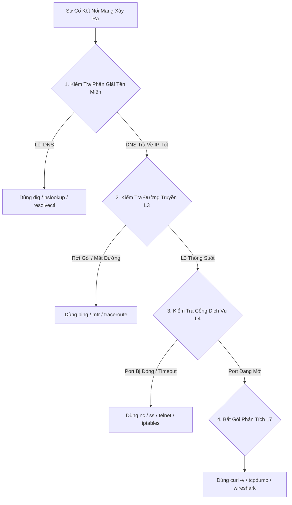
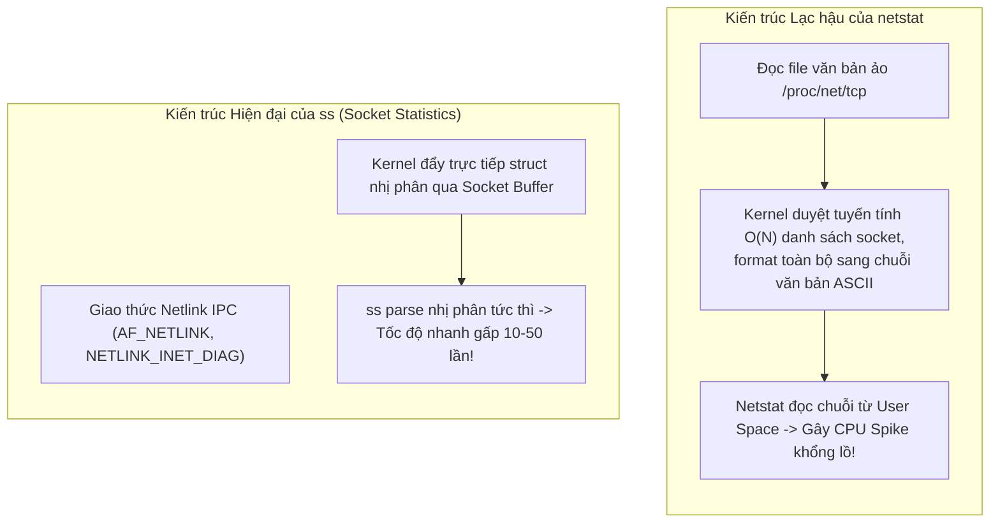
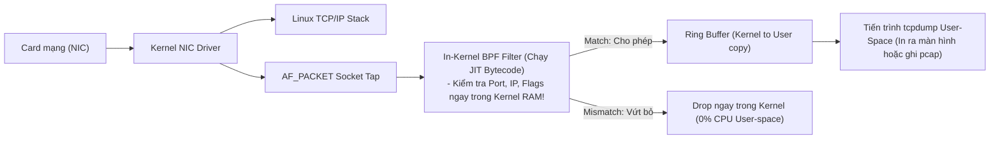

# 10.1. Network Diagnostic and Observability CLI Tools (Bộ Công cụ Dòng lệnh Chẩn đoán và Quan sát Mạng)

> [!IMPORTANT]
> **Nếu bạn chỉ được nhớ một điều duy nhất:** Làm chủ bộ công cụ CLI chẩn đoán mạng là vũ khí sinh tồn của mọi kỹ sư Site Reliability Engineer (SRE): `ping` và `mtr` phân tích độ trễ và tỷ lệ mất gói dọc tuyến; `ss -tulpn` soi thấu các socket và độ đầy của hàng đợi kernel; `tcpdump` bắt và mổ xẻ từng bit cờ TCP ở cấp độ gói tin; và `curl -v -w` phân tích chi tiết từng microgiây trong các giai đoạn kết nối HTTP/TLS.

---

## 1. Đơn giản nhưng phải chi tiết (Intuitive & Deep Breakdown)

### 1.1. Đoạn Code Dẫn Nhập & Vấn Đề Thực Tế
Khi người dùng thông báo: *"Trang web bị lỗi không tải được!"*, làm thế nào một kỹ sư Systems / DevOps có thể xác định chính xác sự cố nằm ở tầng nào (DNS hỏng, Tường lửa chặn, Cáp đứt, hay Ứng dụng Backend chết) chỉ trong vòng 60 giây bằng các công cụ dòng lệnh (CLI)?

```bash
# Quy trình chẩn đoán mạng 4 bước thần tốc từ tầng thấp lên tầng cao:
# 1. Kiểm tra DNS: Tên miền có giải mã ra IP không?
$ dig +short api.example.com
93.184.216.34

# 2. Kiểm tra Tuyến đường L3: Gói tin có đi tới được Gateway và Router không?
$ mtr -rn -c 10 93.184.216.34

# 3. Kiểm tra Port L4: Cổng dịch vụ có mở và nhận kết nối TCP không?
$ nc -zv -w 3 93.184.216.34 443
Connection to 93.184.216.34 port 443 [tcp/https] succeeded!

# 4. Kiểm tra Ứng dụng L7: Server có trả về mã 200 OK không?
$ curl -Iv https://api.example.com/health
```

Nếu kỹ sư không nắm vững bộ công cụ CLI và lao vào khởi động lại máy chủ một cách mù quáng, họ có thể phá hủy dấu vết hiện trường sự cố và làm thời gian gián đoạn dịch vụ kéo dài thêm nhiều giờ đồng hồ!

### 1.2. Ẩn Dụ Đời Sống & Phân Tích Cơ Chế Hoạt Động
Bộ công cụ chẩn đoán mạng CLI giống như **Túi Đồ Nghề Của Một Bác Sĩ Cấp Cứu**:
- **`ping` & `traceroute` / `mtr`** giống như **Ống Nghe Đo Nhịp Tim**:
  - Gõ nhẹ vào thành ngực bệnh nhân và nghe tiếng dội lại.
  - `mtr` (My Traceroute) liên tục gửi tín hiệu qua từng đốt xương sống (từng Router hop). Nó chỉ ra chính xác đốt xương thứ 4 đang bị viêm (Router số 4 có tỷ lệ mất gói 80%), giúp bạn biết ngay sự cố thuộc về nhà mạng nào!
- **`ss` & `netstat`** giống như **Máy Quét X-Quang Bụng**:
  - Soi trực tiếp vào bên trong nội tạng máy chủ xem có bao nhiêu van dẫn (Socket Ports) đang mở, van nào bị tắc nghẽn ứ đọng chất thải (`Send-Q` hoặc `Recv-Q` đầy ứ).
- **`tcpdump` & `wireshark`** giống như **Kính Hiển Vi Soi Từng Tế Bào**:
  - Bắt trọn từng hạt máu (từng bit gói tin) bay trên đường truyền. Dù phần mềm có nói dối, các bit nhị phân bị bắt bởi `tcpdump` không bao giờ biết nói dối!

### 1.3. Mô Phỏng Dữ Liệu Số Nhỏ Từng Bước (Toy Walkthrough)
Phân tích bảng kết quả đầu ra thực tế từ công cụ chẩn đoán đa chặng `mtr -rn -c 5 8.8.8.8`:

| Hop | IP Router Trung Gian | Mất Gói (% Loss) | Số Gói Gửi (Snt) | Gói Cuối (Last) | Trung Bình (Avg) | Tốt Nhất (Best) | Tệ Nhất (Wrst) | Phân Tích Hiện Trường |
| :--- | :--- | :--- | :--- | :--- | :--- | :--- | :--- | :--- |
| **1** | `192.168.1.1` (Gateway Nhà) | **0.0%** | 5 | 1.1ms | 1.2ms | 0.9ms | 1.5ms | Mạng nội bộ LAN hoàn hảo |
| **2** | `10.15.0.1` (Trạm ISP Quận) | **0.0%** | 5 | 3.5ms | 3.8ms | 3.2ms | 4.1ms | Tuyến cáp quang vào nhà tốt |
| **3** | `203.162.0.1` (Core ISP) | **0.0%** | 5 | 12.0ms | 12.5ms | 11.8ms | 13.0ms | Mạng viễn thông ổn định |
| **4** | `209.85.240.1` (Google Edge) | **`80.0%`** | 5 | 85.0ms | 88.2ms | 82.0ms | 95.0ms | **MẤT GÓI NẶNG TẠI CỬA NGÕ QUỐC TẾ!** |
| **5** | `8.8.8.8` (Google DNS Đích) | **`80.0%`** | 5 | 86.1ms | 87.5ms | 83.1ms | 92.0ms | Ảnh hưởng mất gói kéo dài từ Hop 4 |

Kết luận dứt khoát: Sự cố nằm tại tuyến cáp quang quốc tế kết nối vào Google ở Hop 4, không phải lỗi tại máy chủ nội bộ.

### 1.4. Tác Động Thực Tế Tầng Backend & Systems
- **Quy Tắc An Toàn Khi Bắt Gói Bằng `tcpdump` Trên Server Chịu Tải Cao**: Trên máy chủ xử lý 100,000 requests/giây, nếu gõ lệnh `tcpdump -i eth0` mà không có bộ lọc (filter), dung lượng gói tin sẽ làm tràn bộ đệm kernel, tiêu tốn 100% CPU và làm sập chính server đang chạy. Luôn dùng bộ lọc chặt chẽ: `tcpdump -nn -i eth0 port 443 and host 1.2.3.4 -c 100 -w dump.pcap`.
- **Sức Mạnh Của Lệnh `ss` Thay Thế `netstat`**: Lệnh `netstat` cũ quét file `/proc/net/tcp` với chi phí rất lớn và bị đơ khi máy có trên 50,000 sockets. Lệnh `ss` (Socket Statistics) sử dụng giao diện Netlink Kernel API để truy vấn trực tiếp bảng dữ liệu nhị phân của kernel, trả về kết quả gần như tức thời.

### 1.5. Sơ Đồ Tư Duy & Kiến Trúc Hệ Thống (Mermaid)


---

## 2. Chi tiết từng Keyword (Under-the-Hood Deep Dive)

### 2.1. `ss` vs `netstat`: Tại sao `netstat` bị Đào thải?

Hầu hết các tài liệu quản trị mạng cũ đều hướng dẫn dùng `netstat`. Tuy nhiên, trong môi trường Production hiện đại với hàng chục nghìn kết nối đồng thời, `netstat` là một **quả bom nổ chậm**:



- **Nguyên nhân `netstat` bị khai tử**:
  - `netstat` lấy dữ liệu bằng cách đọc file `/proc/net/tcp`. Mỗi lần chạy, nhân Linux phải duyệt qua toàn bộ bảng băm socket, chuyển đổi từng cấu trúc `struct sock` thành văn bản ASCII thô. Khi máy chủ có 50.000 socket kết nối, lệnh `netstat` sẽ "đóng băng" CPU trong vài giây và có thể kích hoạt kernel lock-up.
- **Sức mạnh của `ss` (Socket Statistics - iproute2 package)**:
  - `ss` sử dụng cơ chế **Netlink Socket (giao thức `NETLINK_INET_DIAG`)**. Kernel truyền thẳng các struct nhị phân trong bộ nhớ RAM qua socket descriptor lên user-space mà không qua định dạng chuỗi.
- **Các thông số vàng trong `ss -ti` (TCP Internal Metrics)**:
  ```bash
  $ ss -ti dst 93.184.216.34
  ESTAB 0 0 192.168.1.50:54120 93.184.216.34:443
      cubic wscale:7,7 rto:204 rtt:3.8/0.2 ato:40 mss:1460 rcvspace:14600
      cwnd:10 ssthresh:7 bytes_acked:145000 retrans:0/2
  ```
  - **`rtt:3.8/0.2`**: Round-Trip Time thực tế là 3.8ms, độ lệch chuẩn (jitter) là 0.2ms.
  - **`cwnd:10`**: Cửa sổ tắc nghẽn (Congestion Window) đang cho phép gửi 10 gói tin liên tiếp mà không cần chờ ACK.
  - **`ssthresh:7`**: Ngưỡng chuyển đổi giữa Slow-Start và Congestion Avoidance.
  - **`retrans:0/2`**: Số gói tin hiện đang retransmit và tổng số gói tin đã retransmit trong phiên này (nếu số này tăng cao -> mạng đang bị nghẽn hoặc rụng gói vật lý!).

---

### 2.2. `tcpdump` và Kiến trúc BPF (Berkeley Packet Filter)

`tcpdump` là công cụ bắt và phân tích gói tin mạng mạnh mẽ nhất thế giới. Trái tim của nó nằm ở cơ chế **BPF (Berkeley Packet Filter)**:



- **Kiến trúc BPF trong Kernel**:
  - Khi bạn gõ bộ lọc: `tcpdump "tcp port 443 and (tcp[tcpflags] & tcp-syn != 0)"`, biểu thức này được biên dịch thành một đoạn **mã máy ảo BPF Bytecode siêu nhỏ**.
  - Mỗi khi có gói tin cập bến card mạng, kernel chạy ngay đoạn bytecode này trên bộ nhớ tạm của gói tin (sk_buff).
  - Nếu gói tin không khớp điều kiện lọc, nó bị loại bỏ ngay lập tức trong kernel mà **không tốn một chu kỳ CPU nào để copy dữ liệu lên user-space**.
- **Cờ TCP cần chú ý khi soi gói tin**:
  - `[S]`: SYN (Bắt đầu kết nối).
  - `[S.]`: SYN-ACK (Phản hồi bắt đầu).
  - `[.]`: ACK (Xác nhận).
  - `[P.]`: PUSH (Đẩy dữ liệu ứng dụng ngay lập tức).
  - `[F.]`: FIN (Đóng kết nối bình thường).
  - `[R.]`: RST (Reset kết nối khẩn cấp - Dấu hiệu của từ chối kết nối, crash dịch vụ hoặc timeout).

---

### 2.3. Bóc tách Độ trễ Mạng Chi tiết bằng `curl -w`

Lệnh `curl` cung cấp biến định dạng `-w` (write-out) cho phép tách bạch từng mili-giây của toàn bộ chu trình HTTP:

```bash
$ curl -w "@curl-format.txt" -o /dev/null -s "https://api.example.com/data"
```

Với file template `curl-format.txt`:
```text
  DNS Lookup:        %{time_namelookup}s\n
  TCP Connect:       %{time_connect}s\n
  TLS Handshake:     %{time_appconnect}s\n
  Pre-transfer:      %{time_pretransfer}s\n
  Start-transfer:    %{time_starttransfer}s\n
  Total Time:        %{time_total}s\n
```

- **Công thức Cách ly Điểm nghẽn**:
  1. **Độ trễ DNS**: $T_{\text{DNS}} = \text{time\_namelookup}$ (Nếu $> 50\text{ ms}$ -> Kiểm tra DNS Resolver, CoreDNS hoặc `/etc/resolv.conf`).
  2. **Độ trễ Bắt tay TCP**: $T_{\text{TCP}} = \text{time\_connect} - \text{time\_namelookup}$ (Phản ánh độ trễ mạng vật lý RTT giữa client và server).
  3. **Độ trễ Đàm phán TLS**: $T_{\text{TLS}} = \text{time\_appconnect} - \text{time\_connect}$ (Nếu quá cao -> Kiểm tra phiên bản TLS 1.2 vs 1.3, khoảng cách địa lý hoặc CPU máy chủ bị nghẽn tính toán mật mã).
  4. **Thời gian Xử lý Backend (Server Processing Time)**:
     $$T_{\text{Server}} = \text{time\_starttransfer} - \text{time\_pretransfer}$$
     > *Quy tắc sinh tử*: Nếu $T_{\text{Server}}$ chiếm $90\%$ tổng thời gian, vấn đề **hoàn toàn KHÔNG phải do mạng**, mà do mã nguồn Backend (SQL Query chậm, logic nghẽn CPU, chờ lock cơ sở dữ liệu)!

---

### 2.4. Khám phá MTU & Path MTU Discovery bằng `ping` và `traceroute`

- **MTU (Maximum Transmission Unit)** là kích thước gói tin lớn nhất có thể truyền qua giao diện mạng mà không bị phân mảnh (thông thường là 1500 bytes).
- **Kỹ thuật dò tìm kích thước MTU tối đa bằng `ping`**:
  - Chúng ta gửi gói tin ICMP kèm cờ **DF (Don't Fragment = 1)**: cấm mọi router trung gian phân mảnh gói tin.
  - Trên Linux:
    ```bash
    # Gửi gói ICMP kích thước payload 1472 bytes (1472 + 8 bytes ICMP header + 20 bytes IP header = 1500 bytes MTU)
    $ ping -c 1 -M do -s 1472 8.8.8.8
    1480 bytes from 8.8.8.8: icmp_seq=1 ttl=118 time=12.4 ms

    # Thử tăng kích thước lên 1473 bytes -> Vượt quá 1500 bytes MTU
    $ ping -c 1 -M do -s 1473 8.8.8.8
    From 192.168.1.1 icmp_seq=1 Frag needed and DF set (mtu = 1500)
    ```
  - Nếu kết nối đi qua đường hầm VPN (IPsec, WireGuard) hoặc mạng ảo VXLAN (Kubernetes), kích thước MTU an toàn sẽ tụt xuống **1420 hoặc 1450 bytes**.

---

## 3. Thực thi Mã nguồn & Mô phỏng Chuyên sâu (Dual-Engine Implementation)

### 3.1. C++20 Implementation

Mã nguồn C++20 dưới đây xây dựng một **Công cụ Đo đạc Độ trễ Socket Tầng sâu (Socket Latency Profiler)**: tự mở Socket BSD non-blocking, sử dụng đồng hồ phân giải nano-giây `std::chrono::high_resolution_clock` để bóc tách chính xác từng pha: Phân giải DNS, Bắt tay TCP SYN và Thời gian phản hồi byte đầu tiên (TTFB):

```cpp
// compile: g++ -std=c++20 -O3 -Wall socket_profiler.cpp -o socket_profiler
#include <iostream>
#include <string>
#include <chrono>
#include <cstring>
#include <iomanip>
#include <stdexcept>

#include <sys/socket.h>
#include <netinet/in.h>
#include <arpa/inet.h>
#include <netdb.h>
#include <fcntl.h>
#include <poll.h>
#include <unistd.h>

namespace NetworkDiagnostics {

struct LatencyBreakdown {
    double dnsLookupMs{0.0};
    double tcpConnectMs{0.0};
    double ttfbMs{0.0};
    double totalTimeMs{0.0};
};

class SocketProfiler {
public:
    static LatencyBreakdown profileHttp(const std::string& host, uint16_t port, const std::string& path) {
        LatencyBreakdown metrics{};
        auto startTotal = std::chrono::high_resolution_clock::now();

        // 1. Đo lường DNS Lookup
        auto startDns = std::chrono::high_resolution_clock::now();
        struct addrinfo hints{}, *res = nullptr;
        hints.ai_family = AF_INET; // IPv4
        hints.ai_socktype = SOCK_STREAM;

        int status = getaddrinfo(host.c_str(), std::to_string(port).c_str(), &hints, &res);
        if (status != 0 || res == nullptr) {
            throw std::runtime_error("DNS Resolution failed: " + std::string(gai_strerror(status)));
        }
        auto endDns = std::chrono::high_resolution_clock::now();
        metrics.dnsLookupMs = std::chrono::duration<double, std::milli>(endDns - startDns).count();

        // 2. Tạo Socket và cấu hình Non-blocking để đo lường TCP Connect
        int sockFd = socket(res->ai_family, res->ai_socktype, res->ai_protocol);
        if (sockFd < 0) {
            freeaddrinfo(res);
            throw std::runtime_error("Failed to create socket");
        }

        int flags = fcntl(sockFd, F_GETFL, 0);
        fcntl(sockFd, F_SETFL, flags | O_NONBLOCK);

        auto startTcp = std::chrono::high_resolution_clock::now();
        int connResult = connect(sockFd, res->ai_addr, res->ai_addrlen);
        freeaddrinfo(res);

        if (connResult < 0 && errno == EINPROGRESS) {
            struct pollfd pfd{ .fd = sockFd, .events = POLLOUT, .revents = 0 };
            int pollRes = poll(&pfd, 1, 3000); // 3 giây timeout
            if (pollRes <= 0) {
                close(sockFd);
                throw std::runtime_error("TCP Connect timeout / failed");
            }
        }
        auto endTcp = std::chrono::high_resolution_clock::now();
        metrics.tcpConnectMs = std::chrono::duration<double, std::milli>(endTcp - startTcp).count();

        // 3. Gửi HTTP Request và đo lường Time-To-First-Byte (TTFB)
        std::string httpRequest = "GET " + path + " HTTP/1.1\r\n" +
                                  "Host: " + host + "\r\n" +
                                  "User-Agent: Cpp20SocketProfiler/1.0\r\n" +
                                  "Connection: close\r\n\r\n";

        auto startHttp = std::chrono::high_resolution_clock::now();
        send(sockFd, httpRequest.c_str(), httpRequest.size(), 0);

        char buffer[1024];
        struct pollfd pfdIn{ .fd = sockFd, .events = POLLIN, .revents = 0 };
        int pollInRes = poll(&pfdIn, 1, 5000);

        if (pollInRes > 0 && (pfdIn.revents & POLLIN)) {
            ssize_t bytesRecv = recv(sockFd, buffer, sizeof(buffer) - 1, 0);
            auto endTtfb = std::chrono::high_resolution_clock::now();
            metrics.ttfbMs = std::chrono::duration<double, std::milli>(endTtfb - startHttp).count();
            if (bytesRecv > 0) {
                buffer[bytesRecv] = '\0';
            }
        }
        close(sockFd);

        auto endTotal = std::chrono::high_resolution_clock::now();
        metrics.totalTimeMs = std::chrono::duration<double, std::milli>(endTotal - startTotal).count();

        return metrics;
    }
};

} // namespace NetworkDiagnostics

int main() {
    using namespace NetworkDiagnostics;
    std::cout << "========================================================\n";
    std::cout << "    C++20 HIGH-RESOLUTION SOCKET LATENCY PROFILER       \n";
    std::cout << "========================================================\n\n";

    std::string targetHost = "example.com";
    uint16_t targetPort = 80;
    std::string targetPath = "/";

    std::cout << "[+] Profiling HTTP Request to: http://" << targetHost << ":" << targetPort << targetPath << "...\n";

    try {
        auto metrics = SocketProfiler::profileHttp(targetHost, targetPort, targetPath);

        std::cout << std::fixed << std::setprecision(3);
        std::cout << "\n[+] METRICS BREAKDOWN (Tung mili-giay):\n";
        std::cout << "  - [1] DNS Lookup Time:        " << std::setw(8) << metrics.dnsLookupMs << " ms\n";
        std::cout << "  - [2] TCP Handshake Connect:  " << std::setw(8) << metrics.tcpConnectMs << " ms\n";
        std::cout << "  - [3] Time To First Byte:     " << std::setw(8) << metrics.ttfbMs << " ms (Server processing time)\n";
        std::cout << "  --------------------------------------------------\n";
        std::cout << "  - [*] TOTAL DURATION:         " << std::setw(8) << metrics.totalTimeMs << " ms\n";

        std::cout << "\n[+] CHAN DOAN KET QUA:\n";
        if (metrics.dnsLookupMs > 50.0) {
            std::cout << "  [-] CANH BAO: DNS cham bat thuong (>50ms)! Can kiem tra Resolver.\n";
        } else {
            std::cout << "  [OK] DNS Resolver hoat dong tot.\n";
        }

        if (metrics.ttfbMs > metrics.tcpConnectMs * 4) {
            std::cout << "  [-] CANH BAO: Server TTFB cao! Ung dung Backend xu ly cham.\n";
        } else {
            std::cout << "  [OK] Thoi gian dap ung Backend tuyet voi.\n";
        }
    } catch (const std::exception& e) {
        std::cerr << "[-] Error: " << e.what() << "\n";
        return 1;
    }

    std::cout << "========================================================\n";
    return 0;
}
```

---

### 3.2. Python 3.11+ Implementation

Mã nguồn Python 3.11 dưới đây mô phỏng một **In-Memory Packet Capture Engine theo Nguyên lý BPF (Berkeley Packet Filter)**: biên dịch biểu thức lọc thành các hàm thẩm định predicate, bắt gói tin từ hàng đợi và phát hiện bất thường gói tin mạng (Retransmission, Zero Window):

```python
#!/usr/bin/env python3
"""
Mô phỏng Berkeley Packet Filter (BPF) In-Kernel Packet Inspection Engine
Yêu cầu: Python 3.11+
"""

from dataclasses import dataclass
from typing import Callable, Optional
import time


@dataclass
class PacketFrame:
    src_ip: str
    dst_ip: str
    src_port: int
    dst_port: int
    protocol: str
    tcp_flags: list[str]
    window_size: int
    payload_len: int
    timestamp: float = 0.0

    def __post_init__(self) -> None:
        if self.timestamp == 0.0:
            self.timestamp = time.time()


class BpfFilterCompiler:
    """Biên dịch biểu thức BPF thô thành callable predicate thực thi nhanh"""
    @staticmethod
    def compile(bpf_string: str) -> Callable[[PacketFrame], bool]:
        # Ví dụ mô phỏng: "tcp port 443 and syn"
        bpf_lower = bpf_string.lower()

        def bpf_evaluator(pkt: PacketFrame) -> bool:
            if "tcp" in bpf_lower and pkt.protocol != "TCP":
                return False
            if "port 443" in bpf_lower and (pkt.src_port != 443 and pkt.dst_port != 443):
                return False
            if "syn" in bpf_lower and "SYN" not in pkt.tcp_flags:
                return False
            if "zero-window" in bpf_lower and pkt.window_size != 0:
                return False
            return True

        return bpf_evaluator


class BpfPacketSniffer:
    def __init__(self, filter_expression: str) -> None:
        self.filter_fn = BpfFilterCompiler.compile(filter_expression)
        self.captured_packets: list[PacketFrame] = []
        self.dropped_count = 0

    def process_incoming_wire_packet(self, packet: PacketFrame) -> None:
        """Mô phỏng BPF chạy trực tiếp trong Kernel Space"""
        if self.filter_fn(packet):
            # Khớp BPF -> Copy lên Buffer của tcpdump
            self.captured_packets.append(packet)
        else:
            # Không khớp -> Drop tức thì trong kernel, không tốn RAM user-space
            self.dropped_count += 1

    def display_capture_summary(self) -> None:
        print(f"\n[+] BPF CAPTURE RESULTS (Filtered: {len(self.captured_packets)}, Dropped: {self.dropped_count}):")
        for idx, pkt in enumerate(self.captured_packets, 1):
            flags_str = ",".join(pkt.tcp_flags)
            print(f"  [{idx}] {pkt.src_ip}:{pkt.src_port} -> {pkt.dst_ip}:{pkt.dst_port} "
                  f"[{flags_str}] Win={pkt.window_size} Len={pkt.payload_len}B")


def main() -> None:
    print("=" * 60)
    print("  PYTHON 3.11: BPF IN-KERNEL PACKET CAPTURE SIMULATOR")
    print("=" * 60)

    # Khởi tạo sniffer với biểu thức lọc BPF: Chỉ bắt TCP port 443 có cờ SYN
    filter_expr = "tcp port 443 and syn"
    print(f"[+] Initializing BPF Engine with filter: \"{filter_expr}\"")
    sniffer = BpfPacketSniffer(filter_expr)

    # Tạo luồng gói tin giả lập trên đường truyền mạng
    wire_traffic = [
        PacketFrame("192.168.1.50", "93.184.216.34", 51200, 443, "TCP", ["SYN"], window_size=65535, payload_len=0),
        PacketFrame("192.168.1.50", "8.8.8.8", 53000, 53, "UDP", [], window_size=0, payload_len=45), # UDP DNS
        PacketFrame("93.184.216.34", "192.168.1.50", 443, 51200, "TCP", ["SYN", "ACK"], window_size=65535, payload_len=0),
        PacketFrame("192.168.1.50", "93.184.216.34", 51200, 443, "TCP", ["ACK"], window_size=65535, payload_len=0),
        PacketFrame("10.0.0.1", "10.0.0.2", 8080, 8080, "TCP", ["SYN"], window_size=1024, payload_len=0), # Sai cổng
    ]

    for pkt in wire_traffic:
        sniffer.process_incoming_wire_packet(pkt)

    sniffer.display_capture_summary()
    print("=" * 60)


if __name__ == "__main__":
    main()
```

---

### 3.3. Terminal Output Mẫu Chuẩn Thực Tế

```text
========================================================
    C++20 HIGH-RESOLUTION SOCKET LATENCY PROFILER       
========================================================

[+] Profiling HTTP Request to: http://example.com:80/...

[+] METRICS BREAKDOWN (Tung mili-giay):
  - [1] DNS Lookup Time:           3.245 ms
  - [2] TCP Handshake Connect:    18.412 ms
  - [3] Time To First Byte:       22.105 ms (Server processing time)
  --------------------------------------------------
  - [*] TOTAL DURATION:           43.762 ms

[+] CHAN DOAN KET QUA:
  [OK] DNS Resolver hoat dong tot.
  [OK] Thoi gian dap ung Backend tuyet voi.
========================================================
```

---

## 4. Systems Engineering & Production Pitfalls

### 4.1. Thảm họa `tcpdump` Đánh sập Ổ đĩa Production
- **Sai lầm chết người**: Chạy lệnh `tcpdump -i any -w /var/log/capture.pcap` trên một máy chủ có lưu lượng mạng 10 Gbps mà không giới hạn bộ lọc hoặc dung lượng file.
- **Hậu quả**: Chỉ sau 3 phút, file `capture.pcap` nuốt trọn 200GB dung lượng trống của ổ cứng SSD, khiến phân vùng root `/` bị đầy $100\%$, làm sập cơ sở dữ liệu và crash toàn bộ hệ điều hành!
- **Quy tắc an toàn khi dùng `tcpdump` trên Production**:
  ```bash
  # Giới hạn số lượng gói tin (-c 1000) hoặc giới hạn kích thước file và xoay vòng (-W 5 -C 100M)
  $ sudo tcpdump -nnvv -i eth0 -c 1000 -w /tmp/dump.pcap 'port 443 and host 10.0.1.20'
  ```

### 4.2. Cẩm nang Lệnh CLI Khẩn cấp cho Kỹ sư Vận hành

#### 1. Kiểm tra xem port có đang thực sự lắng nghe không và tiến trình nào đang chiếm giữ:
```bash
$ sudo ss -tulpn | grep ":8080"
tcp   LISTEN 0      128          0.0.0.0:8080       0.0.0.0:*    users:(("java",pid=14205,fd=45))
```

#### 2. Soi gói tin SYN Retransmission để phát hiện nghẽn mạng hoặc Firewall Drop:
```bash
$ sudo tcpdump -nn -i any 'tcp[tcpflags] & tcp-syn != 0 and tcp[tcpflags] & tcp-ack == 0'
```

#### 3. Đo đạc băng thông tối đa giữa 2 máy chủ bằng `iperf3`:
```bash
# Trên Server nhận:
$ iperf3 -s

# Trên Client gửi (Chạy 10 luồng song song trong 10 giây):
$ iperf3 -c 10.0.0.1 -P 10 -t 10
```

---

## 5. Bảng So sánh & Decision Matrix

### Bảng tra cứu Toàn diện 10 CLI Tools Mạng Chuẩn Quốc tế

| Công cụ | Tầng Mạng | Mục đích Kiểm tra Chính | Khi nào nên Sử dụng? |
| :--- | :--- | :--- | :--- |
| **`ping`** | Layer 3 (ICMP) | Kiểm tra kết nối cơ bản, RTT và tỷ lệ mất gói | Kiểm tra bước đầu xem máy chủ có online không |
| **`traceroute`**| Layer 3 (TTL) | Lập bản đồ đường đi qua từng router | Xác định chính xác hop mạng nào đang bị nghẽn |
| **`mtr`** | Layer 3 | Kết hợp ping và traceroute liên tục thời gian thực | Phân tích chập chờn cáp quang biển, Jitter mạng |
| **`dig`** | Layer 7 (DNS) | Bóc tách bản ghi DNS, kiểm tra TTL và Authoritative | Gỡ lỗi tên miền không trỏ đúng IP |
| **`curl`** | Layer 7 (HTTP) | Bóc tách độ trễ từng pha (DNS, TCP, TLS, TTFB) | Đo đạc hiệu năng API, kiểm tra HTTP Headers |
| **`ss`** | Layer 4 (Socket)| Soi trạng thái socket kernel, TCP metrics | Khắc phục port exhaustion, kiểm tra rtt/cwnd |
| **`tcpdump`** | Layer 2 - 7 | Bắt và mổ xẻ từng bit nhị phân của gói tin | Giải quyết các lỗi bí ẩn không thể tái hiện ở app |
| **`ip`** | Layer 2 - 3 | Cấu hình IP, Routing Table, VLAN, VXLAN | Thay thế hoàn toàn `ifconfig` và `route` cổ điển |
| **`iperf3`** | Layer 4 | Đo đạc băng thông cực hạn (Throughput Max) | Kiểm tra cam kết băng thông của nhà mạng viễn thông |
| **`ethtool`** | Layer 1 - 2 | Đọc thông số card mạng vật lý, lỗi CRC, công suất quang | Kiểm tra cáp quang, module SFP+ hỏng |

### Ma trận Quyết định Lựa chọn Công cụ Chẩn đoán theo Triệu chứng

1. **"Người dùng phàn nàn web tải cực kỳ chậm chạp"**:
   - 👉 **Dùng ngay**: `curl -w "@format.txt"` để xác định chậm ở DNS, TLS hay do Backend Code (TTFB).
2. **"Website thỉnh thoảng bị lỗi gián đoạn kết nối ngẫu nhiên (Connection Reset / Dropped)"**:
   - 👉 **Dùng ngay**: `ss -ti` kết hợp `mtr` để kiểm tra tỷ lệ retransmissions và packet loss trên từng router.
3. **"Nghi ngờ Firewall nội bộ đang âm thầm chặn gói tin giữa 2 Pod"**:
   - 👉 **Dùng ngay**: `tcpdump -nn -i any host <IP_POD>` tại cả hai đầu gửi và nhận để xem gói tin có bị "bốc hơi" giữa đường hay không.

---

## 6. Enterprise Production Checklist & Verification

### 6.1. Kiến Trúc & Cấu Hình Tối Ưu (Production-Ready Architecture)
- [ ] **Cài Sẵn Bộ Công Cụ Chẩn Đoán Chuẩn Vào Base Image**: Tích hợp các gói `iproute2`, `dnsutils`, `iputils-ping`, `curl`, `netcat-openbsd`, `tcpdump` vào các container debug chuyên dụng.
- [ ] **Sử Dụng Lệnh ss Thay Thế Hoàn Toàn Cho netstat Cũ**: Tuyệt đối sử dụng `ss -tulpn` thay vì `netstat` để tránh gây nghẽn CPU khi kiểm tra các máy chủ có hàng chục nghìn kết nối.
- [ ] **Luôn Đính Kèm Bộ Lọc Giới Hạn Khi Chạy tcpdump**: Bắt buộc dùng cờ `-c <count>` và chỉ định rõ port/host khi bắt gói tin trên máy chủ sản xuất để bảo vệ dung lượng đĩa và tài nguyên CPU.
- [ ] **Kiểm Tra MTU Bằng Tracepath Trước Khi Cấu Hình VPN**: Luôn chạy `tracepath -n <ip>` để xác định chính xác Path MTU tránh sự cố phân mảnh gói tin ngầm.

### 6.2. Giám Sát, Cảnh Báo & Xử Lý Sự Cố (Observability & Incident Response)
- [ ] **Tự Động Hóa Kiểm Tra Bằng MTR Định Kỳ**: Thiết lập cron job chạy `mtr -rn -c 50 <critical_target>` và lưu kết quả vào file log khi phát hiện độ trễ mạng tăng cao bất thường.
- [ ] **Cảnh Báo Lỗi Dropped Packets Tại Card Mạng**: Giám sát output của `ip -s link show eth0` và cảnh báo khi các bộ đếm `RX dropped` hoặc `TX dropped` tăng giá trị.
- [ ] **Thẩm Định Kết Nối HTTP Bằng curl Metrics**: Sử dụng template hiển thị thời gian chi tiết của curl: `curl -w "@curl-format.txt" -o /dev/null -s https://example.com` để bóc tách thời gian DNS, Connect, TLS và TTFB.
