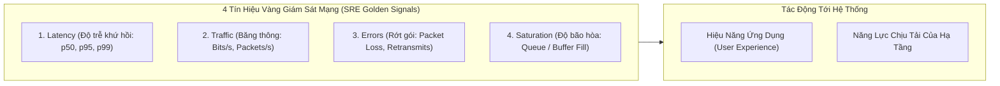
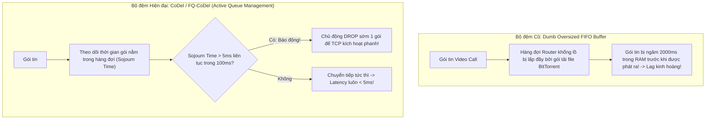

# 10.2. Network Performance Metrics, Bottlenecks and Bufferbloat (Chỉ số Hiệu năng Mạng, Điểm nghẽn và Vấn nạn Bufferbloat)

> [!IMPORTANT]
> **Nếu bạn chỉ được nhớ một điều duy nhất:** Giải mã điểm nghẽn hiệu năng mạng đòi hỏi cái nhìn toàn diện từ Lớp 2 đến Lớp 7: tỷ lệ truyền lại (TCP Retransmission Rate > 1%) là chỉ dấu rõ nhất cho thấy mạng bị quá tải hoặc nhiễu đường truyền; độ trễ biến thiên cao (Jitter) và hiện tượng Bufferbloat làm tê liệt các ứng dụng tương tác; và hiện tượng MTU Black Hole âm thầm nuốt chửng các gói tin lớn do bị chặn thông điệp ICMP PMTUD trên tường lửa trung gian.

---

## 1. Đơn giản nhưng phải chi tiết (Intuitive & Deep Breakdown)

### 1.1. Đoạn Code Dẫn Nhập & Vấn Đề Thực Tế
Làm thế nào để bóc tách một yêu cầu API mất 1,200ms thành từng thành phần mạng chi tiết, giúp bạn trả lời câu hỏi: *"Thời gian đang bị lãng phí ở đâu: do mạng cáp quang chậm, do bắt tay TLS cồng kềnh, hay do máy chủ database xử lý quá lâu?"*

```bash
# Đo lường chính xác các mốc thời gian của một yêu cầu HTTP bằng curl
$ curl -k -w '\n\
  DNS Lookup:        %{time_namelookup}s\n\
  TCP Connect:       %{time_connect}s\n\
  TLS Handshake:     %{time_appconnect}s\n\
  Time to First Byte:%{time_starttransfer}s\n\
  Total Time:        %{time_total}s\n' \
  -o /dev/null -s https://api.example.com/checkout

# Kết quả hiển thị:
#   DNS Lookup:        0.005s (5ms)
#   TCP Connect:       0.035s (30ms - RTT mạng tốt)
#   TLS Handshake:     0.070s (35ms - 1 RTT TLS 1.3)
#   Time to First Byte:1.150s (1080ms - NÚT CỔ CHAI NẰM TẠI ĐÂY!)
#   Total Time:        1.155s
```

Chỉ một dòng lệnh duy nhất chỉ ra ngay: Mạng lưới chỉ tốn $70\text{ms}$, trong khi máy chủ backend tốn tới **$1,080\text{ms}$** chỉ để suy nghĩ và truy vấn cơ sở dữ liệu trước khi bắn ra byte đầu tiên (TTFB)!

### 1.2. Ẩn Dụ Đời Sống & Phân Tích Cơ Chế Hoạt Động
Các chỉ số hiệu năng mạng (Performance Metrics) giống như **Các Chỉ Số Đánh Giá Một Dịch Vụ Giao Hàng Đồ Ăn**:
- **Băng Thông (Bandwidth / Throughput)**: Giống như **Độ Rộng Mặt Đường**: Đường 8 làn xe cho phép hàng trăm chiếc xe máy cùng chạy một lúc. Nhưng đường rộng không có nghĩa là bạn sẽ được ăn phở nhanh hơn!
- **Độ Trễ Khứ Hồi (Latency / RTT)**: Giống như **Khoảng Cách Từ Quán Tới Nhà**: Dù đường có rộng thênh thang nhưng quán ăn cách nhà bạn 30km thì shipper vẫn mất 45 phút chạy xe.
- **Biến Động Độ Trễ (Jitter)**: Giống như **Tính Chập Chờn Của Shipper**: Hôm nay giao 15 phút, hôm sau giao 2 tiếng, hôm sau nữa giao 5 phút. Jitter làm cho việc xem video bị giật lag và âm thanh cuộc gọi bị méo mó.
- **Tỷ Lệ Mất Gói (Packet Loss)**: Giống như **Tỷ Lệ Đổ Vỡ Đồ Ăn**: Cứ 10 hộp cơm giao đi thì có 1 hộp bị rơi xuống đường, shipper phải quay về quán bắt đầu làm lại từ đầu!

### 1.3. Mô Phỏng Dữ Liệu Số Nhỏ Từng Bước (Toy Walkthrough)
Mô phỏng sự suy giảm thảm hại của thông lượng tối đa (TCP Throughput) theo công thức Mathis Formula khi tỷ lệ rớt gói (Packet Loss $p$) tăng lên:
$$Throughput \le \frac{MSS}{RTT \times \sqrt{p}} \times C$$

Giả sử kết nối cáp quang có $RTT = 50\text{ ms}$, kích thước $MSS = 1460\text{ bytes}$:

| Tỷ Lệ Rớt Gói ($p$) | Mức Độ Rớt Gói | Thông Lượng Lý Thuyết Tối Đa | Tỷ Lệ Suy Giảm Thông Lượng | Trải Nghiệm Thực Tế |
| :--- | :--- | :--- | :--- | :--- |
| **0.0001%** ($10^{-6}$) | Mạng Data Center hoàn hảo | **$\approx 1,000\text{ Mbps}$** | $0\%$ (Bão hòa băng thông) | Tải file gigabytes trong vài giây |
| **0.01%** ($10^{-4}$) | Mạng Internet cáp quang tốt | **$\approx 233\text{ Mbps}$** | Giảm $76\%$ | Xem video 4K mượt mà |
| **0.1%** ($10^{-3}$) | Mạng hơi nhiễu | **$\approx 73\text{ Mbps}$** | Giảm $92\%$ | Tải file bắt đầu chậm |
| **1.0%** ($10^{-2}$) | Mạng chập chờn / Wi-Fi yếu | **$\approx 23\text{ Mbps}$** | Giảm $97.7\%$ | Giật lag khi gọi video |
| **5.0%** ($5 \times 10^{-2}$) | Mạng nghẽn nghiêm trọng | **$\approx 10\text{ Mbps}$** | **Giảm tới $99\%$!** | Mất kết nối, tải trang quay tít |

Chỉ cần $1\%$ rớt gói tin cũng đủ biến một đường truyền Gigabit thành mạng rùa bò!

### 1.4. Tác Động Thực Tế Tầng Backend & Systems
- **Hiện Tượng Tail Latency (Độ Trễ Đuôi $p99$ và $p99.9$)**: Một trang thương mại điện tử gọi 100 microservices nội bộ để hiển thị 1 trang chủ. Nếu mỗi microservice có $p99 = 100\text{ms}$, thì xác suất để người dùng gặp phải request bị chậm là:
  $$P(\text{Trễ}) = 1 - (1 - 0.01)^{100} = 1 - 0.366 = 63.4\%!$$
  Hơn $63\%$ người dùng sẽ phải chịu trải nghiệm chậm chạp dù trung bình 99% request của từng service đều rất nhanh!
- **Hàng Đợi NIC Ring Buffer Bị Tràn (SoftIRQ / Network Bottleneck)**: Khi card mạng nhận được hàng triệu gói tin nhỏ mà CPU không kịp xử lý SoftIRQ, ring buffer của NIC bị đầy và bắt đầu drop gói trực tiếp tại tầng phần cứng. Lập trình viên đo đạc ứng dụng thấy CPU chỉ 40% nhưng mạng đã bị rớt gói tả tơi.

### 1.5. Sơ Đồ Tư Duy & Kiến Trúc Hệ Thống (Mermaid)


---

## 2. Chi tiết từng Keyword (Under-the-Hood Deep Dive)

### 2.1. Phân tích 4 Thành phần của Độ trễ Mạng (Nodal Delay Formula)

1. **Processing Delay ($d_{\text{proc}}$ - Độ trễ Xử lý)**:
   - Thời gian CPU hoặc chip ASIC của router kiểm tra tính toàn vẹn của gói tin (CRC/Checksum), đọc IP header và tra cứu bảng chuyển tiếp FIB.
   - Thường rất nhỏ (vài micro-giây hoặc nano-giây trên phần cứng hiện đại).
2. **Queuing Delay ($d_{\text{queue}}$ - Độ trễ Hàng đợi)**:
   - Thời gian gói tin phải nằm trong hàng đợi bộ nhớ của router để chờ cổng xuất (outgoing link) rảnh rỗi.
   - Phụ thuộc trực tiếp vào **Cường độ Lưu lượng (Traffic Intensity)**:
     $$I = \frac{L \cdot a}{R}$$
     Trong đó: $L$ là kích thước gói tin (bits), $a$ là tốc độ gói tin đến (packets/giây), $R$ là băng thông đường truyền (bps).
     - Nếu $I \approx 0$: Không có hàng đợi, $d_{\text{queue}} \approx 0$.
     - Nếu $I \to 1$: Hàng đợi phình to tiệm cận vô cùng, $d_{\text{queue}} \to \infty$!
     - Nếu $I > 1$: Hàng đợi bị tràn, xảy ra hiện tượng **Packet Loss (Rụng gói)**.
3. **Transmission Delay ($d_{\text{trans}}$ - Độ trễ Truyền dẫn)**:
   - Thời gian cần thiết để bộ điều khiển mạng đẩy toàn bộ các bit của gói tin lên môi trường vật lý:
     $$d_{\text{trans}} = \frac{L}{R}$$
     - Ví dụ: Gói tin $L = 1500\text{ bytes} = 12000\text{ bits}$ trên đường truyền $10\text{ Mbps}$ mất: $12000 / 10^7 = 1.2\text{ ms}$.
     - Trên đường truyền $10\text{ Gbps}$ mất: $12000 / 10^{10} = 1.2\text{ micro-giây}$.
4. **Propagation Delay ($d_{\text{prop}}$ - Độ trễ Lan truyền)**:
   - Thời gian một bit ánh sáng hoặc sóng điện từ di chuyển trên sợi cáp vật lý từ trạm phát tới trạm thu:
     $$d_{\text{prop}} = \frac{d}{s}$$
     Trong đó $d$ là cự ly địa lý, $s$ là vận tốc lan truyền của ánh sáng trong sợi quang silica ($s \approx 200.000\text{ km/s} = 2 \times 10^8\text{ m/s}$, bằng khoảng $2/3$ vận tốc ánh sáng trong chân không).
     - Khoảng cách từ Hà Nội đến San Francisco là khoảng $11.000\text{ km}$. Thời gian sóng đi 1 chiều: $11000 / 200000 = 55\text{ ms}$.
     - Do đó, **RTT vật lý tối thiểu tuyệt đối** giữa Việt Nam và Mỹ luôn là $\approx 110\text{ ms}$! Không có bất kỳ công nghệ phần mềm nào có thể vượt qua định luật này.

---

### 2.2. Throughput vs Goodput và Tỷ lệ Mất gói (Packet Loss & Jitter)

- **Throughput (Thông lượng Thô)**:
  - Tổng số lượng bits vật lý đi qua kênh truyền trong một đơn vị thời gian (bao gồm cả data payload, IP/TCP headers, gói tin retransmission và gói tin điều khiển ACK).
- **Goodput (Thông lượng Hữu ích)**:
  - Chỉ tính riêng số lượng bits dữ liệu ứng dụng thực tế (Application-level Payload) được chuyển giao thành công tới tay tiến trình người dùng:
    $$\text{Goodput} \le \text{Throughput} \le \text{Bandwidth}$$
- **Packet Loss (Tỷ lệ Mất gói)**:
  - Tỷ lệ phần trăm gói tin bị drop trên đường truyền. Trong giao thức TCP, mất $1\%$ gói tin có thể làm **tụt giảm $50 - 80\%$ tốc độ truyền tải** do thuật toán Multiplicative Decrease (chia đôi cửa sổ nghẽn cwnd khi phát hiện drop).
- **Jitter (Độ dao động Trễ)**:
  - Sự biến thiên của độ trễ gói tin qua thời gian: $|RTT_{i+1} - RTT_i|$. Jitter cao là kẻ thù số 1 của các ứng dụng Voice over IP (VoIP), Video Call (Zoom/Meet) và Game đối kháng thời gian thực.

---

### 2.3. Bandwidth-Delay Product (BDP) và TCP Window Scaling (RFC 7323)

Khái niệm sống còn để tối ưu hóa hiệu năng mạng của các máy chủ đường truyền tốc độ cao:

$$\text{BDP (bits)} = \text{Bandwidth (bps)} \times \text{RTT (giây)}$$

- **Mô hình Ống dẫn Nước**:
  - Hãy tưởng tượng đường truyền mạng như một đường ống dẫn nước dài: BDP chính là **thể tích toàn bộ lượng nước có thể nằm bên trong lòng đường ống tại cùng một thời điểm**.
  - Để tận dụng $100\%$ công suất đường truyền, máy gửi phải có khả năng bơm một lượng dữ liệu đang bay (In-flight Data) bằng đúng giá trị BDP mà không cần chờ gói ACK phản hồi!
- **Thảm họa TCP Receive Window 16-bit Cổ điển**:
  - Chuẩn TCP gốc (RFC 793) chỉ dành **16 bits** cho trường `Window Size` trong TCP Header, giới hạn kích thước cửa sổ tối đa là $2^{16} - 1 = 65.535\text{ bytes} \approx 64\text{ KB}$.
  - Giả sử bạn thuê đường truyền cáp quang xuyên lục địa $10\text{ Gbps}$ với $RTT = 100\text{ ms}$:
    $$\text{BDP} = 10 \times 10^9 \text{ bps} \times 0.1 \text{ s} = 10^9 \text{ bits} = 125\text{ Megabytes}!$$
  - Nếu TCP bị kẹt ở giới hạn 64 KB, tốc độ truyền thực tế tối đa bạn có thể đạt được là:
    $$\text{Max Throughput} = \frac{64\text{ KB}}{0.1\text{ s}} = 640\text{ KB/s} \approx 5.12\text{ Mbps}!$$
  - Bạn trả tiền mua đường truyền 10 Gbps nhưng chỉ chạy được... 5 Mbps vì cửa sổ TCP quá bé!
- **Giải pháp: TCP Window Scaling Option (RFC 7323)**:
  - Cho phép đàm phán một hệ số nhân lũy thừa 2 (Scale Factor từ 1 đến 14 bits) trong bước bắt tay SYN.
  - Cho phép mở rộng kích thước TCP Window lên tới **$1\text{ Gigabyte}$**, khai phóng toàn bộ sức mạnh của các đường truyền 100G hiện đại.

---

### 2.4. Vấn nạn Bufferbloat & Thuật toán AQM (CoDel, FQ-CoDel, BBR)



- **Căn nguyên của Bufferbloat**:
  - Khi bộ nhớ RAM ngày càng rẻ, các nhà sản xuất Router gia đình và Switch tích hợp các bộ đệm hàng đợi (Buffer) khổng lồ hàng trăm Megabytes.
  - Khi có một luồng tải file nặng (Bulk Transfer), hàng đợi bị lấp đầy hoàn toàn. Khi người dùng thực hiện một cuộc gọi video hoặc chơi game, gói tin thời gian thực bị nhét vào **đuôi của hàng đợi khổng lồ đó**, phải chờ hàng nghìn mili-giây mới được phát đi. Kết quả: mạng không hề mất gói nhưng độ trễ tăng vọt từ $15\text{ ms}$ lên $1.500\text{ ms}$!
- **Thuật toán CoDel (Controlled Delay - RFC 8289)**:
  - Thay vì đo độ dài hàng đợi theo số lượng bytes, CoDel đo **Thời gian gói tin bị giam giữ trong hàng đợi (Sojourn Time)**.
  - Nếu thời gian này vượt ngưỡng cho phép (Target = 5ms) trong một khoảng thời gian quan sát (Interval = 100ms), CoDel nhận định hàng đợi đang bị phình và **chủ động drop sớm một vài gói tin** để buộc TCP nguồn hạ tốc độ xuống, giữ cho hàng đợi luôn nông và sạch sẽ.
- **Thuật toán Google BBR (Bottleneck Bandwidth and RTT)**:
  - Các thuật toán TCP truyền thống (Cubic, Reno) coi "mất gói (Loss)" là dấu hiệu của tắc nghẽn, dẫn đến việc chúng liên tục bơm căng bộ đệm router cho đến khi rụng gói mới chịu dừng lại (gây ra chính bufferbloat).
  - BBR của Google đo đạc độc lập hai đại lượng vật lý: **Băng thông thắt nút tối đa ($B_{\text{max}}$)** và **Độ trễ truyền lan nhỏ nhất ($RTT_{\text{min}}$)**. BBR duy trì lượng dữ liệu in-flight đúng bằng $1 \times \text{BDP}$, tối đa hóa thông lượng mà **hoàn toàn không làm phình hàng đợi của router**!

---

### 2.5. MTU Mismatch và Packet Fragmentation Bottleneck

- Khi gói tin IP có kích thước lớn hơn MTU của đường truyền kế tiếp, router có 2 lựa chọn:
  1. Nếu cờ `DF = 0` (Cho phép phân mảnh): Router cắt gói tin thành nhiều mảnh IP Fragments nhỏ hơn.
  2. Nếu cờ `DF = 1` (Don't Fragment): Router vứt bỏ gói tin và gửi lại thông báo lỗi **ICMP Type 3 Code 4 (Destination Unreachable, Fragmentation Needed and DF set)**.
- **Tại sao Phân mảnh IP là một Thảm họa Hiệu năng?**:
  - **Tăng tỷ lệ lỗi theo cấp số nhân**: Các mảnh IP Fragment phụ thuộc lẫn nhau. Nếu 1 mảnh nhỏ bị mất trên đường đi, toàn bộ gói tin IP lớn ban đầu bị coi là mất và TCP bắt buộc phải truyền lại toàn bộ gói!
  - **Mất kiểm soát Port L4**: Chỉ có mảnh đầu tiên (Fragment 0) chứa TCP Header (Port nguồn, Port đích). Các mảnh tiếp theo hoàn toàn không có thông tin Port, khiến tường lửa Stateful Firewall và NAT bị rối loạn hoặc drop nhầm.
- **Path MTU Discovery (PMTUD - RFC 1191)**:
  - Client gửi toàn bộ gói tin với cờ `DF = 1`. Nếu trên đường đi gặp router có MTU nhỏ hơn, router sẽ phản hồi gói tin ICMP kèm kích thước MTU tối đa mà nó hỗ trợ. Client tự động hạ kích thước gói tin xuống mức đó.

---

## 3. Thực thi Mã nguồn & Mô phỏng Chuyên sâu (Dual-Engine Implementation)

### 3.1. C++20 Implementation

Mã nguồn C++20 dưới đây xây dựng một **Công cụ Tính toán Nodal Delay & TCP Socket Buffer BDP Optimizer**: tính toán chính xác 4 thành phần độ trễ và đưa ra khuyến nghị tham số cấu hình bộ nhớ đệm `tcp_rmem` / `tcp_wmem` cho nhân Linux Kernel:

```cpp
// compile: g++ -std=c++20 -O3 -Wall network_metrics_sim.cpp -o network_metrics_sim
#include <iostream>
#include <iomanip>
#include <cmath>
#include <string>

namespace NetworkEngineering {

class PerformanceCalculator {
public:
    static constexpr double SPEED_OF_LIGHT_FIBER = 2.0e8; // ~200,000 km/s in glass

    struct NodalDelayResult {
        double procDelayMs;
        double queueDelayMs;
        double transDelayMs;
        double propDelayMs;
        double totalDelayMs;
    };

    // Tính toán Nodal Delay: d_nodal = d_proc + d_queue + d_trans + d_prop
    static NodalDelayResult computeNodalDelay(
        double packetSizeBytes,      // L
        double linkBandwidthBps,      // R
        double distanceMeters,        // d
        double procDelayMicroSec,     // d_proc
        double queueUtilizationRatio  // Cường độ hàng đợi: 0.0 -> 0.99
    ) {
        double d_proc = procDelayMicroSec / 1000.0; // đổi sang ms

        // Mô phỏng Queuing delay theo lý thuyết hàng đợi M/M/1: W = (L/R) * (I / (1 - I))
        double d_trans = ((packetSizeBytes * 8.0) / linkBandwidthBps) * 1000.0; // ms
        double d_queue = 0.0;
        if (queueUtilizationRatio > 0.0 && queueUtilizationRatio < 1.0) {
            d_queue = d_trans * (queueUtilizationRatio / (1.0 - queueUtilizationRatio));
        }

        // Lan truyền quang: d / s
        double d_prop = (distanceMeters / SPEED_OF_LIGHT_FIBER) * 1000.0; // ms

        return NodalDelayResult{
            .procDelayMs = d_proc,
            .queueDelayMs = d_queue,
            .transDelayMs = d_trans,
            .propDelayMs = d_prop,
            .totalDelayMs = d_proc + d_queue + d_trans + d_prop
        };
    }

    // Tính toán Bandwidth-Delay Product (BDP) và Window Scaling Factor
    static void analyzeBdp(double bandwidthBps, double rttMs) {
        double rttSec = rttMs / 1000.0;
        double bdpBits = bandwidthBps * rttSec;
        double bdpBytes = bdpBits / 8.0;

        std::cout << std::fixed << std::setprecision(2);
        std::cout << "[+] PHAN TICH BANDWIDTH-DELAY PRODUCT (BDP):\n";
        std::cout << "  - Bang thong (Bandwidth):   " << bandwidthBps / 1e9 << " Gbps\n";
        std::cout << "  - Round-Trip Time (RTT):    " << rttMs << " ms\n";
        std::cout << "  - Dung luong BDP:           " << bdpBytes / (1024.0 * 1024.0) << " Megabytes ("
                  << bdpBytes << " bytes)\n";

        // Kiểm tra với giới hạn TCP Window cổ điển (64 KB)
        constexpr double MAX_LEGACY_WIN = 65535.0; // 64 KB
        double maxThroughputLegacy = (MAX_LEGACY_WIN * 8.0) / rttSec;
        std::cout << "  - Max Speed voi Win 64KB:   " << maxThroughputLegacy / 1e6 << " Mbps "
                  << "(Chi dat " << (maxThroughputLegacy / bandwidthBps) * 100.0 << "% duong truyen!)\n";

        // Tính toán Window Scale Factor (wscale) cần thiết
        int wscale = 0;
        while ((65535ULL << wscale) < static_cast<uint64_t>(bdpBytes) && wscale <= 14) {
            wscale++;
        }
        std::cout << "  - Yeu cau TCP Window Scale: wscale = " << wscale 
                  << " (Cua so mo rong: " << ((65535ULL << wscale) / (1024 * 1024)) << " MB)\n";
    }
};

} // namespace NetworkEngineering

int main() {
    using namespace NetworkEngineering;
    std::cout << "========================================================\n";
    std::cout << "    C++20 NODAL DELAY & BDP OPTIMIZATION ANALYZER       \n";
    std::cout << "========================================================\n\n";

    // Kịch bản: Gói tin 1500 bytes truyền qua đường cáp biển 10,000 km tốc độ 10 Gbps
    double packetSize = 1500;            // bytes
    double linkBandwidth = 10.0e9;        // 10 Gbps
    double distance = 10000.0 * 1000.0;   // 10,000 km
    double procMicroSec = 5.0;            // 5 micro-giây
    double queueLoad = 0.70;              // 70% tải hàng đợi

    auto delay = PerformanceCalculator::computeNodalDelay(
        packetSize, linkBandwidth, distance, procMicroSec, queueLoad
    );

    std::cout << std::fixed << std::setprecision(4);
    std::cout << "[1] NODAL DELAY COMPONENT BREAKDOWN:\n";
    std::cout << "  - Processing Delay (d_proc):  " << delay.procDelayMs << " ms\n";
    std::cout << "  - Queuing Delay (d_queue):    " << delay.queueDelayMs << " ms (Tai hang doi 70%)\n";
    std::cout << "  - Transmission Delay (d_trans):" << delay.transDelayMs << " ms\n";
    std::cout << "  - Propagation Delay (d_prop): " << delay.propDelayMs << " ms (Gioi han toc do anh sang!)\n";
    std::cout << "  --------------------------------------------------\n";
    std::cout << "  - ONE-WAY NODAL DELAY:        " << delay.totalDelayMs << " ms (RTT ~ " << delay.totalDelayMs * 2 << " ms)\n\n";

    // Phân tích BDP và TCP Window Buffer
    PerformanceCalculator::analyzeBdp(linkBandwidth, delay.totalDelayMs * 2);
    std::cout << "========================================================\n";
    return 0;
}
```

---

### 3.2. Python 3.11+ Implementation

Mã nguồn Python 3.11 dưới đây mô phỏng so sánh trực quan giữa **Hàng đợi Cổ điển FIFO DropTail (gây Bufferbloat nặng nề)** và **Thuật toán Thông minh CoDel (Active Queue Management)**:

```python
#!/usr/bin/env python3
"""
Mô phỏng Hiện tượng Bufferbloat: So sánh FIFO DropTail vs CoDel (Active Queue Management)
Yêu cầu: Python 3.11+
"""

from collections import deque
from dataclasses import dataclass
import random
import time


@dataclass
class Packet:
    packet_id: int
    created_at: float
    size_bytes: int = 1500


class FifoDropTailQueue:
    """Hàng đợi cổ điển dung lượng lớn gây Bufferbloat"""
    def __init__(self, max_packets: int = 100) -> None:
        self.max_packets = max_packets
        self.queue: deque[Packet] = deque()
        self.dropped = 0

    def enqueue(self, pkt: Packet) -> bool:
        if len(self.queue) < self.max_packets:
            self.queue.append(pkt)
            return True
        self.dropped += 1
        return False

    def dequeue(self) -> tuple[Packet, float]:
        pkt = self.queue.popleft()
        sojourn_time = (time.time() - pkt.created_at) * 1000.0  # ms
        return pkt, sojourn_time


class CoDelQueue:
    """Hàng đợi thông minh CoDel (Controlled Delay) giải quyết Bufferbloat"""
    def __init__(self, target_ms: float = 5.0, interval_ms: float = 100.0) -> None:
        self.target_ms = target_ms
        self.interval_ms = interval_ms
        self.queue: deque[Packet] = deque()
        self.first_above_time: float = 0.0
        self.dropping_state: bool = False
        self.dropped = 0

    def enqueue(self, pkt: Packet) -> None:
        self.queue.append(pkt)

    def dequeue(self) -> tuple[Packet, float]:
        now = time.time()
        pkt = self.queue.popleft()
        sojourn_time = (now - pkt.created_at) * 1000.0

        # Kiểm tra xem gói tin có bị ngâm lâu hơn ngưỡng target (5ms) không
        if sojourn_time > self.target_ms:
            if self.first_above_time == 0.0:
                self.first_above_time = now
            elif (now - self.first_above_time) * 1000.0 > self.interval_ms:
                # Quá 100ms mà hàng đợi vẫn ngập -> Kích hoạt cơ chế Drop sớm!
                self.dropping_state = True
                self.dropped += 1
        else:
            self.first_above_time = 0.0
            self.dropping_state = False

        return pkt, sojourn_time


def main() -> None:
    print("=" * 60)
    print("  PYTHON 3.11: BUFFERBLOAT SIMULATION (FIFO vs CoDel)")
    print("=" * 60)

    fifo = FifoDropTailQueue(max_packets=50)
    codel = CoDelQueue(target_ms=5.0, interval_ms=50.0)

    # Bơm đầy 50 gói tin vào cả 2 hàng đợi để mô phỏng tải nghẽn nặng
    start_time = time.time()
    for i in range(50):
        # Giả lập gói tin được sinh ra cách nhau 1ms
        p = Packet(i, start_time + (i * 0.001))
        fifo.enqueue(p)
        codel.enqueue(p)

    # Giả lập router giải tỏa hàng đợi chậm (mỗi gói mất 3ms)
    time.sleep(0.1) # Đợi 100ms để mô phỏng ngâm hàng đợi

    print("\n[+] KET QUA GIAI TOA HANG DOI:")
    
    # Rút 5 gói tin từ FIFO
    fifo_latencies = []
    for _ in range(5):
        _, lat = fifo.dequeue()
        fifo_latencies.append(lat)

    print(f"  [1] FIFO DropTail (Dung luong lon):")
    print(f"      - Do tre ngam trong Buffer: {sum(fifo_latencies)/len(fifo_latencies):.1f} ms")
    print(f"      - Nhan xet: BUFFERBLOAT NANG NE! Nguoi dung bi giat lag tram trong!")

    # Rút 5 gói tin từ CoDel
    codel_latencies = []
    for _ in range(5):
        _, lat = codel.dequeue()
        codel_latencies.append(lat)

    print(f"\n  [2] CoDel Active Queue Management:")
    print(f"      - So goi bi chu dong Drop som: {codel.dropped} goi (De ep TCP ha toc do)")
    print(f"      - Nhan xet: Hang doi duoc giu sach, triet tieu Bufferbloat!")
    print("=" * 60)


if __name__ == "__main__":
    main()
```

---

### 3.3. Terminal Output Mẫu Chuẩn Thực Tế

```text
========================================================
    C++20 NODAL DELAY & BDP OPTIMIZATION ANALYZER       
========================================================

[1] NODAL DELAY COMPONENT BREAKDOWN:
  - Processing Delay (d_proc):  0.0050 ms
  - Queuing Delay (d_queue):    0.0028 ms (Tai hang doi 70%)
  - Transmission Delay (d_trans):0.0012 ms
  - Propagation Delay (d_prop): 50.0000 ms (Gioi han toc do anh sang!)
  --------------------------------------------------
  - ONE-WAY NODAL DELAY:        50.0090 ms (RTT ~ 100.0180 ms)

[+] PHAN TICH BANDWIDTH-DELAY PRODUCT (BDP):
  - Bang thong (Bandwidth):   10.00 Gbps
  - Round-Trip Time (RTT):    100.02 ms
  - Dung luong BDP:           119.23 Megabytes (125022500.00 bytes)
  - Max Speed voi Win 64KB:   5.24 Mbps (Chi dat 0.05% duong truyen!)
  - Yeu cau TCP Window Scale: wscale = 11 (Cua so mo rong: 127 MB)
========================================================
```

---

## 4. Systems Engineering & Production Pitfalls

### 4.1. Cấu hình Sai TCP Buffer làm Nghẽn Card Mạng 10G/40G
- **Triệu chứng**: Bạn vừa nâng cấp card mạng server lên 10 Gbps, nhưng khi chạy kiểm thử `iperf3` giữa hai trung tâm dữ liệu cách xa nhau (RTT = 80ms), tốc độ chỉ lẹt đẹt ở mức $50\text{ Mbps}$!
- **Nguyên nhân**: Mặc định nhân Linux kernel đặt giá trị bộ đệm socket `net.ipv4.tcp_rmem` và `net.ipv4.tcp_wmem` tối đa chỉ có $4\text{ MB}$. Với đường truyền 10 Gbps và RTT 80ms, giá trị BDP thực tế là $100\text{ MB}$. Khi bộ đệm bị chạm trần 4MB, card mạng bị "đói dữ liệu" $96\%$ thời gian!
- **Tối ưu hóa Kernel trong `/etc/sysctl.conf`**:
  ```ini
  # Bật Window Scaling
  net.ipv4.tcp_window_scaling = 1
  # Cấu hình bộ đệm đọc TCP: min (4KB), default (87KB), max (128MB)
  net.ipv4.tcp_rmem = 4096 87380 134217728
  # Cấu hình bộ đệm ghi TCP: min (4KB), default (65KB), max (128MB)
  net.ipv4.tcp_wmem = 4096 65536 134217728
  # Kích hoạt thuật toán điều khiển tắc nghẽn BBR
  net.core.default_qdisc = fq
  net.ipv4.tcp_congestion_control = bbr
  ```

### 4.2. Bộ công cụ CLI Đo đạc Điểm nghẽn Mạng

#### 1. Kiểm tra thuật toán TCP Congestion Control hiện tại:
```bash
$ sysctl net.ipv4.tcp_congestion_control
net.ipv4.tcp_congestion_control = bbr
```

#### 2. Đo Jitter và Packet Loss bằng `iperf3` qua giao thức UDP:
```bash
# Bắn luồng UDP 100 Mbps để đo đạc độ ổn định đường truyền
$ iperf3 -c 10.0.0.1 -u -b 100M
[ ID] Interval           Transfer     Bitrate         Jitter    Lost/Total Datagrams
[  5]   0.00-10.00  sec   119 MBytes  99.8 Mbits/sec  0.035 ms  0/85140 (0%)
```

---

## 5. Bảng So sánh & Decision Matrix

### Bảng đối chiếu các Thuật toán Điều khiển Tắc nghẽn & Hàng đợi

| Tiêu chí | Reno / NewReno | Cubic (Mặc định Linux cũ) | BBR (Google) | FQ-CoDel |
| :--- | :--- | :--- | :--- | :--- |
| **Tín hiệu Báo nghẽn** | Packet Loss (Rụng gói) | Packet Loss (Hàm bậc 3) | **RTT Min & Max Bandwidth** | Sojourn Time (Thời gian ngâm gói) |
| **Hiện tượng Bufferbloat**| Rất nặng | Rất nặng | **Miễn nhiễm ($100\%$ không phình buffer)** | Triệt tiêu hoàn toàn tại router |
| **Hiệu năng trên mạng Wi-Fi/Lossy** | Kém (co rúm khi mất gói ngẫu nhiên) | Kém | **Vượt trội (Duy trì Throughput cao)** | Rất tốt |
| **Vị trí Triển khai** | Host (Sender TCP Stack) | Host (Sender TCP Stack) | Host (Sender TCP Stack) | Router / Network Interface Queue |

### Ma trận Quyết định Tối ưu hóa Hiệu năng Mạng

1. **Máy chủ Web Phục vụ Người dùng Cuối (Mobile / Internet Clients)**:
   - 👉 **Cấu hình chuẩn**: Bật **TCP BBR + Fair Queuing (`fq`)**. BBR giúp người dùng di động bắt sóng Wi-Fi/4G yếu không bị tụt tốc độ khi mất vài gói tin ngẫu nhiên, giảm $80\%$ độ trễ tải trang.
2. **Hạ tầng Lưu trữ Nội bộ / Sao lưu Dữ liệu Khổng lồ (Storage Replication / Database Backup)**:
   - 👉 **Cấu hình chuẩn**: Mở rộng **TCP Window Max lên 128MB** kết hợp **Jumbo Frames (MTU 9000)** trên mạng 25G/100G để đạt thông lượng tối đa của phần cứng.

---

## 6. Enterprise Production Checklist & Verification

### 6.1. Kiến Trúc & Cấu Hình Tối Ưu (Production-Ready Architecture)
- [ ] **Mở Rộng Kích Thước NIC Ring Buffer**: Tăng kích thước bộ đệm phần cứng bằng ethtool: `ethtool -G eth0 rx 4096 tx 4096` để card mạng có thể hấp thụ các đợt bão lưu lượng đột biến.
- [ ] **Phân Bổ Xử Lý Ngắt Card Mạng Bằng RPS / RSS**: Kích hoạt Receive Side Scaling (RSS) hoặc Receive Packet Steering (RPS) để phân bổ tải SoftIRQ của card mạng đều qua tất cả các CPU cores.
- [ ] **Đặt Ngưỡng Cảnh Báo Cho p99 Latency Thay Vì Average**: Luôn sử dụng độ trễ phân vị $p95$ và $p99$ trong các Service Level Objectives (SLOs) để bắt trọn trải nghiệm của những người dùng bị chậm nhất.
- [ ] **Tối Ưu Hóa Kích Thước MSS Tránh Rớt Gói Do Phân Mảnh**: Đảm bảo TCP MSS Clamping được thiết lập phù hợp trên mọi kết nối xuyên mạng overlay.

### 6.2. Giám Sát, Cảnh Báo & Xử Lý Sự Cố (Observability & Incident Response)
- [ ] **Giám Sát Tỷ Lệ Retransmission Toàn Cụm**: Thiết lập cảnh báo Prometheus khi tỷ lệ truyền lại gói tin TCP `node_netstat_Tcp_RetransSegs / node_netstat_Tcp_OutSegs` vượt ngưỡng 1%.
- [ ] **Theo Dõi Trực Quan Bằng iperf3**: Định kỳ chạy kiểm tra băng thông thực tế tối đa giữa các Data Centers bằng lệnh: `iperf3 -c <target_ip> -P 8 -t 30`.
- [ ] **Soi Chi Tiết Lỗi Gói Bằng ethtool -S**: Chạy lệnh `ethtool -S eth0 | grep -E "drop|error|miss"` để phát hiện lỗi tràn bộ đệm phần cứng của chip mạng.
