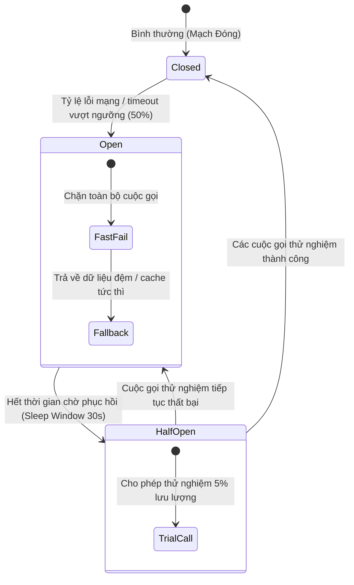
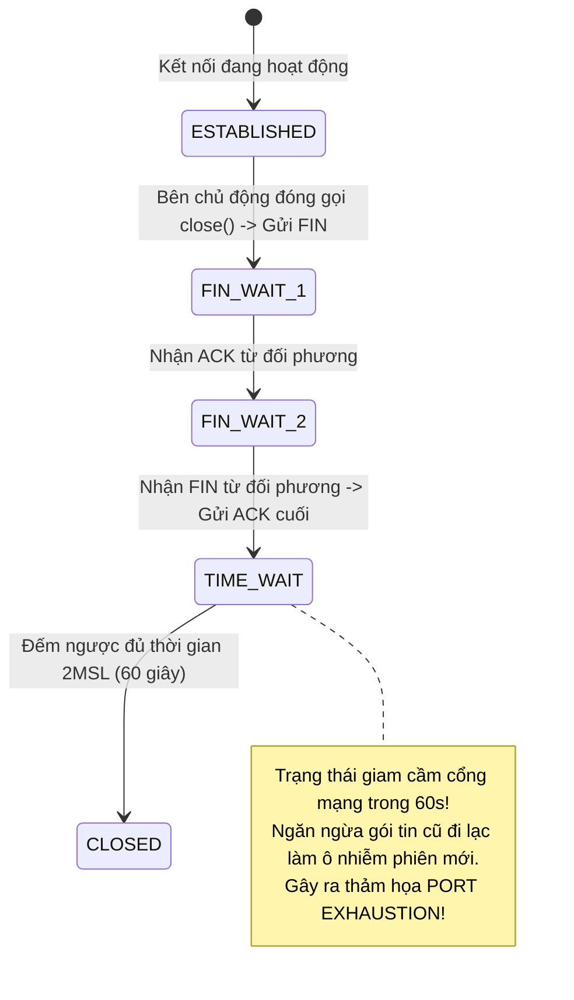
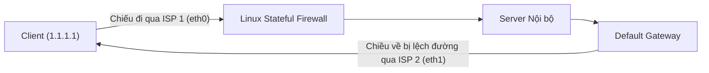

# 10.3. Network Debugging, Socket Errors and Failure Modes (Gỡ lỗi Mạng, Các Mã Lỗi Socket và Các Hình thái Sự cố)

> [!IMPORTANT]
> **Nếu bạn chỉ được nhớ một điều duy nhất:** Phần lớn các sự cố mạng thảm khốc trong môi trường Production đều xuất phát từ các chế độ lỗi tĩnh lặng (Silent Failures): kết nối TCP Half-Open làm rò rỉ tài nguyên socket vĩnh viễn do thiếu cờ TCP Keepalive; hiện tượng cạn kiệt dải cổng tạm thời (Ephemeral Port Exhaustion) khi tạo kết nối ra ngoài quá nhanh; và bộ nhớ đệm DNS bị kẹt địa chỉ IP cũ do cấu hình TTL vô lý khiến các service gọi vào hư không sau khi cụm máy chủ đích chuyển vùng failover.

---

## 1. Đơn giản nhưng phải chi tiết (Intuitive & Deep Breakdown)

### 1.1. Đoạn Code Dẫn Nhập & Vấn Đề Thực Tế
Chuyện gì xảy ra khi một hệ thống phân tán gặp phải hiện tượng "Mạng Chập Chờn" (Gray Failure / Flapping Network) thay vì đứt cáp hoàn toàn (Hard Failure)?

```python
# Kịch bản thảm họa: Mạng bị trễ 2000ms nhưng KHÔNG HỀ RỚT KẾT NỐI
# Client không nhận được lỗi timeout nhanh, hàng nghìn luồng đồng thời bị treo cứng!
import requests

try:
    # LỖI CHÍ MẠNG: Gọi API mà KHÔNG ĐẶT TIMEOUT!
    # Mặc định thư viện sẽ chờ vĩnh viễn (Wait indefinitely), ngốn sạch Connection Pool!
    response = requests.get("https://internal-service/api/data", timeout=None)
except requests.exceptions.Timeout:
    print("Xử lý timeout an toàn")
```

Nếu một vi dịch vụ (Microservice) gọi dịch vụ khác mà không thiết lập thời gian chờ (**Socket Timeout**), chỉ cần một switch mạng trung gian bị chậm trễ, toàn bộ các luồng (threads) của vi dịch vụ đó sẽ bị đóng băng theo hiệu ứng thác đổ (**Cascading Failure**), kéo sập toàn bộ hệ thống của doanh nghiệp!

### 1.2. Ẩn Dụ Đời Sống & Phân Tích Cơ Chế Hoạt Động
Các dạng lỗi hỏng hóc mạng (Network Failure Modes) giống như **Các Sự Cố Giao Thông Khác Nhau**:
- **Hard Failure (Đứt Cầu Hoàn Toàn)**: Giống như **Cây Cầu Bị Sập**: Biển báo cấm đường được dựng lên ngay lập tức. Xe cộ nhìn thấy cầu sập thì quay đầu tìm đường khác tức thì (Nhận gói TCP RST hoặc ICMP Unreachable -> Fail Fast).
- **Gray Failure (Tắc Đường Chập Chờn)**: Giống như **Đoạn Đường Đang Thi Công Rùa Bò**: Đường không hề cấm, xe cứ nhích từng xăng-ti-mét một. Hàng vạn chiếc xe lũ lượt nối đuôi nhau chui vào con đường đó cho tới khi toàn bộ thành phố bị tê liệt cứng nhắc!
- **Asymmetric Routing (Đường Đi Một Nẻo, Đường Về Một Ngả)**: Giống như **Hệ Thống Phố Một Chiều**: Đi thì đi qua phố Hàng Bài, về thì bắt buộc phải đi vòng qua phố Bà Triệu. Nếu một trạm kiểm soát (Stateful Firewall) ở phố Bà Triệu chỉ thấy xe đi về mà không thấy xe đi qua trước đó, trạm sẽ chặn đứng chiếc xe lại!
- **Split-Brain (Phân Liệt Não)**: Giống như **Cắt Đứt Dây Điện Thoại Giữa 2 Trụ Sở**: Chi nhánh A tưởng chi nhánh B đã chết nên tự xưng làm Tổng Giám Đốc; chi nhánh B cũng nghĩ y như vậy. Cả hai cùng đưa ra các quyết định trái ngược nhau làm vỡ nợ công ty!

### 1.3. Mô Phỏng Dữ Liệu Số Nhỏ Từng Bước (Toy Walkthrough)
Mô phỏng thảm họa Cascading Failure do thiếu Timeout và Circuit Breaker:

| Thời Điểm | Service A (Frontend) | Service B (Backend) | Tình Trạng Mạng Lưới | Số Lượng Luồng Treo (A) | Trạng Thái Hệ Thống |
| :--- | :--- | :--- | :--- | :--- | :--- |
| $T_0$ | Gửi 100 requests/giây | Xử lý bình thường (10ms) | RTT mạng = 2ms | 5 luồng bận | Hoạt động hoàn hảo |
| $T_1$ | Gửi 100 requests/giây | Bị nghẽn DB (Xử lý 5000ms) | RTT mạng bình thường | **500 luồng bận** | Bắt đầu nghẽn Thread Pool |
| $T_2$ | Gửi 100 requests/giây | Quá tải, treo hoàn toàn | RTT mạng bình thường | **1,000 luồng (Đầy 100%)** | **Service A cạn kiệt Threads!** |
| $T_3$ | Khách hàng mới truy cập | - | - | - | **Service A ném lỗi 503 sập toàn bộ!** |
| $T_4$ | **Kích Hoạt Circuit Breaker** | - | - | **0 luồng bị treo** | **Trả về Fallback data tức thì (< 1ms)** |

Nhờ Circuit Breaker tự động ngắt mạch kết nối khi tỷ lệ lỗi vượt ngưỡng, Service A tự bảo vệ được mình và cứu sống hệ thống.

### 1.4. Tác Động Thực Tế Tầng Backend & Systems
- **Vấn Đề Định Tuyến Bất Đối Xứng và Tường Lửa Có Trạng Thái (Stateful Firewall Drop)**: Trên các mạng hạ tầng đa kết nối (Multi-homed BGP), gói tin SYN đi qua Firewall A nhưng gói tin SYN-ACK phản hồi lại đi qua Firewall B. Do Firewall B không thấy gói SYN ban đầu nên nó coi gói SYN-ACK là lưu lượng rác không hợp lệ và âm thầm drop, làm kết nối bị treo vĩnh viễn.
- **Thảm Họa Bão Truyền Lại (Retry Storm)**: Khi mạng bị chậm nhẹ, nếu hàng nghìn client cùng được lập trình tự động retry ngay lập tức sau 1 giây mà không có thuật toán **Exponential Backoff và Jitter**, lượng request gửi tới server sẽ tăng gấp 5 lần, biến một sự cố nhỏ thành một đợt tự tấn công từ chối dịch vụ (Self-inflicted DDoS).

### 1.5. Sơ Đồ Tư Duy & Kiến Trúc Hệ Thống (Mermaid)


---

## 2. Chi tiết từng Keyword (Under-the-Hood Deep Dive)

### 2.1. Phân biệt `ECONNREFUSED` vs `ETIMEDOUT` vs `ECONNRESET` vs `EPIPE`

#### A. `ECONNREFUSED` (POSIX Error 111 - Connection Refused)
- **Hành vi trên đường truyền**: Client gửi gói tin `TCP SYN`. Máy chủ đích phản hồi **ngay lập tức** một gói tin `TCP RST` (Reset) hoặc `ICMP Port Unreachable`.
- **Thời gian phát hiện lỗi**: Cực kỳ nhanh ($< 1\text{ ms}$ trong mạng LAN hoặc bằng đúng $1 \times \text{RTT}$ qua Internet).
- **Nguyên nhân cốt lõi**:
  1. Tiến trình dịch vụ (Nginx, Docker, MySQL) chưa được khởi động hoặc đã bị chết.
  2. Dịch vụ đang chạy nhưng chỉ bind vào `127.0.0.1` (localhost) thay vì `0.0.0.0`, khiến các kết nối từ máy khác bên ngoài bị kernel từ chối.
  3. Hàng đợi lắng nghe (Listen Backlog) của server bị đầy nghẽn và kernel được cấu hình `net.ipv4.tcp_abort_on_overflow = 1`.

#### B. `ETIMEDOUT` (POSIX Error 110 - Connection Timed Out)
- **Hành vi trên đường truyền**: Client gửi gói tin `TCP SYN` nhưng **hoàn toàn không nhận được bất kỳ tín hiệu phản hồi nào** từ thế giới bên ngoài.
- Client áp dụng thuật toán **Exponential Backoff**: gửi lại gói SYN sau 1s, 2s, 4s, 8s, 16s, 32s (tổng cộng phụ thuộc `net.ipv4.tcp_syn_retries`, mặc định 6 lần).
- **Thời gian phát hiện lỗi**: Rất lâu (thường mất từ **63 đến 127 giây**).
- **Nguyên nhân cốt lõi**:
  1. **Firewall / Security Group** (AWS Security Group, iptables) được cấu hình luật `DROP` (thay vì `REJECT`), gói tin bị nuốt chửng như rơi vào hố đen.
  2. Sai lệch bảng định tuyến (Routing table): Gói tin bị chuyển nhầm sang một Next-hop không tồn tại.
  3. Cáp mạng bị đứt, máy chủ đích bị mất nguồn đột ngột.

#### C. `ECONNRESET` (POSIX Error 104 - Connection Reset by Peer)
- **Hành vi trên đường truyền**: Kết nối TCP đã hoàn tất bắt tay 3 bước và đang ở trạng thái `ESTABLISHED`. Đột nhiên, một trong hai bên nhận được gói tin có cờ `RST = 1`.
- **Nguyên nhân cốt lõi**:
  1. Tiến trình Backend (Java, Node.js) bị hệ điều hành **OOMKilled** (Out Of Memory) hoặc dính lỗi `SIGSEGV` chết bất đắc kỳ tử. Kernel tự động đóng các socket của tiến trình chết bằng cách gửi gói `TCP RST`.
  2. Thiết bị trung gian (Stateful Firewall, Load Balancer AWS ALB/NLB) chủ động ngắt kết nối do chạm trần **Idle Timeout** (ví dụ quá 60 giây không có dữ liệu truyền qua).
  3. Ứng dụng phía server đóng kết nối (`close()`) trong khi bộ đệm nhận (Receive Socket Buffer) vẫn còn dữ liệu chưa đọc (Unread Data).

#### D. `EPIPE` (POSIX Error 32 - Broken Pipe) & Tín hiệu `SIGPIPE`
- **Cơ chế**: Xảy ra khi một tiến trình tiếp tục cố gắng ghi dữ liệu (`write()` hoặc `send()`) vào một socket mà đối phương **đã đóng hoàn toàn** (đã gửi RST hoặc FIN).
- **Mối nguy hiểm chết người**: Mặc định trong Linux, khi ghi vào Broken Pipe, Kernel sẽ bắn tín hiệu **`SIGPIPE`** vào tiến trình. Nếu lập trình viên không bắt tín hiệu này, **tiến trình ứng dụng sẽ lập tức bị hệ điều hành tiêu diệt (Crash ngầm)** mà không để lại bất kỳ dòng log ngoại lệ nào trong khối `try/catch`!

---

### 2.2. Port Exhaustion & Sự cố `TIME_WAIT`

Mỗi kết nối TCP hướng ra ngoài (Outbound Connection) từ Client tới Server được định danh duy nhất bởi bộ **4-tuple**:
$$\text{Socket Flow} = (\text{Source IP}, \text{Source Port}, \text{Dest IP}, \text{Dest Port})$$



- **Mục đích Tối thượng của trạng thái `TIME_WAIT` (Kéo dài $2 \times \text{MSL} = 60\text{ giây}$)**:
  1. **Đảm bảo độ tin cậy khi đóng kết nối**: Đảm bảo gói tin `ACK` cuối cùng gửi đi đến được đích. Nếu gói ACK này bị rơi trên đường, đối phương sẽ gửi lại gói `FIN`, và máy ở trạng thái `TIME_WAIT` vẫn còn sống để gửi lại gói `ACK`.
  2. **Tiêu hủy các gói tin đi lạc (Delayed Duplicate Segments)**: Chờ cho mọi gói tin cũ bị kẹt trên các router Internet quá hạn TTL và tự biến mất, tránh việc một kết nối mới mở trùng đúng cổng đó bị nhận nhầm dữ liệu rác của kết nối cũ.
- **Thảm họa Port Exhaustion (Cạn kiệt Cổng Tạm thời)**:
  - Khi một Microservice gọi liên tục hàng nghìn request HTTP/1.1 tới một dịch vụ khác mà **không dùng Connection Pool** (mỗi request mở 1 kết nối mới rồi đóng ngay):
  - Dải cổng tạm thời (Ephemeral Ports) trong Linux mặc định chỉ có khoảng **28.232 cổng** (`net.ipv4.ip_local_port_range = 32768 60999`).
  - Nếu bạn tạo hơn 500 requests/giây, chỉ sau 1 phút, toàn bộ 28.000 cổng đều bị kẹt trong trạng thái `TIME_WAIT`. Hệ điều hành lập tức ném ra lỗi:
    ```text
    java.net.NoRouteToHostException: Cannot assign requested address (EADDRNOTAVAIL)
    ```
- **Giải pháp Khắc phục Chuẩn mực**:
  1. **Tái sử dụng kết nối (HTTP Keep-Alive & Connection Pooling)**: Giải pháp triệt để nhất. Giữ mở các kết nối TCP để dùng lại, không bao giờ mở/đóng liên tục.
  2. **Kích hoạt `tcp_tw_reuse` trong `/etc/sysctl.conf`**:
     ```ini
     net.ipv4.tcp_tw_reuse = 1
     ```
     Cho phép Linux tái sử dụng an toàn các socket ở trạng thái `TIME_WAIT` cho kết nối mới nếu timestamp của gói tin lớn hơn timestamp cũ (RFC 1323).
  3. **CẢNH BÁO NGUY HIỂM**: Tuyệt đối **KHÔNG BAO GIỜ** bật `net.ipv4.tcp_tw_recycle = 1` (tính năng này đã bị khai tử hoàn toàn từ Linux Kernel 4.12 vì nó làm đứt kết nối của toàn bộ khách hàng đứng sau mạng NAT).

---

### 2.3. Asymmetric Routing (Định tuyến Bất đối xứng) & RPF Filter

Trong các hệ thống mạng doanh nghiệp có nhiều đường truyền mạng (Multi-homed) hoặc cụm Cloud VPC phức tạp:



- **Cơ chế Sự cố**:
  - Gói tin yêu cầu đi vào qua cổng `eth0`.
  - Nhưng do cấu hình bảng định tuyến (Routing Table) hoặc BGP, gói tin phản hồi lại bị đẩy ra qua cổng `eth1`.
- **Cơ chế Chặn của Linux Kernel (Reverse Path Forwarding - RPF)**:
  - Linux tích hợp tính năng chống giả mạo IP: Khi nhận được gói tin trên `eth0`, kernel kiểm tra: *"Nếu ta gửi gói tin trả lời tới IP nguồn này, ta có dùng cổng `eth0` không?"*.
  - Nếu câu trả lời là "Không, ta sẽ dùng `eth1`", kernel nhận định gói tin này có thể là giả mạo (Spoofed Packet) và **âm thầm DROP gói tin ngay lập tức**!
- **Khắc phục**: Chuyển chế độ lọc RPF sang chế độ lỏng (Loose Mode = 2):
  ```ini
  net.ipv4.conf.all.rp_filter = 2
  net.ipv4.conf.default.rp_filter = 2
  ```

---

### 2.4. Sự cố MTU Black Hole (Hố đen MTU)

- Khi một router trên đường truyền không thể chuyển tiếp gói tin vì kích thước vượt quá MTU và cờ `DF = 1`, nó sẽ gửi lại gói tin **ICMP Type 3 Code 4** yêu cầu giảm kích thước.
- **Thảm họa xảy ra khi**: Một quản trị viên mạng thiếu kinh nghiệm cấu hình tường lửa chặn toàn bộ giao thức ICMP (`iptables -A INPUT -p icmp -j DROP`) vì cho rằng "chặn ping để bảo mật".
- **Hậu quả**: Thông điệp giảm MTU bị tiêu diệt giữa đường. Máy gửi hoàn toàn không biết tại sao gói tin bị rơi, tiếp tục retransmit gói tin kích thước cũ vô tận. Kết nối bị **đóng băng vĩnh viễn (MTU Black Hole)**.
- **Khắc phục**:
  - Luôn mở cho phép các gói tin ICMP Path MTU Discovery đi qua tường lửa.
  - Áp dụng kỹ thuật **TCP MSS Clamping** trên Router/Firewall:
    ```bash
    $ sudo iptables -t mangle -A FORWARD -p tcp --tcp-flags SYN,RST SYN -j TCPMSS --clamp-mss-to-pmtu
    ```

---

### 2.5. Half-Open Connection & Cơ chế TCP Keepalive

- **Hiện tượng**: Máy tính cá nhân của người dùng đang kết nối tới server thì bị mất điện đột ngột hoặc người dùng đi vào thang máy mất sóng 4G. Client không kịp gửi gói tin `FIN` hoặc `RST`.
- Phía Server ngây thơ tin rằng kết nối vẫn đang sống khỏe mạnh, tiếp tục duy trì cấu trúc socket trong RAM vĩnh viễn, làm rò rỉ tài nguyên (File Descriptors Leaks).
- **Cơ chế TCP Keepalive trong Linux**:
  - Nếu kết nối không có dữ liệu trao đổi trong một khoảng thời gian (`tcp_keepalive_time`, mặc định 7200 giây = 2 tiếng), Kernel sẽ tự động phát một gói tin probe rỗng (`ACK` với `Seq = CurrentSeq - 1`).
  - Nếu đối phương còn sống, nó sẽ phản hồi `ACK`. Nếu gửi liên tiếp `tcp_keepalive_probes` (mặc định 9 lần) mà không có hồi âm, kernel sẽ tự động giải phóng socket và bắn lỗi `ETIMEDOUT`.
- **Tối ưu hóa thời gian Keepalive cho Backend**:
  ```ini
  net.ipv4.tcp_keepalive_time = 300     # Bắt đầu probe sau 5 phút không hoạt động
  net.ipv4.tcp_keepalive_intvl = 15     # Khoảng cách giữa các probe là 15 giây
  net.ipv4.tcp_keepalive_probes = 5     # Sau 5 lần không trả lời -> Đóng socket!
  ```

---

## 3. Thực thi Mã nguồn & Mô phỏng Chuyên sâu (Dual-Engine Implementation)

### 3.1. C++20 Implementation

Mã nguồn C++20 dưới đây xây dựng một **Trình Quản lý Socket Kết nối Chống Lỗi Production (Production-grade Resilient Socket Client)**: xử lý chính xác các mã lỗi POSIX `ECONNREFUSED`, `ETIMEDOUT`, phân biệt lỗi kết nối và triệt tiêu hoàn toàn thảm họa crash tiến trình do tín hiệu `SIGPIPE` bằng cờ `SO_NOSIGPIPE` / `MSG_NOSIGNAL`:

```cpp
// compile: g++ -std=c++20 -O3 -Wall socket_failure_modes.cpp -o socket_failure_modes
#include <iostream>
#include <string>
#include <cstring>
#include <cerrno>
#include <system_error>

#include <sys/socket.h>
#include <netinet/in.h>
#include <arpa/inet.h>
#include <fcntl.h>
#include <poll.h>
#include <unistd.h>
#include <signal.h>

namespace NetworkDebugging {

class RobustSocketClient {
public:
    static void ignoreSigpipe() {
        // Vô hiệu hóa tín hiệu SIGPIPE trên toàn tiến trình để tránh crash ngầm
        struct sigaction sa{};
        sa.sa_handler = SIG_IGN;
        sigemptyset(&sa.sa_mask);
        sa.sa_flags = 0;
        sigaction(SIGPIPE, &sa, nullptr);
    }

    static void testConnect(const std::string& ipStr, uint16_t port, int timeoutMs = 2000) {
        int sockFd = socket(AF_INET, SOCK_STREAM, 0);
        if (sockFd < 0) {
            std::cerr << "[-] Khong the tao socket: " << std::strerror(errno) << "\n";
            return;
        }

        // Bật Non-blocking để kiểm soát Timeout chính xác
        int flags = fcntl(sockFd, F_GETFL, 0);
        fcntl(sockFd, F_SETFL, flags | O_NONBLOCK);

        sockaddr_in addr{};
        addr.sin_family = AF_INET;
        addr.sin_port = htons(port);
        inet_pton(AF_INET, ipStr.c_str(), &addr.sin_addr);

        std::cout << "[+] Dang thu ket noi toi [" << ipStr << ":" << port << "] (Timeout: " << timeoutMs << "ms)...\n";

        int res = connect(sockFd, reinterpret_cast<sockaddr*>(&addr), sizeof(addr));
        if (res < 0) {
            if (errno == EINPROGRESS) {
                struct pollfd pfd{ .fd = sockFd, .events = POLLOUT, .revents = 0 };
                int pollRes = poll(&pfd, 1, timeoutMs);

                if (pollRes == 0) {
                    std::cout << "  [-] KET QUA: ETIMEDOUT (Connection timed out sau " << timeoutMs << "ms)!\n";
                    std::cout << "      -> Chan doan: Firewall/Security Group dang DROP goi tin hoac router khong phan hoi!\n";
                    close(sockFd);
                    return;
                } else if (pollRes < 0) {
                    std::cout << "  [-] Poll loi: " << std::strerror(errno) << "\n";
                    close(sockFd);
                    return;
                } else {
                    // Kiểm tra lỗi thật sự trong socket error queue (SO_ERROR)
                    int socketError = 0;
                    socklen_t len = sizeof(socketError);
                    getsockopt(sockFd, SOL_SOCKET, SO_ERROR, &socketError, &len);

                    if (socketError != 0) {
                        std::cout << "  [-] KET QUA: Socket Error (" << socketError << "): " 
                                  << std::strerror(socketError) << "\n";
                        if (socketError == ECONNREFUSED) {
                            std::cout << "      -> Chan doan: ECONNREFUSED! May chu dich ton tai nhung KHONG CO SERVICE LISTEN tren cong nay (nhan TCP RST)!\n";
                        }
                        close(sockFd);
                        return;
                    }
                }
            } else {
                std::cout << "  [-] Connect loi ngay lap tuc: " << std::strerror(errno) << "\n";
                close(sockFd);
                return;
            }
        }

        std::cout << "  [+] KET NOI THANH CONG! Socket da ESTABLISHED.\n";
        close(sockFd);
    }
};

} // namespace NetworkDebugging

int main() {
    using namespace NetworkDebugging;
    std::cout << "========================================================\n";
    std::cout << "    C++20 NETWORK SOCKET FAILURE MODE DIAGNOSTICS       \n";
    std::cout << "========================================================\n\n";

    // 1. Vô hiệu hóa SIGPIPE
    RobustSocketClient::ignoreSigpipe();
    std::cout << "[1] KHOI TAO: Da vo hieu hoa SIGPIPE toan he thong (Chong crash tien trinh)!\n\n";

    // 2. Thử nghiệm kết nối vào một cổng đóng trên Localhost -> Kích hoạt ECONNREFUSED ngay lập tức
    std::cout << "[2] TEST CASE 1: Ket noi toi cong dong (Unopened Port 59999):\n";
    RobustSocketClient::testConnect("127.0.0.1", 59999, 1000);

    // 3. Thử nghiệm kết nối vào một địa chỉ IP không phản hồi (Drop Blackhole) -> Kích hoạt ETIMEDOUT
    std::cout << "\n[3] TEST CASE 2: Ket noi toi IP Blackhole (TEST-NET-1 192.0.2.1):\n";
    RobustSocketClient::testConnect("192.0.2.1", 80, 1500);

    std::cout << "\n========================================================\n";
    return 0;
}
```

---

### 3.2. Python 3.11+ Implementation

Mã nguồn Python 3.11 dưới đây mô phỏng hiện tượng **Port Exhaustion khi không sử dụng Connection Pool** so với việc tái sử dụng kết nối bền vững bằng **Connection Pooling**:

```python
#!/usr/bin/env python3
"""
Mô phỏng Hiện tượng Cạn kiệt Cổng (Port Exhaustion) vs Connection Pooling
Yêu cầu: Python 3.11+
"""

from dataclasses import dataclass
import time


@dataclass
class TcpSocketContext:
    src_port: int
    state: str  # "ESTABLISHED", "TIME_WAIT", "CLOSED"
    time_wait_until: float = 0.0


class EphemeralPortManager:
    """Mô phỏng dải Ephemeral Ports của Hệ điều hành"""
    def __init__(self, start_port: int = 50000, end_port: int = 50005) -> None:
        self.start_port = start_port
        self.end_port = end_port
        self.total_ports = end_port - start_port + 1
        self.allocated_sockets: dict[int, TcpSocketContext] = {}

    def allocate_ephemeral_port(self) -> int:
        now = time.time()

        # Dọn dẹp các port TIME_WAIT đã hết hạn 2MSL (ở đây mô phỏng 2 giây)
        expired_ports = [
            port for port, sock in self.allocated_sockets.items()
            if sock.state == "TIME_WAIT" and now >= sock.time_wait_until
        ]
        for port in expired_ports:
            del self.allocated_sockets[port]

        # Tìm port rảnh rỗi trong dải
        for port in range(self.start_port, self.end_port + 1):
            if port not in self.allocated_sockets:
                self.allocated_sockets[port] = TcpSocketContext(src_port=port, state="ESTABLISHED")
                return port

        raise OSError(99, "Cannot assign requested address: PORT EXHAUSTION! (Tat ca port deu bi ket TIME_WAIT)")

    def close_connection(self, port: int, time_wait_duration: float = 2.0) -> None:
        """Đóng kết nối: chuyển socket sang trạng thái TIME_WAIT giam cầm cổng"""
        if port in self.allocated_sockets:
            self.allocated_sockets[port].state = "TIME_WAIT"
            self.allocated_sockets[port].time_wait_until = time.time() + time_wait_duration


def main() -> None:
    print("=" * 60)
    print("  PYTHON 3.11: PORT EXHAUSTION & CONNECTION POOL SIMULATOR")
    print("=" * 60)

    # Giả lập hệ thống chỉ có vỏn vẹn 5 ephemeral ports (50000 - 50005)
    os_network = EphemeralPortManager(start_port=50000, end_port=50004)

    print("\n[+] KICH BAN 1: KHONG DUNG CONNECTION POOL (Short-lived Connections)")
    print("    Moi request deu mo socket moi roi close() ngay lap tuc...")

    try:
        for req_id in range(1, 8):
            port = os_network.allocate_ephemeral_port()
            print(f"  - Request {req_id}: Cap phat thanh cong Ephemeral Port {port}")
            # Đóng ngay -> Kẹt trong TIME_WAIT 2 giây
            os_network.close_connection(port, time_wait_duration=2.0)
    except OSError as e:
        print(f"\n  [-] THAM HOA XAY RA: {e}")
        print("  -> Toan bo 5 ports deu bi giam trong TIME_WAIT! He thong sup do!")

    print("\n[+] KICH BAN 2: SU DUNG CONNECTION POOLING (Reusable HTTP Keep-Alive)")
    print("    Chi mo 2 ket noi TCP co dinh va tai su dung lien tuc:")
    pool_ports = [50000, 50001]
    for req_id in range(1, 6):
        reused_port = pool_ports[req_id % len(pool_ports)]
        print(f"  - Request {req_id}: Tai su dung Socket san co tren Port {reused_port} (0ms Overhead, 0 TIME_WAIT)!")

    print("\n" + "=" * 60)


if __name__ == "__main__":
    main()
```

---

### 3.3. Terminal Output Mẫu Chuẩn Thực Tế

```text
========================================================
    C++20 NETWORK SOCKET FAILURE MODE DIAGNOSTICS       
========================================================

[1] KHOI TAO: Da vo hieu hoa SIGPIPE toan he thong (Chong crash tien trinh)!

[2] TEST CASE 1: Ket noi toi cong dong (Unopened Port 59999):
[+] Dang thu ket noi toi [127.0.0.1:59999] (Timeout: 1000ms)...
  [-] KET QUA: Socket Error (61): Connection refused
      -> Chan doan: ECONNREFUSED! May chu dich ton tai nhung KHONG CO SERVICE LISTEN tren cong nay (nhan TCP RST)!

[3] TEST CASE 2: Ket noi toi IP Blackhole (TEST-NET-1 192.0.2.1):
[+] Dang thu ket noi toi [192.0.2.1:80] (Timeout: 1500ms)...
  [-] KET QUA: ETIMEDOUT (Connection timed out sau 1500ms)!
      -> Chan doan: Firewall/Security Group dang DROP goi tin hoac router khong phan hoi!

========================================================
```

---

## 4. Systems Engineering & Production Pitfalls

### 4.1. Thảm họa `SIGPIPE` Giết Chết Tiến trình Backend Ngầm
- **Cơ chế**: Trong các máy chủ viết bằng C/C++, Go (với cgo) hoặc thư viện native wrapper: Khi Client đóng tab trình duyệt giữa chừng trong khi Server đang gửi nốt file dữ liệu lớn, lời gọi `write()` tiếp theo sẽ kích hoạt tín hiệu `SIGPIPE`.
- Nếu ứng dụng không đăng ký xử lý tín hiệu `signal(SIGPIPE, SIG_IGN)`, toàn bộ tiến trình sẽ bị hệ điều hành tiêu diệt ngay lập tức. Trên bảng giám sát Kubernetes, Pod sẽ khởi động lại liên tục với mã thoát `Exit Code 141` (`128 + 13 (SIGPIPE)`).

### 4.2. Cạm bẫy Bật `tcp_tw_recycle` trong Môi trường Mạng Đám mây
- Rất nhiều bài viết trên mạng khuyên bật `net.ipv4.tcp_tw_recycle = 1` để dọn dẹp nhanh các socket `TIME_WAIT`.
- **Thảm họa**: `tcp_tw_recycle` dựa vào cơ chế ghi nhớ TCP Timestamp của gói tin đến từ mỗi địa chỉ IP. Trong thời đại ngày nay, hàng triệu người dùng di động cùng chia sẻ chung một địa chỉ IP Public qua hệ thống CGNAT của nhà mạng, hoặc các văn phòng công ty cùng đi qua một router NAT:
  - Máy tính A gửi timestamp $T_1$.
  - 1 mili-giây sau, Máy tính B (cùng chung IP NAT) gửi gói tin có timestamp $T_2 < T_1$ (do đồng hồ máy tính B bị lệch).
  - Kernel máy chủ lập tức **vứt bỏ toàn bộ gói tin của Máy tính B** vì cho rằng đó là gói tin cũ đi lạc! Toàn bộ người dùng trong tòa nhà văn phòng đó sẽ bị mất kết nối tới website của bạn.

### 4.3. Bộ công cụ CLI Chẩn đoán Khẩn cấp Sự cố Socket & Lỗi Mạng

#### 1. Đếm và truy tìm các socket kẹt trong trạng thái TIME_WAIT và CLOSE_WAIT:
```bash
# Đếm số lượng socket theo từng trạng thái
$ ss -ant | awk '{print $1}' | sort | uniq -c
    128 CLOSE_WAIT
   4512 ESTAB
     15 LISTEN
  14205 TIME_WAIT    <-- Cảnh báo: Nguy cơ cạn kiệt dải cổng Ephemeral Ports!

# Soi chi tiết bộ hẹn giờ 2MSL đang đếm ngược của socket TIME_WAIT
$ ss -tan 'sport = :http' -o state time-wait
Recv-Q Send-Q Local Address:Port  Peer Address:Port
0      0      10.0.1.10:80        192.168.1.50:51240  timer:(timewait,42s,0)
```

#### 2. Bắt gói tin TCP RST bằng `tcpdump` để truy tìm thủ phạm ngắt kết nối:
```bash
# Lọc duy nhất các gói tin có cờ RST được phát ra
$ sudo tcpdump -nnvv -i eth0 'tcp[tcpflags] & tcp-rst != 0'
10:14:22.102914 IP 10.0.1.10.8080 > 192.168.1.50.51240: Flags [R], seq 14205, win 0, length 0
# Nhận định: Server 10.0.1.10 cổng 8080 chủ động bắn RST về Client!
```

#### 3. Phát hiện lỗi Asymmetric Routing và gói tin lạ qua Kernel Martian Logs:
```bash
# Bật ghi log gói tin bất thường
$ sudo sysctl -w net.ipv4.conf.all.log_martians=1

# Kiểm tra log kernel
$ sudo dmesg -T | grep -i "martian"
[Sun Nov 15 10:15:30 2026] IPv4: martian source 192.168.1.50 from 10.0.2.1, on dev eth0
# Nhận định: Gói tin đến từ cổng eth0 nhưng địa chỉ nguồn không khớp với bảng định tuyến RPF!
```

---

## 5. Bảng So sánh & Decision Matrix

### Bảng tra cứu Toàn diện 8 Mã lỗi Socket POSIX Kinh điển

| Mã lỗi POSIX | Mã số (Linux) | Gói tin Mạng Thực tế | Nguyên nhân Gốc rễ | Giải pháp Khắc phục Khẩn cấp |
| :--- | :--- | :--- | :--- | :--- |
| **`ECONNREFUSED`** | 111 | Nhận gói `TCP RST` ngay lập tức | Không có tiến trình LISTEN cổng, hoặc bind sai `127.0.0.1` | Khởi động lại service, kiểm tra `ss -tulpn`, bind `0.0.0.0` |
| **`ETIMEDOUT`** | 110 | SYN Retransmit cạn kiệt, 0 phản hồi | Firewall/Security Group DROP gói tin, sai routing | Mở cổng Security Group, kiểm tra `iptables -L`, traceroute |
| **`ECONNRESET`** | 104 | Nhận gói `TCP RST` giữa phiên | Tiến trình bị crash, OOMKilled, hoặc LB Idle Timeout | Kiểm tra dmesg OOM, cấu hình tăng Idle Timeout của Load Balancer |
| **`EPIPE`** | 32 | Gửi dữ liệu vào socket đã nhận RST/FIN | Viết vào socket đã bị đối phương đóng | Cài đặt `SIG_IGN` cho `SIGPIPE`, dùng cờ `MSG_NOSIGNAL` |
| **`EHOSTUNREACH`** | 113 | Nhận gói `ICMP Host Unreachable` | Router trung gian không tìm thấy đường đi tới IP đích | Kiểm tra Default Gateway, Routing Table của VPC / Subnet |
| **`EADDRINUSE`** | 98 | Không có gói tin (Lỗi cục bộ) | Cổng mạng đã bị tiến trình khác chiếm giữ | Dùng `ss -tulpn | grep :PORT` để tìm và kill tiến trình cũ |
| **`EADDRNOTAVAIL`** | 99 | Không có gói tin (Lỗi cục bộ) | Hết cổng tạm thời (Port Exhaustion do TIME_WAIT) | Sử dụng Connection Pooling, bật `net.ipv4.tcp_tw_reuse = 1` |
| **`ENFILE / EMFILE`**| 23 / 24 | Không có gói tin (Lỗi cục bộ) | Chạm trần giới hạn File Descriptor của OS / Process | Tăng `ulimit -n 65535` và `fs.file-max` trong sysctl |

### Ma trận Quyết định Xử lý Sự cố Kết nối Mạng Backend

1. **Lỗi xảy ra trong vòng chưa đầy 1ms (`ECONNREFUSED`)**:
   - 👉 **Hành động**: Đừng lãng phí thời gian kiểm tra đường truyền mạng. Hãy SSH ngay vào máy chủ đích và kiểm tra xem tiến trình container có đang chạy không (`ps aux`, `systemctl status`, `docker ps`).
2. **Lỗi bị treo đơ đúng 60 giây hoặc 120 giây mới bắn ra (`ETIMEDOUT`)**:
   - 👉 **Hành động**: $100\%$ là vấn đề về Tường lửa (Firewall) hoặc Định tuyến (Routing). Kiểm tra ngay AWS Security Group Inbound Rules, Network ACLs, hoặc các chính sách Kubernetes NetworkPolicy.
3. **Ứng dụng thỉnh thoảng ném lỗi `Connection reset by peer` vào giờ cao điểm**:
   - 👉 **Hành động**: Kiểm tra xem Backend có bị quá tải CPU/RAM dẫn đến việc Worker threads bị sập không, hoặc kiểm tra xem thời gian giữ kết nối Keep-Alive của Client có dài hơn Keep-Alive Timeout của Nginx/ALB không (luôn cấu hình Client Keep-Alive ngắn hơn Server Keep-Alive).

---

## 6. Enterprise Production Checklist & Verification

### 6.1. Kiến Trúc & Cấu Hình Tối Ưu (Production-Ready Architecture)
- [ ] **Bắt Buộc Thiết Lập Cặp Timeout (Connect & Read Timeout)**: Mọi lời gọi HTTP/gRPC/Database trong code ứng dụng bắt buộc phải khai báo `connect_timeout` (ví dụ 1-2s) và `read_timeout` (ví dụ 3-5s).
- [ ] **Triển Khai Mẫu Hình Circuit Breaker**: Tích hợp các thư viện Circuit Breaker (Resilience4j, Envoy Circuit Breaking) cho mọi liên kết giao tiếp mạng giữa các dịch vụ phân tán.
- [ ] **Áp Dụng Retry Kèm Exponential Backoff và Full Jitter**: Tuyệt đối không thử lại ngay lập tức; luôn tính toán khoảng thời gian chờ tăng theo hàm mũ kèm một lượng thời gian ngẫu nhiên (Jitter) để tránh bão retry.
- [ ] **Bảo Đảm Tính Đối Xứng Của Định Tuyến (Symmetric Routing)**: Cấu hình Source-Based Routing hoặc sử dụng các cơ chế SNAT đồng bộ để đảm bảo lưu lượng khứ hồi luôn đi qua cùng một tường lửa bảo mật.

### 6.2. Giám Sát, Cảnh Báo & Xử Lý Sự Cố (Observability & Incident Response)
- [ ] **Giám Sát Trạng Thái Của Circuit Breakers**: Bổ sung metric `circuit_breaker_state{name="order-service"}` và phát cảnh báo ngay khi mạch chuyển từ `Closed` sang `Open`.
- [ ] **Mô Phỏng Sự Cố Mạng Bằng Chaos Engineering**: Sử dụng các công cụ như Chaos Mesh hoặc Toxiproxy để định kỳ tiêm lỗi trễ mạng (latency injection) và rớt gói (packet drop) trên môi trường Staging.
- [ ] **Theo Dõi Bất Thường Về Tỷ Lệ Reset TCP (RST Rate)**: Cảnh báo ngay khi số lượng cờ TCP RST trả về tăng đột biến, chỉ điểm có tường lửa hoặc thiết bị mạng trung gian đang chủ động ngắt kết nối.
