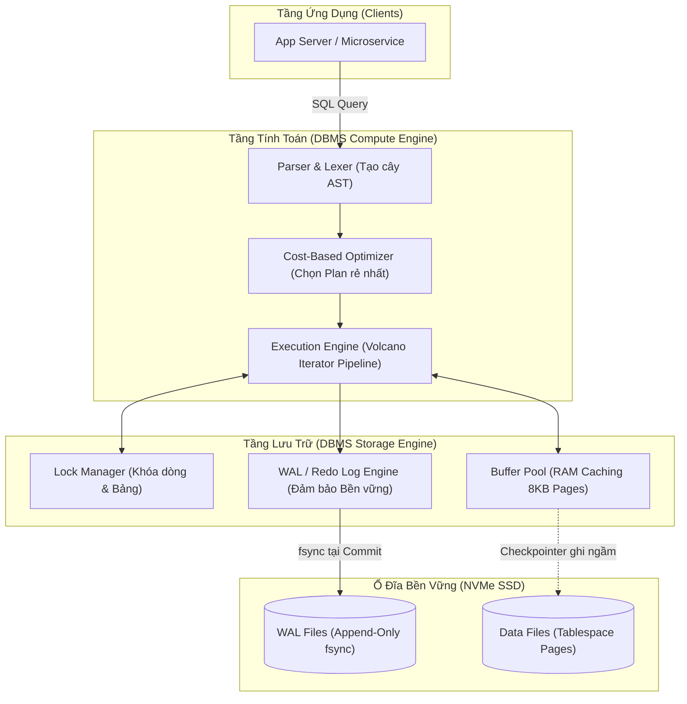
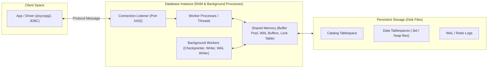
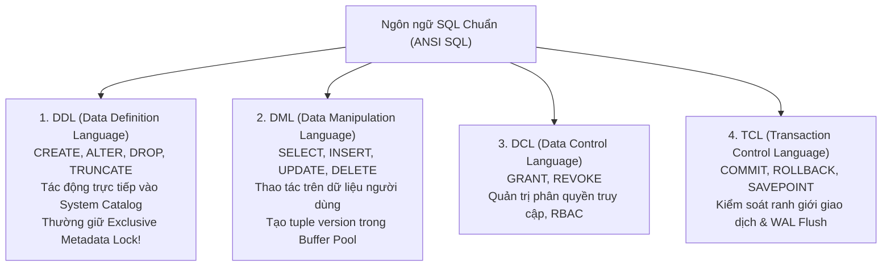
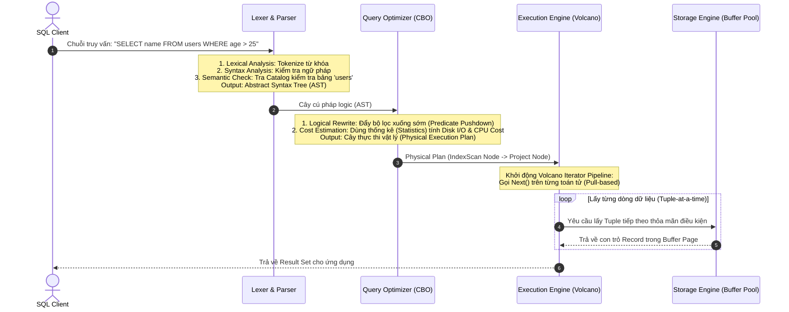
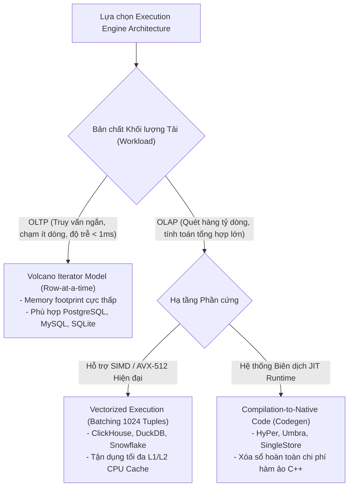

# 1.1. Database Concepts

> [!IMPORTANT]
> **Nếu bạn chỉ được nhớ một điều duy nhất:** Hệ quản trị cơ sở dữ liệu (DBMS) không đơn thuần là nơi lưu file trên đĩa cứng, mà là một cỗ máy đảm bảo tính toàn vẹn dữ liệu: thông qua hệ thống quản lý giao dịch ACID, trừu tượng hóa phân tầng (Logical vs Physical Data Independence), và bảo vệ dữ liệu khỏi rủi ro hỏng hóc vật lý khi mất điện đột ngột bằng cơ chế ghi log trước Write-Ahead Logging (WAL).

---

## 1. Đơn giản nhưng phải chi tiết (Intuitive & Deep Breakdown)

### 1.1. Đoạn Code Dẫn Nhập & Vấn Đề Thực Tế
Tại sao chúng ta không lưu trữ toàn bộ dữ liệu người dùng vào một file JSON hoặc CSV đơn giản trên ổ cứng thay vì phải dựng một Hệ quản trị Cơ sở Dữ liệu (DBMS) cồng kềnh như PostgreSQL hay MySQL?

```python
# Thảm họa khi dùng File thông thường cho ứng dụng nhiều người dùng (Concurrency Bug)
def transfer_money(from_user, to_user, amount):
    # Bước 1: Đọc toàn bộ file vào RAM
    with open("bank_accounts.json", "r") as f:
        data = json.load(f)
    
    # Bước 2: Cập nhật số dư
    if data[from_user] >= amount:
        data[from_user] -= amount
        data[to_user] += amount
        
        # Bước 3: Ghi đè lại file xuống ổ cứng (Mất điện ngay lúc này = Mất sạch dữ liệu!)
        with open("bank_accounts.json", "w") as f:
            json.dump(data, f)
```

Nếu có hai khách hàng cùng rút tiền tại cùng một micro-giây, cả hai tiến trình sẽ cùng đọc số dư cũ, trừ tiền độc lập và ghi đè lên nhau (**Race Condition**). Người sau sẽ xóa sổ giao dịch của người trước, gây thất thoát hàng tỷ đồng mà không để lại bất kỳ dấu vết nào!

### 1.2. Ẩn Dụ Đời Sống & Phân Tích Cơ Chế Hoạt Động
DBMS giống như **Hệ Thống Kho Bạc Trung Ương Tự Động Hóa**:
- **Cơ sở dữ liệu (Database)**: Là khu hầm chứa kiên cố dưới lòng đất, chia thành từng két sắt tiêu chuẩn 8KB (**Data Pages**). Két sắt chỉ được mở bằng chìa khóa bảo mật.
- **DBMS (Hệ Quản Trị CSDL)**: Là toàn bộ bộ máy bảo vệ, ban giám đốc, camera giám sát và quy trình giao dịch nghiêm ngặt:
  - Khi bạn nộp đơn xin rút tiền: Nhân viên tiếp nhận (**Parser / Lexer**) kiểm tra tính hợp lệ của tờ đơn.
  - Trưởng ban kế hoạch (**Query Optimizer**) tính toán lộ trình di chuyển ngắn nhất trong hầm kho để lấy tiền tốn ít calo nhất (**Index Scan vs Table Scan**).
  - Trước khi chạm vào tiền trong két, kế toán phải ghi nhật ký vào **Sổ Cái Khắc Trên Đá (Write-Ahead Log - WAL)**: *"Chuẩn bị trừ 100k của Anh A"*. Dù tòa nhà có bị sét đánh sập ngay sau đó, quyển sổ đá vẫn còn nguyên vẹn để đối chiếu khôi phục lại (**Durability**)!

### 1.3. Mô Phỏng Dữ Liệu Số Nhỏ Từng Bước (Toy Walkthrough)
Theo dõi vòng đời thực thi của câu lệnh SQL `UPDATE accounts SET balance = balance - 100 WHERE id = 1;`:

| Bước | Phân Hệ DBMS | Vùng Nhớ / Tài Nguyên | Hành Động Kỹ Thuật Chi Tiết | Trạng Thái Giao Dịch |
| :--- | :--- | :--- | :--- | :--- |
| **1** | Parser & Optimizer | CPU User Mode | Phân tích cú pháp AST, chọn Physical Plan: `Index Scan on accounts_pkey` | Khởi tạo Transaction $T_1$ |
| **2** | Buffer Manager | Buffer Pool (RAM) | Tìm Trang `Page 42` chứa `id = 1`. Nếu chưa có -> Nạp từ ổ SSD vào RAM | Giữ chốt Pin trên Page |
| **3** | Lock Manager | Lock Table | Cấp phát khóa độc quyền `Exclusive Lock (X-Lock)` trên bản ghi `id = 1` | Chống can thiệp đồng thời |
| **4** | **WAL Engine (Bắt Buộc)**| **WAL Buffer (RAM)** | **Ghi trước bản ghi log:** `[T1: id=1, old=500, new=400]` vào bộ đệm WAL | **Trước khi sửa RAM!** |
| **5** | Execution Engine | Buffer Pool (RAM) | Sửa giá trị `balance = 400` trên `Page 42` (Đánh dấu trang là **Dirty Page**) | Trang bị bẩn trong RAM |
| **6** | Transaction Commit | WAL File (Ổ Cứng) | Gọi syscall `fsync()` ép buộc ghi bản ghi WAL xuống đĩa cứng vật lý | **Cam kết thành công (Committed)!** |

Lưu ý: Trang dữ liệu `Page 42` vẫn nằm trong RAM và CHƯA HỀ được ghi xuống file database trên đĩa! Giao dịch vẫn an toàn $100\%$ nhờ WAL.

### 1.4. Tác Động Thực Tế Tầng Backend & Systems
- **Chi Phí Syscall `fsync()` Trên Ổ Cứng NVMe**: Mỗi khi commit giao dịch, DBMS phải gọi `fsync()` để đẩy dữ liệu từ cache của hệ điều hành xuống chip NAND Flash của SSD. Một ổ SSD chỉ chịu được khoảng vài nghìn lần `fsync()` ngẫu nhiên mỗi giây. Nếu không bật Group Commit (gom nhiều transaction commit cùng lúc), thông lượng của database sẽ bị giới hạn ở mức vài nghìn TPS.
- **Sự Tranh Chấp Bộ Đệm Giữa DBMS Buffer Pool và OS Page Cache (Double Caching)**: Cả hệ điều hành Linux lẫn DBMS đều có cơ chế cache đĩa. Nếu DBMS không mở file với cờ `O_DIRECT`, cùng một khối dữ liệu 8KB sẽ bị nhân bản lưu ở 2 nơi trong RAM: 1 bản trong Buffer Pool của Postgres/MySQL và 1 bản trong Page Cache của Linux, làm lãng phí 50% dung lượng RAM máy chủ!

### 1.5. Sơ Đồ Tư Duy & Kiến Trúc Hệ Thống (Mermaid)


---

## 2. Chi tiết từng Keyword (Under-the-Hood Deep Dive)

### 2.1. Database, DBMS & Database Engine

#### 1. Khái niệm và Sự Tách Bạch
- **Database (Cơ sở Dữ liệu)**: Tập hợp có tổ chức logic của dữ liệu được lưu trữ vật lý trên phương tiện lưu trữ bền vững (HDD, SSD, NVMe).
- **DBMS (Database Management System)**: Hệ thống phần mềm hoàn chỉnh bao bọc xung quanh cơ sở dữ liệu, cung cấp các cơ chế kiểm soát truy cập đồng thời, bảo mật, phục hồi sự cố, sao lưu và tối ưu hóa truy vấn (ví dụ: PostgreSQL, MySQL, Oracle, MongoDB).
- **Database Engine (Storage Engine / Lõi Lưu Trữ)**: Phân hệ phần mềm nội tại phụ trách trực tiếp việc đọc, ghi, đánh chỉ mục và khóa dữ liệu ở cấp độ trang đĩa (Data Pages).

#### 2. Kiến trúc Phân Tách Compute vs Storage trong Kernel
Các hệ CSDL hiện đại tách biệt rất rõ ràng giữa tầng tính toán (Compute Layer) và tầng lưu trữ (Storage Layer):
- **MySQL Pluggable Storage Engine Architecture**:
  - Giao tiếp giữa tầng trên (SQL Layer) và tầng dưới thông qua lớp trừu tượng `handler` interface (các C++ virtual methods như `ha_innobase::index_read()`, `ha_innobase::write_row()`).
  - Cho phép người dùng chọn các engine khác nhau trên từng bảng: **InnoDB** (ACID, B+Tree, MVCC), **MyISAM** (Non-transactional, Table Lock), hoặc **Memory** (RAM-only Hash).
- **PostgreSQL Table Access Method (TAM API)**:
  - Kể từ PostgreSQL 12+, giới thiệu `TableAmRoutine` (các con trỏ hàm C như `tuple_insert`, `tuple_fetch_row_version`). Mặc định sử dụng Heap Engine cổ điển, nhưng cho phép cắm các engine dạng cột (Columnar như Citus, Hydra) hoặc in-memory engine (ZHeap).
- **Embedded Database (SQLite, RocksDB)**:
  - Không có tiến trình server độc lập, không có mạng TCP/IP. Toàn bộ mã nguồn DBMS được biên dịch trực tiếp (link) vào cùng không gian địa chỉ bộ nhớ (Address Space) của tiến trình ứng dụng.

---

### 2.2. Database Server, Database Client, Schema & Instance



1. **Database Instance (Thực thể CSDL)**:
   - Bao gồm toàn bộ **Bộ nhớ RAM được cấp phát** (Buffer Pool, Shared Memory) và tập hợp các **Tiến trình chạy ngầm (Background Processes/Threads)** đang thực thi.
   - Instance có thể khởi động (`STARTUP`), dừng (`SHUTDOWN`) hoặc bị crash.
2. **Database Files (Tệp tin CSDL)**:
   - Toàn bộ dữ liệu nằm trên đĩa cứng: Data Files, Write-Ahead Logs, Control Files, Undo Logs.
   - *Phép phân biệt vàng*: Một Database có thể được gắn kết (Mount) bởi nhiều Instance chạy song song trên các máy chủ khác nhau (mô hình **Oracle RAC** hoặc **AWS Aurora Multi-Writer Shared-Disk**).
3. **Database Schema**:
   - Vùng chứa logic (Namespace) bên trong database, gom nhóm các bảng, views, triggers và quyền hạn (ví dụ schema `public`, `auth`, `billing`). Giúp ngăn chặn xung đột tên bảng và hỗ trợ kiến trúc Multi-tenancy.
4. **Database Client**:
   - Các thư viện lập trình (Driver như JDBC, `pgx`, `mysqlclient`) hoặc công cụ dòng lệnh (`psql`, `mysql`). Client kết nối với Database Server thông qua các giao thức nhị phân riêng biệt (PostgreSQL Frontend/Backend Protocol V3.0, MySQL Client/Server Protocol) qua TCP socket hoặc UNIX Domain Socket.

---

### 2.3. Database Catalog & Metadata

#### 1. Khái niệm và Vai trò
- **Data Dictionary / System Catalog**: Là cuốn bách khoa toàn thư của DBMS, lưu trữ toàn bộ thông tin về cấu trúc CSDL (**Metadata - Dữ liệu về Dữ liệu**):
  - Định nghĩa bảng, danh sách cột, kiểu dữ liệu, các ràng buộc (Constraints, Foreign Keys).
  - Thông tin chỉ mục (B+Tree index root page, index columns).
  - Quyền hạn người dùng (RBAC grants).
  - Số liệu thống kê chi phí phục vụ bộ tối ưu hóa truy vấn (Histogram phân bố dữ liệu, số trang đĩa, số lượng dòng).

#### 2. Cơ chế Lưu trữ và Bài toán "Con gà - Quả trứng" (The Bootstrap Problem)
- Điều kỳ diệu trong các DBMS quan hệ: **Toàn bộ Catalog cũng được lưu trữ dưới dạng các Bảng quan hệ thông thường**!
  - Trong PostgreSQL: `pg_class` (thông tin bảng/index), `pg_attribute` (thông tin cột), `pg_type` (kiểu dữ liệu).
  - Chuẩn ANSI SQL: `INFORMATION_SCHEMA` (tập hợp các Views chuẩn hóa quốc tế trỏ vào các catalog nội bộ).
- **The Bootstrap Problem**: Khi khởi động CSDL từ con số không, làm thế nào DBMS có thể truy vấn bảng `pg_class` để biết vị trí của nó trên đĩa, trong khi chính nó là một bảng?
  - *Giải pháp*: DBMS mã hóa cứng (Hardcode) các OID (Object Identifiers) và địa chỉ trang gốc (Root Page / Fork Page) của các bảng Catalog cốt lõi ngay trong mã nguồn C++ của engine (`include/catalog/pg_class.h`).

---

### 2.4. Data Model & SQL Sublanguages (DDL, DML, DCL, TCL)

#### 1. Data Model (Mô hình Dữ liệu)
Trừu tượng hóa toán học mô tả cách thức tổ chức, liên kết và các ràng buộc dữ liệu:
- **Relational Model**: Dữ liệu được tổ chức dưới dạng các Quan hệ (Relations - Bảng) gồm các Bộ (Tuples - Dòng) và Thuộc tính (Attributes - Cột).
- **Document Model**: Bán cấu trúc (JSON/BSON), cấu trúc cây lồng nhau (Tree-structured).
- **Key-Value & Graph Models**: Ánh xạ cặp khóa-giá trị hoặc mạng lưới Đỉnh (Vertices) và Cạnh (Edges).

#### 2. Bốn Phân Ngữ của SQL (SQL Sublanguages)


---

### 2.5. Query Language, Query Processor, Storage Engine & Execution Engine

Toàn bộ hành trình của một câu truy vấn từ khi Client gửi tới lúc trả về dữ liệu trải qua một dây chuyền tinh vi:



1. **Query Language (Khai báo - Declarative)**: SQL là ngôn ngữ khai báo: người dùng chỉ nói cho DBMS biết **KẾT QUẢ HỌ MUỐN LÀ GÌ**, chứ không chỉ ra từng bước thuật toán phải thực hiện như thế nào.
2. **Query Processor (Bộ Xử lý Truy vấn)**:
   - **Lexer & Parser**: Đọc chuỗi văn bản SQL, sinh danh sách Tokens và dựng cây cú pháp trừu tượng (**AST**).
   - **Semantic Analyzer**: Đối chiếu với System Catalog để xác thực: bảng `users` có tồn tại không? Cột `age` có thuộc bảng `users` không? Người dùng có quyền đọc không?
3. **Query Optimizer (Bộ Tối ưu hóa Dựa trên Chi phí - CBO)**:
   - Biến đổi cây cú pháp thành nhiều kế hoạch vật lý khả thi (Plan Candidates).
   - Sử dụng công thức toán học tính toán chi phí (Cost Model): $\text{Cost} = (N_{pages} \times \text{Page\_Cost}) + (N_{tuples} \times \text{CPU\_Cost})$.
   - Chọn ra kế hoạch có tổng chi phí tài nguyên thấp nhất.
4. **Execution Engine (Động cơ Thực thi - Volcano Iterator Model)**:
   - Hầu hết các CSDL truyền thống (PostgreSQL, MySQL, SQLite) sử dụng mô hình **Volcano Model (Iterator Model)** do Goetz Graefe phát minh.
   - Mỗi toán tử quan hệ (SeqScan, IndexScan, NestedLoopJoin, HashAggregate) là một đối tượng cài đặt 3 phương thức:
     - `open()`: Khởi tạo con trỏ và bộ đệm.
     - `next()`: Trả về đúng **1 tuple duy nhất** (hoặc `NULL` nếu hết dữ liệu).
     - `close()`: Giải phóng tài nguyên.
   - *Ưu điểm*: Tiêu tốn cực ít bộ nhớ RAM vì dữ liệu được xử lý dạng ống dẫn dòng chảy (Pipeline), không cần nạp toàn bộ triệu bản ghi vào RAM một lúc.
5. **Storage Engine (Bộ máy Lưu trữ)**:
   - Chịu trách nhiệm về cấu trúc vật lý của bản ghi: **Slotted-Page Architecture**, quản lý phân trang đĩa (Page 8KB trong Postgres, 16KB trong InnoDB), cấp phát con trỏ trang và cơ chế ghi nhật ký phục hồi (**Write-Ahead Logging**).

---

## 3. Thực thi Mã nguồn & Mô phỏng Chuyên sâu (Dual-Engine Implementation)

Dưới đây là mã nguồn mô phỏng chi tiết cấu trúc lưu trữ Slotted-Page và Pipeline thực thi truy vấn theo mô hình Volcano Iterator.

### 3.1. C++20: Mini Database Kernel với Slotted Page Storage & Volcano Iterator

File `mini_db_engine.cpp` hiện thực hoàn chỉnh cấu trúc trang đĩa Slotted Page (quản lý phân mảnh bộ nhớ bản ghi từ mép cuối trang) và mô hình thực thi cây toán tử kéo dữ liệu từng dòng (`next()`).

```cpp
#include <iostream>
#include <vector>
#include <string>
#include <cstring>
#include <memory>
#include <cstdint>
#include <iomanip>
#include <optional>

// Kich thuoc Data Page chuan 4096 bytes (4KB)
constexpr size_t PAGE_SIZE = 4096;

#pragma pack(push, 1)
struct Slot {
    uint16_t offset; // Vi tri bat dau cua record tinh tu dau trang
    uint16_t length; // Do dai byte cua record
};

struct PageHeader {
    uint16_t num_slots;       // So luong slots hien tai
    uint16_t free_space_start; // Con tro bat dau cua vung nho slot tiep theo
    uint16_t free_space_end;   // Con tro bat dau cua vung ghi du lieu record tu cuoi trang len
};
#pragma pack(pop)

// Cau truc Slotted Page quan ly du lieu vat ly
class SlottedPage {
private:
    alignas(64) uint8_t data_[PAGE_SIZE];

public:
    SlottedPage() {
        std::memset(data_, 0, PAGE_SIZE);
        auto* header = get_header();
        header->num_slots = 0;
        header->free_space_start = sizeof(PageHeader);
        header->free_space_end = PAGE_SIZE;
    }

    PageHeader* get_header() {
        return reinterpret_cast<PageHeader*>(data_);
    }

    const PageHeader* get_header() const {
        return reinterpret_cast<const PageHeader*>(data_);
    }

    Slot* get_slots() {
        return reinterpret_cast<Slot*>(data_ + sizeof(PageHeader));
    }

    const Slot* get_slots() const {
        return reinterpret_cast<const Slot*>(data_ + sizeof(PageHeader));
    }

    // Ghi Record vao trang (Ghi tu cuoi trang len dau trang)
    std::optional<uint16_t> insert_record(const std::string& record_data) {
        auto* header = get_header();
        uint16_t needed_space = sizeof(Slot) + record_data.size();

        // Kiem tra xem con du dung luong trong giua 2 con tro hay khong
        if (header->free_space_end - header->free_space_start < needed_space) {
            return std::nullopt; // Trang da day!
        }

        // 1. Ghi du lieu record vao cuoi trang
        header->free_space_end -= record_data.size();
        std::memcpy(data_ + header->free_space_end, record_data.data(), record_data.size());

        // 2. Ghi slot moi o dau trang
        uint16_t slot_idx = header->num_slots;
        Slot* slots = get_slots();
        slots[slot_idx].offset = header->free_space_end;
        slots[slot_idx].length = static_cast<uint16_t>(record_data.size());

        header->num_slots++;
        header->free_space_start += sizeof(Slot);

        return slot_idx; // Tra ve Slot ID (Record ID = PageID + SlotID)
    }

    std::optional<std::string> get_record(uint16_t slot_idx) const {
        const auto* header = get_header();
        if (slot_idx >= header->num_slots) return std::nullopt;

        const Slot* slots = get_slots();
        uint16_t offset = slots[slot_idx].offset;
        uint16_t length = slots[slot_idx].length;

        return std::string(reinterpret_cast<const char*>(data_ + offset), length);
    }
};

// Mo hinh Tuple logic
struct Tuple {
    int id;
    std::string name;
    int age;
};

// Lop Giao dien Volcano Iterator Model
class ExecutorIterator {
public:
    virtual ~ExecutorIterator() = default;
    virtual void open() = 0;
    virtual std::optional<Tuple> next() = 0;
    virtual void close() = 0;
};

// Toan tu Scan duyet tuan tu cac ban ghi tu Slotted Page
class SeqScanExecutor : public ExecutorIterator {
private:
    const SlottedPage& page_;
    uint16_t current_slot_;

public:
    explicit SeqScanExecutor(const SlottedPage& page) : page_(page), current_slot_(0) {}

    void open() override { current_slot_ = 0; }

    std::optional<Tuple> next() override {
        const auto* header = page_.get_header();
        while (current_slot_ < header->num_slots) {
            auto raw = page_.get_record(current_slot_++);
            if (raw.has_value()) {
                // Parse du lieu CSV don gian: "id,name,age"
                Tuple t{};
                size_t p1 = raw->find(',');
                size_t p2 = raw->find(',', p1 + 1);
                t.id = std::stoi(raw->substr(0, p1));
                t.name = raw->substr(p1 + 1, p2 - p1 - 1);
                t.age = std::stoi(raw->substr(p2 + 1));
                return t;
            }
        }
        return std::nullopt; // Het du lieu
    }

    void close() override {}
};

// Toan tu Filter (Menh de WHERE)
class FilterExecutor : public ExecutorIterator {
private:
    std::unique_ptr<ExecutorIterator> child_;
    int min_age_;

public:
    FilterExecutor(std::unique_ptr<ExecutorIterator> child, int min_age)
        : child_(std::move(child)), min_age_(min_age) {}

    void open() override { child_->open(); }

    std::optional<Tuple> next() override {
        while (true) {
            auto tuple = child_->next();
            if (!tuple.has_value()) return std::nullopt;
            if (tuple->age >= min_age_) {
                return tuple; // Thoa man menh de loc
            }
        }
    }

    void close() override { child_->close(); }
};

int main() {
    std::cout << "=== MINI DATABASE STORAGE & VOLCANO EXECUTION ENGINE (C++20) ===" << std::endl;

    SlottedPage page;
    // Nạp dữ liệu mẫu vào trang đĩa
    page.insert_record("1,Alice,24");
    page.insert_record("2,Bob,32");
    page.insert_record("3,Charlie,28");
    page.insert_record("4,David,19");
    page.insert_record("5,Eva,35");

    std::cout << "[+] Da nap 5 ban ghi vao Slotted Page 4KB an toan.\n";
    std::cout << "    - So slots da tao: " << page.get_header()->num_slots << "\n";
    std::cout << "    - Vung nho trong con lai: " 
              << (page.get_header()->free_space_end - page.get_header()->free_space_start) << " bytes\n\n";

    // Xay dung Cây Kế hoạch Thực thi (Execution Pipeline Plan)
    // Truy van: SELECT * FROM users WHERE age >= 25
    auto scan = std::make_unique<SeqScanExecutor>(page);
    auto filter = std::make_unique<FilterExecutor>(std::move(scan), 25);

    std::cout << "--- KET QUA THUC THI VOLCANO PIPELINE (WHERE age >= 25) ---\n";
    std::cout << std::left << std::setw(6) << "ID" 
              << std::setw(15) << "NAME" 
              << std::setw(6) << "AGE" << "\n";
    std::cout << "----------------------------\n";

    filter->open();
    while (auto t = filter->next()) {
        std::cout << std::left << std::setw(6) << t->id 
                  << std::setw(15) << t->name 
                  << std::setw(6) << t->age << "\n";
    }
    filter->close();

    return 0;
}
```

### 3.2. Python 3.11: SQL Lexer, Parser & Pipeline Engine Simulator

File `sql_pipeline_engine.py` mô phỏng đầy đủ chuỗi xử lý từ câu lệnh SQL dạng văn bản thô, chuyển hóa qua Lexer/Parser thành AST, tra cứu System Catalog và thực thi toán tử.

```python
import re
from dataclasses import dataclass
from typing import List, Dict, Any, Optional

@dataclass
class ColumnMeta:
    name: str
    data_type: str

class SystemCatalog:
    """Mo phong System Catalog luu tru Metadata bang va cot."""
    def __init__(self):
        self.tables: Dict[str, List[ColumnMeta]] = {
            "employees": [
                ColumnMeta("id", "INT"),
                ColumnMeta("name", "VARCHAR"),
                ColumnMeta("salary", "INT"),
                ColumnMeta("dept", "VARCHAR")
            ]
        }

    def validate_table(self, table_name: str) -> bool:
        return table_name in self.tables

    def validate_column(self, table_name: str, col_name: str) -> bool:
        if not self.validate_table(table_name): return False
        return any(c.name == col_name for c in self.tables[table_name])

@dataclass
class ASTQuery:
    select_cols: List[str]
    from_table: str
    where_col: Optional[str] = None
    where_op: Optional[str] = None
    where_val: Optional[Any] = None

class SimpleSQLParser:
    """Tach tu va phan tich cu phap SQL co ban: SELECT cols FROM table WHERE col op val."""
    @staticmethod
    def parse(sql: str, catalog: SystemCatalog) -> ASTQuery:
        tokens = re.findall(r"[\w']+|[<>=!]+|[,*]", sql)
        
        # Kiem tra SELECT
        if not tokens or tokens[0].upper() != "SELECT":
            raise SyntaxError("Truy van phai bat dau bang SELECT!")

        idx = 1
        cols = []
        while idx < len(tokens) and tokens[idx].upper() != "FROM":
            if tokens[idx] != ",":
                cols.append(tokens[idx])
            idx += 1

        idx += 1 # Bo qua FROM
        table = tokens[idx]
        idx += 1

        if not catalog.validate_table(table):
            raise ValueError(f"[Catalog Error] Bang '{table}' khong ton tai trong System Catalog!")

        ast = ASTQuery(select_cols=cols, from_table=table)

        # Kiem tra WHERE
        if idx < len(tokens) and tokens[idx].upper() == "WHERE":
            ast.where_col = tokens[idx + 1]
            ast.where_op = tokens[idx + 2]
            val = tokens[idx + 3]
            ast.where_val = int(val) if val.isdigit() else val.strip("'")
            
            if not catalog.validate_column(table, ast.where_col):
                raise ValueError(f"[Catalog Error] Cot '{ast.where_col}' khong ton tai trong bang '{table}'!")

        return ast

class ExecutionEngine:
    """Thuc thi cau truy van dua tren Physical Plan."""
    @staticmethod
    def execute(ast: ASTQuery, table_data: List[Dict[str, Any]]) -> List[Dict[str, Any]]:
        print(f"[*] Bat dau thuc thi Physical Plan tren bang: '{ast.from_table}'")
        results = []
        for row in table_data:
            # Ap dung Filter Operator (Predicate Pushdown)
            if ast.where_col:
                actual_val = row[ast.where_col]
                if ast.where_op == ">" and not (actual_val > ast.where_val): continue
                if ast.where_op == "=" and not (actual_val == ast.where_val): continue

            # Ap dung Projection Operator
            projected = {}
            if "*" in ast.select_cols:
                projected = row
            else:
                for col in ast.select_cols:
                    projected[col] = row[col]
            results.append(projected)
        return results

if __name__ == "__main__":
    catalog = SystemCatalog()
    sample_employees = [
        {"id": 101, "name": "Alice", "salary": 95000, "dept": "Engineering"},
        {"id": 102, "name": "Bob", "salary": 62000, "dept": "Marketing"},
        {"id": 103, "name": "Charlie", "salary": 110000, "dept": "Engineering"},
        {"id": 104, "name": "Diana", "salary": 75000, "dept": "Finance"}
    ]

    sql = "SELECT name, salary FROM employees WHERE salary > 70000"
    print(f"SQL Input: \"{sql}\"")

    ast = SimpleSQLParser.parse(sql, catalog)
    print(f"[+] AST Parsed: Columns={ast.select_cols}, Table={ast.from_table}, Filter=({ast.where_col} {ast.where_op} {ast.where_val})")

    output = ExecutionEngine.execute(ast, sample_employees)
    print("\n--- RESULT SET ---")
    for r in output:
        print(r)
```

### 3.3. Terminal Output Mẫu

```text
$ clang++ -std=c++20 -O3 mini_db_engine.cpp -o mini_db_engine && ./mini_db_engine
=== MINI DATABASE STORAGE & VOLCANO EXECUTION ENGINE (C++20) ===
[+] Da nap 5 ban ghi vao Slotted Page 4KB an toan.
    - So slots da tao: 5
    - Vung nho trong con lai: 4016 bytes

--- KET QUA THUC THI VOLCANO PIPELINE (WHERE age >= 25) ---
ID    NAME           AGE   
----------------------------
2     Bob            32    
3     Charlie        28    
5     Eva            35    

$ python3 sql_pipeline_engine.py
SQL Input: "SELECT name, salary FROM employees WHERE salary > 70000"
[+] AST Parsed: Columns=['name', 'salary'], Table=employees, Filter=(salary > 70000)
[*] Bat dau thuc thi Physical Plan tren bang: 'employees'

--- RESULT SET ---
{'name': 'Alice', 'salary': 95000}
{'name': 'Charlie', 'salary': 110000}
{'name': 'Diana', 'salary': 75000}
```

---

## 4. Systems Engineering & Production Pitfalls

### 4.1. Cơn Bão Khóa Metadata khi Chạy DDL (Metadata Lock - MDL Storms)
Trong cả MySQL và PostgreSQL, các câu lệnh DDL (`ALTER TABLE`, `ADD COLUMN`, `CREATE INDEX` không đồng thời) yêu cầu khóa độc quyền tối cao trên bảng:
- Trong PostgreSQL: Yêu cầu **`AccessExclusiveLock`**.
- Trong MySQL: Yêu cầu **`Metadata Lock (Exclusive MDL)`**.
- **Kịch bản Thảm họa Production**:
  1. Một truy vấn `SELECT` báo cáo chạy chậm kéo dài 5 phút trên bảng `orders`.
  2. Kỹ sư chạy lệnh `ALTER TABLE orders ADD COLUMN status_code INT;`. Lệnh DDL này phải xếp hàng chờ câu `SELECT` kia nhả Shared Lock.
  3. **Hậu quả dây chuyền**: Tất cả hàng nghìn câu truy vấn `SELECT`, `INSERT`, `UPDATE` mới đến sau lệnh DDL **đều bị kẹt cứng phía sau hàng đợi của DDL**!
  4. Chỉ trong vài giây, Connection Pool của ứng dụng bị đầy $100\%$, máy chủ backend sụp đổ hoàn toàn.
- **Biện pháp Phòng ngừa**:
  ```sql
  -- Luôn đặt lock_timeout trước khi chạy bất kỳ lệnh DDL nào!
  SET lock_timeout = '3s';
  ALTER TABLE orders ADD COLUMN status_code INT;
  -- Trong PostgreSQL, luôn tạo index bằng chế độ CONCURRENTLY
  CREATE INDEX CONCURRENTLY idx_orders_user ON orders(user_id);
  ```

### 4.2. Phình To Bảng System Catalog (`pg_catalog` Bloat)
Trong các hệ thống CI/CD hoặc microservices tự động tạo và xóa các bảng tạm (Temporary Tables) liên tục:
- Các bảng Catalog như `pg_class`, `pg_attribute`, `pg_type` bị ghi đè và xóa hàng triệu lần mỗi ngày.
- Cơ chế MVCC sinh ra hàng gigabyte các Dead Tuples trong System Catalog, khiến bộ tối ưu hóa truy vấn tốn hàng trăm mili-giây chỉ để tra cứu metadata cho mỗi câu SQL đơn giản!
- **Khắc phục**: Định kỳ chạy `VACUUM FULL pg_catalog.pg_class;` trong các cửa sổ bảo trì hoặc cấu hình autovacuum chuyên sâu cho schema `pg_catalog`.

### 4.3. Các Lệnh CLI Chẩn đoán Trạng Thái CSDL Thực Chiến

```bash
# 1. Xem danh sách các truy vấn đang thực thi và thời gian chạy trong PostgreSQL
psql -c "SELECT pid, now() - query_start AS duration, query, state 
         FROM pg_stat_activity 
         WHERE state != 'idle' ORDER BY duration DESC;"

# 2. Phát hiện các câu truy vấn đang chặn khóa nhau (Lock Blocking Tree)
psql -c "SELECT blocked_locks.pid     AS blocked_pid,
                blocking_locks.pid    AS blocking_pid,
                blocked_activity.query AS blocked_statement,
                blocking_activity.query AS blocking_statement
         FROM  pg_catalog.pg_locks         blocked_locks
         JOIN pg_catalog.pg_locks         blocking_locks 
           ON blocking_locks.locktype = blocked_locks.locktype
          AND blocking_locks.database IS NOT DISTINCT FROM blocked_locks.database
          AND blocking_locks.relation IS NOT DISTINCT FROM blocked_locks.relation
          AND blocking_locks.page IS NOT DISTINCT FROM blocked_locks.page
          AND blocking_locks.tuple IS NOT DISTINCT FROM blocked_locks.tuple
          AND blocking_locks.virtualxid IS NOT DISTINCT FROM blocked_locks.virtualxid
          AND blocking_locks.transactionid IS NOT DISTINCT FROM blocked_locks.transactionid
          AND blocking_locks.classid IS NOT DISTINCT FROM blocked_locks.classid
          AND blocking_locks.objid IS NOT DISTINCT FROM blocked_locks.objid
          AND blocking_locks.objsubid IS NOT DISTINCT FROM blocked_locks.objsubid
          AND blocking_locks.pid != blocked_locks.pid
         JOIN pg_catalog.pg_stat_activity blocked_activity ON blocked_activity.pid = blocked_locks.pid
         JOIN pg_catalog.pg_stat_activity blocking_activity ON blocking_activity.pid = blocking_locks.pid
         WHERE NOT blocked_locks.granted;"
```

---

## 5. Bảng So sánh & Decision Matrix

### 5.1. Bảng So sánh: Các Thành phần Kiến trúc của Hệ Quản trị CSDL

| Phân hệ / Khái niệm | Vị trí Thực thi | Nhiệm vụ Trọng tâm | Đại diện Tiêu biểu |
| :--- | :---: | :--- | :--- |
| **Compute Layer** | CPU / User RAM | Parse cú pháp, Tối ưu hóa, Điều phối Pipeline | Parser, Cost-Based Optimizer, Volcano Engine |
| **Storage Engine** | Memory / Disk | Đọc/ghi trang đĩa, B+Tree, Khóa dòng, Flush | InnoDB, RocksDB, WiredTiger, Heap AM |
| **Buffer Manager** | Shared Memory | Caching Data Pages, Thuật toán thay thế trang | LRU, Clock-Sweep, 2Q |
| **WAL / Redo Log** | Bền vững trên Đĩa | Đảm bảo độ bền (Durability), Hỗ trợ Crash Recovery | ARIES WAL, InnoDB Redo Log |
| **System Catalog** | Data Pages đặc biệt | Lưu trữ toàn bộ Schema, Types, Quyền, Thống kê | `pg_class`, MySQL Data Dictionary |

### 5.2. Decision Matrix: Lựa chọn Mô hình Thực thi Truy vấn trong Động cơ CSDL



| Loại hình Tác vụ | Mô hình Thực thi Khuyên dùng | Lý do & Lợi thế Kỹ thuật |
| :--- | :--- | :--- |
| **Giao dịch Trực tuyến Ngân hàng (OLTP)** | **Volcano Iterator (Tuple-at-a-time)** | Tiết kiệm RAM tuyệt đối, độ trễ trả về dòng đầu tiên (Time-to-First-Row) cực nhanh. |
| **Phân tích Dữ liệu Lớn (OLAP / Data Warehouse)** | **Vectorized Execution (Vector-at-a-time)** | Đẩy mảng dữ liệu vào thanh ghi vector CPU SIMD, loại bỏ chi phí gọi hàm ảo lặp lại. |
| **Nhúng Ứng dụng Di động / Thiết bị IoT** | **Embedded Engine (SQLite)** | Không cần daemon server, zero-network overhead, độ tin cậy tuyệt đối với 1 file duy nhất. |

---

## 6. Enterprise Production Checklist & Verification

### 6.1. Kiến Trúc & Cấu Hình Tối Ưu (Production-Ready Architecture)
- [ ] **Kích Thước Buffer Pool Chuẩn Xác**: Cấu hình `shared_buffers` (PostgreSQL) từ 25% đến 40% tổng dung lượng RAM vật lý; hoặc `innodb_buffer_pool_size` (MySQL) từ 60% đến 75% RAM máy chủ chuyên dụng.
- [ ] **Kích Hoạt Direct I/O Tránh Double Caching**: Trên MySQL InnoDB, cấu hình `innodb_flush_method = O_DIRECT` để bypass hoàn toàn OS Page Cache của Linux.
- [ ] **Tối Ưu Hóa Tần Suất Checkpoint**: Thiết lập `max_wal_size` (Postgres) tối thiểu 16GB đến 32GB để giảm tần suất checkpoint dồn dập, tránh hiện tượng sụt giảm IOPS theo chu kỳ (I/O Spikes).
- [ ] **Tách Biệt Ổ Đĩa Cho WAL và Data Files**: Đặt thư mục chứa WAL (`pg_wal` / InnoDB Redo Log) lên một ổ SSD NVMe vật lý riêng biệt với ổ chứa Data Files để triệt tiêu hiện tượng tranh chấp đầu đọc/ghi giữa ghi tuần tự (WAL) và ghi ngẫu nhiên (Data Pages).

### 6.2. Giám Sát, Cảnh Báo & Xử Lý Sự Cố (Observability & Incident Response)
- [ ] **Giám Sát Tỷ Lệ Buffer Cache Hit Ratio**: Theo dõi tỷ lệ đọc dữ liệu từ RAM: `Cache Hit Ratio = (Heap Reads from Buffer / Total Reads) * 100` và đảm bảo luôn đạt trên 99% cho các hệ thống OLTP.
- [ ] **Cảnh Báo Đầy Dung Lượng Ổ Đĩa WAL**: Thiết lập cảnh báo khẩn cấp khi phân vùng chứa WAL đạt 80% dung lượng; nếu ổ đĩa WAL bị đầy $100\%$, DBMS sẽ lập tức tự tắt khẩn cấp (Panic Shutdown) để chống hỏng dữ liệu.
- [ ] **Kiểm Tra Khóa Giao Dịch Bằng CLI**: Sử dụng script truy vấn `pg_stat_activity` hoặc `SHOW ENGINE INNODB STATUS` để phát hiện các truy vấn chạy ngầm đang chiếm giữ khóa bảng lâu bất thường.
