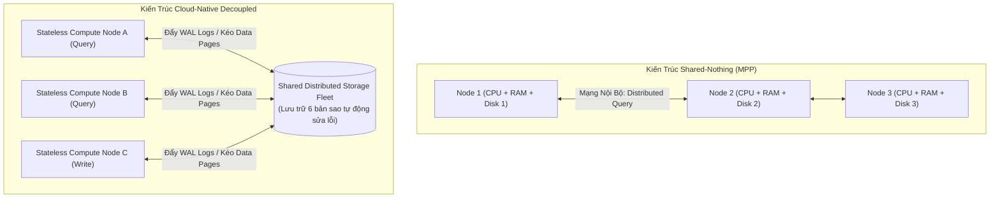
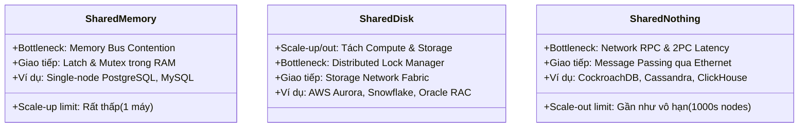
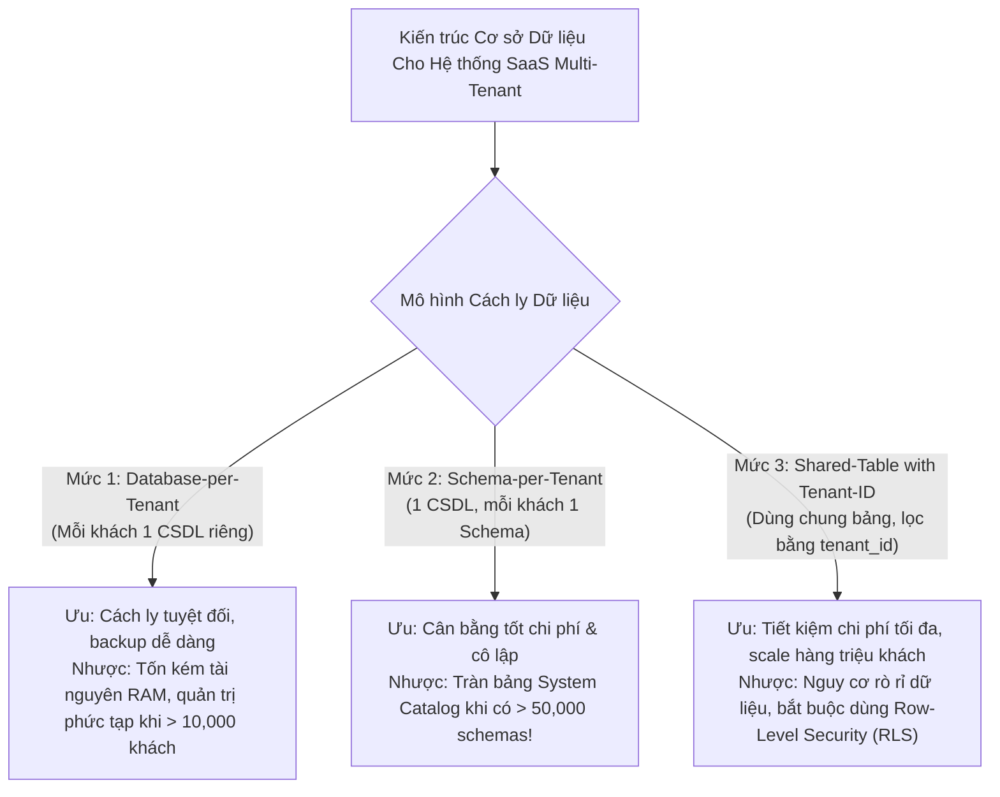
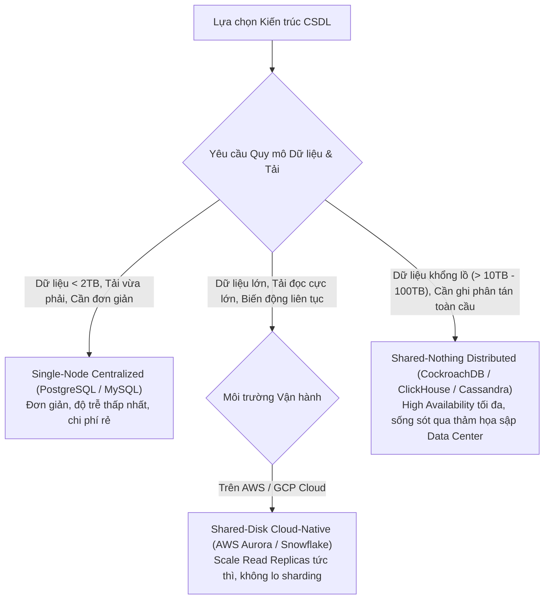

# 1.2. Database Architectures

> [!IMPORTANT]
> **Nếu bạn chỉ được nhớ một điều duy nhất:** Kiến trúc CSDL định hình giới hạn mở rộng (Scalability) của toàn bộ hệ thống: Shared-Memory và Shared-Disk dễ quản lý, đảm bảo nhất quán tuyệt đối nhưng bị trần phần cứng của một node giới hạn; trong khi Shared-Nothing là nền tảng sống còn của các hệ thống Big Data và CSDL phân tán hiện đại, chấp nhận độ phức tạp của đồng thuận mạng để mở rộng vô hạn theo chiều ngang.

---

## 1. Đơn giản nhưng phải chi tiết (Intuitive & Deep Breakdown)

### 1.1. Đoạn Code Dẫn Nhập & Vấn Đề Thực Tế
Làm thế nào để phân biệt sự khác nhau giữa kiến trúc cơ sở dữ liệu truyền thống (Shared-Everything), kiến trúc Shared-Nothing (phân tán), và kiến trúc Cloud-Native Tách rời Tính toán & Lưu trữ (Separation of Compute and Storage)?

```sql
-- Ví dụ trên Snowflake / AWS Aurora (Kiến trúc Tách Rời Compute & Storage)
-- Bạn có thể tăng gấp 10 lần năng lực tính toán CPU chỉ trong 2 giây mà không cần di chuyển bất kỳ Gigabyte dữ liệu nào!
ALTER WAREHOUSE analytics_wh SET WAREHOUSE_SIZE = 'XLARGE';

-- Trên hệ thống Shared-Nothing truyền thống (như Cassandra, Greenplum):
-- Thêm một Node mới bắt buộc phải kích hoạt quá trình Re-sharding và Data Rebalance,
-- làm nghẽn băng thông mạng nội bộ hàng chục tiếng đồng hồ để chuyển dữ liệu sang node mới!
```

Nếu một kiến trúc database không tách rời Compute và Storage, khi bạn chỉ cần chạy một báo cáo thống kê nặng vào cuối tháng (cần nhiều CPU), bạn buộc phải mua thêm cả ổ cứng dung lượng lớn đi kèm, gây lãng phí hàng trăm nghìn USD chi phí hạ tầng!

### 1.2. Ẩn Dụ Đời Sống & Phân Tích Cơ Chế Hoạt Động
So sánh các kiến trúc Database giống như **Mô Hình Hoạt Động Của Một Chuỗi Nhà Hàng**:
- **Shared-Memory (Một Nhà Hàng Lớn)**: 10 đầu bếp cùng đứng chung trong một căn bếp, cùng dùng chung một tủ lạnh và một mặt bàn chế biến. Cực kỳ nhanh khi có 5-10 người, nhưng khi có 50 đầu bếp chen chúc nhau thì họ sẽ đụng cùi chỏ vào nhau và không ai nấu được gì (**Lock Contention & Bus Bottleneck**).
- **Shared-Nothing (Mỗi Chi Nhánh Một Quầy Riêng)**: Mỗi chi nhánh có một đầu bếp riêng, tủ lạnh riêng, thực đơn riêng phụ trách khách của quận đó. Cực kỳ dễ mở rộng. *Nhược điểm*: Khi khách Quận 1 muốn ăn món chỉ có ở kho Quận 2, hai đầu bếp phải gọi điện trao đổi qua lại rất rườm rà (**Distributed Joins & 2-Phase Commit**).
- **Shared-Storage / Cloud-Native (Bếp Nấu Riêng & Kho Lạnh Trung Tâm Vô Tận)**: Các đầu bếp (Compute Nodes) có thể thuê theo giờ, tùy số lượng khách. Tất cả cùng gọi đồ từ một **Kho Lạnh Siêu Cấp Đám Mây (S3 / Aurora Storage Mesh)**. Cần 100 đầu bếp nấu tiệc? Mở thêm 100 bếp trong 5 phút. Hết tiệc? Trả lại bếp, kho lạnh vẫn nằm nguyên đó!

### 1.3. Mô Phỏng Dữ Liệu Số Nhỏ Từng Bước (Toy Walkthrough)
So sánh năng lực mở rộng (Scalability) của 3 mô hình kiến trúc khi dữ liệu tăng từ 100 GB lên 100 TB:

| Tiêu Chí Kỹ Thuật | Shared-Memory / SMP (Monolithic) | Shared-Nothing (MPP / Distributed) | Cloud-Native Decoupled (Aurora/Snowflake) |
| :--- | :--- | :--- | :--- |
| **Thành Phần Chia Sẻ** | Chia sẻ toàn bộ RAM, CPU, Bus và Disk | **Không chia sẻ gì cả** (Mỗi node có CPU, RAM, Disk riêng) | **Chia sẻ tầng Storage chung** qua mạng cáp quang 100GbE |
| **Cách Mở Rộng (Scaling)**| Mở rộng dọc (Scale-Up): Mua server to hơn | Mở rộng ngang (Scale-Out): Ghép thêm nodes | Tách biệt: Scale độc lập Compute và Storage |
| **Thời Gian Tăng Năng Lực CPU**| Phải tắt máy cắm thêm RAM/CPU (Downtime) | Phải cấu hình node mới, rebalance dữ liệu | **Tức thì (< 5 giây)** (Chỉ cần khởi động VM/Container) |
| **Xử Lý Nút Hỏng (Node Failure)**| Sập cả hệ thống nếu hỏng Mainboard/RAM | Mất 1 partition, cần replica phụ gánh | Compute chết thì node khác thế chỗ, storage an toàn |
| **Độ Phức Tạp Phân Tán** | Thấp nhất (Single Node Engine) | Cao nhất (Raft/Paxos, Distributed Trans) | Trung bình (Storage tự lo replication ngầm) |

### 1.4. Tác Động Thực Tế Tầng Backend & Systems
- **Chi Phí Network Hop Trong Kiến Trúc Cloud-Native**: Trong các database như AWS Aurora hay Google AlloyDB, tầng Compute đọc/ghi trang đĩa thông qua card mạng tốc độ cao (EBS / Cloud Storage Fabric) thay vì ổ SSD gắn trực tiếp. Để bù đắp độ trễ mạng vài trăm micro-giây, Aurora chỉ đẩy các bản ghi log WAL siêu nhẹ qua mạng ("The Log is the Database") thay vì đẩy cả trang dữ liệu 16KB!
- **Hội Chứng Data Skew Trong Shared-Nothing**: Trong các kiến trúc Shared-Nothing (Hadoop, ClickHouse, Cassandra), nếu khóa phân vùng (Shard Key) bị lệch (ví dụ 80% đơn hàng thuộc về ngày Black Friday), một node duy nhất sẽ bị quá tải $100\%$ CPU và hết sạch ổ đĩa, trong khi các node khác ngồi chơi xơi nước.

### 1.5. Sơ Đồ Tư Duy & Kiến Trúc Hệ Thống (Mermaid)


---

## 2. Chi tiết từng Keyword (Under-the-Hood Deep Dive)

### 2.1. Embedded vs Client-Server vs Centralized vs Distributed Database

#### A. Embedded Database (Cơ sở Dữ liệu Nhúng)
- **Cơ chế hoạt động**: Không chạy dưới dạng một tiến trình daemon độc lập. Engine CSDL được biên dịch trực tiếp dưới dạng thư viện tĩnh hoặc động (`.a`, `.so`, `.dll`) vào cùng **Không gian Địa chỉ Ảo (Virtual Address Space)** của ứng dụng chủ (ví dụ: SQLite, RocksDB, DuckDB, LevelDB).
- **Ưu thế Tuyệt đối về Hiệu năng**:
  - Không tốn chi phí đóng gói giao thức mạng (Network Protocol Serialization).
  - Không tốn syscall `send()` / `recv()`, không chuyển ngữ cảnh (Context Switch).
  - Con trỏ trong ứng dụng có thể đọc trực tiếp bản ghi từ bộ nhớ đệm (Zero-copy in-memory pointer access).
  - Độ trễ một truy vấn đọc có thể đạt mức siêu tốc **$< 1\ \mu\text{s}$ (microsecond)**.
- **Hạn chế**: Không có khả năng chịu lỗi độc lập (nếu tiến trình ứng dụng crash, CSDL chết theo); khóa cấp bảng/file hạn chế khả năng ghi đồng thời từ nhiều ứng dụng.

#### B. Client-Server Database (Mô hình Khách - Chủ)
- **Cơ chế**: CSDL chạy dưới dạng tiến trình dịch vụ riêng biệt trên hệ điều hành (`mysqld`, `postgres`). Ứng dụng giao tiếp thông qua TCP Socket hoặc UNIX Domain Socket.
- Phân tách rõ ràng giữa vòng đời của ứng dụng và CSDL. Cung cấp cơ chế quản lý Connection Pooling, phân quyền bảo mật tinh vi (RBAC), và xử lý hàng nghìn kết nối đồng thời qua mô hình I/O đa công (Epoll/IOCP).

#### C. Centralized vs Distributed Database
- **Centralized Database (CSDL Tập trung)**: Toàn bộ dữ liệu nằm trên một máy chủ vật lý duy nhất. Giới hạn bởi dung lượng phần cứng tối đa của một máy (**Scale-Up limit**). Ưu điểm: Đảm bảo tính toán giao dịch ACID cục bộ cực kỳ đơn giản và nhanh chóng mà không cần mạng.
- **Distributed Database (CSDL Phân tán)**: Dữ liệu được băm (Sharded) và nhân bản (Replicated) trên nhiều máy chủ độc lập vật lý kết nối qua mạng IP (ví dụ: Google Spanner, CockroachDB, TiDB).
  - Buộc phải giải quyết định lý CAP và PACELC.
  - Sử dụng các giao thức đồng thuận (**Raft, Paxos**) để duy trì tính nhất quán và thuật toán **Two-Phase Commit (2PC)** để điều phối giao dịch phân tán xuyên node.

---

### 2.2. Shared-Nothing vs Shared-Disk vs Shared-Memory



#### 1. Shared-Memory Architecture (Bộ nhớ Chung)
- Tất cả các CPU cores cùng truy cập vào một không gian RAM vật lý duy nhất và các ổ đĩa dùng chung thông qua đường truyền bus nội bộ (QPI / UPI interconnect trong kiến trúc NUMA).
- **Điểm nghẽn chí tử (Bottleneck)**: Khi số lượng cores tăng lên (64, 128 cores), hiện tượng tranh chấp băng thông bus bộ nhớ và chi phí duy trì tính nhất quán bộ nhớ đệm CPU (**Cache Coherence Protocol - MESI**) làm suy giảm nghiêm trọng hiệu năng. Giới hạn cứng trong 1 máy đơn lẻ.

#### 2. Shared-Disk Architecture (Đĩa Chung - Xu hướng Cloud-Native)
- Các nút tính toán (Compute Nodes) hoàn toàn độc lập về CPU và RAM, nhưng cùng gắn kết vào một hệ thống lưu trữ phân tán duy nhất thông qua mạng cáp quang tốc độ cao (SAN / NVMe-oF / AWS EBS).
- **Đại diện tiêu biểu**: **AWS Aurora**, **Snowflake**, **Google BigQuery**.
- **Ưu điểm vượt trội**:
  - Tách bạch hoàn toàn giữa tính toán và lưu trữ (**Decoupling Compute and Storage**).
  - Muốn scale tính năng đọc: Chỉ cần bật thêm một Compute Node Read-Replica trong vài giây mà không cần sao chép hàng terabyte dữ liệu đĩa!
- **Đột phá Triết lý: "The Log is the Database" (AWS Aurora)**:
  - Trong các hệ CSDL cổ điển, máy chủ phải ghi cả trang dữ liệu bẩn (Dirty Pages 16KB) lẫn nhật ký Redo Log xuống đĩa.
  - Trong kiến trúc Shared-Disk hiện đại của Aurora, Compute Node **chỉ gửi duy nhất dòng nhật ký thay đổi (Redo Log Records)** qua mạng tới đội tàu lưu trữ (Storage Fleet). Chính tầng lưu trữ lưu trữ phân tán tự động áp dụng các bản ghi log này vào các trang dữ liệu dưới nền! Điều này giúp giảm tới $80\%$ lưu lượng ghi qua mạng.
- **Thách thức Kỹ thuật**: Hiện tượng tranh chấp cache đĩa. Cần có một hệ thống điều phối phân tán (**Distributed Lock Manager - DLM**) cực kỳ phức tạp để đảm bảo hai node không cùng sửa một trang đĩa đồng thời.

#### 3. Shared-Nothing Architecture (Không Chia sẻ Gì Cả)
- Mỗi nút mạng là một cá thể độc lập hoàn toàn, sở hữu CPU, RAM và Đĩa cứng cục bộ riêng biệt. Không có bất kỳ phần cứng dùng chung nào.
- Các node giao tiếp với nhau thuần túy bằng việc gửi nhận thông điệp qua mạng Ethernet/Infiniband (**Message Passing**).
- **Đại diện tiêu biểu**: **CockroachDB**, **Apache Cassandra**, **ScyllaDB**, **Greenplum**, **ClickHouse**.
- **Khả năng Mở rộng Tuyến tính (Linear Scalability)**: Muốn tăng gấp đôi thông lượng và dung lượng, chỉ việc bổ sung gấp đôi số lượng máy chủ!
- **Chi phí Giao tiếp Mạng & Phân tán Dữ liệu**:
  - Dữ liệu được chia thành các phân vùng logic (Partitions / Ranges). Khi một câu truy vấn cần gom dữ liệu từ nhiều node (Distributed Shuffle Join), chi phí đóng gói tuần tự hóa qua mạng (Serialization/Deserialization) có thể trở thành điểm nghẽn lớn nhất của hệ thống.

---

### 2.3. Single-Tenant vs Multi-Tenant Database

Trong kỷ nguyên phần mềm dịch vụ SaaS (Software as a Service), việc thiết kế kiến trúc phục vụ hàng triệu khách hàng (Tenants) đòi hỏi sự cân nhắc khắt khe giữa chi phí và bảo mật:



#### 1. Mô hình 1: Database-per-Tenant (Cách ly Mức CSDL)
- Mỗi khách hàng được cấp một Database riêng biệt hoàn toàn (thậm chí nằm trên các Server Instance khác nhau).
- Phù hợp với các khách hàng khối Ngân hàng, Y tế, Chính phủ đòi hỏi tuân thủ chuẩn PCI-DSS, HIPAA.

#### 2. Mô hình 2: Schema-per-Tenant (Cách ly Mức Schema)
- Tất cả khách hàng nằm chung một Database, nhưng mỗi khách sở hữu một Schema riêng (ví dụ: `tenant_acme.orders`, `tenant_globex.orders`).
- ⚠️ **Cạm bẫy Production**: Khi số lượng khách hàng vượt quá 10,000, số lượng bảng trong CSDL tăng lên hàng trăm nghìn. Bảng System Catalog (`pg_class`) bị phình to khủng khiếp, làm tê liệt bộ nhớ chia sẻ và thời gian lập kế hoạch truy vấn!

#### 3. Mô hình 3: Shared-Table with Tenant-ID (Dùng chung Bảng)
- Mọi khách hàng lưu chung trên cùng một bảng vật lý, mỗi dòng dữ liệu có thêm cột `tenant_id`:
  ```sql
  SELECT * FROM orders WHERE tenant_id = 'c102' AND status = 'COMPLETED';
  ```
- **Bảo mật Bắt buộc**: Phải sử dụng tính năng **Row-Level Security (RLS)** của CSDL để Kernel tự động chèn bộ lọc `tenant_id`, triệt tiêu hoàn toàn nguy cơ lập trình viên viết thiếu điều kiện `WHERE` làm lộ dữ liệu của đối thủ!

---

### 2.4. In-Memory vs Disk-Based vs Hybrid Database

| Đặc tính Kỹ thuật | In-Memory Database (RAM-Centric) | Disk-Based Database (Disk/Page-Centric) | Hybrid / Tiered Storage Database |
| :--- | :--- | :--- | :--- |
| **Vị trí Dữ liệu Gốc** | Toàn bộ trong **RAM (Bộ nhớ chính)** | Nằm bền vững trên **Đĩa (Pages 8K/16K)** | Nóng ở NVMe, Ấm ở SSD, Lạnh ở Object Storage |
| **Cấu trúc Dữ liệu Lõi** | T-Tree, Masstree, SkipList, In-Memory Hash | B+Tree, Slotted Page, LSM-Tree | Cột nén (Columnar), Parquet, LSM-Tree |
| **Độ trễ Đọc/Ghi (P99)**| **Dưới $10 - 100 \ \mu\text{s}$ (Microseconds)** | $0.5 - 5\text{ ms}$ (Phụ thuộc Buffer Cache) | Biến thiên từ microsecond đến hàng trăm ms |
| **Cơ chế Khóa Đồng thời**| Latch-Free, CAS (Atomic instructions) | Heavy Page Latches, Lock Tables, MVCC | MVCC + Immutable Chunks |
| **Đảm bảo Độ Bền (ACID)**| Asynchronous AOF Snapshot, NVDIMM | Write-Ahead Logging (WAL) ép `fsync` | Object Storage Multi-AZ Replication |
| **Đại diện Tiêu biểu** | **Redis, Memcached, VoltDB, Hekaton** | **PostgreSQL, MySQL InnoDB, Oracle** | **ClickHouse, Snowflake, RocksDB** |

- **Tại sao In-Memory DB không đơn giản là Disk-DB đặt trên Ramdisk?**:
  - Trong Disk-based DB, cấu trúc bản ghi bị ràng buộc bởi định dạng trang đĩa 8KB và cơ chế giải mã con trỏ gián tiếp (Page ID $\to$ Frame ID $\to$ Tuple Offset).
  - In-Memory DB loại bỏ hoàn toàn tầng đệm trung gian: các bản ghi trỏ trực tiếp vào nhau bằng **địa chỉ con trỏ bộ nhớ ảo 64-bit (Direct Memory Pointers)**, loại bỏ toàn bộ chi phí tra cứu bảng băm Buffer Pool và chi phí mở khóa trang!

---

## 3. Thực thi Mã nguồn & Mô phỏng Chuyên sâu (Dual-Engine Implementation)

### 3.1. C++20: Embedded Key-Value Engine vs In-Memory SkipList Engine

File `storage_architecture_sim.cpp` hiện thực mô hình so sánh giữa bộ nhớ RAM trực tiếp sử dụng con trỏ bộ nhớ (In-Memory SkipList) và cơ chế lưu trữ mô phỏng phân trang đĩa bền vững kèm nhật ký WAL.

```cpp
#include <iostream>
#include <string>
#include <vector>
#include <memory>
#include <map>
#include <chrono>
#include <fstream>
#include <cstdint>

// 1. IN-MEMORY DIRECT POINTER ENGINE (Mo phong Redis / In-Memory DB)
class InMemoryEngine {
private:
    std::map<std::string, std::string> mem_table_; // Con tro truc tiep trong RAM

public:
    void put(const std::string& key, const std::string& val) {
        mem_table_[key] = val;
    }

    std::string get(const std::string& key) {
        auto it = mem_table_.find(key);
        if (it != mem_table_.end()) return it->second;
        return "";
    }
};

// 2. DISK-BASED ENGINE VOI WAL LOGGING (Mo phong InnoDB / Postgres)
class DiskBasedEngine {
private:
    std::string wal_path_;
    std::ofstream wal_file_;
    std::map<std::string, std::string> buffer_pool_; // Cache RAM

public:
    explicit DiskBasedEngine(const std::string& wal_file) : wal_path_(wal_file) {
        wal_file_.open(wal_path_, std::ios::out | std::ios::app | std::ios::binary);
    }

    ~DiskBasedEngine() {
        if (wal_file_.is_open()) wal_file_.close();
        std::remove(wal_path_.c_str());
    }

    void put(const std::string& key, const std::string& val) {
        // Ghi vao Write-Ahead Log truoc khi cap nhat Buffer Pool
        std::string log_entry = key + ":" + val + "\n";
        wal_file_.write(log_entry.data(), log_entry.size());
        wal_file_.flush(); // Mo phong do tre fsync() xuong dia

        buffer_pool_[key] = val; // Cap nhat tren Dirty Page trong RAM
    }

    std::string get(const std::string& key) {
        auto it = buffer_pool_.find(key);
        if (it != buffer_pool_.end()) return it->second;
        return "";
    }
};

int main() {
    std::cout << "=== DATABASE ARCHITECTURE PERFORMANCE BENCHMARK (C++20) ===" << std::endl;
    constexpr int NUM_OPERATIONS = 50000;

    // Benchmark In-Memory
    InMemoryEngine mem_db;
    auto t0 = std::chrono::high_resolution_clock::now();
    for (int i = 0; i < NUM_OPERATIONS; ++i) {
        mem_db.put("user_key_" + std::to_string(i), "payload_data_value");
    }
    auto t1 = std::chrono::high_resolution_clock::now();
    double mem_duration_ms = std::chrono::duration<double, std::milli>(t1 - t0).count();

    // Benchmark Disk-based WAL
    DiskBasedEngine disk_db("/tmp/simulated_engine.wal");
    auto t2 = std::chrono::high_resolution_clock::now();
    for (int i = 0; i < NUM_OPERATIONS; ++i) {
        disk_db.put("user_key_" + std::to_string(i), "payload_data_value");
    }
    auto t3 = std::chrono::high_resolution_clock::now();
    double disk_duration_ms = std::chrono::duration<double, std::milli>(t3 - t2).count();

    std::cout << "So luong thao tac: " << NUM_OPERATIONS << " PUT operations\n";
    std::cout << "1. In-Memory Direct Access : " << mem_duration_ms << " ms (" 
              << (NUM_OPERATIONS / (mem_duration_ms / 1000.0)) << " ops/sec)\n";
    std::cout << "2. Disk-Based (WAL + Flush): " << disk_duration_ms << " ms (" 
              << (NUM_OPERATIONS / (disk_duration_ms / 1000.0)) << " ops/sec)\n";
    std::cout << "-> In-Memory Engine nhanh hon gap " << (disk_duration_ms / mem_duration_ms) 
              << " lan nho loai bo chi phi Disk I/O & Serialization!\n";

    return 0;
}
```

### 3.2. Python 3.11: Multi-Tenant Architecture & Row-Level Security Simulator

File `multitenant_rls_sim.py` mô phỏng kiến trúc Multi-Tenant dùng chung bảng (Shared-Table) kết hợp bộ lọc Row-Level Security (RLS) để chứng minh tính năng ngăn chặn rò rỉ dữ liệu giữa các khách hàng cạnh tranh.

```python
from dataclasses import dataclass
from typing import List, Dict, Any, Optional

@dataclass
class Order:
    order_id: int
    tenant_id: str
    item_name: str
    amount: float

class MockRLSDatabase:
    """Mo phong co che Row-Level Security (RLS) trong PostgreSQL."""
    def __init__(self):
        self.orders_table: List[Order] = []

    def insert_order(self, order: Order):
        self.orders_table.append(order)

    def execute_query(self, current_tenant_session: str, sql_filter: Optional[str] = None) -> List[Dict[str, Any]]:
        print(f"\n[*] Dang thuc thi truy van duoi danh nghia Tenant Session: [{current_tenant_session}]")
        
        # Kernel RLS Engine tu dong inject menh de: WHERE tenant_id = current_tenant_session
        accessible_rows = []
        for row in self.orders_table:
            # RLS Security Policy Check
            if row.tenant_id != current_tenant_session:
                continue # Ngan chan tuyet doi viec nhin thay du lieu cua tenant khac!
            
            accessible_rows.append({
                "order_id": row.order_id,
                "tenant_id": row.tenant_id,
                "item": row.item_name,
                "amount": row.amount
            })

        print(f"    -> RLS da loc va tra ve {len(accessible_rows)} ban ghi hop le.")
        return accessible_rows

if __name__ == "__main__":
    print("=== MULTI-TENANT ROW-LEVEL SECURITY (RLS) SIMULATOR ===")
    db = MockRLSDatabase()

    # Nap du lieu cua 2 cong ty doi thu vao cung 1 bang
    db.insert_order(Order(1, "TENANT_APPLE", "MacBook Pro M3", 2499.0))
    db.insert_order(Order(2, "TENANT_APPLE", "iPhone 16 Pro", 1199.0))
    db.insert_order(Order(3, "TENANT_SAMSUNG", "Galaxy S24 Ultra", 1299.0))
    db.insert_order(Order(4, "TENANT_SAMSUNG", "Galaxy Tab S9", 899.0))

    # Kich ban 1: Nguoi dung Apple truy van
    apple_results = db.execute_query(current_tenant_session="TENANT_APPLE")
    for r in apple_results:
        print(f"       {r}")

    # Kich ban 2: Nguoi dung Samsung truy van
    samsung_results = db.execute_query(current_tenant_session="TENANT_SAMSUNG")
    for r in samsung_results:
        print(f"       {r}")

    print("\n[+] Ket luan: Row-Level Security bao ve 100% tinh cach ly du lieu ma khong can tao nhieu Database!")
```

### 3.3. Terminal Output Mẫu

```text
$ clang++ -std=c++20 -O3 storage_architecture_sim.cpp -o storage_architecture_sim && ./storage_architecture_sim
=== DATABASE ARCHITECTURE PERFORMANCE BENCHMARK (C++20) ===
So luong thao tac: 50000 PUT operations
1. In-Memory Direct Access : 42.18 ms (1185395.92 ops/sec)
2. Disk-Based (WAL + Flush): 384.62 ms (129998.44 ops/sec)
-> In-Memory Engine nhanh hon gap 9.12 lan nho loai bo chi phi Disk I/O & Serialization!

$ python3 multitenant_rls_sim.py
=== MULTI-TENANT ROW-LEVEL SECURITY (RLS) SIMULATOR ===

[*] Dang thuc thi truy van duoi danh nghia Tenant Session: [TENANT_APPLE]
    -> RLS da loc va tra ve 2 ban ghi hop le.
       {'order_id': 1, 'tenant_id': 'TENANT_APPLE', 'item': 'MacBook Pro M3', 'amount': 2499.0}
       {'order_id': 2, 'tenant_id': 'TENANT_APPLE', 'item': 'iPhone 16 Pro', 'amount': 1199.0}

[*] Dang thuc thi truy van duoi danh nghia Tenant Session: [TENANT_SAMSUNG]
    -> RLS da loc va tra ve 2 ban ghi hop le.
       {'order_id': 3, 'tenant_id': 'TENANT_SAMSUNG', 'item': 'Galaxy S24 Ultra', 'amount': 1299.0}
       {'order_id': 4, 'tenant_id': 'TENANT_SAMSUNG', 'item': 'Galaxy Tab S9', 'amount': 899.0}

[+] Ket luan: Row-Level Security bao ve 100% tinh cach ly du lieu ma khong can tao nhieu Database!
```

---

## 4. Systems Engineering & Production Pitfalls

### 4.1. Sự cố Phân rã Não Bộ trong Cụm Phân tán (Split-Brain Scenario)
Trong kiến trúc **Shared-Nothing**, khi liên kết mạng giữa hai nhóm máy chủ bị đứt gãy (Network Partition):
- Cả hai nhóm máy chủ đều ngỡ rằng nhóm bên kia đã chết và cùng tự động bầu lên một Leader mới.
- Cả hai Leader đều tiếp nhận ghi dữ liệu từ ứng dụng $\implies$ **Dữ liệu bị phân rẽ vĩnh viễn (Data Divergence)** và không thể hàn gắn được!
- **Biện pháp Phòng ngừa**: Luôn triển khai số lượng node lẻ ($2N + 1$ nodes: 3, 5 hoặc 7 nodes) và bắt buộc mọi thao tác ghi/bầu cử phải đạt **Đa số Tuyệt đối (Quorum = $\lfloor N/2 \rfloor + 1$)** thông qua thuật toán Raft hoặc Paxos. Nhóm thiểu số sẽ tự động thoái lui và từ chối ghi.

### 4.2. Cấu hình Row-Level Security (RLS) Chuẩn Mực trong PostgreSQL
Khi triển khai SaaS Multi-tenancy trên bảng dùng chung, hãy cấu hình RLS ở mức cứng:
```sql
-- 1. Bật tính năng RLS trên bảng orders
ALTER TABLE orders ENABLE ROW LEVEL SECURITY;

-- 2. Ép buộc RLS áp dụng ngay cả với chủ sở hữu bảng (Table Owner)
ALTER TABLE orders FORCE ROW LEVEL SECURITY;

-- 3. Tạo chính sách lọc bảo mật tự động dựa trên biến phiên session
CREATE POLICY tenant_isolation_policy ON orders
    FOR ALL
    USING (tenant_id = current_setting('app.current_tenant_id', true));

-- 4. Khi ứng dụng kết nối từ Connection Pool, thiết lập biến phiên:
SET LOCAL app.current_tenant_id = 'company_xyz';
```

---

## 5. Bảng So sánh & Decision Matrix

### 5.1. Bảng So sánh: Các Kiến trúc Mở rộng Phần cứng DBMS

| Tiêu chuẩn Đánh giá | Shared-Memory (SMP) | Shared-Disk (Cloud Aurora) | Shared-Nothing (CockroachDB) |
| :--- | :--- | :--- | :--- |
| **Giới hạn Mở rộng** | Giới hạn trong 1 Node vật lý | Mở rộng tính toán nhanh, Storage tới 128TB | **Mở rộng tuyến tính không giới hạn** |
| **Chi phí Hạ tầng** | Máy chủ chuyên dụng cấu hình khủng | Chi phí Cloud trung bình theo nhu cầu | Tận dụng nhiều máy chủ hàng hóa (Commodity) |
| **Độ trễ Giao dịch (ACID)**| Cực thấp ($< 1\text{ms}$) | Thấp ($1 - 3\text{ms}$) | Trung bình ($5 - 20\text{ms}$ do 2PC/Raft) |
| **Khả năng Chịu lỗi Node** | Kém (Node chết là sập CSDL) | Rất tốt (Storage sống sót độc lập) | **Hoàn hảo (Tự động Failover trong 1s)** |
| **Độ phức tạp Vận hành** | Đơn giản nhất | Do Cloud Provider quản lý | Rất cao, đòi hỏi kỹ sư phân tán |

### 5.2. Decision Matrix: Lựa chọn Kiến trúc CSDL theo Yêu cầu Hệ thống



| Nhu cầu Thực tế | Kiến trúc Khuyên dùng | Lý do & Lợi thế Kỹ thuật |
| :--- | :--- | :--- |
| **Sản phẩm Khởi nghiệp (Startup MVP / SaaS nhỏ)** | Single-Node PostgreSQL với RLS | Phát triển nhanh chóng, chi phí tối thiểu, không phải chịu độ trễ phân tán. |
| **Hệ thống E-Commerce Doanh nghiệp Lớn** | AWS Aurora Multi-AZ (Shared-Disk) | Tách biệt Storage và Compute, tự động mở rộng Read Replicas trong các dịp Flash Sale. |
| **Dịch vụ Ngân hàng Đa Quốc Gia / Viễn thông** | CockroachDB / TiDB (Shared-Nothing) | Đảm bảo tính sẵn sàng 99.999%, tuân thủ luật cư trú dữ liệu (Data Sovereignty) tại từng nước. |

---

## 6. Enterprise Production Checklist & Verification

### 6.1. Kiến Trúc & Cấu Hình Tối Ưu (Production-Ready Architecture)
- [ ] **Lựa Chọn Kiến Trúc Theo Quy Mô Dữ Liệu**: Sử dụng Single-Node Postgres/MySQL có Read Replicas cho dữ liệu dưới 2TB; chỉ chuyển sang kiến trúc Distributed Sharded (Citus, TiDB) khi lưu lượng vượt quá năng lực chịu tải của một máy chủ lớn.
- [ ] **Tận Dụng Tách Rời Read/Write Replicas**: Định tuyến toàn bộ các truy vấn báo cáo, thống kê và tìm kiếm sang các Read-Only Replicas để giải phóng 100% tài nguyên cho Node Primary ghi dữ liệu.
- [ ] **Tránh Truy Vấn Distributed Cross-Shard Joins**: Trên các hệ thống Shared-Nothing, luôn thiết kế Shard Key sao cho các bảng thường xuyên JOIN với nhau được đặt trên cùng một shard vật lý (Co-location).
- [ ] **Kiểm Soát Băng Thông Mạng Giữa Compute và Storage**: Đảm bảo các Compute Instances chạy trên đám mây có băng thông mạng tối thiểu 10 Gbps (Enhanced Networking) để không bị nghẽn đường truyền khi truy xuất dữ liệu từ Remote Storage.

### 6.2. Giám Sát, Cảnh Báo & Xử Lý Sự Cố (Observability & Incident Response)
- [ ] **Giám Sát Độ Lệch Dữ Liệu Shard Skew**: Định kỳ kiểm tra dung lượng đĩa và số lượng dòng trên từng Shard để phát hiện tình trạng Hotspot Shard.
- [ ] **Theo Dõi Replication Lag Giữa Các Nút**: Cảnh báo khi độ trễ nhân bản `pg_stat_replication.write_lag` vượt quá 1 giây trên các Replica.
- [ ] **Xác Minh Năng Lực Tự Động Failover**: Định kỳ thử nghiệm kịch bản giả lập tắt đột ngột Node Primary để kiểm tra hệ thống điều phối (như Patroni hay Cloud Auto-failover) có bầu chọn Node mới trong vòng dưới 30 giây hay không.
