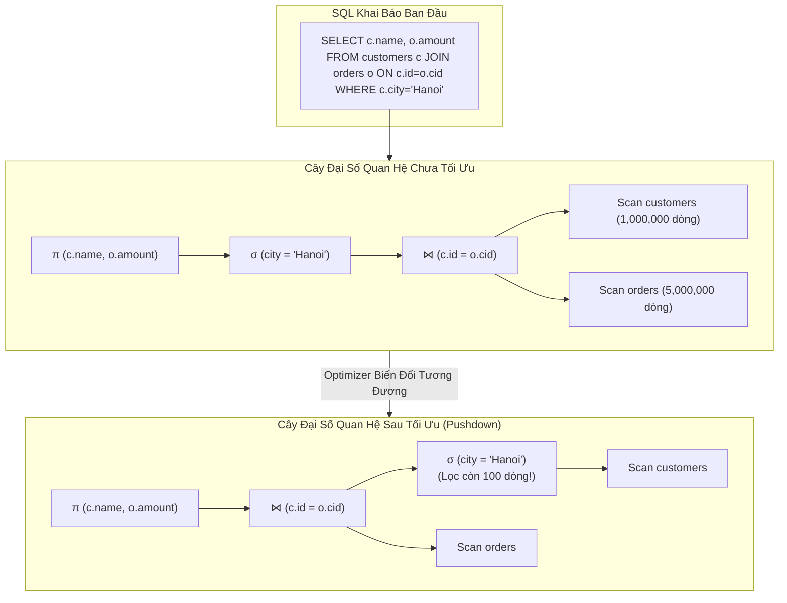

# 2.1. Relational Model & Algebra (Mô hình Quan hệ & Đại số Quan hệ)

> [!IMPORTANT]
> **Nếu bạn chỉ được nhớ một điều duy nhất:** Mô hình Quan hệ của Edgar F. Codd biến việc thao tác dữ liệu thành toán học thuần túy: mọi bảng là một quan hệ (Relation), mỗi hàng là một bộ dữ liệu (Tuple); Đại số Quan hệ (Relational Algebra) với các phép toán Chọn ($\sigma$), Chiếu ($\pi$), Kết nối ($\bowtie$) chính là nền tảng lý thuyết để bộ tối ưu hóa truy vấn (Query Optimizer) có thể biến đổi các câu lệnh SQL khai báo thành các kế hoạch thực thi đại số tối ưu nhất.

---

## 1. Đơn giản nhưng phải chi tiết (Intuitive & Deep Breakdown)

### 1.1. Đoạn Code Dẫn Nhập & Vấn Đề Thực Tế
Làm thế nào mà một câu lệnh SQL khai báo đơn giản: *"Tôi muốn lấy danh sách khách hàng VIP tại Hà Nội"* lại được công cụ tối ưu hóa của database dịch thành các toán tử đại số quan hệ toán học chính xác dưới nền?

```sql
-- Câu lệnh SQL khai báo (Declarative Query)
SELECT c.name, o.total_amount 
FROM customers c 
JOIN orders o ON c.id = o.customer_id 
WHERE c.city = 'Hanoi';

-- Dưới nền, Database Engine biểu diễn truy vấn bằng Cây Đại Số Quan Hệ (Relational Algebra Tree):
-- Phép chiếu (Projection): π_{c.name, o.total_amount}
--   Phép nối (Join): ⋈_{c.id = o.customer_id}
--     Phép chọn (Selection - Đẩy xuống sớm để lọc bớt dòng): σ_{city = 'Hanoi'}(customers)
--     Quét bảng (Scan): orders
```

Nếu công cụ tối ưu hóa không áp dụng các định lý tương đương của Đại số Quan hệ (ví dụ: **Đẩy phép chọn xuống trước phép nối - Pushdown Predicate**), nó sẽ thực hiện phép tích Descartes ($N \times M$ dòng) trước khi lọc, làm bộ nhớ RAM bị tràn ngập hàng triệu dòng dữ liệu rác và câu lệnh chạy mất hàng chục phút!

### 1.2. Ẩn Dụ Đời Sống & Phân Tích Cơ Chế Hoạt Động
Mô hình Quan hệ của Edgar F. Codd giống như **Dây Chuyền Chọn Lọc Trái Cây Tại Nông Trại**:
- **Quan hệ (Relation / Bảng)**: Là một rổ chứa các quả táo. Trong rổ không có hai quả táo nào giống hệt nhau về mọi mặt (Tập hợp toán học không chứa phần tử trùng lặp).
- **Phép Chọn ($\sigma$ - Selection)**: Giống như **Tấm Lưới Lọc Kích Cỡ**: Lọc bỏ những quả táo xanh, chỉ giữ lại những quả táo đỏ chín mọng (Lọc theo dòng / Filter Rows).
- **Phép Chiếu ($\pi$ - Projection)**: Giống như **Máy Gọt Vỏ & Tách Hạt**: Chỉ giữ lại phần thịt quả để đóng hộp, vứt bỏ vỏ và hạt (Lọc theo cột / Filter Columns).
- **Phép Nối ($\bowtie$ - Join)**: Giống như **Ghép Đôi Quả Táo Với Chiếc Hộp Quà Có Cùng Mã Số**: Quả táo mã số 10 ghép vừa khít vào hộp quà mã số 10.
- **Tối ưu hóa Đại số**: Thay vì khuân cả 1,000 rổ táo đầy bùn đất vào xưởng rồi mới lọc (Join trước, Filter sau); người nông dân thông minh lọc sạch bùn đất và quả hỏng ngay tại bờ ruộng (Filter Pushdown), chỉ mang đúng 50 quả táo đạt chuẩn vào xưởng!

### 1.3. Mô Phỏng Dữ Liệu Số Nhỏ Từng Bước (Toy Walkthrough)
Mô phỏng phép tối ưu hóa Pushdown Predicate làm giảm số lượng phép so sánh từ $24$ xuống còn $4$:

Giả sử Bảng `Customers` có 4 dòng, Bảng `Orders` có 6 dòng. Có 1 khách hàng ở `Hanoi` sở hữu 2 đơn hàng.

| Cách Thực Thi Của Engine | Bước 1: Ghép Bảng (Join / Cartesian Product) | Bước 2: Lọc Điều Kiện (`city = 'Hanoi'`) | Tổng Số Lượng Phép So Sánh / Tuples Xử Lý |
| :--- | :--- | :--- | :--- |
| **Cách 1: Ngây Thơ (Chưa Tối Ưu)** | Ghép tất cả: $4 \times 6 = \mathbf{24\text{ dòng}}$ tạm thời vào RAM | Quét duyệt cả $24$ dòng để lọc ra 2 dòng thỏa mãn | **$24\text{ tuples}$ sinh ra trong RAM** |
| **Cách 2: Đẩy Phép Lọc Xuống Trước (Pushdown)**| Lọc `city = 'Hanoi'` trước: $4 \to \mathbf{1\text{ dòng duy nhất}}$ | Ghép 1 dòng đó với 6 dòng Orders: $1 \times 6 = \mathbf{6\text{ so sánh}}$ | **Chỉ $6\text{ tuples}$ được xem xét (Giảm 75% chi phí!)** |

### 1.4. Tác Động Thực Tế Tầng Backend & Systems
- **Chi Phí Bộ Nhớ Của Phép Chiếu Tinh Gọn (Selectivity & Projection)**: Khi lập trình viên gõ `SELECT *` thay vì `SELECT id, status`, database engine buộc phải đọc toàn bộ các cột từ đĩa, bao gồm các cột văn bản dài hàng kilobytes (`description`, `raw_payload`). Điều này làm tràn bộ đệm Buffer Pool và khiến các trang dữ liệu quan trọng khác bị đẩy văng ra đĩa SSD.
- **Luật Hấp Thụ Của Phép Giao Và Phép Hợp**: Các hệ thống CBO (Cost-Based Optimizer) hiện đại dựa trên các công thức đại số quan hệ để biến đổi các biểu thức logic phức tạp trong mệnh đề `WHERE` (ví dụ luật De Morgan) thành các phép quét index hiệu quả nhất.

### 1.5. Sơ Đồ Tư Duy & Kiến Trúc Hệ Thống (Mermaid)


---

## 2. Chi tiết từng Keyword (Under-the-Hood Deep Dive)

### 2.1. Relation, Tuple, Attribute & Domain

#### 1. Định nghĩa Hình thức Toán học
Mô hình quan hệ định nghĩa dữ liệu dựa trên tích Descartes (Cartesian Product) của các tập hợp:
- **Domain (Miền giá trị - $D$)**: Tập hợp tất cả các giá trị nguyên tử (Atomic values) hợp lệ mà một thuộc tính có thể nhận. Ví dụ: $\text{Domain}(\text{Age}) = \mathbb{Z}^+ \cap [1, 150]$; $\text{Domain}(\text{Email}) = \text{Chuỗi ký tự hợp lệ chuẩn RFC 5322}$.
- **Attribute (Thuộc tính - $A$)**: Tên đại diện cho vai trò của một miền giá trị trong một lược đồ. Ví dụ: `user_id`, `created_at`.
- **Relation Schema (Lược đồ quan hệ - $R$)**: Một danh sách định kiểu gồm tên quan hệ và tập hợp các thuộc tính:
  $$R(A_1: D_1, A_2: D_2, \dots, A_n: D_n)$$
  Bậc của quan hệ (Degree / Arity) là số lượng thuộc tính $n$.
- **Tuple (Bộ giá trị - $t$)**: Một hàm ánh xạ gán mỗi thuộc tính $A_i$ với một giá trị nguyên tử $v_i \in D_i$. Một tuple có thể viết dưới dạng bộ $n$ phần tử: $t = (v_1, v_2, \dots, v_n)$.
- **Relation Instance (Quan hệ - $r(R)$)**: Tập hợp con của tích Descartes của các miền giá trị tương ứng:
  $$r(R) \subseteq D_1 \times D_2 \times \dots \times D_n$$
  Lực lượng của quan hệ (Cardinality) là số lượng tuple $|r|$.

#### 2. Ba Tính chất Toán học Bất biến của Quan hệ
1. **Không có phần tử trùng lặp (No duplicate tuples)**: Do $r(R)$ là một tập hợp toán học thuần túy (Mathematical Set), hai phần tử giống hệt nhau không thể cùng tồn tại. *(Lưu ý: SQL trên thực tế vi phạm tính chất này khi mặc định là Multiset / Bag semantics, trừ khi dùng từ khóa `DISTINCT`)*.
2. **Thứ tự của các Tuple không mang ý nghĩa (Unordered tuples)**: Không có khái niệm "hàng thứ nhất" hay "hàng thứ hai" trong lý thuyết. Động cơ lưu trữ có thể trả về các hàng theo bất kỳ thứ tự nào trừ khi có mệnh đề `ORDER BY`.
3. **Tính nguyên tử của giá trị (First Normal Form - Atomicity)**: Mỗi giá trị tại giao điểm của một hàng và một cột phải là đơn nguyên (Atomic), không được chứa mảng hoặc tập hợp con (Non-First Normal Form bị cấm trong mô hình quan hệ cổ điển).

---

### 2.2. Hệ thống Khóa (Keys in Relational Theory)

Trong lý thuyết quan hệ, khóa là cơ chế toán học để định danh duy nhất một tuple và ngăn chặn sự mơ hồ về danh tính thực thể:

```
+-------------------------------------------------------------+
|                       SUPERKEY (Siêu khóa)                  |
|    +---------------------------------------------------+    |
|    |               CANDIDATE KEY (Khóa ứng viên)        |    |
|    |    +--------------------+  +------------------+   |    |
|    |    | PRIMARY KEY (Khóa  |  | ALTERNATE KEY    |   |    |
|    |    | chính được chọn)   |  | (Khóa thay thế)  |   |    |
|    |    +--------------------+  +------------------+   |    |
|    +---------------------------------------------------+    |
+-------------------------------------------------------------+
```

1. **Superkey (Siêu khóa - $SK$)**:
   - Một tập con các thuộc tính $K \subseteq R$ sao cho không có hai tuple phân biệt nào trong bất kỳ quan hệ hợp lệ $r(R)$ có cùng giá trị trên $K$:
     $$\forall t_1, t_2 \in r(R), t_1 \ne t_2 \implies t_1[K] \ne t_2[K]$$
   - Siêu khóa có thể chứa các thuộc tính dư thừa. Ví dụ: Nếu `id` đã là duy nhất thì `{id, name, email}` vẫn là một Superkey.
2. **Candidate Key (Khóa ứng viên - $CK$)**:
   - Một Siêu khóa tối tiểu (Minimal Superkey) - nghĩa là nếu ta loại bỏ bất kỳ thuộc tính nào ra khỏi $CK$, nó sẽ không còn là một Siêu khóa nữa:
     $$K \text{ là Candidate Key} \iff K \text{ là Superkey} \land \forall A \in K, (K \setminus \{A\}) \text{ không là Superkey}$$
3. **Primary Key (Khóa chính - $PK$)**:
   - Một Khóa ứng viên được người thiết kế cơ sở dữ liệu chỉ định làm định danh chính thức của bảng.
   - Bắt buộc phải thỏa mãn: Duy nhất (`UNIQUE`) và Tuyệt đối không được rỗng (`NOT NULL`).
4. **Alternate Key (Khóa thay thế / Khóa phụ)**:
   - Các Khóa ứng viên không được chọn làm Khóa chính. Trong RDBMS, chúng được bảo vệ bằng ràng buộc `UNIQUE` (ví dụ: `email` của người dùng khi `id` là PK).
5. **Foreign Key (Khóa ngoại - $FK$)**:
   - Một tập thuộc tính $FK$ trong quan hệ $R_1$ tham chiếu đến Khóa ứng viên (thường là Primary Key) của quan hệ $R_2$. Nó thiết lập mối liên kết logic giữa hai bảng.

---

### 2.3. Ba Ràng buộc Toàn vẹn Cốt lõi (Integrity Constraints)

Ràng buộc toàn vẹn là các vị từ logic mà mọi trạng thái hợp lệ của cơ sở dữ liệu đều phải thỏa mãn:

#### 1. Entity Integrity (Toàn vẹn Thực thể)
- **Quy tắc**: Không có bất kỳ thuộc tính nào tham gia vào Khóa chính (Primary Key) được phép nhận giá trị `NULL`.
- **Lý do toán học**: Khóa chính là định danh duy nhất để phân biệt một thực thể trong không gian thực tế. Nếu khóa chính mang giá trị `NULL` (nghĩa là "không xác định" hoặc "không tồn tại"), ta không thể xác minh tính duy nhất của tuple đó.

#### 2. Referential Integrity (Toàn vẹn Tham chiếu)
- **Quy tắc**: Nếu quan hệ $R_1$ chứa khóa ngoại $FK$ tham chiếu đến khóa chính $PK$ của quan hệ $R_2$, thì với mọi tuple $t_1 \in R_1$, giá trị $t_1[FK]$ bắt buộc phải thỏa mãn một trong hai điều kiện:
  1. $t_1[FK]$ khớp với giá trị $t_2[PK]$ của một tuple $t_2$ đang tồn tại trong $R_2$.
  2. $t_1[FK]$ mang giá trị `NULL` (nếu cột FK không có ràng buộc `NOT NULL`).
- **Hành vi Vi phạm Khi Xóa/Sửa Khóa Cha**:
  - `RESTRICT / NO ACTION`: Chặn thao tác xóa/sửa nếu còn bản ghi con tham chiếu đến.
  - `CASCADE`: Tự động xóa/sửa các bản ghi con khi bản ghi cha bị xóa/sửa.
  - `SET NULL`: Tự động gán `NULL` cho các khóa ngoại ở bản ghi con.

#### 3. Domain Integrity (Toàn vẹn Miền giá trị)
- **Quy tắc**: Mọi giá trị xuất hiện tại thuộc tính $A$ trong bất kỳ tuple nào đều phải thuộc về Miền giá trị nguyên tử $\text{Domain}(A)$.
- **Thực thi trong RDBMS**:
  - Hệ thống kiểu dữ liệu tĩnh (`INT`, `VARCHAR(255)`, `TIMESTAMP`, `BOOLEAN`).
  - Ràng buộc kiểm tra miền: `CHECK (age >= 18 AND age <= 120)`.
  - Ràng buộc định dạng thông qua Regex hoặc Collation.

---

### 2.4. Đại số Quan hệ (Relational Algebra Operators)

Đại số quan hệ bao gồm 5 toán tử cơ bản độc lập và các toán tử dẫn xuất được xây dựng từ chúng:

#### 1. Các Toán tử Cơ bản (Fundamental Operators)
1. **Selection (Phép chọn - $\sigma_\varphi$)**:
   - Lọc các tuple trong quan hệ $R$ thỏa mãn vị từ logic $\varphi$:
     $$\sigma_\varphi(R) = \{ t \in R \mid \varphi(t) = \text{TRUE} \}$$
   - *Tương đương SQL*: Mệnh đề `WHERE`.
2. **Projection (Phép chiếu - $\pi_{A_1, \dots, A_k}$)**:
   - Trích xuất tập thuộc tính con từ $R$ và tự động loại bỏ các tuple trùng lặp:
     $$\pi_{A_1, \dots, A_k}(R) = \{ t[A_1, \dots, A_k] \mid t \in R \}$$
   - *Tương đương SQL*: `SELECT DISTINCT column1, column2`.
3. **Cartesian Product (Tích Descartes - $R \times S$)**:
   - Ghép mọi tuple trong $R$ với mọi tuple trong $S$:
     $$R \times S = \{ t_1 \circ t_2 \mid t_1 \in R \land t_2 \in S \}$$
   - Độ phức tạp không gian: $|R \times S| = |R| \times |S|$.
4. **Union (Phép hợp - $R \cup S$)**:
   - Kết hợp các tuple từ hai quan hệ **khả hợp** (Union-compatible: cùng số lượng cột và tương thích miền giá trị):
     $$R \cup S = \{ t \mid t \in R \lor t \in S \}$$
5. **Set Difference (Phép hiệu - $R - S$)**:
   - Trả về các tuple thuộc $R$ nhưng không thuộc $S$:
     $$R - S = \{ t \mid t \in R \land t \notin S \}$$
   - *Tương đương SQL*: `EXCEPT` hoặc `MINUS`.

#### 2. Các Toán tử Dẫn xuất (Derived Operators)
1. **Natural Join (Nối tự nhiên - $R \bowtie S$)**:
   - Thực hiện tích Descartes, sau đó chọn lọc các hàng có cùng giá trị trên các thuộc tính chung $C = \text{Attrs}(R) \cap \text{Attrs}(S)$, và chiếu loại bỏ các cột trùng tên:
     $$R \bowtie S = \pi_{\text{Attrs}(R) \cup \text{Attrs}(S)} (\sigma_{R.A_1 = S.A_1 \land \dots \land R.A_k = S.A_k} (R \times S))$$
2. **Theta Join (Nối có điều kiện - $R \bowtie_\theta S$)**:
   - Ghép cặp hai quan hệ dựa trên một điều kiện so sánh $\theta$ bất kỳ:
     $$R \bowtie_\theta S = \sigma_\theta(R \times S)$$
3. **Semi-Join ($R \ltimes S$) & Anti-Join ($R \triangleright S$)**:
   - *Semi-Join*: Trả về các tuple của $R$ mà có ít nhất một tuple trong $S$ khớp điều kiện nối. *(SQL: `WHERE EXISTS (...)`)*.
   - *Anti-Join*: Trả về các tuple của $R$ mà **không có** bất kỳ tuple nào trong $S$ khớp điều kiện nối. *(SQL: `WHERE NOT EXISTS (...)`)*.

---

## 3. Thực thi Mã nguồn & Mô phỏng Chuyên sâu (Dual-Engine Implementation)

Phần này triển khai hai mô phỏng kỹ thuật:
1. **C++20**: Xây dựng một Relational Algebra Engine in-memory thực hiện đầy đủ các phép toán $\sigma$ (Selection), $\pi$ (Projection) và Hash-based Equi-Join ($\bowtie$) trên các cấu trúc dữ liệu thuần túy chuẩn C++20.
2. **Python 3.11**: Xây dựng bộ tối ưu hóa đại số (Algebraic Optimizer) với Abstract Syntax Tree biểu diễn cây truy vấn logic và thực thi phép biến đổi **Predicate Pushdown** chứng minh tính tương đương toán học.

### 3.1. C++20 In-Memory Relational Algebra Engine

```cpp
#include <iostream>
#include <vector>
#include <string>
#include <unordered_map>
#include <functional>
#include <iomanip>
#include <algorithm>
#include <memory>

// Biểu diễn một Hàng (Tuple) dạng bảng băm thuộc tính -> giá trị chuỗi
using Tuple = std::unordered_map<std::string, std::string>;

// Biểu diễn một Quan hệ (Relation)
struct Relation {
    std::string name;
    std::vector<std::string> attributes;
    std::vector<Tuple> tuples;

    void print() const {
        std::cout << "--- Relation: " << name << " (" << tuples.size() << " tuples) ---\n";
        for (const auto& attr : attributes) {
            std::cout << std::setw(15) << attr << " | ";
        }
        std::cout << "\n" << std::string(attributes.size() * 18, '-') << "\n";
        for (const auto& t : tuples) {
            for (const auto& attr : attributes) {
                auto it = t.find(attr);
                std::cout << std::setw(15) << (it != t.end() ? it->second : "NULL") << " | ";
            }
            std::cout << "\n";
        }
        std::cout << "\n";
    }
};

// ==============================================================================
// 1. TOÁN TỬ SELECTION: σ_predicate (R)
// ==============================================================================
Relation select(const Relation& r, std::function<bool(const Tuple&)> predicate) {
    Relation result;
    result.name = "σ(" + r.name + ")";
    result.attributes = r.attributes;
    for (const auto& t : r.tuples) {
        if (predicate(t)) {
            result.tuples.push_back(t);
        }
    }
    return result;
}

// ==============================================================================
// 2. TOÁN TỬ PROJECTION: π_cols (R)
// ==============================================================================
Relation project(const Relation& r, const std::vector<std::string>& target_attrs) {
    Relation result;
    result.name = "π(" + r.name + ")";
    result.attributes = target_attrs;

    for (const auto& t : r.tuples) {
        Tuple projected_tuple;
        for (const auto& attr : target_attrs) {
            auto it = t.find(attr);
            if (it != t.end()) {
                projected_tuple[attr] = it->second;
            }
        }
        // Loại bỏ trùng lặp để bảo đảm tính chất Set Theory (Duplicate Elimination)
        bool exists = false;
        for (const auto& existing : result.tuples) {
            if (existing == projected_tuple) {
                exists = true;
                break;
            }
        }
        if (!exists) {
            result.tuples.push_back(projected_tuple);
        }
    }
    return result;
}

// ==============================================================================
// 3. TOÁN TỬ NATURAL EQUI-JOIN: R ⋈_{join_key} S (Hash Join Implementation)
// ==============================================================================
Relation hash_join(const Relation& r, const Relation& s, const std::string& join_key) {
    Relation result;
    result.name = "(" + r.name + " ⋈ " + s.name + ")";
    
    // Thuộc tính kết quả = attrs(R) ∪ attrs(S) loại bỏ trùng key
    result.attributes = r.attributes;
    for (const auto& attr : s.attributes) {
        if (attr != join_key) {
            result.attributes.push_back(attr);
        }
    }

    // Build Phase: Băm quan hệ S (Build table) theo join_key
    std::unordered_multimap<std::string, const Tuple*> hash_table;
    for (const auto& t_s : s.tuples) {
        auto it = t_s.find(join_key);
        if (it != t_s.end()) {
            hash_table.insert({it->second, &t_s});
        }
    }

    // Probe Phase: Duyệt quan hệ R (Probe table) và dò bảng băm
    for (const auto& t_r : r.tuples) {
        auto it_r = t_r.find(join_key);
        if (it_r != t_r.end()) {
            auto range = hash_table.equal_range(it_r->second);
            for (auto it = range.first; it != range.second; ++it) {
                Tuple merged = t_r;
                for (const auto& [k, v] : *(it->second)) {
                    if (k != join_key) {
                        merged[k] = v;
                    }
                }
                result.tuples.push_back(merged);
            }
        }
    }
    return result;
}

int main() {
    std::cout << "=========================================================\n";
    std::cout << "   RELATIONAL ALGEBRA ENGINE SIMULATION (C++20)          \n";
    std::cout << "=========================================================\n\n";

    // Khởi tạo Quan hệ Users
    Relation users{
        "Users",
        {"user_id", "name", "country"},
        {
            {{"user_id", "1"}, {"name", "Alice"}, {"country", "VN"}},
            {{"user_id", "2"}, {"name", "Bob"}, {"country", "US"}},
            {{"user_id", "3"}, {"name", "Charlie"}, {"country", "VN"}},
            {{"user_id", "4"}, {"name", "David"}, {"country", "SG"}}
        }
    };
    users.print();

    // Khởi tạo Quan hệ Orders
    Relation orders{
        "Orders",
        {"order_id", "user_id", "amount"},
        {
            {{"order_id", "101"}, {"user_id", "1"}, {"amount", "500"}},
            {{"order_id", "102"}, {"user_id", "1"}, {"amount", "1200"}},
            {{"order_id", "103"}, {"user_id", "3"}, {"amount", "300"}},
            {{"order_id", "104"}, {"user_id", "99"}, {"amount", "999"}} // Khóa ngoại không hợp lệ
        }
    };
    orders.print();

    // Thực thi Đại số Quan hệ:
    // Truy vấn: π_{name, order_id, amount} ( σ_{country = 'VN'} (Users) ⋈ Orders )
    std::cout << "Executing: π_{name, order_id, amount} ( σ_{country='VN'}(Users) ⋈ Orders )\n\n";

    // Bước 1: Selection σ_{country='VN'}(Users)
    Relation vn_users = select(users, [](const Tuple& t) {
        auto it = t.find("country");
        return it != t.end() && it->second == "VN";
    });
    vn_users.print();

    // Bước 2: Hash Join với Orders trên 'user_id'
    Relation joined = hash_join(vn_users, orders, "user_id");
    joined.print();

    // Bước 3: Projection π_{name, order_id, amount}
    Relation final_result = project(joined, {"name", "order_id", "amount"});
    final_result.print();

    return 0;
}
```

### 3.2. Python 3.11 Query Tree Optimizer (Predicate Pushdown Simulation)

```python
#!/usr/bin/env python3
"""
Relational Algebra Optimizer: AST Representation and Predicate Pushdown Transformation.
Demonstrates how RDBMS transform unoptimized logical plans into optimal algebraic forms.
"""

from dataclasses import dataclass
from typing import Any

# ==============================================================================
# 1. LOGICAL PLAN NODES (Abstract Syntax Tree)
# ==============================================================================
class PlanNode:
    def explain(self, indent: int = 0) -> str:
        raise NotImplementedError

@dataclass
class ScanNode(PlanNode):
    table_name: str
    attributes: list[str]

    def explain(self, indent: int = 0) -> str:
        return "  " * indent + f"-> SeqScan({self.table_name}) [Attrs: {', '.join(self.attributes)}]"

@dataclass
class SelectionNode(PlanNode):
    child: PlanNode
    predicate_col: str
    operator: str
    predicate_val: Any

    def explain(self, indent: int = 0) -> str:
        prefix = "  " * indent + f"-> Filter: σ({self.predicate_col} {self.operator} '{self.predicate_val}')\n"
        return prefix + self.child.explain(indent + 1)

@dataclass
class JoinNode(PlanNode):
    left: PlanNode
    right: PlanNode
    join_key: str

    def explain(self, indent: int = 0) -> str:
        prefix = "  " * indent + f"-> HashJoin: ({self.join_key})\n"
        return prefix + self.left.explain(indent + 1) + "\n" + self.right.explain(indent + 1)

@dataclass
class ProjectionNode(PlanNode):
    child: PlanNode
    columns: list[str]

    def explain(self, indent: int = 0) -> str:
        prefix = "  " * indent + f"-> Project: π({', '.join(self.columns)})\n"
        return prefix + self.child.explain(indent + 1)

# ==============================================================================
# 2. ALGEBRAIC OPTIMIZER RULES: PREDICATE PUSHDOWN
# ==============================================================================
def optimize_predicate_pushdown(node: PlanNode) -> PlanNode:
    """
    Quy tắc Đại số: σ_φ(R ⋈ S) ≡ (σ_φ(R)) ⋈ S nếu vị từ φ chỉ tham chiếu tới thuộc tính của R.
    """
    if isinstance(node, SelectionNode) and isinstance(node.child, JoinNode):
        join = node.child
        # Kiểm tra xem thuộc tính lọc thuộc về nhánh trái hay phải
        def get_attrs(n: PlanNode) -> list[str]:
            if isinstance(n, ScanNode):
                return n.attributes
            if isinstance(n, JoinNode):
                return get_attrs(n.left) + get_attrs(n.right)
            return []

        left_attrs = get_attrs(join.left)
        right_attrs = get_attrs(join.right)

        if node.predicate_col in left_attrs:
            # Đẩy Filter xuống nhánh trái của Join
            print(f"[Optimizer] Rule applied: Pushing predicate '{node.predicate_col}' down to LEFT branch!")
            new_left = SelectionNode(join.left, node.predicate_col, node.operator, node.predicate_val)
            return JoinNode(new_left, join.right, join.join_key)
        elif node.predicate_col in right_attrs:
            print(f"[Optimizer] Rule applied: Pushing predicate '{node.predicate_col}' down to RIGHT branch!")
            new_right = SelectionNode(join.right, node.predicate_col, node.operator, node.predicate_val)
            return JoinNode(join.left, new_right, join.join_key)

    # Đệ quy cho các nút con
    if isinstance(node, ProjectionNode):
        return ProjectionNode(optimize_predicate_pushdown(node.child), node.columns)
    if isinstance(node, JoinNode):
        return JoinNode(optimize_predicate_pushdown(node.left), optimize_predicate_pushdown(node.right), node.join_key)
    return node

# ==============================================================================
# MAIN VERIFICATION
# ==============================================================================
def main() -> None:
    print("=" * 65)
    print("   RELATIONAL ALGEBRA OPTIMIZER & PREDICATE PUSHDOWN (Python 3.11)")
    print("=" * 65)

    # Xây dựng cây truy vấn nguyên thủy chưa tối ưu:
    # π_{name, amount} ( σ_{country = 'VN'} ( Users ⋈_{user_id} Orders ) )
    users_scan = ScanNode("Users", ["user_id", "name", "country"])
    orders_scan = ScanNode("Orders", ["order_id", "user_id", "amount"])
    naive_join = JoinNode(users_scan, orders_scan, "user_id")
    naive_filter = SelectionNode(naive_join, "country", "=", "VN")
    naive_plan = ProjectionNode(naive_filter, ["name", "amount"])

    print("\n--- 1. NAIVE LOGICAL PLAN (Trước khi tối ưu) ---")
    print(naive_plan.explain())
    print("Nhược điểm: Phép JOIN phải xử lý toàn bộ bảng Users và Orders trước khi lọc!")

    print("\n--- 2. ÁP DỤNG QUY TẮC ĐẠI SỐ ĐẨY VỊ TỪ (Optimizer Run) ---")
    optimized_plan = optimize_predicate_pushdown(naive_plan)

    print("\n--- 3. OPTIMIZED LOGICAL PLAN (Sau khi tối ưu) ---")
    print(optimized_plan.explain())
    print("Ưu điểm: Bảng Users được lọc trước (σ), giảm mạnh kích thước bảng băm khi JOIN!")
    print("=" * 65)

if __name__ == "__main__":
    main()
```

### 3.3. Terminal Output Mẫu Chuẩn Thực Tế

```bash
$ g++ -O3 -std=c++20 relational_algebra.cpp -o relational_algebra && ./relational_algebra
=========================================================
   RELATIONAL ALGEBRA ENGINE SIMULATION (C++20)          
=========================================================

--- Relation: Users (4 tuples) ---
        user_id |            name |         country | 
------------------------------------------------------
              1 |           Alice |              VN | 
              2 |             Bob |              US | 
              3 |         Charlie |              VN | 
              4 |           David |              SG | 

--- Relation: Orders (4 tuples) ---
       order_id |         user_id |          amount | 
------------------------------------------------------
            101 |               1 |             500 | 
            102 |               1 |            1200 | 
            103 |               3 |             300 | 
            104 |              99 |             999 | 

Executing: π_{name, order_id, amount} ( σ_{country='VN'}(Users) ⋈ Orders )

--- Relation: σ(Users) (2 tuples) ---
        user_id |            name |         country | 
------------------------------------------------------
              1 |           Alice |              VN | 
              3 |         Charlie |              VN | 

--- Relation: (σ(Users) ⋈ Orders) (3 tuples) ---
        user_id |            name |         country |        order_id |          amount | 
------------------------------------------------------------------------------------------
              1 |           Alice |              VN |             101 |             500 | 
              1 |           Alice |              VN |             102 |            1200 | 
              3 |         Charlie |              VN |             103 |             300 | 

--- Relation: π((σ(Users) ⋈ Orders)) (3 tuples) ---
           name |        order_id |          amount | 
------------------------------------------------------
          Alice |             101 |             500 | 
          Alice |             102 |            1200 | 
        Charlie |             103 |             300 | 

$ python3 relational_optimizer.py
=================================================================
   RELATIONAL ALGEBRA OPTIMIZER & PREDICATE PUSHDOWN (Python 3.11)
=================================================================

--- 1. NAIVE LOGICAL PLAN (Trước khi tối ưu) ---
-> Project: π(name, amount)
  -> Filter: σ(country = 'VN')
    -> HashJoin: (user_id)
      -> SeqScan(Users) [Attrs: user_id, name, country]
      -> SeqScan(Orders) [Attrs: order_id, user_id, amount]
Nhược điểm: Phép JOIN phải xử lý toàn bộ bảng Users và Orders trước khi lọc!

--- 2. ÁP DỤNG QUY TẮC ĐẠI SỐ ĐẨY VỊ TỪ (Optimizer Run) ---
[Optimizer] Rule applied: Pushing predicate 'country' down to LEFT branch!

--- 3. OPTIMIZED LOGICAL PLAN (Sau khi tối ưu) ---
-> Project: π(name, amount)
  -> HashJoin: (user_id)
    -> Filter: σ(country = 'VN')
      -> SeqScan(Users) [Attrs: user_id, name, country]
    -> SeqScan(Orders) [Attrs: order_id, user_id, amount]
Ưu điểm: Bảng Users được lọc trước (σ), giảm mạnh kích thước bảng băm khi JOIN!
=================================================================
```

---

## 4. Systems Engineering & Production Pitfalls

### 1. Accidental Cartesian Product (Bùng nổ Tích Descartes do thiếu điều kiện JOIN)
- **Hiện tượng**: Một lập trình viên viết câu lệnh SQL nối hai bảng `Users` (1 triệu dòng) và `Orders` (10 triệu dòng) nhưng sơ ý quên mệnh đề `ON` hoặc viết sai điều kiện:
  ```sql
  -- NGUY HIỂM: Biến thành tích Descartes Users × Orders
  SELECT * FROM users, orders;
  ```
- **Hậu quả**: Cơ sở dữ liệu cố gắng tạo ra $1,000,000 \times 10,000,000 = 10^{13}$ (10 nghìn tỷ) bộ giá trị. Đĩa cứng bị đầy trong vài phút do file tạm (temp files), IOPS chạm trần và toàn bộ máy chủ RDS/PostgreSQL bị treo cứng.
- **Phòng ngừa Production**:
  - Bật cờ nghiêm ngặt trong session MySQL: `SET sql_safe_updates = 1;`.
  - Trong PostgreSQL, cài đặt `statement_timeout = '10s'` trên các kết nối ứng dụng để tự động hủy các câu lệnh quét tích Descartes ngoài ý muốn.

### 2. Hash Join Memory Spill: Cạn kiệt `work_mem` trong PostgreSQL
- **Hiện tượng**: Truy vấn JOIN giữa hai bảng lớn đột ngột chạy chậm gấp $50\times$ (tăng từ $200\text{ ms}$ lên $10\text{ giây}$).
- **Cơ chế Under-the-hood**: Khi thực hiện Hash Join, PostgreSQL đưa bảng nhỏ hơn (Build relation) vào bộ nhớ RAM quy định bởi tham số `work_mem`. Nếu kích thước bảng băm vượt quá `work_mem`, engine buộc phải chia nhỏ dữ liệu thành các lô (Batches) và đẩy ra đĩa (Spill to Disk via Workfiles). I/O đĩa phát sinh liên tục làm tê liệt hiệu năng.
- **CLI & Chẩn đoán**:
  ```sql
  EXPLAIN (ANALYZE, BUFFERS)
  SELECT u.name, o.amount 
  FROM users u JOIN orders o ON u.id = o.user_id;
  ```
  > [!WARNING]
  > Nếu kết quả xuất hiện: `Hash Join (Batches: 32 Disk: 4500kB)`, nghĩa là câu lệnh đã bị tràn bộ nhớ đệm ra đĩa!
  - **Khắc phục**: Tăng `work_mem` cục bộ cho session đó:
    ```sql
    SET LOCAL work_mem = '128MB';
    ```

### 3. Implicit Type Coercion làm Vô hiệu hóa B-Tree Index
- **Hiện tượng**: Một truy vấn `WHERE phone_number = 0912345678` quét tuần tự toàn bộ bảng (Sequential Scan) mất vài giây dù cột `phone_number` đã được đánh chỉ mục B-Tree Index.
- **Nguyên nhân toán học**: `phone_number` trong schema có kiểu `VARCHAR` (Domain chuỗi), nhưng tham số truyền vào là số nguyên `INT`. Trình biên dịch SQL bắt buộc phải áp dụng hàm ép kiểu ngầm định:
  $$\sigma_{\text{CAST}(\text{phone\_number AS INT}) = 912345678} (\text{Users})$$
  Bất kỳ phép toán nào bọc quanh cột thuộc tính đều làm vô hiệu hóa cây chỉ mục B-Tree, buộc engine phải quét toàn bộ bảng (Seq Scan).

---

## 5. Bảng So sánh & Decision Matrix

### So sánh các Thuật toán Thực thi Nối (Physical Join Operators)

| Tiêu chí | Nested Loop Join | Hash Join | Sort-Merge Join |
| :--- | :--- | :--- | :--- |
| **Độ phức tạp Thời gian** | $O(|R| \times |S|)$ (hoặc $O(|R| \log |S|)$ với Index) | $O(|R| + |S|)$ (Tuyến tính) | $O(|R|\log|R| + |S|\log|S|)$ |
| **Yêu cầu Bộ nhớ (RAM)** | Tối thiểu ($O(1)$) | Lớn ($O(|R|)$ để giữ Hash Table) | Trung bình ($O(1)$ nếu đã sort sẵn) |
| **Hỗ trợ Điều kiện Nối** | Bất kỳ điều kiện nào ($=, <, >, \le, \ne$) | **Chỉ hỗ trợ Equi-join ($=$)** | Hỗ trợ $=, <, \le, >, \ge$ |
| **Phù hợp nhất khi nào?** | Bảng ngoài rất nhỏ, bảng trong có Index | Cả 2 bảng đều lớn, không có Index | Cả 2 bảng đều rất lớn và **đã được sort sẵn** |
| **Hành vi khi tràn RAM** | Không tràn | Tràn ra đĩa (Multi-batch spilling) | Phải dùng External Merge Sort |

### Bảng Ánh xạ Toán học: Relational Algebra $\to$ SQL Syntax

| Toán tử Đại số Quan hệ | Ký hiệu Toán học | Mệnh đề SQL Tương đương | Ghi chú Tối ưu hóa |
| :--- | :--- | :--- | :--- |
| **Selection** | $\sigma_\varphi(R)$ | `WHERE <condition>` | Luôn được đẩy xuống sâu nhất (Pushdown) |
| **Projection** | $\pi_{A_1, \dots, A_k}(R)$ | `SELECT DISTINCT col1, col2` | Giảm băng thông I/O bằng Early Projection |
| **Natural Join** | $R \bowtie S$ | `R NATURAL JOIN S` / `R JOIN S USING (keys)` | Tự động so khớp trên các cột trùng tên |
| **Theta Join** | $R \bowtie_\theta S$ | `R JOIN S ON <condition>` | Dùng Hash Join nếu là dấu `=`, Nested Loop nếu dải |
| **Union** | $R \cup S$ | `UNION` (loại trùng) / `UNION ALL` (giữ trùng) | `UNION ALL` nhanh hơn nhiều vì không cần Sort/Hash |
| **Set Difference** | $R - S$ | `EXCEPT` hoặc `MINUS` | Đòi hỏi sắp xếp hoặc băm cả hai tập |
| **Cartesian Product** | $R \times S$ | `CROSS JOIN` hoặc `FROM R, S` | Nguy cơ bùng nổ tài nguyên, tránh dùng trên prod |

---

## 6. Enterprise Production Checklist & Verification

### 6.1. Kiến Trúc & Cấu Hình Tối Ưu (Production-Ready Architecture)
- [ ] **Tuyệt Đối Không Dùng SELECT * Trong Production**: Luôn chỉ định rõ ràng danh sách các cột cần lấy trong mệnh đề `SELECT` để giảm thiểu băng thông mạng và tận dụng Covering Indexes.
- [ ] **Đảm Bảo Điều Kiện Lọc Có Thể Pushdown Được**: Tránh bọc cột dữ liệu trong các hàm tính toán phức tạp ở mệnh đề WHERE (ví dụ `WHERE YEAR(created_at) = 2026`) vì điều này ngăn cản engine đẩy điều kiện lọc xuống chỉ mục.
- [ ] **Thiết Lập Khóa Chính Tự Nhiên Hoặc Nhân Tạo Chặt Chẽ**: Mọi quan hệ bắt buộc phải có Primary Key duy nhất để thỏa mãn tiên đề 1NF của mô hình quan hệ.
- [ ] **Sử Dụng Kiểu Dữ Liệu Tối Giản Nhất Có Thể**: Chọn `INT` thay vì `BIGINT` nếu giá trị không vượt quá 2 tỷ, dùng `VARCHAR(n)` thay vì `TEXT` không giới hạn để tối ưu kích thước tuple.

### 6.2. Giám Sát, Cảnh Báo & Xử Lý Sự Cố (Observability & Incident Response)
- [ ] **Kiểm Tra Cây Thực Thi Bằng EXPLAIN**: Luôn chạy `EXPLAIN (ANALYZE, BUFFERS)` cho các truy vấn quan trọng để thẩm định xem vị trí của phép lọc `Filter` có được đẩy xuống sát tầng Scan hay không.
- [ ] **Cảnh Báo Tỷ Lệ Đọc Dữ Liệu Dư Thừa (Rows Removed by Filter)**: Theo dõi metric từ EXPLAIN; nếu số dòng bị loại bỏ bởi filter quá lớn so với số dòng trả về, cần bổ sung Composite Index.
- [ ] **Xác Minh Không Có Phép Tích Descartes (Cartesian Product)**: Rà soát log truy vấn chậm để bắt và loại bỏ ngay các câu lệnh quên khai báo điều kiện `ON` trong phép `JOIN`.
