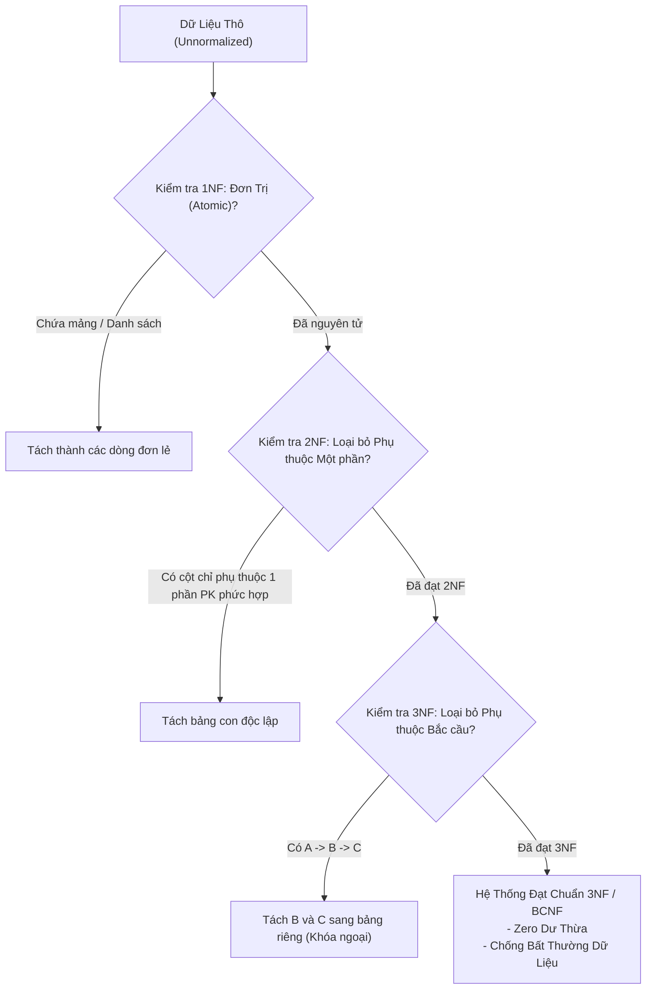

# 2.2. Database Normalization (Chuẩn hóa Cơ sở Dữ liệu)

> [!IMPORTANT]
> **Nếu bạn chỉ được nhớ một điều duy nhất:** Chuẩn hóa dữ liệu (Normalization từ 1NF, 2NF, 3NF đến BCNF) là quá trình thanh lọc sự dư thừa dựa trên Phụ thuộc hàm ($X \to Y$): chuẩn hóa triệt tiêu hoàn toàn các dị thường Thêm, Xóa, Sửa (Anomalies) và đảm bảo tính toàn vẹn dữ liệu khi ghi; nhưng trong hệ thống đọc nhiều (Read-Heavy), kỹ sư phải chủ động phi chuẩn hóa có kiểm soát để tránh thảm họa thắt nút cổ chai khi thực thi quá nhiều phép JOIN.

---

## 1. Đơn giản nhưng phải chi tiết (Intuitive & Deep Breakdown)

### 1.1. Đoạn Code Dẫn Nhập & Vấn Đề Thực Tế
Chuyện gì sẽ xảy ra nếu một công ty lưu toàn bộ thông tin nhân viên, phòng ban, và dự án vào một bảng duy nhất (Chưa chuẩn hóa - Unnormalized)?

```sql
-- Thiết kế tồi tệ: Bảng Nhân viên lưu chung với Phòng ban
CREATE TABLE employees_unnormalized (
    emp_id INT PRIMARY KEY,
    emp_name VARCHAR(100),
    department_id INT,
    department_name VARCHAR(100), -- Dư thừa dữ liệu!
    department_manager VARCHAR(100)
);

-- THẢM HỌA DỮ LIỆU SẼ XẢY RA:
-- 1. Bất thường Chèn (Insertion Anomaly): Muốn tạo một phòng ban mới chưa có nhân viên nào? KHÔNG THỂ LÀM ĐƯỢC vì emp_id là khóa chính không được NULL!
-- 2. Bất thường Cập nhật (Update Anomaly): Phòng IT đổi tên thành "Công nghệ Số"? Phải chạy UPDATE hàng nghìn dòng. Sót 1 dòng là dữ liệu mâu thuẫn!
-- 3. Bất thường Xóa (Deletion Anomaly): Nhân viên duy nhất của phòng Kế toán nghỉ việc? Xóa nhân viên này là XÓA SẠCH luôn sự tồn tại của phòng Kế toán!
```

Chuẩn hóa cơ sở dữ liệu (Normalization từ 1NF đến BCNF) sinh ra không phải để làm bài thi lý thuyết, mà là **Công cụ toán học duy nhất giúp tiêu diệt triệt để 3 thảm họa bất thường dữ liệu trên**!

### 1.2. Ẩn Dụ Đời Sống & Phân Tích Cơ Chế Hoạt Động
Các dạng Chuẩn hóa (Normal Forms) giống như **Quy Trình Phân Loại Rác và Sắp Xếp Đồ Gia Đình**:
- **Dạng Chuẩn 1 (1NF - Tính Nguyên Tử / Atomic)**: Giống như **Mỗi ngăn tủ chỉ để 1 đồ vật**: Không được nhét chung cả tất, cà vạt, dây sạc vào một ngăn kéo (Không chứa mảng hay danh sách phân cách bởi dấu phẩy `"tag1,tag2,tag3"` trong một ô).
- **Dạng Chuẩn 2 (2NF - Phụ Thuộc Hoàn Toàn Vào Toàn Bộ Khóa Chính)**: Giống như **Đồ vật trong phòng phải thuộc về cả hai người thuê phòng**: Nếu phòng trọ do Anh A và Anh B cùng thuê chung làm khóa chính phức hợp: Bất kỳ thông tin nào chỉ phụ thuộc vào riêng Anh A (như ngày sinh của A) bắt buộc phải dọn sang phòng riêng của A!
- **Dạng Chuẩn 3 (3NF - Không Phụ Thuộc Bắc Cầu / Transitive Dependency)**: Giống như **Không nhờ vả trung gian**: Bạn không được lưu thông tin: *"Anh A biết Số điện thoại của Anh B, và Anh B biết Địa chỉ Công ty C, nên trong hồ sơ của Anh A lưu luôn Địa chỉ Công ty C"*. Địa chỉ Công ty C phải được mang sang bảng Công ty để quản lý độc lập!
- **BCNF (Boyce-Codd Normal Form)**: Mọi thuộc tính quyết định điều kiện đều bắt buộc phải là một Siêu khóa (Superkey).

### 1.3. Mô Phỏng Dữ Liệu Số Nhỏ Từng Bước (Toy Walkthrough)
Quá trình tách bảng từ Chưa chuẩn hóa lên Chuẩn 3NF:

**Bảng Gốc Chưa Chuẩn Hóa:**

| `emp_id` (PK) | `emp_name` | `dept_id` | `dept_name` | `dept_budget` |
| :---: | :--- | :---: | :--- | :---: |
| 101 | Nguyễn Văn An | D01 | Kỹ Thuật | \$50,000 |
| 102 | Trần Thị Bình | D01 | Kỹ Thuật | \$50,000 |
| 103 | Lê Văn Cường | D02 | Kinh Doanh | \$30,000 |

Phát hiện phụ thuộc bắc cầu: $\text{emp\_id} \to \text{dept\_id} \to \text{dept\_name}$. Vi phạm 3NF!

**Tách Thành 2 Bảng Chuẩn 3NF (Lossless Join Decomposition):**

*Bảng 1: `Departments` (Quản lý phòng ban độc lập)*
| `dept_id` (PK) | `dept_name` | `dept_budget` |
| :---: | :--- | :---: |
| D01 | Kỹ Thuật | \$50,000 |
| D02 | Kinh Doanh | \$30,000 |

*Bảng 2: `Employees` (Chỉ lưu khóa ngoại tham chiếu)*
| `emp_id` (PK) | `emp_name` | `dept_id` (FK) |
| :---: | :--- | :---: |
| 101 | Nguyễn Văn An | D01 |
| 102 | Trần Thị Bình | D01 |
| 103 | Lê Văn Cường | D02 |

Giờ đây: Đổi tên phòng Kỹ Thuật chỉ cần sửa đúng 1 dòng trên bảng `Departments`. Tạo phòng ban mới không cần có nhân viên!

### 1.4. Tác Động Thực Tế Tầng Backend & Systems
- **Cân Bằng Giữa Chuẩn Hóa (3NF) và Tốc Độ Đọc (Denormalization)**: Một thiết kế chuẩn hóa cao độ (3NF/BCNF) là lý tưởng cho hệ thống ghi OLTP vì chống được trùng lặp và ghi rất nhanh. Tuy nhiên, khi cần đọc báo cáo, việc phải JOIN 10 bảng lại với nhau sẽ làm nghẽn CPU. Do đó, các kỹ sư thường chuẩn hóa triệt để khi lưu trữ, nhưng chủ động phi chuẩn hóa tại tầng Read Model (CQRS).
- **Tránh Lưu Trữ Dạng Danh Sách Trong 1 Cột (Vi phạm 1NF)**: Lưu chuỗi `"1,4,9"` vào cột `product_ids` khiến database không thể sử dụng B-Tree Index để tìm kiếm, buộc phải dùng toán tử `LIKE '%4%'` quét toàn bộ bảng (Table Full Scan).

### 1.5. Sơ Đồ Tư Duy & Kiến Trúc Hệ Thống (Mermaid)


---

## 2. Chi tiết từng Keyword (Under-the-Hood Deep Dive)

### 2.1. Database Anomalies (Dị thường Cơ sở Dữ liệu)

Dị thường cơ sở dữ liệu là những trạng thái mâu thuẫn dữ liệu hoặc sự cố vận hành phát sinh trực tiếp từ việc **lưu trữ dữ liệu dư thừa trong một bảng đơn lẻ**.

Xét ví dụ kinh điển về một bảng chưa chuẩn hóa `Emp_Project_Flat`:
$$\text{Emp\_Project\_Flat}(\underline{\text{emp\_id}}, \underline{\text{project\_id}}, \text{emp\_name}, \text{dept\_name}, \text{project\_budget})$$

```
+--------+------------+----------+-----------+----------------+
| emp_id | project_id | emp_name | dept_name | project_budget |
+--------+------------+----------+-----------+----------------+
| E01    | P100       | Alice    | AI Research| $500,000       |
| E02    | P100       | Bob      | AI Research| $500,000       |
| E03    | P200       | Charlie  | Infra      | $120,000       |
+--------+------------+----------+-----------+----------------+
```

1. **Insertion Anomaly (Dị thường Thêm mới)**:
   - *Tình huống*: Công ty vừa ký một dự án mới mang mã `P300` với ngân sách \$300,000, nhưng chưa kịp phân công nhân viên nào phụ trách.
   - *Bế tắc*: Khóa chính của bảng là cặp hợp phần $\{\text{emp\_id}, \text{project\_id}\}$. Do quy tắc **Entity Integrity**, `emp_id` tuyệt đối không được phép nhận giá trị `NULL`. Do đó, hệ thống **không thể lưu thông tin dự án mới** vào cơ sở dữ liệu!
2. **Update Anomaly (Dị thường Cập nhật)**:
   - *Tình huống*: Ngân sách dự án `P100` được điều chỉnh từ \$500,000 lên \$600,000.
   - *Bế tắc*: Vì dự án `P100` xuất hiện ở hàng trăm nhân viên, ta phải cập nhật hàng trăm dòng trên đĩa. Nếu ứng dụng hoặc máy chủ bị sập giữa chừng, một nửa số dòng hiển thị \$600,000, nửa còn lại hiển thị \$500,000. Cơ sở dữ liệu rơi vào trạng thái gãy đổ tính nhất quán (Inconsistent State).
3. **Deletion Anomaly (Dị thường Xóa)**:
   - *Tình huống*: Nhân viên `Charlie` (`E03`) nộp đơn thôi việc và rời khỏi công ty.
   - *Bế tắc*: Khi DBA thực hiện câu lệnh xóa `DELETE WHERE emp_id = 'E03'`, toàn bộ dòng bị hủy. Vì `E03` là người duy nhất tham gia dự án `P200`, hành vi này vô tình **xóa sổ luôn toàn bộ thông tin về sự tồn tại của dự án P200 và ngân sách của nó** khỏi công ty!

---

### 2.2. Functional Dependency (Phụ thuộc Hàm) & Armstrong's Axioms

#### 1. Định nghĩa Toán học của Phụ thuộc Hàm (Functional Dependency - FD)
Cho lược đồ quan hệ $R$ và hai tập hợp con các thuộc tính $X, Y \subseteq R$. Ta nói rằng **$X$ xác định hàm $Y$** (ký hiệu là $X \to Y$) nếu và chỉ nếu:
$$\forall t_1, t_2 \in r(R), \quad t_1[X] = t_2[X] \implies t_1[Y] = t_2[Y]$$
- $X$ được gọi là **Vế xác định (Determinant)**.
- $Y$ được gọi là **Vế phụ thuộc (Dependent)**.
- **Trivial FD (Phụ thuộc tầm thường)**: $X \to Y$ là tầm thường nếu $Y \subseteq X$ (Ví dụ: $\{\text{id}, \text{name}\} \to \text{id}$).
- **Non-trivial FD (Phụ thuộc không tầm thường)**: $X \to Y$ với $Y \nsubseteq X$.

#### 2. Hệ Tiên đề Armstrong (Armstrong's Axioms - 1974)
Hệ tiên đề Armstrong là tập hợp các quy tắc suy diễn toán học đầy đủ và đúng đắn (Sound and Complete) để tìm tất cả các phụ thuộc hàm khả dĩ từ một tập phụ thuộc hàm cho trước $F$:

1. **Reflexivity (Tính phản xạ)**:
   $$\text{Nếu } Y \subseteq X \subseteq R \implies X \to Y$$
2. **Augmentation (Tính tăng cường)**:
   $$\text{Nếu } X \to Y \implies XZ \to YZ \quad (\forall Z \subseteq R)$$
3. **Transitivity (Tính bắc cầu)**:
   $$\text{Nếu } X \to Y \text{ và } Y \to Z \implies X \to Z$$

#### 3. Các Quy tắc Dẫn xuất Bổ trợ (Secondary Rules)
Từ 3 tiên đề cốt lõi trên, ta chứng minh được 3 quy tắc thực hành quan trọng:
- **Union (Hợp)**: Nếu $X \to Y$ và $X \to Z \implies X \to YZ$.
- **Decomposition (Phân rã)**: Nếu $X \to YZ \implies X \to Y$ và $X \to Z$.
- **Pseudotransitivity (Giả bắc cầu)**: Nếu $X \to Y$ và $WY \to Z \implies WX \to Z$.

---

### 2.3. Attribute Closure & Candidate Key Derivation

#### 1. Bao đóng của Tập Thuộc tính (Attribute Closure - $X^+$)
Bao đóng của tập thuộc tính $X$ đối với tập phụ thuộc hàm $F$ (ký hiệu $X^+$) là **tập hợp tất cả các thuộc tính có thể suy diễn logic được từ $X$** thông qua $F$.

**Thuật toán Tìm Bao đóng $X^+$**:
```
Input: Lược đồ R, Tập phụ thuộc hàm F, Tập thuộc tính X
Output: X+

1. X+ = X
2. Repeat until X+ không thay đổi:
     Với mỗi phụ thuộc hàm (Y -> Z) in F:
         Nếu Y ⊆ X+:
             X+ = X+ ∪ Z
3. Return X+
```
Độ phức tạp thuật toán: $O(|F| \cdot |R|)$ khi triển khai tối ưu.

#### 2. Thuật toán Suy diễn Khóa Ứng viên (Candidate Key Derivation)
Để xác định tất cả các Khóa ứng viên (Candidate Keys) của một quan hệ $R$:
1. **Phân loại thuộc tính**:
   - $L$ (Left-only): Thuộc tính chỉ xuất hiện ở vế trái của các FD trong $F$. *(Bắt buộc phải có mặt trong mọi Candidate Key!)*
   - $R$ (Right-only): Thuộc tính chỉ xuất hiện ở vế phải của các FD. *(Tuyệt đối không thuộc về bất kỳ Candidate Key tối tiểu nào!)*
   - $B$ (Both): Xuất hiện ở cả hai vế.
   - $N$ (Neither): Không xuất hiện ở bất kỳ vế nào. *(Bắt buộc phải có mặt trong mọi Candidate Key!)*
2. **Bắt đầu với lõi bất biến**: $K_{\text{core}} = L \cup N$.
   - Tính $K_{\text{core}}^+$. Nếu $K_{\text{core}}^+ = R$, thì $K_{\text{core}}$ là Candidate Key duy nhất!
   - Nếu $K_{\text{core}}^+ \ne R$, ta lần lượt kết hợp $K_{\text{core}}$ với các tập con của $B$ từ kích thước nhỏ đến lớn để tìm các tập tối tiểu có bao đóng bằng $R$.

---

### 2.4. Các Dạng Chuẩn (Normal Forms: 1NF đến 5NF)

#### 1. First Normal Form (1NF - Dạng chuẩn 1)
- **Điều kiện**:
  - Mọi thuộc tính đều chứa **giá trị nguyên tử (Atomic values)**.
  - Không có các nhóm lặp (No repeating groups) hoặc mảng nhiều giá trị trong cùng một ô (ví dụ: `phone_numbers = "0901, 0902, 0903"` vi phạm 1NF).
  - Có một khóa chính xác định duy nhất mỗi tuple.

#### 2. Second Normal Form (2NF - Dạng chuẩn 2)
- **Điều kiện**:
  - Đã đạt chuẩn 1NF.
  - **Không có phụ thuộc hàm một phần (No Partial Dependencies)**: Mọi thuộc tính không khóa (Non-prime attribute) phải phụ thuộc hàm đầy đủ vào toàn bộ Khóa ứng viên, chứ không được phụ thuộc vào một phần của khóa ghép:
    $$\forall (X \to A) \in F \text{ với } A \notin \text{Key}, \quad \nexists X' \subset X \text{ sao cho } X' \text{ là Candidate Key}$$
- *Ý nghĩa*: Nếu khóa chính là $\{A, B\}$, thì không được phép có $A \to C$. Bắt buộc phải tách $\{A, C\}$ ra bảng riêng.

#### 3. Third Normal Form (3NF - Dạng chuẩn 3)
- **Điều kiện**:
  - Đã đạt chuẩn 2NF.
  - **Không có phụ thuộc bắc cầu (No Transitive Dependencies)**.
  - **Định nghĩa hình thức**: Với mọi phụ thuộc hàm không tầm thường $X \to A \in F$:
    $$\text{Hoặc } X \text{ là Superkey} \quad \lor \quad A \text{ là Prime Attribute (thuộc về một Candidate Key bất kỳ)}$$

#### 4. Boyce-Codd Normal Form (BCNF - Dạng chuẩn Boyce-Codd)
- **Bản chất**: BCNF là phiên bản khắt khe và triệt để hơn của 3NF (đôi khi gọi là 3.5NF).
- **Điều kiện hình thức**: Với mọi phụ thuộc hàm không tầm thường $X \to A \in F$:
  $$X \text{ bắt buộc phải là một Superkey!}$$
- *Sự khác biệt giữa 3NF và BCNF*: 3NF tha thứ cho trường hợp $X$ không phải là Superkey miễn là $A$ là thuộc tính khóa (Prime Attribute). BCNF không có ngoại lệ này: **Bất kỳ thuộc tính nào đóng vai trò xác định giá trị khác (Determinant) đều phải là Siêu khóa!**

#### 5. Fourth Normal Form (4NF) & Fifth Normal Form (5NF)
- **4NF (Multi-valued Dependency - MVD $X \twoheadrightarrow Y$)**:
  - Xuất hiện khi một thuộc tính $X$ độc lập xác định một tập hợp nhiều giá trị của $Y$ và một tập hợp nhiều giá trị của $Z$ (ví dụ: một Giảng viên dạy nhiều Môn học và biết nhiều Ngoại ngữ).
  - 4NF loại bỏ sự bùng nổ tích tổ hợp các dòng bằng cách tách các MVD độc lập thành các bảng riêng rẽ.
- **5NF (Join Dependency - JD / Project-Join Normal Form)**:
  - Một quan hệ đạt 5NF nếu nó không thể phân rã thành $k$ quan hệ nhỏ hơn ($k \ge 3$) mà khi thực hiện phép nối tự nhiên lại không tạo ra các tuple giả (Spurious Tuples). 5NF cực kỳ hiếm gặp trong thiết kế thực tế và thường được bảo đảm ngầm qua 3NF/BCNF.

---

### 2.5. Lossless Decomposition & Dependency Preservation

Khi phân rã một lược đồ quan hệ lớn $R$ thành các lược đồ con $\{R_1, R_2, \dots, R_k\}$, ta phải bảo đảm hai tính chất toán học tối thượng:

#### 1. Lossless-Join Decomposition (Phân rã Nối không tổn thất)
- **Định nghĩa**: Một phép phân rã $R$ thành $(R_1, R_2)$ là không tổn thất nếu ta thực hiện phép nối tự nhiên giữa các bảng con, kết quả thu được **chính xác 100% bằng quan hệ ban đầu**:
  $$R_1 \bowtie R_2 = R$$
  Nếu $R_1 \bowtie R_2 \supset R$, các hàng thừa xuất hiện được gọi là **Tuple Giả (Spurious Tuples)**.
- **Định lý Kiểm tra Lossless đối với 2 bảng**:
  Phép phân rã $R$ thành $(R_1, R_2)$ là Lossless khi và chỉ khi giao của chúng là một Siêu khóa của ít nhất một trong hai bảng:
  $$(R_1 \cap R_2) \to R_1 \quad \lor \quad (R_1 \cap R_2) \to R_2$$

#### 2. Dependency Preservation (Bảo toàn Phụ thuộc Hàm)
- **Định nghĩa**: Một phép phân rã bảo toàn phụ thuộc nếu tập hợp các phụ thuộc hàm cục bộ trên các bảng con $(F_1 \cup F_2 \cup \dots \cup F_k)$ có bao đóng tương đương về mặt logic với tập phụ thuộc ban đầu $F$:
  $$(F_1 \cup F_2 \cup \dots \cup F_k)^+ = F^+$$
- **Hệ quả thực chiến**: Nếu một phép phân rã không bảo toàn phụ thuộc, việc kiểm tra toàn vẹn ràng buộc nghiệp vụ không thể thực hiện cục bộ trong một bảng khi ghi dữ liệu, mà buộc cơ sở dữ liệu phải thực hiện các phép JOIN liên bảng tốn kém trên mỗi câu lệnh `INSERT / UPDATE`!

```
+---------------------------------------------------------------------------------+
|                       ĐÁNH ĐỔI GIỮA 3NF VÀ BCNF:                                |
|                                                                                 |
|   - 3NF : Luôn luôn đạt được đồng thời:                                         |
|           [x] Lossless Join                                                     |
|           [x] Dependency Preservation                                           |
|                                                                                 |
|   - BCNF: Triệt tiêu 100% dị thường phụ thuộc hàm, nhưng:                       |
|           [x] Lossless Join                                                     |
|           [ ] ĐÔI KHI KHÔNG THỂ BẢO TOÀN PHỤ THUỘC HÀM (Dependency Loss)!      |
+---------------------------------------------------------------------------------+
```

---

## 3. Thực thi Mã nguồn & Mô phỏng Chuyên sâu (Dual-Engine Implementation)

Phần này triển khai hai mô phỏng kỹ thuật:
1. **C++20**: Xây dựng thuật toán tính Bao đóng của tập thuộc tính ($X^+$) và suy diễn toàn bộ Khóa ứng viên (Candidate Keys) của một lược đồ bất kỳ.
2. **Python 3.11**: Xây dựng bộ thẩm định chuẩn hóa (Normalization Verifier) tự động kiểm tra một lược đồ có vi phạm 1NF, 2NF, 3NF hay BCNF và tiến hành phân rã không tổn thất.

### 3.1. C++20 Attribute Closure & Candidate Key Derivation

```cpp
#include <iostream>
#include <vector>
#include <string>
#include <set>
#include <algorithm>
#include <iomanip>

// Định nghĩa một Phụ thuộc hàm: Left -> Right
struct FunctionalDependency {
    std::set<std::string> left;
    std::set<std::string> right;

    void print() const {
        std::cout << "{ ";
        for (const auto& a : left) std::cout << a << " ";
        std::cout << "} -> { ";
        for (const auto& b : right) std::cout << b << " ";
        std::cout << "}";
    }
};

// ==============================================================================
// 1. THUẬT TOÁN TÍNH BAO ĐÓNG THUỘC TÍNH (Attribute Closure: X+)
// ==============================================================================
std::set<std::string> compute_closure(
    const std::set<std::string>& x,
    const std::vector<FunctionalDependency>& fds) 
{
    std::set<std::string> closure = x;
    bool changed = true;

    while (changed) {
        changed = false;
        for (const auto& fd : fds) {
            // Kiểm tra xem fd.left có phải tập con của closure hay không
            bool is_subset = std::includes(
                closure.begin(), closure.end(),
                fd.left.begin(), fd.left.end()
            );

            if (is_subset) {
                size_t old_size = closure.size();
                closure.insert(fd.right.begin(), fd.right.end());
                if (closure.size() > old_size) {
                    changed = true;
                }
            }
        }
    }
    return closure;
}

// ==============================================================================
// 2. THUẬT TOÁN TÌM TẤT CẢ CANDIDATE KEYS
// ==============================================================================
std::vector<std::set<std::string>> find_candidate_keys(
    const std::set<std::string>& all_attrs,
    const std::vector<FunctionalDependency>& fds) 
{
    std::vector<std::string> attr_vec(all_attrs.begin(), all_attrs.end());
    size_t n = attr_vec.size();
    std::vector<std::set<std::string>> candidate_keys;

    // Duyệt qua tất cả các tập con thuộc tính từ kích thước 1 đến n (Power set traversal)
    for (size_t len = 1; len <= n; ++len) {
        std::vector<bool> v(n);
        std::fill(v.end() - len, v.end(), true);

        do {
            std::set<std::string> candidate;
            for (size_t i = 0; i < n; ++i) {
                if (v[i]) candidate.insert(attr_vec[i]);
            }

            // Kiểm tra xem candidate có chứa một candidate key nhỏ hơn đã tìm thấy trước đó không
            bool contains_existing_key = false;
            for (const auto& existing_key : candidate_keys) {
                if (std::includes(candidate.begin(), candidate.end(), existing_key.begin(), existing_key.end())) {
                    contains_existing_key = true;
                    break;
                }
            }

            if (!contains_existing_key) {
                auto closure = compute_closure(candidate, fds);
                if (closure == all_attrs) {
                    candidate_keys.push_back(candidate);
                }
            }
        } while (std::next_permutation(v.begin(), v.end()));

        if (!candidate_keys.empty() && candidate_keys.front().size() < len) {
            // Đã tìm thấy các khóa ở bậc nhỏ hơn, tiếp tục kiểm tra các khóa cùng bậc tối tiểu
        }
    }
    return candidate_keys;
}

int main() {
    std::cout << "=========================================================\n";
    std::cout << "   ATTRIBUTE CLOSURE & CANDIDATE KEY DERIVATION (C++20)  \n";
    std::cout << "=========================================================\n\n";

    // Khởi tạo Lược đồ: R(A, B, C, D, E)
    std::set<std::string> R = {"A", "B", "C", "D", "E"};

    // Tập phụ thuộc hàm F:
    // A -> B
    // BC -> D
    // D -> E
    std::vector<FunctionalDependency> F = {
        {{"A"}, {"B"}},
        {{"B", "C"}, {"D"}},
        {{"D"}, {"E"}}
    };

    std::cout << "Schema R: { A, B, C, D, E }\nFunctional Dependencies (F):\n";
    for (const auto& fd : F) {
        std::cout << "  ";
        fd.print();
        std::cout << "\n";
    }
    std::cout << "\n";

    // Thử nghiệm tính bao đóng của {A, C}
    std::set<std::string> test_set = {"A", "C"};
    auto closure_ac = compute_closure(test_set, F);
    std::cout << "Closure of { A, C }^+ = { ";
    for (const auto& attr : closure_ac) std::cout << attr << " ";
    std::cout << "}\n";

    // Tìm tất cả các Khóa ứng viên
    auto keys = find_candidate_keys(R, F);
    std::cout << "\nFound " << keys.size() << " Minimal Candidate Key(s):\n";
    for (size_t i = 0; i < keys.size(); ++i) {
        std::cout << "  Key #" << i + 1 << ": { ";
        for (const auto& k : keys[i]) std::cout << k << " ";
        std::cout << "}\n";
    }

    return 0;
}
```

### 3.2. Python 3.11 Normalization Verifier (1NF to BCNF Checker)

```python
#!/usr/bin/env python3
"""
Relational Database Normalization Verifier & Decomposition Engine.
Validates schemas against 2NF, 3NF, and BCNF definitions.
"""

from itertools import chain, combinations
from typing import NamedTuple

class FD(NamedTuple):
    left: frozenset[str]
    right: frozenset[str]

    def __repr__(self) -> str:
        return f"{set(self.left)} -> {set(self.right)}"

def powerset(iterable):
    s = list(iterable)
    return chain.from_iterable(combinations(s, r) for r in range(len(s) + 1))

def compute_closure(x: frozenset[str], fds: list[FD]) -> frozenset[str]:
    closure = set(x)
    while True:
        added = False
        for fd in fds:
            if fd.left.issubset(closure) and not fd.right.issubset(closure):
                closure.update(fd.right)
                added = True
        if not added:
            break
    return frozenset(closure)

def find_candidate_keys(attributes: frozenset[str], fds: list[FD]) -> list[frozenset[str]]:
    keys = []
    for combo in powerset(attributes):
        s = frozenset(combo)
        # Check minimality against existing keys
        if any(k.issubset(s) for k in keys):
            continue
        if compute_closure(s, fds) == attributes:
            keys.append(s)
    return keys

def verify_normal_forms(attributes: frozenset[str], fds: list[FD]) -> None:
    print(f"Analyzing Schema R: {set(attributes)}")
    candidate_keys = find_candidate_keys(attributes, fds)
    print(f"Minimal Candidate Keys: {[set(k) for k in candidate_keys]}")

    prime_attributes = set().union(*candidate_keys)
    print(f"Prime Attributes: {prime_attributes}\n")

    # 1. Check 2NF: No partial dependency for non-prime attributes
    is_2nf = True
    violating_2nf = []
    for fd in fds:
        for right_attr in fd.right:
            if right_attr not in prime_attributes:
                for k in candidate_keys:
                    if fd.left.issubset(k) and fd.left != k:
                        is_2nf = False
                        violating_2nf.append(fd)
                        break

    print(f"[*] 2NF Status: {'PASSED' if is_2nf else 'VIOLATED'}")
    if not is_2nf:
        print(f"    Violations (Partial Dependencies): {violating_2nf}")

    # 2. Check 3NF: For all X -> A, X is superkey OR A is prime
    is_3nf = is_2nf
    violating_3nf = []
    for fd in fds:
        non_trivial_right = fd.right - fd.left
        if not non_trivial_right:
            continue
        is_superkey = any(k.issubset(fd.left) for k in candidate_keys)
        all_right_prime = non_trivial_right.issubset(prime_attributes)

        if not (is_superkey or all_right_prime):
            is_3nf = False
            violating_3nf.append(fd)

    print(f"[*] 3NF Status: {'PASSED' if is_3nf else 'VIOLATED'}")
    if not is_3nf:
        print(f"    Violations (Transitive Dependencies): {violating_3nf}")

    # 3. Check BCNF: For all X -> A, X MUST BE a superkey
    is_bcnf = True
    violating_bcnf = []
    for fd in fds:
        non_trivial_right = fd.right - fd.left
        if not non_trivial_right:
            continue
        is_superkey = any(k.issubset(fd.left) for k in candidate_keys)
        if not is_superkey:
            is_bcnf = False
            violating_bcnf.append(fd)

    print(f"[*] BCNF Status: {'PASSED' if is_bcnf else 'VIOLATED'}")
    if not is_bcnf:
        print(f"    Violations (Determinant not a Superkey): {violating_bcnf}")

def main() -> None:
    print("=" * 65)
    print("   RELATIONAL SCHEMA NORMALIZATION ANALYZER (Python 3.11)")
    print("=" * 65)

    # Example 1: Classic 2NF violation (Partial Dependency)
    R1 = frozenset({"emp_id", "project_id", "emp_name", "project_budget"})
    F1 = [
        FD(frozenset({"emp_id"}), frozenset({"emp_name"})),
        FD(frozenset({"project_id"}), frozenset({"project_budget"}))
    ]
    print("\n--- TEST CASE 1: Student/Project Composite Table ---")
    verify_normal_forms(R1, F1)

    # Example 2: Clean 3NF / BCNF Schema
    R2 = frozenset({"user_id", "email", "full_name"})
    F2 = [
        FD(frozenset({"user_id"}), frozenset({"email", "full_name"})),
        FD(frozenset({"email"}), frozenset({"user_id", "full_name"}))
    ]
    print("\n--- TEST CASE 2: Normalized User Entity ---")
    verify_normal_forms(R2, F2)
    print("=" * 65)

if __name__ == "__main__":
    main()
```

### 3.3. Terminal Output Mẫu Chuẩn Thực Tế

```bash
$ g++ -O3 -std=c++20 normalization_closure.cpp -o normalization_closure && ./normalization_closure
=========================================================
   ATTRIBUTE CLOSURE & CANDIDATE KEY DERIVATION (C++20)  
=========================================================

Schema R: { A, B, C, D, E }
Functional Dependencies (F):
  { A } -> { B }
  { B C } -> { D }
  { D } -> { E }

Closure of { A, C }^+ = { A B C D E }

Found 1 Minimal Candidate Key(s):
  Key #1: { A C }

$ python3 normalization_verifier.py
=================================================================
   RELATIONAL SCHEMA NORMALIZATION ANALYZER (Python 3.11)
=================================================================

--- TEST CASE 1: Student/Project Composite Table ---
Analyzing Schema R: {'emp_name', 'project_id', 'emp_id', 'project_budget'}
Minimal Candidate Keys: [{'emp_id', 'project_id'}]
Prime Attributes: {'emp_id', 'project_id'}

[*] 2NF Status: VIOLATED
    Violations (Partial Dependencies): [{'emp_id'} -> {'emp_name'}, {'project_id'} -> {'project_budget'}]
[*] 3NF Status: VIOLATED
    Violations (Transitive Dependencies): [{'emp_id'} -> {'emp_name'}, {'project_id'} -> {'project_budget'}]
[*] BCNF Status: VIOLATED
    Violations (Determinant not a Superkey): [{'emp_id'} -> {'emp_name'}, {'project_id'} -> {'project_budget'}]

--- TEST CASE 2: Normalized User Entity ---
Analyzing Schema R: {'email', 'user_id', 'full_name'}
Minimal Candidate Keys: [{'user_id'}, {'email'}]
Prime Attributes: {'email', 'user_id'}

[*] 2NF Status: PASSED
[*] 3NF Status: PASSED
[*] BCNF Status: PASSED
=================================================================
```

---

## 4. Systems Engineering & Production Pitfalls

### 1. The Over-Normalization Trap: "The 12-Table JOIN Nightmare"
- **Hiện tượng**: Một hệ thống E-commerce thiết kế theo chuẩn BCNF tuyệt đối: Tách bảng `Addresses`, `Countries`, `Provinces`, `Districts`, `Wards`, `PostalCodes`, `Users`, `PhoneNumbers`, `Orders`, `OrderItems`, `Products`, `TaxRates`.
- **Hậu quả Production**: Mỗi khi tải trang Checkout của khách hàng, ứng dụng phải thực thi câu lệnh SQL với **12 phép `JOIN`**. Dưới lưu lượng 10,000 requests/giây, Query Planner của PostgreSQL bị quá tải trong giai đoạn tìm kiếm không gian cây truy vấn (Combinatorial explosion của Join Order Search), CPU máy chủ chạm 100% và độ trễ tăng từ $10\text{ ms}$ lên $1.2\text{ giây}$.
- **Giải pháp Thực chiến**:
  - Chuẩn hóa ở mức 3NF cho mô hình ghi (Write-heavy core).
  - Sử dụng phi chuẩn hóa có kiểm soát (Denormalization) cho các địa chỉ giao hàng bằng cách nhúng trực tiếp chuỗi địa chỉ phẳng vào bản ghi `Orders` (Snapshot Pattern).

### 2. Dependency Loss Hazard trong BCNF Decomposition
- **Cảnh báo Kỹ thuật**: Một số lược đồ đạt chuẩn 3NF khi ép lên BCNF sẽ bị **mất khả năng bảo toàn phụ thuộc hàm (Loss of Dependency Preservation)**.
- **Ví dụ Thực tế**: Lược đồ phân công giảng dạy `R(Student, Advisor, Major)` với các phụ thuộc:
  $$\{\text{Advisor}\} \to \text{Major}, \quad \{\text{Student}, \text{Major}\} \to \text{Advisor}$$
  Khóa ứng viên là $\{\text{Student}, \text{Major}\}$ và $\{\text{Student}, \text{Advisor}\}$. Bảng này đạt 3NF (vì Major là prime attribute), nhưng vi phạm BCNF vì `Advisor` không phải là Superkey.
  - Nếu tách lên BCNF thành: $R_1(\text{Advisor}, \text{Major})$ và $R_2(\text{Student}, \text{Advisor})$.
  - Phụ thuộc $\{\text{Student}, \text{Major}\} \to \text{Advisor}$ **bị biến mất**! Muốn kiểm tra một sinh viên có hai cố vấn cùng ngành hay không, hệ thống phải `JOIN` $R_1$ và $R_2$ trên mọi thao tác `INSERT`, gây tắc nghẽn giao dịch nghiêm trọng.

### 3. "Surrogate Key Blindness" (Mù quáng lạm dụng Khóa tự tăng)
- **Sai lầm phổ biến**: Lập trình viên thêm cột `id BIGINT AUTO_INCREMENT PRIMARY KEY` vào mọi bảng và nghĩ rằng bảng mặc nhiên đạt chuẩn 3NF.
- **Thực tế**: Khóa nhân tạo (Surrogate Key) chỉ tạo ra một Candidate Key mới. Nó không hề loại bỏ các phụ thuộc hàm tiềm ẩn giữa các thuộc tính tự nhiên còn lại trong bảng. Nếu không tạo ràng buộc `UNIQUE (country_code, tax_code)`, bảng vẫn bị dị thường cập nhật như thường lệ!

---

## 5. Bảng So sánh & Decision Matrix

### Ma trận So sánh Toàn diện các Dạng chuẩn (Normal Forms Matrix)

| Dạng Chuẩn | Điều kiện Kỹ thuật Cốt lõi | Dị thường bị Triệt tiêu | Đánh đổi Hiệu năng | Bảo toàn Phụ thuộc Hàm? |
| :--- | :--- | :--- | :--- | :--- |
| **1NF** | Thuộc tính nguyên tử (Atomic), không lặp nhóm | Mảng lồng nhau, ô chứa danh sách | Cần thêm dòng, dễ quét chỉ mục | Có |
| **2NF** | Đạt 1NF + Không có phụ thuộc hàm một phần | Dị thường do thuộc tính gắn với nửa khóa ghép | Tách bảng, bắt đầu xuất hiện JOIN 2 bảng | Có |
| **3NF** | Đạt 2NF + Không phụ thuộc bắc cầu ($X \to A: X$ là SK $\lor A$ là prime) | Dị thường cập nhật ở các thuộc tính không khóa | Tăng số lượng phép JOIN ($3-5$ bảng) | **Luôn luôn bảo đảm 100%** |
| **BCNF** | Mọi Determinant đều phải là Superkey ($X \to A \implies X$ là SK) | Triệt tiêu mọi dị thường phụ thuộc hàm đơn trị | Rất sạch, nhưng JOIN nhiều | **Không bảo đảm** (Có thể mất FD) |
| **4NF** | Triệt tiêu Phụ thuộc Đa trị độc lập ($X \twoheadrightarrow Y$) | Bùng nổ tổ hợp Cartesian giữa các quan hệ 1-N | Tách thành các bảng quan hệ cặp độc lập | Có |
| **5NF** | Triệt tiêu Phụ thuộc Nối (Join Dependency) | Các tuple giả sinh ra khi tái tạo quan hệ | Rất hiếm khi cần dùng trong thực tế | Có |

### Hướng dẫn Quyết định: Dừng chuẩn hóa ở đâu trong Production?

```
+---------------------------------------------------------------------------------+
|               QUY TẮC DỪNG CHUẨN HÓA TRONG PRODUCTION ARCHITECTURE              |
|                                                                                 |
| 1. Hệ thống Tài chính, Ngân hàng, Sổ cái kế toán:                               |
|    ==> BẮT BUỘC ĐẠT 3NF HOẶC BCNF. Toàn vẹn dữ liệu là số 1, chấp nhận JOIN.   |
|                                                                                 |
| 2. Hệ thống E-Commerce, SaaS OLTP thông thường:                                 |
|    ==> CHUẨN HÓA ĐẠT 3NF làm gốc. Sau đó phi chuẩn hóa (Denormalize) có chủ đích|
|        cho 5% các truy vấn đọc nóng nhất (Read-heavy dashboards, order summary).|
|                                                                                 |
| 3. Hệ thống Data Warehouse, OLAP, Phân tích dữ liệu:                           |
|    ==> PHI CHUẨN HÓA (Star Schema, Snowflake Schema, One Big Table - OBT)       |
|        để tối ưu hóa quét đĩa theo cột và loại bỏ hoàn toàn các phép JOIN lớn. |
+---------------------------------------------------------------------------------+
```

---

## 6. Enterprise Production Checklist & Verification

### 6.1. Kiến Trúc & Cấu Hình Tối Ưu (Production-Ready Architecture)
- [ ] **Đảm Bảo Dạng Chuẩn 3NF Cho Hệ Thống Giao Dịch OLTP**: Luôn thiết kế cơ sở dữ liệu lõi đạt tối thiểu dạng chuẩn 3NF để đảm bảo an toàn tuyệt đối khi thực hiện các thao tác INSERT, UPDATE, DELETE.
- [ ] **Tuyệt Đối Không Lưu Danh Sách Trong Cột Văn Bản**: Không bao giờ lưu trữ các ID phân cách bởi dấu phẩy trong cột VARCHAR; luôn tạo bảng liên kết nhiều-nhiều (Junction Table) có khóa chính kép.
- [ ] **Khai Báo Khóa Ngoại FOREIGN KEY Đi Kèm Index**: Luôn tạo ràng buộc `FOREIGN KEY` đi kèm với chỉ mục B-Tree trên chính cột khóa ngoại đó để ngăn chặn khóa bảng toàn diện khi xóa dữ liệu cha.
- [ ] **Tách Bảng Lớn Thành Bảng Mở Rộng 1-1**: Nếu bảng có các cột hiếm khi truy cập nhưng dung lượng rất nặng (như `user_bio`, `avatar_blob`), tách chúng sang bảng `user_profiles` để trang dữ liệu của bảng chính gọn nhẹ.

### 6.2. Giám Sát, Cảnh Báo & Xử Lý Sự Cố (Observability & Incident Response)
- [ ] **Phát Hiện Dữ Liệu Mồ Côi (Orphan Records)**: Chạy script định kỳ kiểm tra xem có bản ghi con nào trỏ tới ID cha không tồn tại (trong trường hợp hệ thống không dùng ràng buộc cứng FK).
- [ ] **Đo Lường Chi Phí JOIN Trong Truy Vấn Chậm**: Thống kê số lượng phép JOIN trung bình của các câu truy vấn chậm; nếu một câu lệnh JOIN trên 6 bảng, đánh giá phương án tạo Materialized View.
- [ ] **Thẩm Định Tính Toàn Vẹn Sau Di Chuyển Schema**: Sử dụng các công cụ kiểm thử tự động để xác nhận không có bất kỳ dòng dữ liệu nào bị mất mát sau khi tách bảng chuẩn hóa.
