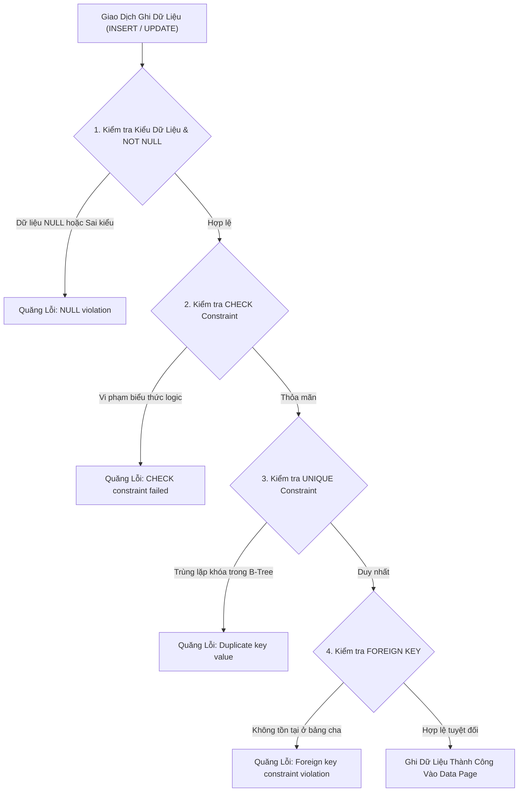

# 2.3. Schema Design & Constraints (Thiết kế Lược đồ & Ràng buộc Cơ sở Dữ liệu)

> [!IMPORTANT]
> **Nếu bạn chỉ được nhớ một điều duy nhất:** Ràng buộc CSDL (Constraints) là tuyến phòng thủ tối hậu cho tính toàn vẹn dữ liệu của doanh nghiệp: mã ứng dụng có thể có bug, microservice có thể crash, nhưng Khóa chính (Primary Key), Khóa ngoại (Foreign Key) và Ràng buộc Kiểm tra (Check Constraints) được thực thi ở tầng hạt nhân CSDL sẽ đảm bảo không một dòng dữ liệu mồ côi hay giá trị vô lý nào có thể lọt vào hệ thống.

---

## 1. Đơn giản nhưng phải chi tiết (Intuitive & Deep Breakdown)

### 1.1. Đoạn Code Dẫn Nhập & Vấn Đề Thực Tế
Làm thế nào để đảm bảo số dư tài khoản ngân hàng không bao giờ bị âm dưới 0 đồng, email người dùng không bao giờ bị trùng lặp, và ngày kết thúc hợp đồng luôn lớn hơn ngày bắt đầu ngay từ tầng hạt nhân của cơ sở dữ liệu?

```sql
-- Thiết lập Ràng buộc Toàn vẹn (Integrity Constraints) cấp độ Hạt nhân Database
CREATE TABLE user_accounts (
    id BIGSERIAL PRIMARY KEY,
    email VARCHAR(255) NOT NULL,
    balance NUMERIC(15, 2) NOT NULL,
    created_at TIMESTAMPTZ DEFAULT NOW(),
    closed_at TIMESTAMPTZ,

    -- Ràng buộc Duy nhất (Chống trùng lặp cấp phần cứng)
    CONSTRAINT uq_user_email UNIQUE (email),

    -- Ràng buộc Kiểm tra Nghiệp vụ (Check Constraint)
    CONSTRAINT chk_positive_balance CHECK (balance >= 0),
    CONSTRAINT chk_valid_date_range CHECK (closed_at IS NULL OR closed_at >= created_at)
);
```

Nếu một nhóm phát triển ỷ lại vào việc "Validation bằng code Backend" (như viết logic kiểm tra bằng Node.js hay Java) mà không đặt ràng buộc trong Database, khi có một tiến trình ghi dữ liệu trực tiếp, một migration lỗi, hoặc một bug race condition xuất hiện, dữ liệu rác và số dư âm sẽ lập tức chui tọt vào database làm hỏng toàn bộ hệ thống!

### 1.2. Ẩn Dụ Đời Sống & Phân Tích Cơ Chế Hoạt Động
Các Ràng buộc Schema (Schema Constraints) giống như **Các Quy Chuẩn Xây Dựng và Cửa An Ninh Sân Bay**:
- **NOT NULL** giống như **Cửa Kiểm Soát Vé**: Không có vé máy bay thì tuyệt đối không được bước vào sảnh chờ.
- **UNIQUE Constraint** giống như **Mỗi Ghế Ngồi Chỉ Bán Cho Đúng 1 Người**: Dù có hai hành khách cùng tên, họ không bao giờ được phép ngồi chung chiếc ghế 12A. Nếu xuất vé trùng, hệ thống báo động đỏ ngay lập tức!
- **FOREIGN KEY (Khóa Ngoại)** giống như **Hành Khách Phải Thuộc Về Một Chuyến Bay Đang Tồn Tại**: Không thể phát thẻ lên máy bay cho một chuyến bay không có trong lịch trình.
  - `ON DELETE CASCADE`: Khi chuyến bay bị hủy, toàn bộ thẻ lên máy bay của hành khách trên chuyến bay đó tự động bị hủy theo.
  - `ON DELETE RESTRICT`: Chừng nào còn hành khách đang ngồi trên máy bay, sân bay kiên quyết cấm không cho phép hủy chuyến bay đó!
- **CHECK Constraint** giống như **Cân Kiểm Tra Trọng Lượng Hành Lý**: Hành lý ký gửi bắt buộc phải $\ge 0\text{ kg}$ và $\le 30\text{ kg}$. Vượt quá ngưỡng là máy từ chối tiếp nhận.

### 1.3. Mô Phỏng Dữ Liệu Số Nhỏ Từng Bước (Toy Walkthrough)
Mô phỏng cơ chế bắt lỗi tức thì của CHECK và FOREIGN KEY trong một giao dịch:

| Thao Tác SQL | Trạng Thái Bảng Dữ Liệu | Phản Ứng Của RDBMS Engine | Kết Quả Giao Dịch |
| :--- | :--- | :--- | :--- |
| `INSERT balance = 500` | Bảng trống | Thỏa mãn `chk_positive_balance` ($500 \ge 0$) | **Thành công (Insert 1 row)** |
| `UPDATE balance = -50` | Bản ghi hiện tại: 500 | Vi phạm: $-50 < 0$ | **Lỗi! `CHECK constraint failed`** (Giao dịch bị Rollback) |
| `INSERT dept_id = 999` | Bảng `Departments` chỉ có ID 1, 2 | Tra cứu B-Tree Index bảng cha: Không tìm thấy 999 | **Lỗi! `FK violation: key not found in parent table`** |
| `DELETE Dept ID = 1` | Có 10 nhân viên đang thuộc Dept 1 | Bảng con có `ON DELETE RESTRICT` | **Lỗi! Từ chối xóa phòng ban vì còn con tham chiếu** |

Dữ liệu luôn được bảo vệ ở trạng thái nhất quán hoàn hảo $100\%$ thời gian.

### 1.4. Tác Động Thực Tế Tầng Backend & Systems
- **Chi Phí Kiểm Tra Khóa Ngoại (Foreign Key Overhead Khi Ghi Dữ Liệu)**: Khi chèn 1 dòng mới vào bảng con có chứa 5 khóa ngoại, database engine phải thực hiện 5 lần tra cứu B-Tree ngầm trên 5 bảng cha để xác thực sự tồn tại của khóa. Nếu các bảng cha chưa được cache trong RAM, thao tác chèn này sẽ gây ra hàng loạt lần đọc đĩa ngẫu nhiên.
- **Rủi Ro Khi Dùng `ON DELETE CASCADE` Trong Môi Trường Sản Xuất**: Một câu lệnh tưởng chừng vô hại như `DELETE FROM customers WHERE id = 5;` có thể ngầm kích hoạt hiệu ứng sụp đổ dây chuyền, tự động xóa sạch hàng nghìn đơn hàng, hóa đơn thanh toán, và lịch sử giao dịch liên quan chỉ trong 1 giây!

### 1.5. Sơ Đồ Tư Duy & Kiến Trúc Hệ Thống (Mermaid)


---

## 2. Chi tiết từng Keyword (Under-the-Hood Deep Dive)

### 2.1. ER Model & ERD (Entity Relationship Diagram)

Mô hình Thực thể - Mối quan hệ (Entity-Relationship Model do Peter Chen đề xuất năm 1976) là công cụ nhận thức giúp trừu tượng hóa thế giới thực thành các khái niệm logic trước khi hiện thực hóa thành các bảng quan hệ.

#### 1. Thành phần Cốt lõi của ER Model
- **Entity (Thực thể)**: Một đối tượng hoặc sự vật trong thế giới thực có thể phân biệt được (ví dụ: `User`, `Order`, `Product`).
  - *Strong Entity (Thực thể mạnh)*: Tự nó có khóa định danh riêng, tồn tại độc lập.
  - *Weak Entity (Thực thể yếu)*: Không có đủ thuộc tính để tạo khóa chính riêng; sự tồn tại của nó phụ thuộc hoàn toàn vào một thực thể chủ thông qua một Khóa bộ phận (Discriminator / Partial Key). Ví dụ: `OrderItem` phụ thuộc vào `Order`.
- **Attribute (Thuộc tính)**: Đặc trưng mô tả thực thể:
  - *Simple (Đơn nguyên)*: Không thể chia nhỏ (ví dụ: `age`, `price`).
  - *Composite (Phức hợp)*: Gồm nhiều thuộc tính nhỏ hợp thành (ví dụ: `Full_Name` = `First_Name` + `Last_Name`).
  - *Multi-valued (Đa trị)*: Có thể nhận nhiều giá trị cùng lúc (ví dụ: `phone_numbers`). Trong mô hình quan hệ, đa trị bắt buộc phải được tách thành bảng riêng để thỏa mãn 1NF.
  - *Derived (Dẫn xuất)*: Giá trị được tính toán từ các thuộc tính khác (ví dụ: `total_years_of_experience` tính từ `hire_date`).
- **Relationship (Mối quan hệ & Lực lượng)**:
  - Bản số (Cardinality Ratio): $1:1$ (Một - Một), $1:N$ (Một - Nhiều), $N:M$ (Nhiều - Nhiều).
  - Ràng buộc tham gia (Participation Constraint):
    - *Total Participation (Tham gia toàn phần / Ràng buộc bắt buộc)*: Mọi thực thể trong tập đều phải tham gia quan hệ (ví dụ: Mọi `Order` bắt buộc phải thuộc về một `Customer`).
    - *Partial Participation (Tham gia một phần / Tùy chọn)*: Không bắt buộc mọi thực thể tham gia (ví dụ: Một `Customer` có thể chưa tạo bất kỳ `Order` nào).

#### 2. Quy tắc Chuyển đổi ERD sang Lược đồ Quan hệ (Mapping ERD to Relational Tables)
```
+---------------------------------------------------------------------------------+
| QUY TẮC CHUYỂN ĐỔI CHUẨN:                                                       |
|                                                                                 |
| 1. Quan hệ 1:N (One-to-Many):                                                   |
|    - Lấy Khóa chính của bảng phía "1" đặt làm Khóa ngoại (FK) ở bảng phía "N".  |
|    - Ví dụ: customer_id (PK của Customer) trở thành FK trong bảng Orders.       |
|                                                                                 |
| 2. Quan hệ N:M (Many-to-Many):                                                   |
|    - BẮT BUỘC tạo một Bảng liên kết trung gian (Associative / Junction Table).   |
|    - Khóa chính của bảng trung gian là Khóa ghép tạo bởi hai Khóa ngoại:         |
|      PK = (order_id, product_id).                                               |
|                                                                                 |
| 3. Quan hệ 1:1 (One-to-One):                                                   |
|    - Đặt Khóa ngoại ở bảng có Total Participation kèm ràng buộc UNIQUE.         |
+---------------------------------------------------------------------------------+
```

---

### 2.2. Database Constraints (Các Ràng buộc Toàn vẹn)

Động cơ lưu trữ (Storage Engine) thực thi các ràng buộc ở mức thấp nhất, chặn đứng mọi thao tác vi phạm trước khi ghi vào log WAL hoặc cập nhật bộ đệm:

#### 1. Primary Key vs Candidate Key vs Unique Constraint
- **Primary Key**:
  - Định danh tối thượng của một hàng trong bảng.
  - Động cơ cơ sở dữ liệu mặc định xây dựng một **Clustered Index (B-Tree)** trên cột Khóa chính (ví dụ trong MySQL InnoDB). Dữ liệu vật lý của toàn bộ hàng được tổ chức sắp xếp trực tiếp tại các nút lá của cây B-Tree này.
  - Bắt buộc phải duy nhất và tuyệt đối cấm `NULL`.
- **Unique Constraint (`UNIQUE`)**:
  - Ngăn chặn sự trùng lặp giá trị trên các cột được chỉ định (Alternate Keys).
  - Động cơ tự động tạo một **Secondary B-Tree Index** để phục vụ việc kiểm tra trùng lặp với độ phức tạp $O(\log N)$ trong mỗi thao tác `INSERT`.
  - *Hành vi với NULL*: Trong chuẩn ANSI SQL và PostgreSQL/MySQL, `NULL` đại diện cho "chưa xác định". Do đó, hai giá trị `NULL` không bằng nhau (`NULL = NULL` trả về `UNKNOWN`). Một cột `UNIQUE` có thể chứa vô số giá trị `NULL` (trừ khi có thêm ràng buộc `NOT NULL`).

#### 2. Foreign Key & Hành vi Tham chiếu (Cascade Behaviors)
Ràng buộc khóa ngoại bảo đảm tính toàn vẹn tham chiếu. Khi một dòng ở bảng cha (Parent Table) bị xóa hoặc sửa khóa chính:
- `ON DELETE RESTRICT` (hoặc `NO ACTION`): Hủy giao dịch và ném lỗi nếu còn bất kỳ dòng con nào đang tham chiếu tới bản ghi cha.
- `ON DELETE CASCADE`: Tự động xóa sạch mọi bản ghi con liên quan. *(Cực kỳ nguy hiểm trong production: Một câu lệnh xóa một người dùng có thể kích hoạt chuỗi xóa hàng triệu đơn hàng, bình luận, và hóa đơn, gây khóa nghẽn toàn bộ cơ sở dữ liệu)*.
- `ON DELETE SET NULL`: Gán `NULL` cho cột khóa ngoại ở các dòng con (Yêu cầu cột FK phải cho phép `NULL`).
- `ON DELETE SET DEFAULT`: Đưa cột khóa ngoại về giá trị mặc định đã khai báo.

#### 3. Check Constraint & Exclusion Constraint
- **Check Constraint (`CHECK`)**:
  - Đánh giá một biểu thức logic vị từ trên mỗi thao tác thêm/sửa:
    ```sql
    CONSTRAINT chk_positive_price CHECK (price > 0),
    CONSTRAINT chk_status CHECK (status IN ('PENDING', 'PROCESSING', 'DELIVERED', 'CANCELLED'))
    ```
- **Exclusion Constraint (Ràng buộc Loại trừ - PostgreSQL GiST)**:
  - Cho phép kiểm tra các điều kiện va chạm không gian hoặc thời gian phức tạp mà ràng buộc `UNIQUE` thông thường không thể làm được.
  - Ví dụ: Đảm bảo không có hai lượt đặt phòng khách sạn bị trùng lặp khoảng thời gian trên cùng một phòng:
    ```sql
    CREATE EXTENSION btree_gist;
    ALTER TABLE room_reservations 
    ADD CONSTRAINT no_overlapping_bookings 
    EXCLUDE USING gist (room_id WITH =, reservation_period WITH &&);
    ```

#### 4. Chiến lược Khóa: Natural Key vs Surrogate Key
- **Natural Key (Khóa tự nhiên)**: Sử dụng thuộc tính nghiệp vụ có sẵn ngoài đời thực làm khóa (ví dụ: Số CCCD, Mã số thuế doanh nghiệp, Số VIN xe hơi, Mã IATA sân bay như `SGN`, `HAN`).
  - *Ưu điểm*: Tiết kiệm bộ nhớ, không cần JOIN thêm để biết mã.
  - *Nhược điểm chí mạng*: Nghiệp vụ thay đổi! Nếu cơ quan nhà nước đổi độ dài CCCD từ 9 số lên 12 số, bạn phải chạy `ALTER TABLE` và `CASCADE UPDATE` trên hàng trăm triệu bản ghi liên kết!
- **Surrogate Key (Khóa nhân tạo)**: Cột nhân tạo không mang ý nghĩa nghiệp vụ sinh ra thuần túy làm định danh hệ thống:
  - `BIGINT AUTO_INCREMENT / IDENTITY`:
    - *Ưu điểm*: 8 bytes, nhỏ gọn, ghi tuần tự vào B-Tree cực nhanh (không phân mảnh trang - Zero Page Splits).
    - *Nhược điểm*: Dễ bị lộ số lượng người dùng (Insecure Direct Object Reference - IDOR); khó mở rộng phân tán khi nhiều node ghi đồng thời.
  - `UUIDv4 (Random UUID)`:
    - *Ưu điểm*: Sinh ngẫu nhiên phân tán 128-bit không lo va chạm, bảo mật.
    - *Nhược điểm*: **Thảm họa B-Tree!** Dữ liệu chèn vào ngẫu nhiên làm xé vụn các trang B-Tree (Page Splits liên tục), phá hủy bộ đệm Buffer Pool và làm giảm hiệu năng ghi tới $10\times$.
  - `UUIDv7 (Time-ordered UUID - Chuẩn mới RFC 9562)`:
    - *Bản chất*: 48-bit đầu là Unix Timestamp mili-giây, các bit sau là dữ liệu ngẫu nhiên chống va chạm.
    - *Ưu điểm*: Vừa có tính phân tán toàn cầu của UUID, vừa có tính sắp xếp tuần tự của số tự tăng, giúp cây B-Tree luôn ghi nối tiếp vào trang cuối cùng, loại bỏ hoàn toàn hiện tượng phân mảnh đĩa!

---

### 2.3. Schema Evolution & Migration

Trong các hệ thống phân tán và dịch vụ trực tuyến phục vụ người dùng 24/7, việc bảo trì định kỳ dừng hệ thống (Downtime Maintenance Window) không còn được chấp nhận. Bất kỳ thay đổi lược đồ cơ sở dữ liệu nào cũng phải đạt chuẩn **Zero-Downtime**.

#### 1. Quy tắc Vàng: Tính Tương thích Ngược (Backward Compatibility)
Mã nguồn ứng dụng và Lược đồ cơ sở dữ liệu không bao giờ được triển khai đồng thời trong một tích tắc. Luôn tồn tại một khoảng thời gian (từ 15 phút đến vài ngày) mà **Ứng dụng phiên bản cũ (App V1) và Ứng dụng phiên bản mới (App V2) cùng chạy song song và cùng truy vấn vào cùng một Cơ sở dữ liệu**.
- *Quy tắc 1*: Tuyệt đối không xóa cột hoặc đổi tên cột trực tiếp trong một bước.
- *Quy tắc 2*: Không thêm cột mới với ràng buộc `NOT NULL` mà không có giá trị `DEFAULT` (hoặc phải dùng quá trình 3 bước).

#### 2. Chiến lược Expand and Contract (Mở rộng và Thu hẹp)
Để đổi tên một cột từ `phone` sang `phone_number`:
1. **Bước 1 (Expand)**: Thêm cột mới `phone_number` cho phép `NULL`.
2. **Bước 2 (Dual-Write)**: Cập nhật ứng dụng để ghi đồng thời vào cả `phone` và `phone_number`. Ứng dụng vẫn đọc từ `phone`.
3. **Bước 3 (Backfill)**: Chạy một Background Batch Job cập nhật dữ liệu lịch sử từ `phone` sang `phone_number` theo từng lô nhỏ (ví dụ: mỗi lô 1,000 dòng để không chiếm khóa đĩa lâu).
4. **Bước 4 (Switch)**: Triển khai ứng dụng mới, chuyển toàn bộ logic đọc sang `phone_number`.
5. **Bước 5 (Contract)**: Thêm ràng buộc `NOT NULL` vào `phone_number`, sau đó xóa bỏ cột cũ `phone`.

#### 3. Nguy cơ Khóa Đĩa của DDL (Data Definition Language Locks)
- Trong PostgreSQL, các lệnh `ALTER TABLE` thông thường sẽ xin khóa **`AccessExclusiveLock`** trên toàn bộ bảng. Khóa này chặn tất cả mọi thao tác đọc và ghi (`SELECT`, `INSERT`, `UPDATE`, `DELETE`). Nếu có một câu lệnh `SELECT` chạy ngầm kéo dài, lệnh `ALTER TABLE` sẽ phải đứng chờ, và toàn bộ hàng nghìn truy vấn đến sau sẽ bị tắc nghẽn phía sau nó (Connection Pool Exhaustion).
- *Giải pháp*:
  - Luôn đặt `lock_timeout`: `SET lock_timeout = '2s';` trước khi chạy migration.
  - Sử dụng các công cụ Online Schema Change: `gh-ost` hoặc `pt-online-schema-change` cho MySQL; `pg_repack` cho PostgreSQL.

---

## 3. Thực thi Mã nguồn & Mô phỏng Chuyên sâu (Dual-Engine Implementation)

Phần này triển khai hai mô phỏng kỹ thuật:
1. **C++20**: Xây dựng một Engine quản lý Table Schema in-memory thực thi nghiêm ngặt các ràng buộc:
   - Primary Key Uniqueness & Not Null.
   - Foreign Key Referential Integrity (liên kết cha - con).
   - Dynamic Check Constraints thông qua C++20 Lambdas/Function Pointers.
2. **Python 3.11**: Xây dựng State Machine mô phỏng chính xác 5 bước của quy trình di chuyển lược đồ **Zero-Downtime Expand & Contract Pattern** dưới tải trọng đọc/ghi đồng thời.

### 3.1. C++20 Database Constraints Engine Simulation

```cpp
#include <iostream>
#include <vector>
#include <string>
#include <unordered_map>
#include <functional>
#include <optional>
#include <stdexcept>
#include <memory>
#include <iomanip>

struct Record {
    int id;
    std::string name;
    std::optional<int> parent_id; // Foreign Key
    double balance;               // Subject to CHECK balance >= 0
};

class Table {
public:
    std::string name;
    std::unordered_map<int, Record> primary_index; // Enforces PK uniqueness
    std::function<bool(const Record&)> check_constraint;
    Table* parent_table = nullptr; // Referential integrity target

    Table(std::string table_name, std::function<bool(const Record&)> chk = nullptr)
        : name(std::move(table_name)), check_constraint(std::move(chk)) {}

    void set_foreign_key_reference(Table* parent) {
        parent_table = parent;
    }

    void insert(const Record& record) {
        // 1. Entity Integrity: Primary Key check
        if (primary_index.contains(record.id)) {
            throw std::runtime_error("PK Violation: Duplicate Key ID = " + std::to_string(record.id));
        }

        // 2. Domain / Check Constraint: Business rule evaluation
        if (check_constraint && !check_constraint(record)) {
            throw std::runtime_error("CHECK Constraint Violation on Table " + name + 
                                     ": Record ID " + std::to_string(record.id) + " failed predicate evaluation.");
        }

        // 3. Referential Integrity: Foreign Key verification
        if (record.parent_id.has_value()) {
            if (!parent_table) {
                throw std::runtime_error("FK Configuration Error: No parent table defined.");
            }
            if (!parent_table->primary_index.contains(record.parent_id.value())) {
                throw std::runtime_error("Referential Integrity Violation: parent_id " + 
                                         std::to_string(record.parent_id.value()) + 
                                         " does NOT exist in parent table '" + parent_table->name + "'!");
            }
        }

        // Insert passed all mathematical barriers
        primary_index[record.id] = record;
        std::cout << "  [SUCCESS] Inserted into " << name << " -> ID: " << record.id 
                  << ", Name: " << record.name << ", Balance: $" << record.balance << "\n";
    }

    void print_table() const {
        std::cout << "\n--- Table State: " << name << " (" << primary_index.size() << " records) ---\n";
        std::cout << std::setw(6) << "ID" << " | " << std::setw(15) << "Name" << " | " 
                  << std::setw(10) << "Parent_ID" << " | " << std::setw(10) << "Balance" << "\n";
        std::cout << std::string(50, '-') << "\n";
        for (const auto& [id, r] : primary_index) {
            std::string p_str = r.parent_id.has_value() ? std::to_string(r.parent_id.value()) : "NULL";
            std::cout << std::setw(6) << r.id << " | " << std::setw(15) << r.name << " | " 
                      << std::setw(10) << p_str << " | $" << std::setw(9) << r.balance << "\n";
        }
        std::cout << "\n";
    }
};

int main() {
    std::cout << "=========================================================\n";
    std::cout << "   DATABASE INTEGRITY CONSTRAINTS ENGINE (C++20)        \n";
    std::cout << "=========================================================\n\n";

    // 1. Tạo bảng cha: Departments (CHECK: balance >= 0)
    Table departments("Departments", [](const Record& r) {
        return r.balance >= 0.0;
    });

    // 2. Tạo bảng con: Employees (FK -> Departments.id)
    Table employees("Employees", [](const Record& r) {
        return r.balance >= 0.0 && !r.name.empty();
    });
    employees.set_foreign_key_reference(&departments);

    std::cout << "[Step 1] Ingesting valid parent records into Departments...\n";
    departments.insert({1, "AI Research", std::nullopt, 500000.0});
    departments.insert({2, "Infrastructure", std::nullopt, 200000.0});

    std::cout << "\n[Step 2] Ingesting valid child records into Employees...\n";
    employees.insert({101, "Alice", 1, 8500.0});
    employees.insert({102, "Bob", 2, 7200.0});

    std::cout << "\n[Step 3] Simulating Constraint Violations:\n";

    // Test A: Primary Key Duplicate
    try {
        std::cout << "  Attempting PK duplicate on Departments (ID=1)...\n";
        departments.insert({1, "Conflict Lab", std::nullopt, 10000.0});
    } catch (const std::exception& e) {
        std::cout << "  [BLOCKED BY ENGINE]: " << e.what() << "\n";
    }

    // Test B: CHECK Constraint Failure (Negative balance)
    try {
        std::cout << "  Attempting CHECK violation on Employees (Balance = -500.0)...\n";
        employees.insert({103, "Charlie", 1, -500.0});
    } catch (const std::exception& e) {
        std::cout << "  [BLOCKED BY ENGINE]: " << e.what() << "\n";
    }

    // Test C: Foreign Key Orphan Record
    try {
        std::cout << "  Attempting FK violation on Employees (Referencing non-existent dept_id = 999)...\n";
        employees.insert({104, "David", 999, 6000.0});
    } catch (const std::exception& e) {
        std::cout << "  [BLOCKED BY ENGINE]: " << e.what() << "\n";
    }

    departments.print_table();
    employees.print_table();
    return 0;
}
```

### 3.2. Python 3.11 Zero-Downtime Migration State Machine

```python
#!/usr/bin/env python3
"""
Zero-Downtime Schema Evolution: The Expand and Contract Pattern Simulation.
Demonstrates live dual-writing and online backfilling without service disruption.
"""

from dataclasses import dataclass
from typing import Any
import time

@dataclass
class DatabaseRow:
    id: int
    name: str
    phone: str | None = None          # Old column
    phone_number: str | None = None   # New column (Expanded)

class ProductionDatabase:
    def __init__(self) -> None:
        # Prepopulate with 5 legacy records
        self.storage: dict[int, DatabaseRow] = {
            i: DatabaseRow(id=i, name=f"User_{i}", phone=f"+84-9000-000{i}")
            for i in range(1, 6)
        }
        self.phase = "PHASE_0_LEGACY"

    def execute_read(self, user_id: int) -> dict[str, Any]:
        row = self.storage[user_id]
        if self.phase in ("PHASE_0_LEGACY", "PHASE_1_EXPAND", "PHASE_2_BACKFILL"):
            return {"id": row.id, "name": row.name, "contact": row.phone}
        else:
            # Switched to new column
            return {"id": row.id, "name": row.name, "contact": row.phone_number}

    def execute_write(self, user_id: int, name: str, phone_val: str) -> None:
        if self.phase == "PHASE_0_LEGACY":
            self.storage[user_id] = DatabaseRow(id=user_id, name=name, phone=phone_val)
        elif self.phase in ("PHASE_1_EXPAND", "PHASE_2_BACKFILL"):
            # DUAL WRITE: Write to both old and new columns
            self.storage[user_id] = DatabaseRow(
                id=user_id, name=name, phone=phone_val, phone_number=phone_val
            )
        elif self.phase in ("PHASE_3_SWITCH", "PHASE_4_CONTRACT"):
            # New application logic: write exclusively to phone_number
            self.storage[user_id] = DatabaseRow(
                id=user_id, name=name, phone=None, phone_number=phone_val
            )

    def run_online_backfill(self) -> None:
        print("  -> [Worker] Starting background chunked backfill...")
        for row in self.storage.values():
            if row.phone and not row.phone_number:
                row.phone_number = row.phone
        print("  -> [Worker] 100% legacy records successfully backfilled to 'phone_number'.")

def main() -> None:
    print("=" * 65)
    print("   ZERO-DOWNTIME SCHEMA EVOLUTION: EXPAND & CONTRACT (Python 3.11)")
    print("=" * 65)

    db = ProductionDatabase()
    print(f"\n[Phase 0: Legacy State] Initial Table: 5 records on 'phone' column.")
    print(f"  Sample Read(User 1): {db.execute_read(1)}")

    # Phase 1: Expand
    print("\n[Phase 1: EXPAND] DDL: ALTER TABLE users ADD COLUMN phone_number VARCHAR NULL;")
    db.phase = "PHASE_1_EXPAND"
    print("  App deployment: Dual-writing enabled. Traffic is NOT interrupted.")
    db.execute_write(6, "NewUser_6", "+84-9999-6666")
    print(f"  Live Write User 6 -> Stored: {db.storage[6]}")

    # Phase 2: Backfill
    print("\n[Phase 2: BACKFILL] Background Worker migrating legacy rows...")
    db.phase = "PHASE_2_BACKFILL"
    db.run_online_backfill()

    # Phase 3: Switch
    print("\n[Phase 3: SWITCH] Deploying Application V2: Reading and Writing 'phone_number' exclusively.")
    db.phase = "PHASE_3_SWITCH"
    print(f"  Sample Read(User 1 - Migrated): {db.execute_read(1)}")
    print(f"  Sample Read(User 6 - Dual-written): {db.execute_read(6)}")

    # Phase 4: Contract
    print("\n[Phase 4: CONTRACT] DDL: ALTER TABLE users DROP COLUMN phone;")
    db.phase = "PHASE_4_CONTRACT"
    for row in db.storage.values():
        row.phone = None  # Dropped from physical storage

    print("\nMigration Completed with ZERO seconds of downtime!")
    print(f"Final State User 1: {db.storage[1]}")
    print("=" * 65)

if __name__ == "__main__":
    main()
```

### 3.3. Terminal Output Mẫu Chuẩn Thực Tế

```bash
$ g++ -O3 -std=c++20 constraints_engine.cpp -o constraints_engine && ./constraints_engine
=========================================================
   DATABASE INTEGRITY CONSTRAINTS ENGINE (C++20)        
=========================================================

[Step 1] Ingesting valid parent records into Departments...
  [SUCCESS] Inserted into Departments -> ID: 1, Name: AI Research, Balance: $500000
  [SUCCESS] Inserted into Departments -> ID: 2, Name: Infrastructure, Balance: $200000

[Step 2] Ingesting valid child records into Employees...
  [SUCCESS] Inserted into Employees -> ID: 101, Name: Alice, Balance: $8500
  [SUCCESS] Inserted into Employees -> ID: 102, Name: Bob, Balance: $7200

[Step 3] Simulating Constraint Violations:
  Attempting PK duplicate on Departments (ID=1)...
  [BLOCKED BY ENGINE]: PK Violation: Duplicate Key ID = 1
  Attempting CHECK violation on Employees (Balance = -500.0)...
  [BLOCKED BY ENGINE]: CHECK Constraint Violation on Table Employees: Record ID 103 failed predicate evaluation.
  Attempting FK violation on Employees (Referencing non-existent dept_id = 999)...
  [BLOCKED BY ENGINE]: Referential Integrity Violation: parent_id 999 does NOT exist in parent table 'Departments'!

--- Table State: Departments (2 records) ---
    ID |            Name |  Parent_ID |    Balance
--------------------------------------------------
     1 |     AI Research |       NULL | $   500000
     2 |  Infrastructure |       NULL | $   200000


--- Table State: Employees (2 records) ---
    ID |            Name |  Parent_ID |    Balance
--------------------------------------------------
   101 |           Alice |          1 | $     8500
   102 |             Bob |          2 | $     7200

$ python3 zero_downtime_migration.py
=================================================================
   ZERO-DOWNTIME SCHEMA EVOLUTION: EXPAND & CONTRACT (Python 3.11)
=================================================================

[Phase 0: Legacy State] Initial Table: 5 records on 'phone' column.
  Sample Read(User 1): {'id': 1, 'name': 'User_1', 'contact': '+84-9000-0001'}

[Phase 1: EXPAND] DDL: ALTER TABLE users ADD COLUMN phone_number VARCHAR NULL;
  App deployment: Dual-writing enabled. Traffic is NOT interrupted.
  Live Write User 6 -> Stored: DatabaseRow(id=6, name='NewUser_6', phone='+84-9999-6666', phone_number='+84-9999-6666')

[Phase 2: BACKFILL] Background Worker migrating legacy rows...
  -> [Worker] Starting background chunked backfill...
  -> [Worker] 100% legacy records successfully backfilled to 'phone_number'.

[Phase 3: SWITCH] Deploying Application V2: Reading and Writing 'phone_number' exclusively.
  Sample Read(User 1 - Migrated): {'id': 1, 'name': 'User_1', 'contact': '+84-9000-0001'}
  Sample Read(User 6 - Dual-written): {'id': 6, 'name': 'NewUser_6', 'contact': '+84-9999-6666'}

[Phase 4: CONTRACT] DDL: ALTER TABLE users DROP COLUMN phone;

Migration Completed with ZERO seconds of downtime!
Final State User 1: DatabaseRow(id=1, name='User_1', phone=None, phone_number='+84-9000-0001')
=================================================================
```

---

## 4. Systems Engineering & Production Pitfalls

### 1. The Missing Index on Foreign Key Lock Trap
- **Hiện tượng**: Bạn thực thi câu lệnh xóa một dòng ở bảng cha: `DELETE FROM customers WHERE id = 42;`. Đột nhiên toàn bộ bảng con `orders` (chứa 50 triệu dòng) bị khóa nghẽn, mọi giao dịch ghi đơn hàng mới trên toàn hệ thống bị treo cứng (Cascading Block).
- **Cơ chế Under-the-Hood**:
  - Khi xóa ở bảng cha, cơ sở dữ liệu phải kiểm tra xem có dòng con nào trong `orders` đang có `customer_id = 42` hay không để bảo toàn tính toàn vẹn tham chiếu.
  - **Nhiều RDBMS (như PostgreSQL, Oracle) KHÔNG tự động tạo chỉ mục trên cột Foreign Key!**
  - Do không có chỉ mục trên `orders.customer_id`, engine buộc phải thực hiện **Sequential Scan** toàn bộ 50 triệu dòng của bảng `orders`, đồng thời giữ khóa chia sẻ (ShareLock) trên toàn bộ bảng con, ngăn chặn mọi thao tác ghi khác.
- **Quy tắc Bất biến trong Production**:
  ```sql
  -- LUÔN LUÔN tạo Index tường minh trên mọi cột Foreign Key!
  CREATE INDEX idx_orders_customer_id ON orders(customer_id);
  ```

### 2. UUIDv4 Random Insertion and B-Tree Page Split Storms
- **Hiện tượng**: Tốc độ ghi dữ liệu của hệ thống giảm dần đều theo thời gian. Khi bảng đạt 100 triệu dòng, mỗi thao tác `INSERT` bằng `UUIDv4` mất tới $50\text{ ms}$ thay vì $0.5\text{ ms}$, trong khi chỉ số IOPS của đĩa SSD luôn chạm trần 100%.
- **Giải phẫu Bộ nhớ**:
  - Cây B-Tree sắp xếp các khóa theo thứ tự tăng dần. Khóa tự tăng `BIGINT` luôn chèn vào trang lá cuối cùng bên phải (Append-only style), các trang trước đó đã đầy và đóng băng an toàn trong Buffer Pool.
  - Ngược lại, `UUIDv4` sinh giá trị ngẫu nhiên hoàn toàn. Dữ liệu mới có xác suất rơi đều vào **bất kỳ trang lá ngẫu nhiên nào** trong số hàng triệu trang B-Tree trên đĩa.
  - Khi một trang lá 8KB đã đầy, động cơ phải thực hiện **Page Split** (cấp phát trang mới, sao chép 50% dữ liệu sang trang mới, cập nhật con trỏ trang cha). Thao tác này gây ra bão I/O đĩa ngẫu nhiên (Random Write Storm) và phân mảnh bộ đệm nghiêm trọng.
- **Giải pháp**: Chuyển ngay sang **UUIDv7** (RFC 9562) hoặc **ULID** để giữ tính tuần tự theo thời gian.

### 3. PostgreSQL `ALTER TABLE ADD COLUMN NOT NULL` Lock Trap
- Trong các phiên bản PostgreSQL cũ (< 11), khi thêm một cột có `DEFAULT` và `NOT NULL`, cơ sở dữ liệu sẽ khóa bảng bằng `AccessExclusiveLock` và ghi đè vật lý lại toàn bộ từng tuple trên đĩa. Trên một bảng 500GB, thao tác này mất 2 tiếng Downtime!
- Từ PostgreSQL 11 trở lên, thao tác này là metadata-only ($O(1)$) nếu giá trị `DEFAULT` là hằng số. Tuy nhiên, nếu hàm default là volatile (ví dụ: `DEFAULT random()`), PostgreSQL vẫn bắt buộc phải ghi lại toàn bộ bảng.
- **CLI Điều tra Khóa treo**:
  ```sql
  SELECT pid, age(clock_timestamp(), query_start), usename, query, state
  FROM pg_stat_activity
  WHERE state != 'idle' AND query ILIKE 'ALTER TABLE%';
  ```

---

## 5. Bảng So sánh & Decision Matrix

### So sánh Toàn diện các Chiến lược Định danh Khóa chính (Primary Key Strategies)

| Tiêu chí | BIGINT Auto-increment | UUIDv4 (Random) | UUIDv7 (Time-ordered) | ULID (Universally Unique Lexicographically) |
| :--- | :--- | :--- | :--- | :--- |
| **Kích thước Lưu trữ** | **8 Bytes** (Rất nhỏ) | 16 Bytes (Lớn gấp đôi) | 16 Bytes | 16 Bytes (hoặc 26 chars string) |
| **Bảo mật (Chống IDOR)** | Kém (Dễ bị scan đoán số) | **Hoàn hảo** (Khó đoán) | Rất tốt (Entropy cao) | Rất tốt |
| **Thân thiện với B-Tree** | **Hoàn hảo** (Append-only) | **Rất tệ** (Gây Page Splits) | **Hoàn hảo** (Tuần tự theo thời gian) | **Hoàn hảo** (Tuần tự theo thời gian) |
| **Sinh Khóa Phân tán** | Khó (Cần Snowflake/Coordination) | Rất dễ (Sinh tại Client) | Rất dễ (Sinh tại Client) | Rất dễ (Sinh tại Client) |
| **Hiệu năng Bộ đệm RAM** | Tối đa hóa hit cache trang lá | Gây ô nhiễm Buffer Pool | Tối đa hóa hit cache trang lá | Tối đa hóa hit cache trang lá |
| **Khuyến nghị Sử dụng** | Dịch vụ nội bộ, bảng nhỏ | Hệ thống phân tán không dùng B-Tree | **Lựa chọn số 1 cho RDBMS hiện đại** | Tốt cho log và microservices |

### Ma trận Các Cấp độ Khóa DDL trong RDBMS (PostgreSQL Locks)

| Mức độ Khóa (Lock Mode) | Lệnh DDL Tiêu biểu | Chặn SELECT? | Chặn INSERT/UPDATE? | Mức độ Nguy hiểm Production |
| :--- | :--- | :--- | :--- | :--- |
| **AccessShareLock** | `SELECT` | Không | Không | An toàn tuyệt đối |
| **RowExclusiveLock** | `INSERT`, `UPDATE`, `DELETE` | Không | Không | Bình thường |
| **ShareUpdateExclusiveLock** | `ANALYZE`, `VACUUM`, `CREATE INDEX CONCURRENTLY` | Không | Không | Thấp (chỉ xung đột với DDL khác) |
| **ShareLock** | `CREATE INDEX` (thông thường) | Không | **CÓ** | Trung bình (Tắc nghẽn luồng ghi) |
| **AccessExclusiveLock** | `ALTER TABLE`, `DROP TABLE`, `TRUNCATE` | **CÓ** | **CÓ** | **CỰC KỲ NGUY HIỂM** (Tắc nghẽn toàn diện) |

---

## 6. Enterprise Production Checklist & Verification

### 6.1. Kiến Trúc & Cấu Hình Tối Ưu (Production-Ready Architecture)
- [ ] **Bắt Buộc Đánh Chỉ Mục Cho Mọi Cột Khóa Ngoại**: Luôn tạo chỉ mục B-Tree trên các cột khóa ngoại ở bảng con để tránh hiện tượng khóa toàn bộ bảng con khi cập nhật hoặc xóa dữ liệu ở bảng cha.
- [ ] **Cân Nhắc Kỹ Lưỡng Trước Khi Dùng ON DELETE CASCADE**: Trong các hệ thống tài chính và thương mại điện tử, cấm tuyệt đối `CASCADE` trên dữ liệu giao dịch; thay vào đó sử dụng `RESTRICT` kết hợp với kỹ thuật Xóa Mềm (Soft Delete: `deleted_at`).
- [ ] **Tận Dụng CHECK Constraints Cho Các Trường Trạng Thái**: Sử dụng `CHECK (status IN ('PENDING', 'PAID', 'CANCELLED'))` để đảm bảo không bao giờ có trạng thái lạ xuất hiện trong cơ sở dữ liệu.
- [ ] **Sử Dụng Khóa Tự Tăng 64-bit (BIGINT / UUIDv7)**: Luôn dùng `BIGINT` cho khóa chính tự tăng; tránh dùng `INT` 32-bit vì sẽ cạn kiệt số ID sau 2.1 tỷ bản ghi.

### 6.2. Giám Sát, Cảnh Báo & Xử Lý Sự Cố (Observability & Incident Response)
- [ ] **Giám Sát Tỷ Lệ Lỗi Vi Phạm Ràng Buộc**: Theo dõi số lượng lỗi `unique_violation` và `foreign_key_violation` trong log để phát hiện các lỗi logic của code ứng dụng.
- [ ] **Cảnh Báo Tình Trạng Sắp Hết Số ID Tự Tăng**: Giám sát giá trị hiện tại của các chuỗi Sequence; cảnh báo khi giá trị đạt 75% ngưỡng cực đại của kiểu dữ liệu.
- [ ] **Thẩm Định Tính Toàn Vẹn Khóa Bằng CLI**: Chạy truy vấn kiểm tra các bản ghi vi phạm tính toàn vẹn tham chiếu sau khi hoàn tất các đợt di chuyển dữ liệu lớn.
