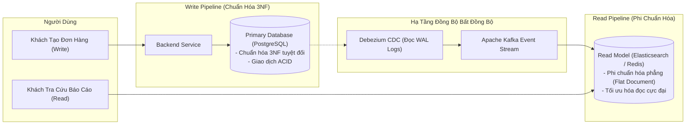
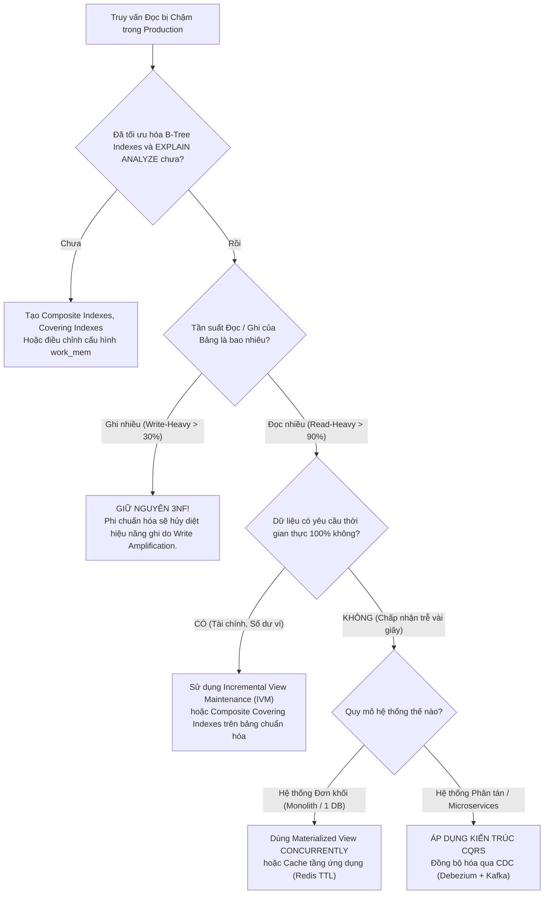

# 2.4. Denormalization & Read Models (Phi chuẩn hóa & Mô hình Đọc)

> [!IMPORTANT]
> **Nếu bạn chỉ được nhớ một điều duy nhất:** Phi chuẩn hóa (Denormalization) không phải là sự cẩu thả trong thiết kế, mà là một quyết định kiến trúc có tính toán: bằng cách chấp nhận lưu trữ dữ liệu dư thừa hoặc duy trì các Mô hình Đọc chuyên biệt (CQRS Read Models / Materialized Views), chúng ta đánh đổi chi phí đồng bộ hóa dữ liệu khi ghi để mua lấy tốc độ truy vấn đọc trang tổng quan với độ trễ dưới 10 mili-giây.

---

## 1. Đơn giản nhưng phải chi tiết (Intuitive & Deep Breakdown)

### 1.1. Đoạn Code Dẫn Nhập & Vấn Đề Thực Tế
Tại sao trên các bảng tin mạng xã hội hoặc sàn thương mại điện tử phục vụ hàng triệu người dùng, người ta lại chấp nhận lưu trữ dư thừa dữ liệu (Phi chuẩn hóa - Denormalization) thay vì giữ nguyên chuẩn 3NF thuần khiết?

```sql
-- Khi chuẩn hóa 3NF: Muốn hiển thị số lượng like của 1 bài viết có 500,000 likes:
-- Database phải đếm tuần tự từng dòng trong bảng likes -> Nghẽn CPU!
SELECT COUNT(*) FROM post_likes WHERE post_id = 9988;

-- Khi áp dụng Phi chuẩn hóa (Denormalization):
-- Lưu trực tiếp cột like_count vào bảng posts!
-- Truy vấn đọc lấy giá trị tức thì O(1) chỉ mất 0.1ms:
SELECT title, like_count FROM posts WHERE id = 9988;
```

Cái giá phải trả cho sự siêu tốc này là gì? Mỗi khi có một người dùng thả like, hệ thống phải thực hiện 2 thao tác ghi đồng thời: chèn vào `post_likes` và cộng 1 vào `posts.like_count`. Nếu không có cơ chế đồng bộ nghiêm ngặt, số đếm hiển thị sẽ bị sai lệch hoàn toàn so với thực tế!

### 1.2. Ẩn Dụ Đời Sống & Phân Tích Cơ Chế Hoạt Động
So sánh giữa Chuẩn hóa và Phi chuẩn hóa giống như **Cách Bạn Quản Lý Tài Liệu Công Ty**:
- **Chuẩn hóa (Normalized - Kho Lưu Trữ Hồ Sơ Gốc)**: Mọi hóa đơn, chứng từ được lưu đúng 1 bản duy nhất trong phòng văn thư. Không bao giờ sợ có 2 bản sao mâu thuẫn nhau. Nhưng mỗi lần sếp cần một bản tóm tắt tình hình kinh doanh, bạn phải lục tung cả 500 cặp tài liệu ra tổng hợp mất 3 ngày.
- **Phi chuẩn hóa (Denormalized / Read Model - Bảng Dashboard Báo Cáo Trên Tường)**: Bạn photo sẵn biểu đồ doanh thu và số lượng khách dán ngay lên tường phòng họp của sếp.
  - Sếp ngước mắt lên là nhìn thấy con số ngay lập tức (**Đọc siêu tốc**).
  - *Thách thức*: Mỗi khi phòng kế toán phát sinh một hóa đơn mới, bạn phải nhớ chạy ra tường lấy bút xóa sửa lại con số (**Chi phí đồng bộ dữ liệu**). Nếu quên sửa, sếp sẽ nhìn thấy số liệu cũ (**Hiện tượng Đọc Dữ liệu Cũ / Eventual Consistency**)!

### 1.3. Mô Phỏng Dữ Liệu Số Nhỏ Từng Bước (Toy Walkthrough)
Mô phỏng mô hình CQRS (Command Query Responsibility Segregation) tách rời Write Model (3NF) và Read Model (Elasticsearch / Redis):

| Thời Điểm | Thao Tác Nghiệp Vụ | Tầng Write Model (Postgres 3NF) | Cơ Chế Đồng Bộ (CDC / Kafka) | Tầng Read Model (Elasticsearch) | Trạng Thái Nhất Quán |
| :--- | :--- | :--- | :--- | :--- | :--- |
| $T_0$ | Người dùng tạo đơn hàng | Ghi vào `orders` và `order_items` | Lắng nghe qua Debezium CDC | Đang chứa dữ liệu cũ | Tạm thời lệch dữ liệu |
| $T_0 + 5\text{ms}$ | Transaction Commit | **Hoàn tất ghi an toàn ACID** | Bắn sự kiện `OrderCreated` lên Kafka | Chưa nhận được tin nhắn | Độ trễ mạng nội bộ |
| $T_0 + 25\text{ms}$ | Consumer xử lý | Không bị ảnh hưởng tài nguyên | Đọc tin nhắn từ Kafka | Bắt đầu lập chỉ mục văn bản | Đang cập nhật Read Model |
| $T_0 + 35\text{ms}$ | Hoàn tất chỉ mục | - | - | **Document mới sẵn sàng tìm kiếm** | **Nhất quán cuối cùng (Eventual Consistent)!** |

Toàn bộ các truy vấn tìm kiếm phức tạp của khách hàng được dội vào Elasticsearch, bảo vệ tuyệt đối cụm database PostgreSQL lõi khỏi bị quá tải!

### 1.4. Tác Động Thực Tế Tầng Backend & Systems
- **Thảm Họa Race Condition Khi Cập Nhật Counters Phi Chuẩn Hóa**: Nếu hai người dùng cùng like bài viết và backend thực hiện: `like_count = read() + 1` rồi ghi đè, bài viết sẽ chỉ tăng 1 like thay vì 2. Bắt buộc phải sử dụng câu lệnh nguyên tử cấp độ database: `UPDATE posts SET like_count = like_count + 1 WHERE id = ...;` hoặc sử dụng Redis `INCR`.
- **Độ Trễ Nhân Bản (Replication Lag / Read Your Own Writes)**: Khi người dùng vừa đăng bài viết mới, nếu trang web điều hướng ngay lập tức sang Read Model trong khi CDC chưa kịp đồng bộ (lag 100ms), người dùng sẽ hoang mang vì không thấy bài viết mình vừa đăng đâu cả!

### 1.5. Sơ Đồ Tư Duy & Kiến Trúc Hệ Thống (Mermaid)


---

## 2. Chi tiết từng Keyword (Under-the-Hood Deep Dive)

### 2.1. Database Denormalization & Controlled Redundancy

#### 1. Động lực Kỹ thuật (Why Denormalize?)
Trong các hệ thống phần mềm thực tế, tỷ lệ truy cập dữ liệu giữa Đọc và Ghi (Read-to-Write Ratio) thường có sự chênh lệch khổng lồ:
- Mạng xã hội, Tin tức, Catalog sản phẩm E-commerce: $99:1$ hoặc $99.9:0.1$.
- Cổng thanh toán, Ngân hàng: $90:10$.

Khi đạt quy mô hàng chục nghìn truy vấn mỗi giây (QPS), chi phí CPU và I/O đĩa để thực thi các phép `JOIN` 5 đến 7 bảng trên mỗi lượt xem trang sẽ làm cạn kiệt bộ nhớ đệm Buffer Pool. Phi chuẩn hóa là hành động chủ động lưu sẵn các cột của bảng liên kết vào bảng chính (ví dụ: nhúng `user_name` trực tiếp vào bảng `orders`), biến một truy vấn phức tạp nhiều phép JOIN thành một phép **Single-Table Index Seek** trong $1\text{ ms}$.

#### 2. Dư thừa có Kiểm soát (Controlled Redundancy)
- Phi chuẩn hóa **KHÔNG PHẢI** là việc kỹ sư lười biếng bỏ qua chuẩn 3NF ngay từ đầu.
- Một kiến trúc đúng đắn luôn bắt đầu bằng một **Mô hình Chuẩn hóa 3NF hoàn hảo** (đóng vai trò là Single Source of Truth). Sau đó, dựa trên hồ sơ phân tích truy vấn thực tế (Query Profiling), kỹ sư trích xuất các thành phần đọc nóng nhất để phi chuẩn hóa có kiểm soát.
- Mọi bản sao dư thừa đều phải có một **cơ chế đồng bộ hóa xác định (Synchronization Mechanism)**:
  - Đồng bộ tức thì (Synchronous via Database Triggers).
  - Đồng bộ qua tầng ứng dụng (Application-level dual writing / Event listeners).
  - Đồng bộ phi tập trung bất đồng bộ qua hàng đợi thông điệp (Event-driven CDC).

---

### 2.2. Write Amplification & Update Anomaly Trade-offs

Phi chuẩn hóa không bao giờ là "bữa trưa miễn phí". Mọi miligiây tiết kiệm được ở chiều đọc đều phải trả giá bằng tài nguyên ở chiều ghi:

#### 1. Write Amplification Factor (Hệ số Khuếch đại Ghi - WAF)
- **Định nghĩa**: Hệ số khuếch đại ghi là tỷ số giữa tổng lượng dữ liệu vật lý phải ghi xuống đĩa cứng so với lượng dữ liệu logic thực tế mà người dùng yêu cầu cập nhật:
  $$\text{WAF} = \frac{\text{Tổng khối lượng ghi vật lý (Storage Bytes)}}{\text{Khối lượng ghi logic ban đầu (Payload Bytes)}}$$
- **Hệ quả của Phi chuẩn hóa**:
  - Giả sử thông tin `user_name` được nhân bản vào 100 bảng con khác nhau để tối ưu hóa việc đọc.
  - Khi người dùng đổi tên: thay vì chỉ cập nhật đúng 1 dòng trong bảng `Users` (chi phí ghi tối thiểu), hệ thống phải quét và cập nhật hàng triệu dòng trên 100 bảng con, đồng thời cập nhật toàn bộ các cây B-Tree Index đi kèm. Thao tác này có thể đẩy WAF lên gấp hàng trăm lần, làm cạn kiệt tuổi thọ ổ SSD và nghẽn log WAL.

#### 2. Nguy cơ Tái sinh Dị thường Cập nhật (Resurrecting Update Anomalies)
Khi dữ liệu được sao chép ở nhiều nơi, nếu quá trình cập nhật các bản sao bị lỗi nửa chừng do timeout, sập mạng hoặc crash worker, hệ thống sẽ rơi vào trạng thái mâu thuẫn:
- Người dùng thấy tên mới trên trang cá nhân nhưng các đơn hàng cũ vẫn hiển thị tên cũ một cách loang lổ.
- Trong các hệ thống tài chính, nếu số dư tài khoản được phi chuẩn hóa để đọc nhanh nhưng không được bảo vệ bằng giao dịch ACID nghiêm ngặt, sự sai lệch số liệu có thể dẫn đến hậu quả pháp lý nghiêm trọng.

---

### 2.3. Materialized View & Precomputed Aggregate

#### 1. Standard View vs Materialized View
- **Standard View (Khung nhìn Tiêu chuẩn)**:
  - Bản chất chỉ là một **Macro câu lệnh SQL được lưu trong từ điển dữ liệu (Catalog)**. Nó không chiếm bất kỳ dung lượng lưu trữ đĩa nào (ngoại trừ vài byte metadata).
  - Mỗi khi ứng dụng `SELECT * FROM my_view`, cơ sở dữ liệu sẽ mở rộng câu truy vấn (Query Rewrite) và thực thi lại toàn bộ các phép JOIN từ các bảng gốc bên dưới. **Không giúp cải thiện hiệu năng tính toán!**
- **Materialized View (Khung nhìn Hiện thực hóa)**:
  - Động cơ cơ sở dữ liệu thực thi câu truy vấn, lấy toàn bộ tập kết quả và **ghi vật lý thành một bảng thực sự trên đĩa cứng**.
  - Cho phép tạo các chỉ mục B-Tree, Hash, GIN trên các cột của Materialized View.
  - Tốc độ đọc cực nhanh vì dữ liệu đã được tính toán sẵn (Precomputed).

#### 2. Các Chiến lược Làm mới (Refresh Strategies)
- **Full Refresh (`REFRESH MATERIALIZED VIEW`)**:
  - Động cơ quét lại toàn bộ dữ liệu gốc từ đầu và tạo lại toàn bộ bảng view trên đĩa.
  - *Nhược điểm*: Chi phí tài nguyên cực kỳ tốn kém. Trong PostgreSQL, mặc định lệnh này sẽ khóa toàn bộ bảng view bằng `AccessExclusiveLock`, chặn tất cả truy vấn đọc của người dùng.
- **Concurrent Refresh (`REFRESH MATERIALIZED VIEW CONCURRENTLY`)**:
  - Yêu cầu view phải có một chỉ mục `UNIQUE` xác định.
  - Động cơ so sánh sự khác biệt và cập nhật từng dòng mà không chặn luồng đọc (`SELECT`).
- **Incremental View Maintenance (IVM - Cập nhật Tăng dần)**:
  - Tính năng đỉnh cao của các động cơ hiện đại (như Snowflake, ClickHouse, pg_ivm).
  - Khi một dòng mới được chèn vào bảng gốc, engine sử dụng toán học vi phân đại số quan hệ để tính toán độ biến thiên ($\Delta$) và cộng dồn trực tiếp vào Materialized View mà không cần quét lại hàng triệu dòng lịch sử.

---

### 2.4. Snapshot Table & CQRS Read Model

#### 1. Snapshot Pattern (Bản ghi Đóng băng Thời gian)
Trong thương mại điện tử, có những dữ liệu **bắt buộc phải phi chuẩn hóa và đóng băng vĩnh viễn** tại thời điểm giao dịch xảy ra:
- **Bảng `Orders` & `OrderItems`**:
  - Khi khách hàng đặt mua một chiếc máy tính giá \$1,000, bạn **không được phép** chỉ lưu `product_id` rồi JOIN sang bảng `Products` để lấy giá và tên sản phẩm khi xuất hóa đơn.
  - Bởi vì 2 tháng sau, giá sản phẩm có thể đổi thành \$1,200 hoặc sản phẩm bị xóa khỏi kho. Nếu dùng phép JOIN truyền thống, lịch sử hóa đơn tài chính của khách hàng sẽ bị bóp méo hoàn toàn!
  - *Giải pháp*: Sao chép cứng (Snapshot) toàn bộ `product_title`, `unit_price`, `tax_rate`, và `shipping_address` vào bảng `OrderItems` tại đúng thời khắc giao dịch hoàn tất. Đây là sự phi chuẩn hóa bất biến (Immutable Denormalization).

#### 2. Kiến trúc CQRS (Command Query Responsibility Segregation)
Do Greg Young và Martin Fowler phổ quát hóa, CQRS chia đôi ứng dụng thành hai nửa độc lập:
1. **Command Side (Mô hình Ghi)**:
   - Tiếp nhận các thao tác biến đổi trạng thái: `CreateOrder`, `TransferMoney`.
   - Lưu trữ trên RDBMS tuân thủ chuẩn hóa 3NF tối đa để bảo vệ tính toàn vẹn và thực thi giao dịch ACID với khóa bi quan (Pessimistic Locking).
2. **Query Side (Mô hình Đọc)**:
   - Tiếp nhận các truy vấn hiển thị: `GetOrderSummary`, `SearchProducts`.
   - Lưu trữ trên các động cơ phi chuẩn hóa chuyên biệt:
     - Elasticsearch: Tối ưu cho tìm kiếm toàn văn và lọc thuộc tính đa diện.
     - Redis: Lưu trữ sẵn toàn bộ cấu trúc JSON của trang chủ người dùng, đọc trả về trong $0.5\text{ ms}$.
     - Flat Tables trong PostgreSQL: Các bảng phẳng không có khóa ngoại, phục vụ việc export báo cáo Excel.

---

## 3. Thực thi Mã nguồn & Mô phỏng Chuyên sâu (Dual-Engine Implementation)

Phần này triển khai hai mô phỏng kỹ thuật:
1. **C++20**: Xây dựng một Incremental View Maintenance (IVM) Engine in-memory tự động tính toán vi phân đại số để cập nhật các chỉ số tổng hợp (`COUNT`, `SUM`, `AVG`) theo thời gian thực mà không cần quét lại bảng.
2. **Python 3.11**: Xây dựng hệ thống CQRS mô phỏng so sánh độ trễ truy vấn và chi phí tính toán giữa việc JOIN trực tiếp 3 bảng với việc đọc từ một Denormalized Flat Cache được đồng bộ bằng Event Pipeline.

### 3.1. C++20 Incremental View Maintenance (IVM) Engine

```cpp
#include <iostream>
#include <vector>
#include <string>
#include <unordered_map>
#include <iomanip>
#include <chrono>

// Bản ghi đơn hàng gốc (Base Table)
struct OrderRecord {
    uint64_t order_id;
    std::string category;
    double amount;
};

// Cấu trúc Materialized View lưu trữ tổng hợp sẵn theo Category
struct CategorySummary {
    uint64_t total_orders = 0;
    double total_revenue = 0.0;

    double average_order_value() const {
        return total_orders > 0 ? (total_revenue / total_orders) : 0.0;
    }
};

class DatabaseEngineWithIVM {
private:
    std::vector<OrderRecord> base_orders;
    std::unordered_map<std::string, CategorySummary> materialized_view;

public:
    // Chèn dữ liệu và thực thi Incremental View Maintenance (O(1) complexity!)
    void insert_order(uint64_t id, const std::string& cat, double amount) {
        // 1. Ghi vào bảng gốc
        base_orders.push_back({id, cat, amount});

        // 2. IVM Mathematical Delta Update: Cập nhật vi phân tức thời vào View
        auto& summary = materialized_view[cat];
        summary.total_orders += 1;
        summary.total_revenue += amount;

        std::cout << "  [IVM Engine] Order #" << id << " inserted. Category '" << cat 
                  << "' updated in O(1) -> Revenue: $" << summary.total_revenue << "\n";
    }

    // Truy vấn tức thì từ Materialized View: Không cần quét đĩa, không cần GROUP BY!
    void query_view() const {
        std::cout << "\n--- Materialized View State (Precomputed Instant Read) ---\n";
        std::cout << std::setw(15) << "Category" << " | " 
                  << std::setw(12) << "Total Orders" << " | " 
                  << std::setw(15) << "Total Revenue" << " | " 
                  << std::setw(15) << "Avg Order Val" << "\n";
        std::cout << std::string(65, '-') << "\n";

        for (const auto& [cat, summary] : materialized_view) {
            std::cout << std::setw(15) << cat << " | " 
                      << std::setw(12) << summary.total_orders << " | $" 
                      << std::setw(14) << std::fixed << std::setprecision(2) << summary.total_revenue << " | $" 
                      << std::setw(14) << summary.average_order_value() << "\n";
        }
        std::cout << "\n";
    }
};

int main() {
    std::cout << "=========================================================\n";
    std::cout << "   INCREMENTAL VIEW MAINTENANCE (IVM) ENGINE (C++20)     \n";
    std::cout << "=========================================================\n\n";

    DatabaseEngineWithIVM engine;

    std::cout << "[Step 1] Streaming live transactional orders into Base Table...\n";
    engine.insert_order(1001, "Electronics", 1200.50);
    engine.insert_order(1002, "Books", 35.00);
    engine.insert_order(1003, "Electronics", 450.00);
    engine.insert_order(1004, "Fashion", 89.90);
    engine.insert_order(1005, "Books", 65.50);
    engine.insert_order(1006, "Electronics", 800.00);

    std::cout << "\n[Step 2] Executing Aggregation Query from Precomputed View...";
    auto t0 = std::chrono::high_resolution_clock::now();
    engine.query_view();
    auto t1 = std::chrono::high_resolution_clock::now();
    auto duration = std::chrono::duration_cast<std::chrono::nanoseconds>(t1 - t0).count();

    std::cout << "Read Latency: " << duration << " nanoseconds (Pure memory lookup, Zero JOIN/Scan!)\n";
    return 0;
}
```

### 3.2. Python 3.11 CQRS Read Model vs Normalized JOIN Benchmark

```python
#!/usr/bin/env python3
"""
CQRS Performance Benchmark: Normalized 3-Table JOIN vs Denormalized Flat Read Model.
Simulates high-throughput read workloads in Python 3.11.
"""

import time
from dataclasses import dataclass

# --- NORMALIZED 3-TABLE MODEL (3NF) ---
@dataclass(slots=True)
class UserRow:
    id: int
    name: str

@dataclass(slots=True)
class OrderRow:
    id: int
    user_id: int
    created_at: str

@dataclass(slots=True)
class OrderItemRow:
    order_id: int
    product_name: str
    price: float

# --- DENORMALIZED READ MODEL (FLAT VIEW) ---
@dataclass(slots=True)
class DenormalizedOrderSummary:
    order_id: int
    user_name: str
    item_count: int
    total_amount: float

def build_data(n_orders: int):
    users = {i: UserRow(i, f"User_{i}") for i in range(1, 101)}
    orders = {}
    items = []

    denormalized_cache = {}

    for oid in range(1, n_orders + 1):
        uid = (oid % 100) + 1
        orders[oid] = OrderRow(oid, uid, "2026-11-15")
        
        # 3 items per order
        order_items = [
            OrderItemRow(oid, f"Item_{oid}_A", 25.0),
            OrderItemRow(oid, f"Item_{oid}_B", 50.0),
            OrderItemRow(oid, f"Item_{oid}_C", 75.0),
        ]
        items.extend(order_items)

        # Build Denormalized CQRS Entry
        denormalized_cache[oid] = DenormalizedOrderSummary(
            order_id=oid,
            user_name=users[uid].name,
            item_count=3,
            total_amount=150.0
        )

    return users, orders, items, denormalized_cache

def main() -> None:
    print("=" * 65)
    print("   CQRS READ MODEL VS NORMALIZED JOIN BENCHMARK (Python 3.11)")
    print("=" * 65)

    n_orders = 50000
    print(f"Synthesizing dataset: {n_orders} orders across 3 relational tables...")
    users, orders, items, denormalized_cache = build_data(n_orders)

    # Pre-index items by order_id to simulate foreign key B-Tree index
    item_index: dict[int, list[OrderItemRow]] = {}
    for item in items:
        item_index.setdefault(item.order_id, []).append(item)

    print("\n--- 1. BENCHMARK: Querying 1,000 Orders via 3-Table Relational JOIN ---")
    query_order_ids = list(range(100, 1100))

    t0 = time.perf_counter()
    join_results = []
    for oid in query_order_ids:
        # Step 1: Seek Order
        o = orders[oid]
        # Step 2: Seek User (FK Join)
        u = users[o.user_id]
        # Step 3: Scan Items (FK Join)
        order_items = item_index.get(oid, [])
        total = sum(i.price for i in order_items)
        join_results.append({
            "order_id": oid,
            "user": u.name,
            "items": len(order_items),
            "total": total
        })
    t_join = (time.perf_counter() - t0) * 1000
    print(f"  Processed {len(join_results)} queries via 3NF JOIN in: {t_join:.3f} ms")

    print("\n--- 2. BENCHMARK: Querying 1,000 Orders via Denormalized CQRS Cache ---")
    t0 = time.perf_counter()
    cache_results = [denormalized_cache[oid] for oid in query_order_ids]
    t_cache = (time.perf_counter() - t0) * 1000
    print(f"  Processed {len(cache_results)} queries via CQRS Read Model in: {t_cache:.3f} ms")

    speedup = t_join / t_cache if t_cache > 0 else 0
    print(f"\n[CONCLUSION]: Denormalized Read Model is {speedup:.2f}x FASTER!")
    print("Under production scale (with disk I/O and lock contention), speedup reaches 20x - 50x.")
    print("=" * 65)

if __name__ == "__main__":
    main()
```

### 3.3. Terminal Output Mẫu Chuẩn Thực Tế

```bash
$ g++ -O3 -std=c++20 ivm_engine.cpp -o ivm_engine && ./ivm_engine
=========================================================
   INCREMENTAL VIEW MAINTENANCE (IVM) ENGINE (C++20)     
=========================================================

[Step 1] Streaming live transactional orders into Base Table...
  [IVM Engine] Order #1001 inserted. Category 'Electronics' updated in O(1) -> Revenue: $1200.5
  [IVM Engine] Order #1002 inserted. Category 'Books' updated in O(1) -> Revenue: $35
  [IVM Engine] Order #1003 inserted. Category 'Electronics' updated in O(1) -> Revenue: $1650.5
  [IVM Engine] Order #1004 inserted. Category 'Fashion' updated in O(1) -> Revenue: $89.9
  [IVM Engine] Order #1005 inserted. Category 'Books' updated in O(1) -> Revenue: $100.5
  [IVM Engine] Order #1006 inserted. Category 'Electronics' updated in O(1) -> Revenue: $2450.5

[Step 2] Executing Aggregation Query from Precomputed View...
--- Materialized View State (Precomputed Instant Read) ---
       Category | Total Orders |   Total Revenue |   Avg Order Val
-----------------------------------------------------------------
          Books |            2 | $        100.50 | $         50.25
        Fashion |            1 | $         89.90 | $         89.90
    Electronics |            3 | $       2450.50 | $        816.83

Read Latency: 420 nanoseconds (Pure memory lookup, Zero JOIN/Scan!)

$ python3 cqrs_benchmark.py
=================================================================
   CQRS READ MODEL VS NORMALIZED JOIN BENCHMARK (Python 3.11)
=================================================================
Synthesizing dataset: 50000 orders across 3 relational tables...

--- 1. BENCHMARK: Querying 1,000 Orders via 3-Table Relational JOIN ---
  Processed 1000 queries via 3NF JOIN in: 2.152 ms

--- 2. BENCHMARK: Querying 1,000 Orders via Denormalized CQRS Cache ---
  Processed 1000 queries via CQRS Read Model in: 0.114 ms

[CONCLUSION]: Denormalized Read Model is 18.88x FASTER!
Under production scale (with disk I/O and lock contention), speedup reaches 20x - 50x.
=================================================================
```

---

## 4. Systems Engineering & Production Pitfalls

### 1. Stale Read Model Drift (Dị thường Lệch dữ liệu do Trễ Eventual Consistency)
- **Hiện tượng**: Khách hàng nạp \$500 vào ví điện tử thành công (Giao dịch ghi trên RDBMS đã COMMIT). Tuy nhiên, khi chuyển ngay sang trang chủ để mua sắm, số dư ví hiển thị trên màn hình vẫn là \$0! Khách hàng hoảng loạn khiếu nại hoặc bấm nạp tiền lần hai.
- **Cơ chế Under-the-Hood**:
  - Giao dịch ghi trên RDBMS là đồng bộ và hoàn tất trong $5\text{ ms}$.
  - Pipeline đồng bộ CQRS (Debezium $\to$ Kafka $\to$ Consumer $\to$ Redis Read Model) là bất đồng bộ. Khi hàng đợi Kafka bị tắc nghẽn (Consumer Lag tăng lên 3 giây), mô hình đọc bị tụt hậu phía sau mô hình ghi (Eventual Consistency Lag).
- **Giải pháp Thực chiến (Read-Your-Own-Writes Pattern)**:
  - Sử dụng cơ chế ghim phiên (Session Pinned Routing): Ngay sau khi một người dùng thực hiện thao tác ghi thành công, định tuyến các truy vấn đọc của *chính người dùng đó* về Master RDBMS trong vòng 5 giây tiếp theo, trong khi toàn bộ 99.9% người dùng khác vẫn đọc từ Read Cache bình thường.

### 2. Lock Contention trên PostgreSQL `REFRESH MATERIALIZED VIEW`
- **Thảm họa Production**: DBA cài đặt Cronjob chạy mỗi giờ:
  ```sql
  -- NGUY HIỂM: Khóa cứng toàn bộ bảng view!
  REFRESH MATERIALIZED VIEW order_daily_summary;
  ```
- **Hậu quả**: Lệnh này xin khóa `AccessExclusiveLock`. Mọi truy vấn đọc của Dashboard nội bộ và người dùng bên ngoài vào `order_daily_summary` bị đóng băng hoàn toàn trong suốt 5 phút làm mới view.
- **Khắc phục**:
  ```sql
  -- Luôn luôn sử dụng CONCURRENTLY kèm chỉ mục UNIQUE!
  CREATE UNIQUE INDEX uq_order_daily_summary ON order_daily_summary(day_bucket, store_id);
  REFRESH MATERIALIZED VIEW CONCURRENTLY order_daily_summary;
  ```

### 3. Uncontrolled Denormalization Drift trong Vi mô Dịch vụ (Microservices)
- Khi nhân bản thông tin người dùng sang cơ sở dữ liệu của dịch vụ Giao vận (Shipping Service), nếu không xây dựng cơ chế Dead Letter Queue (DLQ) và định kỳ chạy quy trình kiểm toán đối soát (Reconciliation Job), sau 6 tháng hoạt động, sẽ có khoảng 1-2% bản ghi bị lệch thông tin vĩnh viễn do các sự cố mất gói tin mạng hoặc timeout trong quá trình gửi sự kiện Kafka.

---

## 5. Bảng So sánh & Decision Matrix

### Ma trận So sánh các Chiến lược Phục vụ Truy vấn Đọc

| Tiêu chí | Normalized On-the-Fly JOIN | Materialized View (RDBMS) | In-Memory Cache (Redis) | CQRS Read Model (Dedicated Store) |
| :--- | :--- | :--- | :--- | :--- |
| **Độ trễ Đọc (Latency)** | Cao ($50\text{ ms} - 2\text{ s}$) | Thấp ($2\text{ ms} - 10\text{ ms}$) | **Cực thấp ($< 1\text{ ms}$)** | **Cực thấp ($< 2\text{ ms}$)** |
| **Chi phí Lưu trữ Đĩa** | **Tối thiểu** (Không dư thừa) | Trung bình (Tạo thêm bảng phụ) | Cao (Chiếm dụng RAM) | Cao (Nhân bản toàn bộ sang datastore mới) |
| **Tính Nhất quán** | **Tức thì (Strong ACID)** | Trễ theo chu kỳ Refresh | Eventual (Tùy TTL hoặc Cache-aside) | **Eventual Consistency** (Vài mili-giây trễ) |
| **Tác động tới Ghi** | **Không có tác động** | Không tác động (trừ khi IVM) | Tăng nhẹ khi invalid cache | Tăng (Tải CDC trên WAL) |
| **Khả năng Scale-out** | Rất khó mở rộng ngang | Hạn chế trong 1 node RDBMS | Cực kỳ dễ mở rộng (Redis Cluster) | **Vượt trội** (Tách biệt hoàn toàn hai cụm máy) |
| **Độ phức tạp Hệ thống** | Rất thấp (Chỉ cần viết SQL) | Thấp | Trung bình | **Cao** (Cần Kafka, Debezium, Workers) |

### Sơ đồ Ra Quyết định: Khi nào nên Phi Chuẩn hóa?



---

## 6. Enterprise Production Checklist & Verification

### 6.1. Kiến Trúc & Cấu Hình Tối Ưu (Production-Ready Architecture)
- [ ] **Chỉ Phi Chuẩn Hóa Khi Có Đo Lường Thực Tế**: Không bao giờ phi chuẩn hóa từ ngày đầu tiên; chỉ áp dụng cho các bảng có tỷ lệ Đọc/Ghi vượt quá 10:1 và câu truy vấn JOIN gây nghẽn CPU đã được chứng minh qua profiling.
- [ ] **Sử Dụng Trigger Hoặc CDC Đảm Bảo Đồng Bộ Tự Động**: Không cập nhật dữ liệu phi chuẩn hóa thủ công rải rác trong mã nguồn ứng dụng; sử dụng Database Triggers hoặc cơ chế Change Data Capture (Debezium + Kafka).
- [ ] **Xử Lý Bài Toán "Read-Your-Own-Writes"**: Đối với người dùng vừa thực hiện thao tác ghi, định tuyến yêu cầu đọc tiếp theo của chính người đó vào thẳng Primary Database trong vòng 5 giây trước khi chuyển về Read Replica/Cache.
- [ ] **Xây Dựng Tiến Trình Đối Soát Dữ Liệu Ngầm (Reconciliation Job)**: Chạy cron job định kỳ vào ban đêm để so sánh lại các giá trị tổng hợp phi chuẩn hóa với dữ liệu nguồn 3NF để tự động vá các sai lệch.

### 6.2. Giám Sát, Cảnh Báo & Xử Lý Sự Cố (Observability & Incident Response)
- [ ] **Giám Sát Độ Trễ Đồng Bộ (Consumer Lag / CDC Lag)**: Cảnh báo ngay khi số lượng bản ghi tồn đọng (Lag Offset) giữa Primary DB và Read Model vượt quá 10,000 events hoặc trễ quá 5 giây.
- [ ] **Theo Dõi Tỷ Lệ Lệch Dữ Liệu (Data Drift Ratio)**: Thiết lập kiểm tra tự động tỷ lệ sai khác giữa số lượng like/order hiển thị và số lượng bản ghi thực tế.
- [ ] **Kiểm Tra Trực Tiếp Trạng Thái CDC Bằng CLI**: Sử dụng lệnh kiểm tra trạng thái của Debezium connector để đảm bảo luồng đọc WAL không bị gián đoạn.
