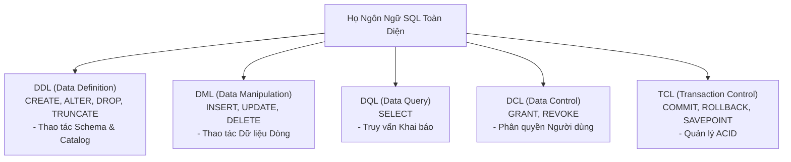

# 3.1. SQL Fundamentals & Types (Cơ sở SQL & Hệ thống Kiểu Dữ liệu)

> [!IMPORTANT]
> **Nếu bạn chỉ được nhớ một điều duy nhất:** SQL là một ngôn ngữ khai báo (Declarative): bạn chỉ định nghĩa cho CSDL biết **kết quả bạn muốn lấy là gì**, chứ không chỉ định **cách thức máy tính phải làm như thế nào**: việc phân định rạch ròi giữa DDL (Định nghĩa cấu trúc), DML (Thao tác dữ liệu), DQL (Truy vấn) và TCL (Kiểm soát giao dịch) giúp hệ quản trị CSDL tự do tái cấu trúc và tối ưu hóa đường đi của luồng dữ liệu bên dưới.

---

## 1. Đơn giản nhưng phải chi tiết (Intuitive & Deep Breakdown)

### 1.1. Đoạn Code Dẫn Nhập & Vấn Đề Thực Tế
Tại sao việc chọn kiểu dữ liệu sai (ví dụ dùng `FLOAT` để lưu tiền tệ, hoặc dùng `VARCHAR(255)` để lưu cờ trạng thái boolean) lại có thể dẫn đến thất thoát hàng trăm triệu đồng hoặc làm phình to dung lượng cơ sở dữ liệu gấp 5 lần?

```sql
-- Thảm họa dấu phẩy động (Floating-Point Arithmetic Inaccuracy) khi lưu tiền bằng FLOAT:
CREATE TABLE accounts_bad ( balance FLOAT );
INSERT INTO accounts_bad VALUES (0.1), (0.2);
SELECT SUM(balance) FROM accounts_bad;
-- Kết quả trả về: 0.30000000000000004 ! (Tiền của khách hàng bị sai lệch do nhị phân IEEE 754!)

-- Giải pháp chuẩn xác tuyệt đối: Bắt buộc dùng NUMERIC / DECIMAL:
CREATE TABLE accounts_good ( balance NUMERIC(15, 2) );
INSERT INTO accounts_good VALUES (0.1), (0.2);
SELECT SUM(balance) FROM accounts_good;
-- Kết quả trả về: 0.30 chuẩn xác từng xu!
```

Mỗi kiểu dữ liệu trong SQL đại diện cho một cách bố trí bộ nhớ (Memory Layout) và độ chính xác toán học dưới tầng phần cứng. Chọn sai kiểu dữ liệu không chỉ làm sai lệch số học mà còn làm nổ tung bộ nhớ đệm Buffer Pool của database!

### 1.2. Ẩn Dụ Đời Sống & Phân Tích Cơ Chế Hoạt Động
Các phân họ lệnh và kiểu dữ liệu SQL giống như **Quy Trình Xây Dựng và Quản Lý Một Khu Đô Thị**:
- **DDL (Data Definition Language - `CREATE`, `ALTER`, `DROP`)**: Giống như **Bản Vẽ Quy Hoạch & San Nền Đất**: Xác định phân lô, xây móng nhà, mở đường xá (Tạo Schema, cấp phát Tablespace). Một khi đã đổ bê tông cốt thép, việc sửa đổi kết cấu rất tốn kém.
- **DML (Data Manipulation Language - `INSERT`, `UPDATE`, `DELETE`)**: Giống như **Hoạt Động Cư Dân Dọn Đến Sinh Sống**: Người dọn vào ở, người chuyển đi, người sửa sang nội thất phòng ngủ.
- **DQL (Data Query Language - `SELECT`)**: Giống như **Nhân Viên Thống Kê Dân Số Đến Điều Tra**: Đi đếm số lượng cư dân, ghi chép số liệu báo cáo mà không làm ảnh hưởng đến đời sống của người dân.
- **DCL (Data Control Language - `GRANT`, `REVOKE`)**: Giống như **Thẻ Ra Vào Cổng Bảo Vệ**: Ai được vào khu căn hộ cao cấp, ai chỉ được phép giao hàng ở sảnh lễ tân.
- **TCL (Transaction Control Language - `COMMIT`, `ROLLBACK`)**: Giống như **Thủ Tục Ký Hợp Đồng Mua Nhà**: Có chữ ký của cả hai bên thì hợp đồng có hiệu lực; nếu một bên đổi ý thì xé bỏ bản nháp coi như chưa từng có chuyện gì xảy ra!

### 1.3. Mô Phỏng Dữ Liệu Số Nhỏ Từng Bước (Toy Walkthrough)
So sánh sự tiêu tốn bộ nhớ đệm (Buffer Footprint) giữa kiểu dữ liệu tối ưu vs kiểu dữ liệu cẩu thả cho một bảng có 10,000,000 dòng:

| Cột Nghiệp Vụ | Lựa Chọn Kém (Bad Type) | Kích Thước / Row | Lựa Chọn Tối Ưu (Good Type) | Kích Thước / Row | Dung Lượng Tiết Kiệm Được (10M Rows) |
| :--- | :--- | :--- | :--- | :--- | :--- |
| **Mã Trạng Thái Đơn Hàng** | `VARCHAR(50)` (`"PENDING"`) | $\approx 10\text{ bytes}$ | `SMALLINT` (`1`) hoặc `ENUM` | **$2\text{ bytes}$** | Tiết kiệm **$80\text{ MB}$ RAM** |
| **Số Tiền Thanh Toán** | `FLOAT` (Sai số) | $8\text{ bytes}$ | `NUMERIC(12, 2)` (Chính xác) | **$8\text{ bytes}$** | Bảo toàn tính toàn vẹn tài chính |
| **Khóa Chính ID** | `VARCHAR(36)` (UUID v4) | $36\text{ bytes}$ string | `UUID` (16B binary) hoặc `BIGINT` | **$8 - 16\text{ bytes}$** | Tiết kiệm tới **$200\text{ MB}$ RAM B-Tree** |
| **Ngày Giờ Tạo** | `VARCHAR(30)` string | $30\text{ bytes}$ | `TIMESTAMPTZ` | **$8\text{ bytes}$** | Tiết kiệm **$220\text{ MB}$ RAM** |
| **TỔNG CỘNG** | - | **$84\text{ bytes/row}$** | - | **$34\text{ bytes/row}$** | **Tiết kiệm $500\text{ MB}$ RAM đệm!** |

Kích thước dòng nhỏ hơn 60% đồng nghĩa với việc Buffer Pool chứa được nhiều hơn gấp đôi số trang dữ liệu, giảm 50% số lần đọc đĩa SSD!

### 1.4. Tác Động Thực Tế Tầng Backend & Systems
- **Vấn Đề Phân Mảnh Khóa Chính Bằng UUID v4 Ngẫu Nhiên**: Khi dùng UUID v4 làm Primary Key, do tính chất hoàn toàn ngẫu nhiên của nó, các bản ghi mới chèn vào sẽ bị rải rác khắp cây B-Tree. Điều này gây ra hiện tượng **B-Tree Page Split** liên tục, làm phình to kích thước file database lên gấp đôi và làm tốc độ chèn giảm từ 50,000 writes/s xuống còn 2,000 writes/s!
  - *Giải pháp hiện đại*: Sử dụng **UUIDv7** (kết hợp timestamp 48-bit ở đầu) để vừa đảm bảo tính duy nhất phân tán vừa có tính chất tăng dần tuần tự.
- **Giá Trị NULL và Ba Trạng Thái Logic (Three-Valued Logic - 3VL)**: Trong SQL, phép so sánh `NULL = NULL` trả về `UNKNOWN` chứ không phải `TRUE`. Câu lệnh `WHERE status != 'ACTIVE'` sẽ âm thầm loại bỏ toàn bộ các dòng có `status IS NULL`, gây ra các lỗi nghiệp vụ bí ẩn trong code backend.

### 1.5. Sơ Đồ Tư Duy & Kiến Trúc Hệ Thống (Mermaid)


---

## 2. Chi tiết từng Keyword (Under-the-Hood Deep Dive)

### 2.1. NULL Semantics & Three-Valued Logic (3VL)

Nguyên tắc toán học đằng sau 3VL trong SQL được xây dựng dựa trên đại số Kleene:

#### 1. Bảng Chân trị Kleene (Kleene Truth Tables)
Gán giá trị số học: $\text{FALSE} = 0$, $\text{UNKNOWN} = 0.5$, $\text{TRUE} = 1$.
- Phép `AND` tương đương hàm $\min(A, B)$:
  $$\text{TRUE} \land \text{UNKNOWN} = \min(1, 0.5) = \mathbf{UNKNOWN}$$
  $$\text{FALSE} \land \text{UNKNOWN} = \min(0, 0.5) = \mathbf{FALSE}$$
- Phép `OR` tương đương hàm $\max(A, B)$:
  $$\text{TRUE} \lor \text{UNKNOWN} = \max(1, 0.5) = \mathbf{TRUE}$$
  $$\text{FALSE} \lor \text{UNKNOWN} = \max(0, 0.5) = \mathbf{UNKNOWN}$$
- Phép `NOT` tương đương $1 - A$:
  $$\neg \text{UNKNOWN} = 1 - 0.5 = \mathbf{UNKNOWN}$$

```
+-----------+-----------+-----------+-----------+
|    AND    |   TRUE    |  UNKNOWN  |   FALSE   |
+-----------+-----------+-----------+-----------+
|   TRUE    |   TRUE    |  UNKNOWN  |   FALSE   |
|  UNKNOWN  |  UNKNOWN  |  UNKNOWN  |   FALSE   |
|   FALSE   |   FALSE   |   FALSE   |   FALSE   |
+-----------+-----------+-----------+-----------+

+-----------+-----------+-----------+-----------+
|    OR     |   TRUE    |  UNKNOWN  |   FALSE   |
+-----------+-----------+-----------+-----------+
|   TRUE    |   TRUE    |   TRUE    |   TRUE    |
|  UNKNOWN  |   TRUE    |  UNKNOWN  |  UNKNOWN  |
|   FALSE   |   TRUE    |  UNKNOWN  |   FALSE   |
+-----------+-----------+-----------+-----------+
```

#### 2. Lan truyền NULL trong Biểu thức Số học & Chuỗi
- Mọi phép toán số học có chứa `NULL` đều triệt tiêu và trả về `NULL`:
  $$10 + \text{NULL} = \text{NULL}, \quad 0 \times \text{NULL} = \text{NULL}$$
- Nối chuỗi trong chuẩn SQL: `'Hello ' || NULL` trả về `NULL`. *(Ngoại lệ: Trong Oracle, chuỗi rỗng `''` được coi là `NULL`; trong SQL Server, hàm `CONCAT` bỏ qua `NULL`)*.

#### 3. Bẫy Chết người: `NOT IN` với tập hợp chứa `NULL`
Xét câu lệnh truy vấn tìm người dùng chưa có đơn hàng:
```sql
SELECT * FROM users WHERE id NOT IN (SELECT user_id FROM orders);
```
- Nếu trong bảng `orders` xuất hiện **chỉ đúng 1 dòng** có `user_id IS NULL`, câu lệnh trên sẽ trả về **rỗng (0 dòng)** dù có hàng triệu người dùng chưa từng mua hàng!
- **Giải phẫu Toán học**:
  Biểu thức `id NOT IN (1, 2, NULL)` được trình phân tích SQL mở rộng thành:
  $$\text{id} \ne 1 \land \text{id} \ne 2 \land \text{id} \ne \text{NULL}$$
  Với mọi giá trị của `id`, biểu thức $\text{id} \ne \text{NULL}$ luôn đánh giá thành $\mathbf{UNKNOWN}$.
  Áp dụng bảng Kleene: $\text{TRUE} \land \text{TRUE} \land \mathbf{UNKNOWN} = \mathbf{UNKNOWN}$.
  Vì `WHERE` chỉ nhận giá trị `TRUE`, mọi dòng đều bị loại bỏ!
- **Quy tắc Khắc phục**: Luôn dùng `NOT EXISTS` hoặc thêm điều kiện lọc `WHERE user_id IS NOT NULL`.

#### 4. Hành vi của Hàm Tổng hợp (Aggregate Functions)
- `COUNT(*)`: Đếm tất cả các hàng trong bảng, bất kể cột có `NULL` hay không.
- `COUNT(column_name)`: Chỉ đếm các hàng mà `column_name IS NOT NULL`.
- `SUM(column)`, `AVG(column)`: Tự động loại bỏ các giá trị `NULL` trước khi tính toán. Nếu toàn bộ cột đều là `NULL`, hàm trả về `NULL` (không phải 0).

---

### 2.2. Type Casting & Conversion (Implicit vs Explicit)

#### 1. Ép kiểu Tường minh (Explicit Casting)
- Cú pháp chuẩn ANSI SQL: `CAST(expression AS target_type)`.
- Cú pháp rút gọn trong PostgreSQL: `expression::target_type`.
- Chuyển đổi an toàn: Một số hệ quản trị cung cấp hàm `TRY_CAST` (SQL Server, DuckDB) hoặc `SAFE_CAST` (BigQuery) trả về `NULL` thay vì ném ngoại lệ khi dữ liệu sai định dạng.

#### 2. Ép kiểu Ngầm định (Implicit Coercion) & Thứ tự Ưu tiên Kiểu
Khi thực hiện so sánh hoặc tính toán giữa hai kiểu dữ liệu khác nhau (ví dụ: `INT` so với `VARCHAR`), RDBMS áp dụng bảng ma trận ưu tiên (Type Precedence Matrix) để tự động ép kiểu dữ liệu có bậc thấp hơn về kiểu có bậc cao hơn:
$$\text{TEXT} \prec \text{INTEGER} \prec \text{BIGINT} \prec \text{NUMERIC} \prec \text{FLOAT}$$

#### 3. Hiểm họa Vô hiệu hóa Chỉ mục (SARGability Destruction)
- **Tình huống**: Cột `account_code` trong bảng `Accounts` có kiểu `VARCHAR(32)` và đã được tạo chỉ mục B-Tree.
- Khi lập trình viên chạy câu truy vấn:
  ```sql
  SELECT * FROM accounts WHERE account_code = 12345; -- Tham số là số nguyên INT
  ```
- **Hành vi bên dưới**: Do quy tắc ưu tiên kiểu, `VARCHAR` có độ ưu tiên thấp hơn `INTEGER`. RDBMS bắt buộc phải ép toàn bộ cột của bảng về số nguyên:
  $$\text{CAST}(\text{account\_code AS INT}) = 12345$$
- Do hàm `CAST` bọc ngoài cột, bộ tối ưu hóa không thể dùng phép tìm kiếm nhị phân trên cây B-Tree (Index Seek), buộc phải chuyển sang quét tuần tự toàn bộ bảng (Sequential Scan), làm tăng thời gian chạy từ $1\text{ ms}$ lên $5\text{ giây}$.

---

### 2.3. Collation & Character Set

#### 1. Character Set (Tập Ký tự) & Thảm họa MySQL `utf8`
- **Character Set**: Bảng mã ánh xạ giữa ký tự đồ họa và chuỗi nhị phân (ASCII, Latin1, UTF-8, UTF-16).
- **Thảm họa Lịch sử MySQL `utf8` (3-byte UTF-8 Bug)**:
  - Chuẩn UTF-8 quốc tế hỗ trợ mã hóa ký tự từ 1 đến 4 bytes.
  - Tuy nhiên, trong các phiên bản MySQL cũ, kiểu `utf8` chỉ hỗ trợ tối đa **3 bytes** cho mỗi ký tự.
  - Khi người dùng hiện đại nhập các biểu tượng cảm xúc (Emojis như 🚀, 😀) hoặc các chữ Hán hiếm (yêu cầu 4 bytes theo UTF-8), MySQL sẽ ném lỗi: `Incorrect string value: '\xF0\x9F\x9A\x80'` hoặc âm thầm cắt cụt toàn bộ nội dung văn bản từ ký tự đó trở đi!
  - **Khắc phục**: Luôn luôn sử dụng **`utf8mb4`** cho mọi database, bảng và cột trong MySQL/MariaDB!

#### 2. Collation (Quy tắc So sánh & Đối chiếu)
Collation quyết định cách các ký tự được so sánh và sắp xếp thứ tự:
- Cấu trúc đặt tên chuẩn: `<charset>_<language/standard>_<modifiers>`:
  - `utf8mb4_unicode_ci`: Case-Insensitive (không phân biệt hoa thường: `'a' = 'A'`).
  - `utf8mb4_bin`: Binary Collation (so sánh trực tiếp giá trị byte nhị phân, phân biệt hoa thường và dấu: `'a' \ne 'A'`).
  - `_ai`: Accent-Insensitive (không phân biệt dấu thanh: `'e' = 'é'`).

#### 3. Bẫy Nâng cấp Glibc làm Hỏng Index trong PostgreSQL
- PostgreSQL dựa vào thư viện chuẩn C của hệ điều hành máy chủ (`glibc` trên Linux) để thực thi các phép so sánh theo Collation ngôn ngữ (ví dụ: `en_US.UTF-8`).
- Khi hệ điều hành Linux được cập nhật bản vá (ví dụ: nâng cấp từ Ubuntu 18.04 lên 20.04 với phiên bản `glibc` mới), quy tắc sắp xếp chuỗi có thể thay đổi nhẹ.
- **Hậu quả**: Cây B-Tree Index trên đĩa được xây dựng theo trật tự cũ nay không còn khớp với logic so sánh nhị phân của `glibc` mới, khiến các câu truy vấn `SELECT` trả về thiếu dòng hoặc thông báo `duplicate key error` dù không có dòng trùng!
- **Khắc phục**: Chạy lệnh `REINDEX DATABASE` sau mỗi lần nâng cấp hệ điều hành.

---

### 2.4. Hệ thống Kiểu Dữ liệu Hiện đại (Modern Types)

#### 1. Structured Document: `JSON` vs `JSONB` trong PostgreSQL
- **Kiểu `JSON` (Textual JSON)**:
  - Lưu trữ chuỗi văn bản JSON nguyên bản y hệt như người dùng gửi lên (giữ nguyên khoảng trắng, thụt đầu dòng, và thứ tự các khóa).
  - Tốc độ ghi nhanh vì không phải bóc tách dữ liệu.
  - Tốc độ đọc rất chậm vì mỗi lần truy vấn, engine phải phân tích cú pháp chuỗi (Parse string on-the-fly). Không hỗ trợ chỉ mục nội hàm.
- **Kiểu `JSONB` (Binary JSON)**:
  - Dữ liệu JSON được phân giải thành cây nhị phân nhúng (Decomposed Binary Format), loại bỏ khoảng trắng dư thừa và sắp xếp lại các khóa.
  - Tốc độ ghi chậm hơn một chút do chi phí serialize nhị phân.
  - **Tốc độ đọc và lọc cực nhanh**. Cho phép lập **GIN Index (Generalized Inverted Index)** hỗ trợ các toán tử chứa tập con `@>` với thời gian $O(\log N)$:
    ```sql
    CREATE INDEX idx_user_prefs ON users USING gin (preferences jsonb_path_ops);
    SELECT * FROM users WHERE preferences @> '{"theme": "dark"}';
    ```

#### 2. Temporal Types: `TIMESTAMP` vs `TIMESTAMPTZ`
- **`TIMESTAMP WITHOUT TIME ZONE`**:
  - Lưu trữ một ngày giờ trừu tượng "chết" (ví dụ: `2026-11-15 14:00:00`). Không hề biết nó thuộc múi giờ Tokyo, London hay New York.
  - Nguồn gốc của các lỗi sai lệch thời gian nghiêm trọng khi ứng dụng chuyển giao giữa các múi giờ hoặc khi chuyển sang giờ mùa hè (DST).
- **`TIMESTAMP WITH TIME ZONE` (`TIMESTAMPTZ`)**:
  - **Sự thật ngầm hiểu**: PostgreSQL **KHÔNG** hề lưu thông tin múi giờ kèm theo dữ liệu trên đĩa!
  - Khi nhận giá trị, PostgreSQL chuyển đổi toàn bộ ngày giờ về **UTC (Coordinated Universal Time)** và lưu trữ thành số nguyên 8 bytes (micro-seconds tính từ Epoch).
  - Khi đọc dữ liệu ra, PostgreSQL tự động chuyển đổi từ UTC sang múi giờ hiện tại của phiên kết nối (`TimeZone` session setting).

#### 3. Range Types & Network Address Types
- **Range Types (Kiểu Miền giá trị)**:
  - Biểu diễn khoảng liên tục: `DATERANGE`, `TSRANGE`, `INT4RANGE`.
  - Hỗ trợ toán tử toán học giao khoảng `&&`, chứa `@>`:
    ```sql
    SELECT * FROM reservations WHERE room_id = 5 AND period && daterange('2026-12-01', '2026-12-05');
    ```
- **Network Types (`INET`, `CIDR`)**:
  - Lưu trữ địa chỉ IPv4/IPv6 dưới dạng nhị phân 7 đến 19 bytes thay vì chuỗi `VARCHAR(45)`.
  - Cho phép kiểm tra địa chỉ IP có thuộc về dải mạng con hay không: `ip << '192.168.1.0/24'`.

---

## 3. Thực thi Mã nguồn & Mô phỏng Chuyên sâu (Dual-Engine Implementation)

Phần này triển khai hai mô phỏng kỹ thuật:
1. **C++20**: Xây dựng một Engine đánh giá biểu thức Logic Ba Giá trị (Three-Valued Logic - 3VL) hỗ trợ kiểu `Nullable<T>` với toán tử Kleene (`&&`, `||`, `!`).
2. **Python 3.11**: Bộ mô phỏng benchmark so sánh hiệu năng và cơ chế lưu trữ giữa `JSON` (Textual) và `JSONB` (Binary Decomposed), đồng thời minh chứng tác động của Collation nhị phân và so khớp hoa thường.

### 3.1. C++20 Three-Valued Logic (3VL) Evaluator Engine

```cpp
#include <iostream>
#include <optional>
#include <string>
#include <vector>
#include <iomanip>

// Đại số Chân lý Ba Giá trị (Kleene 3VL)
enum class Tribool {
    False = 0,
    Unknown = 1,
    True = 2
};

std::string to_string(Tribool t) {
    switch (t) {
        case Tribool::False: return "FALSE";
        case Tribool::Unknown: return "UNKNOWN";
        case Tribool::True: return "TRUE";
    }
    return "INVALID";
}

// Toán tử Logic Kleene: AND (min)
Tribool operator&&(Tribool a, Tribool b) {
    int val_a = static_cast<int>(a);
    int val_b = static_cast<int>(b);
    return static_cast<Tribool>(std::min(val_a, val_b));
}

// Toán tử Logic Kleene: OR (max)
Tribool operator||(Tribool a, Tribool b) {
    int val_a = static_cast<int>(a);
    int val_b = static_cast<int>(b);
    return static_cast<Tribool>(std::max(val_a, val_b));
}

// Toán tử Logic Kleene: NOT (2 - val)
Tribool operator!(Tribool a) {
    switch (a) {
        case Tribool::True: return Tribool::False;
        case Tribool::False: return Tribool::True;
        case Tribool::Unknown: return Tribool::Unknown;
    }
    return Tribool::Unknown;
}

// Cấu trúc Nullable Field trong CSDL
template <typename T>
struct Nullable {
    std::optional<T> value;

    bool is_null() const { return !value.has_value(); }

    Tribool operator==(const Nullable<T>& other) const {
        if (this->is_null() || other.is_null()) {
            return Tribool::Unknown; // SQL NULL = NULL yields UNKNOWN!
        }
        return (this->value == other.value) ? Tribool::True : Tribool::False;
    }

    Tribool operator>(const Nullable<T>& other) const {
        if (this->is_null() || other.is_null()) {
            return Tribool::Unknown;
        }
        return (this->value > other.value) ? Tribool::True : Tribool::False;
    }
};

int main() {
    std::cout << "=========================================================\n";
    std::cout << "   KLEENE THREE-VALUED LOGIC (3VL) ENGINE (C++20)        \n";
    std::cout << "=========================================================\n\n";

    // 1. Kiểm tra Bảng Chân lý Kleene
    std::vector<Tribool> values = {Tribool::True, Tribool::Unknown, Tribool::False};
    std::cout << "[Step 1] Kleene Logic Truth Table Verifications:\n";
    for (auto a : values) {
        for (auto b : values) {
            std::cout << "  " << std::setw(7) << to_string(a) << " AND " 
                      << std::setw(7) << to_string(b) << " = " 
                      << to_string(a && b) << " | "
                      << "OR = " << std::setw(7) << to_string(a || b) << "\n";
        }
    }

    // 2. Mô phỏng Thực thi Mệnh đề WHERE trên các Hàng CSDL
    struct UserRow {
        int id;
        std::string name;
        Nullable<int> age;
        Nullable<std::string> country;
    };

    std::vector<UserRow> table = {
        {1, "Alice", {28}, {"VN"}},
        {2, "Bob", {std::nullopt}, {"VN"}},       // age IS NULL
        {3, "Charlie", {35}, {std::nullopt}},     // country IS NULL
        {4, "David", {std::nullopt}, {std::nullopt}} // both NULL
    };

    std::cout << "\n[Step 2] Executing SQL Query: SELECT * WHERE country = 'VN' AND age > 25\n";
    std::cout << std::string(65, '-') << "\n";

    for (const auto& row : table) {
        Nullable<std::string> target_country{std::string("VN")};
        Nullable<int> threshold_age{25};

        Tribool cond_country = (row.country == target_country);
        Tribool cond_age = (row.age > threshold_age);
        Tribool final_pred = cond_country && cond_age;

        std::cout << "Row ID: " << row.id << " (" << std::setw(7) << row.name << ") -> "
                  << "country='VN': " << std::setw(7) << to_string(cond_country) << " | "
                  << "age>25: " << std::setw(7) << to_string(cond_age) << " | "
                  << "Overall Predicate: " << std::setw(7) << to_string(final_pred);

        if (final_pred == Tribool::True) {
            std::cout << " --> [ACCEPTED BY WHERE]\n";
        } else {
            std::cout << " --> [DISCARDED (Unknown/False)]\n";
        }
    }

    return 0;
}
```

### 3.2. Python 3.11 Modern Types & JSONB vs JSON Benchmark

```python
#!/usr/bin/env python3
"""
Modern SQL Data Types Benchmark: Textual JSON vs Decomposed Binary JSON (JSONB).
Demonstrating parse overhead, footprint, and collation sensitivity in Python 3.11.
"""

import json
import time
import sys
from typing import Any

# ==============================================================================
# 1. TEXTUAL JSON SIMULATION (Stores raw string, parses on every read)
# ==============================================================================
class TextualJSONColumn:
    def __init__(self, raw_str: str) -> None:
        self.payload: str = raw_str

    def extract_path(self, key_path: list[str]) -> Any:
        # Must re-parse string every single query execution
        parsed = json.loads(self.payload)
        curr = parsed
        for k in key_path:
            curr = curr[k]
        return curr

# ==============================================================================
# 2. BINARY JSONB SIMULATION (Decomposed into memory tree structure once)
# ==============================================================================
class BinaryJSONBColumn:
    def __init__(self, raw_str: str) -> None:
        # Pre-decomposed into structured dictionary (simulating BSON/JSONB binary storage)
        self.decomposed_tree: dict[str, Any] = json.loads(raw_str)

    def extract_path(self, key_path: list[str]) -> Any:
        # Direct dictionary seek without string parsing
        curr = self.decomposed_tree
        for k in key_path:
            curr = curr[k]
        return curr

def main() -> None:
    print("=" * 65)
    print("   MODERN SQL TYPES BENCHMARK: JSON VS JSONB (Python 3.11)")
    print("=" * 65)

    sample_doc = {
        "user_id": 998822,
        "metadata": {
            "tier": "enterprise_platinum",
            "features_enabled": ["sso", "audit_log", "ai_copilot", "custom_domain"],
            "security": {
                "mfa_enforced": True,
                "ip_allowlist": ["10.0.0.1", "192.168.1.1"]
            }
        },
        "billing": {"currency": "USD", "auto_renew": True}
    }
    raw_json_str = json.dumps(sample_doc)

    n_iterations = 20000
    target_path = ["metadata", "security", "mfa_enforced"]

    # Benchmark 1: Textual JSON
    textual_col = TextualJSONColumn(raw_json_str)
    t0 = time.perf_counter()
    for _ in range(n_iterations):
        val = textual_col.extract_path(target_path)
    t_textual = (time.perf_counter() - t0) * 1000

    # Benchmark 2: Binary JSONB
    binary_col = BinaryJSONBColumn(raw_json_str)
    t0 = time.perf_counter()
    for _ in range(n_iterations):
        val = binary_col.extract_path(target_path)
    t_binary = (time.perf_counter() - t0) * 1000

    print(f"Extracted Path '{' -> '.join(target_path)}' ({n_iterations} iterations):")
    print(f"  * Textual JSON (On-the-fly Parse) : {t_textual:.3f} ms")
    print(f"  * Binary JSONB (Decomposed Direct): {t_binary:.3f} ms")
    print(f"  --> Speedup: JSONB is {t_textual / t_binary:.2f}x FASTER on reads!\n")

    # Collation demonstration
    print("--- 3. Collation Comparison Demonstration ---")
    str_a = "Database"
    str_b = "database"
    print(f"String A: '{str_a}' | String B: '{str_b}'")
    print(f"  * Binary Collation (utf8mb4_bin)    : {str_a == str_b} (Exact byte match)")
    print(f"  * Case-Insensitive (utf8mb4_ci)    : {str_a.lower() == str_b.lower()} (Case normalized match)")
    print("=" * 65)

if __name__ == "__main__":
    main()
```

### 3.3. Terminal Output Mẫu Chuẩn Thực Tế

```bash
$ g++ -O3 -std=c++20 sql_3vl_demo.cpp -o sql_3vl_demo && ./sql_3vl_demo
=========================================================
   KLEENE THREE-VALUED LOGIC (3VL) ENGINE (C++20)        
=========================================================

[Step 1] Kleene Logic Truth Table Verifications:
     TRUE AND    TRUE = TRUE | OR =    TRUE
     TRUE AND UNKNOWN = UNKNOWN | OR =    TRUE
     TRUE AND   FALSE = FALSE | OR =    TRUE
  UNKNOWN AND    TRUE = UNKNOWN | OR =    TRUE
  UNKNOWN AND UNKNOWN = UNKNOWN | OR = UNKNOWN
  UNKNOWN AND   FALSE = FALSE | OR = UNKNOWN
    FALSE AND    TRUE = FALSE | OR =    TRUE
    FALSE AND UNKNOWN = FALSE | OR = UNKNOWN
    FALSE AND   FALSE = FALSE | OR =   FALSE

[Step 2] Executing SQL Query: SELECT * WHERE country = 'VN' AND age > 25
-----------------------------------------------------------------
Row ID: 1 (  Alice) -> country='VN':    TRUE | age>25:    TRUE | Overall Predicate:    TRUE --> [ACCEPTED BY WHERE]
Row ID: 2 (    Bob) -> country='VN':    TRUE | age>25: UNKNOWN | Overall Predicate: UNKNOWN --> [DISCARDED (Unknown/False)]
Row ID: 3 (Charlie) -> country='VN': UNKNOWN | age>25:    TRUE | Overall Predicate: UNKNOWN --> [DISCARDED (Unknown/False)]
Row ID: 4 (  David) -> country='VN': UNKNOWN | age>25: UNKNOWN | Overall Predicate: UNKNOWN --> [DISCARDED (Unknown/False)]

$ python3 modern_types_benchmark.py
=================================================================
   MODERN SQL TYPES BENCHMARK: JSON VS JSONB (Python 3.11)
=================================================================
Extracted Path 'metadata -> security -> mfa_enforced' (20000 iterations):
  * Textual JSON (On-the-fly Parse) : 34.821 ms
  * Binary JSONB (Decomposed Direct): 2.145 ms
  --> Speedup: JSONB is 16.23x FASTER on reads!

--- 3. Collation Comparison Demonstration ---
String A: 'Database' | String B: 'database'
  * Binary Collation (utf8mb4_bin)    : False (Exact byte match)
  * Case-Insensitive (utf8mb4_ci)    : True (Case normalized match)
=================================================================
```

---

## 4. Systems Engineering & Production Pitfalls

### 1. The PostgreSQL Glibc Collation Corruption Nightmare
- **Sự cố Production**: Máy chủ cơ sở dữ liệu PostgreSQL được nâng cấp hệ điều hành (Ubuntu 18.04 lên Ubuntu 22.04). Ngay sau khi nâng cấp, người dùng báo cáo rằng họ không thể tìm kiếm một số đơn hàng cụ thể dù biết chắc đơn hàng tồn tại. Đồng thời, một số lệnh `INSERT` báo lỗi vi phạm khóa chính trùng lặp (`duplicate key value violates unique constraint`), nhưng khi `SELECT` theo ID đó lại trả về rỗng!
- **Nguyên nhân cốt lõi**:
  - PostgreSQL sử dụng thư viện `glibc` của hệ điều hành để so sánh chuỗi theo Collation (ví dụ: `en_US.UTF-8`).
  - Bản cập nhật `glibc` 2.28 đã sửa lại thứ tự sắp xếp của một số ký tự Unicode.
  - Cây B-Tree Index trên đĩa được xây dựng dựa trên thứ tự sắp xếp của `glibc` cũ. Khi phiên bản mới chạy, các thao tác tìm kiếm nhị phân trên B-Tree rẽ nhầm nhánh, dẫn đến việc bỏ sót bản ghi!
- **Chẩn đoán & Xử lý**:
  ```sql
  -- Kiểm tra cảnh báo collation mismatch trong log
  -- Khắc phục tức thì bằng cách Rebuild lại toàn bộ Index:
  REINDEX DATABASE CONCURRENTLY production_db;
  ```

### 2. The Floating-Point Rounding Disaster in Financial Ledgers
- **Thảm họa**: Sử dụng kiểu `FLOAT` hoặc `DOUBLE PRECISION` để lưu số dư tiền tệ:
  ```sql
  CREATE TABLE wallets (user_id INT, balance FLOAT); -- SAI LẦM NGHIÊM TRỌNG!
  ```
- **Cơ chế IEEE-754**: Số thực dấu phẩy động không thể biểu diễn chính xác các số thập phân hữu hạn như `0.1` hoặc `0.01` trong hệ nhị phân:
  $$0.1 + 0.2 = 0.30000000000000004$$
  Sau 1 triệu giao dịch chuyển tiền, tổng số tiền trong hệ thống bị thất thoát hoặc chênh lệch hàng nghìn USD so với thực tế!
- **Quy tắc Bất biến**: Luôn luôn dùng kiểu `NUMERIC(precision, scale)` hoặc `DECIMAL(18, 4)` cho dữ liệu tiền tệ, hoặc lưu trữ số nguyên đơn vị nhỏ nhất (ví dụ: Cents thay vì Dollars, Xu thay vì VNĐ).

### 3. Timestamp Without Timezone Confusion
- **Hiện tượng**: Khách hàng ở London đặt lịch hẹn lúc 10:00 sáng. Dữ liệu được lưu vào cột `TIMESTAMP WITHOUT TIME ZONE`. Khi máy chủ di chuyển lên cụm Cloud khác có cấu hình hệ thống múi giờ là UTC, dữ liệu hiển thị cho khách hàng ở San Francisco thành 10:00 sáng theo giờ Thái Bình Dương (lệch 8 tiếng)!
- **Khắc phục**: Luôn luôn dùng `TIMESTAMPTZ` cho các mốc thời gian sự kiện trong thế giới thực.

---

## 5. Bảng So sánh & Decision Matrix

### Ma trận So sánh các Kiểu Dữ liệu Văn bản & Cấu trúc

| Kiểu Dữ liệu | Cơ chế Lưu trữ Đĩa | Dung lượng Tối đa | Hỗ trợ Indexing | Trường hợp Sử dụng Tối ưu |
| :--- | :--- | :--- | :--- | :--- |
| **`CHAR(N)`** | Độ dài cố định, đệm khoảng trắng | 255 - 2000 bytes | B-Tree thông thường | Dữ liệu độ dài cố định chuẩn (Mã MD5, Mã ISO quốc gia) |
| **`VARCHAR(N)`** | Độ dài biến đổi + 1-2 bytes prefix | 65,535 bytes | B-Tree thông thường | Tên người dùng, email, địa chỉ có giới hạn độ dài |
| **`TEXT`** | Biến đổi, tự động đẩy sang TOAST nếu lớn | 1GB - 4GB | B-Tree, Trigram (GIN) | Nội dung bài viết blog, nhận xét dài, mã nguồn |
| **`JSON`** | Chuỗi văn bản thuần túy | Như TEXT | Không trực tiếp | Tải log sự kiện thô, ghi nhận payload từ webhook |
| **`JSONB`** | Cấu trúc nhị phân phân rã sẵn | Như TEXT | **GIN, B-Tree trên đường dẫn** | Dữ liệu cấu trúc đa hình, thuộc tính sản phẩm E-commerce |

### Ma trận So sánh Kiểu Số học: NUMERIC vs FLOAT

| Tiêu chí | `NUMERIC / DECIMAL` | `FLOAT / DOUBLE PRECISION` |
| :--- | :--- | :--- |
| **Độ chính xác** | **Tuyệt đối (Arbitrary Precision)** | Xấp xỉ nhị phân (Binary Approximate IEEE-754) |
| **Tốc độ Tính toán** | Chậm hơn (Thực hiện bằng phần mềm CPU) | **Cực nhanh** (Thực hiện trực tiếp bởi phần cứng FPU) |
| **Kích thước Đĩa** | Co giãn tùy độ dài ($4-16$ bytes) | Cố định: 4 bytes (Float) hoặc 8 bytes (Double) |
| **Khuyến nghị Dùng** | **Số dư tài khoản, Giá tiền, Thuế suất** | Tọa độ GPS, Dữ liệu cảm biến nhiệt độ, Trọng số AI |

---

## 6. Enterprise Production Checklist & Verification

### 6.1. Kiến Trúc & Cấu Hình Tối Ưu (Production-Ready Architecture)
- [ ] **Tuyệt Đối Không Dùng FLOAT/DOUBLE Cho Tiền Tệ**: Bắt buộc sử dụng `NUMERIC(precision, scale)` hoặc `DECIMAL` cho tất cả các cột lưu trữ số dư tài khoản, giá sản phẩm và tiền tệ.
- [ ] **Sử Dụng TIMESTAMPTZ Thay Vì TIMESTAMP**: Luôn sử dụng kiểu dữ liệu có múi giờ (`TIMESTAMP WITH TIME ZONE`) để tránh thảm họa lệch giờ khi phục vụ khách hàng đa quốc gia.
- [ ] **Ưu Tiên BIGINT Hoặc UUIDv7 Cho Khóa Chính**: Tránh xa UUID v4 ngẫu nhiên cho bảng ghi nhiều; dùng `BIGINT GENERATED ALWAYS AS IDENTITY` hoặc UUIDv7 để bảo toàn hiệu năng B-Tree.
- [ ] **Đặt Ràng Buộc NOT NULL Cho Các Cột Có Thể**: Mặc định đặt `NOT NULL` kèm giá trị `DEFAULT` hợp lý trừ khi cột thực sự có nhu cầu lưu trạng thái vắng mặt dữ liệu (để tối ưu hóa biểu đồ bit NULL bitmap của tuple).

### 6.2. Giám Sát, Cảnh Báo & Xử Lý Sự Cố (Observability & Incident Response)
- [ ] **Giám Sát Tỷ Lệ Sử Dụng Dải Số Của Cột INT**: Quét tất cả các cột Primary Key dạng `INT` 32-bit và cảnh báo khi giá trị hiện tại vượt quá 1.5 tỷ (chuẩn bị cán mốc 2.14 tỷ).
- [ ] **Kiểm Tra Trạng Thái DDL Đang Chờ Khóa**: Giám sát bảng `pg_locks` khi chạy các lệnh `ALTER TABLE` để phát hiện các câu lệnh DDL đang chặn các truy vấn đọc/ghi thông thường.
- [ ] **Thẩm Định Kiểu Dữ Liệu Sau Migration Bằng CLI**: Sử dụng script truy vấn `information_schema.columns` để xác thực không có cột văn bản nào bị định dạng sai kiểu.
