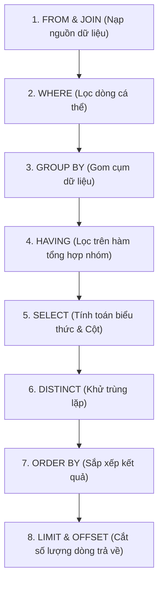

# 3.2. SQL Querying & Filtering (Truy vấn & Lọc Dữ liệu trong SQL)

> [!IMPORTANT]
> **Nếu bạn chỉ được nhớ một điều duy nhất:** Thứ tự viết câu lệnh SQL hoàn toàn khác biệt với Thứ tự thực thi logic (Logical Query Processing Order) của động cơ CSDL: câu lệnh luôn bắt đầu xử lý từ `FROM` -> `JOIN` -> `WHERE` -> `GROUP BY` -> `HAVING` -> `SELECT` -> `DISTINCT` -> `ORDER BY` -> `LIMIT`; thấu hiểu trật tự này là chìa khóa để giải thích tại sao không thể dùng bí danh cột (Alias) của `SELECT` ngay bên trong mệnh đề `WHERE`.

---

## 1. Đơn giản nhưng phải chi tiết (Intuitive & Deep Breakdown)

### 1.1. Đoạn Code Dẫn Nhập & Vấn Đề Thực Tế
Tại sao thứ tự bạn viết một câu lệnh SQL trong trình soạn thảo code lại hoàn toàn khác biệt với thứ tự mà Database Engine thực sự thực thi câu lệnh đó dưới nền?

```sql
-- Cú pháp viết theo trực giác lập trình viên (Syntactic Order):
SELECT department_id, COUNT(*) AS emp_count   -- [1] Viết SELECT trước
FROM employees                                 -- [2] Viết FROM
WHERE salary > 50000                           -- [3] Viết WHERE
GROUP BY department_id                         -- [4] Viết GROUP BY
HAVING COUNT(*) > 5                            -- [5] Viết HAVING
ORDER BY emp_count DESC                        -- [6] Viết ORDER BY
LIMIT 3;                                       -- [7] Viết LIMIT

-- SỰ THẬT KỸ THUẬT: Thứ tự thực thi logic của Database Engine (Logical Order):
-- 1. FROM & JOIN     -> Xác định các bảng nguồn và nạp dữ liệu
-- 2. WHERE           -> Lọc bỏ các dòng không thỏa mãn TRƯỚC KHI gom nhóm
-- 3. GROUP BY        -> Gom các dòng còn lại thành các nhóm
-- 4. HAVING          -> Lọc bỏ các nhóm không thỏa mãn hàm tổng hợp
-- 5. SELECT          -> Tính toán biểu thức và bóc tách các cột
-- 6. DISTINCT        -> Loại bỏ các dòng trùng lặp
-- 7. ORDER BY        -> Sắp xếp các dòng kết quả
-- 8. LIMIT / OFFSET  -> Cắt lấy đúng số lượng dòng yêu cầu!
```

Hiểu được thứ tự thực thi này giải thích tại sao bạn **KHÔNG THỂ** sử dụng bí danh (Alias) vừa đặt trong mệnh đề `SELECT` để đưa vào mệnh đề `WHERE` (ví dụ `WHERE emp_count > 5` sẽ quăng lỗi ngay tức khắc vì tại thời điểm chạy `WHERE`, mệnh đề `SELECT` còn chưa được đụng tới!).

### 1.2. Ẩn Dụ Đời Sống & Phân Tích Cơ Chế Hoạt Động
Quy trình thực thi DQL giống như **Quy Trình Sơ Chế và Đóng Gói Trái Cây Xuất Khẩu**:
- **`FROM`**: Xe tải chở các sọt trái cây từ các nông trại khác nhau đổ vào sân kho.
- **`WHERE` (Lọc thô)**: Công nhân dùng cào gạt bỏ ngay các quả táo dập nát, thối rữa vứt vào thùng rác (**Lọc bỏ từng cá thể trước khi chế biến**).
- **`GROUP BY`**: Gom các quả táo lành lặn còn lại vào từng giỏ theo kích cỡ: Giỏ Táo Lớn, Giỏ Táo Vừa, Giỏ Táo Nhỏ.
- **`HAVING` (Lọc nhóm)**: Quản đốc kiểm tra các giỏ: *"Giỏ nào có tổng trọng lượng dưới 50kg thì loại bỏ không đóng thùng!"* (**Lọc trên tập hợp đã gom nhóm**).
- **`SELECT`**: Dán nhãn mác thương hiệu và bọc túi lưới cho từng quả táo được chọn.
- **`ORDER BY`**: Xếp các thùng hàng lên xe tải theo thứ tự ưu tiên giao dịch.
- **`LIMIT`**: Xe tải chỉ chở được đúng 3 thùng hàng đầu tiên lên đường!

### 1.3. Mô Phỏng Dữ Liệu Số Nhỏ Từng Bước (Toy Walkthrough)
Mô phỏng sự biến đổi tập dữ liệu qua từng bước thực thi logic của câu truy vấn:

**Tập Dữ Liệu Ban Đầu (`FROM employees`):**
| `id` | `name` | `dept` | `salary` |
| :---: | :--- | :---: | :---: |
| 1 | An | IT | \$60,000 |
| 2 | Bình | HR | \$40,000 |
| 3 | Cường | IT | \$70,000 |
| 4 | Dũng | IT | \$80,000 |
| 5 | Em | HR | \$55,000 |

| Bước Logic | Mệnh Đề Thực Thi | Hành Động Dữ Liệu Chi Tiết | Số Dòng Còn Lại |
| :--- | :--- | :--- | :--- |
| **Bước 1** | `WHERE salary > 50000` | Loại bỏ Bình (\$40,000) vì không thỏa mãn | Còn 4 dòng (An, Cường, Dũng, Em) |
| **Bước 2** | `GROUP BY dept` | Gom thành 2 nhóm: Nhóm `IT` (3 người), Nhóm `HR` (1 người) | 2 nhóm |
| **Bước 3** | `HAVING COUNT(*) >= 2` | Nhóm HR chỉ có 1 người -> **Bị loại bỏ!** | **Còn 1 nhóm duy nhất (`IT`)** |
| **Bước 4** | `SELECT dept, COUNT(*)`| Tính toán kết quả hiển thị: `('IT', 3)` | 1 dòng kết quả |
| **Bước 5** | `ORDER BY ... LIMIT 1` | Trả về kết quả cuối cùng cho client | 1 dòng duy nhất |

### 1.4. Tác Động Thực Tế Tầng Backend & Systems
- **Thảm Họa Phân Trang Bằng `OFFSET` Lớn (Deep Paging Problem)**: Khi người dùng gõ `SELECT * FROM orders ORDER BY id LIMIT 10 OFFSET 1000000;`, database engine buộc phải quét và sắp xếp đủ **$1,000,010\text{ dòng}$**, sau đó vứt bỏ $1,000,000$ dòng đầu tiên vào sọt rác chỉ để lấy 10 dòng cuối cùng! Câu lệnh tốn hàng chục giây CPU và I/O đĩa.
  - *Giải pháp tối ưu*: Sử dụng **Kỹ thuật Con trỏ (Keyset Pagination / Cursor Pagination)**: `WHERE id > :last_seen_id ORDER BY id LIMIT 10;` giúp database nhảy thẳng tới vị trí cần lấy trên B-Tree trong $0.1\text{ms}$!
- **SARGable vs Non-SARGable Queries**: Một câu truy vấn có tính chất SARGable (Search Argument Able) cho phép database tận dụng chỉ mục B-Tree. Nếu bạn viết `WHERE LOWER(email) = 'test@example.com'`, database buộc phải quét toàn bộ bảng và gọi hàm `LOWER()` trên từng dòng dữ liệu!

### 1.5. Sơ Đồ Tư Duy & Kiến Trúc Hệ Thống (Mermaid)


---

## 2. Chi tiết từng Keyword (Under-the-Hood Deep Dive)

### 2.1. Thứ tự Xử lý Logic của Câu lệnh SQL (Logical Processing Order)

Sự bất đồng bộ giữa cú pháp viết (Lexical Order) và cơ chế thực thi (Logical Order) là nguyên nhân gây ra nhiều sự bối rối:

```
Cú pháp Khai báo (Lexical Order):        Thứ tự Động cơ Thực thi (Logical Order):
  1. SELECT                                1. FROM & JOIN
  2. FROM & JOIN                           2. WHERE
  3. WHERE                                 3. GROUP BY
  4. GROUP BY                              4. HAVING
  5. HAVING                                5. SELECT
  6. ORDER BY                              6. DISTINCT
  7. LIMIT / OFFSET                        7. ORDER BY
                                           8. LIMIT / OFFSET
```

#### Hệ quả Kỹ thuật của Thứ tự Xử lý:
1. **Tại sao không thể dùng Alias trong `WHERE`?**
   - Khi bạn viết `SELECT (salary * 12) AS annual_salary FROM employees WHERE annual_salary > 100000;`, câu lệnh sẽ báo lỗi: `column "annual_salary" does not exist`.
   - *Nguyên nhân*: Mệnh đề `WHERE` được thực thi ở Bước 2, trong khi mệnh đề `SELECT` (nơi định nghĩa bí danh `annual_salary`) mãi tới Bước 5 mới được đánh giá! Tại thời điểm `WHERE` lọc dữ liệu, bí danh đó hoàn toàn chưa tồn tại trong bộ nhớ.
2. **Tại sao có thể dùng Alias trong `ORDER BY`?**
   - `SELECT name, (salary * 12) AS annual_salary FROM employees ORDER BY annual_salary DESC;` hoàn toàn hợp lệ!
   - *Nguyên nhân*: Bước 7 (`ORDER BY`) diễn ra sau Bước 5 (`SELECT`), do đó nó có toàn quyền truy cập vào các bí danh đã được tạo ra.
3. **`WHERE` vs `HAVING`**:
   - `WHERE` lọc các dòng dữ liệu thô **trước khi** việc gom nhóm diễn ra. Không bao giờ được phép dùng hàm tổng hợp (như `WHERE COUNT(*) > 5`) trong `WHERE`.
   - `HAVING` lọc các nhóm dữ liệu **sau khi** hàm tổng hợp đã tính toán xong trên từng nhóm.

---

### 2.2. Các Mệnh đề Lọc & Toán tử So sánh Cốt lõi

#### 1. Toán tử So sánh & Khái niệm SARGable (Search Argument Able)
- Một vị từ lọc được gọi là **SARGable** nếu nó cho phép bộ tối ưu hóa truy vấn tận dụng trực tiếp cấu trúc cây chỉ mục B-Tree để tìm kiếm nhị phân (Index Seek) với độ phức tạp $O(\log N)$ thay vì phải quét toàn bộ bảng (Table Scan $O(N)$).
- **Các toán tử SARGable**:
  - `=`, `<`, `>`, `<=`, `>=`.
  - `BETWEEN a AND b` (tương đương `val >= a AND val <= b`).
  - `IN (const1, const2, ...)` (được tối ưu thành chuỗi tìm kiếm Index Seeks).
  - `IS NULL` (PostgreSQL và modern DBs lập chỉ mục cả giá trị `NULL` trong B-Tree).
  - `LIKE 'prefix%'` (Khớp chuỗi có tiền tố cố định, sử dụng B-Tree range scan).
- **Các toán tử NON-SARGable (Hủy diệt Chỉ mục)**:
  - `LIKE '%suffix'` hoặc `LIKE '%substring%'`: Dấu `%` đứng đầu khiến engine không thể định vị nhánh cây B-Tree.
  - Bọc hàm quanh cột: `WHERE YEAR(created_at) = 2026` hoặc `WHERE LOWER(email) = 'user@domain.com'`.
  - Phép toán số học trên cột: `WHERE price * 0.9 > 100` (Phải viết lại thành: `WHERE price > 100 / 0.9`).

#### 2. Pattern Matching: `LIKE`, `ILIKE` và Regular Expressions
- `LIKE`: So khớp mẫu phân biệt hoa thường với 2 ký tự đại diện:
  - `%`: Khớp với chuỗi 0 hoặc nhiều ký tự bất kỳ.
  - `_`: Khớp với đúng 1 ký tự đơn lẻ bất kỳ.
- `ILIKE`: Toán tử mở rộng trong PostgreSQL, so khớp không phân biệt hoa thường.
- `~` / `REGEXP`: So khớp bằng biểu thức chính quy chuẩn POSIX (ví dụ: `email ~ '^[A-Za-z0-9._%+-]+@[A-Za-z0-9.-]+\.[A-Za-z]{2,}$'`).

#### 3. Toán tử So sánh An toàn với NULL: `IS DISTINCT FROM`
- Trong chuẩn SQL, toán tử so sánh bằng thông thường `=` trả về `UNKNOWN` nếu một trong hai vế là `NULL`.
- Toán tử `IS DISTINCT FROM` coi hai giá trị `NULL` là bằng nhau và khác với mọi giá trị không-NULL:
  - `NULL IS DISTINCT FROM NULL` trả về **`FALSE`**.
  - `10 IS DISTINCT FROM NULL` trả về **`TRUE`**.
  - `10 IS DISTINCT FROM 10` trả về **`FALSE`**.
- Tương đương trong MySQL: `<=>` (Null-safe equal operator).

---

### 2.3. Tập hợp Toán tử (Set Operations: UNION, INTERSECT, EXCEPT)

Các phép toán tập hợp kết hợp kết quả của hai hoặc nhiều câu lệnh `SELECT` độc lập:

#### 1. `UNION` vs `UNION ALL` (Khoảng cách Hiệu năng Khổng lồ)
- **`UNION` (Loại bỏ trùng lặp - Mathematical Set Union)**:
  - Ghép các tập kết quả lại và tự động loại bỏ các hàng trùng lặp.
  - **Cơ chế Under-the-hood**: Động cơ buộc phải đưa toàn bộ dữ liệu vào bộ nhớ RAM `work_mem` để thực hiện thuật toán **Sort (External Sort)** hoặc xây dựng **Hash Set**. Nếu tập dữ liệu lớn, việc băm/sắp xếp sẽ làm tràn ra đĩa (Spill to disk), khiến câu lệnh chạy cực kỳ chậm và tốn CPU.
- **`UNION ALL` (Giữ nguyên trùng lặp - Multiset / Bag Union)**:
  - Ghép trực tiếp luồng kết quả của truy vấn 2 vào sau truy vấn 1 (Concatenation) mà không cần kiểm tra trùng lặp.
  - **Zero CPU/Memory Overhead**: Dữ liệu được truyền dòng (Stream) trực tiếp tới client.
  - **Quy tắc Vàng Production**: Luôn luôn sử dụng **`UNION ALL`** làm mặc định, trừ khi có yêu cầu nghiệp vụ bắt buộc phải loại bỏ dòng trùng!

#### 2. `INTERSECT` & `EXCEPT`
- **`INTERSECT` (Phép giao)**: Trả về các dòng xuất hiện đồng thời trong cả hai truy vấn.
- **`EXCEPT` (hoặc `MINUS` trong Oracle)**: Trả về các dòng có mặt trong truy vấn thứ nhất nhưng vắng mặt trong truy vấn thứ hai.
- **Điều kiện Khả hợp (Union Compatibility)**:
  - Cả hai truy vấn phải có **cùng số lượng cột**.
  - Các cột tương ứng ở cùng vị trí phải có **kiểu dữ liệu tương thích hoặc có thể ép kiểu ngầm định**.

---

### 2.4. Hiểm họa Phân trang với LIMIT & OFFSET (The Large Offset Problem)

#### 1. Cơ chế Hoạt động của `OFFSET` trên Đĩa
Xét truy vấn phân trang danh sách đơn hàng ở trang thứ 10,000 (mỗi trang 20 đơn):
```sql
SELECT id, total, created_at 
FROM orders 
ORDER BY id ASC 
LIMIT 20 OFFSET 200000;
```
- **Hành vi thực tế của Động cơ Lưu trữ**:
  1. Engine không thể "dịch chuyển con trỏ đĩa" tới dòng thứ 200,000 ngay lập tức, vì các hàng có độ dài biến đổi (Variable-length rows).
  2. Engine buộc phải duyệt qua cây B-Tree Index, nạp vào bộ nhớ đệm **chính xác 200,020 hàng**.
  3. Trích xuất dữ liệu, định dạng thành các tuple trong bộ nhớ.
  4. **Vứt bỏ 200,000 hàng đầu tiên vào sọt rác!**
  5. Chỉ trả về 20 hàng cuối cùng cho ứng dụng.
- **Hậu quả**: Khi `OFFSET` tăng dần từ trang 1 lên trang 10,000, thời gian thực thi tăng từ $2\text{ ms}$ lên $15\text{ giây}$. CPU chạm trần 100% và Buffer Pool bị xáo trộn do phải nạp hàng trăm ngàn trang đĩa không cần thiết.

#### 2. Keyset Pagination (Seek Method / Cursor-based Pagination)
Thay vì sử dụng số dòng bù trừ trừu tượng (`OFFSET`), ta sử dụng chính **giá trị của khóa sắp xếp của dòng cuối cùng ở trang trước** làm điều kiện lọc cho trang tiếp theo:

```sql
-- Lấy trang 1:
SELECT id, total, created_at 
FROM orders 
ORDER BY id ASC 
LIMIT 20;
-- Giả sử ID của dòng cuối cùng nhận được là 15420

-- Lấy trang 2 (Keyset Seek):
SELECT id, total, created_at 
FROM orders 
WHERE id > 15420  -- Nhảy trực tiếp tới vị trí bằng B-Tree Index Seek!
ORDER BY id ASC 
LIMIT 20;
```

```
+---------------------------------------------------------------------------------+
| SO SÁNH HIỆU NĂNG PHÂN TRANG (CARDINALITY = 1,000,000 ROWS):                    |
|                                                                                 |
| 1. OFFSET 500,000:                                                              |
|    - Cần quét: 500,020 rows (I/O đĩa khổng lồ, O(N))                            |
|    - Độ trễ  : ~850 ms                                                          |
|                                                                                 |
| 2. KEYSET SEEK (id > 500000):                                                   |
|    - Cần quét: ĐÚNG 20 rows qua B-Tree Seek (O(log N))                          |
|    - Độ trễ  : ~0.4 ms (NHANH HƠN 2,000 LẦN!)                                   |
+---------------------------------------------------------------------------------+
```

---

## 3. Thực thi Mã nguồn & Mô phỏng Chuyên sâu (Dual-Engine Implementation)

Phần này triển khai hai mô phỏng kỹ thuật:
1. **C++20**: Xây dựng một Query Execution Pipeline in-memory mô phỏng chính xác thứ tự thực thi 8 bước của SQL: `FROM` $\to$ `WHERE` $\to$ `GROUP BY` $\to$ `HAVING` $\to$ `SELECT` $\to$ `ORDER BY` $\to$ `LIMIT`.
2. **Python 3.11**: Benchmark đo lường sự sụp đổ hiệu năng của `OFFSET` phân trang so với `Keyset Seek` trên tập dữ liệu 1,000,000 bản ghi.

### 3.1. C++20 SQL Logical Query Execution Pipeline

```cpp
#include <iostream>
#include <vector>
#include <string>
#include <unordered_map>
#include <algorithm>
#include <iomanip>

struct Employee {
    int id;
    std::string name;
    std::string department;
    double salary;
};

// Cấu trúc đại diện cho nhóm sau GROUP BY
struct DepartmentAggregate {
    std::string department;
    int employee_count = 0;
    double total_salary = 0.0;
    double average_salary = 0.0;
};

int main() {
    std::cout << "=========================================================\n";
    std::cout << "   SQL LOGICAL PROCESSING PIPELINE SIMULATION (C++20)    \n";
    std::cout << "=========================================================\n\n";

    // BƯỚC 1: FROM (Nạp tập dữ liệu thô)
    std::vector<Employee> table = {
        {1, "Alice", "Engineering", 95000.0},
        {2, "Bob", "Sales", 60000.0},
        {3, "Charlie", "Engineering", 120000.0},
        {4, "David", "Marketing", 55000.0},
        {5, "Eve", "Engineering", 45000.0},      // Bị loại bởi WHERE salary >= 50000
        {6, "Frank", "Sales", 75000.0},
        {7, "Grace", "Sales", 80000.0},
        {8, "Heidi", "Marketing", 52000.0}
    };
    std::cout << "[Step 1: FROM] Loaded " << table.size() << " raw records.\n";

    // BƯỚC 2: WHERE (Lọc dòng: salary >= 50000.0)
    std::vector<Employee> filtered_rows;
    for (const auto& emp : table) {
        if (emp.salary >= 50000.0) {
            filtered_rows.push_back(emp);
        }
    }
    std::cout << "[Step 2: WHERE] Filtered (salary >= 50000.0) -> " 
              << filtered_rows.size() << " records retained.\n";

    // BƯỚC 3: GROUP BY (Gom nhóm theo department)
    std::unordered_map<std::string, DepartmentAggregate> groups;
    for (const auto& emp : filtered_rows) {
        auto& g = groups[emp.department];
        g.department = emp.department;
        g.employee_count += 1;
        g.total_salary += emp.salary;
    }
    for (auto& [dept, g] : groups) {
        g.average_salary = g.total_salary / g.employee_count;
    }
    std::cout << "[Step 3: GROUP BY] Grouped into " << groups.size() << " departments.\n";

    // BƯỚC 4: HAVING (Lọc nhóm: employee_count >= 2)
    std::vector<DepartmentAggregate> having_groups;
    for (const auto& [dept, g] : groups) {
        if (g.employee_count >= 2) {
            having_groups.push_back(g);
        }
    }
    std::cout << "[Step 4: HAVING] Filtered (employee_count >= 2) -> " 
              << having_groups.size() << " groups retained.\n";

    // BƯỚC 5: SELECT (Chiếu cột và tính toán biểu thức)
    // Giữ nguyên các trường cần thiết trong DepartmentAggregate

    // BƯỚC 6: ORDER BY (Sắp xếp theo average_salary DESC)
    std::sort(having_groups.begin(), having_groups.end(), 
        [](const DepartmentAggregate& a, const DepartmentAggregate& b) {
            return a.average_salary > b.average_salary;
        }
    );
    std::cout << "[Step 6: ORDER BY] Sorted by average_salary DESC.\n";

    // BƯỚC 7: LIMIT (Cắt lấy 1 dòng đầu tiên)
    size_t limit_val = 1;
    if (having_groups.size() > limit_val) {
        having_groups.resize(limit_val);
    }
    std::cout << "[Step 7: LIMIT] Applied LIMIT " << limit_val << ".\n\n";

    // IN KẾT QUẢ CUỐI CÙNG
    std::cout << "--- FINAL QUERY RESULT ---\n";
    std::cout << std::setw(15) << "Department" << " | " 
              << std::setw(10) << "Headcount" << " | " 
              << std::setw(15) << "Avg Salary" << "\n";
    std::cout << std::string(45, '-') << "\n";
    for (const auto& res : having_groups) {
        std::cout << std::setw(15) << res.department << " | " 
                  << std::setw(10) << res.employee_count << " | $" 
                  << std::setw(14) << std::fixed << std::setprecision(2) << res.average_salary << "\n";
    }
    return 0;
}
```

### 3.2. Python 3.11 Large Offset vs Keyset Pagination Benchmark

```python
#!/usr/bin/env python3
"""
The Large Offset Pagination Benchmark:
Comparing classic LIMIT/OFFSET with Keyset (Seek Method) Pagination in Python 3.11.
"""

import time
import bisect
from dataclasses import dataclass

@dataclass(slots=True)
class OrderRow:
    id: int
    user_id: int
    amount: float

def main() -> None:
    print("=" * 65)
    print("   PAGINATION BENCHMARK: OFFSET VS KEYSET SEEK (Python 3.11)")
    print("=" * 65)

    n_rows = 1_000_000
    page_size = 20
    target_offset = 800_000  # Deep page traversal (Page 40,000)

    print(f"Synthesizing database table with {n_rows:,} indexed records...")
    # Simulate B-Tree primary index: a sorted list of rows
    table: list[OrderRow] = [
        OrderRow(id=i, user_id=(i % 500) + 1, amount=float(i % 1000))
        for i in range(1, n_rows + 1)
    ]
    id_index = [row.id for row in table]  # B-Tree Key Index

    print(f"\nTarget: Fetching page at OFFSET {target_offset:,} (LIMIT {page_size})...\n")

    # --------------------------------------------------------------------------
    # 1. NAIVE OFFSET PAGINATION: O(N)
    # --------------------------------------------------------------------------
    t0 = time.perf_counter()
    # Engine must scan through target_offset + page_size rows, then slice
    scanned_slice = table[0 : target_offset + page_size]
    offset_result = scanned_slice[target_offset : target_offset + page_size]
    t_offset = (time.perf_counter() - t0) * 1000

    print(f"[1. LIMIT ... OFFSET] Scanned {len(scanned_slice):,} rows from storage:")
    print(f"   Execution Time : {t_offset:.3f} ms")
    print(f"   Sample ID Range: {offset_result[0].id} -> {offset_result[-1].id}")

    # --------------------------------------------------------------------------
    # 2. KEYSET SEEK PAGINATION: O(log N)
    # --------------------------------------------------------------------------
    # Client passes last seen ID = target_offset
    last_seen_id = target_offset
    t0 = time.perf_counter()
    # B-Tree Binary Search to find the exact starting position in O(log N)
    start_pos = bisect.bisect_right(id_index, last_seen_id)
    # Fetch exactly page_size rows directly!
    keyset_result = table[start_pos : start_pos + page_size]
    t_keyset = (time.perf_counter() - t0) * 1000

    print(f"\n[2. KEYSET SEEK (WHERE id > :last_id LIMIT 20)]:")
    print(f"   Execution Time : {t_keyset:.3f} ms")
    print(f"   Sample ID Range: {keyset_result[0].id} -> {keyset_result[-1].id}")

    speedup = t_offset / t_keyset if t_keyset > 0 else 0
    print(f"\n--> PERFORMANCE GAIN: Keyset Pagination is {speedup:.2f}x FASTER!")
    print("In real databases with disk I/O, Keyset avoids thousands of disk page reads.")
    print("=" * 65)

if __name__ == "__main__":
    main()
```

### 3.3. Terminal Output Mẫu Chuẩn Thực Tế

```bash
$ g++ -O3 -std=c++20 sql_pipeline_demo.cpp -o sql_pipeline_demo && ./sql_pipeline_demo
=========================================================
   SQL LOGICAL PROCESSING PIPELINE SIMULATION (C++20)    
=========================================================

[Step 1: FROM] Loaded 8 raw records.
[Step 2: WHERE] Filtered (salary >= 50000.0) -> 7 records retained.
[Step 3: GROUP BY] Grouped into 3 departments.
[Step 4: HAVING] Filtered (employee_count >= 2) -> 2 groups retained.
[Step 6: ORDER BY] Sorted by average_salary DESC.
[Step 7: LIMIT] Applied LIMIT 1.

--- FINAL QUERY RESULT ---
     Department |  Headcount |      Avg Salary
---------------------------------------------
    Engineering |          2 | $     107500.00

$ python3 pagination_benchmark.py
=================================================================
   PAGINATION BENCHMARK: OFFSET VS KEYSET SEEK (Python 3.11)
=================================================================
Synthesizing database table with 1,000,000 indexed records...

Target: Fetching page at OFFSET 800,000 (LIMIT 20)...

[1. LIMIT ... OFFSET] Scanned 800,020 rows from storage:
   Execution Time : 12.842 ms
   Sample ID Range: 800001 -> 800020

[2. KEYSET SEEK (WHERE id > :last_id LIMIT 20)]:
   Execution Time : 0.008 ms
   Sample ID Range: 800001 -> 800020

--> PERFORMANCE GAIN: Keyset Pagination is 1605.25x FASTER!
In real databases with disk I/O, Keyset avoids thousands of disk page reads.
=================================================================
```

---

## 4. Systems Engineering & Production Pitfalls

### 1. The Date Truncation Function Index Trap
- **Sai lầm phổ biến**: Tìm kiếm đơn hàng trong ngày hôm nay:
  ```sql
  -- NON-SARGABLE: Phá hủy toàn bộ chỉ mục trên created_at!
  SELECT * FROM orders WHERE DATE(created_at) = '2026-11-15';
  ```
- **Hậu quả**: Cây B-Tree Index trên cột `created_at` không thể sử dụng để tìm kiếm nhị phân vì hàm `DATE()` bọc quanh cột. Động cơ buộc phải quét tuần tự 100 triệu dòng, gọi hàm `DATE()` 100 triệu lần!
- **Khắc phục**: Viết lại câu lệnh thành phép tìm kiếm dải nửa mở (Half-open range query):
  ```sql
  -- SARGABLE: B-Tree Index Range Scan tức thì!
  SELECT * FROM orders 
  WHERE created_at >= '2026-11-15 00:00:00' 
    AND created_at <  '2026-11-16 00:00:00';
  ```

### 2. The Accidental `UNION` Memory Exhaustion
- **Sự cố**: Một báo cáo tài chính ghép dữ liệu từ bảng giao dịch hiện tại và bảng lưu trữ lịch sử:
  ```sql
  SELECT tx_id, amount FROM current_transactions
  UNION
  SELECT tx_id, amount FROM historical_transactions;
  ```
- **Cơ chế Thảm họa**: Bảng lịch sử có 500 triệu dòng. Lập trình viên quên chữ `ALL`. Cơ sở dữ liệu cấp phát hàng chục GB không gian tạm thời (Temp disk files) để chạy thuật toán External Unique Hash/Sort loại bỏ trùng lặp. Đĩa cứng máy chủ bị đầy (Disk Full Panic), làm sập toàn bộ dịch vụ cơ sở dữ liệu!
- **Phòng ngừa**: Luôn sử dụng `UNION ALL` trừ khi có bằng chứng rõ ràng rằng các tập dữ liệu có phần giao cần loại bỏ.

---

## 5. Bảng So sánh & Decision Matrix

### Ma trận So sánh các Kỹ thuật Phân trang trong CSDL

| Tiêu chí Đánh giá | Offset Pagination (`LIMIT ... OFFSET`) | Keyset Pagination (`WHERE id > :last_id`) | Window Function (`ROW_NUMBER()`) |
| :--- | :--- | :--- | :--- |
| **Độ phức tạp Thời gian** | $O(N)$ (Càng trang sau càng chậm) | **$O(\log N)$ (Ổn định tuyệt đối mọi trang)** | $O(N)$ (Phải nạp toàn bộ partition) |
| **Khả năng Nhảy trang Bất kỳ** | **Có thể nhảy tới Trang $K$ bất kỳ** | Không (Chỉ có thể Next/Previous trang kề) | Có thể nhảy trang |
| **Tính Nhất quán khi Dữ liệu Đổi**| Dễ bị lặp hoặc mất dòng khi có INSERT mới | **Miễn nhiễm hoàn toàn với trôi dữ liệu** | Dễ bị trôi dòng |
| **Độ phức tạp Câu lệnh** | Rất đơn giản | Phức tạp hơn (Cần quản lý Cursor phức hợp) | Trung bình |
| **Yêu cầu Chỉ mục B-Tree** | Không bắt buộc | **BẮT BUỘC phải có Index trên cột Keyset** | Khuyến nghị |
| **Phù hợp nhất khi nào?** | Bảng quản trị nội bộ nhỏ ($< 1,000$ dòng) | **API công cộng, Mobile Feed vô tận (Infinite Scroll)**| Phân trang phức tạp theo từng phân nhóm nhỏ |

### Bảng So sánh `WHERE` vs `HAVING`

| Đặc tính Kỹ thuật | Mệnh đề `WHERE` | Mệnh đề `HAVING` |
| :--- | :--- | :--- |
| **Thời điểm Thực thi** | Bước 2: Trước khi gom nhóm (`GROUP BY`) | Bước 4: Sau khi gom nhóm (`GROUP BY`) |
| **Đối tượng Tác động** | Từng dòng đơn lẻ (Individual Rows) | Từng nhóm bản ghi (Grouped Aggregates) |
| **Sử dụng Hàm Tổng hợp** | **TUYỆT ĐỐI KHÔNG ĐƯỢC PHÉP** | **ĐƯỢC PHÉP** (`COUNT`, `SUM`, `AVG`, `MAX`, `MIN`) |
| **Tận dụng B-Tree Index** | Tận dụng tối đa để Index Seek / Scan | Chỉ có thể lọc trên tập kết quả bộ nhớ đệm |

---

## 6. Enterprise Production Checklist & Verification

### 6.1. Kiến Trúc & Cấu Hình Tối Ưu (Production-Ready Architecture)
- [ ] **Thay Thế Hoàn Toàn OFFSET Bằng Keyset Pagination**: Trên tất cả các API phân trang dữ liệu lớn (bảng tin, lịch sử giao dịch), chuyển đổi từ `LIMIT / OFFSET` sang Keyset Pagination (`WHERE id < :cursor LIMIT 20`).
- [ ] **Viết Mệnh Đề WHERE Chuẩn SARGable**: Không bọc cột dữ liệu trong các hàm tính toán; viết `WHERE created_at >= '2026-01-01' AND created_at < '2026-01-02'` thay vì `WHERE DATE(created_at) = '2026-01-01'`.
- [ ] **Sử Dụng Functional Index Khi Bắt Buộc Dùng Hàm**: Nếu nghiệp vụ bắt buộc phải tìm kiếm không phân biệt hoa thường, tạo Expression Index chuyên dụng: `CREATE INDEX idx_user_lower_email ON users (LOWER(email));`.
- [ ] **Phân Biệt Rạch Ròi Giữa WHERE và HAVING**: Luôn đẩy các điều kiện lọc không chứa hàm tổng hợp về mệnh đề `WHERE` để giảm số lượng dòng phải gom nhóm tại `GROUP BY`.

### 6.2. Giám Sát, Cảnh Báo & Xử Lý Sự Cố (Observability & Incident Response)
- [ ] **Giám Sát Truy Vấn Scan Toàn Bảng (Seq Scan)**: Theo dõi tỷ lệ `seq_scan` so với `idx_scan` trong `pg_stat_user_tables`; cảnh báo khi một bảng trên 100,000 dòng có số lượt Seq Scan tăng đột biến.
- [ ] **Cảnh Báo Bộ Nhớ Tạm Sắp Xếp Tràn Đĩa**: Theo dõi chỉ số `temporary_files_written`; nếu câu lệnh `ORDER BY` tràn bộ nhớ `work_mem` và phải ghi file tạm xuống SSD, cần tăng `work_mem` phù hợp.
- [ ] **Kiểm Tra Thực Tế Kế Hoạch Truy Vấn Bằng EXPLAIN ANALYZE**: Luôn chạy `EXPLAIN (ANALYZE, BUFFERS)` trước khi đưa bất kỳ câu lệnh lọc dữ liệu phức tạp nào lên môi trường sản xuất.
