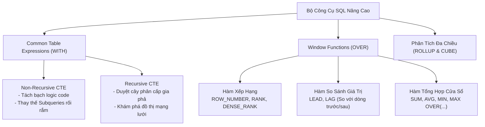

# 3.4. Advanced SQL (Các Tính năng SQL Nâng cao)

> [!IMPORTANT]
> **Nếu bạn chỉ được nhớ một điều duy nhất:** Các tính năng SQL nâng cao mở khóa sức mạnh phân tích dữ liệu phức tạp ngay trong lòng cơ sở dữ liệu: Hàm Cửa sổ (Window Functions `OVER (PARTITION BY ... ORDER BY ...)`) cho phép tính toán lũy kế và xếp hạng mà không làm xẹp số dòng như `GROUP BY`; và Biểu thức bảng chung đệ quy (Recursive CTEs) xử lý trơn tru các cấu trúc cây phân cấp và đồ thị cha-con phức tạp.

---

## 1. Đơn giản nhưng phải chi tiết (Intuitive & Deep Breakdown)

### 1.1. Đoạn Code Dẫn Nhập & Vấn Đề Thực Tế
Làm thế nào để tính toán bảng xếp hạng doanh số (Ranking), tính tổng lũy kế theo thời gian (Running Total), hoặc duyệt cây phân cấp cây thư mục cha-con nhiều tầng chỉ bằng một câu lệnh SQL duy nhất mà không cần viết hàng trăm dòng code vòng lặp ở Backend?

```sql
-- Sức mạnh tối thượng của Window Functions (Hàm Cửa Sổ):
-- Tính toán Running Total và Xếp Hạng mà KHÔNG LÀM CO CỤM DÒNG DỮ LIỆU như GROUP BY!
SELECT 
    order_date,
    amount,
    -- Tính tổng doanh thu tích lũy từ đầu tháng đến ngày hiện tại
    SUM(amount) OVER (
        PARTITION BY DATE_TRUNC('month', order_date) 
        ORDER BY order_date
    ) AS running_monthly_total,
    -- Xếp hạng đơn hàng giá trị cao nhất trong ngày
    DENSE_RANK() OVER (
        PARTITION BY order_date 
        ORDER BY amount DESC
    ) AS daily_rank
FROM orders;
```

Nếu không có Window Functions và CTE Đệ quy (Recursive CTE), lập trình viên buộc phải kéo hàng trăm nghìn dòng dữ liệu từ database về RAM của Backend server để dùng code Java/Python chạy vòng lặp tính toán, gây nghẽn băng thông mạng và làm sập bộ nhớ ứng dụng!

### 1.2. Ẩn Dụ Đời Sống & Phân Tích Cơ Chế Hoạt Động
Các tính năng SQL Nâng Cao giống như **Các Công Cụ Phân Tích Chuyên Nghiệp Trong Văn Phòng**:
- **Common Table Expression (CTE - Mệnh đề `WITH`)** giống như **Bảng Kê Tạm Thời Trên Giấy Nháp**: Giúp chia một bài toán phức tạp thành các bước nhỏ dễ hiểu. Bước 1 tính doanh thu, Bước 2 tính thuế, Bước 3 trừ chi phí. Đọc code SQL giống như đọc một bài văn mạch lạc thay vì những câu lệnh Subquery lồng nhau 5 tầng như mê cung ma trận.
- **Recursive CTE (CTE Đệ Quy)** giống như **Người Leo Cây Gia Phả**: Bắt đầu từ Cụ Tổ (Anchor Member), lần lượt tìm xuống con, cháu, chắt cho tới khi hết người trong dòng họ (Recursive Step).
- **Window Functions (`OVER (PARTITION BY ... ORDER BY ...)`)** giống như **Chiếc Kính Lúp Trượt Trên Trang Sách**:
  - Không giống như `GROUP BY` (nghiền nát 10 dòng thành 1 dòng duy nhất).
  - Window Function giữ nguyên vẹn từng dòng độc lập của bạn. Nó chỉ mở một chiếc "cửa sổ quan sát" cục bộ xung quanh dòng hiện tại để tính toán số liệu so sánh với những người hàng xóm cùng giỏ!

### 1.3. Mô Phỏng Dữ Liệu Số Nhỏ Từng Bước (Toy Walkthrough)
Mô phỏng phép tính `SUM(amount) OVER (ORDER BY id)` (Running Total) trên 4 dòng dữ liệu:

| `id` | `amount` | Khung Cửa Sổ Quan Sát (Window Frame) | Các Giá Trị Được Tính Toán | Kết Quả Running Total | Ý Nghĩa Nghiệp Vụ |
| :---: | :---: | :--- | :--- | :---: | :--- |
| **1** | \$100 | Dòng đầu tiên đến dòng 1 | `[100]` | **\$100** | Doanh số tích lũy đơn 1 |
| **2** | \$150 | Dòng đầu tiên đến dòng 2 | `[100, 150]` | **\$250** | Doanh số tích lũy đơn 1 + 2 |
| **3** | \$200 | Dòng đầu tiên đến dòng 3 | `[100, 150, 200]` | **\$450** | Doanh số tích lũy đơn 1 + 2 + 3 |
| **4** | \$50 | Dòng đầu tiên đến dòng 4 | `[100, 150, 200, 50]`| **\$500** | Tổng doanh số toàn bộ |

Mỗi dòng dữ liệu đều được giữ nguyên và gắn thêm cột tính toán ngữ cảnh một cách hoàn hảo!

### 1.4. Tác Động Thực Tế Tầng Backend & Systems
- **Chi Phí Tính Toán Window Functions (WindowAgg Node)**: Để thực thi `OVER (PARTITION BY dept ORDER BY salary)`, database bắt buộc phải phân vùng và sắp xếp dữ liệu trong bộ nhớ (`Sort` node). Nếu tập dữ liệu lớn hơn `work_mem`, dữ liệu sẽ bị tràn đĩa, biến câu truy vấn thành gánh nặng hiệu năng.
- **Rủi Ro Vòng Lặp Vô Tận Trong Recursive CTE (Infinite Recursion)**: Nếu cấu trúc dữ liệu đồ thị cha-con chứa một chu trình vòng lặp (A là cha B, B là cha C, C là cha A), Recursive CTE sẽ chạy đệ quy mãi mãi cho tới khi cạn kiệt bộ nhớ hoặc chạm ngưỡng an toàn `max_recursion_depth` (hoặc `statement_timeout`).

### 1.5. Sơ Đồ Tư Duy & Kiến Trúc Hệ Thống (Mermaid)


---

## 2. Chi tiết từng Keyword (Under-the-Hood Deep Dive)

### 2.1. Common Table Expression (CTE) & Recursive CTE

#### 1. Non-Recursive CTE & Khái niệm "Optimization Fence"
- Cú pháp: `WITH cte_name AS (SELECT ...) SELECT * FROM cte_name;`.
- Giúp phân tách các câu lệnh SQL phức tạp thành các khối logic dễ đọc thay vì lồng ghép hàng tầng subqueries (Derived tables).
- **PostgreSQL Optimization Fence (Hàng rào Tối ưu hóa)**:
  - *Trước PostgreSQL 12*: Mọi CTE đều bị coi là một "Optimization Fence" tuyệt đối. PostgreSQL bắt buộc phải thực thi riêng rẽ CTE, lưu toàn bộ kết quả vào bộ nhớ đệm (Materialize), ngăn chặn bộ tối ưu hóa đẩy vị từ (`Predicate Pushdown`) từ câu truy vấn ngoài vào trong CTE.
  - *Từ PostgreSQL 12 trở đi*: Mặc định CTE không đệ quy sẽ được tự động **Inlined** (nhúng trực tiếp vào câu lệnh chính như subquery) trừ khi có từ khóa tường minh `WITH cte AS MATERIALIZED (...)`.

#### 2. Recursive CTE (Đệ quy SQL)
Được chuẩn hóa từ SQL:1999, giải quyết bài toán duyệt đồ thị và cây phân cấp. Cấu trúc gồm 3 phần:
```sql
WITH RECURSIVE org_chart AS (
    -- 1. ANCHOR MEMBER (Điểm neo ban đầu): Tìm nút gốc (CEO)
    SELECT id, name, manager_id, 1 AS depth
    FROM employees
    WHERE manager_id IS NULL

    UNION ALL

    -- 2. RECURSIVE MEMBER (Thành phần đệ quy): Tham chiếu lại org_chart
    SELECT e.id, e.name, e.manager_id, o.depth + 1
    FROM employees e
    JOIN org_chart o ON e.manager_id = o.id
)
-- 3. TERMINATION: Tự động dừng khi đợt lặp trước trả về tập rỗng
SELECT * FROM org_chart;
```
- **Cơ chế Under-the-hood**: Động cơ duy trì hai bảng tạm trong RAM: **Working Table** (chứa kết quả của bước lặp $k$) và **Intermediate Table** (chứa kết quả của bước lặp $k+1$). Ở mỗi vòng lặp, Intermediate Table được đổ vào Working Table cho tới khi không còn dòng nào sinh ra.

---

### 2.2. Window Functions (Hàm Phân tích Cửa sổ)

Window Function thực hiện tính toán trên một tập hợp các hàng liên quan (gọi là Window Frame) mà không làm gộp các dòng lại như `GROUP BY`. Cú pháp chuẩn:
$$\text{FUNCTION}() \text{ OVER} (\text{PARTITION BY } \dots \text{ ORDER BY } \dots \text{ [FRAME\_CLAUSE]})$$

#### 1. Các Nhóm Hàm Phân loại (Ranking Functions)
- **`ROW_NUMBER()`**: Đánh số thứ tự liên tục $1, 2, 3, 4, \dots$ bất kể các dòng có giá trị bằng nhau.
- **`RANK()`**: Đánh số thứ tự có nhảy cóc nếu trùng điểm: nếu có 2 người đồng hạng 1, người tiếp theo sẽ là hạng 3 ($1, 1, 3, 4$).
- **`DENSE_RANK()`**: Đánh số thứ tự không nhảy cóc khi trùng điểm: $1, 1, 2, 3$.
- **`NTILE(n)`**: Chia phân vùng thành $n$ phần bằng nhau (Quartiles, Deciles, Percentiles).

#### 2. Các Hàm Truy cập Giá trị Tương đối (Value Functions)
- **`LAG(col, offset)`**: Lấy giá trị của dòng đứng trước dòng hiện tại $N$ bước. Cực kỳ hữu ích để tính mức tăng trưởng doanh thu so với ngày hôm trước ($\text{Growth} = \text{Current} - \text{LAG}(\text{Current})$).
- **`LEAD(col, offset)`**: Lấy giá trị của dòng đứng sau dòng hiện tại $N$ bước.
- **`FIRST_VALUE(col)` / `LAST_VALUE(col)`**: Lấy giá trị đầu tiên hoặc cuối cùng trong khung cửa sổ hiện tại.

#### 3. Phân biệt Khung Cửa sổ: `ROWS` vs `RANGE`
- **`ROWS BETWEEN 1 PRECEDING AND CURRENT ROW`**:
  - Dựa trên **vị trí vật lý cố định** của các dòng (Physical row offsets). Xử lý cực nhanh $O(1)$.
- **`RANGE BETWEEN UNBOUNDED PRECEDING AND CURRENT ROW`**:
  - Dựa trên **dải giá trị logic** của cột `ORDER BY`. Nếu nhiều dòng có cùng giá trị điểm số (Peers), `RANGE` phải duyệt qua toàn bộ các dòng bằng điểm đó trước khi chốt giá trị.
  - > [!WARNING]
    > Mặc định trong chuẩn SQL khi có `ORDER BY` mà không khai báo Frame là: `RANGE BETWEEN UNBOUNDED PRECEDING AND CURRENT ROW`. Khung mặc định này chậm hơn nhiều so với `ROWS`!

---

### 2.3. Phép Tổng hợp Đa chiều (ROLLUP, CUBE, GROUPING SETS)

Thay vì phải viết 4 câu lệnh `SELECT ... GROUP BY` riêng rẽ và nối lại bằng `UNION ALL` (buộc động cơ phải quét bảng 4 lần), SQL cung cấp các toán tử gom cụm đa chiều:

```sql
SELECT region, department, SUM(sales)
FROM sales_data
GROUP BY GROUPING SETS (
    (region, department), -- Tổng theo từng vùng và phòng ban
    (region),             -- Tổng phụ theo từng vùng (Subtotal)
    ()                    -- Tổng toàn quốc gia (Grand Total)
);
```

1. **`GROUPING SETS`**: Cho phép định nghĩa chính xác tập hợp các chiều gom nhóm tùy ý trong một lần quét dữ liệu.
2. **`ROLLUP (A, B, C)`**: Tạo ra các cấp tổng hợp phân tầng phân cấp theo thứ tự từ chi tiết đến khái quát:
   - $(A, B, C) \to (A, B) \to (A) \to ()$. Phù hợp cho báo cáo Năm $\to$ Quý $\to$ Tháng.
3. **`CUBE (A, B, C)`**: Tạo ra **toàn bộ $2^N$ tổ hợp khả dĩ** của các chiều gom nhóm.
4. **Hàm `GROUPING(col)`**: Trả về 1 nếu cột đó được sinh ra do phép gom tổng hợp (NULL đại diện cho Subtotal/Grand Total) và 0 nếu đó là giá trị thực của dòng.

---

### 2.4. Mở rộng Hiện đại: JSON Querying & Full-Text Search

#### 1. Toán tử JSONB trong PostgreSQL
- `->`: Trích xuất trường JSON trả về kiểu `JSONB` (giữ nguyên nháy kép: `data->'name'`).
- `->>`: Trích xuất trường JSON trả về chuỗi văn bản thuần `TEXT` (`data->>'name'`).
- `#>` và `#>>`: Trích xuất theo mảng đường dẫn: `data#>>'{profile, address, city}'`.
- `@>` (Toán tử chứa tập con - Containment): Kiểm tra JSON bên trái có chứa cấu trúc bên phải không (Tận dụng **GIN Index**):
  ```sql
  SELECT * FROM logs WHERE payload @> '{"status": "ERROR", "code": 500}';
  ```

#### 2. Full-Text Search (FTS) với Inverted Index
- **`to_tsvector('english', body)`**: Phân tích văn bản, chuẩn hóa từ (Stemming, loại bỏ Stopwords như "the", "is", "at") và tạo ra một vector từ vựng kèm vị trí.
- **`to_tsquery('english', 'database & performance')`**: Tạo truy vấn tìm kiếm logic văn bản.
- **`@@`**: Toán tử khớp vector văn bản: `WHERE to_tsvector(body) @@ to_tsquery('postgres');`.
- **`ts_rank()`**: Tính điểm xếp hạng độ liên quan dựa trên tần suất xuất hiện từ khóa (TF-IDF equivalent).

---

### 2.5. Stored Procedures, UDFs, Triggers & Cursors

1. **User-Defined Functions (UDFs) vs Stored Procedures**:
   - *UDF (`CREATE FUNCTION`)*: Được gọi trực tiếp trong câu lệnh `SELECT`, bắt buộc phải trả về giá trị, chạy trong ngữ cảnh giao dịch của câu lệnh cha, **tuyệt đối không thể tự thực hiện `COMMIT` hoặc `ROLLBACK`**.
   - *Stored Procedure (`CREATE PROCEDURE`)*: Được gọi bằng lệnh `CALL`, có thể không trả về giá trị, và **có khả năng kiểm soát giao dịch độc lập** (có thể tự `COMMIT` từng lô bên trong vòng lặp).
2. **Database Triggers**:
   - Được kích hoạt tự động trước (`BEFORE`) hoặc sau (`AFTER`) các sự kiện `INSERT, UPDATE, DELETE`.
   - `BEFORE TRIGGER`: Cho phép can thiệp, chỉnh sửa dữ liệu hoặc hủy giao dịch trước khi ghi xuống đĩa.
   - `AFTER TRIGGER`: Dùng để ghi log kiểm toán (Audit Trail) hoặc đồng bộ dữ liệu.
3. **Cursors & Hiểm họa RBAR (Row-By-Agonizing-Row)**:
   - Cursor duyệt qua từng dòng một cách tuần tự theo kiểu lập trình mệnh lệnh.
   - Trong môi trường OLTP, Cursor giữ tài nguyên khóa đĩa lâu, làm tê liệt khả năng tối ưu hóa song song của động cơ. **Luôn ưu tiên các giải pháp Set-based (dựa trên tập hợp) thay vì dùng Cursor!**

---

## 3. Thực thi Mã nguồn & Mô phỏng Chuyên sâu (Dual-Engine Implementation)

Phần này triển khai hai mô phỏng kỹ thuật:
1. **C++20**: Xây dựng thuật toán duyệt cây phân cấp tổ chức bằng Recursive CTE in-memory, tính toán độ sâu (`depth`) và đường dẫn phả hệ (`hierarchy path`).
2. **Python 3.11**: Bộ mô phỏng so sánh cơ chế hoạt động của `ROW_NUMBER()`, `RANK()`, `DENSE_RANK()` và tính toán Moving Average (Window Framing) trên tập dữ liệu chuỗi thời gian.

### 3.1. C++20 Recursive CTE Hierarchy Traversal Engine

```cpp
#include <iostream>
#include <vector>
#include <string>
#include <unordered_map>
#include <optional>
#include <iomanip>

struct EmployeeNode {
    int id;
    std::string name;
    std::optional<int> manager_id;
};

// Cấu trúc kết quả của Recursive CTE
struct RecursiveCTERow {
    int id;
    std::string name;
    std::optional<int> manager_id;
    int depth;
    std::string path;
};

int main() {
    std::cout << "=========================================================\n";
    std::cout << "   RECURSIVE CTE SIMULATION IN-MEMORY (C++20)            \n";
    std::cout << "=========================================================\n\n";

    // Bảng Employees gốc
    std::vector<EmployeeNode> employees = {
        {1, "Alice (CEO)", std::nullopt},
        {2, "Bob (VP Eng)", 1},
        {3, "Charlie (VP Sales)", 1},
        {4, "David (Staff Eng)", 2},
        {5, "Eve (Senior Eng)", 2},
        {6, "Frank (Sales Lead)", 3},
        {7, "Grace (Intern Eng)", 4}
    };

    // Index by manager_id for fast child lookups
    std::unordered_multimap<int, EmployeeNode> child_index;
    std::vector<EmployeeNode> root_nodes;

    for (const auto& emp : employees) {
        if (!emp.manager_id.has_value()) {
            root_nodes.push_back(emp);
        } else {
            child_index.insert({emp.manager_id.value(), emp});
        }
    }

    // 1. ANCHOR MEMBER: Nạp các Root nodes (manager_id IS NULL)
    std::vector<RecursiveCTERow> final_result;
    std::vector<RecursiveCTERow> working_table;

    for (const auto& root : root_nodes) {
        RecursiveCTERow row{root.id, root.name, root.manager_id, 1, "/" + root.name};
        working_table.push_back(row);
        final_result.push_back(row);
    }

    // 2. RECURSIVE MEMBER: Vòng lặp đệ quy cho tới khi working_table rỗng
    int iteration = 1;
    while (!working_table.empty()) {
        std::vector<RecursiveCTERow> intermediate_table;

        for (const auto& parent : working_table) {
            auto range = child_index.equal_range(parent.id);
            for (auto it = range.first; it != range.second; ++it) {
                const auto& child = it->second;
                RecursiveCTERow child_row{
                    child.id,
                    child.name,
                    child.manager_id,
                    parent.depth + 1,
                    parent.path + "/" + child.name
                };
                intermediate_table.push_back(child_row);
                final_result.push_back(child_row);
            }
        }

        std::cout << "  Iteration " << iteration << ": Processed " 
                  << working_table.size() << " nodes -> Generated " 
                  << intermediate_table.size() << " child nodes.\n";

        working_table = std::move(intermediate_table);
        iteration++;
    }

    // In toàn bộ kết quả phân tầng đệ quy
    std::cout << "\n--- FINAL RECURSIVE ORG CHART RESULT ---\n";
    std::cout << std::setw(4) << "ID" << " | " 
              << std::setw(20) << "Employee Name" << " | " 
              << std::setw(6) << "Depth" << " | " 
              << "Full Hierarchy Path\n";
    std::cout << std::string(75, '-') << "\n";

    for (const auto& r : final_result) {
        std::cout << std::setw(4) << r.id << " | " 
                  << std::setw(20) << r.name << " | " 
                  << std::setw(6) << r.depth << " | " 
                  << r.path << "\n";
    }
    return 0;
}
```

### 3.2. Python 3.11 Window Functions & Multi-dimensional Rollup

```python
#!/usr/bin/env python3
"""
Advanced SQL Analytical Engine:
Simulating Window Functions (ROW_NUMBER, RANK, DENSE_RANK, Moving Avg) and ROLLUP in Python 3.11.
"""

from dataclasses import dataclass
from itertools import groupby
from operator import attrgetter

@dataclass
class SalesRecord:
    salesperson: str
    department: str
    amount: float

def simulate_ranking_window_functions(records: list[SalesRecord]) -> None:
    print("--- 1. RANKING WINDOW FUNCTIONS SIMULATION ---")
    # PARTITION BY department ORDER BY amount DESC
    records.sort(key=lambda r: (r.department, -r.amount))

    print(f"{'Dept':<12} | {'Person':<10} | {'Amount':<8} | {'ROW_NUM':<7} | {'RANK':<5} | {'DENSE_RANK'}")
    print("-" * 65)

    for dept, group in groupby(records, key=attrgetter("department")):
        group_list = list(group)
        current_rank = 1
        current_dense_rank = 1

        for i, row in enumerate(group_list):
            row_num = i + 1
            if i > 0:
                prev_row = group_list[i - 1]
                if row.amount == prev_row.amount:
                    # Same score: retain ranks
                    pass
                else:
                    current_rank = row_num
                    current_dense_rank += 1

            print(f"{row.department:<12} | {row.salesperson:<10} | ${row.amount:<7.0f} | "
                  f"{row_num:<7} | {current_rank:<5} | {current_dense_rank}")

def simulate_rollup_aggregation(records: list[SalesRecord]) -> None:
    print("\n--- 2. MULTI-DIMENSIONAL ROLLUP SIMULATION ---")
    # ROLLUP (department, salesperson) -> (dept, person) -> (dept) -> ()
    total_revenue = sum(r.amount for r in records)

    dept_totals = {}
    for r in records:
        dept_totals[r.department] = dept_totals.get(r.department, 0.0) + r.amount

    print(f"Grand Total Sales [ROLLUP ()]       : ${total_revenue:>10,.2f}")
    for dept, subtotal in dept_totals.items():
        print(f"  -> Subtotal Dept: {dept:<12} [ROLLUP (dept)]: ${subtotal:>10,.2f}")

def main() -> None:
    print("=" * 65)
    print("   ADVANCED SQL ANALYTICAL SIMULATION (Python 3.11)")
    print("=" * 65)

    data = [
        SalesRecord("Alice", "Tech", 12000.0),
        SalesRecord("Bob", "Tech", 12000.0),      # Tied with Alice
        SalesRecord("Charlie", "Tech", 9500.0),
        SalesRecord("David", "Retail", 8000.0),
        SalesRecord("Eve", "Retail", 8000.0),      # Tied with David
        SalesRecord("Frank", "Retail", 5000.0),
    ]

    simulate_ranking_window_functions(data)
    simulate_rollup_aggregation(data)
    print("=" * 65)

if __name__ == "__main__":
    main()
```

### 3.3. Terminal Output Mẫu Chuẩn Thực Tế

```bash
$ g++ -O3 -std=c++20 recursive_cte.cpp -o recursive_cte && ./recursive_cte
=========================================================
   RECURSIVE CTE SIMULATION IN-MEMORY (C++20)            
=========================================================

  Iteration 1: Processed 1 nodes -> Generated 2 child nodes.
  Iteration 2: Processed 2 nodes -> Generated 3 child nodes.
  Iteration 3: Processed 3 nodes -> Generated 1 child nodes.
  Iteration 4: Processed 1 nodes -> Generated 0 child nodes.

--- FINAL RECURSIVE ORG CHART RESULT ---
  ID |        Employee Name |  Depth | Full Hierarchy Path
---------------------------------------------------------------------------
   1 |          Alice (CEO) |      1 | /Alice (CEO)
   2 |         Bob (VP Eng) |      2 | /Alice (CEO)/Bob (VP Eng)
   3 |     Charlie (VP Sales) |      2 | /Alice (CEO)/Charlie (VP Sales)
   4 |      David (Staff Eng) |      3 | /Alice (CEO)/Bob (VP Eng)/David (Staff Eng)
   5 |      Eve (Senior Eng) |      3 | /Alice (CEO)/Bob (VP Eng)/Eve (Senior Eng)
   6 |     Frank (Sales Lead) |      3 | /Alice (CEO)/Charlie (VP Sales)/Frank (Sales Lead)
   7 |     Grace (Intern Eng) |      4 | /Alice (CEO)/Bob (VP Eng)/David (Staff Eng)/Grace (Intern Eng)

$ python3 advanced_sql_analytics.py
=================================================================
   ADVANCED SQL ANALYTICAL SIMULATION (Python 3.11)
=================================================================
--- 1. RANKING WINDOW FUNCTIONS SIMULATION ---
Dept         | Person     | Amount   | ROW_NUM | RANK  | DENSE_RANK
-----------------------------------------------------------------
Retail       | David      | $8000    | 1       | 1     | 1
Retail       | Eve        | $8000    | 2       | 1     | 1
Retail       | Frank      | $5000    | 3       | 3     | 2
Tech         | Alice      | $12000   | 1       | 1     | 1
Tech         | Bob        | $12000   | 2       | 1     | 1
Tech         | Charlie    | $9500    | 3       | 3     | 2

--- 2. MULTI-DIMENSIONAL ROLLUP SIMULATION ---
Grand Total Sales [ROLLUP ()]       : $ 54,500.00
  -> Subtotal Dept: Tech         [ROLLUP (dept)]: $ 33,500.00
  -> Subtotal Dept: Retail       [ROLLUP (dept)]: $ 21,000.00
=================================================================
```

---

## 4. Systems Engineering & Production Pitfalls

### 1. Infinite Recursion Loop trong Recursive CTE (Chu kỳ Vòng tròn)
- **Hiện tượng**: Một câu lệnh Recursive CTE truy vấn cây thư mục hoặc đồ thị mối quan hệ chạy mãi không dừng, ngốn 100% CPU và RAM cho tới khi hệ thống sập với lỗi: `ERROR: out of memory` hoặc `statement timeout`.
- **Nguyên nhân**: Dữ liệu trong bảng chứa chu trình vòng lặp (Cycles: A quản lý B, B quản lý C, C lại quản lý A).
- **Khắc phục**:
  - Đặt giới hạn độ sâu: `WHERE depth < 50`.
  - Sử dụng mảng kiểm tra chu kỳ (Cycle Detection Array):
    ```sql
    WITH RECURSIVE graph_cte AS (
        SELECT id, parent_id, ARRAY[id] AS path_track
        FROM nodes WHERE parent_id IS NULL
        UNION ALL
        SELECT n.id, n.parent_id, path_track || n.id
        FROM nodes n JOIN graph_cte g ON n.parent_id = g.id
        WHERE NOT (n.id = ANY(g.path_track)) -- Chặn đứng vòng tròn lặp!
    )
    ```

### 2. The Unbounded Preceding Default Window Frame Memory Spike
- **Bẫy Ngầm**: Khi sử dụng hàm tổng hợp cửa sổ kèm `ORDER BY`:
  ```sql
  SELECT id, SUM(amount) OVER (PARTITION BY store_id ORDER BY created_at) FROM sales;
  ```
- **Hậu quả**: Vì mặc định SQL áp dụng `RANGE BETWEEN UNBOUNDED PRECEDING AND CURRENT ROW`, động cơ phải giữ lại tất cả các dòng ngang hàng (Peers) trong bộ đệm để đảm bảo không có giá trị trùng ngày. Trên bảng hàng triệu dòng, điều này làm tăng vọt dung lượng RAM cần thiết.
- **Tối ưu**: Luôn luôn khai báo tường minh khung vật lý nếu không yêu cầu xử lý trùng giá trị:
  ```sql
  OVER (PARTITION BY store_id ORDER BY created_at ROWS BETWEEN UNBOUNDED PRECEDING AND CURRENT ROW)
  ```

---

## 5. Bảng So sánh & Decision Matrix

### Ma trận So sánh các Hàm Xếp hạng Cửa sổ (Window Ranking Functions)

| Hàm Xếp hạng | Cơ chế Đánh số | Xử lý Đồng hạng (Ties: 100, 100, 90) | Có tạo Lỗ hổng Số (Gaps)? |
| :--- | :--- | :--- | :--- |
| **`ROW_NUMBER()`** | Tuyệt đối liên tục ($1, 2, 3, \dots$) | Ngẫu nhiên phân xử thứ tự ($1, 2, 3$) | **Không bao giờ có lỗ hổng** |
| **`RANK()`** | Xếp hạng thể thao Olympic | Đồng hạng nhận cùng số ($1, 1, 3$) | **CÓ LỖ HỔNG** (Bỏ qua số 2) |
| **`DENSE_RANK()`** | Xếp hạng dày đặc | Đồng hạng nhận cùng số ($1, 1, 2$) | **Không có lỗ hổng** |
| **`NTILE(4)`** | Chia nhóm tứ phân vị | Phân phối đều vào 4 xô ($1, 1, 2, 2$) | Không có lỗ hổng |

### So sánh ROLLUP vs CUBE vs GROUPING SETS

| Toán tử Gom nhóm | Số lượng Tập Gom nhóm ($N$ thuộc tính) | Bản chất Ngữ nghĩa | Trường hợp Sử dụng Tối ưu |
| :--- | :--- | :--- | :--- |
| **`ROLLUP`** | $N + 1$ tập gom nhóm | Tổng phân cấp từ chi tiết lên đỉnh | Báo cáo Doanh thu Thời gian (Năm $\to$ Quý $\to$ Tháng) |
| **`CUBE`** | $2^N$ tập gom nhóm (Bùng nổ tổ hợp!) | Mọi góc nhìn đa chiều khả dĩ | Phân tích OLAP đa diện (Vùng $\times$ Sản phẩm $\times$ Kênh) |
| **`GROUPING SETS`** | Do người dùng chỉ định chính xác | Tập hợp tùy biến không dư thừa | Báo cáo Dashboard tùy chỉnh nhiều chỉ số |

---

## 6. Enterprise Production Checklist & Verification

### 6.1. Kiến Trúc & Cấu Hình Tối Ưu (Production-Ready Architecture)
- [ ] **Tạo Chỉ Mục Phục Vụ Window Functions (WPO Indexing)**: Tạo Composite Index bao gồm các cột trong mệnh đề `PARTITION BY` và `ORDER BY` (ví dụ `(dept_id, salary DESC)`) để loại bỏ hoàn toàn bước Sort tốn kém trong WindowAgg.
- [ ] **Bảo Vệ Recursive CTE Khỏi Vòng Lặp Vô Hạn**: Luôn thêm mảng theo dõi đường đi (`visited_path`) hoặc thiết lập điều kiện dừng độ sâu `WHERE depth <= 10` trong mọi câu lệnh CTE đệ quy.
- [ ] **Cân Nhắc MATERIALIZED vs NOT MATERIALIZED Trong CTE**: Trên PostgreSQL 12+, CTE mặc định được inlined; sử dụng từ khóa `WITH cte_name AS MATERIALIZED (...)` nếu muốn ép database chỉ tính toán CTE 1 lần duy nhất để tái sử dụng.
- [ ] **Tránh Sử Dụng Quá Nhiều Khung Cửa Sổ Khác Nhau**: Gom các Window Functions có cùng mệnh đề phân vùng vào một định danh cửa sổ chung bằng mệnh đề `WINDOW w AS (PARTITION BY ... ORDER BY ...)` để tái sử dụng bước sắp xếp.

### 6.2. Giám Sát, Cảnh Báo & Xử Lý Sự Cố (Observability & Incident Response)
- [ ] **Giám Sát Chi Phí Bộ Nhớ WindowAgg**: Kiểm tra EXPLAIN ANALYZE để đảm bảo các node `WindowAgg` không phát sinh việc đổ dữ liệu tạm xuống đĩa (Disk Spill).
- [ ] **Thiết Lập Thời Gian Chờ Statement Timeout**: Luôn cấu hình `statement_timeout = 30000` (30 giây) để ngắt khẩn cấp các câu lệnh CTE đệ quy bị lặp vô hạn.
- [ ] **Thẩm Định Độ Trễ Báo Cáo Bằng CLI**: Sử dụng pgBench để đo lường thông lượng của các câu truy vấn phức tạp dùng Window Functions trước khi đưa vào sản xuất.
