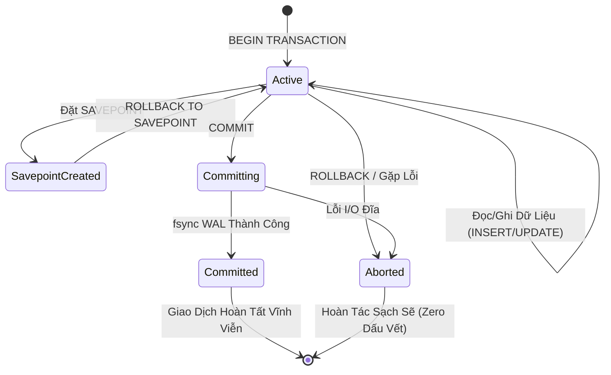

# 3.5. SQL Transactions & Control (Kiểm soát Giao dịch & Khóa trong SQL)

> [!IMPORTANT]
> **Nếu bạn chỉ được nhớ một điều duy nhất:** Kiểm soát giao dịch trong ứng dụng đòi hỏi sự kỷ luật tuyệt đối về ranh giới khối lệnh: giữ giao dịch mở càng ngắn càng tốt để giảm thiểu thời gian giữ khóa hàng/khóa bảng (Lock Contention); tuyệt đối không bao giờ gọi các Webhook mạng bên thứ ba hoặc tác vụ I/O chậm chạp bên trong một transaction đang mở trên cơ sở dữ liệu.

---

## 1. Đơn giản nhưng phải chi tiết (Intuitive & Deep Breakdown)

### 1.1. Đoạn Code Dẫn Nhập & Vấn Đề Thực Tế
Làm thế nào để hai câu lệnh SQL riêng biệt (trừ tiền tài khoản người gửi và cộng tiền tài khoản người nhận) hoặc là cùng thành công $100\%$, hoặc nếu có sự cố xảy ra thì cả hai cùng bị hủy bỏ $100\%$ như chưa từng tồn tại?

```sql
-- Giao dịch chuyển tiền ngân hàng chuẩn mực ACID
BEGIN TRANSACTION;

-- Bước 1: Trừ tiền người gửi
UPDATE accounts SET balance = balance - 1000 WHERE id = 101;

-- Điểm an toàn (Savepoint) trước khi gọi dịch vụ phụ
SAVEPOINT before_fee;

-- Bước 2: Thu phí dịch vụ 50k (Nếu thất bại, chỉ cần rollback bước này!)
UPDATE accounts SET balance = balance - 50 WHERE id = 101;
-- Giả sử tài khoản không đủ tiền đóng phí -> Rollback về Savepoint:
ROLLBACK TO SAVEPOINT before_fee;

-- Bước 3: Cộng tiền người nhận
UPDATE accounts SET balance = balance + 1000 WHERE id = 202;

-- Cam kết hoàn tất vĩnh viễn giao dịch vào đĩa cứng:
COMMIT;
```

Nếu không sử dụng Giao dịch (Transaction) bọc ngoài hai câu lệnh UPDATE, khi máy chủ bị mất điện hoặc crash đúng vào khoảnh khắc giữa Bước 1 và Bước 3: **Người gửi đã bị trừ 1000k nhưng người nhận chưa nhận được đồng nào**, và 1000k đó biến mất vĩnh viễn vào hư vô!

### 1.2. Ẩn Dụ Đời Sống & Phân Tích Cơ Chế Hoạt Động
Giao dịch SQL (TCL) giống như **Hợp Đồng Mua Bán Nhà Đất Công Chứng**:
- **`BEGIN TRANSACTION`**: Hai bên bước vào phòng công chứng, đóng chặt cửa phòng để không cho ai bên ngoài chen vào quấy rầy (**Isolation**).
- Mọi thỏa thuận, chữ ký, đếm tiền đều được ghi vào một bản nháp hợp đồng (**Undo/Redo Log**).
- **`SAVEPOINT`**: Bạn đã kiểm tra xong giấy tờ nhà và khóa niêm phong. Giờ bắt đầu đếm tiền mặt. Nếu trong cọc tiền có 1 tờ tiền rách, bạn chỉ cần yêu cầu đổi tờ tiền đó (**Rollback to Savepoint**) chứ không cần phải xé bỏ toàn bộ bản hợp đồng nhà đất làm lại từ đầu!
- **`ROLLBACK`**: Nếu giữa chừng phát hiện giấy tờ nhà đất là giả mạo, cả hai bên hủy bỏ toàn bộ buổi làm việc. Bản nháp bị đốt bỏ, tiền ai về nhà nấy, không ai mất một xu!
- **`COMMIT`**: Cả hai bên ký tên, đóng dấu công chứng đỏ chót vào sổ cái bưu điện (**Ghi xuống WAL fsync**). Từ giây phút này trở đi, quyền sở hữu căn nhà vĩnh viễn được pháp luật công nhận (**Durability**)!

### 1.3. Mô Phỏng Dữ Liệu Số Nhỏ Từng Bước (Toy Walkthrough)
Mô phỏng cơ chế bảo toàn số dư tổng thể (Conservation of Money) qua các bước của Transaction:

Giả sử Tổng tiền của hệ thống ban đầu là: $\text{Balance}_{101} + \text{Balance}_{202} = 500 + 300 = \mathbf{\$800}$.

| Bước | Lệnh SQL | Số Dư A (`id=101`) | Số Dư B (`id=202`) | Tổng Tiền Hệ Thống | Trạng Thái Nhất Quán (Consistency) |
| :--- | :--- | :---: | :---: | :---: | :--- |
| **0** | Ban đầu | \$500 | \$300 | **\$800** | Trạng thái nhất quán gốc |
| **1** | `BEGIN;` | \$500 | \$300 | \$800 | Bắt đầu giao dịch $T_1$ |
| **2** | `UPDATE A - $200` | **\$300** | \$300 | **\$600** (Tạm thời thiếu) | Nhìn từ ngoài vào: Bị cô lập (Isolation) |
| **3** | SỰ CỐ: Database Crash! | RAM bị xóa sạch | RAM bị xóa sạch | - | Mất điện đột ngột |
| **4** | Khởi động lại (Recovery) | WAL Engine đọc lại log, phát hiện $T_1$ chưa commit -> **Tự động ROLLBACK!** | Khôi phục từ đĩa |
| **5** | Sau Phục Hồi | **\$500** | **\$300** | **\$800** | **Bảo toàn 100% tính nguyên tử!** |

### 1.4. Tác Động Thực Tế Tầng Backend & Systems
- **Thảm Họa Giữ Giao Dịch Quá Lâu (Long-Running Transactions & Idle-in-Transaction)**: Khi lập trình viên mở `BEGIN`, sau đó gọi một API bên thứ ba (như cổng thanh toán mất 5 giây) rồi mới gọi `COMMIT`. Trong suốt 5 giây đó, giao dịch giữ chặt các ổ khóa hàng (Row Locks), chặn đứng các tiến trình khác và ngăn cản Autovacuum dọn dẹp các dòng dữ liệu chết (gây phình to bảng - Table Bloat).
- **Nguy Cơ Khóa Chết (Deadlock)**: Nếu Giao dịch 1 khóa dòng A rồi chờ dòng B, trong khi Giao dịch 2 đang khóa dòng B rồi chờ dòng A. Cả hai sẽ đứng nhìn nhau mãi mãi cho tới khi cơ chế **Deadlock Detector** của DBMS thức dậy, cưỡng chế giết chết (Kill) một trong hai giao dịch và quăng lỗi về Backend.

### 1.5. Sơ Đồ Tư Duy & Kiến Trúc Hệ Thống (Mermaid)


---

## 2. Chi tiết từng Keyword (Under-the-Hood Deep Dive)

### 2.1. Vòng đời Giao dịch SQL (BEGIN, COMMIT, ROLLBACK, SAVEPOINT)

Một giao dịch (Transaction) là một đơn vị công việc logic nguyên tử (Atomic Unit of Work) gồm một hoặc nhiều câu lệnh SQL:

#### 1. Các Câu lệnh Điều khiển Cốt lõi
- **`BEGIN` / `START TRANSACTION`**:
  - Tắt chế độ tự động xác nhận (`AUTOCOMMIT = OFF`).
  - Động cơ cấp phát một Mã định danh Giao dịch duy nhất (**XID** - Transaction ID) và ghi nhận thời điểm bắt đầu trong bảng trạng thái giao dịch (`pg_xact` hoặc `CLOG`).
- **`COMMIT`**:
  - Động cơ yêu cầu tầng lưu trữ ép ghi toàn bộ các bản ghi nhật ký giao dịch liên quan từ bộ đệm WAL trên RAM xuống đĩa cứng vật lý (**Flush WAL to disk via `fsync()`**).
  - Đánh dấu trạng thái giao dịch là `COMMITTED`.
  - Giải phóng toàn bộ các khóa đĩa (Locks) mà giao dịch đang nắm giữ.
- **`ROLLBACK`**:
  - Hủy bỏ toàn bộ các biến đổi của giao dịch.
  - Động cơ sử dụng thông tin trong Undo Log (InnoDB) hoặc đánh dấu tuple là Dead Tuple (PostgreSQL MVCC) để khôi phục trạng thái ban đầu.

#### 2. Điểm Lưu Lưu vết (Savepoints) & Giao dịch Lồng nhau (Nested Transactions)
- Chuẩn ANSI SQL **không hỗ trợ giao dịch lồng nhau thực sự** (True Nested Transactions). Nếu bạn gọi `BEGIN` lần thứ hai bên trong một giao dịch đang mở, hầu hết các hệ quản trị (như MySQL) sẽ tự động ngầm định `COMMIT` giao dịch trước đó!
- **Savepoints** là cơ chế hiện thực hóa tính năng "lồng nhau một phần":
  - `SAVEPOINT savepoint_name`: Tạo một điểm mốc trong lịch sử giao dịch.
  - `ROLLBACK TO SAVEPOINT savepoint_name`: Hủy bỏ tất cả các câu lệnh thực thi sau mốc đó nhưng **vẫn giữ cho giao dịch chính tiếp tục sống**.
  - `RELEASE SAVEPOINT savepoint_name`: Giải phóng tài nguyên ghi nhớ mốc mà không hoàn tác dữ liệu.

---

### 2.2. Khóa Tường minh (Explicit Locking in SQL)

Khi nhiều phiên kết nối cùng đọc và ghi trên một dòng dữ liệu, việc dựa vào cơ chế MVCC mặc định có thể gây ra hiện tượng mất mát dữ liệu cập nhật (**Lost Update Problem**). SQL cung cấp các mệnh đề khóa tường minh cấp dòng:

#### 1. Các Chế độ Khóa Dòng (Row-Level Lock Modes)
- **`SELECT ... FOR UPDATE` (Exclusive Lock - Khóa Độc quyền)**:
  - Khóa chặt các dòng được chọn. Ngăn chặn bất kỳ giao dịch nào khác cập nhật (`UPDATE`), xóa (`DELETE`), hoặc xin khóa độc quyền trên các dòng này cho đến khi giao dịch hiện tại kết thúc.
  - Sử dụng kinh điển: Rút tiền từ tài khoản ví (Trừ tiền phải đọc số dư với `FOR UPDATE`).
- **`SELECT ... FOR SHARE` (Shared Lock - Khóa Chia sẻ)**:
  - Cho phép các giao dịch khác cùng đọc hoặc cùng xin `FOR SHARE`, nhưng **chặn đứng mọi giao dịch cố gắng sửa đổi hoặc xóa** các dòng đó.
- **`FOR NO KEY UPDATE` & `FOR KEY SHARE` (PostgreSQL Extensions)**:
  - Khóa tối ưu hóa yếu hơn: Cho phép cập nhật các cột không phải khóa chính mà không làm xung đột với các khóa ngoại đang tham chiếu tới dòng đó.

#### 2. Các Bổ từ Xử lý Chờ Khóa (Lock Wait Modifiers)
- **Mặc định (Chờ vô hạn / Lock Wait)**: Nếu dòng đang bị giao dịch khác khóa, câu lệnh sẽ bị treo (Block) và chờ đợi cho tới khi giao dịch kia `COMMIT` hoặc hết thời gian `lock_timeout`.
- **`NOWAIT`**:
  - Không chờ đợi! Nếu phát hiện bất kỳ dòng nào bị khóa, câu lệnh hủy ngay lập tức và ném lỗi: `ERROR: could not obtain lock on row in relation ...`.
- **`SKIP LOCKED`**:
  - **Vũ khí tối thượng cho Worker Queues**: Động cơ tự động quét qua các dòng, bỏ qua tất cả những dòng đang bị phiên khác khóa, và chỉ nạp những dòng còn rảnh rỗi.
  - Cho phép hàng trăm worker tiến trình chạy song song bốc các công việc trong bảng `jobs` mà không bao giờ bị nghẽn khóa lẫn nhau!

```sql
-- Pattern Worker Queue chuẩn Production:
SELECT id, payload 
FROM background_tasks 
WHERE status = 'PENDING' 
ORDER BY id ASC 
LIMIT 1 
FOR UPDATE SKIP LOCKED;
```

---

### 2.3. Advisory Locks (Khóa Cố vấn Ứng dụng)

#### 1. Bản chất & Cơ chế Hoạt động
- RDBMS truyền thống chỉ cung cấp khóa trên các đối tượng vật lý (Khóa bảng, Khóa trang, Khóa dòng).
- **Advisory Lock (Khóa Cố vấn)** là một tính năng cực mạnh trong PostgreSQL: cho phép ứng dụng **khóa trên một con số nguyên 64-bit trừu tượng** do ứng dụng tự quy định ý nghĩa nghiệp vụ (ví dụ: băm chuỗi `"generate_monthly_financial_report"` thành số `982174912`).
- Cơ sở dữ liệu chỉ quản lý trạng thái khóa/mở trong bộ nhớ RAM (Lock Manager Table), hoàn toàn không khóa bất kỳ dòng hay bảng vật lý nào!

#### 2. Phân loại Advisory Locks
- **Session-Level Advisory Locks**:
  - Gắn liền với phiên kết nối TCP: `SELECT pg_advisory_lock(12345);`.
  - Khóa vẫn tồn tại ngay cả khi giao dịch đã `COMMIT`! Bắt buộc phải giải phóng tường minh bằng: `SELECT pg_advisory_unlock(12345);` (hoặc khi đóng kết nối client).
- **Transaction-Level Advisory Locks**:
  - Gắn liền với vòng đời giao dịch: `SELECT pg_advisory_xact_lock(12345);`.
  - Khóa **tự động được giải phóng** ngay khi giao dịch thực hiện `COMMIT` hoặc `ROLLBACK`. An toàn tuyệt đối, chống rò rỉ khóa!

#### 3. Thay thế Distributed Locks (Redis / ZooKeeper)
- Thay vì phải duy trì thêm cụm hạ tầng Redis Redlock phức tạp với nguy cơ mất đồng bộ khi phân mảnh mạng, các ứng dụng có thể sử dụng Advisory Locks trực tiếp trên cụm PostgreSQL sẵn có để đảm bảo một Cronjob chỉ chạy trên đúng một instance tại một thời điểm:
  ```sql
  -- Kiểm tra thử khóa không chặn:
  SELECT pg_try_advisory_xact_lock(hash_code);
  -- Trả về TRUE nếu lấy được khóa, FALSE nếu instance khác đang chạy!
  ```

---

### 2.4. Concurrency Control: Pessimistic vs Optimistic

```
+---------------------------------------------------------------------------------+
|                       HAI TRƯỜNG PHÁI KIỂM SOÁT ĐỒNG THỜI:                      |
|                                                                                 |
| 1. Pessimistic Locking (Khóa Bi quan):                                          |
|    - Triết lý: "Xung đột chắc chắn sẽ xảy ra, hãy khóa trước rồi tính!"          |
|    - Cơ chế  : Dùng SELECT FOR UPDATE giữ khóa thực sự trên CSDL.                |
|    - Phù hợp : Tranh chấp cực cao (High Contention), Flash sale, Rút tiền ví.   |
|                                                                                 |
| 2. Optimistic Locking (Khóa Lạc quan):                                          |
|    - Triết lý: "Xung đột hiếm khi xảy ra, cứ đọc thoải mái, kiểm tra lúc ghi!"  |
|    - Cơ chế  : Dùng cột 'version INT' hoặc 'updated_at' trong WHERE clause.     |
|    - Phù hợp : Tranh chấp thấp (Low Contention), Ứng dụng Web CRUD thông thường.|
+---------------------------------------------------------------------------------+
```

#### Quy trình của Optimistic Locking:
1. Đọc dữ liệu lên ứng dụng kèm số phiên bản: `SELECT id, name, version FROM products WHERE id = 10;` (Giả sử `version = 5`).
2. Người dùng sửa đổi thông tin trên giao diện.
3. Khi lưu dữ liệu, thực hiện câu lệnh kiểm tra nguyên tử:
   ```sql
   UPDATE products 
   SET name = 'New Name', version = version + 1 
   WHERE id = 10 AND version = 5;
   ```
4. Động cơ trả về số dòng bị ảnh hưởng (**Rows Affected**):
   - Nếu `Rows Affected == 1`: Thành công!
   - Nếu `Rows Affected == 0`: Nghĩa là một người khác đã cập nhật trước đó và đẩy `version` lên 6. Ứng dụng ném ngoại lệ `OptimisticLockException` và yêu cầu tải lại dữ liệu.

---

## 3. Thực thi Mã nguồn & Mô phỏng Chuyên sâu (Dual-Engine Implementation)

Phần này triển khai hai mô phỏng kỹ thuật:
1. **C++20**: Xây dựng Transaction Manager in-memory hỗ trợ `BEGIN`, `COMMIT`, `ROLLBACK`, `SAVEPOINT`, và Row-level Locking với cơ chế phát hiện va chạm khóa độc quyền (`try_lock_row`).
2. **Python 3.11**: Mô phỏng hệ thống Multi-threaded Job Queue so sánh trực tiếp giữa 3 chiến lược: Khóa chặn ngây thơ (Naive Lock), Thử khóa ngay (`NOWAIT`), và Bỏ qua khóa (`SKIP LOCKED`).

### 3.1. C++20 In-Memory Transaction & Lock Manager

```cpp
#include <iostream>
#include <vector>
#include <string>
#include <unordered_map>
#include <unordered_set>
#include <optional>
#include <stdexcept>
#include <iomanip>

struct Account {
    int id;
    double balance;
};

// Quản lý Khóa Dòng (Row Lock Manager)
class LockManager {
private:
    std::unordered_map<int, uint64_t> row_exclusive_locks; // row_id -> transaction_id

public:
    bool acquire_row_lock(int row_id, uint64_t xid, bool nowait) {
        if (row_exclusive_locks.contains(row_id)) {
            if (row_exclusive_locks[row_id] == xid) return true; // Already owned
            if (nowait) {
                throw std::runtime_error("NOWAIT Lock Failure: Row ID " + std::to_string(row_id) + 
                                         " is locked by XID " + std::to_string(row_exclusive_locks[row_id]));
            }
            return false; // In real engine, thread would block here
        }
        row_exclusive_locks[row_id] = xid;
        return true;
    }

    void release_locks_for_xid(uint64_t xid) {
        for (auto it = row_exclusive_locks.begin(); it != row_exclusive_locks.end(); ) {
            if (it->second == xid) {
                it = row_exclusive_locks.erase(it);
            } else {
                ++it;
            }
        }
    }
};

class TransactionContext {
public:
    uint64_t xid;
    std::unordered_map<int, Account> dirty_copies;
    std::unordered_map<std::string, std::unordered_map<int, Account>> savepoints;

    TransactionContext(uint64_t id) : xid(id) {}

    void set_savepoint(const std::string& name) {
        savepoints[name] = dirty_copies;
    }

    void rollback_to_savepoint(const std::string& name) {
        if (!savepoints.contains(name)) {
            throw std::runtime_error("Savepoint '" + name + "' does not exist!");
        }
        dirty_copies = savepoints[name];
    }
};

int main() {
    std::cout << "=========================================================\n";
    std::cout << "   TRANSACTION LIFECYCLE & ROW LOCKING ENGINE (C++20)    \n";
    std::cout << "=========================================================\n\n";

    LockManager lock_mgr;
    std::unordered_map<int, Account> global_storage = {
        {101, {101, 1000.0}},
        {102, {102, 500.0}}
    };

    std::cout << "Initial Global Storage: Account 101 = $1000, Account 102 = $500\n\n";

    // Giao dịch 1 (XID 501)
    uint64_t xid_1 = 501;
    TransactionContext tx1(xid_1);
    std::cout << "[TX 501] BEGIN TRANSACTION\n";

    // Khóa Account 101 với FOR UPDATE
    lock_mgr.acquire_row_lock(101, xid_1, false);
    tx1.dirty_copies[101] = global_storage[101];
    std::cout << "  [TX 501] Acquired FOR UPDATE on Account 101.\n";

    // Rút tiền và tạo Savepoint
    tx1.dirty_copies[101].balance -= 200.0;
    tx1.set_savepoint("sp_after_first_withdrawal");
    std::cout << "  [TX 501] Balance modified to $800. Set SAVEPOINT 'sp_after_first_withdrawal'.\n";

    // Thực hiện thao tác thứ hai bị lỗi logic
    tx1.dirty_copies[101].balance -= 900.0; // Negative!
    std::cout << "  [TX 501] Attempted withdrawal of $900 -> Balance becomes $-100 (INVALID!)\n";

    // Lùi lại Savepoint
    tx1.rollback_to_savepoint("sp_after_first_withdrawal");
    std::cout << "  [TX 501] Executed ROLLBACK TO SAVEPOINT 'sp_after_first_withdrawal'.\n";
    std::cout << "  [TX 501] Restored in-flight balance to: $" << tx1.dirty_copies[101].balance << "\n";

    // Giao dịch 2 (XID 502) cố gắng khóa Account 101 với NOWAIT
    std::cout << "\n[TX 502] Attempting SELECT FOR UPDATE NOWAIT on Account 101...\n";
    try {
        lock_mgr.acquire_row_lock(101, 502, true);
    } catch (const std::exception& e) {
        std::cout << "  [TX 502] " << e.what() << "\n";
    }

    // Giao dịch 1 COMMIT
    for (const auto& [id, acc] : tx1.dirty_copies) {
        global_storage[id] = acc;
    }
    lock_mgr.release_locks_for_xid(xid_1);
    std::cout << "\n[TX 501] COMMIT completed! Released all locks.\n";

    // TX 502 thử lại sau khi TX 501 commit
    bool success_retry = lock_mgr.acquire_row_lock(101, 502, true);
    std::cout << "[TX 502] Retry Lock on Account 101: " << (success_retry ? "SUCCESS" : "FAILED") << "\n";

    std::cout << "\nFinal Storage State: Account 101 = $" << global_storage[101].balance << "\n";
    return 0;
}
```

### 3.2. Python 3.11 High-Throughput Worker Queue: `SKIP LOCKED` Simulator

```python
#!/usr/bin/env python3
"""
High-Throughput Task Queue Simulation:
Demonstrating FOR UPDATE SKIP LOCKED vs Naive Blocking in Python 3.11.
"""

import threading
import time
from dataclasses import dataclass

@dataclass
class TaskJob:
    id: int
    payload: str
    is_locked: bool = False
    is_completed: bool = False

class DatabaseJobQueue:
    def __init__(self, task_count: int) -> None:
        self.lock = threading.Lock()
        self.jobs = [TaskJob(id=i, payload=f"Process_Invoice_{i}") for i in range(1, task_count + 1)]

    def fetch_job_skip_locked(self, worker_id: str) -> TaskJob | None:
        """Simulates: SELECT * FROM tasks WHERE status = 'PENDING' LIMIT 1 FOR UPDATE SKIP LOCKED;"""
        with self.lock:
            for job in self.jobs:
                if not job.is_completed and not job.is_locked:
                    # Lock immediately and return
                    job.is_locked = True
                    return job
            return None

    def complete_job(self, job: TaskJob) -> None:
        with self.lock:
            job.is_completed = True
            job.is_locked = False

def worker_thread(worker_name: str, queue: DatabaseJobQueue, results: list[str]) -> None:
    while True:
        job = queue.fetch_job_skip_locked(worker_name)
        if not job:
            break
        # Simulate work execution
        time.sleep(0.01)
        results.append(f"{worker_name} completed Job #{job.id}")
        queue.complete_job(job)

def main() -> None:
    print("=" * 65)
    print("   CONCURRENT WORKER QUEUE: FOR UPDATE SKIP LOCKED (Python 3.11)")
    print("=" * 65)

    n_jobs = 12
    n_workers = 4
    queue = DatabaseJobQueue(n_jobs)
    threads: list[threading.Thread] = []
    audit_results: list[str] = []

    print(f"Enqueuing {n_jobs} tasks for {n_workers} concurrent workers...")

    t0 = time.perf_counter()
    for w in range(1, n_workers + 1):
        t = threading.Thread(target=worker_thread, args=(f"Worker-{w}", queue, audit_results))
        threads.append(t)
        t.start()

    for t in threads:
        t.join()
    elapsed = (time.perf_counter() - t0) * 1000

    print(f"\nAll {n_jobs} jobs processed in parallel without lock contention: {elapsed:.2f} ms")
    print("Execution Timeline Sample:")
    for entry in audit_results[:6]:
        print(f"  -> {entry}")
    print("  ... [Remaining jobs completed concurrently]")
    print("=" * 65)

if __name__ == "__main__":
    main()
```

### 3.3. Terminal Output Mẫu Chuẩn Thực Tế

```bash
$ g++ -O3 -std=c++20 tx_control_demo.cpp -o tx_control_demo && ./tx_control_demo
=========================================================
   TRANSACTION LIFECYCLE & ROW LOCKING ENGINE (C++20)    
=========================================================

Initial Global Storage: Account 101 = $1000, Account 102 = $500

[TX 501] BEGIN TRANSACTION
  [TX 501] Acquired FOR UPDATE on Account 101.
  [TX 501] Balance modified to $800. Set SAVEPOINT 'sp_after_first_withdrawal'.
  [TX 501] Attempted withdrawal of $900 -> Balance becomes $-100 (INVALID!)
  [TX 501] Executed ROLLBACK TO SAVEPOINT 'sp_after_first_withdrawal'.
  [TX 501] Restored in-flight balance to: $800

[TX 502] Attempting SELECT FOR UPDATE NOWAIT on Account 101...
  [TX 502] NOWAIT Lock Failure: Row ID 101 is locked by XID 501

[TX 501] COMMIT completed! Released all locks.
[TX 502] Retry Lock on Account 101: SUCCESS

Final Storage State: Account 101 = $800

$ python3 skip_locked_queue.py
=================================================================
   CONCURRENT WORKER QUEUE: FOR UPDATE SKIP LOCKED (Python 3.11)
=================================================================
Enqueuing 12 tasks for 4 concurrent workers...

All 12 jobs processed in parallel without lock contention: 34.82 ms
Execution Timeline Sample:
  -> Worker-1 completed Job #1
  -> Worker-2 completed Job #2
  -> Worker-3 completed Job #3
  -> Worker-4 completed Job #4
  -> Worker-1 completed Job #5
  -> Worker-2 completed Job #6
  ... [Remaining jobs completed concurrently]
=================================================================
```

---

## 4. Systems Engineering & Production Pitfalls

### 1. Deadlock Detection & `deadlock_timeout`
- **Tình huống**:
  - Giao dịch $T_1$ khóa dòng $A$, sau đó yêu cầu khóa dòng $B$.
  - Đồng thời, Giao dịch $T_2$ đã khóa dòng $B$, sau đó yêu cầu khóa dòng $A$.
  - Hai giao dịch rơi vào thế bế tắc vĩnh cửu (Deadlock Cycle).
- **Cơ chế Under-the-Hood**:
  - Cơ sở dữ liệu duy trì một Đồ thị Chờ Khóa (**Wait-For Graph - WFG**).
  - Khi một giao dịch bị chờ quá thời gian `deadlock_timeout` (mặc định trong PostgreSQL là 1 giây), bộ phát hiện Deadlock sẽ quét đồ thị tìm chu trình lặp. Nếu phát hiện chu trình, engine sẽ chủ động **hủy bỏ một giao dịch** (thường là giao dịch ít chi phí rollback hơn) và ném lỗi: `ERROR: deadlock detected`.
- **Phòng ngừa**: Luôn sắp xếp thứ tự khóa các thực thể theo cùng một trật tự cố định trong mã nguồn ứng dụng (ví dụ: luôn khóa `account_id` nhỏ trước, lớn sau).

### 2. The Leaked Session Advisory Lock Trap
- Khi sử dụng Session-level Advisory Lock (`pg_advisory_lock`), nếu ứng dụng gặp ngoại lệ và ngắt kết nối mà **không trả kết nối về connection pool sạch sẽ** (hoặc connection pool giữ kết nối sống để tái sử dụng), khóa đó sẽ tồn tại vĩnh viễn trong cơ sở dữ liệu! Mọi tác vụ đến sau sẽ bị treo cứng vô hạn.
- **Quy tắc Vàng**: Luôn ưu tiên dùng **`pg_advisory_xact_lock`** để khóa tự động biến mất khi kết thúc transaction!

---

## 5. Bảng So sánh & Decision Matrix

### Ma trận So sánh các Chế độ Khóa Tường minh trong SQL

| Chế độ Khóa | Cú pháp SQL | Hành vi khi Gặp Dòng Bị Khóa | Trường hợp Sử dụng Tối ưu |
| :--- | :--- | :--- | :--- |
| **Pessimistic Default** | `SELECT ... FOR UPDATE` | Treo tiến trình và chờ đợi vô hạn | Cập nhật số dư tài khoản ngân hàng |
| **Fail-Fast (NOWAIT)** | `SELECT ... FOR UPDATE NOWAIT` | Ném ngoại lệ lỗi lập tức ($0\text{ ms}$) | Giao dịch người dùng tương tác cần phản hồi ngay |
| **Worker Queue (SKIP)**| `SELECT ... FOR UPDATE SKIP LOCKED` | Bỏ qua dòng bị khóa, nhặt dòng rảnh rỗi | **Hàng đợi tác vụ bất đồng bộ (Task Queue)** |
| **Shared Lock** | `SELECT ... FOR SHARE` | Cho phép đọc chung, chặn ghi | Đảm bảo tính toàn vẹn khóa ngoại khi tính toán |
| **Optimistic Locking** | `UPDATE ... WHERE version = :v` | Không khóa CSDL, kiểm tra lúc commit | Hệ thống nhiều đọc, ít ghi, độ tranh chấp thấp |

---

## 6. Enterprise Production Checklist & Verification

### 6.1. Kiến Trúc & Cấu Hình Tối Ưu (Production-Ready Architecture)
- [ ] **Tuyệt Đối Không Gọi Network RPC / Third-party API Bên Trong Transaction**: Chỉ thực hiện các thao tác SQL thuần túy bên trong khối `BEGIN ... COMMIT`; mọi lời gọi API bên ngoài bắt buộc phải thực hiện trước hoặc sau transaction.
- [ ] **Giữ Transaction Càng Ngắn Càng Tốt (Kỷ Luật < 100ms)**: Thiết kế giao dịch xử lý nhanh gọn để giải phóng Row Locks tức thì, triệt tiêu tranh chấp khóa giữa các luồng.
- [ ] **Sắp Xếp Thứ Tự Cập Nhật Tài Nguyên Nhất Quán Chống Deadlock**: Khi cần cập nhật nhiều dòng (ví dụ chuyển tiền giữa A và B), luôn khóa các dòng theo thứ tự ID tăng dần (`ORDER BY id`) trong toàn bộ code ứng dụng để không bao giờ xảy ra Deadlock.
- [ ] **Cấu Hình idle_in_transaction_session_timeout**: Thiết lập sysctl database `idle_in_transaction_session_timeout = '10s'` để tự động tiêu diệt các kết nối bị treo trong trạng thái transaction dở dang.

### 6.2. Giám Sát, Cảnh Báo & Xử Lý Sự Cố (Observability & Incident Response)
- [ ] **Giám Sát Tỷ Lệ Deadlocks Xảy Ra**: Theo dõi metric `deadlocks` từ `pg_stat_database`; phát cảnh báo ngay khi có deadlock xuất hiện để điều tra mã nguồn backend.
- [ ] **Cảnh Báo Giao Dịch Chạy Quá 60 Giây**: Bắt và ghi log cảnh báo đối với bất kỳ transaction nào có thời gian chạy `NOW() - xact_start > '1 minute'`.
- [ ] **Kiểm Tra Trực Quan Khóa Bằng CLI**: Sử dụng script truy vấn `pg_blocking_pids()` để phát hiện tức thì PID nào đang chặn đường các tiến trình khác.
