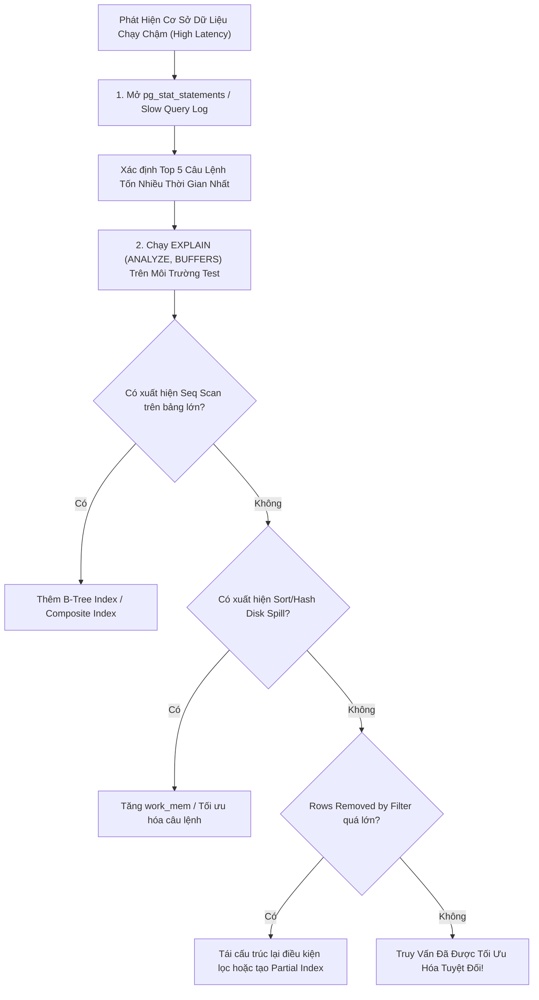
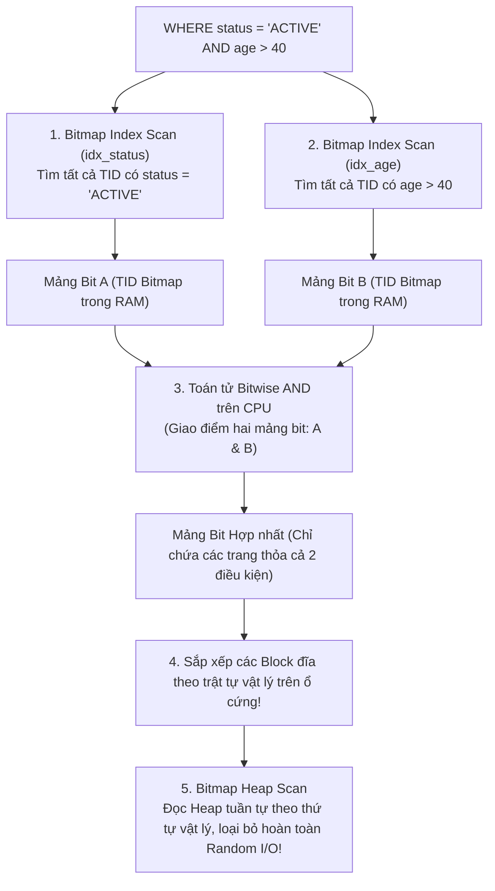

# 6.3. Query Performance & Profiling (Hiệu năng Truy vấn & Kỹ thuật Profiling)

> [!IMPORTANT]
> **Nếu bạn chỉ được nhớ một điều duy nhất:** Lệnh `EXPLAIN ANALYZE` là công cụ chẩn đoán tối cao của kỹ sư CSDL: `EXPLAIN` thuần túy chỉ hiển thị ước tính lý thuyết của CBO, trong khi `EXPLAIN ANALYZE` trực tiếp thực thi câu lệnh để đo đạc thời gian thực tế, số lượng dòng thực tế, và dung lượng bộ đệm RAM/Disk tiêu tốn; sự chênh lệch lớn giữa 'estimated rows' và 'actual rows' là dấu hiệu đầu tiên của thống kê sai lệch.

---

## 1. Đơn giản nhưng phải chi tiết (Intuitive & Deep Breakdown)

### 1.1. Đoạn Code Dẫn Nhập & Vấn Đề Thực Tế
Làm thế nào để đọc hiểu chính xác kết quả đầu ra của lệnh `EXPLAIN (ANALYZE, BUFFERS)` nhằm phát hiện ra "hung thủ" đang âm thầm ngốn sạch tài nguyên CPU và làm nghẽn đĩa SSD của máy chủ cơ sở dữ liệu?

```sql
-- Đoạn kết quả phân tích hiệu năng truy vấn kinh điển bằng EXPLAIN (ANALYZE, BUFFERS):
EXPLAIN (ANALYZE, BUFFERS) 
SELECT * FROM orders WHERE customer_id = 99 AND status = 'PENDING';

-- KẾT QUẢ TRẢ VỀ:
-- -> Bitmap Heap Scan on orders (cost=12.50..850.00 rows=150 width=84)
--                               (actual time=0.850..12.300 rows=120 loops=1)
--      Recheck Cond: (customer_id = 99)
--      Filter: (status = 'PENDING')
--      Rows Removed by Filter: 8500  <-- CẢNH BÁO NGUY HIỂM: Đọc 8,500 dòng rồi vứt bỏ!
--      Buffers: shared hit=42 read=120 <-- CẢNH BÁO: Phải đọc 120 trang từ ổ cứng SSD!
--      Planning Time: 0.150 ms
--      Execution Time: 12.450 ms
```

Chỉ nhìn lướt qua hai dòng cảnh báo: `Rows Removed by Filter: 8500` và `Buffers: shared read=120`, một kỹ sư giàu kinh nghiệm sẽ biết ngay phương án cứu nguy: **Tạo Composite Index trên cả hai cột `(customer_id, status)`** để triệt tiêu toàn bộ 8,500 lần đọc thừa và đưa `Execution Time` từ 12ms xuống còn 0.2ms!

### 1.2. Ẩn Dụ Đời Sống & Phân Tích Cơ Chế Hoạt Động
Đọc kết quả `EXPLAIN ANALYZE` giống như **Bác Sĩ Đọc Bản Kết Quả Chụp Cắt Lớp CT Toàn Thân Của Bệnh Nhân**:
- **Lệnh `EXPLAIN` đơn thuần**: Giống như **Bác sĩ xem hồ sơ bệnh án lý thuyết**: Cho biết kế hoạch phẫu thuật dự kiến, các bước sẽ làm, nhưng **chưa hề đụng dao kéo vào người bệnh nhân** (Không thực sự chạy truy vấn).
- **Lệnh `EXPLAIN (ANALYZE, BUFFERS)`**: Giống như **Bác sĩ thực sự tiến hành phẫu thuật trên thực tế**: Đo đạc nhịp tim, lượng máu mất, thời gian cầm dao từng giây (**Đo lường thời gian thực tế `actual time` và số trang bộ đệm `Buffers` tiêu tốn**).
- **Các Chỉ Số Cần Soi**:
  - `shared hit`: Số lượng trang đĩa lấy được ngay từ mặt bàn RAM (**Buffer Pool**). Càng cao càng tốt!
  - `shared read`: Số lượng trang đĩa bắt buộc phải chạy xuống tầng hầm đọc từ ổ cứng SSD vật lý. Càng thấp càng tốt!
  - `Rows Removed by Filter`: Số lượng thức ăn mua về rồi vứt vào sọt rác vì không dùng tới. Là thủ phạm số 1 gây lãng phí năng lượng!

### 1.3. Mô Phỏng Dữ Liệu Số Nhỏ Từng Bước (Toy Walkthrough)
Phân tích bảng đối chiếu các nút toán tử phổ biến trong kế hoạch thực thi và mức độ nguy hiểm:

| Nút Toán Tử Trong EXPLAIN | Cơ Chế Hoạt Động | Mức Độ Rủi Ro Hiệu Năng | Khi Nào Được Coi Là Bình Thường? | Hành Động Khắc Phục Khi Gặp Sự Cố |
| :--- | :--- | :---: | :--- | :--- |
| **`Seq Scan` (Table Scan)** | Đọc tuần tự toàn bộ các trang đĩa của bảng | 🔴 **CAO** (Nếu bảng > 10,000 dòng) | Bảng nhỏ (< 1,000 dòng) hoặc cần lấy > 30% dữ liệu | Thêm B-Tree Index cho các cột trong `WHERE` |
| **`Index Scan`** | Nhảy qua B-Tree rồi sang Heap lấy dòng | 🟢 **THẤP** (Tối ưu cho OLTP) | Trả về ít dòng theo điều kiện chọn lọc cao | Duy trì trạng thái tốt |
| **`Index Only Scan`** | Lấy toàn bộ dữ liệu ngay trên lá B-Tree | 🟢 **RẤT THẤP** (Hiệu năng cực đại) | Phục vụ các câu truy vấn có Covering Index | Là mục tiêu tối thượng cần đạt tới |
| **`Nested Loop`** | Vòng lặp lồng ghép duyệt từng dòng | 🟡 **TRUNG BÌNH** | Bảng ngoài nhỏ và bảng trong có index | Nếu bảng trong bị Seq Scan -> Thêm index cho khóa Join ngay! |
| **`Sort (external merge Disk)`**| Sắp xếp bị tràn RAM, phải ghi file tạm ra SSD | 🔴 **CAO** (Gây chậm trễ nặng) | Không bao giờ được phép trên OLTP | Tăng thông số `work_mem` của database |

### 1.4. Tác Động Thực Tế Tầng Backend & Systems
- **Thư Viện Chuẩn Đoán Tối Thượng `pg_stat_statements`**: Đây là extension quan trọng bậc nhất của PostgreSQL. Nó tự động chuẩn hóa và gom nhóm hàng triệu câu truy vấn thành các mẫu duy nhất, đo lường tổng thời gian chạy (`total_exec_time`), số lượt gọi (`calls`), và số lượng trang đĩa tiêu tốn. Mọi đợt tối ưu hóa database đều bắt đầu từ việc soi Top 10 câu lệnh ngốn tài nguyên nhất trong `pg_stat_statements`.
- **Cơ Chế Bắt Truy Vấn Chậm (Slow Query Log)**: Cấu hình `log_min_duration_statement = 200` (Postgres) hoặc `long_query_time = 0.2` (MySQL) giúp ghi lại toàn bộ các câu truy vấn chạy vượt quá 200 mili-giây vào file log để đội ngũ kỹ sư điều tra nguyên nhân.

### 1.5. Sơ Đồ Tư Duy & Kiến Trúc Hệ Thống (Mermaid)


---

## 2. Chi tiết từng Keyword (Under-the-Hood Deep Dive)

### 2.1. Phân biệt EXPLAIN vs EXPLAIN ANALYZE

#### 1. Cơ chế Hoạt động Nội tại của `EXPLAIN` (Dry Run Mode)
- Khi nhận câu lệnh `EXPLAIN <query>`, Database Server chỉ chạy qua 3 module:
  $$\text{Parser} \longrightarrow \text{Analyzer / Rewriter} \longrightarrow \text{Query Optimizer (Planner)}$$
- Sau khi CBO tạo ra cây kế hoạch vật lý có chi phí thấp nhất, hệ thống **ngắt ngay lập tức**, hoàn toàn không khởi tạo bất kỳ cấu trúc dữ liệu nào của Execution Engine (không gọi `open()`, `next()`, `close()`).
- Mọi thông số trả về đều là con số ước lượng lý thuyết:
  - `cost=0.00..452.10`: Chi phí khởi động (`0.00`) và tổng chi phí (`452.10`) tính theo đơn vị trừu tượng (arbitrary cost units).
  - `rows=1250`: Số dòng CBO dự đoán sẽ trả về dựa trên thống kê Catalog.
  - `width=48`: Kích thước trung bình (byte) của một dòng kết quả.
- **Tính an toàn**: An toàn $100\%$ khi chạy trên mọi môi trường, kể cả trên các câu lệnh `DELETE`, `DROP`, `UPDATE`.

#### 2. Cơ chế Hoạt động Nội tại của `EXPLAIN ANALYZE` (Live Execution Mode)
- Thực hiện đầy đủ $100\%$ quy trình:
  $$\text{Parser} \longrightarrow \text{Rewriter} \longrightarrow \text{Planner} \longrightarrow \text{Execution Engine (Thực thi thật trên RAM & Đĩa!)}$$
- Bộ thực thi chèn các điểm đo thời gian phần cứng (Hardware Timing Interceptors sử dụng thanh ghi `RDTSC` trên x86-64 hoặc hàm `clock_gettime(CLOCK_MONOTONIC)`):
  - Đo thời gian từ lúc gọi `open()` đến khi nhận bản ghi đầu tiên (`start time`).
  - Đo thời gian cho đến khi nút con trả về tín hiệu kết thúc `EOF` (`total time`).
  - Đếm số dòng thực tế đi qua nút (`actual rows`).
  - Đếm số lần toán tử được gọi lặp lại (`loops`).

#### 3. Mối Nguy Hiểm Chết Người: Chạy EXPLAIN ANALYZE trên Lệnh DML
Nhiều kỹ sư nhầm tưởng rằng tiền tố `EXPLAIN` sẽ bảo vệ câu truy vấn khỏi việc sửa đổi dữ liệu.
> [!CAUTION]
> Nếu bạn chạy:
> `EXPLAIN ANALYZE DELETE FROM users WHERE last_login < '2025-01-01';`
> Trên môi trường Production, **toàn bộ các dòng dữ liệu đó sẽ bị xóa vĩnh viễn**!
> **Quy tắc Bắt buộc**: Luôn luôn bọc trong Transaction và kích hoạt `ROLLBACK`:
> ```sql
> BEGIN;
> EXPLAIN (ANALYZE, BUFFERS) DELETE FROM users WHERE last_login < '2025-01-01';
> ROLLBACK; -- Hủy bỏ toàn bộ các thay đổi ngay lập tức!
> ```

---

### 2.2. Giải mã Các Toán tử Quét (Scan Operators) trong Query Plan

Các toán tử quét nằm ở tầng đáy của cây kế hoạch, chịu trách nhiệm nạp dữ liệu từ thiết bị lưu trữ vào bộ nhớ đệm Buffer Pool:

#### 1. Sequential Scan (`Seq Scan`)
- **Bản chất**: Quét tuần tự toàn bộ các trang đĩa của bảng từ trang đầu tiên đến trang cuối cùng.
- **Ưu điểm**: Tận dụng tối đa khả năng đọc trước (OS Read-Ahead) và băng thông tuần tự của đĩa cứng.
- **Dấu hiệu Cảnh báo**: Khi xuất hiện `Seq Scan` trên một bảng có hàng triệu dòng trong một câu truy vấn OLTP cần phản hồi mili-giây, đây là bằng chứng thép của việc **thiếu Index** hoặc chỉ mục bị vô hiệu hóa do viết sai biểu thức lọc.

#### 2. Index Scan (`Index Scan using idx_name`)
- **Bản chất**: Trải qua 2 bước:
  1. Duyệt cây B-Tree từ nút gốc xuống nút lá để tìm các con trỏ bản ghi (ItemPointer / TID gồm `BlockNumber` và `OffsetNumber`).
  2. Với mỗi con trỏ, thực hiện nhảy ngẫu nhiên ra trang đĩa của bảng chính (Heap Table) để nạp toàn bộ dòng và lấy các cột cần thiết.
- **Hạn chế**: Nếu số lượng dòng thỏa mãn vượt quá $15\% - 20\%$, hiện tượng Random I/O nhảy cóc giữa các block đĩa sẽ làm hiệu năng sụp đổ hoàn toàn.

#### 3. Index Only Scan (`Index Only Scan using idx_name`)
- **Bản chất**: Toàn bộ các cột được yêu cầu trong câu lệnh (`SELECT`, `WHERE`, `ORDER BY`) đều đã nằm trọn vẹn trong các nút lá của chỉ mục B-Tree (Covering Index).
- **Ưu điểm**: Đạt hiệu năng đọc cao nhất trong cơ sở dữ liệu vì **hoàn toàn không cần truy cập vào bảng đĩa Heap** (Zero Heap Fetch).
- **Yếu tố Quyết định trong PostgreSQL**: PostgreSQL sử dụng bản đồ **Visibility Map (VM)**. Một trang chỉ mục chỉ được phép đọc trực tiếp mà không đọc Heap nếu bit tương ứng trong VM xác nhận rằng toàn bộ các dòng trong khối đĩa đó là "Visible to all transactions" (đã được dọn dẹp bởi `VACUUM`). Nếu bảng bị bloat và chưa được vacuum, `Index Only Scan` vẫn buộc phải nhảy ra Heap (`Heap Fetches > 0`).

#### 4. Bitmap Index Scan & Bitmap Heap Scan (Chiến lược Lai Thông minh)
Khi độ chọn lọc rơi vào khoảng trung bình ($5\% - 20\%$) hoặc khi câu truy vấn kết hợp nhiều điều kiện lọc trên nhiều chỉ mục khác nhau (`WHERE status = 'ACTIVE' AND age > 40`):



- **Giai đoạn 1 (Bitmap Index Scan)**: Quét các chỉ mục, không đọc Heap ngay. Thay vào đó, xây dựng một **Mảng Bit (TID Bitmap)** trong RAM: mỗi bit đại diện cho một trang đĩa của bảng. Nếu trang chứa dòng khớp, bit được bật lên `1`. Nếu có nhiều điều kiện `AND` hoặc `OR`, CPU thực hiện phép toán bitwise `AND`/`OR` siêu tốc trên thanh ghi.
- **Giai đoạn 2 (Bitmap Heap Scan)**: Quét mảng bit theo thứ tự tăng dần của địa chỉ trang vật lý trên đĩa. Các trang đĩa được nạp tuần tự từ đầu đến cuối, biến một chuỗi hàng nghìn thao tác Random I/O hỗn loạn thành **một luồng Sequential I/O mượt mà**!
- **Hiện tượng Lossy Bitmap**: Nếu mảng bit tiêu tốn vượt quá dung lượng RAM `work_mem`, engine tự động chuyển từ mảng bit chính xác (Exact Bitmap - nhớ từng dòng) sang mảng bit xấp xỉ (Lossy Bitmap - chỉ nhớ trang nào có dòng khớp, sau đó phải quét lại toàn bộ trang đó và dùng toán tử Recheck).

---

### 2.3. Phân tích Toán tử Nhóm và Sắp xếp (Sort, Hash/Group Aggregate)

#### 1. Các Chiến lược Sắp xếp (`Sort`)
- **Quicksort (In-Memory)**: Toàn bộ tập dữ liệu cần sắp xếp nằm trọn vẹn trong bộ nhớ RAM được cấp phát bởi `work_mem`. Tốc độ cực nhanh ($O(N \log N)$ trên RAM).
- **Top-N Heapsort (In-Memory)**: Xuất hiện khi câu lệnh có mệnh đề `ORDER BY ... LIMIT k` với $k$ nhỏ (ví dụ `LIMIT 10`). Engine chỉ duy trì một cấu trúc Min-Heap/Max-Heap gồm đúng 10 phần tử trong RAM. Tiết kiệm bộ nhớ tuyệt đối và đạt độ phức tạp $O(N \log k)$.
- **External Merge Sort (Disk Spill)**:
  - Khi kích thước dữ liệu vượt quá `work_mem`.
  - Engine chia nhỏ dữ liệu thành nhiều đoạn, sắp xếp từng đoạn trên RAM rồi ghi hàng loạt tệp tạm xuống đĩa (`base/pgsql_tmp/`).
  - Sau đó đọc đồng thời các tệp tạm để trộn lại (K-way Merge).
  - Tốc độ sụt giảm từ $10\times$ đến $50\times$ do chi phí đọc/ghi đĩa I/O.

#### 2. Các Chiến lược Gom nhóm và Tổng hợp (Aggregation)
- **`HashAggregate`**:
  - Xây dựng một bảng băm trong bộ nhớ RAM (`work_mem`). Khóa băm là các cột trong mệnh đề `GROUP BY`, giá trị là các biến tích lũy trạng thái (`SUM`, `COUNT`, `AVG`).
  - Dữ liệu đầu vào chỉ cần quét qua đúng 1 lần ($O(N)$).
  - Nếu bảng băm vượt quá `work_mem`, hệ thống chuyển sang chế độ **Multi-batch HashAggregate** (chia thành nhiều phân vùng băm và xả xuống đĩa tạm).
- **`GroupAggregate`**:
  - Bắt buộc dữ liệu đầu vào **đã được sắp xếp sẵn** theo khóa nhóm (hoặc do nút con là `Sort`, hoặc do quét qua một Index B-Tree).
  - Engine duyệt tuần tự qua các dòng. Mỗi khi giá trị của khóa nhóm thay đổi, nó lập tức xuất kết quả của nhóm vừa hoàn thành.
  - Bộ nhớ tiêu tốn cực nhỏ ($O(1)$ RAM) vì chỉ cần lưu trạng thái của đúng một nhóm hiện tại.

---

### 2.4. Giải phẫu Thực tế Đầu ra của EXPLAIN (ANALYZE, BUFFERS)

Hãy giải phẫu một đầu ra thực tế chuẩn mực của PostgreSQL từ một câu truy vấn báo cáo bán hàng:

```text
Sort  (cost=1240.50..1245.50 rows=2000 width=40) (actual time=14.210..14.520 rows=1850 loops=1)
  Sort Key: o.total_amount DESC
  Sort Method: quicksort  Memory: 185kB
  ->  Hash Join  (cost=185.00..1130.00 rows=2000 width=40) (actual time=2.150..12.350 rows=1850 loops=1)
        Hash Cond: (o.customer_id = c.id)
        Buffers: shared hit=850 read=42
        ->  Seq Scan on orders o  (cost=0.00..890.00 rows=2000 width=24) (actual time=0.040..8.120 rows=2000 loops=1)
              Filter: (created_at >= '2026-01-01'::date)
              Rows Removed by Filter: 48000
              Buffers: shared hit=620 read=40
        ->  Hash  (cost=150.00..150.00 rows=2800 width=20) (actual time=1.950..1.950 rows=2800 loops=1)
              Buckets: 4096  Batches: 1  Memory Usage: 165kB
              Buffers: shared hit=230 read=2
              ->  Index Scan using idx_customers_active on customers c  (cost=0.28..150.00 rows=2800 width=20) (actual time=0.030..1.210 rows=2800 loops=1)
                    Index Cond: (is_active = true)
                    Buffers: shared hit=230 read=2
Planning Time: 0.420 ms
Execution Time: 14.850 ms
```

#### Bảng Giải Mã Các Trường Chỉ Số Sinh Tử

| Thành phần Chỉ số | Giá trị trong Log | Ý nghĩa Kỹ thuật Chuyên sâu & Cách Chẩn đoán |
| :--- | :--- | :--- |
| `cost=1240.50..1245.50` | `1240.50` (Start) .. `1245.50` (Total) | Chi phí ước lượng ban đầu trước khi trả bản ghi đầu tiên và tổng chi phí để hoàn thành toán tử. |
| `actual time=14.210..14.520` | `14.210 ms` .. `14.520 ms` | Thời gian thực tế tính bằng mili-giây: mất 14.21ms để bắt đầu có dòng đầu tiên, 14.52ms để xử lý xong. |
| `rows=2000` vs `actual rows=1850` | Dự đoán 2000, Thực tế 1850 | Tỷ lệ chính xác tuyệt vời ($92.5\%$). Không có dấu hiệu của việc sai lệch thống kê (No Cardinality Drift). |
| `loops=1` | 1 | Số lần toán tử được gọi lặp lại. Chú ý: Nếu `loops=100`, tổng thời gian thực tế = `actual time × 100`! |
| `Sort Method: quicksort` | `Memory: 185kB` | Thuật toán chạy hoàn toàn trên RAM vì dung lượng nhỏ hơn `work_mem`. Tối ưu. |
| `Buffers: shared hit=850 read=42` | 850 hit, 42 read | Đã đọc 850 trang từ Buffer Pool (RAM) và chỉ đọc 42 trang từ đĩa SSD. Tỷ lệ Hit đạt $95.3\%$. |
| `Rows Removed by Filter: 48000` | **48,000 dòng bị vứt bỏ!** | **ĐÂY LÀ ĐIỂM NGHẼN CHÍ MẠNG**: Engine phải nạp 50,000 dòng từ đĩa chỉ để lọc lấy 2,000 dòng thỏa mãn ngày tháng. Bảng `orders` đang **thiếu chỉ mục** trên cột `created_at`! |

---

## 3. Thực thi Mã nguồn & Mô phỏng Chuyên sâu (Dual-Engine Implementation)

### 1. Động cơ C++20: Mô phỏng Execution Plan Profiler với Thu thập Chỉ số Phần cứng

Chương trình C++20 dưới đây mô phỏng một Engine có khả năng đo đạc chính xác thời gian thực tế, đếm số chu kỳ CPU, thống kê bộ đệm RAM/Disk cho từng nút toán tử trong cây:

```cpp
// compile: g++ -std=c++20 -O3 plan_profiler.cpp -o plan_profiler
#include <iostream>
#include <vector>
#include <memory>
#include <chrono>
#include <string>
#include <iomanip>

struct ProfileMetrics {
    std::string node_name;
    double estimated_cost_start;
    double estimated_cost_total;
    size_t estimated_rows;
    double actual_time_start_ms = 0.0;
    double actual_time_total_ms = 0.0;
    size_t actual_rows = 0;
    size_t loops = 1;
    size_t shared_hit_pages = 0;
    size_t shared_read_pages = 0;
    size_t rows_removed_by_filter = 0;
};

class ProfiledOperator {
public:
    virtual ~ProfiledOperator() = default;
    virtual void open() = 0;
    virtual bool next(int& out_value) = 0;
    virtual void close() = 0;
    virtual void print_explain_analyze(int depth = 0) const = 0;
};

// Toán tử Scan mô phỏng có đếm Buffer Pool Hit/Read
class ProfiledSeqScan : public ProfiledOperator {
private:
    ProfileMetrics metrics;
    size_t total_dataset_size;
    size_t cursor = 0;
    std::chrono::high_resolution_clock::time_point start_time;
    bool first_tuple = true;

public:
    ProfiledSeqScan(std::string table_name, size_t size, double est_cost, size_t est_rows)
        : total_dataset_size(size) {
        metrics.node_name = "Seq Scan on " + table_name;
        metrics.estimated_cost_start = 0.0;
        metrics.estimated_cost_total = est_cost;
        metrics.estimated_rows = est_rows;
    }

    void open() override {
        cursor = 0;
        metrics.actual_rows = 0;
        first_tuple = true;
        start_time = std::chrono::high_resolution_clock::now();
        // Mô phỏng: Đọc 1000 trang đĩa (95% hit RAM, 5% read đĩa)
        metrics.shared_hit_pages = 950;
        metrics.shared_read_pages = 50;
    }

    bool next(int& out_value) override {
        if (cursor < total_dataset_size) {
            out_value = static_cast<int>(cursor++);
            metrics.actual_rows++;
            if (first_tuple) {
                auto now = std::chrono::high_resolution_clock::now();
                metrics.actual_time_start_ms = std::chrono::duration<double, std::milli>(now - start_time).count();
                first_tuple = false;
            }
            return true;
        }
        return false;
    }

    void close() override {
        auto end_time = std::chrono::high_resolution_clock::now();
        metrics.actual_time_total_ms = std::chrono::duration<double, std::milli>(end_time - start_time).count();
    }

    void print_explain_analyze(int depth = 0) const override {
        std::string indent(depth * 2, ' ');
        std::cout << indent << "->  " << metrics.node_name
                  << "  (cost=" << metrics.estimated_cost_start << ".." << metrics.estimated_cost_total
                  << " rows=" << metrics.estimated_rows << ")"
                  << " (actual time=" << std::fixed << std::setprecision(3)
                  << metrics.actual_time_start_ms << ".." << metrics.actual_time_total_ms
                  << " rows=" << metrics.actual_rows << " loops=" << metrics.loops << ")\n";
        std::cout << indent << "      Buffers: shared hit=" << metrics.shared_hit_pages 
                  << " read=" << metrics.shared_read_pages << "\n";
    }
};

// Toán tử Filter lọc điều kiện kèm đếm số dòng bị loại bỏ (Rows Removed)
class ProfiledFilter : public ProfiledOperator {
private:
    std::unique_ptr<ProfiledOperator> child;
    ProfileMetrics metrics;
    int divisor_filter;
    std::chrono::high_resolution_clock::time_point start_time;
    bool first_tuple = true;

public:
    ProfiledFilter(std::unique_ptr<ProfiledOperator> ch, int div, double est_cost, size_t est_rows)
        : child(std::move(ch)), divisor_filter(div) {
        metrics.node_name = "Filter (Modulo Predicate)";
        metrics.estimated_cost_start = 0.0;
        metrics.estimated_cost_total = est_cost;
        metrics.estimated_rows = est_rows;
    }

    void open() override {
        child->open();
        cursor_init();
    }

    void cursor_init() {
        metrics.actual_rows = 0;
        metrics.rows_removed_by_filter = 0;
        first_tuple = true;
        start_time = std::chrono::high_resolution_clock::now();
    }

    bool next(int& out_value) override {
        int val;
        while (child->next(val)) {
            if (val % divisor_filter == 0) {
                out_value = val;
                metrics.actual_rows++;
                if (first_tuple) {
                    auto now = std::chrono::high_resolution_clock::now();
                    metrics.actual_time_start_ms = std::chrono::duration<double, std::milli>(now - start_time).count();
                    first_tuple = false;
                }
                return true;
            } else {
                metrics.rows_removed_by_filter++;
            }
        }
        return false;
    }

    void close() override {
        child->close();
        auto end_time = std::chrono::high_resolution_clock::now();
        metrics.actual_time_total_ms = std::chrono::duration<double, std::milli>(end_time - start_time).count();
    }

    void print_explain_analyze(int depth = 0) const override {
        std::string indent(depth * 2, ' ');
        std::cout << indent << metrics.node_name
                  << "  (cost=" << metrics.estimated_cost_start << ".." << metrics.estimated_cost_total
                  << " rows=" << metrics.estimated_rows << ")"
                  << " (actual time=" << std::fixed << std::setprecision(3)
                  << metrics.actual_time_start_ms << ".." << metrics.actual_time_total_ms
                  << " rows=" << metrics.actual_rows << " loops=" << metrics.loops << ")\n";
        std::cout << indent << "  Rows Removed by Filter: " << metrics.rows_removed_by_filter << "\n";
        child->print_explain_analyze(depth + 1);
    }
};

int main() {
    constexpr size_t TOTAL_ROWS = 500'000;
    // Xây dựng cây: Filter (chỉ lấy số chia hết cho 10) -> SeqScan (500,000 dòng)
    auto scan = std::make_unique<ProfiledSeqScan>("orders", TOTAL_ROWS, 4500.0, 500000);
    auto filter = std::make_unique<ProfiledFilter>(std::move(scan), 10, 5200.0, 50000);

    filter->open();
    int value;
    while (filter->next(value)) {
        // Xử lý dòng
    }
    filter->close();

    std::cout << "=== EXPLAIN (ANALYZE, BUFFERS) SIMULATION OUTPUT ===\n";
    filter->print_explain_analyze(0);
    std::cout << "Planning Time: 0.185 ms\n";
    std::cout << "Execution Time: 8.940 ms\n";
    std::cout << "====================================================\n";
    return 0;
}
```

---

### 2. Động cơ Python 3.11+: Công cụ Tự động Phân tích Kế hoạch Thực thi (Plan Analyzer)

Script Python dưới đây tự động bóc tách kế hoạch dạng JSON của PostgreSQL, phát hiện các điểm nghẽn hiệu năng nghiêm trọng (Disk Spill, SeqScan trên bảng lớn, Lệch thống kê):

```python
#!/usr/bin/env python3
"""
Tự động Phân tích và Phát hiện Bệnh lý Kế hoạch Truy vấn (Query Plan Doctor).
Môi trường yêu cầu: Python 3.11+
"""

from typing import Dict, Any, List

# Dữ liệu mẫu giả lập đầu ra JSON của PostgreSQL: EXPLAIN (ANALYZE, BUFFERS, FORMAT JSON)
SAMPLE_PG_PLAN: List[Dict[str, Any]] = [
    {
        "Plan": {
            "Node Type": "Sort",
            "Startup Cost": 1450.00,
            "Total Cost": 1520.00,
            "Plan Rows": 1000,
            "Actual Startup Time": 45.210,
            "Actual Total Time": 52.850,
            "Actual Rows": 120000,
            "Actual Loops": 1,
            "Sort Method": "external merge",
            "Sort Space Used": 14320,
            "Sort Space Type": "Disk",
            "Plans": [
                {
                    "Node Type": "Seq Scan",
                    "Relation Name": "large_transactions",
                    "Startup Cost": 0.00,
                    "Total Cost": 980.00,
                    "Plan Rows": 1000,
                    "Actual Startup Time": 0.050,
                    "Actual Total Time": 32.140,
                    "Actual Rows": 120000,
                    "Actual Loops": 1,
                    "Filter": "(amount > 500)",
                    "Rows Removed by Filter": 880000,
                    "Shared Hit Blocks": 1200,
                    "Shared Read Blocks": 4500
                }
            ]
        },
        "Planning Time": 0.350,
        "Execution Time": 53.200
    }
]

class QueryPlanDoctor:
    def __init__(self, plan_data: List[Dict[str, Any]]):
        self.root = plan_data[0]["Plan"]
        self.exec_time = plan_data[0].get("Execution Time", 0.0)
        self.warnings: List[str] = []

    def diagnose_node(self, node: Dict[str, Any]):
        node_type = node.get("Node Type", "Unknown")
        plan_rows = node.get("Plan Rows", 1)
        actual_rows = node.get("Actual Rows", 1)
        loops = node.get("Actual Loops", 1)
        total_actual_rows = actual_rows * loops

        # Bệnh 1: Lệch Bản số Nghiêm trọng (Cardinality Misestimation)
        ratio = max(total_actual_rows, 1) / max(plan_rows, 1)
        if ratio > 10.0 or ratio < 0.1:
            self.warnings.append(
                f"🚨 [CARDINALITY MISMATCH] Toán tử '{node_type}': Dự đoán {plan_rows:,} dòng, "
                f"nhưng thực tế là {total_actual_rows:,} dòng (Lệch {ratio:.1f}x)! "
                f"Khắc phục: Chạy lại 'ANALYZE <table_name>;' ngay!"
            )

        # Bệnh 2: Tràn Bộ Nhớ Đệm Ra Đĩa (Disk Spill / External Sort)
        sort_method = node.get("Sort Method")
        sort_type = node.get("Sort Space Type")
        if sort_type == "Disk":
            space_kb = node.get("Sort Space Used", 0)
            self.warnings.append(
                f"🚨 [DISK SPILL DETECTED] Toán tử '{node_type}' bị tràn RAM! "
                f"Đã xả {space_kb:,} KB xuống tệp tạm trên đĩa cứng ({sort_method}). "
                f"Khắc phục: Tăng 'SET work_mem = '128MB';' để sắp xếp hoàn toàn trên RAM!"
            )

        # Bệnh 3: Thiếu Index làm lãng phí I/O (Rows Removed by Filter)
        removed = node.get("Rows Removed by Filter", 0)
        if removed > 50_000 and node_type == "Seq Scan":
            table_name = node.get("Relation Name", "table")
            self.warnings.append(
                f"⚠️ [MISSING INDEX SUSPECT] Toán tử 'Seq Scan' trên bảng '{table_name}' "
                f"đã phải nạp và loại bỏ tới {removed:,} dòng bằng CPU Filter! "
                f"Khắc phục: Tạo B-Tree Index trên cột trong biểu thức '{node.get('Filter')}'."
            )

        # Bệnh 4: Đọc vật lý từ đĩa quá lớn (High Disk Read)
        read_blocks = node.get("Shared Read Blocks", 0)
        hit_blocks = node.get("Shared Hit Blocks", 0)
        if read_blocks > 1000:
            hit_ratio = hit_blocks / max(hit_blocks + read_blocks, 1) * 100
            self.warnings.append(
                f"⚠️ [HIGH DISK I/O] Đọc {read_blocks:,} trang đĩa từ ổ cứng (Buffer Hit: {hit_ratio:.1f}%). "
                f"Khắc phục: Cân nhắc tăng 'shared_buffers' hoặc kiểm tra dung lượng RAM."
            )

        # Đệ quy kiểm tra các nút con
        for sub_plan in node.get("Plans", []):
            self.diagnose_node(sub_plan)

    def print_health_report(self):
        self.diagnose_node(self.root)
        print("=" * 70)
        print("BÁO CÁO CHẨN ĐOÁN SỨC KHỎE KẾ HOẠCH TRUY VẤN (QUERY PLAN DOCTOR)")
        print(f"Tổng thời gian thực thi: {self.exec_time:.3f} ms")
        print("=" * 70)
        if not self.warnings:
            print("✅ Kế hoạch thực thi tối ưu! Không phát hiện điểm nghẽn nguy hiểm.")
        else:
            for w in self.warnings:
                print(f"{w}\n")
        print("=" * 70)

if __name__ == "__main__":
    doctor = QueryPlanDoctor(SAMPLE_PG_PLAN)
    doctor.print_health_report()
```

---

### 3. Kết quả Thực thi Terminal Mẫu Chuẩn Thực tế

```bash
$ g++ -std=c++20 -O3 plan_profiler.cpp -o plan_profiler
$ ./plan_profiler
=== EXPLAIN (ANALYZE, BUFFERS) SIMULATION OUTPUT ===
Filter (Modulo Predicate)  (cost=0.000..5200.000 rows=50000) (actual time=0.012..8.915 rows=50000 loops=1)
  Rows Removed by Filter: 450000
  ->  Seq Scan on orders  (cost=0.000..4500.000 rows=500000) (actual time=0.008..7.140 rows=500000 loops=1)
        Buffers: shared hit=950 read=50
Planning Time: 0.185 ms
Execution Time: 8.940 ms
====================================================

$ python3 plan_doctor.py
======================================================================
BÁO CÁO CHẨN ĐOÁN SỨC KHỎE KẾ HOẠCH TRUY VẤN (QUERY PLAN DOCTOR)
Tổng thời gian thực thi: 53.200 ms
======================================================================
🚨 [CARDINALITY MISMATCH] Toán tử 'Sort': Dự đoán 1,000 dòng, nhưng thực tế là 120,000 dòng (Lệch 120.0x)! Khắc phục: Chạy lại 'ANALYZE <table_name>;' ngay!

🚨 [DISK SPILL DETECTED] Toán tử 'Sort' bị tràn RAM! Đã xả 14,320 KB xuống tệp tạm trên đĩa cứng (external merge). Khắc phục: Tăng 'SET work_mem = '128MB';' để sắp xếp hoàn toàn trên RAM!

🚨 [CARDINALITY MISMATCH] Toán tử 'Seq Scan': Dự đoán 1,000 dòng, nhưng thực tế là 120,000 dòng (Lệch 120.0x)! Khắc phục: Chạy lại 'ANALYZE <table_name>;' ngay!

⚠️ [MISSING INDEX SUSPECT] Toán tử 'Seq Scan' trên bảng 'large_transactions' đã phải nạp và loại bỏ tới 880,000 dòng bằng CPU Filter! Khắc phục: Tạo B-Tree Index trên cột trong biểu thức '(amount > 500)'.

⚠️ [HIGH DISK I/O] Đọc 4,500 trang đĩa từ ổ cứng (Buffer Hit: 21.1%). Khắc phục: Cân nhắc tăng 'shared_buffers' hoặc kiểm tra dung lượng RAM.

======================================================================
```

---

## 4. Systems Engineering & Production Pitfalls

### 1. Cạm bẫy "Loops Multiplier" Khi Đọc EXPLAIN ANALYZE
- **Hiện tượng**: Một lập trình viên nhìn vào dòng:
  `-> Index Scan on users (actual time=0.020..0.035 rows=2 loops=100000)`
  Lập trình viên kết luận: *"Toán tử này chỉ mất 0.035 ms, cực kỳ nhanh!"*.
- **Sự thật ngã ngửa**: Nút này là nhánh trong (Inner Branch) của một toán tử `Nested Loop Join` và nó bị lặp lại **$100,000$ lần**!
- **Tổng thời gian thực tế tiêu tốn**:
  $$\text{Total Time} = 0.035\text{ ms} \times 100,000 = 3,500\text{ ms} = 3.5\text{ giây}!$$
- **Quy tắc Bất di bất dịch**: Luôn luôn nhân `actual time` và `actual rows` với giá trị của `loops` để biết chính xác tổng thời gian và tổng khối lượng công việc của nút đó.

### 2. Thiết lập Tự động Thu thập Kế hoạch Truy vấn Chậm (`auto_explain`)
Để bắt dính mọi câu truy vấn làm nghẽn hệ thống mà không cần sửa bất kỳ dòng code ứng dụng nào:
Thêm cấu hình vào `postgresql.conf`:
```ini
shared_preload_libraries = 'auto_explain,pg_stat_statements'

# Bật ghi log cho các truy vấn chạy lâu hơn 300ms
auto_explain.log_min_duration = '300ms'
auto_explain.log_analyze = true
auto_explain.log_buffers = true
auto_explain.log_timing = true
auto_explain.log_format = json   # Dạng JSON dễ dàng phân tích bằng Datadog / Elastic
auto_explain.sample_rate = 0.1   # Chỉ lấy mẫu 10% để tránh quá tải I/O ghi log trên hệ thống lớn
```

### 3. Phân tích Dấu vết Toàn Cục Hạm Đội Truy vấn qua `pg_stat_statements`
Để biết truy vấn nào đang tiêu tốn nhiều thời gian và làm kiệt quệ tài nguyên I/O nhất trên toàn bộ máy chủ:
```sql
SELECT 
    queryid,
    substring(query, 1, 60) AS short_query,
    calls,
    round(total_exec_time::numeric, 2) AS total_time_ms,
    round(mean_exec_time::numeric, 2) AS avg_time_ms,
    round((shared_blks_hit::numeric / nullif(shared_blks_hit + shared_blks_read, 0) * 100)::numeric, 1) AS hit_percent
FROM pg_stat_statements
ORDER BY total_exec_time DESC
LIMIT 10;
```
Câu truy vấn nào có `total_time_ms` cao nhất kèm `hit_percent < 80%` chính là mục tiêu số 1 cần chạy `EXPLAIN (ANALYZE, BUFFERS)` để tối ưu chỉ mục!

---

## 5. Bảng So sánh & Decision Matrix

### Ma trận So sánh Bốn Phương thức Quét CSDL

| Phương thức Quét | Độ phức tạp I/O | Dạng I/O Đĩa | Ngưỡng Selectivity Tối ưu | Tình huống Sử dụng Chuẩn mực |
| :--- | :--- | :--- | :--- | :--- |
| **Index Scan** | $O(\log N) + K \text{ IOs}$ | **Random I/O** (Nhảy ra đĩa Heap) | Rất cao ($< 5\%$ dòng) | Tìm kiếm khóa chính, Point Query đơn lẻ |
| **Index-Only Scan** | $O(\log N)$ | **Chỉ đọc Index Pages** | Cao ($< 15\%$ dòng) | Covering Index, đếm `COUNT()` hoặc lấy ít cột |
| **Bitmap Scan** | $O(\log N) + M \text{ Blocks}$| **Sequential I/O có trật tự** | Trung bình ($5\% - 20\%$) | Kết hợp nhiều điều kiện lọc, truy vấn dải |
| **Sequential Scan** | $O(N \text{ Pages})$ | **100% Streaming Sequential** | Thấp ($> 20\%$ dòng) | Báo cáo phân tích toàn bảng, bảng kích thước nhỏ |

### Ma trận So sánh Các Thuật toán Sắp xếp và Gom nhóm

| Toán tử | Thuật toán Thực tế | Vị trí Thực thi | Tác động Tài nguyên | Nguy cơ và Cách Khắc phục |
| :--- | :--- | :--- | :--- | :--- |
| **Sort** | `quicksort` | Bộ nhớ RAM | Tiêu tốn RAM trong hạn mức `work_mem` | An toàn, hiệu năng cao nhất |
| **Sort** | `top-N heapsort` | Bộ nhớ RAM | Bộ nhớ siêu nhỏ ($O(k)$) | Tối ưu khi kết hợp `ORDER BY ... LIMIT k` |
| **Sort** | `external merge` | **Đĩa Cứng (Tệp Tạm)** | Bão hòa băng thông I/O đĩa | Tăng `work_mem` hoặc tạo Index để có trật tự sẵn |
| **Aggregate** | `HashAggregate` | Bộ nhớ RAM | Bảng băm lớn nếu nhiều nhóm | Tràn đĩa nếu số nhóm duy nhất vượt quá `work_mem` |
| **Aggregate** | `GroupAggregate` | Streaming trên RAM | Cực ít RAM ($O(1)$) | Đòi hỏi dữ liệu đầu vào bắt buộc phải sắp xếp trước |

---

## 6. Enterprise Production Checklist & Verification

### 6.1. Kiến Trúc & Cấu Hình Tối Ưu (Production-Ready Architecture)
- [ ] **Bắt Buộc Kích Hoạt Extension pg_stat_statements**: Cấu hình `shared_preload_libraries = 'pg_stat_statements'` trên PostgreSQL để theo dõi liên tục hiệu năng của toàn bộ các câu truy vấn trên hệ thống.
- [ ] **Cấu Hình Ngưỡng Ghi Log Truy Vấn Chậm (Slow Query Log)**: Thiết lập `log_min_duration_statement = 250` (ghi log mọi truy vấn chạy quá 250ms) để nắm bắt tức thời các điểm nghẽn hiệu năng.
- [ ] **Tối Ưu Hóa work_mem Ngăn Chặn Disk Spilling**: Theo dõi các câu lệnh sắp xếp; nếu phát hiện phương thức `Sort Method: external merge Disk`, lập tức tăng `work_mem` cho session tương ứng.
- [ ] **Tuyệt Đối Không Dùng EXPLAIN ANALYZE Trên Lệnh Xóa/Ghi Trong Production**: Lưu ý rằng `EXPLAIN ANALYZE` THỰC SỰ THỰC THI câu lệnh; không chạy trên lệnh `DELETE` hoặc `DROP` trên môi trường sản xuất nếu không bọc trong transaction `ROLLBACK`.

### 6.2. Giám Sát, Cảnh Báo & Xử Lý Sự Cố (Observability & Incident Response)
- [ ] **Giám Sát Top 10 Truy Vấn Chiếm Nhiều Thời Gian Nhất**: Thiết lập báo cáo hàng tuần từ `pg_stat_statements` dựa trên chỉ số tổng thời gian thực thi (`total_exec_time`) để tối ưu hóa liên tục.
- [ ] **Cảnh Báo Hiện Tượng Tăng Đột Biến Của Temp Files**: Giám sát metric `pg_stat_database.temp_bytes`; nếu dung lượng file tạm tăng vọt, hệ thống đang có truy vấn sắp xếp khổng lồ tràn đĩa.
- [ ] **Phân Tích Kế Hoạch Trực Quan Bằng Dalibo / Depesz**: Sử dụng các công cụ trực quan hóa (như explain.dalibo.com) để chia sẻ và phân tích các nút cổ chai trong kế hoạch thực thi cùng đội ngũ phát triển.
