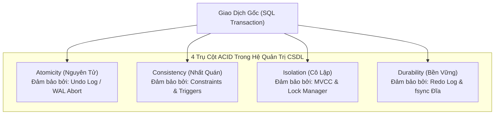
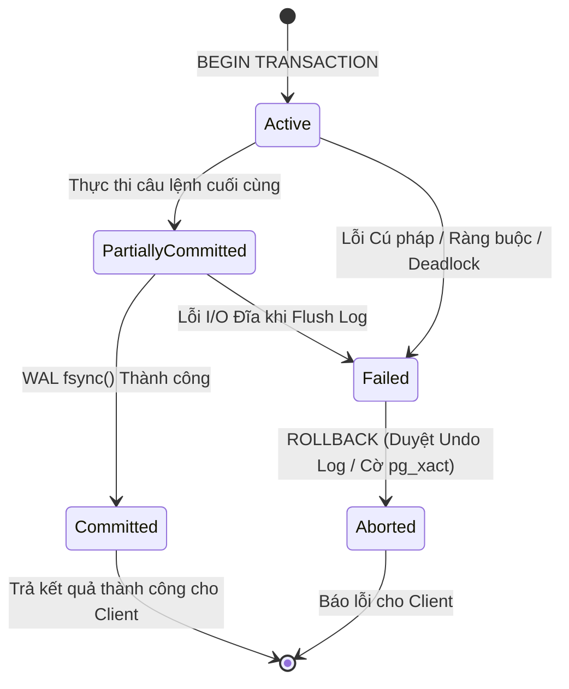
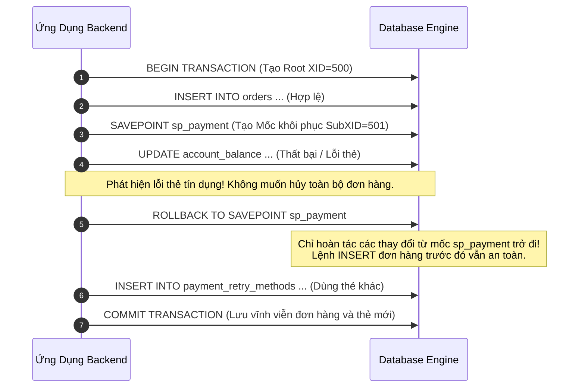

# 7.1. Transaction Fundamentals & ACID (Nguyên lý Giao dịch & Bộ Thuộc tính ACID)

> [!IMPORTANT]
> **Nếu bạn chỉ được nhớ một điều duy nhất:** Giao dịch (Transaction) là sự bảo chứng vững chắc nhất trong kỹ thuật phần mềm: Nguyên tử (Atomicity - Tất cả hoặc Không gì cả), Nhất quán (Consistency - Không vi phạm luật hệ thống), Cô lập (Isolation - Giao dịch song song không dẫm chân nhau), và Bền vững (Durability - Đã commit thì cúp điện dữ liệu vẫn tồn tại); đây là ranh giới phân định một hệ thống tài chính tin cậy với một tập tệp văn bản dễ đổ vỡ.

---

## 1. Đơn giản nhưng phải chi tiết (Intuitive & Deep Breakdown)

### 1.1. Đoạn Code Dẫn Nhập & Vấn Đề Thực Tế
Tại sao 4 chữ cái A-C-I-D (Atomicity, Consistency, Isolation, Durability) lại là tiêu chuẩn vàng định nghĩa sự đáng tin cậy của toàn bộ nền kinh tế số và hệ thống ngân hàng toàn cầu?

```sql
-- Giao dịch chuyển tiền giữa 2 tài khoản: Thử thách 4 thuộc tính ACID
BEGIN TRANSACTION; -- Bắt đầu Transaction

-- [A] Atomicity (Nguyên tử): Nếu máy chủ sập ngay tại đây -> Phải quay về 100% như cũ!
UPDATE accounts SET balance = balance - 500 WHERE id = 10;

-- [C] Consistency (Nhất quán): Kiểm tra CHECK (balance >= 0). Nếu âm -> Abort ngay!
-- [I] Isolation (Cô lập): Người khác đọc số dư của id=10 lúc này vẫn thấy số dư cũ!
UPDATE accounts SET balance = balance + 500 WHERE id = 20;

COMMIT; -- [D] Durability (Bền vững): fsync WAL thành công -> Dữ liệu vĩnh viễn không mất!
```

Nếu một database thiếu đi dù chỉ một chữ cái trong ACID:
- Thiếu **Atomicity**: Bạn mất tiền nhưng người nhận không nhận được.
- Thiếu **Consistency**: Số dư bị âm hoặc vi phạm ràng buộc nghiệp vụ.
- Thiếu **Isolation**: Hai người cùng mua chiếc vé máy bay cuối cùng tại cùng 1 giây (**Double-booking**).
- Thiếu **Durability**: Vừa nhận được thông báo chuyển tiền thành công thì cúp điện, bật máy lên số tiền biến mất!

### 1.2. Ẩn Dụ Đời Sống & Phân Tích Cơ Chế Hoạt Động
4 Thuộc tính ACID giống như **Quy Trình Của Một Ca Phẫu Thuật Ghép Tạng**:
- **A - Atomicity (Tính Nguyên Tử - Tất cả hoặc Không có gì)**: Không thể có chuyện bác sĩ đã rạch bụng và cắt quả thận cũ ra rồi, nhưng đến bước ghép thận mới thì bảo: *"Thôi mệt quá hôm nay làm nửa chừng, khâu lại về nhà ngủ!"*. Hoặc là ca ghép tạng thành công trọn vẹn, hoặc nếu có sự cố thì bệnh nhân phải được hồi phục nguyên trạng như trước ca mổ (**Rollback**)!
- **C - Consistency (Tính Nhất Quán - Giữ Vững Luật Lệ)**: Ca mổ phải tuân thủ nghiêm ngặt nhóm máu và các chỉ số sinh hóa. Không bao giờ được phép ghép quả thận của người nhóm máu A cho người nhóm máu B.
- **I - Isolation (Tính Cô Lập - Phòng Mổ Vô Trùng)**: Phòng mổ đóng kín cửa. Người nhà bệnh nhân đứng ngoài hành lang không được phép nhìn thấy cảnh tượng nội tạng đang dở dang bên trong (**Không nhìn thấy trạng thái trung gian chưa commit**).
- **D - Durability (Tính Bền Vững - Hồ Sơ Bệnh Án Khắc Vào Sổ)**: Khi ca mổ thành công, biên bản phẫu thuật được ký tên công chứng và lưu vào kho lưu trữ quốc gia. Kể cả bệnh viện có bị mất điện thì bệnh nhân vẫn chính thức sở hữu quả thận mới!

### 1.3. Mô Phỏng Dữ Liệu Số Nhỏ Từng Bước (Toy Walkthrough)
Ma trận các cơ chế vật lý dưới nền đảm bảo cho từng chữ cái trong ACID:

| Thuộc Tính ACID | Cơ Chế Hạt Nhân Đảm Bảo (Under-the-Hood) | Khi Nào Được Kích Hoạt? | Hậu Quả Nếu Cơ Chế Bị Lỗi |
| :--- | :--- | :--- | :--- |
| **Atomicity** (Nguyên Tử) | **Undo Log / WAL Rollback Segment** | Khi có lỗi hoặc lệnh `ROLLBACK` | Dữ liệu bị cập nhật dở dang nửa nạc nửa mỡ |
| **Consistency** (Nhất Quán) | **Schema Constraints (FK, CHECK, UNIQUE)** | Kiểm tra ở mỗi câu lệnh ghi và lúc Commit | Dữ liệu rác lọt vào DB, tiền tệ bị âm |
| **Isolation** (Cô Lập) | **2PL (Locking) hoặc MVCC (Snapshot)** | Xuyên suốt thời gian giao dịch đang chạy | Xuất hiện các hiện tượng bóng ma, đọc dữ liệu rác |
| **Durability** (Bền Vững) | **Write-Ahead Log (WAL) + `fsync()`** | Khi giao dịch gọi `COMMIT` | Mất dữ liệu đã xác nhận khi server crash |

### 1.4. Tác Động Thực Tế Tầng Backend & Systems
- **Sự Đánh Đổi Hiệu Năng Giữa ACID và BASE (NoSQL)**: Để đảm bảo ACID tuyệt đối, RDBMS phải trả giá bằng việc ghi nhật ký `fsync()` tuần tự và duy trì các ổ khóa (Locks/Latches). Các hệ thống NoSQL chấp nhận nới lỏng tính chất này theo mô hình BASE (Basically Available, Soft-state, Eventual consistency) để đạt thông lượng hàng triệu writes/giây trên nhiều châu lục.
- **Tính Bền Vững Thư Thái (Relaxed Durability)**: Nếu bạn cấu hình `synchronous_commit = off` (PostgreSQL) hoặc `innodb_flush_log_at_trx_commit = 2` (MySQL), database sẽ không gọi `fsync()` ở mỗi lần commit mà gom lại ghi mỗi giây 1 lần. Hiệu năng ghi tăng gấp 10 lần, nhưng nếu máy chủ bị cúp điện đột ngột, bạn chấp nhận mất tối đa 1 giây dữ liệu giao dịch gần nhất!

### 1.5. Sơ Đồ Tư Duy & Kiến Trúc Hệ Thống (Mermaid)


---

## 2. Chi tiết từng Keyword (Under-the-Hood Deep Dive)

### 2.1. Vòng đời và Ranh giới Giao dịch (Transaction Lifecycle & Boundaries)

#### 1. Máy Trạng Thái Hữu Hạn của Giao dịch (Finite State Machine)
Một giao dịch trong cơ sở dữ liệu chuyển đổi qua 5 trạng thái kinh điển chuẩn mực:



- **1. Active (Đang hoạt động)**: Trạng thái ngay sau lệnh `BEGIN`. Giao dịch thực thi các câu lệnh đọc và ghi. Dữ liệu thay đổi được lưu tạm trên các trang bộ đệm trong RAM (Buffer Pool Dirty Pages).
- **2. Partially Committed (Đã xác nhận một phần)**: Toàn bộ các câu lệnh DML trong giao dịch đã thực thi xong trên ứng dụng, nhưng bản ghi `COMMIT` trong Write-Ahead Log (WAL) **chưa được xả (flush) an toàn xuống bề mặt vật lý của đĩa cứng**. Nếu mất điện tại thời điểm này, giao dịch vẫn bị coi là thất bại!
- **3. Committed (Đã xác nhận hoàn tất)**: Nhật ký ghi nhận giao dịch đã được ghi xuống đĩa cứng bền vững qua lệnh gọi hệ thống `fsync()`. Giao dịch hoàn tất thành công, không thể đảo ngược.
- **4. Failed (Thất bại)**: Xảy ra sự cố trong quá trình chạy: lỗi vi phạm ràng buộc dữ liệu (`Duplicate key`), lỗi cạn kiệt bộ nhớ, hoặc bị hệ thống hủy bỏ do phát hiện bế tắc (Deadlock Victim).
- **5. Aborted (Đã hủy bỏ)**: Toàn bộ các thay đổi của giao dịch đã được hoàn tác hoàn toàn về trạng thái ban đầu bằng cách áp dụng Undo Log hoặc đánh dấu cờ `ABORTED` trong Commit Log.

#### 2. Định Danh Giao Dịch (Transaction ID - XID) & Hiểm Họa XID Wraparound
- Mỗi khi một giao dịch bắt đầu thực hiện thao tác ghi dữ liệu, Database Server sẽ cấp phát cho nó một mã số nguyên định danh duy nhất gọi là **Transaction ID (XID)**.
- **Hiểm họa XID 32-bit trong PostgreSQL**:
  - PostgreSQL sử dụng số nguyên không dấu 32-bit (`uint32`) để lưu XID, cho phép tối đa $2^{32} \approx 4.29$ tỷ giao dịch.
  - Do không gian số là một vòng tròn modulo ($2^{32}$), PostgreSQL quy ước: Một nửa không gian số ($2.1$ tỷ số phía trước) thuộc về "quá khứ", một nửa không gian số ($2.1$ tỷ số phía sau) thuộc về "tương lai".
  - **Thảm họa**: Nếu một cơ sở dữ liệu hoạt động liên tục với lưu lượng cao mà không thực hiện thao tác đóng băng XID (`VACUUM FREEZE`), khi số đếm vượt quá 2.1 tỷ, các giao dịch cũ trong quá khứ sẽ bất ngờ biến thành "tương lai", khiến toàn bộ dữ liệu lịch sử của công ty **biến mất hoàn toàn khỏi tầm nhìn của các câu truy vấn**!
  - Để ngăn chặn thảm họa, PostgreSQL sẽ tự động chuyển sang chế độ `Read-Only` cưỡng bức và từ chối mọi câu lệnh ghi khi XID chạm mốc nguy hiểm.

---

### 2.2. Mổ xẻ Chuyên sâu Từng Thành tố ACID

#### 1. Atomicity (Tính Nguyên tử - Bản chất Cơ học Phục hồi)
Làm thế nào Database Engine có thể khôi phục lại dữ liệu nếu tiến trình bị `kill -9` giữa chừng?
- **Trường phái MySQL InnoDB (Undo Log / Before-Image)**:
  - Khi một dòng dữ liệu được cập nhật: InnoDB sao chép toàn bộ giá trị cũ của dòng đó vào một vùng nhớ đặc biệt gọi là **Undo Segment** trên đĩa.
  - Trong tiêu đề của dòng dữ liệu mới, InnoDB tạo một con trỏ quay ngược (`roll_ptr`) trỏ trực tiếp đến bản ghi Undo Log tương ứng.
  - Nếu giao dịch gọi `ROLLBACK` hoặc máy chủ bị tắt ngang: Engine duyệt theo con trỏ `roll_ptr`, lấy lại giá trị cũ và ghi đè ngược lại vào trang dữ liệu.
- **Trường phái PostgreSQL (Tuple Versioning & pg_xact)**:
  - PostgreSQL không bao giờ ghi đè lên dữ liệu cũ (Append-Only MVCC).
  - Khi cập nhật: Dòng cũ được giữ nguyên, dòng mới được chèn thêm vào trang đĩa kèm theo trường tiêu đề `xmin = current_xid`.
  - Nếu giao dịch thất bại: PostgreSQL **không cần tốn công chạy lại để xóa dòng mới**. Nó chỉ cần đánh dấu trạng thái của `current_xid` là `TRANSACTION_STATUS_ABORTED` trong tệp ánh xạ bit **`pg_xact`** (trước đây là `pg_clog`). Mọi truy vấn trong tương lai khi đọc thấy dòng có `xmin` bị đánh dấu Aborted sẽ tự động coi như dòng đó không tồn tại!

#### 2. Consistency (Tính Nhất quán - Invariants)
- Chữ **C** trong ACID hoàn toàn khác biệt với chữ **C** trong định lý CAP (Linearizability - tính nhất quán đọc sau khi ghi trong hệ thống phân tán).
- Chữ **C** trong ACID đại diện cho **Tính Nhất quán Hợp lệ của Ứng dụng (Application Correctness / Invariants)**:
  - **Ràng buộc Hệ thống (Schema Constraints)**: Khóa chính (Primary Key), Khóa ngoại (Foreign Key), Kiểm tra giá trị (`CHECK balance >= 0`), Cột bắt buộc (`NOT NULL`).
  - **Luật Nghiệp vụ (Business Rules)**: Trong hệ thống đấu giá, người đặt giá sau phải có mức giá cao hơn người đặt giá trước ít nhất 10%; trong hệ thống hàng không, số vé bán ra không được vượt quá số ghế của máy bay.
  - Nếu một giao dịch vi phạm bất kỳ ràng buộc nào, trạng thái toàn vẹn bị đe dọa, hệ thống sẽ kích hoạt hủy bỏ giao dịch để bảo toàn tính đúng đắn.

#### 3. Isolation (Tính Cô lập - Ảo ảnh Thực thi Tuần tự)
- Mục tiêu tối thượng của Isolation là tạo ra một "ảo ảnh hoàn hảo" cho mỗi phiên làm việc: Lập trình viên cảm giác như thể ứng dụng của mình đang là thực thể duy nhất sở hữu toàn bộ cơ sở dữ liệu.
- **Tiêu chuẩn Vàng: Khả năng Tuần tự hóa (Serializability)**:
  - Cho dù có 10,000 giao dịch chạy đan xen song song (Concurrent Interleaving) trên 64 lõi CPU, kết quả trạng thái cuối cùng của cơ sở dữ liệu phải **hoàn toàn đồng nhất** với một trật tự thực thi tuần tự nào đó (Serial Order: $T_1 \rightarrow T_2 \rightarrow T_3$).
- **Đánh đổi Thực tế**: Đạt được Serializability tuyệt đối đòi hỏi chi phí khóa và xung đột giao dịch rất lớn. Do đó, các hệ quản trị cung cấp nhiều cấp độ cô lập thấp hơn như `READ COMMITTED`, `REPEATABLE READ` (sẽ phân tích sâu ở bài 7.3).

#### 4. Durability (Tính Bền vững - Nghệ thuật Ghi Đĩa Bất biến)
- **Nghịch lý Hiệu năng**: Để cơ sở dữ liệu chạy nhanh, các trang dữ liệu (Data Pages 8KB hoặc 16KB) phải được lưu trữ và sửa đổi trên RAM (Buffer Pool). Nhưng nếu máy chủ mất điện, toàn bộ RAM sẽ bị xóa sạch. Nếu mỗi lần commit lại phải ghi hàng chục trang dữ liệu 8KB ngẫu nhiên xuống đĩa SSD, thông lượng hệ thống sẽ tụt xuống chỉ còn vài chục giao dịch/giây!
- **Giải pháp Cứu cánh: Write-Ahead Logging (WAL)**:
  - Thay vì ghi cả trang dữ liệu 8KB ngẫu nhiên, hệ thống chỉ ghi một mẩu nhật ký nhỏ gọn (khoảng 50-100 bytes) mô tả sự thay đổi theo dạng tuần tự (Append-Only Sequential Write).
  - **Quy tắc Bất di bất dịch của WAL**: *Nhật ký WAL mô tả thay đổi bắt buộc phải được xả xuống đĩa cứng bằng lệnh `fsync()` trước khi tín hiệu Commit được trả về cho Client*.
  - Khi máy chủ khởi động lại sau sự cố mất điện: Engine chỉ việc đọc lại WAL và thực hiện cơ chế **Redo (Làm lại)** để tái tạo lại toàn bộ dữ liệu trên các trang RAM đã bị mất.

---

### 2.3. Autocommit, Savepoints & Nested Transactions

#### 1. Chi phí Vận hành Ẩn của Chế độ Autocommit
- Trong hầu hết các thư viện kết nối (JDBC, Node.js `pg`, Python `psycopg2`), chế độ `autocommit` thường được kích hoạt theo mặc định.
- Khi đó, mỗi câu lệnh SQL đơn lẻ:
  ```sql
  INSERT INTO logs (message) VALUES ('Request processed');
  ```
  Sẽ được bọc ngầm trong một chu trình:
  $$\text{BEGIN} \longrightarrow \text{Execute SQL} \longrightarrow \text{COMMIT (Gọi lệnh fsync() xuống đĩa!)}$$
- **Hậu quả Hiệu năng**: Nếu bạn thực hiện một vòng lặp 5,000 lần `INSERT` trong ứng dụng, ổ đĩa SSD phải thực hiện 5,000 lần đồng bộ I/O vật lý. Thời gian thực thi mất tới **30 giây**.
- **Tối ưu**: Gom toàn bộ 5,000 câu lệnh vào trong **DUY NHẤT MỘT** khối giao dịch tường minh (`BEGIN ... COMMIT`). Toàn bộ 5,000 thao tác chỉ tốn đúng **1 lần gọi `fsync()` duy nhất**, thời gian giảm xuống còn **0.08 giây (Nhanh hơn 375 lần!)**.

#### 2. Savepoints & Bản chất Giao dịch Lồng nhau (Nested Transactions)
Chuẩn SQL không hỗ trợ giao dịch lồng nhau thực sự (True Nested Transactions với cây phân cấp độc lập). Thay vào đó, RDBMS hiện thực hóa tính năng này thông qua **Điểm Khôi phục (Savepoints)**:



- **Cơ chế Nội tại của Savepoint**:
  - Khi gọi `SAVEPOINT sp1`: Engine cấp phát một định danh giao dịch con (**Subtransaction ID - SubXID**).
  - Vị trí hiện tại của con trỏ nhật ký WAL và kích thước danh sách Undo Log được ghi nhớ lại.
  - Khi gọi `ROLLBACK TO SAVEPOINT sp1`: Engine chỉ việc duyệt ngược Undo Log để hoàn tác dữ liệu trở về đúng vị trí con trỏ đã lưu mà không làm ảnh hưởng đến các câu lệnh chạy trước Savepoint.

---

### 2.4. Khái quát Giao dịch Phân tán (Distributed Transactions)

Khi dữ liệu được phân mảnh (Sharding) hoặc lưu trữ trên nhiều máy chủ vật lý độc lập (Microservices Architecture, Google Spanner, CockroachDB):
- **Vấn đề Cốt lõi**: Mỗi máy chủ có CPU, RAM và ổ cứng riêng biệt. Làm sao để bảo đảm tính chất Atomicity khi Node A commit thành công nhưng Node B bị sập mạng ngay tại thời điểm ghi đĩa?
- **Giao thức Cam kết Hai Pha (Two-Phase Commit - 2PC)**:
  - **Pha 1 (Prepare Phase)**: Bộ điều phối (Coordinator) gửi thông điệp `PREPARE` tới tất cả các Node tham gia (Participants). Các Node kiểm tra ràng buộc, ghi Redo/Undo log xuống đĩa và khóa tài nguyên, sau đó phản hồi `VOTE_COMMIT` hoặc `VOTE_ABORT`.
  - **Pha 2 (Commit Phase)**: Nếu $100\%$ các Node phản hồi đồng ý, Coordinator xả bản ghi commit và gửi lệnh `GLOBAL_COMMIT`. Các Node chính thức xác nhận dữ liệu. Nếu có bất kỳ Node nào từ chối, Coordinator gửi lệnh `GLOBAL_ABORT`.
- **Nhược điểm Chí mạng của 2PC**: Là giao thức **chặn hoàn toàn (Blocking Protocol)**. Nếu Coordinator bị sập nguồn đúng lúc tất cả các Participant đang ở trạng thái `Prepared`, toàn bộ các hàng dữ liệu trên tất cả các node sẽ **bị khóa vô thời hạn**, khiến hệ thống phân tán rơi vào bế tắc hoàn toàn.

---

## 3. Thực thi Mã nguồn & Mô phỏng Chuyên sâu (Dual-Engine Implementation)

### 1. Động cơ C++20: Mô phỏng Transaction Manager Chuẩn RAII với WAL và Savepoints

Chương trình C++20 dưới đây triển khai cơ chế quản lý giao dịch chuẩn công nghiệp áp dụng mẫu thiết kế RAII (Resource Acquisition Is Initialization), tự động khôi phục an toàn (Rollback) khi có lỗi ngoại lệ và hỗ trợ đa cấp Savepoints:

```cpp
// compile: g++ -std=c++20 -O3 transaction_manager.cpp -o tx_mgr
#include <iostream>
#include <vector>
#include <string>
#include <unordered_map>
#include <memory>
#include <stdexcept>
#include <format>

// Cấu trúc đại diện cho một bản ghi Undo Log (Before-Image)
struct UndoRecord {
    std::string key;
    std::string old_value;
    bool was_deleted;
};

// Động cơ Lưu trữ In-Memory mô phỏng ACID
class StorageEngine {
private:
    std::unordered_map<std::string, std::string> table;
public:
    void set(const std::string& key, const std::string& val) {
        table[key] = val;
    }
    std::string get(const std::string& key) const {
        auto it = table.find(key);
        return it != table.end() ? it->second : "NULL";
    }
    bool exists(const std::string& key) const {
        return table.find(key) != table.end();
    }
    void erase(const std::string& key) {
        table.erase(key);
    }
    void print_state() const {
        std::cout << "  [Current DB State]: ";
        for (const auto& [k, v] : table) {
            std::cout << "{" << k << ": " << v << "} ";
        }
        std::cout << "\n";
    }
};

// Quản lý Vòng đời Giao dịch với Undo Log & Savepoints
class TransactionContext {
private:
    StorageEngine& engine;
    uint64_t xid;
    bool is_active = false;
    bool is_committed = false;
    std::vector<UndoRecord> undo_log;
    std::unordered_map<std::string, size_t> savepoints; // Name -> Index in undo_log

public:
    TransactionContext(StorageEngine& eng, uint64_t tx_id) 
        : engine(eng), xid(tx_id), is_active(true) {
        std::cout << std::format("[TX #{}] BEGIN TRANSACTION\n", xid);
    }

    void write(const std::string& key, const std::string& new_val) {
        if (!is_active) throw std::runtime_error("Giao dịch không hoạt động!");
        
        // Ghi lại Before-Image vào Undo Log trước khi sửa dữ liệu (Atomicity)
        UndoRecord record;
        record.key = key;
        if (engine.exists(key)) {
            record.old_value = engine.get(key);
            record.was_deleted = false;
        } else {
            record.old_value = "";
            record.was_deleted = true;
        }
        undo_log.push_back(record);

        // Áp dụng giá trị mới lên bộ nhớ
        engine.set(key, new_val);
        std::cout << std::format("  -> TX #{} SET '{}' = '{}' (Undo logged)\n", xid, key, new_val);
    }

    void create_savepoint(const std::string& name) {
        savepoints[name] = undo_log.size();
        std::cout << std::format("  -> TX #{} SAVEPOINT '{}' created\n", xid, name);
    }

    void rollback_to_savepoint(const std::string& name) {
        auto it = savepoints.find(name);
        if (it == savepoints.end()) {
            throw std::runtime_error("Savepoint không tồn tại: " + name);
        }

        size_t target_idx = it->second;
        std::cout << std::format("  ⚠️ TX #{} ROLLBACK TO SAVEPOINT '{}' (Reverting changes)...\n", xid, name);
        
        // Hoàn tác các bản ghi từ cuối về target_idx
        while (undo_log.size() > target_idx) {
            const auto& rec = undo_log.back();
            if (rec.was_deleted) {
                engine.erase(rec.key);
            } else {
                engine.set(rec.key, rec.old_value);
            }
            undo_log.pop_back();
        }
    }

    void commit() {
        if (!is_active) return;
        std::cout << std::format("[TX #{}] COMMIT TRANSACTION (WAL Flush simulated via fsync)\n", xid);
        is_committed = true;
        is_active = false;
        undo_log.clear();
        savepoints.clear();
    }

    void rollback() {
        if (!is_active || is_committed) return;
        std::cout << std::format("🚨 [TX #{}] ROLLBACK TRANSACTION! (Applying full Undo Log)...\n", xid);
        
        // Duyệt ngược toàn bộ Undo Log để hoàn tác dữ liệu
        for (auto it = undo_log.rbegin(); it != undo_log.rend(); ++it) {
            if (it->was_deleted) {
                engine.erase(it->key);
            } else {
                engine.set(it->key, it->old_value);
            }
        }
        undo_log.clear();
        savepoints.clear();
        is_active = false;
    }

    ~TransactionContext() {
        // Tự động Rollback nếu đối tượng bị hủy (do Exception) mà chưa gọi Commit (RAII Guarantee)
        if (is_active && !is_committed) {
            rollback();
        }
    }
};

int main() {
    StorageEngine db;
    db.set("acc_A", "1000");
    db.set("acc_B", "500");
    std::cout << "=== TRẠNG THÁI KHỞI ĐẦU ===\n";
    db.print_state();
    std::cout << "---------------------------------------------------------\n";

    // KỊCH BẢN 1: Giao dịch thành công có sử dụng Savepoint
    {
        std::cout << "\n--- KỊCH BẢN 1: Chuyển tiền và Phục hồi Savepoint ---\n";
        TransactionContext tx1(db, 101);
        tx1.write("acc_A", "900"); // Trừ 100
        tx1.write("acc_B", "600"); // Cộng 100
        
        tx1.create_savepoint("sp_fee");
        tx1.write("acc_A", "850"); // Thử trừ thêm phí dịch vụ 50
        
        // Giả sử phát hiện người dùng có mã miễn phí dịch vụ -> Rollback Savepoint!
        tx1.rollback_to_savepoint("sp_fee");
        tx1.commit();
    }
    db.print_state();
    std::cout << "---------------------------------------------------------\n";

    // KỊCH BẢN 2: Giao dịch ném lỗi ngoại lệ -> Tự động Rollback qua RAII
    try {
        std::cout << "\n--- KỊCH BẢN 2: Lỗi Nghiệp Vụ Phát Sinh -> Tự Động Rollback RAII ---\n";
        TransactionContext tx2(db, 102);
        tx2.write("acc_A", "100"); // Trừ tiền tài khoản A
        
        // Mô phỏng lỗi logic nghiệp vụ
        throw std::runtime_error("Tài khoản thụ hưởng B bị khóa do nghi vấn gian lận!");
        
        tx2.write("acc_B", "1400");
        tx2.commit(); // Dòng này không bao giờ được gọi
    } catch (const std::exception& e) {
        std::cout << "  [Ứng dụng Bắt Ngoại Lệ]: " << e.what() << "\n";
    }

    std::cout << "\n=== TRẠNG THÁI CUỐI CÙNG SAU ROLLBACK ===\n";
    db.print_state();
    std::cout << "=========================================================\n";
    return 0;
}
```

---

### 2. Động cơ Python 3.11+: Mô phỏng Xâm Phạm Tính Nhất Quán (Race Condition vs ACID)

Script Python dưới đây mô phỏng kịch bản đa luồng chuyển tiền ngân hàng: chứng minh tại sao thiếu giao dịch (Non-ACID) sẽ làm bốc hơi tiền của hệ thống do xung đột tranh chấp (Lost Update):

```python
#!/usr/bin/env python3
"""
Mô phỏng Xung Đột Tương Tranh và Bảo Toàn Invariants trong Ngân Hàng (ACID Consistency).
Môi trường yêu cầu: Python 3.11+
"""

import threading
import time
from typing import Dict

class BankDatabase:
    def __init__(self):
        self.accounts: Dict[str, int] = {"Alice": 10_000, "Bob": 10_000}
        self.lock = threading.Lock()

    def get_total_balance(self) -> int:
        return sum(self.accounts.values())

    def transfer_unsafe(self, sender: str, receiver: str, amount: int):
        """Thực thi KHÔNG CÓ Transaction / Isolation (Gây mất mát dữ liệu)."""
        current_sender = self.accounts[sender]
        time.sleep(0.0001) # Mô phỏng độ trễ I/O làm xen kẽ luồng
        self.accounts[sender] = current_sender - amount
        
        current_receiver = self.accounts[receiver]
        time.sleep(0.0001)
        self.accounts[receiver] = current_receiver + amount

    def transfer_acid(self, sender: str, receiver: str, amount: int):
        """Thực thi CÓ Khóa Cách Ly (Bảo đảm Atomicity & Consistency)."""
        with self.lock:
            if self.accounts[sender] < amount:
                raise ValueError(f"Tài khoản {sender} không đủ số dư!")
            self.accounts[sender] -= amount
            self.accounts[receiver] += amount

def run_concurrent_transfers(use_acid: bool):
    bank = BankDatabase()
    initial_total = bank.get_total_balance()
    threads = []
    num_transfers = 50
    transfer_amount = 100

    print("=" * 65)
    print(f"BẮT ĐẦU MÔ PHỎNG ĐA LUỒNG (ACID ENABLED = {use_acid})")
    print(f"Tổng tài sản ban đầu: ${initial_total:,}")
    print("=" * 65)

    def worker_a_to_b():
        for _ in range(num_transfers):
            if use_acid:
                bank.transfer_acid("Alice", "Bob", transfer_amount)
            else:
                bank.transfer_unsafe("Alice", "Bob", transfer_amount)

    def worker_b_to_a():
        for _ in range(num_transfers):
            if use_acid:
                bank.transfer_acid("Bob", "Alice", transfer_amount)
            else:
                bank.transfer_unsafe("Bob", "Alice", transfer_amount)

    t1 = threading.Thread(target=worker_a_to_b)
    t2 = threading.Thread(target=worker_b_to_a)

    t1.start()
    t2.start()
    t1.join()
    t2.join()

    final_total = bank.get_total_balance()
    diff = final_total - initial_total
    print(f"Số dư cuối cùng: Alice = ${bank.accounts['Alice']:,} | Bob = ${bank.accounts['Bob']:,}")
    print(f"Tổng tài sản sau 100 giao dịch: ${final_total:,}")
    
    if diff != 0:
        print(f"🚨 [VI PHẠM TÍNH NHẤT QUÁN C] Tiền bị lệch mất: ${diff:,} do Race Condition!")
    else:
        print("✅ [TÍNH NHẤT QUÁN TOÀN VẸN] Tổng tiền bảo toàn 100% nhờ ACID Isolation!")

if __name__ == "__main__":
    # Test 1: Chạy không an toàn (Xâm phạm ACID)
    run_concurrent_transfers(use_acid=False)
    print("\n")
    # Test 2: Chạy với ACID
    run_concurrent_transfers(use_acid=True)
```

---

### 3. Kết quả Thực thi Terminal Mẫu Chuẩn Thực tế

```bash
$ g++ -std=c++20 -O3 transaction_manager.cpp -o tx_mgr
$ ./tx_mgr
=== TRẠNG THÁI KHỞI ĐẦU ===
  [Current DB State]: {acc_B: 500} {acc_A: 1000} 
---------------------------------------------------------

--- KỊCH BẢN 1: Chuyển tiền và Phục hồi Savepoint ---
[TX #101] BEGIN TRANSACTION
  -> TX #101 SET 'acc_A' = '900' (Undo logged)
  -> TX #101 SET 'acc_B' = '600' (Undo logged)
  -> TX #101 SAVEPOINT 'sp_fee' created
  -> TX #101 SET 'acc_A' = '850' (Undo logged)
  ⚠️ TX #101 ROLLBACK TO SAVEPOINT 'sp_fee' (Reverting changes)...
[TX #101] COMMIT TRANSACTION (WAL Flush simulated via fsync)
  [Current DB State]: {acc_B: 600} {acc_A: 900} 
---------------------------------------------------------

--- KỊCH BẢN 2: Lỗi Nghiệp Vụ Phát Sinh -> Tự Động Rollback RAII ---
[TX #102] BEGIN TRANSACTION
  -> TX #102 SET 'acc_A' = '100' (Undo logged)
🚨 [TX #102] ROLLBACK TRANSACTION! (Applying full Undo Log)...
  [Ứng dụng Bắt Ngoại Lệ]: Tài khoản thụ hưởng B bị khóa do nghi vấn gian lận!

=== TRẠNG THÁI CUỐI CÙNG SAU ROLLBACK ===
  [Current DB State]: {acc_B: 600} {acc_A: 900} 
=========================================================

$ python3 acid_bank_sim.py
=================================================================
BẮT ĐẦU MÔ PHỎNG ĐA LUỒNG (ACID ENABLED = False)
Tổng tài sản ban đầu: $20,000
=================================================================
Số dư cuối cùng: Alice = $9,400 | Bob = $10,200
Tổng tài sản sau 100 giao dịch: $19,600
🚨 [VI PHẠM TÍNH NHẤT QUÁN C] Tiền bị lệch mất: $-400 do Race Condition!


=================================================================
BẮT ĐẦU MÔ PHỎNG ĐA LUỒNG (ACID ENABLED = True)
Tổng tài sản ban đầu: $20,000
=================================================================
Số dư cuối cùng: Alice = $10,000 | Bob = $10,000
Tổng tài sản sau 100 giao dịch: $20,000
✅ [TÍNH NHẤT QUÁN TOÀN VẸN] Tổng tiền bảo toàn 100% nhờ ACID Isolation!
```

---

## 4. Systems Engineering & Production Pitfalls

### 1. Hiểm Họa "Long-Running Transactions" & Phình To Bảng (Table Bloat)
- **Cơ chế Nguy hiểm**: Khi một giao dịch mở ra (`BEGIN`) và bị treo (ví dụ lập trình viên gọi HTTP sang cổng thanh toán Stripe mất 10 giây):
- Trong PostgreSQL, giao dịch này giữ một ảnh chụp bộ nhớ cũ (Snapshot Horizon) với `xmin` cổ nhất.
- Tiến trình tự động dọn rác **Autovacuum bị tê liệt hoàn toàn**: Nó không được phép xóa bất kỳ bản ghi chết (Dead Tuples) nào có `xmax >= xmin` của giao dịch treo đó!
- **Hậu quả**: Hàng triệu dòng dữ liệu cập nhật sau đó tích tụ thành rác, bảng phình to gấp 10 lần (`Table Bloat`), bộ đệm RAM bị chiếm dụng sạch, dung lượng đĩa cạn kiệt.
- **Phát hiện & Tiêu diệt qua SQL**:
  ```sql
  -- Tìm các giao dịch mở quá 5 phút:
  SELECT pid, now() - xact_start AS duration, state, query 
  FROM pg_stat_activity 
  WHERE state IN ('idle in transaction', 'active') 
    AND now() - xact_start > interval '5 minutes';

  -- Cưỡng chế ngắt kết nối (Kill connection):
  SELECT pg_terminate_backend(pid);
  ```

### 2. Cạm Bẫy Thực Thi Cuộc Gọi Mạng Bên Trong Khối Giao Dịch
- **Lỗi Lập Trình Viên Thường Gặp**:
  ```python
  with db.transaction():
      order = create_order()
      # NGUY HIỂM CHẾT NGƯỜI: Gọi API bên ngoài trong Transaction!
      payment_res = requests.post("https://payment-gateway.com/charge", timeout=30)
      if payment_res.status_code == 200:
          mark_order_paid(order.id)
  ```
- Nếu cổng thanh toán bị treo 30 giây: Cơ sở dữ liệu sẽ giữ khóa hàng (Row Exclusive Locks) trên bảng `orders` trong suốt 30 giây. Hàng trăm người dùng khác cố gắng sửa đổi hoặc mua hàng sẽ bị nghẽn (Lock Wait Queue), làm kiệt quệ toàn bộ Connection Pool của hệ thống!
- **Quy tắc Bất di bất dịch**:
  1. Tuyệt đối không bao giờ thực hiện Network I/O (HTTP, gRPC, gửi Email, gửi Kafka) bên trong một Database Transaction.
  2. Thực hiện thanh toán trước, sau đó mới mở Transaction để lưu kết quả vào Database trong vài mili-giây.

---

## 5. Bảng So sánh & Decision Matrix

### Ma trận Quản lý Bộ đệm: Steal / No-Steal vs Force / No-Force

Trong khoa học máy tính về hệ thống cơ sở dữ liệu (Haerder & Reuter, 1983), thiết kế bộ đệm RAM (Buffer Pool) và cơ chế ACID được định nghĩa qua ma trận 4 trạng thái kinh điển:

| Thuộc tính Bộ đệm | Định nghĩa Kỹ thuật | Tác động lên Hiệu năng Ghi | Yêu cầu Kỹ thuật Thuật toán Khôi phục |
| :--- | :--- | :--- | :--- |
| **STEAL** | Cho phép hệ thống ghi trang đĩa bẩn (Dirty Page) của một giao dịch **chưa commit** xuống đĩa để giải phóng RAM cho giao dịch khác. | **Hiệu năng cực cao**, tận dụng RAM tối đa. | **Bắt buộc phải có UNDO LOG** để hoàn tác dữ liệu nếu giao dịch sau đó bị Abort. |
| **NO-STEAL** | Nghiêm cấm ghi dữ liệu chưa commit xuống đĩa. Toàn bộ dữ liệu bẩn phải giữ trong RAM. | Hiệu năng kém, dễ tràn RAM nếu giao dịch lớn. | Không cần Undo Log cho Crash Recovery. |
| **FORCE** | Bắt buộc phải xả (flush) toàn bộ các trang dữ liệu bảng thực tế xuống đĩa trước khi cho phép giao dịch Commit. | **Hiệu năng cực kỳ tệ hại**, gây ngập lụt Random I/O trên đĩa. | Không cần Redo Log cho các giao dịch đã commit. |
| **NO-FORCE** | Cho phép giao dịch Commit mà **không cần ghi trang dữ liệu bảng xuống đĩa**, chỉ cần ghi mẩu nhật ký nhỏ vào WAL. | **Hiệu năng tối thượng**, chuẩn mực của mọi RDBMS hiện đại! | **Bắt buộc phải có REDO LOG (WAL)** để làm lại dữ liệu khi khởi động lại sau crash. |

> [!NOTE]
> Mọi hệ cơ sở dữ liệu quan hệ sản xuất hàng đầu thế giới (PostgreSQL, MySQL InnoDB, Oracle, SQL Server) đều sử dụng mô hình kiến trúc: **STEAL + NO-FORCE**. Đây chính là lý do vì sao cơ chế Undo Log và Redo Log (WAL) là hai thành phần sinh tử không thể tách rời trong kiến trúc nhân CSDL!

---

## 6. Enterprise Production Checklist & Verification

### 6.1. Kiến Trúc & Cấu Hình Tối Ưu (Production-Ready Architecture)
- [ ] **Bảo Toàn Durability Tuyệt Đối Cho Dữ Liệu Tài Chính**: Luôn giữ nguyên `synchronous_commit = on` (PostgreSQL) và `innodb_flush_log_at_trx_commit = 1` (MySQL) cho các cơ sở dữ liệu xử lý tiền tệ, thanh toán và đơn hàng.
- [ ] **Cân Nhắc Tắt Sync Commit Cho Dữ Liệu Logs / Analytics**: Nếu lưu trữ log sự kiện clickstream hoặc sensor IoT, có thể thiết lập `synchronous_commit = off` cho session đó để tăng gấp 5 lần tốc độ ghi.
- [ ] **Khai Báo Toàn Bộ Ràng Buộc Nhất Quán Tại Database**: Không phụ thuộc vào tầng ứng dụng; khai báo đầy đủ các ràng buộc `NOT NULL`, `CHECK`, `FOREIGN KEY` để bảo đảm tính Consistency cấp phần cứng.
- [ ] **Thiết Kế Idempotent Transactions Ở Tầng Backend**: Luôn gắn mã định danh giao dịch duy nhất (`transaction_id`) từ client để nếu kết nối mạng bị rớt khi đang commit, client có thể an toàn gọi lại mà không bị thực thi hai lần.

### 6.2. Giám Sát, Cảnh Báo & Xử Lý Sự Cố (Observability & Incident Response)
- [ ] **Giám Sát Tỷ Lệ Transaction Rollback**: Theo dõi metric `pg_stat_database.xact_rollback / (xact_commit + xact_rollback)`; cảnh báo khi tỷ lệ rollback vượt quá 2% (dấu hiệu xung đột khóa hoặc lỗi ứng dụng).
- [ ] **Cảnh Báo Đĩa I/O Bị Quá Tải Do fsync**: Đo lường thời gian thực hiện syscall `fsync` trên ổ đĩa WAL; cảnh báo khi độ trễ ghi WAL vượt quá 10ms.
- [ ] **Kiểm Tra Tính Nhất Quán Bằng Khảo Sát Tự Động**: Định kỳ chạy các truy vấn kiểm toán (Audit Queries: ví dụ Tổng tiền nạp - Tổng tiền rút = Số dư hiện tại) để xác thực tính nhất quán toàn vẹn của sổ cái.
