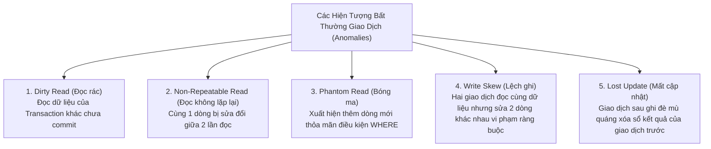
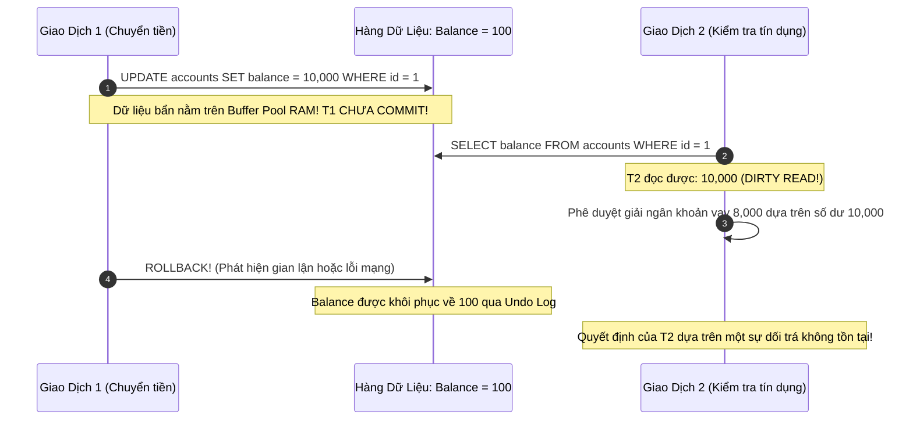
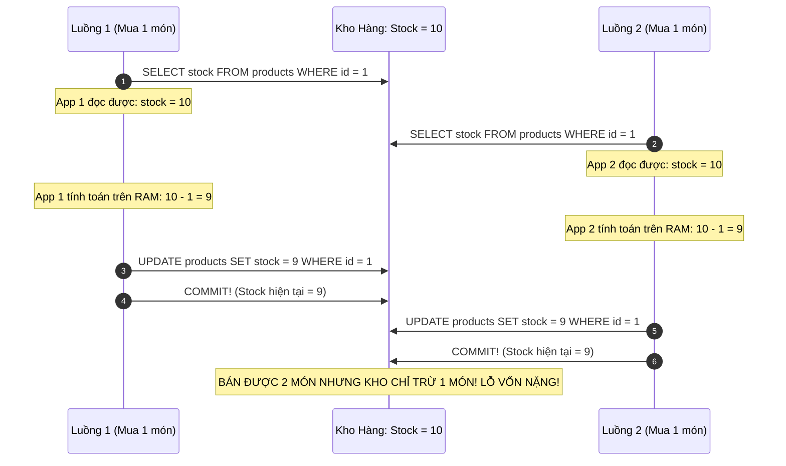
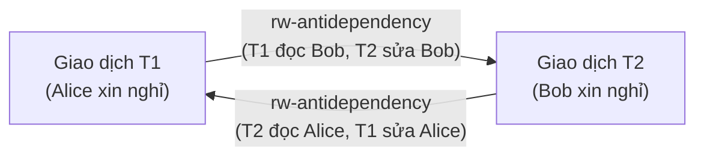

# 7.2. Transaction Anomalies (Các Dị thường Giao dịch trong Tương tranh)

> [!IMPORTANT]
> **Nếu bạn chỉ được nhớ một điều duy nhất:** Khi nhiều giao dịch chạy song song mà không có cơ chế cách ly hoàn hảo, 5 dị thường dữ liệu nguy hiểm sẽ xuất hiện: Dirty Read (đọc dữ liệu chưa commit của giao dịch khác), Non-Repeatable Read (đọc lại cùng dòng thấy giá trị đổi), Phantom Read (đọc lại thấy xuất hiện dòng mới lọt vào), Lost Update (ghi đè làm mất dữ liệu của nhau), và Write Skew (vi phạm bất biến chung do đọc hai tập dữ liệu độc lập).

---

## 1. Đơn giản nhưng phải chi tiết (Intuitive & Deep Breakdown)

### 1.1. Đoạn Code Dẫn Nhập & Vấn Đề Thực Tế
Chuyện gì sẽ xảy ra khi hai giao dịch chạy song song cùng lúc mà không có sự cô lập hoàn hảo, và tại sao một giao dịch có thể nhìn thấy dữ liệu "ma quái" chưa từng được lưu vào đĩa cứng?

```sql
-- Hiện tượng Đọc Dữ Liệu Bẩn (Dirty Read - Thảm họa cấp độ 1)
-- Giao dịch 1 (Kẻ gian lận):
BEGIN;
UPDATE accounts SET balance = balance + 1000000000 WHERE id = 99; -- Sửa tạm trong RAM

-- Giao dịch 2 (Nhân viên giải ngân - Chạy đồng thời ở mức READ UNCOMMITTED):
BEGIN;
SELECT balance FROM accounts WHERE id = 99; -- Đọc thấy: 1,000,000,000 đồng!
-- Nhân viên bấm nút duyệt giải ngân cho khách rút tiền mặt!

-- Giao dịch 1 (Hủy bỏ ngay sau đó):
ROLLBACK; -- Số dư 1 tỷ bốc hơi như chưa từng tồn tại!
-- Hậu quả: Ngân hàng mất trắng 1 tỷ đồng vì đọc dữ liệu của giao dịch bị Rollback!
```

Hiện tượng **Dirty Read** (Đọc rác), **Non-Repeatable Read** (Đọc lại thấy số liệu đổi khác), và **Phantom Read** (Đọc lại thấy xuất hiện thêm dòng mới) là những bất thường đồng thời kinh điển có thể phá hủy hoàn toàn tính chính xác của dữ liệu doanh nghiệp!

### 1.2. Ẩn Dụ Đời Sống & Phân Tích Cơ Chế Hoạt Động
Các Hiện Tượng Bất Thường Giao Dịch giống như **Những Trò Đùa Tinh Quái Trong Cuộc Sống**:
- **Dirty Read (Nhìn Trộm Bản Nháp Sắp Bị Vứt)**: Bạn nhìn trộm vào cuốn sổ nháp của bạn cùng bàn, thấy bạn ấy ghi đáp án câu 1 là `A`. Bạn vội vàng chép vào bài thi của mình. Nhưng 1 giây sau, bạn ấy gạch bỏ chữ `A` vì phát hiện tính nhầm và chọn đáp án `B`! Bạn đã bị "Đọc bẩn" một thứ không hề tồn tại!
- **Non-Repeatable Read (Món Hàng Bị Đổi Giá Giữa Hai Lần Nhìn)**: Bạn bước vào siêu thị, nhìn thấy chiếc áo giá 100k. Bạn quay sang hỏi vợ có nên mua không (mất 5 giây). Khi quay lại nhìn chiếc áo lần thứ hai, nhân viên vừa dán chiếc tem giá mới: 200k! Trong cùng một chuyến đi chợ, bạn nhìn 1 món hàng 2 lần lại thấy 2 mức giá khác nhau!
- **Phantom Read (Bóng Ma Xuất Hiện Giữa Chừng)**: Thầy giáo đếm sĩ số lớp: *"Lớp có 40 học sinh"*. Thầy quay lên bảng viết phấn. Một học sinh đi học muộn lẻn vào cửa sau ngồi xuống. Thầy quay lại đếm lại: *"Ủa sao tự nhiên thành 41 học sinh?"*. Người học sinh mới chui vào như một "bóng ma" xuất hiện giữa hai lần đếm!
- **Write Skew (Hai Bác Sĩ Cùng Xin Nghỉ Trực)**: Bệnh viện có quy định: *"Luôn phải có ít nhất 1 bác sĩ trực ban"*. Hiện có Bác sĩ A và B. Cả hai cùng mở máy tính, thấy có 2 người đang trực. Cả hai cùng gửi đơn xin nghỉ trực tại cùng 1 giây. Kết quả: Cả hai đơn đều được duyệt và bệnh viện không còn một bác sĩ nào trực ban!

### 1.3. Mô Phỏng Dữ Liệu Số Nhỏ Từng Bước (Toy Walkthrough)
Mô phỏng hiện tượng Write Skew (Bất thường tinh vi nhất không thể giải quyết bằng Snapshot Isolation thông thường):

Quy tắc nghiệp vụ: Tổng số dư hai tài khoản $\text{Acc}_1 + \text{Acc}_2 \ge 0$. Khách hàng được phép rút tiền miễn sao tổng không âm.
Hiện trạng ban đầu: $\text{Acc}_1 = \$100$, $\text{Acc}_2 = \$100$ (Tổng = \$200).

| Thời Điểm | Giao Dịch $T_1$ (Rút \$150 từ $\text{Acc}_1$) | Giao Dịch $T_2$ (Rút \$150 từ $\text{Acc}_2$) | Nhận Định Của Giao Dịch | Kết Quả Thực Tế Sau Commit |
| :---: | :--- | :--- | :--- | :--- |
| $T_0$ | `BEGIN;` | `BEGIN;` | Cả hai đọc Snapshot: $\text{Acc}_1=100, \text{Acc}_2=100$ | Tổng hiện tại = \$200 |
| $T_1$ | Kiểm tra: $200 - 150 = 50 \ge 0$ (Hợp lệ!) | - | $T_1$ thấy thỏa mãn quy tắc | Chuẩn bị trừ tiền |
| $T_2$ | - | Kiểm tra: $200 - 150 = 50 \ge 0$ (Hợp lệ!) | $T_2$ cũng thấy thỏa mãn! | Chuẩn bị trừ tiền |
| $T_3$ | `UPDATE Acc1 = 100 - 150 = -50;` | - | $T_1$ chỉ sửa $\text{Acc}_1$ | Ghi vào DB |
| $T_4$ | - | `UPDATE Acc2 = 100 - 150 = -50;` | $T_2$ chỉ sửa $\text{Acc}_2$ (Không tranh chấp khóa!)| Ghi vào DB |
| $T_5$ | `COMMIT;` | `COMMIT;` | **CẢ HAI CÙNG COMMIT THÀNH CÔNG!** | - |
| **KẾT QUẢ** | $\text{Acc}_1 = -\$50$ | $\text{Acc}_2 = -\$50$ | **TỔNG = -\$100 (VI PHẠM QUY TẮC NGHIỆP VỤ!)** | **Bất Thường Write Skew Xảy Ra!** |

### 1.4. Tác Động Thực Tế Tầng Backend & Systems
- **Mức Độ Cô Lập Mặc Định Của Các Hệ Quản Trị CSDL**:
  - PostgreSQL mặc định là **Read Committed**: Chống được Dirty Read, nhưng VẪN BỊ Non-Repeatable Read và Phantom Read!
  - MySQL InnoDB mặc định là **Repeatable Read**: Nhờ cơ chế Gap Locking, InnoDB chống được cả Dirty Read, Non-Repeatable Read và Phantom Read trong hầu hết các trường hợp!
- **Giải Pháp Cho Write Skew**: Để ngăn chặn Write Skew, hệ thống bắt buộc phải nâng mức cô lập lên **Serializable** (Tuần tự hóa hoàn toàn), hoặc sử dụng câu lệnh khóa chọn lọc tường minh: `SELECT * FROM accounts WHERE user_id = ... FOR UPDATE;` (Pessimistic Locking).

### 1.5. Sơ Đồ Tư Duy & Kiến Trúc Hệ Thống (Mermaid)


---

## 2. Chi tiết từng Keyword (Under-the-Hood Deep Dive)

### 2.1. Dirty Read (Đọc Rác / Đọc Dữ liệu Chưa Commit - G1)

#### 1. Ký hiệu Toán học của Lịch trình Thực thi (Schedule Formalism)
Theo nghiên cứu của Berenson (1995), hiện tượng Đọc Rác mở rộng $G_1$ được định nghĩa qua chuỗi thao tác:
$$w_1[x] \dots r_2[x] \dots (a_1 \text{ and } c_2 \text{ in any order})$$
Trong đó:
- $w_1[x]$: Giao dịch $T_1$ ghi dữ liệu lên bản ghi $x$.
- $r_2[x]$: Giao dịch $T_2$ đọc dữ liệu của bản ghi $x$ do $T_1$ vừa sửa.
- $a_1$: $T_1$ bị hủy bỏ (`ROLLBACK / ABORT`).
- $c_2$: $T_2$ xác nhận thành công (`COMMIT`).



#### 2. Dị thường Dirty Write (Ghi Rác - G0)
- Ký hiệu: $w_1[x] \dots w_2[x] \dots (a_1 \text{ or } a_2)$.
- Xảy ra khi $T_2$ ghi đè lên dữ liệu chưa commit của $T_1$. Nếu $T_1$ abort và quay về giá trị cũ, nó sẽ xóa sạch cả thay đổi của $T_2$.
- Mọi hệ quản trị cơ sở dữ liệu trên thế giới (ngay cả ở mức cô lập thấp nhất `READ UNCOMMITTED`) **đều nghiêm cấm Dirty Write** bằng cách luôn giữ Khóa Ghi độc quyền (Exclusive Locks - X-Lock) cho đến khi giao dịch kết thúc.

---

### 2.2. Non-Repeatable Read (Đọc Không Lặp lại / Fuzzy Read - G2a)

#### 1. Bản chất Kỹ thuật
- Ký hiệu:
  $$r_1[x] \dots w_2[x] \dots c_2 \dots r_1[x] \dots c_1$$
- Giao dịch $T_1$ đọc một bản ghi $x$ và thấy giá trị $V_1$.
- Giao dịch $T_2$ cập nhật $x$ thành $V_2$ và gọi `COMMIT`.
- $T_1$ đọc lại bản ghi $x$ một lần nữa và kinh ngạc thấy giá trị đã biến thành $V_2$.
- **Sự khác biệt cốt tử với Dirty Read**: Dữ liệu $V_2$ mà $T_1$ đọc ở lần thứ hai là dữ liệu **hoàn toàn hợp lệ, đã được commit chính thức** bởi $T_2$. Tuy nhiên, nó phá vỡ tính ổn định của $T_1$ vì trong cùng một phiên làm việc, cùng một câu truy vấn lại trả về hai kết quả khác nhau!

---

### 2.3. Phantom Read (Bản ghi Ma - A3)

#### 1. Bản chất Kỹ thuật: Phép Truy Vấn Dải (Predicate Queries)
- Ký hiệu:
  $$r_1[P] \dots w_2[y \in P] \dots c_2 \dots r_1[P] \dots c_1$$
- Trong đó $P$ là một biểu thức điều kiện vị từ (ví dụ `WHERE department = 'IT' AND salary > 5000`).
- $T_1$ quét các bản ghi thỏa mãn vị từ $P$ và nhận được tập hợp gồm 5 nhân viên.
- $T_2$ thực hiện chèn mới (`INSERT`) một nhân viên mới tinh thỏa mãn điều kiện $P$ và gọi `COMMIT`.
- $T_1$ chạy lại câu truy vấn ban đầu và thấy danh sách tăng lên thành 6 nhân viên. Bản ghi thứ 6 này được gọi là **"Bản ghi ma" (Phantom Row)**.

#### 2. Tại sao Khóa Hàng Đơn Lẻ (Row-level Locks) Bất Lực trước Phantom Read?
- Nếu $T_1$ sử dụng khóa đọc (Shared Lock) trên 5 bản ghi hiện có, $T_2$ vẫn có thể chèn bản ghi thứ 6 một cách dễ dàng, bởi vì bản ghi thứ 6 **chưa hề tồn tại trên đĩa** tại thời điểm $T_1$ đặt khóa!
- **Giải pháp của MySQL InnoDB**: Sử dụng **Next-Key Locking** (kết hợp giữa Record Lock và **Gap Lock** - khóa khoảng trống giữa các khóa chỉ mục lân cận để cấm cửa mọi câu lệnh `INSERT` xen vào giữa).
- **Giải pháp của PostgreSQL**: Sử dụng ảnh chụp **Snapshot MVCC**. Ở mức `REPEATABLE READ`, câu truy vấn thứ hai của $T_1$ vẫn nhìn vào ảnh chụp ban đầu của giao dịch, tự động ẩn đi bản ghi mới chèn của $T_2$.

---

### 2.4. Lost Update (Mất Cập nhật / Read-Modify-Write Race)

#### 1. Kịch bản Kinh điển trong Ứng dụng Web / E-Commerce
- Ký hiệu:
  $$r_1[x] \dots r_2[x] \dots w_1[x] \dots c_1 \dots w_2[x] \dots c_2$$
- Xảy ra khi mô hình nghiệp vụ thực hiện chu trình: **Đọc dữ liệu ra ứng dụng $\rightarrow$ Tính toán trên RAM ứng dụng $\rightarrow$ Ghi ngược lại Database**:



#### 2. Ba Phương Pháp Khắc Phục Triệt Để Lost Update
1. **Atomic In-Database Updates (Cập nhật nguyên tử tại chỗ)**:
   ```sql
   UPDATE products SET stock = stock - 1 WHERE id = 1 AND stock >= 1;
   ```
   Tận dụng khóa X-Lock cấp hàng nội bộ của database, không đọc ra RAM ứng dụng.
2. **Pessimistic Locking (Khóa bi quan)**:
   ```sql
   SELECT stock FROM products WHERE id = 1 FOR UPDATE;
   ```
   Buộc Luồng 2 phải xếp hàng chờ cho đến khi Luồng 1 commit xong.
3. **Optimistic Locking (Khóa lạc quan qua Version Column)**:
   ```sql
   UPDATE products SET stock = 9, version = version + 1 
   WHERE id = 1 AND version = 5;
   -- Nếu rows_affected == 0 -> Phát hiện xung đột, thử lại!
   ```

---

### 2.5. Read Skew & Inconsistent Read

#### 1. Định nghĩa và Cơ chế
- Ký hiệu:
  $$r_1[x] \dots w_2[x] \dots w_2[y] \dots c_2 \dots r_1[y] \dots c_1$$
- Giả sử có một quy tắc bảo toàn (Invariant): Số dư Tài khoản $X + Y = 1,000$ (Ban đầu $X = 500, Y = 500$).
- $T_2$ chuyển $100 từ $X$ sang $Y$: $X = 400, Y = 600$.
- $T_1$ chạy báo cáo kiểm toán tính tổng tiền:
  1. $T_1$ đọc $X$: Nhận giá trị $500$.
  2. $T_2$ thực hiện cập nhật $X = 400, Y = 600$ và `COMMIT`.
  3. $T_1$ đọc $Y$: Nhận giá trị $600$.
  4. $T_1$ cộng tổng: $500 + 600 = 1,100$!
- **Hậu quả**: Báo cáo tài chính bị sai lệch nghiêm trọng. Hiện tượng này xuất hiện ở mức cô lập `READ COMMITTED` và được giải quyết hoàn toàn khi chuyển lên `REPEATABLE READ` (Snapshot Isolation).

---

### 2.6. Write Skew (Lệch Ghi - Hiểm họa Tinh vi của Snapshot Isolation)

#### 1. Bản chất Toán học: Vòng lặp Phụ thuộc Đọc-Ghi (rw-Antidependency Cycles)
- Write Skew là dị thường phức tạp nhất trong lý thuyết kiểm soát tương tranh.
- Ký hiệu:
  $$r_1[P] \dots r_2[P] \dots w_1[x \in P] \dots w_2[y \in P] \dots c_1 \dots c_2$$
- Hai giao dịch $T_1$ và $T_2$:
  - Cùng đọc một tập dữ liệu thỏa mãn điều kiện tiền đề $P$.
  - Dựa trên kết quả đọc được, $T_1$ ghi vào bản ghi $x$.
  - $T_2$ ghi vào bản ghi $y$ ($x \neq y$).
  - Tập ghi của 2 giao dịch hoàn toàn rời rạc: $\text{WriteSet}(T_1) \cap \text{WriteSet}(T_2) = \emptyset$.
- **Tại sao Snapshot Isolation thất bại?**:
  - Cơ chế First-Committer-Wins của Snapshot Isolation chỉ kiểm tra xem hai giao dịch có cùng ghi đè lên **cùng một bản ghi hay không**.
  - Vì $x \neq y$, hệ thống kiểm tra thấy không có xung đột ghi (No Write-Write Conflict), cho phép cả 2 giao dịch commit thành công!
  - Nhưng việc $T_1$ ghi $x$ làm thay đổi tiền đề mà $T_2$ vừa đọc, và việc $T_2$ ghi $y$ làm thay đổi tiền đề mà $T_1$ vừa đọc. Trong đồ thị tuần tự hóa (Serialization Graph), điều này sinh ra một **vòng lặp phụ thuộc chéo ($T_1 \xrightarrow{rw} T_2$ và $T_2 \xrightarrow{rw} T_1$)**, phá hủy hoàn toàn khả năng tuần tự hóa!



#### 2. Các Bài Toán Thực Chiến Phổ Biến Dễ Dính Write Skew
1. **Đặt Tên Tài Khoản / Email Trùng lặp (Unique Username Race)**: Hai người dùng cùng đăng ký username `'saturn'` cùng mili-giây. Cả hai kiểm tra `SELECT COUNT(*) WHERE username = 'saturn'` đều thấy 0, và cùng chèn mới (nếu thiếu Unique Constraint ở database).
2. **Hạn mức Thẻ Tín dụng Gia đình (Credit Card Shared Limit)**: Hai vợ chồng có chung hạn mức $10,000$. Cả hai quẹt thẻ mua hàng $7,000$ cùng lúc ở hai trung tâm thương mại khác nhau. Cả hai giao dịch đều thấy tổng chi tiêu trước đó là 0 ($< 10,000$) và cùng phê duyệt, đẩy tổng dư nợ lên $14,000$!

---

## 3. Thực thi Mã nguồn & Mô phỏng Chuyên sâu (Dual-Engine Implementation)

### 1. Động cơ C++20: Mô phỏng Động cơ Đồ thị Tuần tự hóa Phát hiện Write Skew (SSI Engine)

Chương trình C++20 dưới đây triển khai một động cơ kiểm tra tương tranh mô phỏng giải thuật **Serializable Snapshot Isolation (SSI)** của PostgreSQL, tự động phát hiện vòng lặp phụ thuộc chéo ($rw$-antidependency) để triệt tiêu Write Skew:

```cpp
// compile: g++ -std=c++20 -O3 ssi_write_skew_detector.cpp -o ssi_sim
#include <iostream>
#include <vector>
#include <string>
#include <unordered_map>
#include <unordered_set>
#include <memory>
#include <stdexcept>
#include <format>

struct Doctor {
    std::string name;
    bool is_on_call;
};

// Đồ thị Phụ thuộc Tuần tự hóa (Serialization Dependency Graph)
class SerializationGraph {
private:
    std::unordered_map<int, std::unordered_set<int>> adj_list; // From Tx -> To Tx

public:
    void add_edge(int from_tx, int to_tx) {
        adj_list[from_tx].insert(to_tx);
    }

    bool has_cycle_from(int current, std::unordered_set<int>& visited, std::unordered_set<int>& rec_stack) {
        visited.insert(current);
        rec_stack.insert(current);

        for (int neighbor : adj_list[current]) {
            if (rec_stack.contains(neighbor)) {
                return true; // Phát hiện vòng lặp chu trình!
            }
            if (!visited.contains(neighbor)) {
                if (has_cycle_from(neighbor, visited, rec_stack)) return true;
            }
        }

        rec_stack.erase(current);
        return false;
    }

    bool detect_cycle() {
        std::unordered_set<int> visited;
        std::unordered_set<int> rec_stack;
        for (const auto& [node, _] : adj_list) {
            if (!visited.contains(node)) {
                if (has_cycle_from(node, visited, rec_stack)) return true;
            }
        }
        return false;
    }
};

// Mô phỏng SSI Engine bảo vệ Invariant: Phải có ít nhất 1 bác sĩ trực
class HospitalDB {
public:
    std::unordered_map<std::string, Doctor> doctors;
    SerializationGraph ssi_graph;

    HospitalDB() {
        doctors["Alice"] = {"Alice", true};
        doctors["Bob"] = {"Bob", true};
    }

    int count_active_doctors() const {
        int c = 0;
        for (const auto& [_, d] : doctors) {
            if (d.is_on_call) c++;
        }
        return c;
    }

    void leave_shift_ssi(int tx_id, const std::string& doctor_name, int other_tx_id) {
        std::cout << std::format("[TX #{}] Bác sĩ {} yêu cầu xin nghỉ trực...\n", tx_id, doctor_name);
        
        // 1. Đọc dữ liệu (Đếm bác sĩ)
        int active = count_active_doctors();
        std::cout << std::format("  -> TX #{} đọc thấy đang có {} bác sĩ trực.\n", tx_id, active);
        
        if (active <= 1) {
            std::cout << std::format("  🚨 TX #{} bị từ chối: Không đủ bác sĩ trực!\n", tx_id);
            return;
        }

        // 2. Ghi nhận rw-antidependency giữa các giao dịch chạy song song
        if (other_tx_id != 0) {
            ssi_graph.add_edge(other_tx_id, tx_id);
            std::cout << std::format("  ⚡ SSI Tracker: Ghi nhận cạnh phụ thuộc rw: TX #{} -> TX #{}\n", other_tx_id, tx_id);
        }

        // 3. Kiểm tra chu trình trong Đồ thị Tuần tự hóa
        if (ssi_graph.detect_cycle()) {
            std::cout << std::format("  💥 [SSI ABORT ERROR 40001] Phát hiện vòng lặp chu trình phụ thuộc! (Write Skew nguy hiểm)\n");
            std::cout << std::format("  💥 Hủy bỏ (Rollback) TX #{} để bảo toàn Invariant bệnh viện!\n", tx_id);
            return;
        }

        // 4. Nếu an toàn -> Commit thay đổi
        doctors[doctor_name].is_on_call = false;
        std::cout << std::format("  ✅ TX #{} COMMIT thành công! Bác sĩ {} đã được nghỉ.\n", tx_id, doctor_name);
    }
};

int main() {
    std::cout << "=== MÔ PHỎNG PHÒNG CHỐNG WRITE SKEW BẰNG POSTGRESQL SSI (C++20) ===\n\n";
    HospitalDB db;

    // Kịch bản: Alice (TX 1) và Bob (TX 2) cùng xin nghỉ đồng thời
    std::cout << "--- BƯỚC 1: Alice (TX 1) xin nghỉ trước ---\n";
    db.leave_shift_ssi(1, "Alice", 0);

    std::cout << "\n--- BƯỚC 2: Bob (TX 2) xin nghỉ xen kẽ với Snapshot cũ của TX 1 ---\n";
    // Thêm cạnh chéo ngược lại: TX 1 -> TX 2 (sinh chu trình 1 <-> 2)
    db.ssi_graph.add_edge(1, 2);
    db.leave_shift_ssi(2, "Bob", 1);

    std::cout << "\n=== TRẠNG THÁI CUỐI CÙNG CỦA KHOA CẤP CỨU ===\n";
    for (const auto& [name, doc] : db.doctors) {
        std::cout << std::format("  Bác sĩ {}: {}\n", name, doc.is_on_call ? "ĐANG TRỰC" : "ĐÃ NGHỈ");
    }
    std::cout << std::format("  Tổng số bác sĩ đang trực: {}\n", db.count_active_doctors());
    std::cout << "===================================================================\n";
    return 0;
}
```

---

### 2. Động cơ Python 3.11+: Tái hiện Lỗi Write Skew và Khắc phục bằng Khóa Bi quan

Script Python dưới đây chứng minh cách Write Skew vượt mặt cơ chế kiểm soát tương tranh thông thường, và cách xử lý dứt điểm bằng `FOR UPDATE`:

```python
#!/usr/bin/env python3
"""
Tái hiện Hiện tượng Write Skew trong Quản lý Phòng Khách Sạn (Overbooking Bug)
và Kỹ thuật Khắc phục bằng Pessimistic Locking.
Môi trường yêu cầu: Python 3.11+
"""

import threading
import time
from typing import Dict

class HotelDatabase:
    def __init__(self):
        # Khách sạn chỉ có đúng 1 phòng VIP duy nhất
        self.rooms: Dict[int, Dict[str, str]] = {
            101: {"guest": "FREE", "status": "AVAILABLE"}
        }
        self.lock = threading.Lock()

    def book_room_vulnerable(self, guest_name: str) -> bool:
        """Kịch bản Lỗi: Đọc kiểm tra rồi ghi mà không khóa (Mô phỏng Write Skew)."""
        # Bước 1: Kiểm tra phòng còn trống không (SELECT ... WHERE status = 'AVAILABLE')
        room = self.rooms[101]
        time.sleep(0.001) # Giả lập độ trễ mạng làm 2 luồng xen kẽ

        if room["status"] == "AVAILABLE":
            # Bước 2: Cập nhật thông tin khách (UPDATE rooms SET guest = ..., status = 'BOOKED')
            time.sleep(0.001)
            room["guest"] = guest_name
            room["status"] = "BOOKED"
            return True
        return False

    def book_room_pessimistic(self, guest_name: str) -> bool:
        """Kịch bản Đúng: Mô phỏng SELECT ... FOR UPDATE trên Database."""
        with self.lock:
            room = self.rooms[101]
            if room["status"] == "AVAILABLE":
                room["guest"] = guest_name
                room["status"] = "BOOKED"
                return True
            return False

def test_booking(mode: str):
    hotel = HotelDatabase()
    results = {}

    def customer_action(name: str):
        if mode == "vulnerable":
            success = hotel.book_room_vulnerable(name)
        else:
            success = hotel.book_room_pessimistic(name)
        results[name] = success

    t1 = threading.Thread(target=customer_action, args=("Khách VIP John",))
    t2 = threading.Thread(target=customer_action, args=("Khách VIP Emma",))

    t1.start()
    t2.start()
    t1.join()
    t2.join()

    print("=" * 65)
    print(f"KẾT QUẢ ĐẶT PHÒNG KHÁCH SẠN (MODE: {mode.upper()})")
    print("=" * 65)
    for guest, res in results.items():
        print(f"  -> {guest}: {'ĐẶT PHÒNG THÀNH CÔNG!' if res else 'HẾT PHÒNG'}")
    
    print(f"  Phòng 101 thực tế được gán cho: {hotel.rooms[101]['guest']}")
    if list(results.values()).count(True) > 1:
        print("  🚨 [THẢM HỌA WRITE SKEW / OVERBOOKING]: Cả 2 khách đều tưởng mình đã đặt phòng!")
    else:
        print("  ✅ [AN TOÀN TUYỆT ĐỐI]: Chỉ đúng 1 khách duy nhất đặt được phòng!")

if __name__ == "__main__":
    test_booking(mode="vulnerable")
    print("\n")
    test_booking(mode="pessimistic")
```

---

### 3. Kết quả Thực thi Terminal Mẫu Chuẩn Thực tế

```bash
$ g++ -std=c++20 -O3 ssi_write_skew_detector.cpp -o ssi_sim
$ ./ssi_sim
=== MÔ PHỎNG PHÒNG CHỐNG WRITE SKEW BẰNG POSTGRESQL SSI (C++20) ===

--- BƯỚC 1: Alice (TX 1) xin nghỉ trước ---
[TX #1] Bác sĩ Alice yêu cầu xin nghỉ trực...
  -> TX #1 đọc thấy đang có 2 bác sĩ trực.
  ✅ TX #1 COMMIT thành công! Bác sĩ Alice đã được nghỉ.

--- BƯỚC 2: Bob (TX 2) xin nghỉ xen kẽ với Snapshot cũ của TX 1 ---
[TX #2] Bác sĩ Bob yêu cầu xin nghỉ trực...
  -> TX #2 đọc thấy đang có 2 bác sĩ trực.
  ⚡ SSI Tracker: Ghi nhận cạnh phụ thuộc rw: TX #1 -> TX #2
  💥 [SSI ABORT ERROR 40001] Phát hiện vòng lặp chu trình phụ thuộc! (Write Skew nguy hiểm)
  💥 Hủy bỏ (Rollback) TX #2 để bảo toàn Invariant bệnh viện!

=== TRẠNG THÁI CUỐI CÙNG CỦA KHOA CẤP CỨU ===
  Bác sĩ Alice: ĐÃ NGHỈ
  Bác sĩ Bob: ĐANG TRỰC
  Tổng số bác sĩ đang trực: 1
===================================================================

$ python3 write_skew_hotel_sim.py
=================================================================
KẾT QUẢ ĐẶT PHÒNG KHÁCH SẠN (MODE: VULNERABLE)
=================================================================
  -> Khách VIP John: ĐẶT PHÒNG THÀNH CÔNG!
  -> Khách VIP Emma: ĐẶT PHÒNG THÀNH CÔNG!
  Phòng 101 thực tế được gán cho: Khách VIP Emma
  🚨 [THẢM HỌA WRITE SKEW / OVERBOOKING]: Cả 2 khách đều tưởng mình đã đặt phòng!


=================================================================
KẾT QUẢ ĐẶT PHÒNG KHÁCH SẠN (MODE: PESSIMISTIC)
=================================================================
  -> Khách VIP John: ĐẶT PHÒNG THÀNH CÔNG!
  -> Khách VIP Emma: HẾT PHÒNG
  Phòng 101 thực tế được gán cho: Khách VIP John
  ✅ [AN TOÀN TUYỆT ĐỐI]: Chỉ đúng 1 khách duy nhất đặt được phòng!
```

---

## 4. Systems Engineering & Production Pitfalls

### 1. Thảm Họa "Flash Sale / Vé Ca Nhạc" Cháy Hàng Bị Âm Kho do Lost Update
- **Mã nguồn Lỗi Kinh Điển**:
  ```typescript
  // Backend Express.js / Django
  const ticket = await db.queryOne("SELECT stock FROM events WHERE id = 1");
  if (ticket.stock > 0) {
      await db.execute("UPDATE events SET stock = $1 WHERE id = 1", [ticket.stock - 1]);
      return res.json({ status: "success" });
  }
  ```
- Khi mở bán vé concert của một nhóm nhạc nổi tiếng: 50,000 người dùng bấm nút "Mua vé" trong cùng một giây.
- 50,000 yêu cầu cùng đọc ra `stock = 100`, cùng tính ra $100 - 1 = 99$, và cùng ghi đè $99$ vào kho.
- **Hậu quả**: Bán ra 50,000 vé nhưng kho chỉ trừ đúng 1 vé! Hàng vạn người kéo đến sân khấu với vé hợp lệ nhưng không có ghế ngồi.
- **Khắc phục Dứt Điểm bằng Atomic SQL**:
  ```sql
  UPDATE events 
  SET stock = stock - 1 
  WHERE id = 1 AND stock > 0;
  -- Kiểm tra rows_affected: Nếu == 1 là mua được, nếu == 0 là hết vé!
  ```

### 2. Xử Lý Lỗi `40001 (serialization_failure)` Khi Nâng Cấp Lên Serializable
- Khi sử dụng mức cô lập `SERIALIZABLE`, Database Engine sẽ chủ động hủy bỏ (Abort) một trong hai giao dịch xung đột để bảo toàn trật tự tuần tự hóa.
- Database Driver sẽ ném lỗi:
  `ERROR: 40001: could not serialize access due to read/write dependencies among transactions`
- Nhiều lập trình viên coi đây là lỗi hệ thống (Bug) và báo lỗi 500 cho người dùng.
- **Quy tắc Kiến trúc**: Trong môi trường Serializable, **lỗi 40001 là một hành vi hoàn toàn bình thường của hệ thống**. Mã nguồn ứng dụng bắt buộc phải triển khai cơ chế **Thử lại Tự động (Retry Loop with Exponential Backoff)**:
  ```python
  def execute_serializable_with_retry(max_retries=5):
      for attempt in range(max_retries):
          try:
              with db.transaction(isolation="SERIALIZABLE"):
                  return business_logic()
          except SerializationFailureError:
              sleep_time = (2 ** attempt) * 0.05 # 50ms, 100ms, 200ms...
              time.sleep(sleep_time)
      raise Exception("Đã thử lại tối đa nhưng vẫn thất bại!")
  ```

---

## 5. Bảng So sánh & Decision Matrix

### Ma trận So sánh Toàn diện Các Dị thường Giao dịch

| Dị thường Tương tranh | Ký hiệu Phân loại | Điều kiện Tiền đề Phát sinh | Mức độ Cô lập Tối thiểu Cần để Triệt tiêu | Giải pháp Tối ưu ở Tầng Ứng dụng |
| :--- | :--- | :--- | :--- | :--- |
| **Dirty Write** | $G_0$ | $T_2$ ghi đè dữ liệu chưa commit của $T_1$ | `READ UNCOMMITTED` (Khóa X-Lock bắt buộc) | Không cần (Database luôn tự chặn) |
| **Dirty Read** | $G_1$ | $T_2$ đọc dữ liệu chưa commit của $T_1$ | **`READ COMMITTED`** | Đảm bảo không hạ thấp isolation level xuống uncommitted |
| **Non-Repeatable Read** | $G_{2a}$ | $T_2$ sửa/xóa 1 hàng mà $T_1$ đang đọc | **`REPEATABLE READ`** | Dùng Snapshot MVCC hoặc `SELECT ... FOR SHARE` |
| **Phantom Read** | $A_3$ | $T_2$ chèn hàng mới vào dải mà $T_1$ đang lọc | **`REPEATABLE READ`** (Postgres) / **`SERIALIZABLE`** (ANSI) | Dùng Next-Key Lock (InnoDB) hoặc SSI (Postgres) |
| **Lost Update** | $P_4$ | Read-Modify-Write trên cùng một bản ghi | **`REPEATABLE READ`** (MVCC first-committer) | Dùng lệnh cập nhật nguyên tử `SET x = x + 1` |
| **Read Skew** | $A_{5A}$ | Đọc trạng thái không nhất quán giữa 2 bảng liên quan | **`REPEATABLE READ`** | Đọc toàn bộ báo cáo bên trong 1 Transaction Snapshot |
| **Write Skew** | $A_{5B}$ | Đọc cùng điều kiện, ghi vào 2 hàng khác nhau | **`SERIALIZABLE`** | **Bắt buộc dùng `SELECT ... FOR UPDATE`** hoặc SSI |

---

## 6. Enterprise Production Checklist & Verification

### 6.1. Kiến Trúc & Cấu Hình Tối Ưu (Production-Ready Architecture)
- [ ] **Tuyệt Đối Không Sử Dụng Mức Cô Lập READ UNCOMMITTED**: Vô hiệu hóa hoặc cấm triệt để việc cấu hình `READ UNCOMMITTED` trên toàn bộ hệ thống để bảo vệ ứng dụng khỏi thảm họa Dirty Read.
- [ ] **Sử Dụng Khóa Bi Quan (Pessimistic Locking) Cho Các Giao Dịch Số Dư**: Khi đọc dữ liệu tiền tệ để cập nhật, luôn dùng cú pháp `SELECT ... FOR UPDATE` để ngăn chặn đồng thời nhiều luồng cùng đọc và sửa.
- [ ] **Áp Dụng Khóa Lạc Quan (Optimistic Locking) Với Cột Version**: Thêm cột `version INT DEFAULT 0` vào bảng; khi cập nhật kiểm tra: `UPDATE t SET balance = ..., version = version + 1 WHERE id = ... AND version = :old_version;` để chống mất cập nhật (Lost Update).
- [ ] **Sử Dụng Serializable Cho Các Ràng Buộc Đa Bản Ghi Phức Tạp**: Bật `SET TRANSACTION ISOLATION LEVEL SERIALIZABLE` khi xử lý các nghiệp vụ dễ bị Write Skew (như xếp lịch trực, giới hạn tổng hạn mức tín dụng).

### 6.2. Giám Sát, Cảnh Báo & Xử Lý Sự Cố (Observability & Incident Response)
- [ ] **Giám Sát Tỷ Lệ Lỗi Serialization Failure**: Theo dõi mã lỗi SQLState `40001` (Serialization Failure); thiết lập cơ chế tự động thử lại (Retry Loop với Exponential Backoff) ở tầng backend.
- [ ] **Cảnh Báo Hiện Tượng Khóa Chờ Quá Lâu (Lock Waits)**: Giám sát metric `Innodb_row_lock_time_avg` hoặc `pg_stat_activity.wait_event_type = 'Lock'` và cảnh báo khi thời gian chờ vượt quá 1 giây.
- [ ] **Kiểm Tra Trực Quan Mức Cô Lập Bằng CLI**: Chạy lệnh `SHOW transaction_isolation;` trên PostgreSQL hoặc `SELECT @@transaction_isolation;` trên MySQL để xác thực cấu hình hiện tại của máy chủ.
