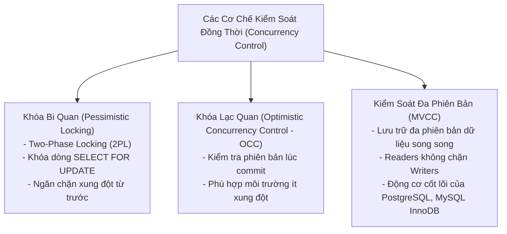
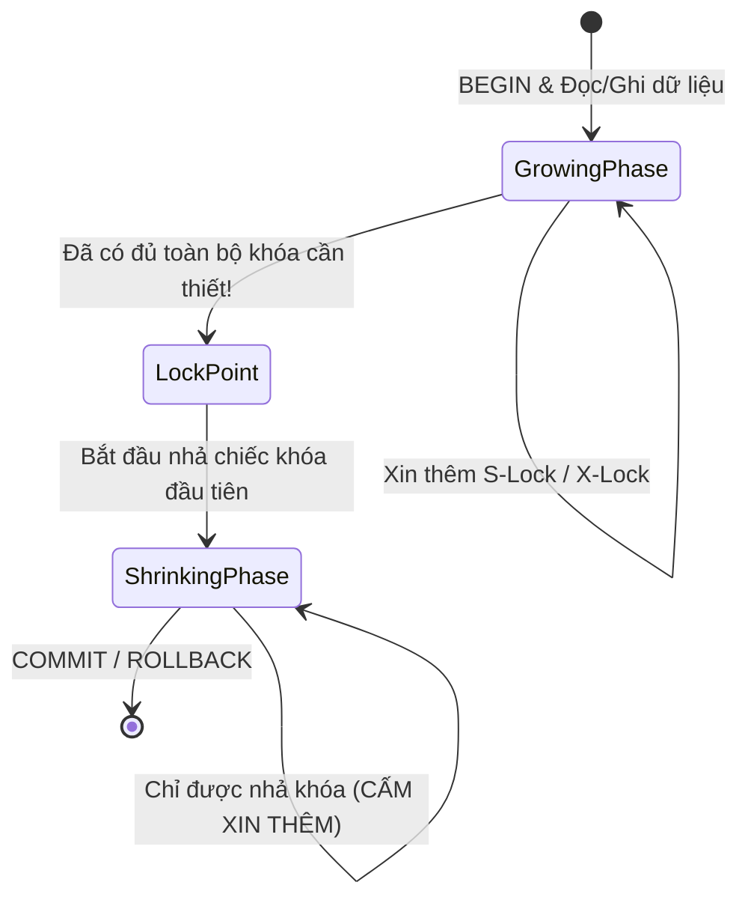
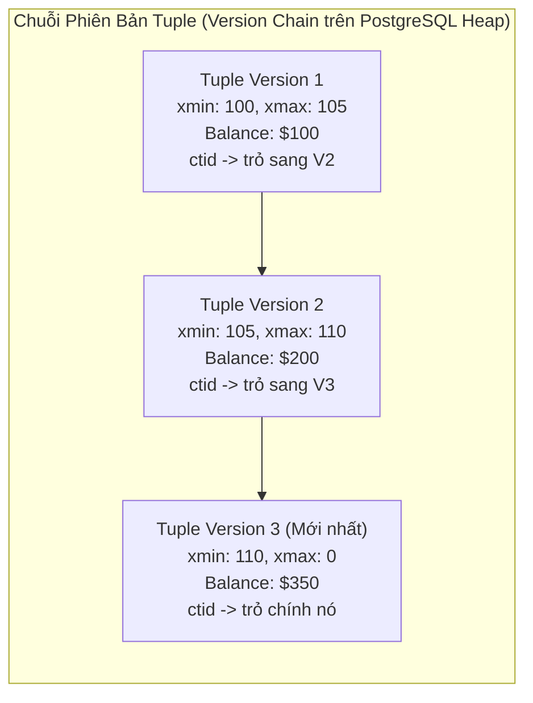

# 7.4. Concurrency Control (Kiểm soát Tương tranh Đa Luồng trong CSDL)

> [!IMPORTANT]
> **Nếu bạn chỉ được nhớ một điều duy nhất:** Kiểm soát đồng thời đa phiên bản (MVCC - Multi-Version Concurrency Control) là bí quyết giúp các CSDL hiện đại đạt hiệu năng đỉnh cao: triết lý tối thượng của MVCC là 'Bên Đọc không bao giờ chặn Bên Ghi, và Bên Ghi không bao giờ chặn Bên Đọc'; mỗi thao tác cập nhật đơn giản là tạo ra một phiên bản dòng mới mang dấu thời gian/Transaction ID, cho phép các câu truy vấn đọc nhìn thấy ảnh chụp nhất quán (Snapshot) của quá khứ mà không cần giữ khóa đọc.

---

## 1. Đơn giản nhưng phải chi tiết (Intuitive & Deep Breakdown)

### 1.1. Đoạn Code Dẫn Nhập & Vấn Đề Thực Tế
Làm thế nào một cơ sở dữ liệu hiện đại có thể cho phép hàng nghìn người cùng đọc dữ liệu trong khi hàng trăm người khác đang liên tục ghi và cập nhật trên cùng một bảng mà không ai phải chờ đợi ai?

```sql
-- Triết lý tối thượng của MVCC (Multi-Version Concurrency Control):
-- "READERS NEVER BLOCK WRITERS, AND WRITERS NEVER BLOCK READERS!"
-- (Người đọc không bao giờ chặn người ghi, và người ghi không bao giờ chặn người đọc!)

-- Tiến trình Ghi (Writer):
BEGIN;
UPDATE products SET price = 999 WHERE id = 1; -- Cập nhật giá sản phẩm
-- Database KHÔNG HỀ ghi đè lên dòng cũ!
-- Nó tạo ra một PHIÊN BẢN MỚI (New Tuple Version) có mã xmin = TransactionID hiện tại!

-- Tiến trình Đọc (Reader - Chạy đồng thời):
BEGIN;
SELECT price FROM products WHERE id = 1; 
-- Vẫn đọc mượt mà phiên bản cũ (Old Tuple Version) với giá cũ trong RAM!
-- Hoàn toàn KHÔNG BỊ KHÓA, KHÔNG PHẢI CHỜ ĐỢI DÙ CHỈ 1 MICRO-GIÂY!
```

Trước khi có MVCC, các hệ thống cơ sở dữ liệu truyền thống sử dụng cơ chế Khóa 2 Pha (**Strict 2-Phase Locking - S2PL**). Khi một người đang ghi, toàn bộ những người muốn đọc đều bị khóa cứng xếp hàng chờ đợi, khiến hệ thống tê liệt hoàn toàn khi lượng người dùng tăng cao!

### 1.2. Ẩn Dụ Đời Sống & Phân Tích Cơ Chế Hoạt Động
So sánh giữa Cơ chế Khóa Bi Quan (2PL) và Cơ chế Đa Phiên Bản (MVCC) giống như **Cách Quản Lý Bản Thảo Một Cuốn Sách**:
- **Khóa 2 Pha Bi Quan (2-Phase Locking - 2PL)**:
  - Chỉ có duy nhất 1 bản thảo bằng giấy đặt trên bàn.
  - Khi tác giả muốn sửa một chương: Tác giả khóa trái cửa phòng, ôm chặt bản thảo (**Giai đoạn Thu thập Khóa - Growing Phase**). Suốt thời gian đó, không một độc giả nào được phép bước vào phòng đọc sách.
  - Sửa xong, tác giả mở cửa phòng và trả lại bản thảo (**Giai đoạn Nhả Khóa - Shrinking Phase**). Rất an toàn nhưng độc giả chờ đợi phát điên!
- **Kiểm Soát Đồng Thời Đa Phiên Bản (MVCC - Git cho Cơ Sở Dữ Liệu)**:
  - Mỗi khi tác giả muốn sửa sách: Tác giả tạo ra một **Bản sao chép mới (Branch / New Version)**.
  - Tác giả thỏa sức gõ phím trên bản sao mới.
  - Toàn bộ độc giả trên thế giới vẫn tiếp tục đọc phiên bản xuất bản chính thức cũ (**Snapshot cũ**).
  - Khi tác giả hoàn tất: Bấm nút Publish (**Commit**). Kể từ giây phút này, các độc giả mới vào sẽ đọc phiên bản mới, trong khi các độc giả cũ đang đọc dở vẫn đọc nốt phiên bản cũ của họ. Không ai phải chờ đợi ai!

### 1.3. Mô Phỏng Dữ Liệu Số Nhỏ Từng Bước (Toy Walkthrough)
Mô phỏng cấu trúc tiêu đề Tuple Header của PostgreSQL MVCC (`xmin`, `xmax`) qua các thao tác:

- `xmin`: ID của Transaction đã tạo ra phiên bản dòng này.
- `xmax`: ID của Transaction đã xóa (hoặc cập nhật) phiên bản dòng này (Mặc định = 0 nếu còn sống).

| Bước | Lệnh SQL | `xmin` | `xmax` | Dữ Liệu Dòng Thực Tế | Trạng Thái Hiển Thị (Visibility) |
| :---: | :--- | :---: | :---: | :--- | :--- |
| **1** | $T_{100}$: `INSERT balance = 500` | **100** | **0** | `balance: 500` | Dòng sống (Visible cho mọi Transaction sau 100) |
| **2** | $T_{105}$: `UPDATE balance = 600` | 100 | **105** | `balance: 500` (Phiên bản cũ) | Biến thành Dead Tuple đối với các transaction mới! |
| - | (Bản ghi mới sinh ra cùng lúc) | **105** | **0** | `balance: 600` (Phiên bản mới) | Hiển thị cho các transaction bắt đầu sau 105 |
| **3** | $T_{110}$: `DELETE` | 105 | **110** | `balance: 600` | Đánh dấu xóa bằng `xmax = 110` |
| **4** | **VACUUM chạy ngầm** | - | - | - | **Thu dọn hoàn toàn các phiên bản chết, giải phóng trang đĩa!** |

### 1.4. Tác Động Thực Tế Tầng Backend & Systems
- **Nỗi Ám Ảnh PostgreSQL Vacuum và Transaction ID Wraparound**: Do trường `xmin` và `xmax` trong Postgres là số nguyên 32-bit (chỉ đếm được tối đa 4 tỷ transactions), nếu hệ thống chạm ngưỡng 2 tỷ transactions mà không chạy tiến trình đóng băng (`FREEZE`) thu gom rác, database sẽ **tự động tắt khẩn cấp (Forced Shutdown)** để bảo vệ dữ liệu chống quay vòng ID (Wraparound Data Loss)!
- **Hiện Tượng Undo Tablespace Phình To Trên MySQL**: Trong MySQL InnoDB, các phiên bản cũ được lưu trong các khối Undo Log liên kết ngược (`roll_ptr`). Nếu có một transaction đọc treo quá lâu, tiến trình Purge Thread không thể dọn dẹp các Undo Logs này, khiến file `ibdata1` hoặc Undo Tablespace phình to chiếm sạch ổ cứng SSD.

### 1.5. Sơ Đồ Tư Duy & Kiến Trúc Hệ Thống (Mermaid)


---

## 2. Chi tiết từng Keyword (Under-the-Hood Deep Dive)

### 2.1. Two-Phase Locking (2PL & Strict 2PL)

#### 1. Định Lý Khả Tuần Tự Xung Đột (Conflict Serializability Theorem)
Giao thức Khóa Hai Pha (Eswaran et al., 1976) là nền tảng toán học chứng minh rằng: *Mọi lịch trình thực thi tuân thủ nghiêm ngặt quy tắc 2PL đều được bảo đảm là Khả tuần tự xung đột (Conflict Serializable)* — nghĩa là đồ thị xung đột giao dịch không bao giờ xuất hiện chu trình.

Giao dịch được chia thành 2 giai đoạn bất biến:
1. **Giai đoạn Tăng trưởng (Growing Phase / Expanding Phase)**:
   - Giao dịch được phép xin cấp thêm các loại khóa mới (Shared Lock hoặc Exclusive Lock).
   - **Tuyệt đối nghiêm cấm nhả bất kỳ chiếc khóa nào** trong giai đoạn này.
2. **Điểm Khóa (Lock Point)**:
   - Khoảnh khắc giao dịch nắm giữ đầy đủ tất cả các khóa cần thiết để hoàn thành toàn bộ khối lượng công việc.
3. **Giai đoạn Thu hẹp (Shrinking Phase / Contracting Phase)**:
   - Bắt đầu ngay khi giao dịch nhả chiếc khóa đầu tiên ra.
   - Từ thời điểm này trở đi, giao dịch **chỉ được phép nhả khóa, tuyệt đối không được phép xin thêm bất kỳ chiếc khóa mới nào khác**!



#### 2. Strict 2PL (S2PL - Chuẩn Mực Công Nghiệp Chống Cascading Aborts)
- **Hiểm họa của 2PL Thuần túy (Cascading Aborts)**:
  - Giả sử $T_1$ sửa bản ghi $A$, sau đó nhả khóa $A$ ở giai đoạn Shrinking Phase nhưng **chưa commit**.
  - $T_2$ vào đọc bản ghi $A$ do $T_1$ vừa sửa.
  - Ngay sau đó, $T_1$ gặp lỗi phần cứng và bị buộc phải `ROLLBACK`!
  - Vì dữ liệu $A$ mà $T_2$ vừa đọc đã bị xóa sổ, $T_2$ cũng buộc phải bị `ROLLBACK` theo dây chuyền! Nếu có 1,000 giao dịch khác đã đọc dữ liệu từ $T_2$, toàn bộ 1,000 giao dịch đó đều bị hủy diệt (Hiệu ứng Domino).
- **Strict 2PL Giải Quyết Triệt Để**:
  - Giao thức Strict 2PL đưa ra một quy tắc bổ sung: **Toàn bộ các Khóa Độc Quyền (Exclusive X-Locks) bắt buộc phải được giữ chặt cho đến khi giao dịch kết thúc hoàn toàn (COMMIT hoặc ROLLBACK)**.
  - Không có giai đoạn nhả khóa dần dần cho các thao tác ghi. Khi giao dịch kết thúc, toàn bộ các khóa được giải phóng đồng thời trong một phần triệu giây.
- **Rigorous 2PL (SS2PL)**: Giữ chặt **cả Shared Locks lẫn Exclusive Locks** cho đến cuối giao dịch.

---

### 2.2. Hệ thống Cây Phân cấp Khóa & Khóa Dự định (Intention Locks)

Trong một hệ thống RDBMS lớn, dữ liệu được tổ chức theo cây phân cấp đa độ hạt (Multiple Granularity Hierarchy - Jim Gray, 1975):
$$\text{Database} \longrightarrow \text{Table (Relation)} \longrightarrow \text{Page (Block 8KB)} \longrightarrow \text{Row (Tuple)}$$

#### 1. Định Nghĩa 3 Loại Khóa Dự Định (Intention Locks)
Để cho phép các giao dịch khóa cấp dòng và các giao dịch khóa cấp bảng cùng tồn tại mà không cần quét toàn bộ bảng:
- **`IS` (Intention Shared - Dự định Chia sẻ)**: Giao dịch thông báo ở cấp độ cao (Bảng/Trang) rằng: *"Tôi dự định sẽ đặt khóa đọc chia sẻ (S-Lock) trên một số dòng dữ liệu cụ thể ở bên dưới"*.
- **`IX` (Intention Exclusive - Dự định Độc quyền)**: Giao dịch thông báo rằng: *"Tôi dự định sẽ đặt khóa ghi độc quyền (X-Lock) trên một số dòng dữ liệu cụ thể ở bên dưới"*.
- **`SIX` (Shared + Intention Exclusive)**: Giao dịch khóa toàn bộ bảng để đọc (S-Lock trên toàn bảng), nhưng đồng thời dự định sẽ sửa đổi một vài dòng cụ thể ở bên dưới (IX trên các dòng đó).

#### 2. Bảng Ma trận Tương thích Khóa Toàn Diện (Lock Compatibility Matrix)

Khi một giao dịch đang nắm giữ một loại khóa ở cấp bảng, một giao dịch khác đến xin cấp một loại khóa khác:

| Khóa Đang Nắm Giữ \ Khóa Muốn Xin | `IS` | `IX` | `S` | `SIX` | `X` |
| :---: | :---: | :---: | :---: | :---: | :---: |
| **`IS`** | ✅ Tương thích | ✅ Tương thích | ✅ Tương thích | ✅ Tương thích | ❌ Xung đột (Chờ) |
| **`IX`** | ✅ Tương thích | ✅ Tương thích | ❌ Xung đột | ❌ Xung đột | ❌ Xung đột (Chờ) |
| **`S`** | ✅ Tương thích | ❌ Xung đột | ✅ Tương thích | ❌ Xung đột | ❌ Xung đột (Chờ) |
| **`SIX`**| ✅ Tương thích | ❌ Xung đột | ❌ Xung đột | ❌ Xung đột | ❌ Xung đột (Chờ) |
| **`X`** | ❌ Xung đột | ❌ Xung đột | ❌ Xung đột | ❌ Xung đột | ❌ Xung đột (Chờ) |

- **Ý nghĩa Kỹ thuật Vàng**: Hai giao dịch cùng sửa đổi hai hàng khác nhau trong cùng một bảng: Cả hai đều xin `IX` ở cấp bảng. Nhìn vào ma trận, `IX` tương thích với `IX` $\implies$ Cả hai giao dịch đều được cấp phép ngay lập tức mà không hề bị chặn!
- Khi một câu lệnh DDL chạy (`ALTER TABLE users ADD COLUMN phone VARCHAR(20);`): Nó yêu cầu khóa `X-Lock` ở cấp bảng. Nhìn vào ma trận, `X` xung đột với cả `IS` và `IX`. Lệnh DDL sẽ tự động dừng lại chờ cho đến khi tất cả các giao dịch đang đọc/ghi hàng hoàn tất!

---

### 2.3. Giải phẫu Cơ chế MVCC (Multi-Version Concurrency Control)

MVCC hiện thực hóa khả năng đọc và ghi đồng thời bằng cách duy trì nhiều phiên bản vật lý của cùng một bản ghi logic.

#### 1. Tiêu Đề Tuple trong PostgreSQL (Heap Tuple Header Anatomy)
Mỗi dòng dữ liệu trong tệp đĩa Heap của PostgreSQL (chiếm 23 bytes header) đều chứa các trường thông tin kiểm soát tương tranh cốt tử:
- `t_xmin`: Transaction ID của giao dịch đã thực hiện lệnh `INSERT` tạo ra phiên bản tuple này.
- `t_xmax`: Transaction ID của giao dịch đã thực hiện lệnh `UPDATE` hoặc `DELETE` xóa sổ phiên bản tuple này (nếu dòng còn sống và chưa bị xóa, `t_xmax = 0`).
- `t_cid`: Command Identifier (đếm số thứ tự câu lệnh bên trong cùng một giao dịch, ví dụ câu lệnh thứ 1, 2, 3).
- `t_ctid`: Con trỏ vật lý (`BlockNumber`, `OffsetNumber`) trỏ đến vị trí của chính tuple này, hoặc nếu tuple đã bị update, nó sẽ **trỏ trực tiếp đến phiên bản tuple mới tiếp theo trong chuỗi (Version Chain)**!



#### 2. Thuật toán Đánh giá Tính Hiển thị của Snapshot (Visibility Engine)
Cấu trúc `SnapshotData` trong nhân PostgreSQL bao gồm:
- `xmin`: XID nhỏ nhất trong số các giao dịch đang còn chạy tại thời điểm chụp snapshot. Mọi giao dịch có $\text{XID} < \text{snapshot.xmin}$ đều đã được commit trong quá khứ $\implies$ **Luôn luôn nhìn thấy**.
- `xmax`: XID đầu tiên chưa được cấp phát tại thời điểm chụp snapshot. Mọi giao dịch có $\text{XID} \ge \text{snapshot.xmax}$ đều thuộc về tương lai $\implies$ **Tuyệt đối không nhìn thấy**.
- `xip[]`: Mảng danh sách các XID của các giao dịch đang chạy dở dang (Active / In-progress) tại thời điểm chụp snapshot $\implies$ **Ẩn hoàn toàn khỏi tầm nhìn**.

#### 3. So Sánh Động Cơ MVCC: PostgreSQL Heap Appending vs MySQL InnoDB Undo Log
- **PostgreSQL (In-Heap Versioning / Append-Only)**:
  - Khi `UPDATE`: Tuple cũ được đánh dấu `t_xmax = current_xid`. Một tuple mới toanh được chèn vào trang đĩa.
  - *Hậu quả*: Bảng bị phình to (Bloat). Bắt buộc phải có tiến trình nền **`VACUUM`** quét dọn và giải phóng các Dead Tuples.
- **MySQL InnoDB (Rollback Segment / Undo Log)**:
  - Khi `UPDATE`: Dòng dữ liệu được sửa đổi **trực tiếp tại chỗ (In-Place Update)** trên trang đĩa của Clustered Index.
  - Giá trị cũ được đẩy vào **Undo Log**. Tiêu đề dòng lưu con trỏ `roll_ptr` trỏ ngược về Undo Log.
  - *Ưu điểm*: Bảng không bị phình to rác đĩa như PostgreSQL.
  - *Nhược điểm*: Khi một câu truy vấn cần đọc dữ liệu cũ trong quá khứ, nó phải tốn chi phí CPU duyệt ngược chuỗi con trỏ Undo Log dài dằng dặc để tái tạo lại trạng thái cũ.

---

### 2.4. Phát hiện & Phòng ngừa Bế tắc (Deadlock Handling)

Bế tắc (Deadlock) là trạng thái hai hoặc nhiều giao dịch bị khóa cứng vĩnh viễn do tạo thành một chu trình chờ đợi tài nguyên khép kín: $T_1$ giữ Khóa $A$ chờ Khóa $B$, trong khi $T_2$ giữ Khóa $B$ chờ Khóa $A$.

#### 1. Đồ Thị Chờ Đợi (Wait-For Graph - WFG) & Thuật toán Phát hiện Chu trình
- Hệ thống duy trì một đồ thị có hướng $G = (V, E)$ trong RAM:
  - Tập đỉnh $V$: Các giao dịch đang hoạt động.
  - Tập cạnh $E$: Cạnh $T_A \to T_B$ tồn tại khi và chỉ khi giao dịch $T_A$ đang bị chặn và chờ một khóa do giao dịch $T_B$ đang nắm giữ.
- **Cơ chế Phát hiện**:
  - Khi một giao dịch bị rơi vào trạng thái chờ khóa vượt quá ngưỡng cấu hình `deadlock_timeout` (mặc định $1\text{ giây}$ trong PostgreSQL):
  - Hệ thống kích hoạt thuật toán duyệt đồ thị (DFS hoặc Tarjan's Strongly Connected Components) để tìm chu trình (Cycles).
  - Nếu phát hiện chu trình: Engine lựa chọn một **Nạn nhân (Victim)** dựa trên hàm chi phí (giao dịch chạy ít thời gian nhất, sửa ít dòng nhất hoặc có XID trẻ nhất), sau đó gửi tín hiệu hủy bỏ (`ROLLBACK`) giao dịch đó để giải phóng toàn bộ khóa, giải cứu các giao dịch còn lại.

#### 2. Các Kỹ Thuật Phòng Ngừa Bế Tắc Không Cần Đồ Thị (Deadlock Prevention)
Thay vì chờ bế tắc xảy ra rồi mới phát hiện, các hệ thống phân tán thường áp dụng kỹ thuật gán Nhãn Thời Gian (Timestamps) ngay khi giao dịch bắt đầu:
- **Quy ước**: Giao dịch cũ ($T_{old}$) có độ ưu tiên cao hơn giao dịch trẻ ($T_{young}$).
- **Cơ chế Chờ - Chết (Wait-Die Scheme - Không tước đoạt)**:
  - Nếu $T_{old}$ xin khóa đang bị $T_{young}$ giữ: Cho phép $T_{old}$ được **Chờ (Wait)**.
  - Nếu $T_{young}$ xin khóa đang bị $T_{old}$ giữ: $T_{young}$ lập tức **Tự sát (Die / Abort)** và khởi động lại sau một khoảng trễ ngẫu nhiên.
- **Cơ chế Làm Bị Thương - Chờ (Wound-Wait Scheme - Có tước đoạt)**:
  - Nếu $T_{old}$ xin khóa đang bị $T_{young}$ giữ: $T_{old}$ lập tức **Đánh bị thương (Wound / Preempt)** và cướp khóa của $T_{young}$, buộc $T_{young}$ phải Rollback!
  - Nếu $T_{young}$ xin khóa đang bị $T_{old}$ giữ: Cho phép $T_{young}$ được **Chờ (Wait)**.
  - *Đặc điểm*: Cơ chế Wound-Wait giảm thiểu tối đa số lần Rollback so với Wait-Die.

---

## 3. Thực thi Mã nguồn & Mô phỏng Chuyên sâu (Dual-Engine Implementation)

### 1. Động cơ C++20: Mô phỏng Lock Manager Đa Cấp với Intention Locks và Wait-For Graph

Chương trình C++20 dưới đây triển khai đầy đủ một Trình Quản Lý Khóa (Lock Manager) hỗ trợ kiểm tra tính tương thích của Khóa Dự Định (IS, IX, S, X) và tích hợp thuật toán tìm kiếm chu trình DFS phát hiện Deadlock:

```cpp
// compile: g++ -std=c++20 -O3 lock_manager_sim.cpp -o lock_mgr
#include <iostream>
#include <vector>
#include <string>
#include <unordered_map>
#include <unordered_set>
#include <format>
#include <stdexcept>

enum class LockMode { IS, IX, S, SIX, X };

std::string to_string(LockMode mode) {
    switch (mode) {
        case LockMode::IS: return "IS";
        case LockMode::IX: return "IX";
        case LockMode::S: return "S";
        case LockMode::SIX: return "SIX";
        case LockMode::X: return "X";
    }
    return "UNKNOWN";
}

// Bảng Ma trận Tương thích Khóa chuẩn Jim Gray 1975
bool are_compatible(LockMode held, LockMode requested) {
    if (held == LockMode::IS) {
        return requested != LockMode::X;
    }
    if (held == LockMode::IX) {
        return requested == LockMode::IS || requested == LockMode::IX;
    }
    if (held == LockMode::S) {
        return requested == LockMode::IS || requested == LockMode::S;
    }
    if (held == LockMode::SIX) {
        return requested == LockMode::IS;
    }
    if (held == LockMode::X) {
        return false; // X xung đột với tất cả mọi loại khóa khác!
    }
    return false;
}

// Bộ Quản Lý Khóa Hệ Thống kèm Wait-For Graph Deadlock Detector
class LockManager {
private:
    // ResourceName -> Danh sách các {TxID, LockMode} đang nắm giữ
    std::unordered_map<std::string, std::vector<std::pair<int, LockMode>>> granted_locks;
    // Wait-For Graph: TxID (Đang chờ) -> Set các TxID (Đang giữ khóa làm nó phải chờ)
    std::unordered_map<int, std::unordered_set<int>> wait_for_graph;

    bool dfs_cycle(int current, std::unordered_set<int>& visited, std::unordered_set<int>& rec_stack) {
        visited.insert(current);
        rec_stack.insert(current);

        for (int neighbor : wait_for_graph[current]) {
            if (rec_stack.contains(neighbor)) {
                std::cout << std::format("  🚨 [DEADLOCK DETECTED] Phát hiện chu trình bế tắc liên quan đến Tx #{} và Tx #{}\n", current, neighbor);
                return true;
            }
            if (!visited.contains(neighbor)) {
                if (dfs_cycle(neighbor, visited, rec_stack)) return true;
            }
        }

        rec_stack.erase(current);
        return false;
    }

public:
    bool acquire_lock(int tx_id, const std::string& resource, LockMode requested_mode) {
        std::cout << std::format("[Tx #{}] Yêu cầu cấp khóa '{}' trên tài nguyên '{}'...\n", 
                                 tx_id, to_string(requested_mode), resource);

        auto& current_holders = granted_locks[resource];
        bool has_conflict = false;

        for (const auto& [holder_tx, held_mode] : current_holders) {
            if (holder_tx == tx_id) continue; // Cùng 1 Tx đã có khóa

            if (!are_compatible(held_mode, requested_mode)) {
                has_conflict = true;
                std::cout << std::format("  ⚠️ XUNG ĐỘT: Tx #{} đang giữ khóa '{}', không thể cấp khóa '{}' cho Tx #{}\n",
                                         holder_tx, to_string(held_mode), to_string(requested_mode), tx_id);
                // Thêm cạnh chờ đợi vào Wait-For Graph: tx_id phải chờ holder_tx
                wait_for_graph[tx_id].insert(holder_tx);
            }
        }

        if (has_conflict) {
            std::cout << std::format("  -> Tx #{} bị rơi vào trạng thái LOCK WAIT trên '{}'.\n", tx_id, resource);
            // Kiểm tra bế tắc ngay lập tức
            if (check_deadlock()) {
                std::cout << std::format("  💥 [ABORT VICTIM]: Database Engine quyết định ROLLBACK Tx #{} để phá vỡ bế tắc!\n", tx_id);
                release_all_locks(tx_id);
                return false;
            }
            return false;
        }

        // Nếu tương thích hoàn toàn -> Cấp khóa thành công!
        current_holders.push_back({tx_id, requested_mode});
        std::cout << std::format("  ✅ CẤP KHÓA THÀNH CÔNG cho Tx #{} trên '{}'.\n", tx_id, resource);
        return true;
    }

    bool check_deadlock() {
        std::unordered_set<int> visited;
        std::unordered_set<int> rec_stack;
        for (const auto& [node, _] : wait_for_graph) {
            if (!visited.contains(node)) {
                if (dfs_cycle(node, visited, rec_stack)) return true;
            }
        }
        return false;
    }

    void release_all_locks(int tx_id) {
        std::cout << std::format("[Tx #{}] Giải phóng toàn bộ khóa và rút lui khỏi hệ thống.\n", tx_id);
        // Xóa các khóa đang giữ
        for (auto& [res, holders] : granted_locks) {
            std::erase_if(holders, [tx_id](const auto& p) { return p.first == tx_id; });
        }
        // Xóa khỏi Wait-For Graph
        wait_for_graph.erase(tx_id);
        for (auto& [_, neighbors] : wait_for_graph) {
            neighbors.erase(tx_id);
        }
    }
};

int main() {
    std::cout << "=== MÔ PHỎNG LOCK MANAGER & DEADLOCK DETECTOR (C++20) ===\n\n";
    LockManager lm;

    // Kịch bản 1: Hai giao dịch cùng sửa 2 hàng khác nhau trong cùng 1 bảng (Hợp tác Intention Lock)
    std::cout << "--- KỊCH BẢN 1: Kiểm tra Tính Tương Thích của Intention Lock (IX vs IX) ---\n";
    lm.acquire_lock(1, "table_orders", LockMode::IX);
    lm.acquire_lock(2, "table_orders", LockMode::IX);
    std::cout << "--> Cả hai Tx cùng sửa hàng mà không hề bị chặn ở cấp bảng!\n\n";

    // Kịch bản 2: Bế tắc kinh điển giữa 2 giao dịch trên 2 tài nguyên
    std::cout << "---------------------------------------------------------\n";
    std::cout << "--- KỊCH BẢN 2: Tái hiện Chu trình Bế tắc (Deadlock Cycle) ---\n";
    LockManager dead_lm;
    // Tx 1 chiếm khóa độc quyền X trên Tài nguyên A
    dead_lm.acquire_lock(1, "Row_A", LockMode::X);
    // Tx 2 chiếm khóa độc quyền X trên Tài nguyên B
    dead_lm.acquire_lock(2, "Row_B", LockMode::X);

    std::cout << "\n[Bắt đầu tranh chấp chéo]:\n";
    // Tx 1 muốn xin khóa trên Tài nguyên B (bị Tx 2 chặn -> Tx 1 chờ Tx 2)
    dead_lm.acquire_lock(1, "Row_B", LockMode::X);

    // Tx 2 muốn xin khóa trên Tài nguyên A (bị Tx 1 chặn -> Tx 2 chờ Tx 1 -> DEADLOCK!)
    dead_lm.acquire_lock(2, "Row_A", LockMode::X);

    std::cout << "=========================================================\n";
    return 0;
}
```

---

### 2. Động cơ Python 3.11+: Triệt Tiêu Deadlock Bằng Kỹ Thuật Global Lock Ordering

Script Python dưới đây chứng minh sự khác biệt sống còn giữa việc chiếm khóa lộn xộn (gây Deadlock 100%) và việc áp dụng nguyên lý sắp xếp khóa toàn cục:

```python
#!/usr/bin/env python3
"""
Mô phỏng Nguy Cơ Bế Tắc (Deadlock Hazard) và Kỹ Thuật Phòng Ngừa
bằng Trật Tự Khóa Toàn Cục (Global Resource Ordering).
Môi trường yêu cầu: Python 3.11+
"""

import threading
import time
from typing import Dict

class Account:
    def __init__(self, acc_id: int, balance: int):
        self.acc_id = acc_id
        self.balance = balance
        self.lock = threading.Lock()

def transfer_deadlock_prone(acc_from: Account, acc_to: Account, amount: int):
    """
    Kịch bản Nguy Hiểm: Khóa tài khoản theo thứ tự truyền vào của hàm!
    Nếu Luồng 1 chuyển A -> B, Luồng 2 chuyển B -> A: DEADLOCK CHẮC CHẮN XẢY RA!
    """
    print(f"  [Tx {threading.current_thread().name}] Xin khóa tài khoản nguồn #{acc_from.acc_id}...")
    with acc_from.lock:
        print(f"  [Tx {threading.current_thread().name}] ĐÃ GIỮ khóa #{acc_from.acc_id}. Chờ độ trễ mạng...")
        time.sleep(0.01) # Tăng xác suất xen kẽ luồng

        print(f"  [Tx {threading.current_thread().name}] Xin tiếp khóa tài khoản đích #{acc_to.acc_id}...")
        with acc_to.lock:
            acc_from.balance -= amount
            acc_to.balance += amount
            print(f"  ✅ [Tx {threading.current_thread().name}] Chuyển tiền thành công!")

def transfer_deadlock_free(acc1: Account, acc2: Account, from_id: int, to_id: int, amount: int):
    """
    Kỹ Thuật Phòng Ngừa Vàng (Global Resource Ordering):
    LUÔN LUÔN chiếm khóa theo thứ tự ID TĂNG DẦN: min(ID) trước, max(ID) sau!
    Triệt tiêu 100% khả năng xảy ra chu trình chờ đợi có hướng.
    """
    first_lock = acc1 if acc1.acc_id < acc2.acc_id else acc2
    second_lock = acc2 if acc1.acc_id < acc2.acc_id else acc1

    with first_lock.lock:
        time.sleep(0.01)
        with second_lock.lock:
            # Xác định tài khoản nào trừ, tài khoản nào cộng
            src = acc1 if acc1.acc_id == from_id else acc2
            dst = acc2 if acc2.acc_id == to_id else acc1
            src.balance -= amount
            dst.balance += amount
            print(f"  ✅ [Tx {threading.current_thread().name}] Chuyển tiền an toàn tuyệt đối (Không Deadlock)!")

if __name__ == "__main__":
    print("=" * 70)
    print("TEST PHÒNG CHỐNG DEADLOCK BẰNG GLOBAL RESOURCE ORDERING")
    print("=" * 70)

    accA = Account(101, 5000)
    accB = Account(202, 5000)

    # Chạy 2 luồng chuyển tiền chéo nhau với thuật toán An Toàn
    t1 = threading.Thread(
        target=transfer_deadlock_free, 
        args=(accA, accB, 101, 202, 500), 
        name="Worker-A-to-B"
    )
    t2 = threading.Thread(
        target=transfer_deadlock_free, 
        args=(accA, accB, 202, 101, 300), 
        name="Worker-B-to-A"
    )

    t1.start()
    t2.start()
    t1.join()
    t2.join()

    print("\n" + "=" * 70)
    print(f"Số dư cuối cùng: Account #101 = ${accA.balance:,} | Account #202 = ${accB.balance:,}")
    print("Kết luận: Hệ thống vận hành trơn tru không hề bị Deadlock!")
    print("=" * 70)
```

---

### 3. Kết quả Thực thi Terminal Mẫu Chuẩn Thực tế

```bash
$ g++ -std=c++20 -O3 lock_manager_sim.cpp -o lock_mgr
$ ./lock_mgr
=== MÔ PHỎNG LOCK MANAGER & DEADLOCK DETECTOR (C++20) ===

--- KỊCH BẢN 1: Kiểm tra Tính Tương Thích của Intention Lock (IX vs IX) ---
[Tx #1] Yêu cầu cấp khóa 'IX' trên tài nguyên 'table_orders'...
  ✅ CẤP KHÓA THÀNH CÔNG cho Tx #1 trên 'table_orders'.
[Tx #2] Yêu cầu cấp khóa 'IX' trên tài nguyên 'table_orders'...
  ✅ CẤP KHÓA THÀNH CÔNG cho Tx #2 trên 'table_orders'.
--> Cả hai Tx cùng sửa hàng mà không hề bị chặn ở cấp bảng!

---------------------------------------------------------
--- KỊCH BẢN 2: Tái hiện Chu trình Bế tắc (Deadlock Cycle) ---
[Tx #1] Yêu cầu cấp khóa 'X' trên tài nguyên 'Row_A'...
  ✅ CẤP KHÓA THÀNH CÔNG cho Tx #1 trên 'Row_A'.
[Tx #2] Yêu cầu cấp khóa 'X' trên tài nguyên 'Row_B'...
  ✅ CẤP KHÓA THÀNH CÔNG cho Tx #2 trên 'Row_B'.

[Bắt đầu tranh chấp chéo]:
[Tx #1] Yêu cầu cấp khóa 'X' trên tài nguyên 'Row_B'...
  ⚠️ XUNG ĐỘT: Tx #2 đang giữ khóa 'X', không thể cấp khóa 'X' cho Tx #1
  -> Tx #1 bị rơi vào trạng thái LOCK WAIT trên 'Row_B'.
[Tx #2] Yêu cầu cấp khóa 'X' trên tài nguyên 'Row_A'...
  ⚠️ XUNG ĐỘT: Tx #1 đang giữ khóa 'X', không thể cấp khóa 'X' cho Tx #2
  -> Tx #2 bị rơi vào trạng thái LOCK WAIT trên 'Row_A'.
  🚨 [DEADLOCK DETECTED] Phát hiện chu trình bế tắc liên quan đến Tx #2 và Tx #1
  💥 [ABORT VICTIM]: Database Engine quyết định ROLLBACK Tx #2 để phá vỡ bế tắc!
[Tx #2] Giải phóng toàn bộ khóa và rút lui khỏi hệ thống.
=========================================================

$ python3 deadlock_prevention_sim.py
======================================================================
TEST PHÒNG CHỐNG DEADLOCK BẰNG GLOBAL RESOURCE ORDERING
======================================================================
  ✅ [Tx Worker-A-to-B] Chuyển tiền an toàn tuyệt đối (Không Deadlock)!
  ✅ [Tx Worker-B-to-A] Chuyển tiền an toàn tuyệt đối (Không Deadlock)!

======================================================================
Số dư cuối cùng: Account #101 = $4,800 | Account #202 = $5,200
Kết luận: Hệ thống vận hành trơn tru không hề bị Deadlock!
======================================================================
```

---

## 4. Systems Engineering & Production Pitfalls

### 1. Hiểm Họa Treo Bảng Toàn Hệ Thống do DDL Khóa Độc Quyền (`ACCESS EXCLUSIVE`)
- **Tình huống Thực tế**: Một kỹ sư chạy lệnh thêm cột mới trên bảng `users` có 50 triệu dòng vào giữa giờ cao điểm:
  ```sql
  ALTER TABLE users ADD COLUMN is_verified BOOLEAN DEFAULT false;
  ```
- **Bản chất Cơ chế**: Lệnh `ALTER TABLE` yêu cầu khóa cấp cao nhất: **`ACCESS EXCLUSIVE`**.
- Khóa này xung đột với **tất cả mọi loại khóa khác**, kể cả lệnh `SELECT` thông thường (`AccessShareLock`).
- Nếu có một câu truy vấn báo cáo đang chạy chậm mất 20 giây:
  1. Lệnh DDL bị đẩy vào hàng chờ (Lock Wait Queue).
  2. Mọi câu lệnh `SELECT` của người dùng gửi đến sau thời điểm đó **đều bị xếp hàng đứng sau lệnh DDL**!
  3. Chỉ trong 10 giây, hàng nghìn kết nối từ web backend bị nghẽn lại ở trạng thái Lock Wait, làm sập toàn bộ hệ sinh thái dịch vụ.
- **Biện pháp Phòng ngừa**:
  1. Luôn đặt `lock_timeout` trước khi chạy DDL:
     ```sql
     SET lock_timeout = '2s';
     ALTER TABLE users ADD COLUMN is_verified BOOLEAN DEFAULT false;
     ```
  2. Tạo chỉ mục luôn dùng cờ `CONCURRENTLY` để tránh khóa bảng:
     ```sql
     CREATE INDEX CONCURRENTLY idx_users_email ON users(email);
     ```

### 2. Dò Tìm Giao Dịch Đang Chặn Các Giao Dịch Khác qua `pg_locks`
Khi máy chủ có dấu hiệu đơ cứng vì nghẽn khóa, hãy chạy ngay câu truy vấn chẩn đoán cấp cứu này:
```sql
SELECT
    blocked_locks.pid     AS blocked_pid,
    blocked_activity.usename  AS blocked_user,
    blocking_locks.pid    AS blocking_pid,
    blocking_activity.usename AS blocking_user,
    blocked_activity.query    AS blocked_statement,
    blocking_activity.query   AS current_statement_in_blocking_process
FROM  pg_catalog.pg_locks         blocked_locks
JOIN pg_catalog.pg_stat_activity blocked_activity ON blocked_activity.pid = blocked_locks.pid
JOIN pg_catalog.pg_locks         blocking_locks 
    ON blocking_locks.locktype = blocked_locks.locktype
    AND blocking_locks.database IS NOT DISTINCT FROM blocked_locks.database
    AND blocking_locks.relation IS NOT DISTINCT FROM blocked_locks.relation
    AND blocking_locks.page IS NOT DISTINCT FROM blocked_locks.page
    AND blocking_locks.tuple IS NOT DISTINCT FROM blocked_locks.tuple
    AND blocking_locks.virtualxid IS NOT DISTINCT FROM blocked_locks.virtualxid
    AND blocking_locks.transactionid IS NOT DISTINCT FROM blocked_locks.transactionid
    AND blocking_locks.classid IS NOT DISTINCT FROM blocked_locks.classid
    AND blocking_locks.objid IS NOT DISTINCT FROM blocked_locks.objid
    AND blocking_locks.objsubid IS NOT DISTINCT FROM blocked_locks.objsubid
    AND blocking_locks.pid != blocked_locks.pid
JOIN pg_catalog.pg_stat_activity blocking_activity ON blocking_activity.pid = blocking_locks.pid
WHERE NOT blocked_locks.granted;
```
Xác định ngay `blocking_pid` đang gây tắc nghẽn và hủy kết nối bằng `SELECT pg_terminate_backend(<blocking_pid>);`.

---

## 5. Bảng So sánh & Decision Matrix

### Ma trận So sánh Ba Trường Phái Kiểm Soát Tương Tranh

| Tiêu Chí Kỹ Thuật | Pessimistic 2PL (Khóa Hai Pha) | Multi-Version Concurrency Control (MVCC) | Optimistic Concurrency Control (OCC) |
| :--- | :--- | :--- | :--- |
| **Triết lý Cốt lõi** | Ngăn ngừa xung đột xảy ra ngay từ đầu bằng cách bắt chờ. | Tránh chờ đợi bằng cách tạo nhiều bản sao dữ liệu lịch sử. | Giả định hiếm khi xung đột; kiểm tra ở pha Commit. |
| **Tương tác Đọc / Ghi** | Đọc chặn Ghi, Ghi chặn Đọc. | **Đọc không chặn Ghi, Ghi không chặn Đọc.** | Đọc ghi không khóa, nhưng kiểm tra validation cuối cùng. |
| **Xử lý Bế tắc (Deadlock)** | Nguy cơ bế tắc rất cao; bắt buộc có WFG Detector. | Gần như không bị bế tắc cho các thao tác đọc; chỉ bị khi cập nhật đồng thời. | Không bị bế tắc khóa, nhưng bị tỷ lệ Abort cao khi tải nặng. |
| **Chi phí Bộ nhớ & Đĩa** | Rất thấp (Chỉ cần bảng băm Lock Table trong RAM). | Cao (Cần lưu trữ Tuple Version rác và Undo Logs). | Trung bình (Lưu giữ Private Workspace cho mỗi Tx). |
| **Phù hợp Tối ưu Cho** | Hệ thống có độ xung đột ghi cực cao (High Contention). | Hầu hết các ứng dụng Web/Enterprise hiện đại (Read-Heavy). | Môi trường chủ yếu là Đọc và rất ít khi có 2 luồng ghi cùng 1 dòng. |

### Hệ Thống 8 Cấp Độ Khóa Quan Hệ trong PostgreSQL (Relation-Level Locks)

| Tên Loại Khóa (Lock Mode) | Lệnh SQL Kích Hoạt Mẫu | Mức Độ Xung Đột |
| :--- | :--- | :--- |
| `AccessShareLock` | `SELECT` thông thường | Chỉ xung đột với `AccessExclusiveLock`. |
| `RowShareLock` | `SELECT ... FOR UPDATE / FOR SHARE` | Xung đột với `ExclusiveLock` và `AccessExclusiveLock`. |
| `RowExclusiveLock` | `UPDATE`, `DELETE`, `INSERT` | Xung đột với `ShareLock` trở lên. |
| `ShareUpdateExclusiveLock` | `VACUUM` (không FULL), `ANALYZE`, `CREATE INDEX CONCURRENTLY` | Khóa tự vệ chống các thao tác bảo trì schema đồng thời. |
| `ShareLock` | `CREATE INDEX` (không có CONCURRENTLY) | Cho phép đọc đồng thời, chặn toàn bộ các lệnh ghi DML. |
| `ShareRowExclusiveLock` | Rất ít dùng | Chặn cả đọc có khóa lẫn ghi. |
| `ExclusiveLock` | `REFRESH MATERIALIZED VIEW CONCURRENTLY` | Chặn mọi giao dịch ghi và đọc có khóa. |
| `AccessExclusiveLock` | `DROP TABLE`, `TRUNCATE`, `ALTER TABLE`, `VACUUM FULL` | **Khóa tối cao**: Chặn đứng toàn bộ mọi thao tác Đọc và Ghi! |

---

## 6. Enterprise Production Checklist & Verification

### 6.1. Kiến Trúc & Cấu Hình Tối Ưu (Production-Ready Architecture)
- [ ] **Tối Ưu Hóa Tần Suất Autovacuum Trên PostgreSQL**: Cấu hình `autovacuum_vacuum_scale_factor = 0.05` và `autovacuum_vacuum_cost_limit = 1000` để tiến trình dọn dẹp Dead Tuples chạy nhanh hơn, không làm tích tụ rác MVCC.
- [ ] **Kích Hoạt Vacuum Freeze Tránh Thảm Họa Wraparound**: Đảm bảo thông số `autovacuum_freeze_max_age = 200000000` được kiểm soát chặt chẽ và không bao giờ tắt Autovacuum trên production.
- [ ] **Sử Dụng Khóa Bi Quan Có Giới Hạn Thời Gian (NOWAIT / SKIP LOCKED)**: Khi dùng `SELECT FOR UPDATE`, luôn đính kèm tùy chọn `NOWAIT` hoặc `SKIP LOCKED` (đặc biệt trong các kiến trúc hàng đợi Message Queue) để các luồng không bị treo chờ khóa.
- [ ] **Phân Bổ Kích Thước Undo Tablespace Riêng Biệt (MySQL)**: Trên MySQL 8.0, cấu hình Undo Tablespaces động để hệ thống tự động thu nhỏ (truncate) các file Undo sau khi Purge hoàn tất.

### 6.2. Giám Sát, Cảnh Báo & Xử Lý Sự Cố (Observability & Incident Response)
- [ ] **Giám Sát Độ Tuổi Transaction ID Của Database (TXID Age)**: Thiết lập cảnh báo Prometheus khi giá trị `max(age(datfrozenxid))` vượt quá 1.2 tỷ transactions (nguy cơ cận kề Wraparound).
- [ ] **Theo Dõi Tỷ Lệ Dead Tuples Trong Các Bảng Lõi**: Cảnh báo khi số lượng `n_dead_tup` trong `pg_stat_user_tables` vượt quá 20% tổng số dòng `n_live_tup`.
- [ ] **Kiểm Tra Trực Quan Chuỗi Khóa Bằng CLI**: Sử dụng lệnh `SELECT pid, pg_blocking_pids(pid) FROM pg_stat_activity WHERE cardinality(pg_blocking_pids(pid)) > 0;` để giải tỏa các nút thắt khóa ngay lập tức.
