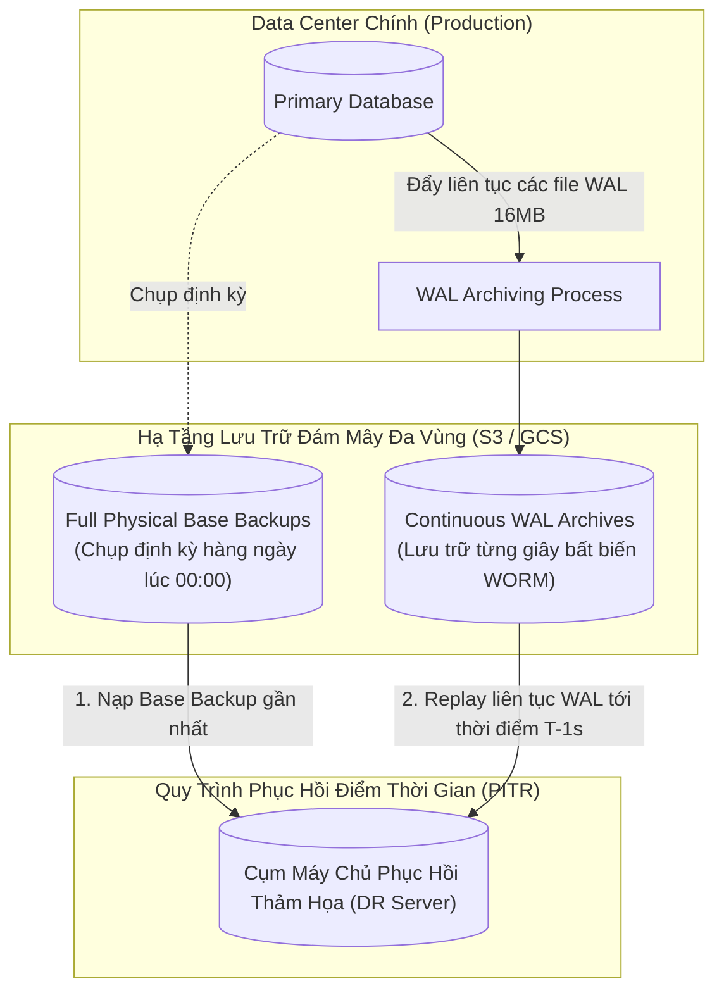
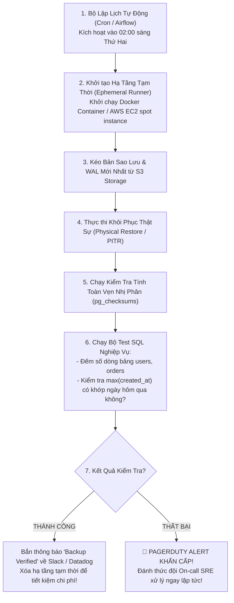

# 8.3. Backup & Disaster Recovery (Sao lưu & Khôi phục Thảm họa)

> [!IMPORTANT]
> **Nếu bạn chỉ được nhớ một điều duy nhất:** Chiến lược sao lưu dự phòng hiện đại không dừng lại ở việc xuất file nén logic (`pg_dump` / `mysqldump` vốn chậm chạp và khóa bảng): hệ thống sản xuất tiêu chuẩn bắt buộc phải kết hợp Sao lưu vật lý nền tảng (Base Backup) với việc lưu trữ liên tục luồng nhật ký WAL (WAL Archiving) để hiện thực hóa khả năng Khôi phục về thời điểm bất kỳ (Point-In-Time Recovery - PITR), giúp doanh nghiệp khôi phục dữ liệu chính xác đến từng microgiây trước khi sự cố xóa nhầm xảy ra.

---

## 1. Đơn giản nhưng phải chi tiết (Intuitive & Deep Breakdown)

### 1.1. Đoạn Code Dẫn Nhập & Vấn Đề Thực Tế
Làm thế nào để khôi phục lại toàn bộ cơ sở dữ liệu về chính xác thời điểm 1 giây trước khi một lập trình viên lỡ tay gõ nhầm câu lệnh `DROP TABLE customers;` vào lúc 14:32:45 chiều?

```bash
# Phục hồi dữ liệu về thời điểm chính xác trong quá khứ (Point-In-Time Recovery - PITR)
# Bước 1: Khôi phục bản sao lưu vật lý đầy đủ gần nhất (Base Backup lúc 00:00 sáng)
$ pg_restore -D /var/lib/postgresql/data base_backup_midnight.tar.gz

# Bước 2: Cấu hình mục tiêu dừng khôi phục chính xác tới từng giây trong postgresql.conf:
restore_command = 'cp /mnt/wal_archive/%f %p'
recovery_target_time = '2026-03-31 14:32:44.999 UTC' # Dừng đúng 1 mili-giây trước thảm họa!
recovery_target_action = 'promote'

# Khi khởi động: Database sẽ tua lại bản Base Backup, nạp tuần tự các file WAL lưu trữ,
# và dừng khôi phục ngay tại 14:32:44 -> Bảng customers được cứu sống nguyên vẹn 100%!
```

Một chân lý khắc nghiệt trong ngành công nghệ thông tin: **"Sao lưu (Backup) là vô nghĩa, chỉ có Khôi phục (Restore) mới có ý nghĩa!"**. Một công ty có hàng terabytes file backup nhưng chưa từng thử nghiệm khôi phục thực tế sẽ phải trả giá bằng cả sự nghiệp khi thảm họa thực sự ập đến!

### 1.2. Ẩn Dụ Đời Sống & Phân Tích Cơ Chế Hoạt Động
Chiến lược Sao lưu và Khắc phục Thảm họa (Backup & Disaster Recovery) giống như **Hệ Thống Camera An Ninh Của Tòa Nhà**:
- **Sao Lưu Logic (Logical Backup - `pg_dump` / `mysqldump`)**: Giống như **Người Thư Ký Chép Lại Toàn Bộ Sách Thành Văn Bản Mới**: Dễ đọc, dễ sửa, nhưng để chép lại một cuốn bách khoa toàn thư 10TB thì mất cả tuần trời và lúc nạp lại vào máy thì CPU bị bốc khói (**Cực kỳ chậm chạp trên dữ liệu lớn**).
- **Sao Lưu Vật Lý (Physical Base Backup - `pg_basebackup`)**: Giống như **Chụp Một Bức Ảnh Sao Chép Toàn Bộ Ổ Đĩa 1:1**: Sao chép trực tiếp các block nhị phân 8KB của hệ thống file. Nhanh như tốc độ đọc ghi tối đa của ổ SSD!
- **Lưu Trữ Nhật Ký Giao Dịch Liên Tục (WAL Archiving)**: Giống như **Cuộn Băng Video Camera Ghi Lại Mọi Giây Phút Hoạt Động**:
  - Bạn có một bức ảnh chụp lúc nửa đêm (**Base Backup**).
  - Bạn có cuốn băng ghi hình từ nửa đêm tới hiện tại (**WAL Archives**).
  - Ghép bức ảnh nửa đêm với cuốn băng, bạn có thể tua đến **BẤT KỲ GIÂY PHÚT NÀO TRONG NGÀY** để tái hiện lại lịch sử (**Point-In-Time Recovery - PITR**)!

### 1.3. Mô Phỏng Dữ Liệu Số Nhỏ Từng Bước (Toy Walkthrough)
Đo lường hai chỉ số sống còn của kế hoạch ứng phó thảm họa: **RPO** và **RTO**:

```text
Trục thời gian thảm họa:
[Sao lưu Base Backup gần nhất] ------------ [Mất Mát Dữ Liệu: RPO] ---> [💥 THẢM HỌA] ======= [Thời Gian Khôi Phục: RTO] =======> [Hệ Thống Online Trở Lại]
```

| Tiêu Chí Đo Lường | Định Nghĩa Bản Chất | Ý Nghĩa Kinh Doanh | Mục Tiêu Chuẩn Doanh Nghiệp | Giải Pháp Kỹ Thuật Đáp Ứng |
| :--- | :--- | :--- | :---: | :--- |
| **RPO** (Recovery Point Objective) | Lượng dữ liệu tối đa chấp nhận bị mất mát (tính theo thời gian) | *"Chúng ta chấp nhận mất bao nhiêu phút giao dịch của khách hàng?"* | **$< 1\text{ phút}$** (Hoặc = 0) | **WAL Continuous Archiving / Streaming Replication** |
| **RTO** (Recovery Time Objective) | Thời gian tối đa cho phép hệ thống ngừng hoạt động để phục hồi | *"Bao lâu sau khi sập thì website phải hoạt động trở lại bình thường?"* | **$< 15\text{ phút}$** | **Automated Failover (Patroni / Orchestrator) + Hot Standby** |

Nếu chỉ dùng backup định kỳ lúc 00:00 đêm mà không có WAL Archiving, khi thảm họa xảy ra lúc 23:59 đêm: **RPO của bạn là 24 tiếng đồng hồ (Mất sạch dữ liệu của cả 1 ngày làm việc!)**.

### 1.4. Tác Động Thực Tế Tầng Backend & Systems
- **Quy Tắc Sao Lưu 3-2-1 Bất Hủ**:
  - Lưu trữ ít nhất **3** bản sao dữ liệu (1 bản Production + 2 bản Backup).
  - Trên **2** loại phương tiện lưu trữ vật lý khác nhau (ví dụ: 1 bản trên Ổ cứng gắn mạng NAS nội bộ + 1 bản trên Cloud Object Storage S3).
  - Ít nhất **1** bản sao lưu phải được đặt ở **Vị trí địa lý hoàn toàn khác biệt (Offsite / Multi-Region)** để chống lại thảm họa thiên tai, động đất, hỏa hoạn phá hủy toàn bộ Data Center!
- **Mã Hóa và Bất Biến Bản Sao Lưu (Immutability Chống Ransomware)**: Các cuộc tấn công mã độc tống tiền hiện đại thường tìm cách xóa sạch các file backup trước khi mã hóa cơ sở dữ liệu chính. Kích hoạt tính năng **S3 Object Lock (WORM - Write Once, Read Many)** giúp file backup không thể bị xóa hoặc sửa đổi bởi bất kỳ ai (kể cả tài khoản Root) trong suốt thời gian bảo vệ quy định.

### 1.5. Sơ Đồ Tư Duy & Kiến Trúc Hệ Thống (Mermaid)


---

## 2. Chi tiết từng Keyword (Under-the-Hood Deep Dive)

### 2.1. Phân loại Sao lưu: Physical vs Logical & Hot vs Cold

#### 1. Logical Backup (Sao lưu Logic) vs Physical Backup (Sao lưu Vật lý)
- **Logical Backup (Ví dụ: `pg_dump`, `mysqldump`)**:
  - Đọc dữ liệu qua tầng động cơ truy vấn và xuất ra các câu lệnh SQL dạng văn bản (`CREATE TABLE`, `INSERT INTO`) hoặc định dạng nhị phân độc quyền nén (`custom format .dump`).
  - **Ưu điểm**: Khả năng tương thích chéo (Portability) tuyệt vời — có thể sao lưu từ PostgreSQL 14 trên Ubuntu x86-64 và phục hồi sang PostgreSQL 16 trên macOS ARM64; cho phép sao lưu từng bảng riêng lẻ hoặc lọc dữ liệu.
  - **Nhược điểm Chí mạng**: **Cực kỳ chậm khi khôi phục trên cơ sở dữ liệu lớn (> 500GB)**. Quá trình restore phải phân tích cú pháp hàng trăm triệu câu lệnh SQL, nạp dữ liệu tuần tự và đặc biệt là **phải xây dựng lại từ đầu toàn bộ các cây chỉ mục B-Tree (Index Rebuilding)**. Một database 2TB có thể mất tới **48 giờ** chỉ để restore!
- **Physical Backup (Ví dụ: `pg_basebackup`, Percona XtraBackup, pgBackRest)**:
  - Sao chép trực tiếp các khối tệp nhị phân thô ở cấp độ hệ thống tệp tin (Data pages, WAL files, configuration files).
  - **Ưu điểm**: Tốc độ khôi phục đạt mức cực đại (chỉ bị giới hạn bởi băng thông đọc/ghi thô của ổ cứng NVMe và mạng). Các cây chỉ mục đã tồn tại sẵn, **Zero Index Rebuild Time**!
  - **Nhược điểm**: Bắt buộc phải phục hồi trên cùng một kiến trúc CPU, cùng hệ điều hành và cùng phiên bản Database Engine chính (Major Version).

#### 2. Cold Backup (Sao lưu Ngoại tuyến) vs Hot Backup (Sao lưu Trực tuyến)
- **Cold Backup (Sao lưu Nguội)**:
  - Dừng hoàn toàn tiến trình cơ sở dữ liệu (`systemctl stop postgresql`), sau đó copy toàn bộ thư mục dữ liệu (`$PGDATA`).
  - Đảm bảo tính nhất quán tĩnh $100\%$, nhưng gây gián đoạn dịch vụ (Downtime) nghiêm trọng cho khách hàng.
- **Hot Backup (Sao lưu Nóng / Không Chặn)**:
  - Cơ sở dữ liệu vẫn đang chạy và phục vụ hàng nghìn kết nối đọc/ghi mỗi giây.
  - Sử dụng giao thức sao lưu không độc quyền (Non-exclusive Base Backup API):
    1. Gọi lệnh `SELECT pg_backup_start('label', true);`: Buộc tạo một Checkpoint và bắt đầu ghi nhớ mốc bắt đầu của WAL.
    2. Một tiến trình nền copy toàn bộ các trang dữ liệu từ đĩa. (Các trang này có thể bị sửa đổi dở dang trong lúc copy).
    3. Gọi lệnh `SELECT pg_backup_stop();`: Đảm bảo toàn bộ các tệp WAL phát sinh trong suốt thời gian copy đã được lưu lại an toàn. Khi restore, engine sẽ áp dụng các WAL này để đưa các trang dữ liệu về trạng thái nhất quán hoàn hảo.

---

### 2.2. Point-in-Time Recovery (PITR) & WAL Archiving

#### 1. Cơ Chế Hoạt Động của Continuous WAL Archiving
- Trong điều kiện bình thường, PostgreSQL luân chuyển (recycle) các tệp WAL 16MB sau mỗi lần Checkpoint.
- Khi bật chế độ lưu trữ:
  ```ini
  archive_mode = on
  archive_command = 'test ! -f /mnt/nfs/wal_archive/%f && cp %p /mnt/nfs/wal_archive/%f'
  ```
- Mỗi khi một tệp WAL (16MB) được ghi đầy, tiến trình `archiver` của PostgreSQL sẽ tự động thực thi lệnh `archive_command` để chuyển tệp WAL đó sang hệ thống lưu trữ bên ngoài (NFS, AWS S3, Google Cloud Storage).
- Chuỗi các tệp WAL này tạo thành một dòng thời gian liên tục không bao giờ đứt gãy.

#### 2. Cấu Hình Du Hành Thời Gian (PITR Configuration)
Trên máy chủ phục hồi thảm họa, DBA tạo tệp cấu hình tín hiệu (trong PostgreSQL 12+ là chỉnh trực tiếp trong `postgresql.conf` và tạo tệp rỗng `recovery.signal`):
```ini
restore_command = 'aws s3 cp s3://my-db-wal-vault/%f %p'
recovery_target_time = '2026-11-12 14:32:15.000 UTC'
recovery_target_action = 'pause' # Tạm dừng tại mốc để DBA kiểm tra dữ liệu trước khi mở cổng
```
- Khi khởi động, PostgreSQL tự động kéo các tệp WAL từ S3, áp dụng tuần tự từng thay đổi và dừng lại chính xác tại mili-giây `14:32:15.000`.

#### 3. Phân Nhánh Dòng Thời Gian (Timeline History `.history` Files)
- Điều gì xảy ra nếu sau khi phục hồi về 14:32:15, bạn cho phép ứng dụng ghi dữ liệu mới?
- Database tạo ra một **Dòng thời gian mới (New Timeline ID - TLI)** để không bao giờ ghi đè lên chuỗi WAL cũ của dòng thời gian trước đó.
- Các tệp `.history` (ví dụ `00000002.history`) ghi lại lịch sử phân nhánh cây gia phả của cơ sở dữ liệu, cho phép bạn có thể quay lại bất kỳ nhánh quá khứ nào trong đa vũ trụ dữ liệu!

---

### 2.3. Snapshot Backup & Khôi phục Thảm họa (Cloud DR)

#### 1. Công Nghệ Sao Lưu Ảnh Nhanh (Cloud Volume Snapshots - AWS EBS / GCP PD)
- Các nhà cung cấp đám mây cung cấp tính năng chụp ảnh nhanh ổ đĩa ở tầng khối (Block-level Copy-on-Write - CoW).
- Cho phép chụp một bản sao lưu của ổ đĩa 10TB chỉ trong vòng **vài giây**, vì dữ liệu không bị copy ngay mà chỉ ghi nhận con trỏ block thay đổi.

#### 2. Phân Biệt: Crash-Consistent vs Application-Consistent Snapshots
- **Crash-Consistent Snapshot (Chụp Bất Chấp)**:
  - Bạn bấm nút "Create Snapshot" trên AWS Console mà không báo cho Database biết.
  - Các trang dữ liệu trong Buffer Pool RAM chưa kịp xả xuống đĩa.
  - Bản snapshot này giống hệt như trạng thái máy chủ bị rút phích cắm điện đột ngột. Khi khởi động lại một máy chủ mới từ snapshot này, database bắt buộc phải chạy qua 3 pha của **ARIES Crash Recovery**. Nếu có Torn Pages, hệ thống có thể gặp nguy cơ lỗi!
- **Application-Consistent Snapshot (Chụp Đồng Thuận Chuẩn Mực)**:
  - Gọi API database để đóng băng ghi:
    ```sql
    SELECT pg_backup_start('ebs_snapshot');
    ```
  - Gọi AWS API để tạo EBS Snapshot.
  - Mở đóng băng ghi:
    ```sql
    SELECT pg_backup_stop();
    ```
  - Bản snapshot này được bảo đảm an toàn tuyệt đối $100\%$ về tính toàn vẹn của ứng dụng!

---

### 2.4. Backup Validation & Automated Restore Testing

Nhiều tập đoàn công nghệ lớn trên thế giới từng phá sản hoặc mất hàng triệu USD vì phát hiện ra rằng hệ thống sao lưu chạy hàng đêm suốt 2 năm qua **hoàn toàn vô dụng khi cần khôi phục**!

#### 1. Các Nguyên Nhân Hỏng Bản Sao Lưu Thầm Lặng (Silent Backup Failures)
1. **Tệp Sao Lưu Bị Rỗng (Zero-byte Dumps)**: Script cronjob chạy lệnh `pg_dump > /backups/db.sql`, ổ đĩa đầy $100\%$, lệnh dump kết thúc nhưng tệp tạo ra rỗng 0 bytes mà không có cảnh báo.
2. **Gãy Chuỗi WAL (Broken WAL Chain)**: Quá trình đẩy WAL lên S3 bị mất đúng một tệp `000000010000001A00000042` do lỗi mạng timeout. Quá trình PITR chạy đến tệp này bị đứt đoạn và **không thể nào phục hồi tiếp các ngày sau đó**!
3. **Mất Khóa Mã Hóa (Lost Encryption Keys)**: Bản sao lưu được mã hóa bằng GPG nhưng khóa bí mật lưu trên cùng máy chủ và bị cháy mất theo trung tâm dữ liệu.

#### 2. Đường Ống Tự Động Kiểm Thử Khôi Phục (Automated Restore Pipeline CI/CD)
Quy trình chuẩn mực công nghiệp được thực thi tự động mỗi tuần một lần:



---

## 3. Thực thi Mã nguồn & Mô phỏng Chuyên sâu (Dual-Engine Implementation)

### 1. Động cơ C++20: Mô phỏng Động cơ Tua Ngược Thời Gian PITR (Time-Travel Engine)

Chương trình C++20 dưới đây triển khai mô hình Point-in-Time Recovery: nạp một Base Snapshot tại thời điểm quá khứ, quét chuỗi nhật ký WAL có gắn nhãn thời gian thực tế, và dừng lại chính xác trước lệnh `DROP TABLE`:

```cpp
// compile: g++ -std=c++20 -O3 pitr_recovery_engine.cpp -o pitr_sim
#include <iostream>
#include <vector>
#include <string>
#include <unordered_map>
#include <chrono>
#include <format>
#include <cstdint>

struct WALEvent {
    uint64_t lsn;
    int64_t timestamp_epoch_ms; // Thời gian phát sinh thao tác
    std::string sql_action;
    std::string table_affected;
    std::string data_change;
    bool is_disaster_command;   // Đánh dấu lệnh phá hoại (DROP / TRUNCATE)
};

class PointInTimeRecoveryEngine {
private:
    std::unordered_map<std::string, std::vector<std::string>> database_tables;

public:
    void apply_base_backup(const std::unordered_map<std::string, std::vector<std::string>>& snapshot) {
        database_tables = snapshot;
        std::cout << ">>> [PITR PHASE 1] Đã nạp thành công Base Backup từ S3 Storage!\n";
        print_state();
    }

    void replay_wal_to_target_time(const std::vector<WALEvent>& wal_stream, int64_t target_timestamp_ms) {
        std::cout << std::format("\n>>> [PITR PHASE 2] Bắt đầu tua xuôi dòng WAL đến mốc đích: {} ms...\n", target_timestamp_ms);

        for (const auto& event : wal_stream) {
            // Kiểm tra điều kiện dừng thời gian
            if (event.timestamp_epoch_ms > target_timestamp_ms) {
                std::cout << std::format("  🛑 ĐÃ CHẠM MỐC THỜI GIAN ĐÍCH ({})! Dừng lại ngay trước LSN={} ({})!\n",
                                         target_timestamp_ms, event.lsn, event.sql_action);
                break;
            }

            if (event.is_disaster_command) {
                std::cout << std::format("  🚨 CẢNH BÁO: Phát hiện lệnh phá hoại tại LSN={}! ({})\n", event.lsn, event.sql_action);
                // Nếu lệnh phá hoại nằm ngoài target -> Sẽ không bao giờ bị thực thi!
            }

            // Áp dụng thay đổi
            if (event.sql_action.starts_with("INSERT")) {
                database_tables[event.table_affected].push_back(event.data_change);
                std::cout << std::format("  ⚡ Replay LSN {}: Thêm vào '{}' -> [{}]\n", event.lsn, event.table_affected, event.data_change);
            } else if (event.sql_action.starts_with("DROP")) {
                database_tables.erase(event.table_affected);
                std::cout << std::format("  💀 THỰC THI DROP TABLE '{}'!\n", event.table_affected);
            }
        }

        std::cout << "\n>>> [PITR PHASE 3] Hoàn tất phục hồi theo mốc thời gian! Cơ sở dữ liệu sẵn sàng.\n";
    }

    void print_state() const {
        std::cout << "  [Hiện trạng CSDL]:\n";
        for (const auto& [table, rows] : database_tables) {
            std::cout << std::format("    Bảng '{}' ({} dòng): ", table, rows.size());
            for (const auto& r : rows) std::cout << "{" << r << "} ";
            std::cout << "\n";
        }
        if (database_tables.empty()) {
            std::cout << "    (CSDL RỖNG HOÀN TOÀN!)\n";
        }
    }
};

int main() {
    std::cout << "=== MÔ PHỎNG ĐỘNG CƠ POINT-IN-TIME RECOVERY (PITR) C++20 ===\n\n";

    PointInTimeRecoveryEngine pitr;

    // 1. Trạng thái Base Backup vào lúc 08:00 sáng Chủ Nhật (Timestamp = 1000)
    std::unordered_map<std::string, std::vector<std::string>> base_backup = {
        {"users", {"id=1, name=Alice", "id=2, name=Bob"}},
        {"orders", {"order=101, user=1, total=$50"}}
    };

    pitr.apply_base_backup(base_backup);

    // 2. Luồng WAL phát sinh liên tục trong tuần
    std::vector<WALEvent> wal_archive = {
        // Thứ Ba 10:00 (Timestamp = 1200)
        {2001, 1200, "INSERT INTO users", "users", "id=3, name=Charlie", false},
        // Thứ Tư 15:30 (Timestamp = 1400)
        {2002, 1400, "INSERT INTO orders", "orders", "order=102, user=3, total=$120", false},
        // Thứ Năm 14:32:15 (Timestamp = 1600) -> Mốc an toàn cuối cùng!
        {2003, 1600, "INSERT INTO orders", "orders", "order=103, user=2, total=$300", false},
        // Thứ Năm 14:32:16 (Timestamp = 1601) -> THẢM HỌA: Kỹ sư chạy nhầm lệnh DROP TABLE users!
        {2004, 1601, "DROP TABLE users", "users", "", true}
    };

    // Yêu cầu DBA: Phục hồi về đúng mốc Timestamp = 1600 (ngay trước khi DROP TABLE 1 mili-giây!)
    pitr.replay_wal_to_target_time(wal_archive, 1600);

    std::cout << "\n=== TRẠNG THÁI DỮ LIỆU ĐÃ ĐƯỢC CỨU SỐNG TOÀN VẸN ===\n";
    pitr.print_state();
    std::cout << "=========================================================\n";
    return 0;
}
```

---

### 2. Động cơ Python 3.11+: Tự Động Hóa Kiểm Thử Khôi Phục Bản Sao Lưu (Restore Health Checker)

Script Python dưới đây mô phỏng một tác vụ kiểm tra độ tin cậy của bản sao lưu hàng tuần: tải bản sao lưu, kiểm tra mã băm checksum, phục hồi lên môi trường thử nghiệm và đánh giá chất lượng dữ liệu:

```python
#!/usr/bin/env python3
"""
Hệ thống Tự Động Kiểm Thử Khôi Phục Bản Sao Lưu (Automated Restore Health Checker).
Môi trường yêu cầu: Python 3.11+
"""

import hashlib
import json
import time
from typing import Dict, Any

class BackupPackage:
    def __init__(self, dump_data: str):
        self.payload = dump_data
        self.size_bytes = len(dump_data.encode('utf-8'))
        # Tính toán SHA256 Checksum của bản sao lưu
        self.checksum = hashlib.sha256(dump_data.encode('utf-8')).hexdigest()

class AutomatedRestoreTester:
    def __init__(self):
        self.audit_log: Dict[str, Any] = {}

    def run_restore_drill(self, s3_package: BackupPackage, expected_checksum: str) -> bool:
        start_time = time.perf_counter()
        print("=" * 70)
        print("KHỞI CHẠY QUY TRÌNH KIỂM THỬ KHÔI PHỤC BẢN SAO LƯU TỰ ĐỘNG (DISASTER DRILL)")
        print("=" * 70)

        # Bước 1: Kiểm tra tính toàn vẹn nhị phân (Binary Integrity Verification)
        print("  1. Xác minh Checksum SHA256 của gói sao lưu...")
        if s3_package.checksum != expected_checksum:
            print(f"  🚨 [LỖI CHECKSUM]: Gói sao lưu bị hỏng hoặc bị sửa đổi trái phép!")
            return False
        print(f"     ✅ Checksum khớp hoàn hảo: {s3_package.checksum[:16]}... (Valid)")

        # Bước 2: Khởi tạo CSDL thử nghiệm tạm thời (Ephemeral Instance)
        print("  2. Khởi tạo môi trường CSDL thử nghiệm cách ly trong bộ nhớ...")
        restored_db: Dict[str, Any] = {}

        # Bước 3: Phục hồi dữ liệu
        print("  3. Nạp và giải mã cấu trúc dữ liệu nhị phân...")
        try:
            parsed_data = json.loads(s3_package.payload)
            restored_db = parsed_data
        except Exception as e:
            print(f"  🚨 [LỖI PARSE]: Không thể đọc được dữ liệu dump ({e})!")
            return False

        # Bước 4: Chạy các phép kiểm tra toàn vẹn nghiệp vụ (Business Assertions)
        print("  4. Chạy bộ kiểm thử toàn vẹn dữ liệu nghiệp vụ (Data Invariants):")
        
        users_count = len(restored_db.get("users", []))
        orders_count = len(restored_db.get("orders", []))
        print(f"     -> Bảng 'users': {users_count:,} bản ghi")
        print(f"     -> Bảng 'orders': {orders_count:,} bản ghi")

        if users_count == 0 or orders_count == 0:
            print("  🚨 [LỖI DỮ LIỆU]: Bảng cốt lõi bị rỗng sau khi phục hồi!")
            return False

        duration = time.perf_counter() - start_time
        print(f"\n  ✅ [THÀNH CÔNG RỰC RỠ] Đã phục hồi và xác minh dữ liệu toàn vẹn trong {duration:.3f}s!")
        print("  ✅ Bắn tín hiệu 'BACKUP_VERIFIED_HEALTHY' lên Hệ thống Giám sát.")
        print("=" * 70)
        return True

if __name__ == "__main__":
    # Dữ liệu dump mẫu
    raw_mock_dump = json.dumps({
        "users": [{"id": 1, "name": "Alice"}, {"id": 2, "name": "Bob"}],
        "orders": [{"order_id": 101, "amount": 250.0}, {"order_id": 102, "amount": 80.0}]
    })

    backup_pkg = BackupPackage(raw_mock_dump)
    tester = AutomatedRestoreTester()

    # Chạy quy trình diễn tập khôi phục
    success = tester.run_restore_drill(backup_pkg, expected_checksum=backup_pkg.checksum)
```

---

### 3. Kết quả Thực thi Terminal Mẫu Chuẩn Thực tế

```bash
$ g++ -std=c++20 -O3 pitr_recovery_engine.cpp -o pitr_sim
$ ./pitr_sim
=== MÔ PHỎNG ĐỘNG CƠ POINT-IN-TIME RECOVERY (PITR) C++20 ===

>>> [PITR PHASE 1] Đã nạp thành công Base Backup từ S3 Storage!
  [Hiện trạng CSDL]:
    Bảng 'users' (2 dòng): {id=1, name=Alice} {id=2, name=Bob} 
    Bảng 'orders' (1 dòng): {order=101, user=1, total=$50} 

>>> [PITR PHASE 2] Bắt đầu tua xuôi dòng WAL đến mốc đích: 1600 ms...
  ⚡ Replay LSN 2001: Thêm vào 'users' -> [id=3, name=Charlie]
  ⚡ Replay LSN 2002: Thêm vào 'orders' -> [order=102, user=3, total=$120]
  ⚡ Replay LSN 2003: Thêm vào 'orders' -> [order=103, user=2, total=$300]
  🛑 ĐÃ CHẠM MỐC THỜI GIAN ĐÍCH (1600)! Dừng lại ngay trước LSN=2004 (DROP TABLE users)!

>>> [PITR PHASE 3] Hoàn tất phục hồi theo mốc thời gian! Cơ sở dữ liệu sẵn sàng.

=== TRẠNG THÁI DỮ LIỆU ĐÃ ĐƯỢC CỨU SỐNG TOÀN VẸN ===
  [Hiện trạng CSDL]:
    Bảng 'users' (3 dòng): {id=1, name=Alice} {id=2, name=Bob} {id=3, name=Charlie} 
    Bảng 'orders' (3 dòng): {order=101, user=1, total=$50} {order=102, user=3, total=$120} {order=103, user=2, total=$300} 
=========================================================

$ python3 restore_tester_sim.py
======================================================================
KHỞI CHẠY QUY TRÌNH KIỂM THỬ KHÔI PHỤC BẢN SAO LƯU TỰ ĐỘNG (DISASTER DRILL)
======================================================================
  1. Xác minh Checksum SHA256 của gói sao lưu...
     ✅ Checksum khớp hoàn hảo: 84b80e4ad9b3fe19... (Valid)
  2. Khởi tạo môi trường CSDL thử nghiệm cách ly trong bộ nhớ...
  3. Nạp và giải mã cấu trúc dữ liệu nhị phân...
  4. Chạy bộ kiểm thử toàn vẹn dữ liệu nghiệp vụ (Data Invariants):
     -> Bảng 'users': 2 bản ghi
     -> Bảng 'orders': 2 bản ghi

  ✅ [THÀNH CÔNG RỰC RỠ] Đã phục hồi và xác minh dữ liệu toàn vẹn trong 0.002s!
  ✅ Bắn tín hiệu 'BACKUP_VERIFIED_HEALTHY' lên Hệ thống Giám sát.
======================================================================
```

---

## 4. Systems Engineering & Production Pitfalls

### 1. Thảm Họa "Lưu Trữ Bản Sao Lưu Trên Cùng Vùng Điện Toán" (Single Region Doom)
- **Sai Lầm Ngớ Ngẩn Nhưng Phổ Biến**: Lưu trữ tệp sao lưu trên cùng một cụm máy chủ, hoặc đẩy sang một S3 Bucket nằm **cùng một Region với Database chính** (ví dụ cả hai đều ở `us-east-1`).
- Khi một cơn bão lớn hoặc sự cố cháy nổ trung tâm dữ liệu quét sạch toàn bộ vùng `us-east-1`: Cả máy chủ chính lẫn kho lưu trữ sao lưu **đều bị tiêu hủy cùng lúc**! Doanh nghiệp mất trắng toàn bộ dữ liệu vĩnh viễn.
- **Quy Tắc Vàng 3-2-1**:
  - Lưu trữ ít nhất **3 bản sao** dữ liệu.
  - Trên **2 loại phương tiện lưu trữ** khác nhau.
  - Ít nhất **1 bản sao lưu phải nằm ngoài địa bàn (Offsite / Cross-Region Replication)** cách xa tối thiểu 500 km.

### 2. Sự Cố Đứt Đoạn Chuỗi WAL Khiến PITR Bị Vô Hiệu Hóa Hoàn Toàn
- **Kịch bản Ác mộng**: Bạn có Base Backup của Chủ Nhật và hàng nghìn tệp WAL đến Thứ Năm. Tuy nhiên, vào rạng sáng Thứ Tư, mạng bị nghẽn làm lệnh `archive_command` bị lỗi 1 lần, bỏ sót đúng **1 tệp WAL duy nhất**: `00000001000000020000001F`.
- Khi xảy ra sự cố vào Thứ Năm: Quá trình PITR nạp Base Backup, chạy lại các WAL của Thứ Hai và Thứ Ba. Đến sáng Thứ Tư, nó tìm kiếm tệp `00000001000000020000001F` nhưng không thấy:
  `FATAL: could not restore file "00000001000000020000001F" from archive: file not found`
- **Hệ quả**: Quá trình khôi phục dừng lại vĩnh viễn! Toàn bộ các thay đổi của Thứ Tư và Thứ Năm **không thể nào áp dụng tiếp được**, dữ liệu của 2 ngày kinh doanh bị mất vĩnh viễn!
- **Giải Pháp**: Sử dụng các công cụ sao lưu chuyên dụng hiện đại cấp doanh nghiệp như **`pgBackRest`** hoặc **`WAL-G`**. Các công cụ này tự động kiểm tra tính liên tục của chuỗi LSN, tự động thử lại khi mất mạng và cảnh báo ngay lập tức nếu có bất kỳ khoảng trống (gap) nào xuất hiện trong chuỗi WAL.

---

## 5. Bảng So sánh & Decision Matrix

### Ma trận So sánh Toàn diện Giữa Logical Backup và Physical Backup

| Tiêu Chí Kỹ Thuật | Logical Backup (`pg_dump`, `mysqldump`) | Physical Backup (`pg_basebackup`, `pgBackRest`) |
| :--- | :--- | :--- |
| **Bản Chất Dữ Liệu** | Câu lệnh SQL văn bản hoặc tệp nhị phân logic nén | Các khối trang đĩa 8KB nhị phân nguyên bản |
| **Tốc Độ Sao Lưu** | Chậm (Phải quét bảng qua SQL query) | Rất nhanh (Đọc block thô tuần tự) |
| **Tốc Độ Phục Hồi (RTO)** | **Cực kỳ chậm** (Phải parse SQL, build lại B-Tree index) | **Cực nhanh** (Tốc độ copy đĩa NVMe, Zero index rebuild) |
| **Tính Linh Hoạt & Di Động** | Rất cao (Đổi hệ điều hành, đổi kiến trúc CPU, đổi version) | Rất thấp (Cùng phiên bản chính, cùng kiến trúc CPU) |
| **Khả Năng Hỗ Trợ PITR** | **KHÔNG HỖ TRỢ** (Chỉ phục hồi về đúng mốc chạy dump) | **HỖ TRỢ TUYỆT HẢO** (Kết hợp với Continuous WAL) |
| **Phù Hợp Tối Ưu Cho** | Database $< 200\text{ GB}$, di trú môi trường Dev/Staging | **Hệ thống Production Enterprise lớn từ $500\text{ GB} - 50\text{ TB}$** |

### Ma trận Lựa chọn Kiến trúc Khôi phục Thảm họa (Cloud DR Strategies)

| Chiến Lược DR | Chi Phí Vận Hành | RPO (Mất Mát Dữ Liệu) | RTO (Thời Gian Gián Đoạn) | Độ Phức Tạp Vận Hành |
| :--- | :--- | :--- | :--- | :--- |
| **1. Backup & Restore** (PITR từ Cloud Storage) | **Thấp nhất** (Chỉ tốn phí lưu trữ S3) | Vài giây đến vài phút | $1 - 4\text{ giờ}$ (Chờ kéo dữ liệu và replay WAL) | Thấp, dễ triển khai |
| **2. Pilot Light** (Data được sync liên tục, compute tắt) | Thấp đến trung bình | Vài giây | $10 - 20\text{ phút}$ (Bật máy chủ compute lên) | Trung bình |
| **3. Warm Standby** (Máy chủ Replica chạy sẵn cấu hình nhỏ) | Trung bình | Gần như bằng $0$ | $1 - 3\text{ phút}$ (Mở rộng quy mô máy chủ và chuyển hướng) | Trung bình |
| **4. Multi-Region Active/Active** (Đồng bộ đa vùng chạy song song) | **Cực kỳ đắt đỏ** ($> 300\%$) | **RPO = 0 Tuyệt đối** | **RTO = 0 (Tức thì)** | Rất phức tạp (Xử lý xung đột ghi phân tán) |

---

## 6. Enterprise Production Checklist & Verification

### 6.1. Kiến Trúc & Cấu Hình Tối Ưu (Production-Ready Architecture)
- [ ] **Triển Khai Lưu Trữ WAL Liên Tục (Continuous Archiving)**: Bắt buộc cấu hình `archive_mode = on` và sử dụng các công cụ chuẩn doanh nghiệp như `pgBackRest` hoặc `WAL-G` để đẩy WAL tức thì lên Cloud Storage S3.
- [ ] **Áp Dụng Quy Tắc Sao Lưu 3-2-1**: Đảm bảo luôn có ít nhất một bản sao lưu được lưu trữ ở một Region đám mây độc lập hoặc hạ tầng offsite cách trung tâm dữ liệu chính tối thiểu 500km.
- [ ] **Kích Hoạt Tính Năng S3 Object Lock (Immutability)**: Thiết lập chế độ WORM trên bucket lưu trữ backup với thời gian khóa tối thiểu 30 ngày để miễn nhiễm hoàn toàn với các cuộc tấn công của mã độc tống tiền (Ransomware).
- [ ] **Tự Động Hóa Kiểm Tra Khôi Phục Hàng Tuần**: Thiết lập pipeline tự động kéo bản backup mới nhất về một máy chủ thử nghiệm biệt lập, thực hiện khôi phục hoàn chỉnh và chạy test kiểm tra dữ liệu để xác nhận tính toàn vẹn của bản sao lưu.

### 6.2. Giám Sát, Cảnh Báo & Xử Lý Sự Cố (Observability & Incident Response)
- [ ] **Giám Sát Độ Trễ Đẩy File Backup (Archive Lag)**: Cảnh báo ngay khi thời gian trôi qua kể từ file WAL cuối cùng được đẩy lên Cloud vượt quá 10 phút.
- [ ] **Theo Dõi Chỉ Số RPO và RTO Thực Tế**: Đo lường thời gian cần thiết để khôi phục hoàn chỉnh một cụm database từ đĩa backup và đối chiếu với chỉ tiêu cam kết kinh doanh (SLA).
- [ ] **Xác Minh Tính Toàn Vẹn Của Bản Backup Bằng pgBackRest CLI**: Chạy lệnh `pgbackrest --stanza=db-cluster check` để tự động kiểm tra cấu hình kết nối và tính hợp lệ của toàn bộ cây sao lưu.
