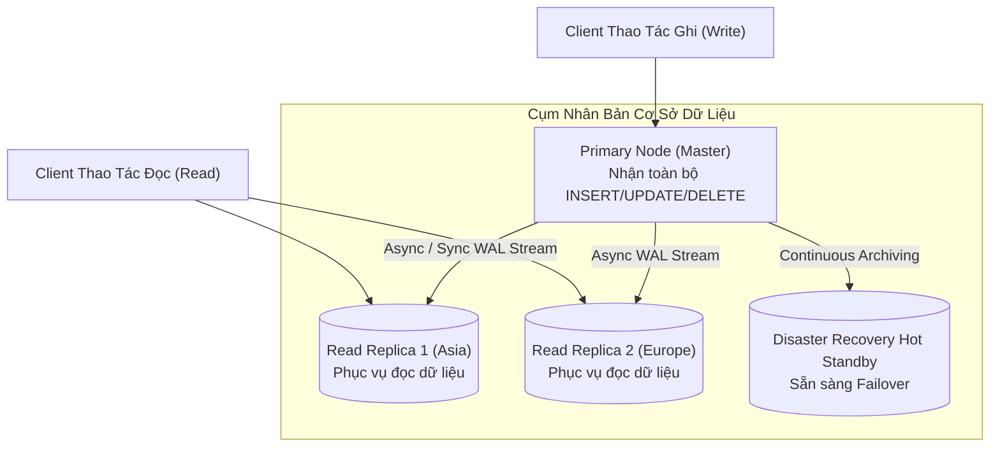
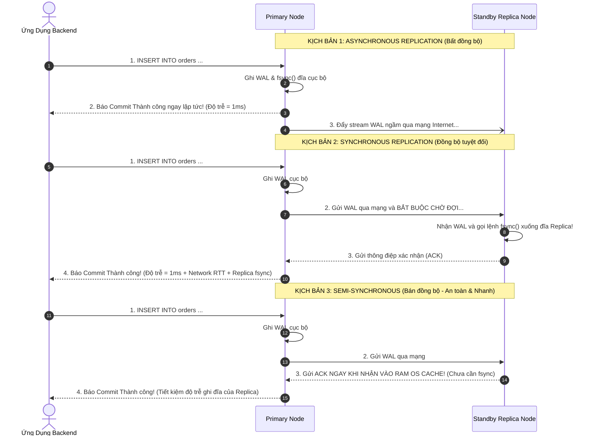
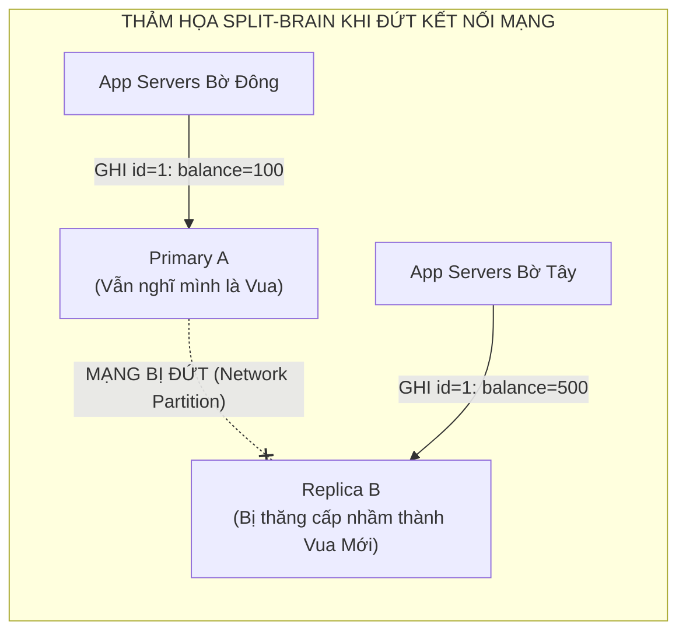

# 9.1. Replication Fundamentals (Nguyên lý Nhân bản Cơ sở Dữ liệu)

> [!IMPORTANT]
> **Nếu bạn chỉ được nhớ một điều duy nhất:** Nhân bản CSDL (Replication) giải quyết hai bài toán sống còn: Khả năng sẵn sàng cao (High Availability - HA) và Mở rộng thông lượng đọc (Read Scale-out): trong mô hình Single-Leader, node chính (Leader) tiếp nhận toàn bộ thao tác Ghi và truyền luồng thay đổi (Replication Stream) sang các node phụ (Replicas) để phục vụ các truy vấn Đọc; tuy nhiên, việc chuyển đổi node chính khi có sự cố (Automatic Failover) luôn tiềm ẩn rủi ro Hội chứng Phân lập não bộ (Split-Brain).

---

## 1. Đơn giản nhưng phải chi tiết (Intuitive & Deep Breakdown)

### 1.1. Đoạn Code Dẫn Nhập & Vấn Đề Thực Tế
Làm thế nào một hệ thống cơ sở dữ liệu có thể mở rộng khả năng phục vụ hàng triệu người dùng đọc đồng thời và duy trì tính sẵn sàng cao (High Availability) khi máy chủ chính (Primary Node) bất ngờ bị cháy chập phần cứng?

```sql
-- Cấu hình Nhân bản Luồng (Streaming Replication) cơ bản trên PostgreSQL
-- Trên Primary Node (postgresql.conf):
wal_level = replica
max_wal_senders = 10
wal_keep_size = '10GB'

-- Trên Standby Replica (standby.signal & postgresql.conf):
primary_conninfo = 'host=10.0.0.1 port=5432 user=replicator password=secret'
hot_standby = on -- Cho phép nhận các câu truy vấn SELECT đọc dữ liệu!

-- KHI PRIMARY BỊ SẬP:
-- Chỉ cần 1 lệnh duy nhất để phong thần Standby thành Primary mới (Failover):
$ pg_ctl promote -D /var/lib/postgresql/data
```

Nếu hệ thống không có cơ chế Nhân bản (Replication), toàn bộ doanh nghiệp của bạn sẽ phụ thuộc vào một "Điểm lỗi duy nhất" (Single Point of Failure - SPOF). Khi chiếc máy chủ duy nhất đó bị hỏng ổ cứng hoặc mất nguồn, toàn bộ hệ thống kinh doanh sẽ bị đóng băng hoàn toàn suốt nhiều ngày!

### 1.2. Ẩn Dụ Đời Sống & Phân Tích Cơ Chế Hoạt Động
Nhân bản Cơ sở Dữ liệu giống như **Quy Trình Hoạt Động Của Một Tòa Soạn Báo Toàn Quốc**:
- **Trụ Sở Chính (Primary Node - Tác giả & Ban Biên Tập)**: Là nơi duy nhất có thẩm quyền viết bài, duyệt bài và chỉnh sửa nội dung (**Chịu trách nhiệm ghi dữ liệu: INSERT, UPDATE, DELETE**).
- **Các Nhà In Vệ Tinh (Read Replicas - Standby Nodes)**: Đặt tại Đà Nẵng, Cần Thơ, Hải Phòng. Mỗi khi ban biên tập ở Hà Nội gõ xong một trang báo:
  - Tòa soạn gửi ngay bản scan trang báo qua mạng cáp quang (**Streaming WAL logs**).
  - Các nhà in vệ tinh chỉ việc in hàng loạt và phát hành cho độc giả địa phương đọc (**Phục vụ các truy vấn SELECT**). Độc giả địa phương không được phép tự ý cầm bút vẽ vào bản thảo gốc!
- **Sự Cố Khẩn Cấp (Failover)**: Nếu tòa soạn Hà Nội bị mất điện đột ngột, ban giám đốc lập tức chỉ định: *"Từ giờ phút này, nhà in Đà Nẵng sẽ trở thành Trụ sở biên tập mới!"* (**Promote Replica to Primary**). Cả tòa báo tiếp tục hoạt động mà không bị gián đoạn một số báo nào!

### 1.3. Mô Phỏng Dữ Liệu Số Nhỏ Từng Bước (Toy Walkthrough)
So sánh giữa Nhân bản Đồng bộ (Synchronous Replication) và Nhân bản Bất đồng bộ (Asynchronous Replication):

| Khía Cạnh Kỹ Thuật | Nhân Bản Đồng Bộ (Sync Replication) | Nhân Bản Bất Đồng Bộ (Async Replication) |
| :--- | :--- | :--- |
| **Cơ Chế Commit** | Primary chờ ít nhất 1 Replica xác nhận đã ghi WAL vào RAM/đĩa mới báo Commit | Primary ghi WAL của mình xong là báo Commit thành công ngay lập tức |
| **Độ Trễ Phía Khách Hàng (Write Latency)**| Bị cộng thêm ít nhất **1 RTT độ trễ mạng** giữa Primary và Replica ($+5 - 20\text{ms}$) | **Siêu thấp (< 1ms)**, không bị ảnh hưởng bởi tốc độ mạng |
| **Rủi Ro Mất Dữ Liệu (RPO)** | **RPO = 0 (Không bao giờ mất dù chỉ 1 transaction)** | **RPO > 0 (Có thể mất vài giây dữ liệu gần nhất)** |
| **Tính Sẵn Sàng (Availability)**| Nếu Replica bị sập hoặc đứt mạng -> **Primary bị treo không cho ghi tiếp!** | Replica sập thì Primary vẫn ung dung hoạt động bình thường |
| **Kịch Bản Sử Dụng Chuẩn** | Hệ thống Chuyển mạch Ngân hàng, Sàn chứng khoán | Mạng xã hội, Thương mại điện tử, Game trực tuyến |

### 1.4. Tác Động Thực Tế Tầng Backend & Systems
- **Thảm Họa Phân Liệt Não (Split-Brain Problem)**: Nếu đường cáp mạng giữa Primary và Standby bị đứt (Network Partition) nhưng cả hai máy chủ vẫn sống, nếu không có cơ chế phân xử Quorum (bầu chọn đa số), Standby có thể tưởng nhầm Primary đã chết và tự phong mình làm Primary mới. Lúc này hệ thống có **2 Primary cùng nhận ghi dữ liệu**, tạo ra hai nhánh dữ liệu mâu thuẫn hoàn toàn không thể hợp nhất!
- **Áp Lực Băng Thông Mạng Nhân Bản (Replication Lag Accumulation)**: Khi trên Primary có một tác vụ chạy ngầm lớn (như cập nhật giá 5 triệu sản phẩm), lượng WAL sinh ra với tốc độ hàng Gigabytes/phút. Nếu đường truyền mạng giữa hai máy chủ không đủ băng thông, Standby sẽ bị tụt hậu (Lag) hàng chục phút, khiến người dùng đọc dữ liệu bị cũ kỹ.

### 1.5. Sơ Đồ Tư Duy & Kiến Trúc Hệ Thống (Mermaid)


---

## 2. Chi tiết từng Keyword (Under-the-Hood Deep Dive)

### 2.1. Các Tô-pô Kiến trúc Nhân bản (Replication Topologies)

Trong khoa học hệ thống phân tán, có 3 mô hình tô-pô nhân bản kinh điển:

#### 1. Single-Leader / Primary-Replica (Active-Passive / Leader-Follower)
- **Quy tắc Kiến trúc**: Chỉ có **duy nhất 1 nút Leader (Primary)** được cấp quyền tiếp nhận các thao tác sửa đổi trạng thái (Ghi). Các nút Follower (Replicas) đóng vai trò là bản sao thụ động (Passive Replicas), chỉ nhận luồng nhật ký thay đổi và áp dụng lại (Replay) vào bộ nhớ/đĩa của mình để phục vụ các truy vấn đọc.
- **Ưu điểm**: Loại bỏ hoàn toàn nguy cơ xung đột ghi (Zero Write-Write Conflicts) vì mọi thao tác ghi đều được tuần tự hóa qua một đầu não duy nhất.
- **Hạn chế**: Băng thông ghi (Write Scalability) bị giới hạn bởi năng lực phần cứng của đúng 1 máy chủ Leader duy nhất.

#### 2. Multi-Leader (Active-Active / Master-Master)
- **Quy tắc Kiến trúc**: Nhiều máy chủ (thường đặt rải rác ở các trung tâm dữ liệu độc lập như US-East, EU-West, AP-East) cùng đồng thời đóng vai trò Leader và tiếp nhận thao tác ghi từ người dùng trong khu vực địa lý của mình.
- **Thách thức Sống Còn: Giải quyết Xung đột Ghi (Write Conflict Resolution)**:
  - Nếu Người dùng $A$ ở Mỹ sửa email thành `a@us.com`, trong khi Người dùng $B$ ở Đức sửa email của cùng tài khoản đó thành `b@eu.com` cùng một giây:
  - Hai trung tâm dữ liệu ghi nhận hai giá trị khác nhau. Khi hai nút truyền dữ liệu cho nhau, xung đột bùng nổ!
  - **Thuật toán giải quyết**:
    - *Last-Write-Wins (LWW)*: Dựa trên NTP Timestamp (dễ bị sai lệch do Clock Drift).
    - *CRDTs (Conflict-free Replicated Data Types)*: Cấu trúc dữ liệu hội tụ tự động dựa trên toán học (dùng trong chat, giỏ hàng).

#### 3. Leaderless Replication (Mô hình Không Leader - Dynamo-style / Cassandra)
- Được tiên phong bởi Amazon Dynamo (2007) và hiện thực hóa trong Apache Cassandra, ScyllaDB.
- **Quy tắc**: Không có bất kỳ nút nào là Leader. Client gửi đồng thời câu lệnh đọc hoặc ghi tới $N$ nút trong cụm (Replica Set).
- **Quy tắc Số Đông Quorum ($R + W > N$)**:
  - $N$: Tổng số bản sao cấu hình cho một hàng dữ liệu.
  - $W$: Số lượng nút bắt buộc phải xác nhận ghi thành công trước khi báo cho client.
  - $R$: Số lượng nút bắt buộc phải phản hồi dữ liệu khi đọc.
  - Khi $R + W > N$: Theo nguyên lý chuồng bồ câu (Pigeonhole Principle), tập hợp các nút đọc và tập hợp các nút ghi **chắc chắn phải có ít nhất 1 nút giao nhau**. Nút giao này sẽ mang giá trị mới nhất (xác định qua Version Number)!

---

### 2.2. Mô hình Đồng bộ: Synchronous vs Asynchronous vs Semi-Synchronous

Sự khác biệt giữa các mô hình đồng bộ nằm ở thời điểm mà nút Leader quyết định gửi thông báo *"Giao dịch của bạn đã hoàn tất thành công!"* về cho ứng dụng client:



#### Bảng Phân Tích So Sánh Đánh Đổi Kỹ Thuật Chuyên Sâu

| Thuộc Tính Kỹ Thuật | Asynchronous (Bất đồng bộ) | Semi-Synchronous (Bán đồng bộ) | Synchronous (Đồng bộ Tuyệt đối) |
| :--- | :--- | :--- | :--- |
| **Độ Trễ Ghi (Write Latency)** | **Thấp nhất** ($\approx 0.5 - 2\text{ ms}$, chỉ tốn I/O nội bộ) | Trung bình ($+ 1\text{ Network RTT}$) | **Cao nhất** ($+ 1\text{ RTT} + \text{fsync đĩa Replica}$) |
| **Mất Mát Dữ Liệu Khi Leader Chết**| **RPO > 0** (Mất các giao dịch trong Replication Lag) | **RPO $\approx$ 0** (Dữ liệu đã nằm trên RAM của Replica) | **RPO = 0 Tuyệt đối** (Dữ liệu đã nằm trên đĩa Replica) |
| **Hành Vi Khi Replica Bị Đứt Mạng** | Leader tiếp tục ghi bình thường, không bị ảnh hưởng. | Chờ hết thời gian timeout rồi tự hạ cấp về Asynchronous. | **Toàn bộ hệ thống bị đóng băng hoàn toàn**, từ chối mọi lệnh ghi! |
| **Khuyến Nghị Sử Dụng** | Đọc nhiều, chấp nhận mất mát vài giây dữ liệu (MXH, Logs). | **Chuẩn mực vàng cho ứng dụng E-Commerce, Ngân hàng**. | Hệ thống tài chính chứng khoán bắt buộc Zero-RPO nội vùng. |

---

### 2.3. Replication Lag & Replication Slots

#### 1. Replication Lag (Độ Trễ Nhân Bản) Đo Bằng Cách Nào?
Replication Lag có thể được định lượng qua 2 thước đo:
1. **Time-Based Lag (Độ trễ thời gian)**: Khoảng thời gian từ lúc giao dịch được commit trên Primary đến lúc được áp dụng xong trên Replica:
   $$\Delta t = t_{\text{now}} - t_{\text{replica\_last\_replay\_timestamp}}$$
2. **Byte-Based Lag (Độ trễ dung lượng byte WAL)**: Đo đạc khoảng cách chính xác theo trục LSN trong PostgreSQL:
   ```sql
   SELECT pg_wal_lsn_diff(pg_current_wal_lsn(), replay_lsn) AS lag_bytes
   FROM pg_stat_replication;
   ```
   Nếu `lag_bytes = 104,857,600` (100MB), nghĩa là Replica đang bị tụt hậu $100\text{ MB}$ nhật ký phía sau Primary.

#### 2. Nguyên Nhân Gốc Rễ Khiến Replica Bị Tụt Hậu
- **Bất đối xứng phần cứng**: Máy chủ Replica có CPU hoặc ổ đĩa SSD yếu hơn Primary.
- **Tiến trình Replay đơn luồng (Single-Threaded Applier)**: Trên Primary, hàng trăm kết nối client ghi đồng thời đa luồng; nhưng trên Replica, chỉ có đúng một tiến trình nền (`startup` worker) tuần tự đọc WAL và áp dụng vào đĩa.
- **Xung đột Khóa Đọc trên Replica (Lock Conflicts with Recovery)**: Người dùng đang chạy một câu truy vấn báo cáo kéo dài 10 phút trên Replica. Câu truy vấn này giữ khóa đọc trên bảng `orders`. Khi một bản ghi WAL từ Primary yêu cầu sửa cấu trúc bảng `orders` đổ về, tiến trình Replay bị **chặn đứng lại**, khiến Replication Lag tăng vọt liên tục trong 10 phút đó!

#### 3. Replication Slots - Con Dao Hai Lưỡi
- **Mục đích**: Ngăn ngừa Primary xóa các tệp WAL cũ mà Replica chưa kịp kéo về.
- **Cơ chế**: Replication Slot lưu giữ mốc `restart_lsn`. Primary cam đoan: *"Tôi sẽ giữ lại toàn bộ các tệp WAL có LSN $\ge$ `restart_lsn` trên đĩa cứng của tôi"*.
- **Hiểm họa Sập Ổ Cứng**: Nếu máy chủ Replica bị tắt nguồn đi bảo trì trong 3 ngày:
  - Replication Slot trên Primary không nhả con trỏ LSN.
  - Hàng trăm GB tệp WAL mới liên tục tích tụ trong thư mục `pg_wal`.
  - Ổ đĩa của Primary chạm mốc $100\%$, làm Primary crash ngay lập tức!
- **Cấu hình Tự Vệ trong `postgresql.conf`**:
  ```ini
  max_slot_wal_keep_size = 64GB # Nếu Replica tụt hậu quá 64GB, Primary sẽ tự hủy slot để tự cứu sống mình!
  ```

---

### 2.4. Failover, Switchover & Thảm họa Split-Brain

#### 1. Phân Biệt: Switchover vs Failover
- **Switchover (Chuyển đổi Chủ Động Có Kế Hoạch)**:
  - Dùng khi cần bảo trì phần cứng, cập nhật hệ điều hành cho Primary.
  - Các bước: Chặn ghi trên Primary cũ $\rightarrow$ Đợi Replica đồng bộ $100\%$ ($\text{Lag} = 0$) $\rightarrow$ Thăng cấp Replica thành Primary mới $\rightarrow$ Chuyển Primary cũ thành Replica.
  - **Zero Data Loss, Zero Downtime**!
- **Failover (Chuyển đổi Dự Phòng Bắt Buộc khi Sự Cố)**:
  - Primary bị sập đột ngột (chết nguồn, đứt mạng).
  - Hệ thống điều phối tự động chọn Replica có LSN cao nhất và thăng cấp lên làm Primary mới.
  - Nếu đang chạy Asynchronous, một số giao dịch chưa kịp đồng bộ sẽ bị mất mát.

#### 2. Thảm Họa Split-Brain (Phân Liệt Não)
Xảy ra khi đường truyền mạng giữa 2 trung tâm dữ liệu bị đứt (Network Partition) nhưng cả hai máy chủ vẫn còn sống:



- Cả hai nút cùng nhận các câu lệnh `UPDATE` mâu thuẫn trên cùng một tài khoản.
- Lịch sử dữ liệu bị phân nhánh (Divergence). Khi mạng nối lại, hai cơ sở dữ liệu **hoàn toàn không thể tự động sáp nhập lại**, buộc kỹ sư phải đối soát thủ công từng dòng và bồi thường thiệt hại cho khách hàng!

#### 3. Kỹ Thuật Cô Lập Phần Cứng STONITH / Fencing
Để ngăn chặn Split-Brain, các hệ thống HA hiện đại (Patroni, Pacemaker) sử dụng giải thuật đồng thuận phân tán (Distributed Consensus qua etcd, Consul, Raft) kết hợp cơ chế:
$$\mathbf{STONITH} \quad \text{("Shoot The Other Node In The Head")}$$
- **Nguyên tắc Sắt Đá**: Trước khi cho phép Node B được thăng cấp lên làm Primary mới, Bộ điều phối bắt buộc phải kích hoạt cơ chế Fencing:
  - Gửi tín hiệu ngắt nguồn vật lý qua cổng quản trị máy chủ từ xa (IPMI / iLO / APC Smart-PDU).
  - Hoặc thu hồi quyền ghi qua Cloud IAM API (AWS EC2 Stop Instance / Detach EBS Volume).
  - **Bảo đảm chắc chắn $100\%$ máy chủ Primary cũ đã chết hẳn** trước khi trao ngai vàng cho máy chủ mới!

---

## 3. Thực thi Mã nguồn & Mô phỏng Chuyên sâu (Dual-Engine Implementation)

### 1. Động cơ C++20: Mô phỏng Cụm Primary-Replica Hỗ trợ Cả Async và Semi-Sync

Chương trình C++20 dưới đây triển khai một cụm cơ sở dữ liệu phân tán gồm 1 Primary và 2 Replicas, đo đạc trực tiếp độ trễ ghi và dung lượng Replication Lag:

```cpp
// compile: g++ -std=c++20 -O3 replication_cluster_sim.cpp -o repl_sim
#include <iostream>
#include <vector>
#include <string>
#include <chrono>
#include <format>
#include <thread>
#include <memory>
#include <cstdint>

enum class ReplicationMode { ASYNCHRONOUS, SEMI_SYNCHRONOUS };

struct WALMessage {
    uint64_t lsn;
    std::string payload;
};

// Mô phỏng một nút Standby Read Replica
class StandbyReplicaNode {
public:
    std::string node_name;
    uint64_t replayed_lsn = 0;
    int network_latency_ms; // Giả lập độ trễ mạng tới Primary

    StandbyReplicaNode(std::string name, int latency) 
        : node_name(name), network_latency_ms(latency) {}

    // Nhận và áp dụng WAL
    void receive_wal(const WALMessage& msg, bool simulate_async_delay = false) {
        // Giả lập độ trễ truyền gói tin mạng
        std::this_thread::sleep_for(std::chrono::milliseconds(network_latency_ms));
        
        if (simulate_async_delay) {
            // Giả lập Replica bị quá tải hoặc vướng lock -> replay chậm
            std::this_thread::sleep_for(std::chrono::milliseconds(15));
        }
        replayed_lsn = msg.lsn;
    }
};

// Nút Primary tiếp nhận ghi và điều phối stream nhân bản
class PrimaryNode {
private:
    uint64_t current_lsn = 1000;
    std::vector<std::shared_ptr<StandbyReplicaNode>> replicas;
    ReplicationMode mode;

public:
    PrimaryNode(ReplicationMode m) : mode(m) {}

    void add_replica(std::shared_ptr<StandbyReplicaNode> rep) {
        replicas.push_back(rep);
    }

    uint64_t write_transaction(const std::string& sql) {
        auto start_time = std::chrono::high_resolution_clock::now();
        
        // 1. Ghi WAL cục bộ trên Primary
        current_lsn += 128; // Tăng LSN thêm 128 bytes
        WALMessage msg = {.lsn = current_lsn, .payload = sql};
        std::this_thread::sleep_for(std::chrono::milliseconds(1)); // fsync() cục bộ

        // 2. Điều phối nhân bản sang Replicas
        if (mode == ReplicationMode::ASYNCHRONOUS) {
            // Chế độ Bất đồng bộ: Bắn tín hiệu và trả về ngay cho Client!
            for (auto& rep : replicas) {
                // Chạy ngầm trong thread riêng biệt (detached)
                std::thread([rep, msg]() {
                    rep->receive_wal(msg, true);
                }).detach();
            }
        } else if (mode == ReplicationMode::SEMI_SYNCHRONOUS) {
            // Chế độ Bán đồng bộ: Bắt buộc CHỜ ít nhất 1 Replica gửi xác nhận ACK!
            // Gửi tới replica nhanh nhất
            if (!replicas.empty()) {
                replicas[0]->receive_wal(msg, false); // Chờ ACK từ Replica 1
            }
        }

        auto end_time = std::chrono::high_resolution_clock::now();
        double elapsed_ms = std::chrono::duration<double, std::milli>(end_time - start_time).count();

        std::cout << std::format("  [Primary] Commit Tx LSN={} | SQL: '{}' | Latency: {:.2f} ms\n", 
                                 current_lsn, sql, elapsed_ms);
        return current_lsn;
    }

    void print_replication_status() {
        std::cout << "\n--- BÁO CÁO REPLICATION LAG TRÊN PRIMARY (Current LSN: " << current_lsn << ") ---\n";
        for (const auto& rep : replicas) {
            uint64_t lag_bytes = current_lsn - rep->replayed_lsn;
            std::cout << std::format("  -> Replica '{}': Replayed LSN = {} | Lag = {} bytes ({})\n",
                                     rep->node_name, rep->replayed_lsn, lag_bytes,
                                     lag_bytes == 0 ? "IN SYNC" : "LAGGING!");
        }
        std::cout << "----------------------------------------------------------------------\n\n";
    }
};

int main() {
    std::cout << "=== MÔ PHỎNG CỤM NHÂN BẢN CƠ SỞ DỮ LIỆU C++20 ===\n\n";

    // ---------------------------------------------------------
    // TEST 1: CHẠY Ở CHẾ ĐỘ ASYNCHRONOUS (Độ trễ thấp, xuất hiện Lag)
    // ---------------------------------------------------------
    std::cout << ">>> KỊCH BẢN 1: REPLICATION CHẾ ĐỘ ASYNCHRONOUS <<<\n";
    PrimaryNode async_primary(ReplicationMode::ASYNCHRONOUS);
    auto repA = std::make_shared<StandbyReplicaNode>("Replica-US-East", 2);
    auto repB = std::make_shared<StandbyReplicaNode>("Replica-EU-West", 10);
    async_primary.add_replica(repA);
    async_primary.add_replica(repB);

    async_primary.write_transaction("INSERT INTO orders (id, total) VALUES (1, 100)");
    async_primary.write_transaction("UPDATE orders SET total = 150 WHERE id = 1");
    // Kiểm tra ngay khi vừa ghi: Replicas chắc chắn bị tụt hậu (Replication Lag)!
    async_primary.print_replication_status();

    // Chờ 50ms để các thread nền hoàn tất việc stream WAL
    std::this_thread::sleep_for(std::chrono::milliseconds(50));
    std::cout << "[Sau 50ms mạng truyền dẫn]:";
    async_primary.print_replication_status();

    // ---------------------------------------------------------
    // TEST 2: CHẠY Ở CHẾ ĐỘ SEMI-SYNCHRONOUS (Bảo đảm an toàn dữ liệu)
    // ---------------------------------------------------------
    std::cout << ">>> KỊCH BẢN 2: REPLICATION CHẾ ĐỘ SEMI-SYNCHRONOUS <<<\n";
    PrimaryNode semi_primary(ReplicationMode::SEMI_SYNCHRONOUS);
    auto repSync = std::make_shared<StandbyReplicaNode>("Replica-Local-DC", 3);
    semi_primary.add_replica(repSync);

    semi_primary.write_transaction("INSERT INTO users (id, name) VALUES (99, 'Dave')");
    semi_primary.print_replication_status();

    return 0;
}
```

---

### 2. Động cơ Python 3.11+: Bộ Định Tuyến Đọc/Ghi Thông Minh và Tự Động Cách Ly Replica Lag

Script Python dưới đây mô phỏng một Connection Router thông minh: tự động phân luồng Đọc/Ghi và giám sát dung lượng Replication Lag qua `pg_wal_lsn_diff()`. Nếu một Replica bị tụt hậu vượt quá ngưỡng $5\text{ MB}$, Router sẽ lập tức loại bỏ Replica đó khỏi danh sách đọc để bảo vệ người dùng khỏi việc đọc dữ liệu cũ:

```python
#!/usr/bin/env python3
"""
Bộ Định Tuyến Cơ Sở Dữ Liệu Thông Minh Tự Động Tách Luồng Đọc/Ghi
và Cách Ly Read Replicas Bị Tụt Hậu (Adaptive Read-Write Router).
Môi trường yêu cầu: Python 3.11+
"""

from dataclasses import dataclass
from typing import List, Dict, Optional

@dataclass
class ReplicaHealth:
    name: str
    replayed_lsn: int
    is_active: bool = True

class SmartDatabaseRouter:
    def __init__(self, primary_name: str, max_allowed_lag_bytes: int = 5_000_000):
        self.primary_name = primary_name
        self.primary_lsn = 100_000_000 # LSN hiện tại của Primary (~100 MB)
        self.max_lag = max_allowed_lag_bytes
        self.replicas: List[ReplicaHealth] = [
            ReplicaHealth("replica-zone-a", replayed_lsn=99_800_000), # Lag 200KB (Tốt)
            ReplicaHealth("replica-zone-b", replayed_lsn=92_000_000), # Lag 8MB (QUÁ TẢI - VƯỢT NGƯỠNG!)
            ReplicaHealth("replica-zone-c", replayed_lsn=99_950_000)  # Lag 50KB (Tốt)
        ]
        self.rr_index = 0

    def execute_query(self, sql: str) -> str:
        trimmed = sql.strip().upper()
        is_write = any(trimmed.startswith(verb) for verb in ["INSERT", "UPDATE", "DELETE", "ALTER", "CREATE"])

        if is_write:
            self.primary_lsn += 1024 # Mô phỏng phát sinh thêm 1KB WAL
            return f"👉 [WRITE ROUTED TO PRIMARY ({self.primary_name})]: SQL: '{sql}' (New LSN: {self.primary_lsn:,})"
        else:
            # Chọn Replica hợp lệ
            selected_node = self._get_healthy_read_node()
            return f"📖 [READ ROUTED TO REPLICA ({selected_node})]: SQL: '{sql}'"

    def _get_healthy_read_node(self) -> str:
        # Lọc danh sách các Replicas có Replication Lag trong ngưỡng cho phép
        healthy_replicas = []
        for r in self.replicas:
            lag = self.primary_lsn - r.replayed_lsn
            if lag <= self.max_lag and r.is_active:
                healthy_replicas.append((r.name, lag))
            else:
                print(f"  ⚠️ [CÁCH LY REPLICA]: '{r.name}' bị tụt hậu {lag:,} bytes (> {self.max_lag:,} bytes)! LOẠI BỎ KHỎI DANH SÁCH ĐỌC!")

        if not healthy_replicas:
            print("  🚨 [CẢNH BÁO KHẨN]: Toàn bộ Replicas đều bị lag! Buộc phải đọc trực tiếp từ Primary!")
            return self.primary_name

        # Cân bằng tải Round-Robin trên các node khỏe mạnh
        node_name, lag = healthy_replicas[self.rr_index % len(healthy_replicas)]
        self.rr_index += 1
        return f"{node_name} (Lag: {lag:,}B)"

if __name__ == "__main__":
    print("=" * 70)
    print("MÔ PHỎNG ADAPTIVE READ-WRITE DATABASE ROUTER (PYTHON 3.11)")
    print("=" * 70)

    router = SmartDatabaseRouter(primary_name="primary-db-master", max_allowed_lag_bytes=5_000_000)

    # 1. Thao tác Ghi
    print(router.execute_query("INSERT INTO orders (id, total) VALUES (501, 250.0)"))
    print(router.execute_query("UPDATE users SET status = 'ACTIVE' WHERE id = 10"))

    # 2. Thao tác Đọc phân tán
    print("\n--- PHÂN PHỐI CÁC TRUY VẤN ĐỌC ---")
    for i in range(4):
        print(router.execute_query(f"SELECT * FROM products WHERE category_id = {i+1}"))

    print("=" * 70)
```

---

### 3. Kết quả Thực thi Terminal Mẫu Chuẩn Thực tế

```bash
$ g++ -std=c++20 -O3 replication_cluster_sim.cpp -o repl_sim
$ ./repl_sim
=== MÔ PHỎNG CỤM NHÂN BẢN CƠ SỞ DỮ LIỆU C++20 ===

>>> KỊCH BẢN 1: REPLICATION CHẾ ĐỘ ASYNCHRONOUS <<<
  [Primary] Commit Tx LSN=1128 | SQL: 'INSERT INTO orders (id, total) VALUES (1, 100)' | Latency: 1.05 ms
  [Primary] Commit Tx LSN=1256 | SQL: 'UPDATE orders SET total = 150 WHERE id = 1' | Latency: 1.02 ms

--- BÁO CÁO REPLICATION LAG TRÊN PRIMARY (Current LSN: 1256) ---
  -> Replica 'Replica-US-East': Replayed LSN = 0 | Lag = 1256 bytes (LAGGING!)
  -> Replica 'Replica-EU-West': Replayed LSN = 0 | Lag = 1256 bytes (LAGGING!)
----------------------------------------------------------------------

[Sau 50ms mạng truyền dẫn]:
--- BÁO CÁO REPLICATION LAG TRÊN PRIMARY (Current LSN: 1256) ---
  -> Replica 'Replica-US-East': Replayed LSN = 1256 | Lag = 0 bytes (IN SYNC)
  -> Replica 'Replica-EU-West': Replayed LSN = 1256 | Lag = 0 bytes (IN SYNC)
----------------------------------------------------------------------

>>> KỊCH BẢN 2: REPLICATION CHẾ ĐỘ SEMI-SYNCHRONOUS <<<
  [Primary] Commit Tx LSN=1384 | SQL: 'INSERT INTO users (id, name) VALUES (99, 'Dave')' | Latency: 4.12 ms

--- BÁO CÁO REPLICATION LAG TRÊN PRIMARY (Current LSN: 1384) ---
  -> Replica 'Replica-Local-DC': Replayed LSN = 1384 | Lag = 0 bytes (IN SYNC)
----------------------------------------------------------------------

$ python3 smart_router_sim.py
======================================================================
MÔ PHỎNG ADAPTIVE READ-WRITE DATABASE ROUTER (PYTHON 3.11)
======================================================================
👉 [WRITE ROUTED TO PRIMARY (primary-db-master)]: SQL: 'INSERT INTO orders (id, total) VALUES (501, 250.0)' (New LSN: 100,001,024)
👉 [WRITE ROUTED TO PRIMARY (primary-db-master)]: SQL: 'UPDATE users SET status = 'ACTIVE' WHERE id = 10' (New LSN: 100,002,048)

--- PHÂN PHỐI CÁC TRUY VẤN ĐỌC ---
  ⚠️ [CÁCH LY REPLICA]: 'replica-zone-b' bị tụt hậu 8,002,048 bytes (> 5,000,000 bytes)! LOẠI BỎ KHỎI DANH SÁCH ĐỌC!
📖 [READ ROUTED TO REPLICA (replica-zone-a (Lag: 202,048B))]: SQL: 'SELECT * FROM products WHERE category_id = 1'
  ⚠️ [CÁCH LY REPLICA]: 'replica-zone-b' bị tụt hậu 8,002,048 bytes (> 5,000,000 bytes)! LOẠI BỎ KHỎI DANH SÁCH ĐỌC!
📖 [READ ROUTED TO REPLICA (replica-zone-c (Lag: 52,048B))]: SQL: 'SELECT * FROM products WHERE category_id = 2'
  ⚠️ [CÁCH LY REPLICA]: 'replica-zone-b' bị tụt hậu 8,002,048 bytes (> 5,000,000 bytes)! LOẠI BỎ KHỎI DANH SÁCH ĐỌC!
📖 [READ ROUTED TO REPLICA (replica-zone-a (Lag: 202,048B))]: SQL: 'SELECT * FROM products WHERE category_id = 3'
======================================================================
```

---

## 4. Systems Engineering & Production Pitfalls

### 1. Dị Thường "Đọc Không Thấy Dữ Liệu Vừa Ghi" (Read-Your-Own-Writes Violation)
- **Kịch bản Lỗi Người Dùng**:
  1. Người dùng vào trang cá nhân đổi ảnh đại diện (Avatar) và bấm "Lưu". Yêu cầu `POST /profile` được Router gửi vào máy chủ **Primary**. Primary ghi dữ liệu thành công trong $2\text{ ms}$.
  2. Trình duyệt người dùng tự động chuyển hướng (Redirect) sang trang xem hồ sơ `GET /profile`.
  3. Yêu cầu `GET` được Router phân phối vào một **Read Replica**.
  4. Do Replication Lag đang là $500\text{ ms}$, Replica chưa nhận được bản ghi WAL đổi avatar.
  5. Người dùng nhìn thấy ảnh đại diện cũ! Họ hoang mang bấm nút lưu liên tục vì tưởng hệ thống bị lỗi.
- **Giải Pháp Kỹ Thuật (Sticky Primary Read)**:
  - Khi một người dùng vừa thực hiện một thao tác Ghi: Backend lưu một con cờ trong Cookie/Redis (`user_last_write_timestamp = now()`).
  - Trong vòng **5 giây tiếp theo**, mọi yêu cầu đọc của người dùng đó **bắt buộc phải được định tuyến trực tiếp vào Primary** để đảm bảo tính nhất quán *Read-Your-Own-Writes*!

### 2. Sự Cố Nghẽn Nhân Bản Đơn Luồng trong MySQL (Single-Threaded Slave Bottleneck)
- **Bản chất**: Trước phiên bản MySQL 5.7/8.0, tiến trình SQL Thread trên Slave chỉ chạy bằng một luồng CPU duy nhất để áp dụng các sự kiện từ Binlog.
- Trên Master có 64 lõi CPU xử lý 10,000 transactions/giây. Slave chỉ có 1 luồng xử lý không kịp, dẫn đến `Seconds_Behind_Master` tăng vọt từ $1\text{ giây}$ lên hàng nghìn giây.
- **Cấu hình Cứu Hỏa trên MySQL 8.0**: Bật tính năng Nhân bản Đa luồng (Multi-Threaded Slave - MTS):
  ```ini
  slave_parallel_type = LOGICAL_CLOCK
  slave_parallel_workers = 16          # Tận dụng 16 luồng CPU để replay Binlog song song!
  slave_preserve_commit_order = ON     # Bảo đảm trật tự commit đồng nhất với Master
  ```

---

## 5. Bảng So sánh & Decision Matrix

### Ma trận So sánh Toàn diện Ba Tô-pô Nhân bản CSDL

| Tiêu Chí Kỹ Thuật | Single-Leader (Primary-Replica) | Multi-Leader (Active-Active) | Leaderless (Quorum Dynamo/Cassandra) |
| :--- | :--- | :--- | :--- |
| **Xung Đột Ghi (Write Conflicts)**| **Hoàn toàn Không Có** ($O(1)$) | **Rất Phức Tạp** (Cần LWW, CRDTs) | Không có Leader; giải quyết qua Quorum |
| **Mở Rộng Ghi (Write Scalability)**| Bị giới hạn bởi 1 máy chủ Leader | Rất tốt (Ghi tại Datacenter địa phương) | **Tối thượng** (Mở rộng tuyến tính theo số node) |
| **Mở Rộng Đọc (Read Scalability)** | Xuất sắc (Thêm nhiều Read Replicas) | Xuất sắc (Đọc tại chỗ) | Xuất sắc ($R + W > N$) |
| **Độ Phức Tạp Vận Hành** | Thấp đến trung bình | Cực kỳ cao | Trung bình |
| **Hệ Quản Trị Tiêu Biểu** | PostgreSQL, MySQL, Oracle, MongoDB | CockroachDB, CouchDB, Bimodal MySQL | Apache Cassandra, ScyllaDB, Amazon DynamoDB |

### Ma trận Lựa chọn Công Cụ Quản Lý High Availability & Chống Split-Brain

| Giải Pháp HA | Cơ Chế Phục Hồi Thất Bại (Failover) | Cơ Chế Phòng Chống Split-Brain | Hệ Quản Trị Hỗ Trợ |
| :--- | :--- | :--- | :--- |
| **Patroni** | Tự động thăng cấp dựa trên thuật toán đồng thuận Raft | **Được bảo đảm tuyệt đối** qua DCS (etcd / Consul) | **PostgreSQL (Chuẩn mực vàng)** |
| **Orchestrator** | Tự động phát hiện cấu trúc topo và chuyển đổi | Sử dụng cơ chế cấm ghi Read-Only cưỡng bức | **MySQL (Chuẩn mực vàng)** |
| **Keepalived + VIP** | Chuyển đổi IP ảo (Virtual IP) dựa trên VRRP | **Rất dễ bị Split-Brain** nếu mạng chập chờn! | Không khuyên dùng cho Database |
| **AWS Aurora** | Quản lý tầng lưu trữ phân tán (Storage Quorum 4/6) | Tự động bởi tầng ảo hóa siêu hội tụ của AWS | Managed Cloud (PostgreSQL / MySQL) |

---

## 6. Enterprise Production Checklist & Verification

### 6.1. Kiến Trúc & Cấu Hình Tối Ưu (Production-Ready Architecture)
- [ ] **Triển Khai Mô Hình Semi-Synchronous Replication**: Cấu hình `synchronous_commit = remote_write` với 1 Sync Replica để vừa bảo đảm RPO = 0 vừa giảm độ trễ ghi đĩa của Replica.
- [ ] **Sử Dụng Cơ Chế Bầu Chọn Đa Số Chống Split-Brain**: Luôn duy trì số lượng node lẻ (tối thiểu 3 nodes: ví dụ 1 Primary + 1 Standby + 1 Witness/Quorum Node) bằng các công cụ như Patroni hoặc Orchestrator.
- [ ] **Bảo Vệ WAL Khỏi Bị Xóa Sớm Bằng Replication Slots**: Luôn sử dụng Replication Slots (`wal_level = replica`) để Primary không bao giờ tự ý dọn dẹp các đoạn WAL mà Replica chưa kịp nhận.
- [ ] **Định Tuyến Đọc/Ghi Tự Động Bằng Database Proxy**: Đặt HAProxy, ProxySQL, hoặc PgBouncer trước cụm database để tự động chuyển tiếp các câu lệnh SELECT sang Replicas và INSERT/UPDATE sang Primary.

### 6.2. Giám Sát, Cảnh Báo & Xử Lý Sự Cố (Observability & Incident Response)
- [ ] **Giám Sát Độ Trễ Nhân Bản (Replication Lag)**: Thiết lập cảnh báo Prometheus khi độ trễ nhân bản `pg_stat_replication.replay_lag` vượt quá 5 giây hoặc dung lượng lag vượt quá 1GB.
- [ ] **Cảnh Báo Kích Thước Replication Slot Bị Tồn Đọng**: Giám sát `pg_replication_slots.wal_status`; cảnh báo ngay khi có slot bị mất kết nối làm tích tụ WAL đầy ổ đĩa Primary.
- [ ] **Kiểm Tra Trạng Thái Nhân Bản Bằng CLI**: Sử dụng lệnh `SELECT * FROM pg_stat_replication;` trên Primary để xác thực IP, trạng thái sync, và vị trí LSN của tất cả các Standby.
