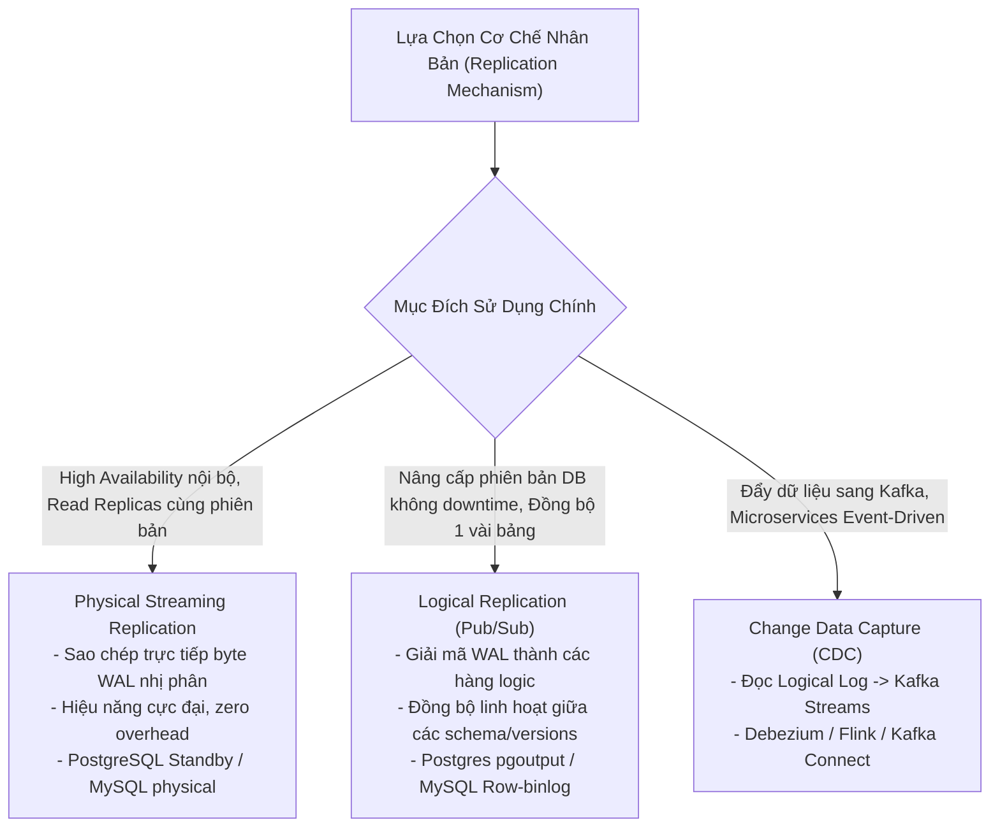
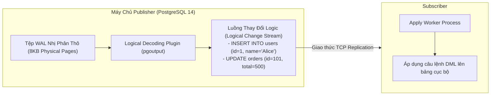
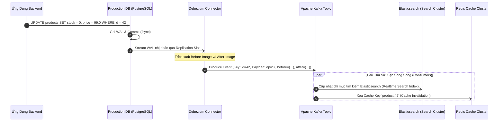

# 9.2. Replication Mechanisms (Các Cơ chế Hiện thực Nhân bản)

> [!IMPORTANT]
> **Nếu bạn chỉ được nhớ một điều duy nhất:** Cơ chế đồng bộ nhân bản là bài toán cân não giữa Độ an toàn dữ liệu và Độ trễ ghi ứng dụng: Đồng bộ hoàn toàn (Synchronous) cam kết 0% rủi ro mất dữ liệu ($RPO = 0$) nhưng độ trễ ghi của Leader bị kéo dài bằng độ trễ mạng của node xa nhất; Bất đồng bộ (Asynchronous) cho tốc độ ghi cực nhanh nhưng chấp nhận mất mát dữ liệu chưa kịp gửi khi Leader sập nguồn; và Bán đồng bộ (Semi-synchronous) là giải pháp dung hòa: chỉ chờ ít nhất 1 node Replica xác nhận đã nhận log vào đĩa.

---

## 1. Đơn giản nhưng phải chi tiết (Intuitive & Deep Breakdown)

### 1.1. Đoạn Code Dẫn Nhập & Vấn Đề Thực Tế
Làm thế nào dữ liệu được truyền tải thực tế giữa các máy chủ: gửi nguyên vẹn câu lệnh SQL (Statement-based), gửi bản ghi nhị phân của các dòng bị sửa (Row-based), hay gửi trực tiếp các byte nhật ký đĩa vật lý (Physical WAL)?

```sql
-- Thảm họa của Statement-Based Replication (SBR) trên MySQL cổ điển:
-- Primary thực thi câu lệnh SQL có chứa hàm phi tất định (Non-deterministic Function):
INSERT INTO user_coupons (user_id, coupon_code, created_at)
VALUES (101, 'SALE50', NOW());

-- Câu lệnh này được gửi nguyên văn sang Replica và chạy lại:
-- Do trễ mạng vài giây, hàm NOW() trên Replica sinh ra giá trị GIỜ KHÁC với Primary!
-- Hoặc nếu dùng: UPDATE products SET stock = stock - 1 LIMIT 1;
-- Trên Primary trừ sản phẩm A, nhưng trên Replica lại trừ nhầm sản phẩm B!
-- HẬU QUẢ: Dữ liệu giữa Master và Slave bị phân kỳ (Data Drift) vĩnh viễn!
```

Hiểu rõ cơ chế nhân bản giúp kỹ sư tránh được những cái bẫy phân kỳ dữ liệu chết người và biết khi nào nên dùng **Physical Replication** (nhanh, đồng nhất nhị phân 1:1) và khi nào nên dùng **Logical Replication** (linh hoạt, hỗ trợ đồng bộ giữa các phiên bản database khác nhau).

### 1.2. Ẩn Dụ Đời Sống & Phân Tích Cơ Chế Hoạt Động
So sánh các cơ chế nhân bản giống như **Các Phương Thức Sao Chép Một Bức Họa Nổi Tiếng**:
- **Statement-Based Replication (Chép Lại Lời Miêu Tả Của Họa Sĩ)**:
  - Họa sĩ chính hô lớn: *"Vẽ một vòng tròn màu đỏ ở góc trên bên phải!"*.
  - Người học trò ở xa nghe lời và tự cầm cọ vẽ lại. Nhưng vì góc nhìn và tâm trạng khác nhau, vòng tròn của học trò sẽ bị lệch 2cm và màu đậm hơn (**Dữ liệu bị sai lệch do hàm ngẫu nhiên / thứ tự execution**).
- **Row-Based / Logical Replication (Chép Lại Kết Quả Tọa Độ Cụ Thể)**:
  - Họa sĩ chính không nói lệnh vẽ nữa. Họa sĩ đo chính xác: *"Điểm ảnh tại tọa độ (100, 200) đổi thành mã màu #FF0000"*.
  - Người học trò chỉ việc tô đúng mã màu vào đúng tọa độ đó. Hoàn toàn chính xác, an toàn tuyệt đối!
- **Physical WAL Replication (Photocopy Nguyên Bản Giấy Báo)**:
  - Không quan tâm nội dung bên trong là tranh vẽ hay văn bản. Đặt toàn bộ trang giấy lên máy photocopy quét trực tiếp các phân tử mực nhị phân 8KB (**Bit-by-Bit Physical Copy**). Tốc độ nhanh nhất, tiêu tốn ít CPU nhất, nhưng bắt buộc cả hai máy phải dùng chung một phiên bản hệ điều hành và database!

### 1.3. Mô Phỏng Dữ Liệu Số Nhỏ Từng Bước (Toy Walkthrough)
So sánh 3 Cơ Chế Nhân Bản qua câu lệnh: `UPDATE users SET points = points + 10 WHERE status = 'VIP';` (Có 2 dòng thỏa mãn: User 1 và User 2):

| Cơ Chế Nhân Bản | Dữ Liệu Thực Tế Được Truyền Qua Mạng | Khối Lượng Dữ Liệu Mạng | Tính An Toàn Dữ Liệu | Khả Năng Đồng Bộ Khác Phiên Bản |
| :--- | :--- | :---: | :---: | :---: |
| **Statement-Based (SBR)** | Chuỗi text: `"UPDATE users SET points = points + 10 WHERE status = 'VIP';"` | **Siêu nhỏ ($\approx 100\text{ bytes}$)** | ❌ **Kém** (Dễ bị lệch bởi `NOW()`, `RAND()`, `LIMIT`) | Hỗ trợ tốt |
| **Row-Based (RBR)** | Hai gói tin nhị phân chi tiết: `[User 1: old=50, new=60]`, `[User 2: old=80, new=90]` | Trung bình (Tỷ lệ với số dòng bị sửa) | ✅ **An toàn 100%** (Chống phân kỳ) | Hỗ trợ tốt |
| **Physical WAL Streaming** | Khối nhị phân WAL: `[LSN 4096: Block 12, Offset 40, Bytes...]` | Nhỏ và đều đặn theo trang đĩa | ✅ **Chính xác tuyệt đối cấp phần cứng** | ❌ **Không** (Bắt buộc cùng Major Version) |

### 1.4. Tác Động Thực Tế Tầng Backend & Systems
- **Cuộc Cách Mạng Logical Replication Trong Nâng Cấp Không Downtime (Zero-Downtime Major Upgrades)**: Physical Replication không thể kết nối giữa PostgreSQL 12 và PostgreSQL 16. Nhưng bằng **Logical Replication (Cơ chế Publish/Subscribe)**, bạn có thể thiết lập nhân bản logic giữa hai phiên bản khác nhau, cho phép dữ liệu đồng bộ liên tục sang cụm mới và thực hiện chuyển đổi (Cutover) chỉ trong 2 giây mà không cần tắt ứng dụng!
- **Khai Thác Dữ Liệu Bằng Change Data Capture (CDC)**: Logical Replication chính là nền tảng của các công cụ CDC như Debezium. Bằng cách đọc luồng logical decoding từ database, Debezium bắn các sự kiện thay đổi dữ liệu dạng JSON lên Apache Kafka để cung cấp dữ liệu tức thì cho Data Lake và Search Engine.

### 1.5. Sơ Đồ Tư Duy & Kiến Trúc Hệ Thống (Mermaid)


---

## 2. Chi tiết từng Keyword (Under-the-Hood Deep Dive)

### 2.1. Statement-Based vs Row-Based Replication (Bài học MySQL Binlog)

MySQL sử dụng cơ chế ghi nhật ký nhị phân (**Binary Log - Binlog**) độc lập với Storage Engine để phục vụ nhân bản và khôi phục dữ liệu. Tham số điều khiển cốt lõi là `binlog_format`:

#### 1. Statement-Based Replication (`binlog_format = STATEMENT`)
- Máy chủ Primary chỉ ghi lại chính xác câu lệnh SQL văn bản nguyên gốc vào Binlog:
  ```sql
  UPDATE orders SET status = 'CANCELLED' WHERE created_at < NOW() - INTERVAL 7 DAY;
  ```
- **Ưu điểm**: Kích thước tệp Binlog cực nhỏ. Một câu lệnh cập nhật 5 triệu dòng dữ liệu chỉ chiếm khoảng $150\text{ bytes}$ trong tệp log và truyền qua mạng trong vài micro-giây.
- **Thảm họa Tính Không Tất Định (Non-deterministic SQL Trap)**:
  - Nếu câu lệnh chứa hàm lấy thời gian thực `NOW()` hoặc `CURRENT_TIMESTAMP`: Khi Replica thực thi lại câu lệnh đó sau 2 giây (hoặc sau vài tiếng nếu có replication lag), giá trị `NOW()` trên Replica sẽ khác hoàn toàn giá trị `NOW()` trên Primary! Hàng triệu dòng dữ liệu bị xóa hoặc cập nhật sai lệch.
  - Các hàm sinh ngẫu nhiên: `UUID()`, `RAND()`.
  - Mệnh đề `UPDATE ... LIMIT 10` mà **không có `ORDER BY` tường minh**: Primary chọn ngẫu nhiên 10 dòng đầu tiên quét được trên đĩa, trong khi Replica có thể quét theo thứ tự chỉ mục khác và cập nhật 10 dòng hoàn toàn khác!

#### 2. Row-Based Replication (`binlog_format = ROW` - Chuẩn Mực Mặc Định Từ MySQL 5.7+)
- Primary không quan tâm câu lệnh SQL gốc là gì. Nó phân tích các dòng dữ liệu bị ảnh hưởng bởi câu lệnh và ghi lại hình thái nhị phân của từng dòng:
  - **Before-Image**: Giá trị của tất cả các cột của dòng đó *trước khi bị sửa*.
  - **After-Image**: Giá trị của tất cả các cột của dòng đó *sau khi đã sửa*.
- **Ưu điểm Vượt Trội**: An toàn tuyệt đối $100\%$ về tính nhất quán toán học. Không một hàm ngẫu nhiên hay múi giờ nào có thể làm sai lệch dữ liệu trên Replica.
- **Nhược điểm (Băng thông Bùng nổ)**: Nếu bạn chạy một câu lệnh bảo trì:
  `UPDATE logs SET is_archived = true;` trên bảng có 20 triệu dòng, MySQL sẽ ghi đầy đủ 20 triệu bản ghi After-Image vào Binlog, tạo ra một tệp log nặng **hơn $10\text{ GB}$**, làm nghẽn băng thông mạng truyền sang Replica!

#### 3. Mixed-Based Replication (`binlog_format = MIXED`)
- Cơ chế dung hòa thông minh: Mặc định MySQL sử dụng SBR để tiết kiệm băng thông. Khi Parser phát hiện câu lệnh chứa các yếu tố không tất định (hàm `UUID()`, `NOW()`, triggers, stored procedures), nó sẽ tự động chuyển sang chế độ RBR cho riêng câu lệnh đó.

---

### 2.2. Physical Replication (WAL Streaming) vs Logical Replication

Trong hệ quản trị PostgreSQL, nhân bản được chia thành hai trường phái kiến trúc hoàn toàn tách biệt:

#### 1. Physical Streaming Replication (Nhân bản Vật lý Nguyên Khối)
- **Cơ chế Hoạt động**:
  - Trên Primary: Tiến trình nền `walsender` đọc các khối byte thô 8KB trực tiếp từ tệp WAL trong thư mục `pg_wal/` và stream qua kết nối mạng TCP socket tới máy chủ Standby.
  - Trên Standby: Tiến trình nền `walreceiver` nhận các khối byte và ghi vào đĩa, sau đó tiến trình `startup` liên tục chạy **Pha Redo của ARIES Crash Recovery** để áp dụng trực tiếp các thay đổi vật lý lên các trang đĩa.
- **Đặc điểm Kỹ thuật**:
  - Máy chủ Standby là một bản sao chép hoàn hảo tới từng bit vật lý (Byte-for-byte identical copy).
  - Nhân bản toàn bộ cụm CSDL (Cluster-wide), bao gồm mọi database, mọi bảng, bảng TOAST, bảng danh mục hệ thống `pg_catalog`, và toàn bộ các chỉ mục B-Tree/GIN.
  - **Rào cản Cứng**: Bắt buộc cả hai máy chủ phải có **cùng kiến trúc CPU** (ví dụ cùng x86-64), cùng hệ điều hành, và **bắt buộc phải cùng phiên bản Major của PostgreSQL** (ví dụ: Không thể nhân bản từ PostgreSQL 14 sang PostgreSQL 16!).

#### 2. Logical Replication (Nhân bản Logic qua Mô hình Publish/Subscribe)
- Được giới thiệu chính thức từ PostgreSQL 10+, vận hành dựa trên cơ chế **Logical Decoding**:



- **Nguyên lý Hoạt động**:
  - Một plugin giải mã (mặc định là `pgoutput`) đọc các bản ghi WAL nhị phân, đối chiếu với Database Catalog, và **dịch ngược lại thành các sự kiện DML logic** (Tuple Inserts, Updates, Deletes).
  - Máy chủ Subscriber khởi tạo tiến trình `Apply Worker` để thực thi các sự kiện logic này trên schema cục bộ của mình.
- **Sức Mạnh Đột Phá**:
  - **Nâng Cấp Phiên Bản Không Gián Đoạn (Zero-Downtime Major Upgrade)**: Bạn có thể dựng một Subscriber chạy PostgreSQL 16, đồng bộ dữ liệu logic liên tục từ Publisher chạy PostgreSQL 14, sau đó chỉ mất 1 giây để chuyển hướng traffic ứng dụng sang máy chủ mới!
  - **Nhân Bản Có Chọn Lọc (Selective Table Replication)**: Cho phép chỉ đồng bộ 5 bảng quan trọng thay vì toàn bộ cụm CSDL 10TB.
  - **Ghi Cục Bộ Độc Lập**: Máy chủ Subscriber vẫn có thể tiếp nhận các câu lệnh ghi cục bộ hoặc tạo các chỉ mục phân tích riêng mà không ảnh hưởng tới Publisher.

#### 3. Hiểm Họa Kỹ Thuật: `REPLICA IDENTITY` trong Logical Replication
Khi Subscriber nhận được một sự kiện `UPDATE` hoặc `DELETE`, làm thế nào nó biết được dòng nào trong bảng của nó cần được sửa hoặc xóa?
- **`DEFAULT` (Chuẩn mực)**: Sử dụng Khóa chính (Primary Key). Subscriber dùng Index của Primary Key để tìm dòng cực nhanh trong $O(\log N)$.
- **`FULL` (Nguy Hiểm Chết Người)**:
  - Nếu bảng không có Primary Key, PostgreSQL bắt buộc phải cấu hình:
    ```sql
    ALTER TABLE orders REPLICA IDENTITY FULL;
    ```
  - Khi đó, Before-Image chứa giá trị của toàn bộ các cột.
  - **Hậu quả Production**: Mỗi khi có một thao tác `UPDATE` hoặc `DELETE`, máy chủ Subscriber **bắt buộc phải quét tuần tự toàn bộ bảng (Full Table Scan $O(N)$)** để tìm ra dòng khớp với Before-Image! Nếu bảng có 10 triệu dòng, chỉ cần 100 câu lệnh update trên Publisher sẽ khiến CPU của Subscriber chạm đỉnh $100\%$, luồng replication bị treo cứng hoàn toàn!

---

### 2.3. Change Data Capture (CDC) & Modern Data Streams

Trong kiến trúc hướng sự kiện (Event-Driven Architecture) và Microservices hiện đại, cơ sở dữ liệu không còn là một ốc đảo biệt lập. Dữ liệu cần được truyền tải liên tục sang Search Engines (Elasticsearch), Caching Layers (Redis), và Data Warehouses (Snowflake, BigQuery).

#### 1. Sự Thất Bại Của Các Phương Pháp CDC Cổ Điển
- **Phương pháp Quét Định Kỳ (Polling `WHERE updated_at > :last_poll`)**:
  - Gây quá tải CPU của database do phải chạy câu query quét đĩa liên tục mỗi giây.
  - **Hoàn toàn không thể bắt được các thao tác `DELETE`** (vì dòng bị xóa mất, không còn cột `updated_at` để quét!).
  - Bỏ sót các trạng thái trung gian nếu một dòng bị sửa đổi 3 lần giữa 2 chu kỳ quét.
- **Phương pháp Dùng Database Triggers**:
  - Viết trigger ghi lịch sử thay đổi vào một bảng audit.
  - **Làm suy giảm nghiêm trọng hiệu năng ghi**: Tăng gấp đôi số lượng I/O ghi đĩa và thời gian giữ khóa hàng, dễ gây bế tắc (Deadlock).

#### 2. Kiến Trúc CDC Chuẩn Mực Hiện Đại: Debezium + Apache Kafka
- **Debezium** là nền tảng mã nguồn mở hàng đầu thế giới cho giải pháp Log-based Change Data Capture.
- **Cơ chế Hoạt động**:
  1. Debezium kết nối vào cơ sở dữ liệu dưới tư cách là một **Replication Client giả lập** (sử dụng Replication Slot trong Postgres hoặc Binary Log dump trong MySQL).
  2. Nó đọc trực tiếp luồng nhị phân WAL/Binlog với độ trễ cực thấp (Sub-millisecond latency), **tiêu tốn gần như 0% tài nguyên CPU truy vấn** của cơ sở dữ liệu chính!
  3. Debezium phân tích và đóng gói mọi biến động dữ liệu thành các thông điệp có cấu trúc JSON hoặc Apache Avro chuẩn mực, sau đó đẩy vào các Topic của **Apache Kafka**.



#### 3. Giải Phẫu Cấu Trúc Payload Chuẩn Của Một Sự Kiện Debezium CDC
Một thông điệp CDC được đẩy vào Kafka mang đầy đủ ngữ cảnh nghiệp vụ và siêu dữ liệu hệ thống:
```json
{
  "before": {
    "id": 42,
    "name": "Mechanical Keyboard",
    "stock": 5,
    "price": 120.0
  },
  "after": {
    "id": 42,
    "name": "Mechanical Keyboard",
    "stock": 0,
    "price": 99.0
  },
  "source": {
    "version": "2.4.0.Final",
    "connector": "postgresql",
    "name": "prod_server",
    "ts_ms": 1700000000123,
    "db": "ecommerce",
    "schema": "public",
    "table": "products",
    "txId": 50421,
    "lsn": 248912384
  },
  "op": "u",
  "ts_ms": 1700000000145
}
```
- Trường `op`: Đại diện cho loại hành động (`c`: Create/Insert, `u`: Update, `d`: Delete, `r`: Read/Snapshot ban đầu).
- Sự hiện diện của cả hai khối `before` và `after` cho phép downstream consumers có thể đưa ra các quyết định nghiệp vụ tinh vi (ví dụ: phát hiện sự kiện giảm giá khi so sánh `after.price < before.price` để tự động gửi thông báo push cho khách hàng theo dõi món hàng)!

---

## 3. Thực thi Mã nguồn & Mô phỏng Chuyên sâu (Dual-Engine Implementation)

### 1. Động cơ C++20: Mô phỏng Động cơ Giải Mã WAL Logic và Đóng Gói CDC Event

Chương trình C++20 dưới đây triển khai mô hình Logical Decoding: đọc luồng bản ghi nhị phân thô của cơ sở dữ liệu và chuyển đổi thành cấu trúc sự kiện CDC có định dạng Before/After chuẩn mực:

```cpp
// compile: g++ -std=c++20 -O3 logical_cdc_engine.cpp -o cdc_engine
#include <iostream>
#include <vector>
#include <string>
#include <memory>
#include <format>
#include <cstdint>

enum class CDCOperation { CREATE, UPDATE, DELETE };

std::string to_string(CDCOperation op) {
    switch (op) {
        case CDCOperation::CREATE: return "CREATE (INSERT)";
        case CDCOperation::UPDATE: return "UPDATE";
        case CDCOperation::DELETE: return "DELETE";
    }
    return "UNKNOWN";
}

// Cấu trúc đại diện cho một bản ghi dữ liệu người dùng
struct UserRow {
    int id;
    std::string name;
    std::string email;
    int points;
};

// Cấu trúc một thông điệp CDC Event chuẩn mực
struct CDCEvent {
    CDCOperation op;
    uint64_t lsn;
    int64_t timestamp_ms;
    std::string table_name;
    std::unique_ptr<UserRow> before; // Giá trị cũ (null nếu là INSERT)
    std::unique_ptr<UserRow> after;  // Giá trị mới (null nếu là DELETE)
};

class LogicalDecodingEngine {
public:
    CDCEvent decode_insert(uint64_t lsn, int64_t ts, int id, std::string name, std::string email, int points) {
        auto after_row = std::make_unique<UserRow>(UserRow{id, name, email, points});
        return CDCEvent{
            .op = CDCOperation::CREATE,
            .lsn = lsn,
            .timestamp_ms = ts,
            .table_name = "users",
            .before = nullptr,
            .after = std::move(after_row)
        };
    }

    CDCEvent decode_update(uint64_t lsn, int64_t ts, UserRow old_row, UserRow new_row) {
        return CDCEvent{
            .op = CDCOperation::UPDATE,
            .lsn = lsn,
            .timestamp_ms = ts,
            .table_name = "users",
            .before = std::make_unique<UserRow>(old_row),
            .after = std::make_unique<UserRow>(new_row)
        };
    }

    CDCEvent decode_delete(uint64_t lsn, int64_t ts, UserRow deleted_row) {
        return CDCEvent{
            .op = CDCOperation::DELETE,
            .lsn = lsn,
            .timestamp_ms = ts,
            .table_name = "users",
            .before = std::make_unique<UserRow>(deleted_row),
            .after = nullptr
        };
    }

    void publish_to_kafka_stream(const CDCEvent& event) {
        std::cout << std::format(">>> [KAFKA PUBLISH] Topic: 'dbserver1.public.{}' | LSN: {} | Op: {}\n", 
                                 event.table_name, event.lsn, to_string(event.op));
        
        if (event.before) {
            std::cout << std::format("    [BEFORE-IMAGE]: {{ id: {}, name: '{}', points: {} }}\n", 
                                     event.before->id, event.before->name, event.before->points);
        }
        if (event.after) {
            std::cout << std::format("    [AFTER-IMAGE ]: {{ id: {}, name: '{}', points: {} }}\n", 
                                     event.after->id, event.after->name, event.after->points);
        }
        std::cout << "----------------------------------------------------------------------\n";
    }
};

int main() {
    std::cout << "=== MÔ PHỎNG ĐỘNG CƠ LOGICAL DECODING & CDC (C++20) ===\n\n";
    LogicalDecodingEngine decoder;

    // 1. Thao tác Insert
    auto ev1 = decoder.decode_insert(105012, 1700000000100, 1, "Alice", "alice@corp.com", 100);
    decoder.publish_to_kafka_stream(ev1);

    // 2. Thao tác Update điểm thưởng
    UserRow old_alice = {1, "Alice", "alice@corp.com", 100};
    UserRow new_alice = {1, "Alice", "alice@corp.com", 250};
    auto ev2 = decoder.decode_update(105150, 1700000000250, old_alice, new_alice);
    decoder.publish_to_kafka_stream(ev2);

    // 3. Thao tác Delete người dùng
    auto ev3 = decoder.decode_delete(105300, 1700000000500, new_alice);
    decoder.publish_to_kafka_stream(ev3);

    return 0;
}
```

---

### 2. Động cơ Python 3.11+: Bộ Xử Lý Sự Kiện CDC Đồng Bộ Hóa Elasticsearch và Cache Invalidation

Script Python dưới đây mô phỏng một Consumer dịch vụ nền: lắng nghe luồng sự kiện CDC từ Kafka, tự động xóa bộ đệm Redis và cập nhật chỉ mục tìm kiếm Elasticsearch trong thời gian thực:

```python
#!/usr/bin/env python3
"""
Mô phỏng Xử Lý Dòng Sự Kiện CDC (Change Data Capture Consumer)
Đồng Bộ Hóa Elasticsearch Index và Tự Động Xóa Bộ Đệm Redis (Python 3.11+).
"""

from dataclasses import dataclass
from typing import Dict, Any, Optional

class MockRedisCache:
    def __init__(self):
        self.store: Dict[str, str] = {}

    def set(self, key: str, val: str):
        self.store[key] = val

    def delete(self, key: str):
        if key in self.store:
            del self.store[key]
            print(f"  ⚡ [REDIS CACHE INVALIDATED]: Khóa '{key}' đã bị xóa khỏi RAM!")
        else:
            print(f"  -> [REDIS]: Khóa '{key}' không tồn tại trong cache (Cold miss).")

class MockElasticsearch:
    def __init__(self):
        self.index: Dict[int, Dict[str, Any]] = {}

    def upsert_document(self, doc_id: int, document: Dict[str, Any]):
        self.index[doc_id] = document
        print(f"  🔍 [ELASTICSEARCH INDEXED]: Document ID={doc_id} đã cập nhật -> {document}")

    def delete_document(self, doc_id: int):
        if doc_id in self.index:
            del self.index[doc_id]
            print(f"  🔍 [ELASTICSEARCH DELETED]: Document ID={doc_id} đã bị gỡ bỏ khỏi Search Index!")

class CDCKafkaConsumer:
    def __init__(self, cache: MockRedisCache, search: MockElasticsearch):
        self.cache = cache
        self.search = search

    def process_cdc_message(self, message: Dict[str, Any]):
        op = message.get("op")
        table = message["source"]["table"]
        after = message.get("after")
        before = message.get("before")

        print(f"\n[CDC INGESTION] Nhận thông điệp từ Kafka Topic: 'cdc.{table}' | Thao tác: '{op.upper()}'")

        if op == "c": # CREATE / INSERT
            doc_id = after["id"]
            self.search.upsert_document(doc_id, after)
            print(f"  -> Khởi tạo dữ liệu người dùng mới: {after['name']}")

        elif op == "u": # UPDATE
            doc_id = after["id"]
            # 1. Cập nhật chỉ mục Search Engine
            self.search.upsert_document(doc_id, after)
            # 2. Xóa Cache Redis để ngăn ngừa đọc dữ liệu cũ (Cache Invalidation)
            cache_key = f"user_profile:{doc_id}"
            self.cache.delete(cache_key)

        elif op == "d": # DELETE
            doc_id = before["id"]
            self.search.delete_document(doc_id)
            cache_key = f"user_profile:{doc_id}"
            self.cache.delete(cache_key)

if __name__ == "__main__":
    print("=" * 70)
    print("MÔ PHỎNG DÂY CHUYỀN HƯỚNG SỰ KIỆN DEBEZIUM CDC (PYTHON 3.11)")
    print("=" * 70)

    redis = MockRedisCache()
    es = MockElasticsearch()
    consumer = CDCKafkaConsumer(redis, es)

    # Nạp sẵn cache giả định
    redis.set("user_profile:101", "{'name': 'Bob', 'points': 50}")

    # 1. Nhận sự kiện INSERT
    msg_insert = {
        "op": "c",
        "source": {"table": "users", "lsn": 1001},
        "before": None,
        "after": {"id": 102, "name": "Charlie", "points": 200}
    }
    consumer.process_cdc_message(msg_insert)

    # 2. Nhận sự kiện UPDATE điểm của Bob
    msg_update = {
        "op": "u",
        "source": {"table": "users", "lsn": 1002},
        "before": {"id": 101, "name": "Bob", "points": 50},
        "after": {"id": 101, "name": "Bob", "points": 120}
    }
    consumer.process_cdc_message(msg_update)

    # 3. Nhận sự kiện DELETE Charlie
    msg_delete = {
        "op": "d",
        "source": {"table": "users", "lsn": 1003},
        "before": {"id": 102, "name": "Charlie", "points": 200},
        "after": None
    }
    consumer.process_cdc_message(msg_delete)

    print("\n" + "=" * 70)
    print("KẾT QUẢ CUỐI CÙNG:")
    print(f"  Redis Cache: {redis.store}")
    print(f"  Elasticsearch Index: {es.index}")
    print("======================================================================")
```

---

### 3. Kết quả Thực thi Terminal Mẫu Chuẩn Thực tế

```bash
$ g++ -std=c++20 -O3 logical_cdc_engine.cpp -o cdc_engine
$ ./cdc_engine
=== MÔ PHỎNG ĐỘNG CƠ LOGICAL DECODING & CDC (C++20) ===

>>> [KAFKA PUBLISH] Topic: 'dbserver1.public.users' | LSN: 105012 | Op: CREATE (INSERT)
    [AFTER-IMAGE ]: { id: 1, name: 'Alice', points: 100 }
----------------------------------------------------------------------
>>> [KAFKA PUBLISH] Topic: 'dbserver1.public.users' | LSN: 105150 | Op: UPDATE
    [BEFORE-IMAGE]: { id: 1, name: 'Alice', points: 100 }
    [AFTER-IMAGE ]: { id: 1, name: 'Alice', points: 250 }
----------------------------------------------------------------------
>>> [KAFKA PUBLISH] Topic: 'dbserver1.public.users' | LSN: 105300 | Op: DELETE
    [BEFORE-IMAGE]: { id: 1, name: 'Alice', points: 250 }
----------------------------------------------------------------------

$ python3 cdc_consumer_sim.py
======================================================================
MÔ PHỎNG DÂY CHUYỀN HƯỚNG SỰ KIỆN DEBEZIUM CDC (PYTHON 3.11)
======================================================================

[CDC INGESTION] Nhận thông điệp từ Kafka Topic: 'cdc.users' | Thao tác: 'C'
  🔍 [ELASTICSEARCH INDEXED]: Document ID=102 đã cập nhật -> {'id': 102, 'name': 'Charlie', 'points': 200}
  -> Khởi tạo dữ liệu người dùng mới: Charlie

[CDC INGESTION] Nhận thông điệp từ Kafka Topic: 'cdc.users' | Thao tác: 'U'
  🔍 [ELASTICSEARCH INDEXED]: Document ID=101 đã cập nhật -> {'id': 101, 'name': 'Bob', 'points': 120}
  ⚡ [REDIS CACHE INVALIDATED]: Khóa 'user_profile:101' đã bị xóa khỏi RAM!

[CDC INGESTION] Nhận thông điệp từ Kafka Topic: 'cdc.users' | Thao tác: 'D'
  🔍 [ELASTICSEARCH DELETED]: Document ID=102 đã bị gỡ bỏ khỏi Search Index!
  -> [REDIS]: Khóa 'user_profile:102' không tồn tại trong cache (Cold miss).

======================================================================
KẾT QUẢ CUỐI CÙNG:
  Redis Cache: {}
  Elasticsearch Index: {101: {'id': 101, 'name': 'Bob', 'points': 120}}
======================================================================
```

---

## 4. Systems Engineering & Production Pitfalls

### 1. Thảm Họa "Treo Slot Nhân Bản Logic" Làm Sập Primary Khi Debezium Bị Chết
- **Tình huống Thực tế**: Debezium Connector kết nối vào PostgreSQL qua một Logical Replication Slot (`debezium_slot`).
- Đêm Thứ Bảy, cụm máy chủ Kafka gặp sự cố đầy đĩa và từ chối nhận tin. Debezium dừng xử lý (Crash).
- **Hậu quả**: PostgreSQL Primary phát hiện replication slot `debezium_slot` không dịch chuyển con trỏ LSN xác nhận (`confirmed_flush_lsn`).
- Toàn bộ các tệp WAL mới phát sinh trên Primary không được phép xóa! Trong 24 giờ cuối tuần, hàng trăm GB tệp WAL dồn ứ làm tràn $100\%$ ổ đĩa của Production Primary, gây sập toàn bộ dịch vụ.
- **Biện Pháp Tự Vệ Bắt Buộc**: Luôn cấu hình trần an toàn trong `postgresql.conf`:
  ```ini
  max_slot_wal_keep_size = 32GB # Nếu Debezium chết làm dồn quá 32GB WAL, Postgres sẽ tự ngắt slot để tự cứu sống mình!
  ```

### 2. Sự Cố Nghẽn Phân Vùng Kafka Khi Bảng Thiếu Khóa Chính
- Khi đẩy sự kiện CDC vào Apache Kafka, Debezium sử dụng **Primary Key** của bảng để làm `Message Key` của bản ghi Kafka.
- Kafka dựa vào Message Key này để băm (Hash Partitioning), đảm bảo rằng **toàn bộ các thay đổi của cùng một người dùng (cùng `id`) luôn luôn được gửi vào cùng một Kafka Partition duy nhất**, bảo toàn tuyệt đối trật tự trước-sau theo thời gian!
- **Cạm bẫy**: Nếu bảng không có Primary Key, Debezium gửi sự kiện với `Key = null`. Kafka sẽ phân phối ngẫu nhiên (Round-Robin) các sự kiện `UPDATE` và `DELETE` sang các partition khác nhau! Các consumer xử lý đa luồng có thể nhận sự kiện `UPDATE` sau sự kiện `DELETE`, dẫn đến việc phục sinh lại một bản ghi đã bị xóa (Zombification bug)!

---

## 5. Bảng So sánh & Decision Matrix

### Ma trận So sánh Bốn Cơ chế Nhân bản Dữ liệu

| Tiêu Chí So Sánh | Statement-Based (SBR) | Row-Based (RBR) | Physical Streaming (WAL) | Logical Replication / CDC |
| :--- | :--- | :--- | :--- | :--- |
| **Đơn Vị Dữ Liệu Truyền Tải** | Chuỗi ký tự câu lệnh SQL | Nhị phân Before & After Image | Các trang đĩa 8KB/16KB thô | Dòng sự kiện có cấu trúc (JSON/Avro) |
| **Băng Thông Mạng Chiếm Dụng** | **Nhỏ nhất** (Vài chục bytes) | Lớn khi cập nhật hàng loạt | Trung bình đến lớn | Trung bình |
| **Tính Tất Định Toán Học** | **Kém** (Hỏng khi có `NOW()`, `UUID()`) | **Tuyệt đối an toàn** ($100\%$) | **Tuyệt đối an toàn** ($100\%$) | **Tuyệt đối an toàn** ($100\%$) |
| **Tương Thích Phiên Bản CSDL** | Cao (Khác version vẫn chạy) | Cao | **Bắt buộc cùng Major Version** | **Hoạt động xuyên phiên bản (PG14 $\to$ PG16)** |
| **Khả Năng Đẩy Sang Hệ Thác Khác**| Không thể | Khó khăn | Hoàn toàn không thể | **Xuất sắc (Kafka, Elasticsearch, S3)** |
| **Tác Động Lên CPU Database** | Thấp | Thấp | **Thấp nhất (Zero Decode)** | Trung bình (Tốn CPU giải mã WAL) |

### Hướng Dẫn Thiết Lập `REPLICA IDENTITY` trong PostgreSQL

| Thiết Lập Cấu Hình | Dữ Liệu Lưu Trong Before-Image | Phương Thức Tìm Dòng Trên Subscriber | Khuyến Nghị Sản Xuất |
| :--- | :--- | :--- | :--- |
| **`DEFAULT`** | Chỉ chứa các cột của Primary Key | Dùng B-Tree Index của PK ($O(\log N)$) | **Bắt buộc dùng cho $99\%$ bảng** |
| **`USING INDEX`** | Chứa các cột của một Unique Index cụ thể | Dùng Unique Index ($O(\log N)$) | Dùng khi bảng không có PK nhưng có Unique Index |
| **`FULL`** | **Chứa toàn bộ $100\%$ các cột của dòng** | **Full Table Scan ($O(N)$ đĩa!)** | **TUYỆT ĐỐI TRÁNH trên bảng lớn** ($> 10,000$ dòng) |
| **`NOTHING`** | Không lưu Before-Image | Không thể UPDATE / DELETE | Chỉ dùng cho bảng Append-Only (Logs) |

---

## 6. Enterprise Production Checklist & Verification

### 6.1. Kiến Trúc & Cấu Hình Tối Ưu (Production-Ready Architecture)
- [ ] **Mặc Định Sử Dụng Row-Based Logging Trên MySQL**: Luôn cấu hình `binlog_format = ROW` trên MySQL để triệt tiêu hoàn toàn nguy cơ lệch dữ liệu của Statement-Based Replication.
- [ ] **Kích Hoạt Logical Decoding Cho Kiến Trúc Sự Kiện**: Cấu hình `wal_level = logical` trên PostgreSQL khi có kế hoạch tích hợp Debezium hoặc sử dụng Logical Replication.
- [ ] **Đặt Tên Replica Identity Rõ Ràng Cho Bảng Không Có Khóa Chính**: Khi dùng Logical Replication, đảm bảo mọi bảng đều có Primary Key; nếu không có, phải chỉ định `REPLICA IDENTITY FULL` để database có thể tìm đúng dòng cần cập nhật.
- [ ] **Kiểm Soát Tần Suất Xóa Binlog (expire_logs_days)**: Thiết lập `binlog_expire_logs_seconds = 604800` (7 ngày) trên MySQL để giữ đủ log cho các Replica bị rớt mạng có thể kết nối lại và đồng bộ tiếp.

### 6.2. Giám Sát, Cảnh Báo & Xử Lý Sự Cố (Observability & Incident Response)
- [ ] **Giám Sát Tình Trạng Lệch Dữ Liệu Bằng pt-table-checksum**: Định kỳ chạy công cụ Percona Toolkit để kiểm tra mã băm checksum giữa Master và Slave, phát hiện sớm các dòng bị phân kỳ.
- [ ] **Cảnh Báo Khi Luồng Logical Replication Bị Dừng**: Theo dõi bảng `pg_stat_subscription`; cảnh báo ngay khi trạng thái worker subscription bị lỗi dừng tiến trình.
- [ ] **Xác Minh Vị Trí Binlog Bằng CLI**: Sử dụng lệnh `SHOW MASTER STATUS;` và `SHOW SLAVE STATUS\G` trên MySQL để kiểm tra tọa độ file và offset của luồng nhân bản.
