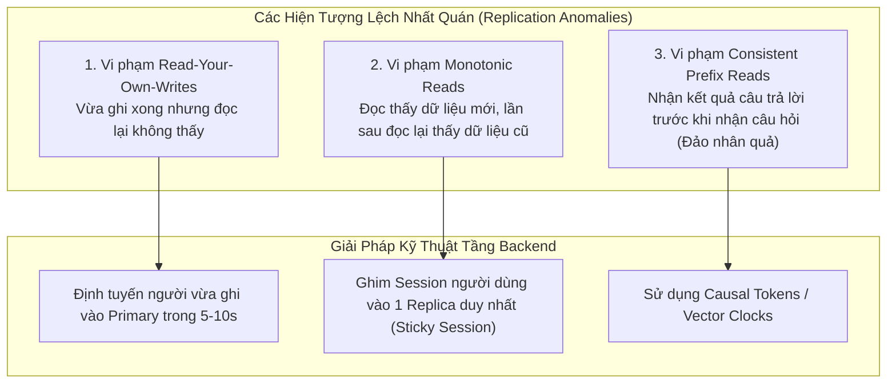
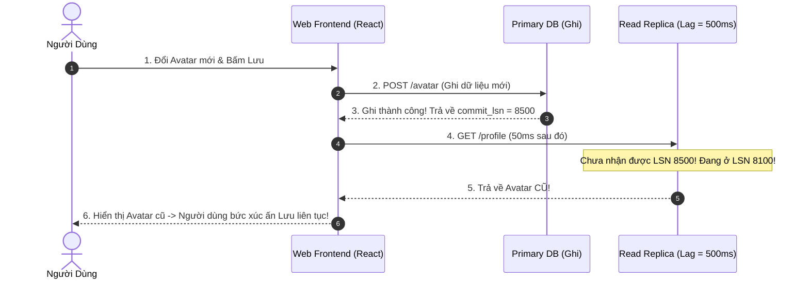
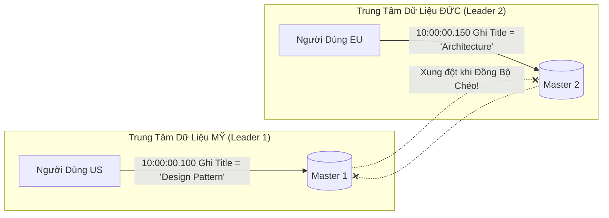

# 9.3. Replication Anomalies & Consistency (Dị thường Nhân bản & Tính Nhất quán Phân tán)

> [!IMPORTANT]
> **Nếu bạn chỉ được nhớ một điều duy nhất:** Độ trễ nhân bản (Replication Lag) trong các hệ thống bất đồng bộ là nguồn gốc của các trải nghiệm người dùng tồi tệ: vừa đăng bài viết mới xong F5 lại trang thì bài viết biến mất! Để khắc phục, hệ thống phải áp dụng tính nhất quán Đọc-sau-khi-Ghi (Read-After-Write Consistency): tự động định tuyến các yêu cầu đọc của chính người dùng vừa sửa đổi dữ liệu về thẳng node Leader hoặc trì hoãn truy vấn cho đến khi Replica đã bắt kịp mốc Log Sequence Number tương ứng.

---

## 1. Đơn giản nhưng phải chi tiết (Intuitive & Deep Breakdown)

### 1.1. Đoạn Code Dẫn Nhập & Vấn Đề Thực Tế
Chuyện gì xảy ra với tâm lý người dùng khi họ vừa đăng một bình luận trên mạng xã hội, bấm F5 tải lại trang, và bàng hoàng thấy **bình luận của mình vừa biến mất**, nhưng 3 giây sau F5 lại thì bình luận đó lại xuất hiện trở lại?

```python
# Kịch bản thảm họa: Lệch Nhất Quán Do Độ Trễ Nhân Bản (Replication Lag Anomaly)

# Bước 1: Người dùng gửi bình luận mới (Ghi vào Primary Database)
db_primary.execute("INSERT INTO comments (post_id, text) VALUES (1, 'Bài viết quá hay!')")

# Bước 2: Người dùng bấm F5 tải lại trang ngay tức khắc (Sau 10ms)
# Hệ thống tự động chia tải, đẩy câu lệnh SELECT sang Read Replica (Đang bị lag 500ms):
comments = db_replica.execute("SELECT * FROM comments WHERE post_id = 1")
# Kết quả: KHÔNG CÓ BÌNH LUẬN NÀO! Người dùng tưởng ứng dụng bị lỗi và bấm đăng lại 3 lần!
```

Hiện tượng kỳ dị này sinh ra do **Tính Nhất Quán Cuối Cùng (Eventual Consistency)** trong các hệ thống nhân bản bất đồng bộ. Nếu không có các mô hình bảo vệ tính nhất quán như **"Read-Your-Own-Writes"** hay **"Monotonic Reads"**, trải nghiệm của người dùng sẽ bị phá vỡ hoàn toàn!

### 1.2. Ẩn Dụ Đời Sống & Phân Tích Cơ Chế Hoạt Động
Các Hiện Tượng Lệch Nhất Quán Trong Nhân Bản giống như **Chuyện Bạn Kể Cho Hai Người Bạn Thân**:
- Bạn có một bí mật vừa xảy ra lúc 10h00 sáng.
- **Hiện tượng Mất Bình Luận (Vi phạm Read-Your-Own-Writes)**:
  - 10h01: Bạn vừa kể bí mật cho bạn An (**Primary**).
  - 10h02: Bạn quay sang hỏi bạn Bình (**Replica - người chưa kịp nghe An kể lại**): *"Cậu thấy bí mật của tớ thế nào?"*. Bình ngơ ngác: *"Bí mật gì? Cậu đã nói gì đâu!"*. Bạn hoang mang tột độ!
- **Hiện tượng Du Hành Ngược Thời Gian (Vi phạm Monotonic Reads)**:
  - 10h05: Bạn gọi điện cho bạn An, An kể: *"Tớ vừa biết tin Nam và Hoa chia tay rồi!"* (Bạn đã nhìn thấy tương lai).
  - 10h06: Bạn gọi điện cho bạn Bình (Bình ở vùng quê sóng yếu, nhận tin chậm). Bình hào hứng bảo: *"Nam và Hoa đang yêu nhau thắm thiết lắm đấy!"*. Bạn có cảm giác như mình vừa bước vào cỗ máy thời gian quay ngược về quá khứ!
- **Hiện tượng Đảo Lộn Nhân Quả (Vi phạm Consistent Prefix Reads)**:
  - Bạn gửi tin nhắn 1: *"Cậu có muốn ăn trưa không?"*.
  - Bạn gửi tin nhắn 2: *"Nếu có thì ra quán phở nhé!"*.
  - Nhưng do mạng phân tán, người nhận lại nhận được tin 2 trước tin 1!

### 1.3. Mô Phỏng Dữ Liệu Số Nhỏ Từng Bước (Toy Walkthrough)
Mô phỏng giải pháp khắc phục hiện tượng "Read-Your-Own-Writes" bằng cơ chế **Session Sticky Routing**:

| Thời Điểm | Hành Động Phía Người Dùng | Tầng Middleware / Router Phân Phối | Node Database Được Chọn | Trải Nghiệm Khách Hàng |
| :---: | :--- | :--- | :--- | :--- |
| $T_0$ | Đăng bình luận: `"Hello"` | Gửi vào Primary Node | **Primary DB** | Bình luận được lưu an toàn |
| $T_0$ | Backend ghi nhận | Đặt cookie hoặc cache session: `last_write_timestamp = T0` | - | Đánh dấu người dùng vừa thực hiện Ghi |
| $T_0 + 50\text{ms}$ | Bấm F5 tải lại trang | Router kiểm tra: $T_{\text{current}} - T_{\text{last\_write}} < 5\text{s}$? | **CƯỠNG CHẾ GỬI SANG PRIMARY!** | **Nhìn thấy bình luận "Hello" ngay tức khắc!** |
| $T_0 + 10\text{s}$ | Người dùng khác đọc bài | Router kiểm tra: Không có thao tác ghi gần đây | **Gửi sang Read Replica** (Đã đồng bộ xong) | Tải trang nhanh từ Replica |

Chỉ bằng cách định tuyến thông minh trong 5 giây đầu tiên, hệ thống vừa bảo vệ được trải nghiệm người dùng vừa tận dụng được sức mạnh chia tải của Replica!

### 1.4. Tác Động Thực Tế Tầng Backend & Systems
- **Định Lý CAP Trong Cơ Sở Dữ Liệu Phân Tán (Eric Brewer, 2000)**: Khi có sự cố đứt gãy mạng phân vùng (Partition Tolerance - P), một hệ thống cơ sở dữ liệu chỉ có thể chọn một trong hai con đường: Hoặc là **Consistency (C - Từ chối phục vụ để bảo vệ tính nhất quán)**, hoặc là **Availability (A - Tiếp tục trả lời dữ liệu cũ để duy trì tính sẵn sàng)**. Không một hệ thống nào trên trái đất có thể đạt được cả 3 yếu tố cùng một lúc!
- **Mô Hình Đồng Thuận Phân Tán (Raft / Paxos Consensus)**: Để giải quyết mâu thuẫn dữ liệu giữa các node mà không cần phụ thuộc vào một Primary duy nhất, các cơ sở dữ liệu NewSQL hiện đại (như CockroachDB, Google Spanner, TiDB) sử dụng thuật toán đồng thuận Raft/Paxos: Mọi giao dịch chỉ cần được xác nhận bởi đa số thành viên (Quorum: $N/2 + 1$) là được coi là thành công tuyệt đối.

### 1.5. Sơ Đồ Tư Duy & Kiến Trúc Hệ Thống (Mermaid)


---

## 2. Chi tiết từng Keyword (Under-the-Hood Deep Dive)

### 2.1. Dị thường "Đọc sau khi Ghi" (Read-After-Write Consistency / Read-Your-Writes)

#### 1. Kịch Bản Lỗi Thực Tế trong Ứng Dụng Web / Mobile
- Người dùng thực hiện cập nhật ảnh đại diện (Avatar):
  1. Trình duyệt gửi request: `POST /api/user/avatar`. Bộ điều phối định tuyến ghi vào **Primary Node**. Primary ghi WAL, cập nhật đĩa thành công trong $2\text{ ms}$ và trả về HTTP 200.
  2. Ứng dụng Single-Page App (React/Vue) lập tức kích hoạt hàm tải lại trang: `GET /api/user/profile`.
  3. Yêu cầu `GET` được Load Balancer điều phối vào **Read Replica 2**.
  4. Do Replication Lag trên Replica 2 đang là $400\text{ ms}$, bản ghi WAL thay đổi avatar chưa được áp dụng xong.
  5. API trả về thông tin hồ sơ với ảnh đại diện cũ!
- **Hậu quả Tâm lý**: Người dùng nghĩ rằng nút bấm bị liệt, liên tục nhấn nút "Lưu" thêm 5 lần nữa, làm gia tăng tải đột biến lên máy chủ ghi (Thundering Herd).



#### 2. Ba Chiến Lược Giải Pháp Kỹ Thuật Chuẩn Mực
1. **Chiến Lược Định Tuyến Dữ Liệu Sở Hữu (User-Owned Data Routing)**:
   - Mọi truy vấn xem hoặc sửa thông tin thuộc quyền sở hữu của chính người dùng hiện tại (ví dụ: Trang cá nhân, giỏ hàng, thông tin thanh toán) **luôn luôn được định tuyến $100\%$ về Primary Node**.
   - Chỉ những thông tin công cộng hoặc của người dùng khác (Bảng tin công khai, danh sách sản phẩm) mới được định tuyến sang Read Replicas.
2. **Chiến Lược Cửa Sổ Thời Gian (Time-Window Tracking)**:
   - Khi người dùng thực hiện một thao tác Ghi thành công: Backend lưu vào Session/Cookie mốc thời gian ghi: `last_write_timestamp = now()`.
   - Trong vòng **5 giây tiếp theo** (khoảng thời gian đủ để replication lag bắt kịp), toàn bộ các câu lệnh đọc của người dùng đó bắt buộc phải đọc từ Primary. Sau 5 giây, hệ thống tự động chuyển lại sang Read Replicas.
3. **Chiến Lược Mã Phiên Bản LSN (Session LSN Token / Causal Consistency)**:
   - Primary trả về mã vị trí nhật ký chính xác: `X-Commit-LSN: 18/B374D800`.
   - Client gửi lại token này trong header của request tiếp theo: `X-Required-LSN: 18/B374D800`.
   - Replica nhận request, kiểm tra LSN hiện tại của mình:
     - Nếu `replica_current_lsn >= 18/B374D800`: Phục vụ truy vấn đọc ngay lập tức.
     - Nếu chưa bắt kịp: Replica tạm dừng (chờ tối đa $50\text{ ms}$) để đợi luồng WAL đuổi tới mốc LSN đó, hoặc chủ động chuyển tiếp (proxy) request về Primary.

---

### 2.2. Dị thường "Đọc Đơn điệu" (Monotonic Reads - Không Quay Ngược Thời Gian)

#### 1. Định Nghĩa Toán Học
Mức bảo đảm Monotonic Reads khẳng định rằng: *Nếu một client đã đọc được giá trị $V_1$ tại thời điểm $t_1$, thì trong mọi lần đọc tiếp theo tại thời điểm $t_2 > t_1$, client đó tuyệt đối không bao giờ nhìn thấy một giá trị cũ hơn $V_0$ ($V_0 < V_1$)*.

#### 2. Kịch Bản Xuất Hiện Dị Thường
- Hệ thống có 2 Replicas:
  - Replica 1 có mạng cực tốt: $\text{Lag} = 5\text{ ms}$.
  - Replica 2 đang bị dồn tải I/O: $\text{Lag} = 8,000\text{ ms}$ (8 giây).
- Khách hàng duyệt lịch sử đơn hàng trên ứng dụng di động:
  - Lần chạm màn hình 1: Request vào Replica 1 $\implies$ Nhìn thấy đơn hàng mã `#99` (Trạng thái: `ĐANG GIAO HÀNG`).
  - Lần chạm màn hình 2: Load Balancer (thuật toán Round-Robin ngây thơ) chuyển request sang Replica 2 $\implies$ Replica 2 đang chậm 8 giây, đơn hàng `#99` **hoàn toàn chưa tồn tại**! Ứng dụng báo: *"Bạn chưa có đơn hàng nào"*.

#### 3. Giải Pháp: Băm Khách Hàng Cố Định (User-to-Replica Sticky Hashing)
- Thay vì dùng Round-Robin ngẫu nhiên, tầng API Gateway sử dụng thuật toán Băm Nhất Quán (Consistent Hashing) dựa trên `user_id`:
  $$\text{Replica\_Index} = \text{Hash}(\text{user\_id}) \pmod{\text{Total\_Replicas}}$$
- **Nguyên lý Bảo Toàn**: Mọi truy vấn đọc của cùng một người dùng luôn luôn được gửi đến **duy nhất một máy chủ Replica cố định**. Dù Replica đó có bị chậm 5 giây, dòng thời gian trên máy chủ đó vẫn luôn luôn trôi về phía trước (tiến tính đơn điệu), triệt tiêu hoàn toàn hiện tượng "quay ngược thời gian"!

---

### 2.3. Xung đột Ghi trong Multi-Leader (Data Divergence & Conflict Resolution)

Trong tô-pô Active-Active (Multi-Leader), hai trung tâm dữ liệu ở hai nửa bán cầu cùng chấp nhận thao tác ghi đồng thời. Đây là cái nôi phát sinh các mâu thuẫn phân tán phức tạp nhất:



#### 1. Chiến Lược Né Tránh Xung Đột (Conflict Avoidance - Tối Ưu Nhất)
- Cách tốt nhất để xử lý xung đột là **không bao giờ để xung đột có cơ hội xảy ra**!
- Cấu hình phân mảnh địa lý (Geo-Partitioning): Toàn bộ dữ liệu của người dùng khu vực Châu Mỹ (Users có `region = 'US'`) chỉ được phép ghi vào Master 1. Toàn bộ người dùng Châu Âu chỉ ghi vào Master 2. Mỗi bản ghi logic luôn chỉ có đúng một Leader chịu trách nhiệm ghi duy nhất.

#### 2. Chiến Lược "Bản Ghi Cuối Cùng Chiến Thắng" (Last-Write-Wins - LWW)
- Mỗi thao tác ghi được gắn một con tem thời gian vật lý (Physical Wall-Clock Timestamp). Khi hai bản ghi xung đột đụng độ, bản ghi có tem thời gian lớn hơn sẽ ghi đè và tiêu diệt bản ghi kia.
- **Hiểm Họa Đồng Hồ Lệch (Clock Drift & Leap Second Hazard)**:
  - Các máy chủ đồng bộ thời gian qua giao thức NTP (Network Time Protocol) luôn có độ lệch thực tế từ vài mili-giây đến vài giây.
  - Một máy chủ có đồng hồ chạy nhanh hơn sẽ liên tục ghi đè và xóa sổ các thay đổi hoàn toàn hợp lệ của một máy chủ có đồng hồ chạy chuẩn!
  - **Khắc phục Hiện đại**: Sử dụng Đồng Hồ Logic Lai (Hybrid Logical Clock - HLC) kết hợp giữa thời gian vật lý và bộ đếm Lamport tăng dần (sẽ phân tích sâu ở Chương 12).

#### 3. Cấu Trúc Dữ Liệu Tự Hội Tụ Không Xung Đột (CRDTs - The Mathematical Cure)
Được phát minh bởi Marc Shapiro và cộng sự (INRIA, 2011), CRDTs là đỉnh cao của toán học đại số trừu tượng áp dụng vào khoa học máy tính:
- Vận hành dựa trên cấu trúc đại số **Bán dàn hội tụ (Join-Semilattice)**:
  - Có tính chất giao hoán (Commutative): $A \cup B = B \cup A$
  - Có tính chất kết hợp (Associative): $(A \cup B) \cup C = A \cup (B \cup C)$
  - Có tính chất lũy đẳng (Idempotent): $A \cup A = A$
- **Hệ Quả Thực Tiễn**: Bất kể các thông điệp cập nhật mạng truyền đi theo thứ tự nào, bị chậm trễ hay bị gửi lặp lại bao nhiêu lần: Khi tất cả các máy chủ trao đổi trạng thái với nhau, **dữ liệu trên toàn bộ các node sẽ tự động hội tụ về một giá trị duy nhất giống hệt nhau $100\%$** mà không cần bất kỳ sự can thiệp thủ công nào của con người!
- **Ví dụ điển hình**: PN-Counter (Bộ đếm tăng/giảm đồng thời), G-Set (Tập hợp chỉ thêm), LWW-Element-Set (Giỏ hàng thương mại điện tử).

---

## 3. Thực thi Mã nguồn & Mô phỏng Chuyên sâu (Dual-Engine Implementation)

### 1. Động cơ C++20: Mô phỏng Cấu trúc Dữ liệu CRDT PN-Counter Đồng Thuận Đa Máy Chủ

Chương trình C++20 dưới đây triển khai thuật toán **Positive-Negative Counter (PN-Counter CRDT)**: cho phép hai nút Leader độc lập cùng tăng và giảm số lượng tồn kho đồng thời, sau đó sáp nhập (Merge) lại trạng thái để tự động hội tụ về kết quả chính xác mà không cần khóa tập trung:

```cpp
// compile: g++ -std=c++20 -O3 crdt_pn_counter_sim.cpp -o crdt_sim
#include <iostream>
#include <vector>
#include <string>
#include <unordered_map>
#include <format>
#include <algorithm>

// Bộ đếm Tự Hội tụ Không Xung đột: PN-Counter (Positive-Negative Counter)
class PNCounterCRDT {
private:
    std::string node_id;
    // P-Vector: Mảng các giá trị TĂNG (+) do từng node thực hiện
    std::unordered_map<std::string, int64_t> p_vector;
    // N-Vector: Mảng các giá trị GIẢM (-) do từng node thực hiện
    std::unordered_map<std::string, int64_t> n_vector;

public:
    explicit PNCounterCRDT(std::string id) : node_id(std::move(id)) {}

    void increment(int64_t val = 1) {
        p_vector[node_id] += val;
        std::cout << std::format("  [{}] Ghi nhận TĂNG +{} (Tổng P nội bộ = {})\n", node_id, val, p_vector[node_id]);
    }

    void decrement(int64_t val = 1) {
        n_vector[node_id] += val;
        std::cout << std::format("  [{}] Ghi nhận GIẢM -{} (Tổng N nội bộ = {})\n", node_id, val, n_vector[node_id]);
    }

    // Giá trị hiện tại = Tổng tất cả các phép Tăng - Tổng tất cả các phép Giảm
    int64_t value() const {
        int64_t total_p = 0;
        for (const auto& [_, p] : p_vector) total_p += p;
        int64_t total_n = 0;
        for (const auto& [_, n] : n_vector) total_n += n;
        return total_p - total_n;
    }

    // Toán tử Sáp nhập Bán dàn (Lattice Join Operator: Lấy MAX từng thành phần)
    void merge(const PNCounterCRDT& other) {
        std::cout << std::format(">>> SÁP NHẬP DỮ LIỆU (MERGE) TỪ [{}] VÀO [{}] <<<\n", other.node_id, this->node_id);
        
        // P_merge = max(P_local, P_remote)
        for (const auto& [node, val] : other.p_vector) {
            this->p_vector[node] = std::max(this->p_vector[node], val);
        }
        // N_merge = max(N_local, N_remote)
        for (const auto& [node, val] : other.n_vector) {
            this->n_vector[node] = std::max(this->n_vector[node], val);
        }
    }

    void print_vector_state() const {
        std::cout << std::format("  Trạng thái Node [{}]: Value = {} (P-Vector: ", node_id, value());
        for (const auto& [k, v] : p_vector) std::cout << k << ":" << v << " ";
        std::cout << "| N-Vector: ";
        for (const auto& [k, v] : n_vector) std::cout << k << ":" << v << " ";
        std::cout << ")\n";
    }
};

int main() {
    std::cout << "=== MÔ PHỎNG CRDT PN-COUNTER TRONG HỆ THỐNG MULTI-LEADER (C++20) ===\n\n";

    // Khởi tạo 2 Leader ở 2 Datacenter: US và EU
    PNCounterCRDT leader_us("Datacenter-US");
    PNCounterCRDT leader_eu("Datacenter-EU");

    std::cout << "--- BƯỚC 1: CẢ 2 DATACENTER TIẾP NHẬN THAO TÁC GHI ĐỒNG THỜI ---\n";
    // Người dùng ở Mỹ thêm 10 món hàng vào kho, rồi bán bớt 2 món
    leader_us.increment(10);
    leader_us.decrement(2);

    // Cùng lúc đó, người dùng ở Châu Âu thêm 5 món hàng, rồi bán bớt 1 món
    leader_eu.increment(5);
    leader_eu.decrement(1);

    std::cout << "\n[Trạng thái trước khi truyền mạng]:\n";
    leader_us.print_vector_state();
    leader_eu.print_vector_state();

    std::cout << "\n--- BƯỚC 2: TRAO ĐỔI TRẠNG THÁI VÀ TỰ ĐỘNG HỘI TỤ (CONVERGENCE) ---\n";
    // Hai node gửi bản tin mạng và sáp nhập (Merge) chéo nhau
    leader_us.merge(leader_eu);
    leader_eu.merge(leader_us);

    std::cout << "\n[Trạng thái sau khi Hội Tụ Hoàn Tất]:\n";
    leader_us.print_vector_state();
    leader_eu.print_vector_state();

    std::cout << "\n====================================================================\n";
    std::cout << std::format("KẾT LUẬN: Giá trị cuối cùng trên cả 2 Leader hội tụ chính xác: {} món hàng!\n", leader_us.value());
    std::cout << "(Phép tính đúng: +10 - 2 + 5 - 1 = 12 món hàng. Không hề bị mất mát dữ liệu!)\n";
    std::cout << "====================================================================\n";
    return 0;
}
```

---

### 2. Động cơ Python 3.11+: Bộ Quản Lý Session Token Bảo Đảm Tính Nhất Quán Read-After-Write

Script Python dưới đây mô phỏng cơ chế Client-Side Version Watermark: Client theo dõi mốc commit LSN của chính mình và tự động phát hiện nếu Replica bị chậm để chờ đợi hoặc định tuyến lại:

```python
#!/usr/bin/env python3
"""
Mô phỏng Bộ Quản Lý Phiên (Session Consistency Token Manager)
Bảo Đảm Thuộc Tính Read-After-Write và Monotonic Reads trên Asynchronous Replicas.
Môi trường yêu cầu: Python 3.11+
"""

import time
from typing import Dict, Optional

class SimulatedReplica:
    def __init__(self, name: str, lag_delay_ms: float):
        self.name = name
        self.lag_delay_sec = lag_delay_ms / 1000.0
        self.last_applied_lsn = 1000

    def apply_wal_progress(self, lsn: int):
        self.last_applied_lsn = lsn

class SessionConsistencyClient:
    def __init__(self, user_id: str):
        self.user_id = user_id
        # Client ghi nhớ LSN cao nhất mà chính nó đã từng ghi hoặc đã từng nhìn thấy
        self.last_observed_lsn: int = 0

    def on_write_success(self, committed_lsn: int):
        """Cập nhật Watermark ngay khi câu lệnh Ghi thành công."""
        self.last_observed_lsn = max(self.last_observed_lsn, committed_lsn)
        print(f"  👉 [CLIENT UPDATE]: User '{self.user_id}' ghi nhớ Watermark LSN = {self.last_observed_lsn}")

    def read_from_replica(self, replica: SimulatedReplica, query_desc: str) -> bool:
        print(f"\n[CLIENT READ REQUEST] '{query_desc}' gửi tới '{replica.name}'...")
        print(f"  -> Client yêu cầu tối thiểu LSN: {self.last_observed_lsn}")
        print(f"  -> Replica hiện tại mới chỉ áp dụng tới LSN: {replica.last_applied_lsn}")

        if replica.last_applied_lsn < self.last_observed_lsn:
            lag_diff = self.last_observed_lsn - replica.last_applied_lsn
            print(f"  🚨 [DỊ THƯỜNG PHÁT HIỆN]: Vi phạm Read-After-Write! Replica bị trễ {lag_diff} LSN units!")
            print("  ⚡ [HÀNH ĐỘNG KHẮC PHỤC]: Chuyển tiếp (Fallback) truy vấn về PRIMARY NODE để đọc dữ liệu mới nhất!")
            return False
        else:
            print("  ✅ [HỢP LỆ]: Replica đã đuổi kịp Watermark! Trả về dữ liệu nhất quán.")
            return True

if __name__ == "__main__":
    print("=" * 70)
    print("MÔ PHỎNG CLIENT-SIDE SESSION CONSISTENCY WATERMARK (PYTHON 3.11)")
    print("=" * 70)

    client = SessionConsistencyClient(user_id="user_8842")

    # 1. Người dùng thực hiện thao tác Đổi Avatar trên Primary (Commit LSN = 2500)
    print("\n--- BƯỚC 1: NGƯỜI DÙNG THỰC HIỆN THAO TÁC GHI ---")
    print("  Ghi dữ liệu vào Primary: UPDATE users SET avatar = 'new_pic.png'")
    client.on_write_success(committed_lsn=2500)

    # 2. Ngay lập tức (50ms sau), người dùng tải lại trang: Gửi đọc vào Replica A (Bị lag)
    fast_replica = SimulatedReplica(name="Replica-Asia-Fast", lag_delay_ms=20)
    fast_replica.apply_wal_progress(lsn=2600) # Đã đuổi kịp

    slow_replica = SimulatedReplica(name="Replica-Europe-Lagging", lag_delay_ms=800)
    slow_replica.apply_wal_progress(lsn=2100) # Chưa đuổi kịp (Mới tới 2100 < 2500)

    print("\n--- BƯỚC 2: ĐỌC DỮ LIỆU TỪ REPLICA BỊ LAG ---")
    client.read_from_replica(slow_replica, "Xem lại Avatar vừa cập nhật")

    print("\n--- BƯỚC 3: ĐỌC DỮ LIỆU TỪ REPLICA NHANH ---")
    client.read_from_replica(fast_replica, "Xem lại Avatar vừa cập nhật")

    print("\n" + "=" * 70)
```

---

### 3. Kết quả Thực thi Terminal Mẫu Chuẩn Thực tế

```bash
$ g++ -std=c++20 -O3 crdt_pn_counter_sim.cpp -o crdt_sim
$ ./crdt_sim
=== MÔ PHỎNG CRDT PN-COUNTER TRONG HỆ THỐNG MULTI-LEADER (C++20) ===

--- BƯỚC 1: CẢ 2 DATACENTER TIẾP NHẬN THAO TÁC GHI ĐỒNG THỜI ---
  [Datacenter-US] Ghi nhận TĂNG +10 (Tổng P nội bộ = 10)
  [Datacenter-US] Ghi nhận GIẢM -2 (Tổng N nội bộ = 2)
  [Datacenter-EU] Ghi nhận TĂNG +5 (Tổng P nội bộ = 5)
  [Datacenter-EU] Ghi nhận GIẢM -1 (Tổng N nội bộ = 1)

[Trạng thái trước khi truyền mạng]:
  Trạng thái Node [Datacenter-US]: Value = 8 (P-Vector: Datacenter-US:10 | N-Vector: Datacenter-US:2 )
  Trạng thái Node [Datacenter-EU]: Value = 4 (P-Vector: Datacenter-EU:5 | N-Vector: Datacenter-EU:1 )

--- BƯỚC 2: TRAO ĐỔI TRẠNG THÁI VÀ TỰ ĐỘNG HỘI TỤ (CONVERGENCE) ---
>>> SÁP NHẬP DỮ LIỆU (MERGE) TỪ [Datacenter-EU] VÀO [Datacenter-US] <<<
>>> SÁP NHẬP DỮ LIỆU (MERGE) TỪ [Datacenter-US] VÀO [Datacenter-EU] <<<

[Trạng thái sau khi Hội Tụ Hoàn Tất]:
  Trạng thái Node [Datacenter-US]: Value = 12 (P-Vector: Datacenter-EU:5 Datacenter-US:10 | N-Vector: Datacenter-EU:1 Datacenter-US:2 )
  Trạng thái Node [Datacenter-EU]: Value = 12 (P-Vector: Datacenter-EU:5 Datacenter-US:10 | N-Vector: Datacenter-EU:1 Datacenter-US:2 )

====================================================================
KẾT LUẬN: Giá trị cuối cùng trên cả 2 Leader hội tụ chính xác: 12 món hàng!
(Phép tính đúng: +10 - 2 + 5 - 1 = 12 món hàng. Không hề bị mất mát dữ liệu!)
====================================================================

$ python3 session_watermark_sim.py
======================================================================
MÔ PHỎNG CLIENT-SIDE SESSION CONSISTENCY WATERMARK (PYTHON 3.11)
======================================================================

--- BƯỚC 1: NGƯỜI DÙNG THỰC HIỆN THAO TÁC GHI ---
  Ghi dữ liệu vào Primary: UPDATE users SET avatar = 'new_pic.png'
  👉 [CLIENT UPDATE]: User 'user_8842' ghi nhớ Watermark LSN = 2500

--- BƯỚC 2: ĐỌC DỮ LIỆU TỪ REPLICA BỊ LAG ---

[CLIENT READ REQUEST] 'Xem lại Avatar vừa cập nhật' gửi tới 'Replica-Europe-Lagging'...
  -> Client yêu cầu tối thiểu LSN: 2500
  -> Replica hiện tại mới chỉ áp dụng tới LSN: 2100
  🚨 [DỊ THƯỜNG PHÁT HIỆN]: Vi phạm Read-After-Write! Replica bị trễ 400 LSN units!
  ⚡ [HÀNH ĐỘNG KHẮC PHỤC]: Chuyển tiếp (Fallback) truy vấn về PRIMARY NODE để đọc dữ liệu mới nhất!

--- BƯỚC 3: ĐỌC DỮ LIỆU TỪ REPLICA NHANH ---

[CLIENT READ REQUEST] 'Xem lại Avatar vừa cập nhật' gửi tới 'Replica-Asia-Fast'...
  -> Client yêu cầu tối thiểu LSN: 2500
  -> Replica hiện tại mới chỉ áp dụng tới LSN: 2600
  ✅ [HỢP LỆ]: Replica đã đuổi kịp Watermark! Trả về dữ liệu nhất quán.

======================================================================
```

---

## 4. Systems Engineering & Production Pitfalls

### 1. Thảm Họa Mất Dữ Liệu do Clock Drift Trong Multi-Master LWW (Last-Write-Wins)
- **Kịch bản Sự cố**: Hệ thống Multi-Master sử dụng thuật toán Last-Write-Wins dựa trên NTP timestamp.
- Máy chủ Master tại Frankfurt (EU) gặp sự cố cấu hình NTP, đồng hồ phần cứng chạy **chậm hơn thực tế $120\text{ ms}$**.
- Một người dùng tại Đức cập nhật địa chỉ giao hàng lúc 10:00:00.200 (Timestamp ghi nhận: `10:00:00.080`).
- Trước đó 100ms, một người dùng tại Mỹ cập nhật ghi chú lúc 10:00:00.100 (Timestamp ghi nhận: `10:00:00.100`).
- **Hậu quả**: Khi đồng bộ dữ liệu, thuật toán LWW so sánh thấy $10:00:00.080 < 10:00:00.100$. Thao tác cập nhật địa chỉ mới nhất của người dùng Đức bị **xóa bỏ hoàn toàn khỏi hệ thống**!
- **Giải Pháp Bắt Buộc**: Tuyệt đối không dùng thời gian vật lý của hệ điều hành (`System.currentTimeMillis()`) làm tem xung đột. Bắt buộc phải sử dụng **Hybrid Logical Clocks (HLC)** hoặc giao thức đồng thuận Raft/Paxos.

### 2. Sự Cố Đảo Lộn Trật Tự Nhân Quả trong Hệ Thống Microservices
- **Kịch bản**: Ứng dụng thương mại điện tử tách biệt hai dịch vụ: Dịch vụ Người dùng (User Service) và Dịch vụ Đơn hàng (Order Service) cùng đẩy sự kiện sang hai Kafka Topic khác nhau.
- Người dùng đăng ký tài khoản mới $\rightarrow$ Sinh sự kiện `USER_CREATED`.
- Người dùng mua ngay một món hàng $\rightarrow$ Sinh sự kiện `ORDER_CREATED`.
- Do sự kiện `USER_CREATED` rơi vào một partition bị nghẽn mạng, sự kiện `ORDER_CREATED` đến dịch vụ Xử lý Hóa đơn trước!
- **Hậu quả**: Dịch vụ Hóa đơn tìm kiếm `user_id` trong database nhưng không thấy $\implies$ Báo lỗi `Foreign Key Violation` và hủy đơn hàng của khách hàng!
- **Khắc phục**: Gom các sự kiện có quan hệ nhân quả phụ thuộc vào **cùng một Message Key** để Kafka đảm bảo chúng được xử lý tuần tự trên cùng một Partition.

---

## 5. Bảng So sánh & Decision Matrix

### Ma trận So sánh Bốn Cấp độ Nhất quán Phía Client (Client-Centric Consistency)

| Mô Hình Nhất Quán | Vấn Đề Dị Thường Triệt Tiêu | Phương Pháp Hiện Thực Hóa Chuẩn Mực | Chi Phí Hiệu Năng Đánh Đổi |
| :--- | :--- | :--- | :--- |
| **Read-Your-Writes** | Tránh thấy dữ liệu vừa ghi bị biến mất | Dùng Cookie ghi nhận `last_write_ts` hoặc Session LSN Token | Đẩy một phần tải đọc về Primary trong vài giây |
| **Monotonic Reads** | Tránh bị "quay ngược thời gian" khi F5 | Sticky Hashing `hash(user_id) % replicas` | Giảm tính linh hoạt cân bằng tải của Load Balancer |
| **Monotonic Writes** | Tránh các câu lệnh ghi của 1 user bị đảo lộn | Tuần tự hóa các lệnh ghi qua cùng một kết nối / Message Key | Giới hạn tính song song của các lệnh ghi từ 1 client |
| **Consistent Prefix Reads**| Tránh đảo lộn trật tự Nhân - Quả | Nhân bản các bảng liên quan trong cùng một luồng WAL duy nhất | Không thể phân tán các bảng liên quan sang nhiều shard rời rạc |

### Ma trận So sánh Các Chiến lược Giải quyết Xung đột Ghi (Multi-Leader Conflict Resolution)

| Chiến Lược | Độ Phức Tạp Thuật Toán | Nguy Cơ Mất Dữ Liệu | Khả Năng Mở Rộng Hệ Thống | Môi Trường Khuyên Dùng |
| :--- | :--- | :--- | :--- | :--- |
| **Conflict Avoidance** | Rất thấp | **Bằng Không ($0\%$)** | Rất cao | Phân vùng người dùng theo địa lý (Geo-partitioning) |
| **Last-Write-Wins (LWW)** | Thấp | **Rất cao** (Do đồng hồ lệch Clock Drift) | Cực cao | Dữ liệu cảm biến IoT, cập nhật vị trí GPS xe ôm công nghệ |
| **CRDTs (Semilattice)** | Rất cao (Đòi hỏi thiết kế toán học) | **Bằng Không ($0\%$)** | **Tối thượng** (Hội tụ tự động không khóa) | Đếm lượt like, cộng trừ giỏ hàng, ứng dụng soạn thảo cộng tác (Figma/Google Docs) |
| **Manual / App Resolver** | Trung bình | Thấp (Do người dùng/mã tự chọn) | Thấp (Cần con người can thiệp) | Hệ thống quản lý phiên bản Git, kiểm toán hóa đơn |

---

## 6. Enterprise Production Checklist & Verification

### 6.1. Kiến Trúc & Cấu Hình Tối Ưu (Production-Ready Architecture)
- [ ] **Bảo Đảm Read-Your-Own-Writes Cho Mọi API Cập Nhật**: Thiết kế API Gateway hoặc Database Middleware tự động định tuyến các yêu cầu đọc của chính user vừa ghi dữ liệu về Primary trong cửa sổ thời gian 5 giây.
- [ ] **Áp Dụng Sticky Session Cho Khách Hàng Thường Xuyên Đọc**: Ghim các kết nối đọc của một phiên làm việc vào cùng một Read Replica duy nhất để đảm bảo tính chất Monotonic Reads (không bị nhảy lùi thời gian).
- [ ] **Theo Dõi Vị Trí LSN Trước Khi Phục Vụ (Read After LSN)**: Ứng dụng gửi kèm vị trí LSN vừa ghi; Replica kiểm tra nếu LSN của mình đã vượt qua mốc đó mới trả lời, nếu chưa thì chờ hoặc chuyển tiếp sang Primary.
- [ ] **Xây Dựng Cơ Chế Xử Lý Lỗi Phân Vùng Mạng Rõ Ràng**: Xác định rõ dịch vụ nào ưu tiên tính Nhất quán (CP: Payment, Đơn hàng) và dịch vụ nào ưu tiên tính Sẵn sàng (AP: Lịch sử xem hàng, Khuyến mãi) khi có đứt cáp mạng.

### 6.2. Giám Sát, Cảnh Báo & Xử Lý Sự Cố (Observability & Incident Response)
- [ ] **Giám Sát Tỷ Lệ Lỗi Read-After-Write Thất Bại**: Thu thập log từ client; cảnh báo khi tỷ lệ người dùng bấm lưu dữ liệu nhưng không thấy cập nhật vượt ngưỡng 0.1%.
- [ ] **Cảnh Báo Tình Trạng Quá Ngưỡng Replication Lag SLA**: Đặt cảnh báo tự động loại bỏ (Evict) một Replica ra khỏi Load Balancer nếu Replica đó bị lag quá 10 giây so với Primary.
- [ ] **Kiểm Tra Trực Tiếp Tính Nhất Quán Bằng Script Kiểm Toán**: Chạy tool kiểm tra tính nhất quán ngẫu nhiên (Chaos Consistency Testing) liên tục đọc và ghi trên các cụm đa vùng.
