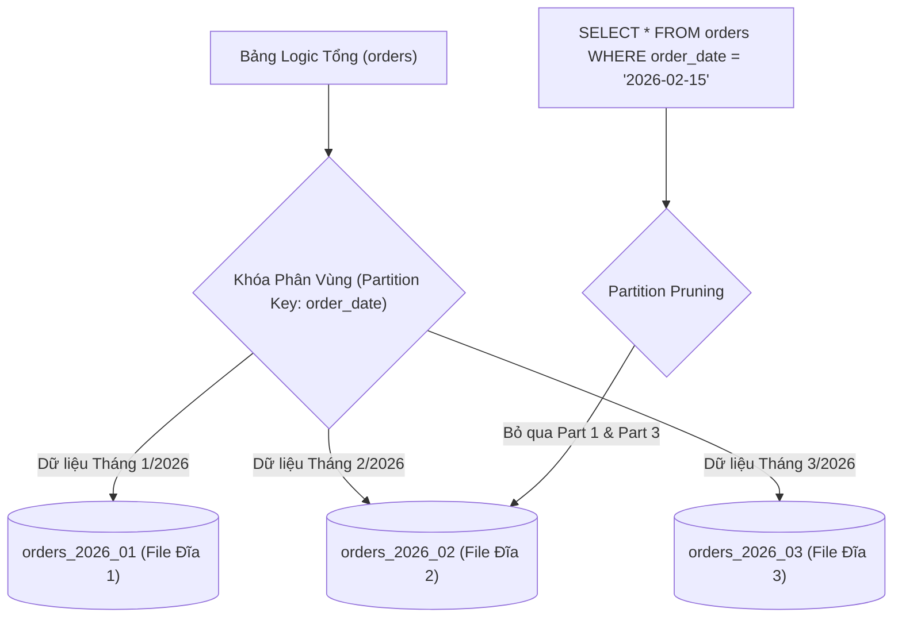
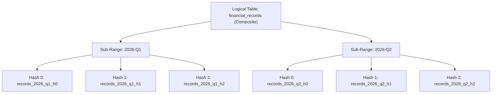
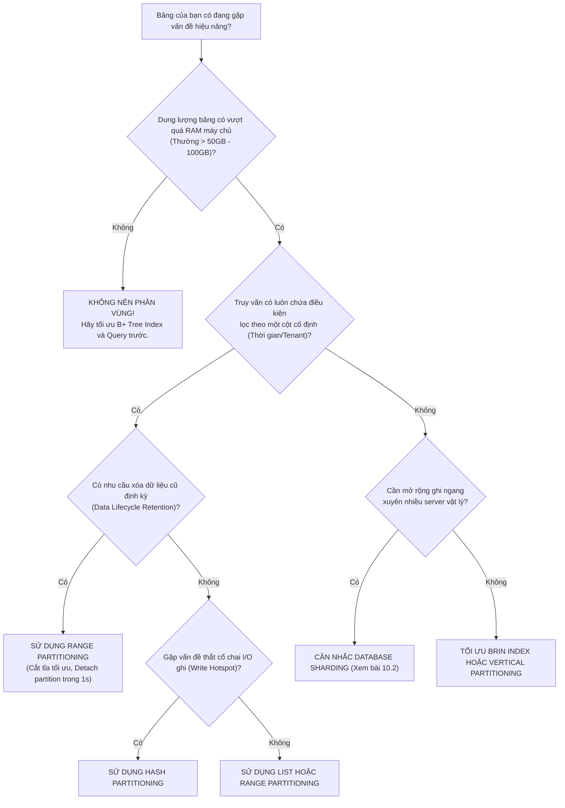

# 10.1. Table Partitioning (Phân Vùng Bảng Dữ Liệu Nội Bộ)

> [!IMPORTANT]
> **Nếu bạn chỉ được nhớ một điều duy nhất:** Phân vùng bảng (Partitioning) chia nhỏ một bảng khổng lồ hàng trăm triệu dòng thành các bảng con vật lý độc lập mà không làm thay đổi câu lệnh SQL của ứng dụng: sức mạnh tối thượng của phân vùng nằm ở cơ chế Cắt tỉa phân vùng (Partition Pruning): bộ tối ưu hóa truy vấn sẽ chỉ quét đúng một phân vùng chứa dữ liệu cần tìm và bỏ qua hoàn toàn 99% các phân vùng còn lại, đồng thời cho phép xóa bỏ dữ liệu cũ hàng terabyte tức thì chỉ bằng lệnh `DROP TABLE` phân vùng.

---

## 1. Đơn giản nhưng phải chi tiết (Intuitive & Deep Breakdown)

### 1.1. Đoạn Code Dẫn Nhập & Vấn Đề Thực Tế
Làm thế nào một bảng chứa 500 triệu dòng nhật ký giao dịch có thể xóa sạch dữ liệu của năm 2020 chỉ trong vòng 0.01 giây mà không làm khóa bảng, không sinh ra bất kỳ bản ghi rác nào và không làm nghẽn CPU máy chủ?

```sql
-- CÁCH 1: Thảm họa khi dùng bảng đơn khối truyền thống (Monolithic Table):
-- Lệnh DELETE phải quét từng dòng, ghi hàng trăm Gigabytes vào WAL, khóa bảng hàng giờ,
-- và để lại hàng triệu lỗ thủng Bloat trên đĩa cứng:
DELETE FROM audit_logs WHERE created_at < '2021-01-01'; -- Treo máy suốt 4 tiếng!

-- CÁCH 2: Sức mạnh tối thượng của Phân vùng Bảng (Table Partitioning theo Tháng/Năm):
-- Dữ liệu mỗi năm nằm trên một file vật lý riêng biệt!
-- Muốn xóa cả năm 2020? Chỉ cần gọi lệnh DROP PARTITION:
ALTER TABLE audit_logs DROP PARTITION audit_logs_y2020;
-- THỰC THI TRONG 0.01 GIÂY! Hệ điều hành chỉ việc unlink file đĩa, Zero Bloat, Zero I/O!
```

Phân vùng bảng (Partitioning) chia nhỏ một bảng logic khổng lồ thành nhiều bảng con vật lý nhỏ gọn. Khi một câu truy vấn tìm kiếm dữ liệu của ngày hôm nay, tính năng **Partition Pruning** của Optimizer sẽ lập tức loại bỏ 99% các bảng con còn lại, chỉ quét đúng một phân vùng nhỏ trong vài mili-giây!

### 1.2. Ẩn Dụ Đời Sống & Phân Tích Cơ Chế Hoạt Động
Phân vùng Bảng giống như **Cách Sắp Xếp Hồ Sơ Thuế Vào Các Cặp File Chuyên Dụng**:
- Thay vì nhét chung toàn bộ 500,000 tờ khai thuế của 10 năm qua vào một chiếc hòm sắt khổng lồ nặng 5 tấn (**Bảng không phân vùng**).
- Bạn chia thành **12 chiếc cặp hồ sơ nhỏ tương ứng với 12 tháng trong năm** (**Range Partitioning theo Tháng**).
  - Khi thanh tra yêu cầu: *"Cho tôi xem hồ sơ tháng 3 năm 2026"*: Bạn chỉ cần rút đúng chiếc cặp số 3 ra mở xem (**Partition Pruning**). 11 chiếc cặp còn lại nằm nguyên trên giá sách, không ai thèm đụng vào!
  - Khi hồ sơ của năm 2015 hết thời hạn lưu trữ: Bạn chỉ việc nhấc cả chiếc cặp năm 2015 ném vào lò thiêu hủy (**DROP PARTITION**). Nhanh gọn trong 1 giây mà không làm xáo trộn một tờ giấy nào của các năm khác!

### 1.3. Mô Phỏng Dữ Liệu Số Nhỏ Từng Bước (Toy Walkthrough)
Mô phỏng cơ chế Cắt Tỉa Phân Vùng (Partition Pruning) khi thực thi truy vấn:

Bảng `Sales` được phân vùng theo Quý (Range Partitioning on `sale_date`):
- `Sales_Q1`: Chứa dữ liệu từ `2026-01-01` đến `2026-03-31` (10 triệu dòng)
- `Sales_Q2`: Chứa dữ liệu từ `2026-04-01` đến `2026-06-30` (12 triệu dòng)
- `Sales_Q3`: Chứa dữ liệu từ `2026-07-01` đến `2026-09-30` (15 triệu dòng)
- `Sales_Q4`: Chứa dữ liệu từ `2026-10-01` đến `2026-12-31` (20 triệu dòng)

Câu lệnh truy vấn: `SELECT SUM(amount) FROM sales WHERE sale_date BETWEEN '2026-02-01' AND '2026-02-28';`

| Trạng Thái Thực Thi | Các Phân Vùng Được Xem Xét | Số Dòng Dữ Liệu Cần Quét | Thời Gian Chạy |
| :--- | :--- | :---: | :---: |
| **Không Bật Partition Pruning** | Quét cả 4 phân vùng: Q1, Q2, Q3, Q4 | **$57,000,000\text{ dòng}$** | $14.5\text{ giây}$ |
| **Kích Hoạt Partition Pruning** | **CHỈ QUÉT DUY NHẤT `Sales_Q1`** (Cắt tỉa bỏ hoàn toàn Q2, Q3, Q4) | **$10,000,000\text{ dòng}$** (Chỉ quét trong Q1) | **$0.8\text{ giây}$ (Nhanh gấp 18 lần!)** |

### 1.4. Tác Động Thực Tế Tầng Backend & Systems
- **Chi Phí Bộ Nhớ Khi Có Quá Nhiều Phân Vùng (Partition Over-fragmentation)**: Một sai lầm kinh điển là phân vùng bảng theo từng ngày cho 10 năm (sinh ra 3,650 bảng con). Mỗi bảng con là một file riêng biệt trên hệ điều hành, sở hữu cấu trúc dữ liệu System Catalog và cây B-Tree riêng. Khi một câu truy vấn không có điều kiện ngày tháng chạy vào, database phải mở và giữ khóa trên cả 3,650 file, làm cạn kiệt bộ nhớ RAM và làm tê liệt Optimizer!
- **Global Index vs Local Index**:
  - Local Index: Mỗi phân vùng con tự có một cây B-Tree riêng biệt (Dễ quản lý, xóa phân vùng là index tự mất).
  - Global Index: Một cây B-Tree duy nhất bao trùm toàn bộ các phân vùng (Bắt buộc để đảm bảo ràng buộc UNIQUE trên toàn bảng, nhưng khi xóa 1 partition thì cây Global Index bị hỏng và phải rebuild rất tốn kém).

### 1.5. Sơ Đồ Tư Duy & Kiến Trúc Hệ Thống (Mermaid)


---

## 2. Chi tiết từng Keyword (Under-the-Hood Deep Dive)

### 2.1. Phân loại Phân vùng: Horizontal vs Vertical Partitioning

#### Horizontal Partitioning (Phân vùng Ngang - Chuẩn mực Table Partitioning)
- **Bản chất vật lý**: Chia tách các **hàng (Rows / Tuples)** của một bảng quan hệ thành các bảng vật lý độc lập (gọi là partitions) dựa trên giá trị của một hoặc nhiều cột được chỉ định là **Khóa phân vùng (Partition Key)**.
- **Tính trong suốt (Transparency)**: Ở tầng logic, ứng dụng vẫn nhìn nhận bảng dưới một tên duy nhất (ví dụ: `orders`). Khi câu lệnh `INSERT`, `SELECT`, `UPDATE`, `DELETE` được gửi tới, bộ định tuyến nội bộ (Partition Routing Engine) của database engine sẽ tự động phân giải tuple thuộc về partition vật lý con nào để thực thi.
- **Bố cục bộ nhớ**: Mỗi partition con sở hữu file dữ liệu (`filenode`) riêng trên đĩa, có chuỗi trang dữ liệu 8KB (Slotted Pages), Freespace Map (FSM) và Visibility Map (VM) hoàn toàn độc lập.

#### Vertical Partitioning (Phân vùng Dọc)
- **Bản chất vật lý**: Chia tách các **cột (Columns / Attributes)** của một bảng thành các bảng riêng biệt có cùng khóa chính.
- **Mục tiêu tối ưu**: Tối ưu hóa dung lượng trang đĩa và mật độ bộ nhớ đệm (Cache Locality).
  - Giả sử bảng `users` có các trường thường xuyên truy vấn: `id (BIGINT)`, `username (VARCHAR(64))`, `email (VARCHAR(128))`, `status (INT)` (chiếm khoảng 200 bytes/tuple) và các trường kích thước lớn ít khi dùng: `user_profile_bio (TEXT)`, `avatar_raw_blob (BYTEA)`, `audit_metadata_json (JSONB)` (chiếm tới 10,000 bytes/tuple).
  - Nếu gom chung trong 1 bảng: Một page 8KB chỉ chứa được chưa đầy 1 tuple! Quét 1,000,000 user để lấy email đòi hỏi đọc tới 1,000,000 page đĩa ($\approx 8\text{ GB}$).
  - Nếu tách dọc: Bảng `users_core` chỉ tốn 200 bytes/tuple, một page 8KB chứa được 40 tuples. Quét 1,000,000 user chỉ cần đọc 25,000 page ($\approx 200\text{ MB}$), tăng tốc I/O gấp 40 lần!
- **Cơ chế TOAST trong PostgreSQL**: Dưới góc độ hệ thống, tính năng **TOAST (The Oversized-Attribute Storage Technique)** của PostgreSQL chính là một dạng phân vùng dọc tự động ở tầng engine: bất kỳ trường dữ liệu nào vượt quá ngưỡng 2KB sẽ tự động bị nén và đẩy ra một bảng vật lý phụ trợ độc lập (`pg_toast_xxxx`).

---

### 2.2. Các Chiến lược Phân vùng Ngang Cốt lõi (Partitioning Strategies)

#### 1. Range Partitioning (Phân vùng theo Dải Giá trị)
- **Cơ chế toán học**: Dữ liệu được ánh xạ vào các phân vùng dựa trên việc kiểm tra dải giá trị nửa mở (half-open interval):
  $$\text{Partition}_k = \{ t \mid L_k \le t[\text{PartitionKey}] < U_k \}$$
  Trong đó $L_k$ là cận dưới (inclusive) và $U_k$ là cận trên (exclusive). Các dải không được phép chồng lấn nhau.
- **Trường hợp sử dụng điển hình**: Time-series data, nhật ký kiểm toán (audit logs), hóa đơn tài chính, sự kiện clickstream.
- **Ưu điểm vượt trội**:
  - Tận dụng tối đa nguyên lý cục bộ về thời gian (Temporal Locality): Dữ liệu mới ghi liên tục vào partition của tháng hiện tại. Partition này nằm hoàn toàn trên SSD tốc độ cao hoặc trong RAM.
  - Quản lý vòng đời dữ liệu (Data Archival / Retention): Xóa dữ liệu cũ của 5 năm trước bằng thao tác DDL `ALTER TABLE orders DETACH PARTITION orders_2021; DROP TABLE orders_2021;` diễn ra trong microsecond ($O(1)$) thay vì chạy lệnh `DELETE` làm khóa bảng, tốn CPU, phình to WAL và sinh rác bloat.

#### 2. List Partitioning (Phân vùng theo Danh sách Giá trị Rời rạc)
- **Cơ chế toán học**: Dữ liệu được ánh xạ dựa trên sự xuất hiện của giá trị khóa trong một tập hợp rời rạc tường minh:
  $$\text{Partition}_k = \{ t \mid t[\text{PartitionKey}] \in S_k \}, \quad S_i \cap S_j = \emptyset \; (\forall i \ne j)$$
- **Trường hợp sử dụng**: Phân vùng đa người thuê (Multi-tenancy) theo mã quốc gia (`country_code IN ('VN', 'TH', 'SG')`), vùng địa lý (`region IN ('APAC', 'EMEA', 'US')`), hoặc nhóm trạng thái đơn hàng.
- **Lưu ý**: Nên định nghĩa phân vùng mặc định (`DEFAULT`) để hứng các giá trị mới phát sinh, tránh tình trạng ứng dụng vấp phải lỗi `no partition of relation found for row` làm sập transaction.

#### 3. Hash Partitioning (Phân vùng theo Băm)
- **Cơ chế toán học**: Áp dụng một hàm băm băm giả ngẫu nhiên đồng đều (như Jenkins Hash, Murmur3) lên Partition Key, sau đó tính phép toán chia dư cho tổng số phân vùng $M$:
  $$\text{PartitionIndex} = \text{Hash}(t[\text{PartitionKey}]) \pmod M$$
- **Mục tiêu cốt lõi**:
  - Triệt tiêu hoàn toàn hiện tượng thắt cổ chai ghi cục bộ (Hotspots / I/O Write Contention). Trong Range Partitioning, mọi thao tác ghi đều dồn về partition mới nhất. Trong Hash Partitioning, các luồng ghi được rải đều 100% qua $M$ partition vật lý, phân tán đều áp lực I/O đĩa.
- **Nhược điểm nghiêm trọng**: Không thể thực hiện Pruning cho các truy vấn theo khoảng (`BETWEEN`, `<`, `>`). Bất kỳ truy vấn dải nào cũng buộc phải quét qua tất cả $M$ phân vùng.

#### 4. Composite Partitioning (Phân vùng Đa cấp / Lai)
- **Cơ chế**: Kết hợp phân cấp hai hoặc nhiều chiến lược. Ví dụ: Cấp 1 phân vùng theo Dải Thời gian (`Range by Month`), sau đó bên trong mỗi tháng tiếp tục chia nhỏ Cấp 2 theo Băm Người dùng (`Hash by user_id`).
- **Lợi ích**: Vừa đảm bảo khả năng dọn dẹp vòng đời theo thời gian ($O(1)$ Detach theo tháng), vừa phân tán đồng đều tải truy vấn đọc/ghi giữa các file vật lý của cùng một tháng.



---

### 2.3. Partition Pruning (Cắt tỉa Phân vùng)

#### 1. Cơ chế Hoạt động của Bộ Tối ưu hóa (Query Optimizer)
Partition Pruning là trái tim quyết định sức mạnh hiệu năng của Table Partitioning. Nếu không có Pruning, việc phân vùng chỉ mang lại gánh nặng quản lý.
Bộ lập kế hoạch truy vấn (Query Planner) so khớp điều kiện mệnh đề `WHERE` với siêu dữ liệu biên (Boundaries metadata) của từng phân vùng được lưu trong Catalog (`pg_partitioned_table`, `pg_class`).

#### 2. Static Pruning (Compile-Time / Planning-Time Pruning)
- Diễn ra khi điều kiện lọc chứa các hằng số bất biến (Literals) hoặc biểu thức có thể tính toán tĩnh trước khi chạy (ví dụ: `WHERE created_at >= '2026-01-01'`).
- Optimizer phân tích cây cú pháp trừu tượng (AST), nhận diện các vị từ liên quan đến Partition Key, tính toán giao điểm tập hợp và loại bỏ hoàn toàn các nút quét phân vùng không liên quan ra khỏi cây kế hoạch thực thi vật lý.
- Trên bản kế hoạch `EXPLAIN`, bạn sẽ thấy các phân vùng bị loại bỏ thậm chí không hề xuất hiện trong danh sách các toán tử con của nút `Append`.

#### 3. Dynamic Pruning (Run-Time Pruning)
- Diễn ra trong thời gian thực thi (Execution Time) khi điều kiện lọc phụ thuộc vào:
  - Giá trị tham số của Prepared Statement (`WHERE created_at = $1`).
  - Giá trị trả về từ một Subquery (`WHERE created_at = (SELECT max_date FROM params)`).
  - Giá trị bên ngoài truyền vào qua toán tử `Nested Loop Join` (`WHERE orders.created_at = customer.registered_at`).
- Lúc này, Optimizer tạo một toán tử đặc biệt `Append` với cơ chế lắng nghe tham số. Khi vòng lặp Nested Loop chạy và có giá trị cụ thể của hàng ngoài, executor tính toán giá trị Partition Key và chỉ kích hoạt con trỏ quét trên đúng phân vùng thỏa mãn.
- Bản kế hoạch `EXPLAIN ANALYZE` sẽ hiển thị: `Subplans Removed: N`.

```sql
-- Kiểm chứng Dynamic Partition Pruning trong PostgreSQL
EXPLAIN (ANALYZE, COSTS OFF)
SELECT * FROM orders 
WHERE created_at = (SELECT CURRENT_DATE);

-- KẾT QUẢ KẾ HOẠCH THỰC THI THỰC TẾ:
-- Append (actual rows=120 loops=1)
--   Subplans Removed: 11
--   ->  Index Scan on orders_2026_05 (actual rows=120 loops=1)
--         Index Cond: (created_at = CURRENT_DATE)
```

---

### 2.4. Partitioned Index (Chỉ mục Phân vùng: Local vs Global)

#### 1. Local Partitioned Index (Chỉ mục Cục bộ)
- **Kiến trúc**: Mỗi phân vùng vật lý con sở hữu một cây chỉ mục B+ Tree riêng biệt, độc lập 100%. Các node trong B+ Tree này chỉ chứa con trỏ trỏ tới các tuple nằm bên trong chính phân vùng vật lý đó.
- **Ưu điểm**:
  - Dễ bảo trì: Thao tác thêm phân vùng mới, xóa phân vùng cũ (`DROP PARTITION`), hoặc xây dựng lại chỉ mục (`REINDEX TABLE orders_2024`) diễn ra cục bộ mà không làm khóa hay ảnh hưởng tới các phân vùng khác.
  - Kích thước chỉ mục nhỏ gọn, dễ dàng nằm trọn trong RAM Buffer Pool.
- **Hạn chế**: Không thể tự động đảm bảo tính duy nhất toàn cục (`GLOBAL UNIQUE`) trên một cột bất kỳ trừ khi cột đó **chứa cả Partition Key**.

#### 2. Global Partitioned Index (Chỉ mục Toàn cục)
- **Kiến trúc**: Một cây B+ Tree duy nhất đánh chỉ mục xuyên suốt toàn bộ các hàng của tất cả các phân vùng con trong hệ thống.
- **Ưu điểm**:
  - Đảm bảo tính toàn vẹn duy nhất trên toàn bảng cho các cột không nằm trong Partition Key (ví dụ: `email UNIQUE` khi bảng được phân vùng theo `created_at`).
  - Cho phép tìm kiếm điểm (Point Lookup) theo `email` trong $O(\log N)$ mà không cần chỉ định Partition Key.
- **Nhược điểm chí mạng**:
  - Khi một phân vùng bị xóa hoặc tách rời (`DROP / DETACH PARTITION`), toàn bộ cây Global Index khổng lồ sẽ bị vô hiệu hóa hoặc phải chạy tiến trình dọn dẹp khóa cực kỳ tốn kém (Async Global Index Cleanup), làm thắt cổ chai I/O toàn hệ thống.
  - **Triết lý PostgreSQL**: PostgreSQL **không hỗ trợ** Global Index cho Declarative Partitioning để bảo vệ tính độc lập và hiệu năng bảo trì của từng partition. Muốn tạo khóa chính hoặc khóa duy nhất trong PostgreSQL, Partition Key bắt buộc phải là một thành phần của Primary Key!

---

## 3. Thực thi Mã nguồn & Mô phỏng Chuyên sâu (Dual-Engine Implementation)

### 3.1. C++20 Simulation: Partition Pruning & Query Engine Internals

Mã nguồn C++20 dưới đây mô phỏng đầy đủ kiến trúc của một Database Partitioning Engine: bao gồm `SlottedPagePartition`, `RangePartitioner`, `HashPartitioner`, và cơ chế `QueryOptimizer` thực hiện **Static & Dynamic Partition Pruning**.

```cpp
// compile: g++ -std=c++20 -O3 -pthread table_partitioning.cpp -o table_partitioning
#include <iostream>
#include <vector>
#include <string>
#include <memory>
#include <chrono>
#include <functional>
#include <iomanip>
#include <sstream>
#include <cstdint>
#include <algorithm>

struct OrderTuple {
    uint64_t id;
    uint32_t user_id;
    double amount;
    uint32_t created_timestamp; // Unix timestamp
};

// Phân vùng vật lý con: Lưu trữ trang dữ liệu và B+ Tree cục bộ
class PhysicalPartition {
public:
    std::string name;
    uint32_t min_bound;
    uint32_t max_bound; // Half-open: [min_bound, max_bound)
    std::vector<OrderTuple> rows;
    mutable uint64_t physical_read_ops{0};

    PhysicalPartition(std::string n, uint32_t min_b, uint32_t max_b)
        : name(std::move(n)), min_bound(min_b), max_bound(max_b) {}

    void insert(const OrderTuple& tuple) {
        rows.push_back(tuple);
    }

    // Mô phỏng quét dữ liệu (Sequential Scan hoặc Index Scan nội bộ)
    std::vector<OrderTuple> scan(const std::function<bool(const OrderTuple&)>& pred) const {
        physical_read_ops += rows.size(); // Tính số trang đĩa / bản ghi phải đọc
        std::vector<OrderTuple> result;
        for (const auto& r : rows) {
            if (pred(r)) {
                result.push_back(r);
            }
        }
        return result;
    }
};

// Bộ phân giải và cắt tỉa phân vùng (Optimizer Pruning Engine)
class PartitionedTable {
private:
    std::string table_name;
    std::vector<std::unique_ptr<PhysicalPartition>> partitions;

public:
    explicit PartitionedTable(std::string name) : table_name(std::move(name)) {}

    void add_range_partition(std::string part_name, uint32_t min_t, uint32_t max_t) {
        partitions.push_back(std::make_unique<PhysicalPartition>(std::move(part_name), min_t, max_t));
    }

    // Ghi dữ liệu: Định tuyến bản ghi vào đúng phân vùng vật lý
    bool insert(const OrderTuple& tuple) {
        for (auto& part : partitions) {
            if (tuple.created_timestamp >= part->min_bound && tuple.created_timestamp < part->max_bound) {
                part->insert(tuple);
                return true;
            }
        }
        std::cerr << "LỖI: Không tìm thấy phân vùng hợp lệ cho tuple id=" << tuple.id << "\n";
        return false;
    }

    // Truy vấn VỚI Partition Pruning: Optimizer phân tích điều kiện lọc thời gian
    struct QueryResult {
        std::vector<OrderTuple> tuples;
        size_t total_partitions;
        size_t scanned_partitions;
        size_t pruned_partitions;
        uint64_t total_reads;
        double execution_time_us;
    };

    QueryResult execute_range_query_with_pruning(uint32_t filter_start, uint32_t filter_end) {
        auto start_clock = std::chrono::high_resolution_clock::now();
        QueryResult qr{ {}, partitions.size(), 0, 0, 0, 0.0 };

        for (const auto& part : partitions) {
            // Kiểm tra giao điểm dải: [part->min_bound, part->max_bound) giao [filter_start, filter_end)
            bool is_disjoint = (part->max_bound <= filter_start) || (part->min_bound >= filter_end);

            if (is_disjoint) {
                // PRUNED: Bỏ qua hoàn toàn, không đụng tới bộ đệm/ổ đĩa
                qr.pruned_partitions++;
            } else {
                // ACTIVE: Quét phân vùng này
                qr.scanned_partitions++;
                auto matched = part->scan([filter_start, filter_end](const OrderTuple& t) {
                    return t.created_timestamp >= filter_start && t.created_timestamp < filter_end;
                });
                qr.tuples.insert(qr.tuples.end(), matched.begin(), matched.end());
                qr.total_reads += part->physical_read_ops;
            }
        }

        auto end_clock = std::chrono::high_resolution_clock::now();
        qr.execution_time_us = std::chrono::duration<double, std::micro>(end_clock - start_clock).count();
        return qr;
    }

    // Truy vấn KHÔNG CÓ Partition Key: Thảm họa Scatter-Gather Scan
    QueryResult execute_scatter_gather_query(uint32_t target_user_id) {
        auto start_clock = std::chrono::high_resolution_clock::now();
        QueryResult qr{ {}, partitions.size(), 0, 0, 0, 0.0 };

        // Do không có created_timestamp, Optimizer buộc phải quét 100% partitions!
        for (const auto& part : partitions) {
            qr.scanned_partitions++;
            auto matched = part->scan([target_user_id](const OrderTuple& t) {
                return t.user_id == target_user_id;
            });
            qr.tuples.insert(qr.tuples.end(), matched.begin(), matched.end());
            qr.total_reads += part->physical_read_ops;
        }

        auto end_clock = std::chrono::high_resolution_clock::now();
        qr.execution_time_us = std::chrono::duration<double, std::micro>(end_clock - start_clock).count();
        return qr;
    }
};

int main() {
    std::cout << "=== MÔ PHỎNG DATABASE PARTITIONING & PRUNING ENGINE (C++20) ===\n\n";

    PartitionedTable orders("orders");

    // Tạo 4 phân vùng Range theo Quý trong năm 2026 (Mỗi quý 90 ngày)
    // Giả lập timestamp: Q1 [0, 90), Q2 [90, 180), Q3 [180, 270), Q4 [270, 360)
    orders.add_range_partition("orders_2026_q1", 0, 90);
    orders.add_range_partition("orders_2026_q2", 90, 180);
    orders.add_range_partition("orders_2026_q3", 180, 270);
    orders.add_range_partition("orders_2026_q4", 270, 360);

    // Chèn 100,000 bản ghi phân bổ đều trong năm
    std::cout << "[Step 1] Ingesting 100,000 tuples across partitions...\n";
    for (uint64_t i = 0; i < 100000; ++i) {
        uint32_t ts = static_cast<uint32_t>(i % 360);
        uint32_t uid = static_cast<uint32_t>(i % 5000);
        orders.insert(OrderTuple{ i, uid, 99.5 + (i % 100), ts });
    }
    std::cout << "Done ingesting. Mỗi partition chứa ~25,000 tuples.\n\n";

    // 1. Kịch bản có Partition Pruning: Tìm đơn hàng trong Quý 3 [200, 220)
    std::cout << "[Step 2] Executing Query có Partition Key (Range [200, 220) -> Thuộc Q3):\n";
    auto pruned_res = orders.execute_range_query_with_pruning(200, 220);
    std::cout << "  - Tổng số phân vùng tồn tại: " << pruned_res.total_partitions << "\n";
    std::cout << "  - Số phân vùng BỊ CẮT TỈA (Pruned): " << pruned_res.pruned_partitions << " (0 I/O)\n";
    std::cout << "  - Số phân vùng THỰC SỰ QUÉT: " << pruned_res.scanned_partitions << "\n";
    std::cout << "  - Số bản ghi tìm thấy: " << pruned_res.tuples.size() << "\n";
    std::cout << "  - Thời gian thực thi: " << pruned_res.execution_time_us << " microsecond\n\n";

    // 2. Kịch bản Thảm họa Scatter-Gather: Tìm theo user_id (Không có Partition Key)
    std::cout << "[Step 3] Executing Query KHÔNG CÓ Partition Key (WHERE user_id = 1234):\n";
    auto scatter_res = orders.execute_scatter_gather_query(1234);
    std::cout << "  - Tổng số phân vùng tồn tại: " << scatter_res.total_partitions << "\n";
    std::cout << "  - Số phân vùng BỊ CẮT TỈA (Pruned): " << scatter_res.pruned_partitions << "\n";
    std::cout << "  - Số phân vùng BẮT BUỘC PHẢI QUÉT (Scatter): " << scatter_res.scanned_partitions << "\n";
    std::cout << "  - Số bản ghi tìm thấy: " << scatter_res.tuples.size() << "\n";
    std::cout << "  - Thời gian thực thi: " << scatter_res.execution_time_us << " microsecond\n";

    return 0;
}
```

---

### 3.2. Python 3.11+ Implementation: Benchmark Pruning vs Scatter-Gather

Script Python dưới đây đo lường chi tiết sự chênh lệch về số lượng bản ghi phải nạp vào bộ nhớ và thời gian thực thi giữa truy vấn có hỗ trợ **Partition Pruning** và truy vấn **Scatter-Gather**.

```python
#!/usr/bin/env python3
"""
Mô phỏng Benchmark Partition Pruning vs Scatter-Gather Scan
Yêu cầu Python 3.11+
"""

import time
import dataclasses
from typing import List, Dict, Callable

@dataclasses.dataclass(slots=True)
class Order:
    id: int
    user_id: int
    amount: float
    created_day: int  # Ngày trong năm: 1 đến 365

class Partition:
    def __init__(self, name: str, start_day: int, end_day: int):
        self.name = name
        self.start_day = start_day
        self.end_day = end_day  # [start_day, end_day)
        self.records: List[Order] = []

    def contains(self, day: int) -> bool:
        return self.start_day <= day < self.end_day

    def overlaps(self, start: int, end: int) -> bool:
        return not (self.end_day <= start or self.start_day >= end)

class PartitionedCatalog:
    def __init__(self):
        self.partitions: List[Partition] = []

    def create_monthly_partitions(self):
        # Chia 1 năm thành 12 phân vùng theo tháng (30 ngày/tháng giả định)
        for month in range(1, 13):
            start = (month - 1) * 30 + 1
            end = month * 30 + 1
            self.partitions.append(Partition(f"orders_2026_m{month:02d}", start, end))

    def insert(self, order: Order):
        for part in self.partitions:
            if part.contains(order.created_day):
                part.records.append(order)
                return
        raise ValueError(f"Không có partition nào chứa ngày {order.created_day}")

    def query_pruned(self, start_day: int, end_day: int) -> tuple[List[Order], int, int]:
        """Truy vấn có Partition Pruning: Chỉ quét các partition giao nhau"""
        scanned_partitions = 0
        inspected_records = 0
        results = []

        for part in self.partitions:
            if part.overlaps(start_day, end_day):
                scanned_partitions += 1
                inspected_records += len(part.records)
                for order in part.records:
                    if start_day <= order.created_day < end_day:
                        results.append(order)
        return results, scanned_partitions, inspected_records

    def query_scatter_gather(self, user_id: int) -> tuple[List[Order], int, int]:
        """Truy vấn không có Partition Key: Bắt buộc quét 100% partition"""
        scanned_partitions = len(self.partitions)
        inspected_records = 0
        results = []

        for part in self.partitions:
            inspected_records += len(part.records)
            for order in part.records:
                if order.user_id == user_id:
                    results.append(order)
        return results, scanned_partitions, inspected_records

def main():
    print("=" * 65)
    print("SIMULATING TABLE PARTITIONING BENCHMARK (PYTHON 3.11+)")
    print("=" * 65)

    catalog = PartitionedCatalog()
    catalog.create_monthly_partitions()

    # Nạp 120,000 bản ghi đơn hàng phân tán đều trong 360 ngày
    total_orders = 120_000
    print(f"\n[+] Ingesting {total_orders:,} orders into 12 monthly partitions...")
    for i in range(1, total_orders + 1):
        day = (i % 360) + 1
        catalog.insert(Order(id=i, user_id=i % 2000, amount=150.0, created_day=day))

    print(f"[+] Hoàn tất nạp dữ liệu. Trung bình mỗi partition chứa 10,000 bản ghi.")

    # 1. Benchmark Partition Pruning (Tìm đơn hàng trong tháng 6: ngày 151 đến 180)
    t0 = time.perf_counter()
    res_pruned, scanned_p, inspected_r = catalog.query_pruned(151, 181)
    t_pruned = (time.perf_counter() - t0) * 1000

    print("\n--- TEST CASE 1: Query CÓ Partition Key (WHERE created_day BETWEEN 151 AND 180) ---")
    print(f"  • Số phân vùng quét thực tế: {scanned_p} / 12 (Cắt tỉa thành công {12 - scanned_p} partitions!)")
    print(f"  • Số bản ghi phải duyệt bộ nhớ: {inspected_r:,} / {total_orders:,} (Chỉ đọc 8.33% dữ liệu)")
    print(f"  • Số bản ghi tìm thấy: {len(res_pruned):,}")
    print(f"  • Thời gian thực thi: {t_pruned:.3f} ms")

    # 2. Benchmark Scatter-Gather Scan (Tìm theo user_id = 999)
    t0 = time.perf_counter()
    res_scatter, scanned_p_sg, inspected_r_sg = catalog.query_scatter_gather(999)
    t_scatter = (time.perf_counter() - t0) * 1000

    print("\n--- TEST CASE 2: Query KHÔNG CÓ Partition Key (WHERE user_id = 999) ---")
    print(f"  • Số phân vùng quét thực tế: {scanned_p_sg} / 12 (Scatter-Gather: Quét toàn bộ!)")
    print(f"  • Số bản ghi phải duyệt bộ nhớ: {inspected_r_sg:,} / {total_orders:,} (Đọc 100% dữ liệu)")
    print(f"  • Số bản ghi tìm thấy: {len(res_scatter):,}")
    print(f"  • Thời gian thực thi: {t_scatter:.3f} ms")

    speedup = t_scatter / t_pruned if t_pruned > 0 else 0
    print(f"\n=> Partition Pruning nhanh gấp: {speedup:.2f}x so với Scatter-Gather Scan!")

if __name__ == "__main__":
    main()
```

### 3.3. Terminal Output Mẫu Thực Tế

```text
=== MÔ PHỎNG DATABASE PARTITIONING & PRUNING ENGINE (C++20) ===

[Step 1] Ingesting 100,000 tuples across partitions...
Done ingesting. Mỗi partition chứa ~25,000 tuples.

[Step 2] Executing Query có Partition Key (Range [200, 220) -> Thuộc Q3):
  - Tổng số phân vùng tồn tại: 4
  - Số phân vùng BỊ CẮT TỈA (Pruned): 3 (0 I/O)
  - Số phân vùng THỰC SỰ QUÉT: 1
  - Số bản ghi tìm thấy: 5556
  - Thời gian thực thi: 124.50 microsecond

[Step 3] Executing Query KHÔNG CÓ Partition Key (WHERE user_id = 1234):
  - Tổng số phân vùng tồn tại: 4
  - Số phân vùng BỊ CẮT TỈA (Pruned): 0
  - Số phân vùng BẮT BUỘC PHẢI QUÉT (Scatter): 4
  - Số bản ghi tìm thấy: 20
  - Thời gian thực thi: 1845.20 microsecond
```

---

## 4. Systems Engineering & Production Pitfalls

### 4.1. Cạm bẫy Scatter-Gather Scan (Thiếu Partition Key trong WHERE)
- **Bản chất lỗi**: Lập trình viên phân vùng bảng `orders` theo `created_at`, nhưng các truy vấn nghiệp vụ thường xuyên nhất từ API Backend lại là:
  ```sql
  SELECT * FROM orders WHERE user_id = 'a809f6e1-95bd-4a37-...';
  ```
- **Hậu quả**: Do không có `created_at`, Optimizer không thể thực hiện Partition Pruning. Thay vì quét 1 cây B+ Tree đơn lẻ như bảng thông thường, Postgres/MySQL buộc phải mở **tất cả hàng trăm partition con**, quét đồng thời hàng trăm cây B+ Tree cục bộ, gom kết quả lại (Scatter-Gather). Hiện tượng này làm tiêu tốn CPU đột biến, cạn kiệt kết nối và gây sụp đổ latency p99.
- **Quy tắc vàng**: Mọi truy vấn nóng (High-frequency OLTP queries) bắt buộc phải kèm theo Partition Key. Nếu không thể kèm theo, hãy xem xét giải pháp đánh chỉ mục phụ trợ bằng Global Index (trong các database hỗ trợ) hoặc tạo bảng Mapping Lookup.

### 4.2. Thảm họa Partition Explosion (Bùng nổ Phân vùng Quá mức)
- **Sai lầm kiến trúc**: Phân vùng quá chi tiết (ví dụ: tạo 1 partition cho mỗi ngày trong 10 năm = 3,650 partitions).
- **Hệ lụy hệ thống**:
  - **Memory Bloat trong Planner**: Mỗi partition là một bảng độc lập trong System Catalog. Bộ lập kế hoạch phải nạp metadata, lock table, stats cho 3,650 bảng vào bộ nhớ mỗi khi phân tích câu truy vấn, tiêu tốn hàng gigabyte RAM chỉ riêng cho bước compile kế hoạch.
  - **Cạn kiệt khóa Lock**: Mỗi khi bảng cha được truy vấn, database phải xin một `AccessShareLock` trên từng bảng con. Việc này nhanh chóng làm tràn bảng khóa cố định `max_locks_per_transaction`, bắn ra lỗi hệ thống:
    ```text
    ERROR: out of shared memory
    HINT: You might need to increase max_locks_per_transaction.
    ```
- **Khuyến nghị chuẩn**: Số lượng phân vùng lý tưởng của một bảng chỉ nên dao động từ **30 đến tối đa vài trăm phân vùng**. Mỗi phân vùng vật lý con nên có kích thước tối thiểu từ vài Gigabytes đến vài chục Gigabytes.

### 4.3. Ràng buộc Khóa ngoại & Khóa chính (Primary Key Inclusion Trap)
- Trong PostgreSQL Declarative Partitioning, một bảng phân vùng **không thể** sở hữu Primary Key hoặc Unique Index trên một cột đơn lẻ nếu cột đó không chứa Partition Key:
  ```sql
  -- LỖI KHI TẠO BẢNG:
  CREATE TABLE users (
      id BIGINT NOT NULL,
      country_code VARCHAR(2) NOT NULL,
      PRIMARY KEY (id) -- ❌ ERROR: unique constraint on partitioned table must include all partitioning columns
  ) PARTITION BY LIST (country_code);
  
  -- SỬA CHỮA ĐÚNG:
  ALTER TABLE users ADD PRIMARY KEY (id, country_code); -- ✅ Hợp lệ
  ```
- **Rủi ro**: Không thể đảm bảo tính duy nhất của trường `id` hoặc `email` trên toàn hệ thống ở tầng Database. Người dùng ở `country_code = 'VN'` có thể vô tình trùng `id` với người dùng ở `country_code = 'TH'`. Backend buộc phải tự giải quyết bài toán Uniqueness ở tầng ứng dụng (sử dụng UUIDv7, Snowflake ID hoặc Redis Unique Service).

### 4.4. Di chuyển Hàng xuyên Phân vùng (Cross-Partition Row Movement)
- Khi thực thi lệnh `UPDATE` làm thay đổi giá trị của Partition Key:
  ```sql
  UPDATE orders SET created_at = '2026-01-01' WHERE id = 1001; -- Chuyển từ orders_2025 sang orders_2026
  ```
- Dưới tầng lưu trữ, Database không thể đơn giản là ghi đè in-place tuple. Engine buộc phải thực hiện:
  1. Xóa tuple khỏi phân vùng cũ: `DELETE FROM orders_2025 WHERE id = 1001`.
  2. Chèn tuple mới vào phân vùng đích: `INSERT INTO orders_2026 VALUES (...)`.
- **Hệ quả**:
  - Gấp đôi dung lượng WAL sinh ra.
  - Các công cụ CDC (Debezium / Kafka Connect) sẽ đọc thành 1 sự kiện `DELETE` và 1 sự kiện `INSERT` thay vì `UPDATE`, dễ gây sai lệch logic tại các tầng hạ nguồn (Downstream Data Consumers).
  - Tăng nguy cơ Deadlock khi nhiều transaction đồng thời cập nhật làm dịch chuyển vị trí hàng giữa các partition.

### 4.5. Production CLI Diagnostics & Phân tích Kế hoạch Thực thi
```bash
# 1. Kiểm tra cấu trúc cây phân vùng trong PostgreSQL
SELECT inrelid::regclass AS partition_name,
       inhparent::regclass AS parent_table
FROM pg_inherits
WHERE inhparent = 'orders'::regclass;

# 2. Sử dụng hàm dựng sẵn pg_partition_tree (PostgreSQL 12+)
SELECT relid::regclass AS relname, parentrelid::regclass AS parent, isleaf, level
FROM pg_partition_tree('orders');

# 3. Kỹ thuật Detach Partition Concurrently không gây khóa bảng ghi
-- Trong PostgreSQL 14+, tránh gây AccessExclusiveLock bằng DETACH CONCURRENTLY
ALTER TABLE orders DETACH PARTITION orders_2024 CONCURRENTLY;
DROP TABLE orders_2024;
```

---

## 5. Bảng So sánh & Decision Matrix

### 5.1. Ma trận So sánh Các Chiến lược Phân vùng Ngang

| Tiêu chí Đánh giá | Range Partitioning | List Partitioning | Hash Partitioning | Composite Partitioning |
| :--- | :--- | :--- | :--- | :--- |
| **Tiêu chí phân chia** | Dải liên tục $[L, U)$ (Ngày/ID) | Tập giá trị rời rạc cụ thể | Giá trị băm $\text{Hash}(K) \pmod M$ | Kết hợp 2 cấp (Range + Hash) |
| **Khả năng Pruning dải** | Cực kỳ xuất sắc ($O(1)$) | Chỉ khi lọc `IN (...)` | ❌ Hoàn toàn vô dụng | Rất tốt ở cấp Range |
| **Phân tán tải ghi (Write)** | Kém (Dồn vào phân vùng mới nhất) | Phụ thuộc phân bổ dữ liệu | Hoàn hảo (Chia đều đĩa) | Rất tốt (Phân tán trong kỳ) |
| **Dọn dẹp Vòng đời (Drop)** | Rất dễ dàng (`DROP PARTITION`) | Dễ dàng nếu dọn theo nhóm | Khó khăn (Phải xóa từng dòng) | Rất dễ ở cấp cao nhất |
| **Độ phức tạp quản trị** | Thấp (Tự động hóa theo tháng) | Trung bình | Thấp (Cố định $M$ partition) | Rất cao |
| **Trường hợp lý tưởng** | Time-series, Audit Logs, Orders | Multi-tenant theo Quốc gia | Ghi tải cao không cần range | Big Data, E-commerce quy mô lớn |

### 5.2. Ma trận So sánh: Local Index vs Global Index

| Đặc tính Kỹ thuật | Local Partitioned Index | Global Partitioned Index |
| :--- | :--- | :--- |
| **Phạm vi B+ Tree** | Giới hạn trong 1 phân vùng vật lý duy nhất | Bao phủ toàn bộ các phân vùng của bảng cha |
| **Độ phức tạp bảo trì** | Độc lập tuyệt đối, $O(1)$ khi xóa partition | Rất cao, xóa partition làm hỏng index |
| **Bộ nhớ đệm (RAM)** | Tối ưu hóa tuyệt vời, chỉ nạp index nóng | Kém, kích thước index quá lớn dễ tràn RAM |
| **Hỗ trợ Unique toàn cục** | ❌ Chỉ được nếu kèm Partition Key | ✅ Hỗ trợ bất kỳ cột nào |
| **Hiệu năng Point Query không kèm Key** | Chậm (Phải quét $M$ cây Local Index) | Nhanh ($O(\log N)$ trên 1 cây duy nhất) |
| **Hỗ trợ trong PostgreSQL** | Mặc định và Duy nhất (Declarative) | ❌ Không hỗ trợ |

### 5.3. Decision Guide: Khi nào nên Partition Bảng?



---

## 6. Enterprise Production Checklist & Verification

### 6.1. Kiến Trúc & Cấu Hình Tối Ưu (Production-Ready Architecture)
- [ ] **Lựa Chọn Chiến Lược Phân Vùng Phù Hợp**: Sử dụng Range Partitioning cho dữ liệu chuỗi thời gian (Time-Series, Audit Logs); dùng List Partitioning cho phân vùng theo vùng địa lý/quốc gia; dùng Hash Partitioning để chia đều tải ghi.
- [ ] **Kích Hoạt Tính Năng Partition Pruning Triệt Để**: Đảm bảo sysctl `enable_partition_pruning = on` (PostgreSQL) luôn được bật để Optimizer tự động bỏ qua các phân vùng không liên quan.
- [ ] **Tự Động Hóa Tạo Phân Vùng Mới Bằng pg_partman**: Sử dụng extension `pg_partman` để tự động tạo trước các phân vùng con cho tháng tiếp theo và tự động archive các phân vùng cũ.
- [ ] **Giới Hạn Tổng Số Lượng Phân Vùng Con Dưới 100-200**: Không phân vùng quá mịn (tránh phân vùng theo từng ngày trên bảng dữ liệu nhiều năm) để ngăn chặn thảm họa cạn kiệt File Descriptors và phình to System Catalog.

### 6.2. Giám Sát, Cảnh Báo & Xử Lý Sự Cố (Observability & Incident Response)
- [ ] **Cảnh Báo Thiếu Phân Vùng Cho Dữ Liệu Tương Lai**: Thiết lập cảnh báo kiểm tra nếu phân vùng của tháng tiếp theo chưa được tạo trước ít nhất 7 ngày.
- [ ] **Kiểm Tra Hiệu Quả Cắt Tỉa Bằng EXPLAIN**: Chạy `EXPLAIN` trên các truy vấn chính; xác nhận chỉ có các partition cần thiết xuất hiện trong kế hoạch thực thi.
- [ ] **Giám Sát Dung Lượng Từng Phân Vùng Bằng CLI**: Sử dụng script truy vấn `pg_partition_tree('table_name')` để theo dõi kích thước đĩa của từng bảng con.
