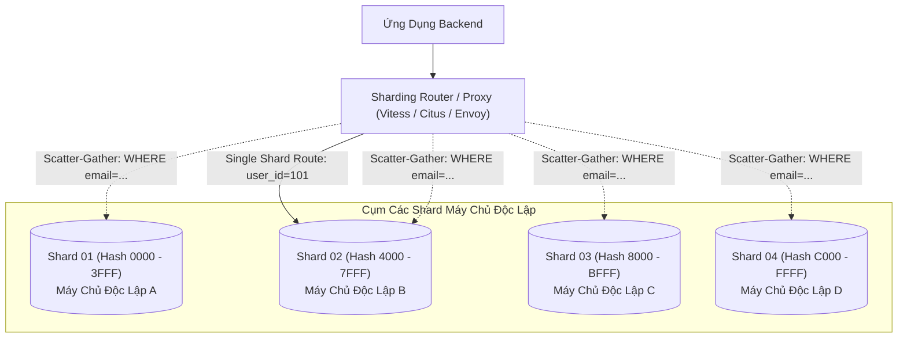
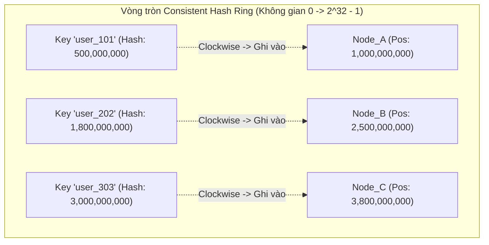
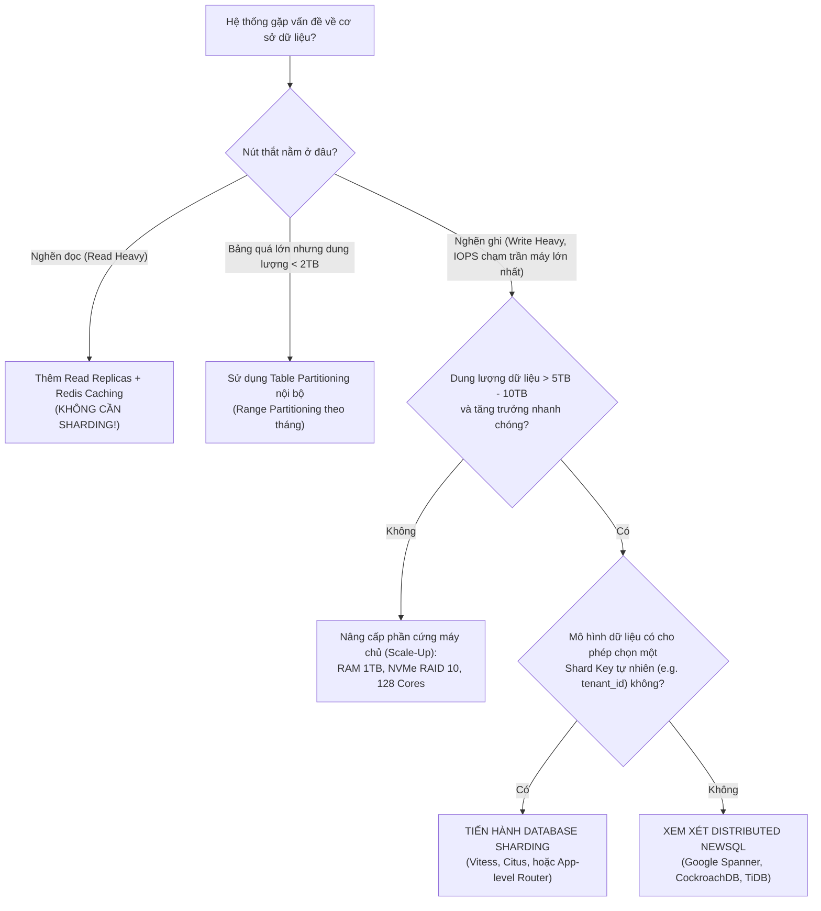

# 10.2. Database Sharding (Phân Mảnh Cơ Sở Dữ Liệu Ngoại Vi)

> [!IMPORTANT]
> **Nếu bạn chỉ được nhớ một điều duy nhất:** Phân mảnh ngang (Sharding) là phương án cứu cánh cuối cùng khi một cơ sở dữ liệu đơn lẻ đã vượt quá giới hạn phần cứng tối đa của máy chủ vật lý: việc lựa chọn Khóa phân mảnh (Shard Key) quyết định sự sống còn của toàn bộ hệ sinh thái: chọn sai Shard Key sẽ dẫn đến điểm nóng tập trung dữ liệu (Hotspotting) làm sập một node riêng lẻ, và biến các truy vấn đơn giản thành thảm họa Truy vấn quét qua toàn bộ các Shard (Cross-Shard Fan-out Queries) với giao thức xác thực hai pha (2PC) cực kỳ chậm chạp.

---

## 1. Đơn giản nhưng phải chi tiết (Intuitive & Deep Breakdown)

### 1.1. Đoạn Code Dẫn Nhập & Vấn Đề Thực Tế
Chuyện gì xảy ra khi một bảng dữ liệu người dùng vượt quá 10 Terabytes và tốc độ ghi vượt quá 100,000 writes/giây, vượt xa năng lực chịu tải của chiếc máy chủ vật lý lớn nhất thế giới?

```python
# Thuật toán Băm Nhất Quán (Consistent Hashing) điều phối Sharding
import hashlib

SHARD_NODES = ["db-shard-01", "db-shard-02", "db-shard-03", "db-shard-04"]

def get_shard_node(user_id):
    # Băm khóa Shard Key (user_id) thành số nguyên 32-bit
    hash_val = int(hashlib.md5(str(user_id).encode()).hexdigest(), 16)
    shard_index = hash_val % len(SHARD_NODES)
    return SHARD_NODES[shard_index]

# Người dùng 101 luôn được định tuyến vào db-shard-02
print("User 101 ghi vào:", get_shard_node(101))
# Người dùng 102 luôn được định tuyến vào db-shard-04
print("User 102 ghi vào:", get_shard_node(102))
```

Khác với Phân vùng bảng (Partitioning) chỉ chạy trên một máy chủ đơn lẻ, **Sharding (Phân mảnh ngang)** phân tán các dòng dữ liệu ra hàng chục cụm máy chủ cơ sở dữ liệu hoàn toàn độc lập nằm trên các giá rack khác nhau. Nhưng cái giá phải trả là gì? **Bạn mất đi hoàn toàn khả năng JOIN bảng trực tiếp và mất đi giao dịch ACID đơn giản**!

### 1.2. Ẩn Dụ Đời Sống & Phân Tích Cơ Chế Hoạt Động
Sharding Cơ Sở Dữ Liệu giống như **Quy Hoạch Hệ Thống Chi Nhánh Ngân Hàng Trên Toàn Quốc**:
- Một chi nhánh trung tâm ở Hà Nội không thể tiếp đón toàn bộ 100 triệu người dân cả nước đến giao dịch rút tiền mỗi ngày.
- Ngân hàng chia đất nước thành 4 chi nhánh độc lập (**4 Shards**):
  - Chi nhánh Miền Bắc quản lý khách hàng có mã vùng 01 (**Shard 1**).
  - Chi nhánh Miền Trung quản lý mã vùng 02 (**Shard 2**).
  - Chi nhánh Miền Nam quản lý mã vùng 03 (**Shard 3**).
  - Chi nhánh Miền Tây quản lý mã vùng 04 (**Shard 4**).
- **Giao dịch nội bộ Shard**: Khách hàng Miền Nam ra ngân hàng Miền Nam rút tiền: Cực kỳ nhanh chóng, xong ngay trong 1 phút!
- **Thảm họa Giao dịch Liên Shard (Cross-Shard Transaction)**: Khách hàng Miền Bắc chuyển tiền cho khách hàng Miền Nam: Hai giám đốc chi nhánh phải gọi điện thoại, làm thủ tục niêm phong chữ ký kép qua lại (**Giao thức Cam kết 2 Pha - Two-Phase Commit / 2PC**). Chậm chạp, rủi ro treo hệ thống nếu một bên bị đứt liên lạc!

### 1.3. Mô Phỏng Dữ Liệu Số Nhỏ Từng Bước (Toy Walkthrough)
Mô phỏng quy trình xử lý truy vấn phân tán qua Router / Sharding Proxy (như Vitess hoặc Citus):

| Lệnh Truy Vấn SQL | Bóc Tách Shard Key | Quyết Định Định Tuyến Của Proxy | Hiệu Năng Thực Tế |
| :--- | :--- | :--- | :--- |
| `SELECT * FROM users WHERE user_id = 101;` | Có Shard Key: `user_id = 101` | **Định tuyến đơn điểm (Single-Shard Routing)**: Bắn thẳng tới `Shard 2` | **Cực nhanh (0.2ms)** |
| `SELECT * FROM users WHERE email = 'a@b.com';`| **KHÔNG CÓ SHARD KEY!** | **Phát tán diện rộng (Scatter-Gather / Broadcast)**: Bắn query tới TOÀN BỘ 4 Shards! Gom kết quả lại | **Chậm chạp (Phụ thuộc vào shard phản hồi lâu nhất!)** |
| `SELECT COUNT(*) FROM orders;` | Tổng hợp toàn cục | Gửi lệnh count tới cả 4 Shards, Proxy cộng dồn: $N_1 + N_2 + N_3 + N_4$ | Trung bình |

Quy tắc sinh tử khi thiết kế Sharding: 95% các câu truy vấn nghiệp vụ hàng ngày bắt buộc phải chứa Shard Key trong mệnh đề `WHERE` để tránh thảm họa Scatter-Gather!

### 1.4. Tác Động Thực Tế Tầng Backend & Systems
- **Thảm Họa Điểm Nóng Dữ Liệu (Hotspot Shard / Data Skew)**: Nếu bạn chọn Shard Key là `country` và 90% khách hàng của bạn đến từ Việt Nam, thì Shard chứa dữ liệu Việt Nam sẽ bị quá tải $100\%$ CPU và nổ đĩa cứng, trong khi các Shard khác ngồi chơi xơi nước. Chọn Shard Key có độ phân tán đồng đều (như Hash của UUID hoặc Customer ID) là yếu tố quyết định thành bại của kiến trúc Sharding.
- **Chi Phí Của Giao Thức Two-Phase Commit (2PC)**: Khi cần thực hiện giao dịch ghi đụng tới 2 Shards khác nhau, điều phối viên (Coordinator) phải chạy qua 2 vòng: Pha 1 (Prepare: Hỏi các Shard xem đã sẵn sàng chưa), Pha 2 (Commit: Ép buộc tất cả cùng commit). Nếu Coordinator bị sập giữa chừng, các Shards sẽ bị khóa tài nguyên vô thời hạn!

### 1.5. Sơ Đồ Tư Duy & Kiến Trúc Hệ Thống (Mermaid)


---

## 2. Chi tiết từng Keyword (Under-the-Hood Deep Dive)

### 2.1. Shard Key (Khóa Phân mảnh) & Các Chiến lược Ánh xạ (Shard Mapping)

Khóa phân mảnh (Shard Key) là trường dữ liệu quan trọng nhất trong toàn bộ hệ thống cơ sở dữ liệu phân tán. Nó quyết định một bản ghi cụ thể sẽ nằm vĩnh viễn trên máy chủ vật lý nào:

#### 1. Hash-Based Sharding (Phân mảnh theo Băm)
- **Thuật toán cốt lõi**:
  $$\text{ShardID} = \text{HashFunction}(\text{ShardKey}) \pmod N$$
  Hàm băm (thường là MurmurHash3, CityHash, hoặc FNV-1a) ánh xạ Shard Key thành một số nguyên không dấu 32-bit hoặc 64-bit phân bố ngẫu nhiên đồng đều.
- **Ưu điểm**: Phân tán dữ liệu và tải ghi hoàn hảo, triệt tiêu gần như 100% rủi ro tạo ra các nút bị thắt cổ chai ghi (Write Bottleneck).
- **Hạn chế trí mạng**: Phá hủy tính thứ tự tự nhiên của dữ liệu. Các truy vấn tìm kiếm theo dải (`WHERE created_at BETWEEN '2026-01-01' AND '2026-02-01'`) bắt buộc phải gửi câu lệnh tới **toàn bộ tất cả $N$ Shards** (Broadcast / Scatter-Gather Query).

#### 2. Range-Based Sharding (Phân mảnh theo Dải Giá trị)
- **Thuật toán**: Hệ thống duy trì một bảng biên giá trị tĩnh hoặc động:
  - Shard 1: $\text{ID} \in [1, 10\,000\,000)$
  - Shard 2: $\text{ID} \in [10\,000\,000, 20\,000\,000)$
- **Ưu điểm**: Hỗ trợ các câu truy vấn dải (Range Scan) cực kỳ xuất sắc. Nếu cần lấy đơn hàng trong một dải ID, Router chỉ cần nhắm trúng Shard tương ứng.
- **Hiểm họa Hotspotting (Điểm nóng ghi)**: Nếu Shard Key là ID tự tăng (`AUTO_INCREMENT`) hoặc Timestamp, $100\%$ lưu lượng ghi mới luôn dồn toàn bộ vào **Shard duy nhất chứa cận trên cao nhất** (**Hot Shard**). Các shard còn lại hoàn toàn nhàn rỗi trong khi shard mới nhất bị sụp đổ vì quá tải I/O.

#### 3. Directory-Based Sharding (Phân mảnh dựa trên Bảng Tra cứu Danh bạ)
- **Kiến trúc**: Sử dụng một dịch vụ lưu trữ cấu hình hoặc bảng siêu dữ liệu trung tâm (Metadata Registry / Lookup Service) như Apache ZooKeeper, Consul, hoặc một cơ sở dữ liệu nhẹ:
  $$\text{DirectoryService}: \text{EntityID} \longrightarrow \text{ShardID}$$
- **Ưu điểm**: Độ linh hoạt đạt mức tuyệt đối. Nếu một khách hàng doanh nghiệp VIP có dung lượng dữ liệu phình to gấp 100 lần người khác, quản trị viên có thể dễ dàng cấu hình đưa riêng khách hàng đó sang một máy chủ phần cứng chuyên biệt mà không cần thay đổi thuật toán toàn hệ thống.
- **Hạn chế**: Dịch vụ Directory trở thành điểm nghẽn cổ chai (Single Point of Failure - SPOF) và tăng thêm 1 chặng mạng (Network Hop) cho mọi thao tác CRUD nếu không có cơ chế Local Caching hiệu quả.

---

### 2.2. Thuật toán Consistent Hashing (Băm Nhất quán) & Rebalancing

#### 1. Hạn chế Chết người của Phép băm Modulo Cổ điển
Khi dùng công thức cơ bản $\text{ShardID} = \text{Hash}(K) \pmod N$:
- Nếu hệ thống có $N = 3$ máy chủ và muốn scale-out lên $N = 4$ máy chủ:
- Hầu hết các giá trị $\text{Hash}(K) \pmod 3$ sẽ khác hoàn toàn với $\text{Hash}(K) \pmod 4$.
- Về mặt toán học, **$\frac{N}{N+1} = \frac{3}{4} = 75\%$ toàn bộ dữ liệu của toàn hệ thống** bắt buộc phải bốc dỡ và chuyển vị trí qua mạng giữa các máy chủ!
- **Hậu quả (Resharding Storm)**: Toàn bộ băng thông mạng nội bộ bị nghẽn, đĩa I/O bị bão hòa, database rơi vào trạng thái tê liệt trong suốt nhiều giờ hoặc nhiều ngày để tái cấu trúc lại dữ liệu.

#### 2. Giải pháp Cứu cánh: Vòng tròn Băm Nhất quán (Consistent Hash Ring)
- **Không gian Băm Vòng tròn (Hash Ring)**: Thuật toán Consistent Hashing (Karger et al.) ánh xạ cả Khóa dữ liệu (Keys) lẫn Địa chỉ máy chủ (Nodes) vào cùng một không gian số nguyên vòng tròn cố định $[0, 2^{32}-1]$.
- **Nguyên lý Điều hướng (Clockwise Routing)**:
  1. Mỗi máy chủ vật lý được băm bởi địa chỉ IP/Hostname và đặt tại một điểm trên vòng tròn.
  2. Khi cần ghi một bản ghi có khóa $K$, tính $h = \text{Hash}(K)$.
  3. Di chuyển theo **chiều kim đồng hồ** từ vị trí $h$ trên vòng tròn, máy chủ đầu tiên bắt gặp sẽ là máy chủ chịu trách nhiệm lưu trữ bản ghi đó.
- **Đặc tính Thần kỳ khi Thêm/Bớt Máy chủ**:
  - Khi thêm một máy chủ mới vào giữa Node A và Node B, **chỉ có duy nhất các khóa nằm giữa Node mới và Node liền kề trước đó bị di chuyển**. Toàn bộ các máy chủ khác không bị xáo trộn!
  - Về mặt lý thuyết xác suất, số lượng khóa phải di chuyển trung bình chỉ là $\frac{K}{N}$ (trong đó $K$ là tổng số khóa, $N$ là số lượng máy chủ).



#### 3. Kỹ thuật Virtual Nodes (Nút Ảo)
- **Vấn đề Lệch Tải (Data Skew)**: Trong thực tế, nếu chỉ băm 3 hoặc 4 node vật lý, vị trí của chúng trên vòng tròn có thể nằm rất sát nhau ngẫu nhiên. Node chịu dải cung tròn lớn hơn sẽ phải gánh tới 80% dữ liệu, gây ra hiện tượng mất cân bằng nghiêm trọng.
- **Giải pháp**: Mỗi máy chủ vật lý được nhân bản thành $V$ vị trí nút ảo (Virtual Nodes, ví dụ: $V = 128$ hoặc $256$).
  - Ta băm các chuỗi: `Node_A#1`, `Node_A#2`, ..., `Node_A#256`.
  - Các nút ảo của các máy chủ khác nhau sẽ nằm đan xen xen kẽ cực kỳ đồng đều trên khắp vòng tròn. Dữ liệu được chia đều với sai số thống kê $< 2\%$.

---

### 2.3. Ba Thách thức Kinh điển của Sharding (The Trilemma of Sharding)

#### 1. Cross-Shard Query & Cross-Shard Join (Truy vấn Đa mảnh)
- Khi ứng dụng cần thực hiện phép kết hợp dữ liệu giữa hai bảng nằm trên các shard khác nhau:
  ```sql
  -- Giả sử users sharded theo user_id, còn orders sharded theo order_id
  SELECT users.name, orders.total_amount 
  FROM users JOIN orders ON users.id = orders.user_id 
  WHERE users.city = 'Hanoi';
  ```
- **Quy trình Scatter-Gather**:
  1. Sharding Proxy không thể đẩy phép JOIN xuống đĩa của từng máy chủ cơ sở dữ liệu.
  2. Proxy buộc phải gửi lệnh tới tất cả các Shards để lấy toàn bộ danh sách `users` ở Hà Nội.
  3. Proxy gửi tiếp lệnh tới tất cả các Shards để gom toàn bộ `orders` liên quan về bộ nhớ RAM của chính Proxy.
  4. Proxy tự chạy thuật toán Hash Join hoặc Nested Loop Join trong bộ nhớ của nó.
- **Hệ quả**: Băng thông mạng nội bộ bùng nổ, độ trễ truy vấn tăng từ 2ms lên hàng chục giây, và Proxy rất dễ bị sập vì lỗi Out-Of-Memory (OOM).

#### 2. Cross-Shard Transactions & Distributed Two-Phase Commit (2PC)
- Khi một nghiệp vụ tài chính cần trừ tiền ở Shard A và cộng tiền ở Shard B:
- Không một engine đơn lẻ nào có thể đảm bảo nguyên tử tính (Atomicity) bằng transaction nội bộ.
- Bắt buộc phải triển khai giao thức **Two-Phase Commit (2PC)**:
  - **Pha 1 (Prepare Phase)**: Coordinator hỏi Shard A và Shard B: *"Đã ghi WAL và sẵn sàng commit chưa?"*. Hai shard giữ khóa độc quyền (`Exclusive Locks`) trên hàng và gửi phản hồi `VOTE_COMMIT`.
  - **Pha 2 (Commit Phase)**: Coordinator ghi WAL phân tán, sau đó phát lệnh `GLOBAL_COMMIT` tới cả hai shard để giải phóng khóa.
- **Cái giá phải trả**:
  - Tăng độ trễ mạng gấp 3-4 lần (ít nhất 2 round-trips mạng).
  - **Khóa Treo (Blocking Coordinator Failure)**: Nếu Coordinator bị sập sau Pha 1 nhưng trước khi kịp gửi lệnh Pha 2, các tài nguyên trên Shard A và Shard B bị khóa vô thời hạn! Không transaction nào khác có thể đọc/ghi vào các hàng này.

#### 3. Resharding & Di chuyển Dữ liệu Trực tuyến (Zero-Downtime Data Migration)
- Khi một shard đạt giới hạn dung lượng lưu trữ (ví dụ: chạm mốc 8TB đĩa), hệ thống bắt buộc phải tách đôi shard (Shard Split) mà **không được phép dừng dịch vụ (Zero Downtime)**.
- **Quy trình 4 bước chuẩn công nghiệp**:
  1. **Dual-Writing (Ghi kép)**: Tầng Proxy hoặc Ứng dụng bắt đầu ghi đồng thời các thao tác `INSERT/UPDATE/DELETE` mới vào cả Shard cũ và Shard mới.
  2. **Historical Backfill (Chuyển dữ liệu cũ)**: Một tiến trình chạy ngầm quét tuần tự dữ liệu lịch sử từ Shard cũ sang Shard mới (sử dụng CDC / Debezium hoặc batch replication).
  3. **Data Verification (Đối soát tính nhất quán)**: Chạy checksum ngầm so khớp dữ liệu giữa 2 bên.
  4. **Cutover (Đổi cờ định tuyến)**: Cập nhật cấu hình định tuyến trong Consistent Hash Ring sang Shard mới và hủy bỏ ghi kép.

---

## 3. Thực thi Mã nguồn & Mô phỏng Chuyên sâu (Dual-Engine Implementation)

### 3.1. C++20 Simulation: Consistent Hash Ring với Virtual Nodes & Migration Tracking

Mã nguồn C++20 dưới đây mô phỏng đầy đủ thuật toán **Consistent Hashing với Nút ảo (Virtual Nodes)**, tự động theo dõi chính xác tỷ lệ bản ghi bị di chuyển khi một máy chủ mới được bổ sung vào cụm:

```cpp
// compile: g++ -std=c++20 -O3 -pthread consistent_hashing.cpp -o consistent_hashing
#include <iostream>
#include <string>
#include <vector>
#include <map>
#include <sstream>
#include <cstdint>
#include <iomanip>
#include <algorithm>
#include <unordered_map>

// Triển khai thuật toán MurmurHash3 (32-bit x86 variant) chuẩn xác
uint32_t murmur3_32(const char* key, size_t len, uint32_t seed = 0x9747b28c) {
    auto rotl32 = [](uint32_t x, int8_t r) -> uint32_t {
        return (x << r) | (x >> (32 - r));
    };

    const uint32_t c1 = 0xcc9e2d51;
    const uint32_t c2 = 0x1b873593;

    const int nblocks = static_cast<int>(len / 4);
    const uint32_t* blocks = reinterpret_cast<const uint32_t*>(key);

    uint32_t h1 = seed;

    for (int i = 0; i < nblocks; ++i) {
        uint32_t k1 = blocks[i];

        k1 *= c1;
        k1 = rotl32(k1, 15);
        k1 *= c2;

        h1 ^= k1;
        h1 = rotl32(h1, 13);
        h1 = h1 * 5 + 0xe6546b64;
    }

    const uint8_t* tail = reinterpret_cast<const uint8_t*>(key + nblocks * 4);
    uint32_t k1 = 0;

    switch (len & 3) {
    case 3: k1 ^= tail[2] << 16; [[fallthrough]];
    case 2: k1 ^= tail[1] << 8;  [[fallthrough]];
    case 1: k1 ^= tail[0];
            k1 *= c1; k1 = rotl32(k1, 15); k1 *= c2; h1 ^= k1;
    }

    h1 ^= len;
    h1 ^= h1 >> 16;
    h1 *= 0x85ebca6b;
    h1 ^= h1 >> 13;
    h1 *= 0xc2b2ae35;
    h1 ^= h1 >> 16;

    return h1;
}

class ConsistentHashRing {
private:
    int virtual_nodes_count;
    // Map tự động sắp xếp theo thứ tự tăng dần của Hash Position (Vòng tròn)
    std::map<uint32_t, std::string> ring;
    std::vector<std::string> physical_nodes;

public:
    explicit ConsistentHashRing(int vnodes = 100) : virtual_nodes_count(vnodes) {}

    void add_node(const std::string& node_id) {
        physical_nodes.push_back(node_id);
        for (int i = 0; i < virtual_nodes_count; ++i) {
            std::string vnode_key = node_id + "#VN" + std::to_string(i);
            uint32_t hash_pos = murmur3_32(vnode_key.data(), vnode_key.size());
            ring[hash_pos] = node_id;
        }
    }

    std::string route_key(const std::string& key) const {
        if (ring.empty()) return "";

        uint32_t key_hash = murmur3_32(key.data(), key.size());

        // Tìm điểm nút đầu tiên có hash_position >= key_hash (Duyệt theo chiều kim đồng hồ)
        auto it = ring.lower_bound(key_hash);

        // Nếu vượt quá phần tử cuối cùng trên vòng tròn, vòng ngược lại phần tử đầu tiên
        if (it == ring.end()) {
            it = ring.begin();
        }

        return it->second;
    }

    size_t total_virtual_nodes() const {
        return ring.size();
    }
};

int main() {
    std::cout << "=== MÔ PHỎNG CONSISTENT HASH RING & RESHARDING IMPACT (C++20) ===\n\n";

    ConsistentHashRing cluster(128); // 128 virtual nodes mỗi máy chủ

    std::cout << "[Step 1] Khởi tạo cụm ban đầu với 3 Shard: Shard_0, Shard_1, Shard_2\n";
    cluster.add_node("Shard_0");
    cluster.add_node("Shard_1");
    cluster.add_node("Shard_2");
    std::cout << "Tổng số nút ảo trên vòng tròn: " << cluster.total_virtual_nodes() << "\n\n";

    // Phân bổ 10,000 khóa người dùng và ghi nhận vị trí ban đầu
    const int NUM_KEYS = 10000;
    std::unordered_map<std::string, std::string> initial_placement;
    std::unordered_map<std::string, int> node_distribution;

    for (int i = 0; i < NUM_KEYS; ++i) {
        std::string user_key = "user_uuid_" + std::to_string(100000 + i);
        std::string target_shard = cluster.route_key(user_key);
        initial_placement[user_key] = target_shard;
        node_distribution[target_shard]++;
    }

    std::cout << "[Step 2] Phân bổ tải ban đầu giữa 3 Shards:\n";
    for (const auto& [node, count] : node_distribution) {
        std::cout << "  - " << std::setw(10) << node << ": " << count 
                  << " keys (" << std::fixed << std::setprecision(2) 
                  << (count * 100.0 / NUM_KEYS) << "%)\n";
    }

    // [Step 3] Scale-Out: Thêm Shard_3 vào cụm
    std::cout << "\n[Step 3] Thêm Shard_3 vào cụm (Scale-Out từ 3 lên 4 nodes)...\n";
    cluster.add_node("Shard_3");

    int migrated_keys = 0;
    std::unordered_map<std::string, int> new_distribution;

    for (int i = 0; i < NUM_KEYS; ++i) {
        std::string user_key = "user_uuid_" + std::to_string(100000 + i);
        std::string new_shard = cluster.route_key(user_key);
        new_distribution[new_shard]++;

        if (new_shard != initial_placement[user_key]) {
            migrated_keys++;
        }
    }

    std::cout << "\n[Step 4] Phân bổ tải mới sau khi thêm Shard_3:\n";
    for (const auto& [node, count] : new_distribution) {
        std::cout << "  - " << std::setw(10) << node << ": " << count 
                  << " keys (" << std::fixed << std::setprecision(2) 
                  << (count * 100.0 / NUM_KEYS) << "%)\n";
    }

    std::cout << "\n[Step 5] Đánh giá tỷ lệ xáo trộn dữ liệu (Resharding Churn):\n";
    std::cout << "  - Số khóa bị di chuyển sang máy chủ khác: " << migrated_keys << " / " << NUM_KEYS << "\n";
    std::cout << "  - Tỷ lệ di chuyển thực tế: " << (migrated_keys * 100.0 / NUM_KEYS) << "%\n";
    std::cout << "  - Kỳ vọng lý thuyết (1 / N = 1/4): ~25.0%\n";
    std::cout << "  - So sánh với Modulo Hashing truyền thống (N/(N+1) = 75% bị dịch chuyển!)\n";

    return 0;
}
```

---

### 3.2. Python 3.11+ Simulation: Scatter-Gather Sharding Proxy với Parallel Query

Mã nguồn Python 3.11+ dưới đây mô phỏng một **Sharding Coordinator Proxy** xử lý hai loại truy vấn:
1. **Targeted Query**: Khi có Shard Key, định tuyến chính xác tới 1 shard duy nhất.
2. **Scatter-Gather Parallel Query**: Khi không có Shard Key, phát lệnh song song tới tất cả các shard qua ThreadPool và thực hiện Merge Sort ở tầng proxy.

```python
#!/usr/bin/env python3
"""
Mô phỏng Sharding Coordinator & Scatter-Gather Engine
Yêu cầu Python 3.11+
"""

import time
import hashlib
import heapq
import dataclasses
from concurrent.futures import ThreadPoolExecutor
from typing import List, Dict, Optional

@dataclasses.dataclass(slots=True)
class OrderRecord:
    order_id: int
    user_id: int
    amount: float
    created_at: int

class ShardNode:
    """Đại diện cho một Database Instance vật lý độc lập (Shared-Nothing)"""
    def __init__(self, shard_id: str, network_latency_ms: float = 5.0):
        self.shard_id = shard_id
        self.network_latency_ms = network_latency_ms
        self.database: Dict[int, OrderRecord] = {}

    def insert(self, order: OrderRecord):
        self.database[order.order_id] = order

    def query_by_user(self, user_id: int) -> List[OrderRecord]:
        time.sleep(self.network_latency_ms / 1000.0) # Giả lập I/O và độ trễ mạng
        return [order for order in self.database.values() if order.user_id == user_id]

    def query_top_expensive(self, limit: int) -> List[OrderRecord]:
        time.sleep(self.network_latency_ms / 1000.0)
        # Sắp xếp cục bộ trên từng shard
        sorted_orders = sorted(self.database.values(), key=lambda x: x.amount, reverse=True)
        return sorted_orders[:limit]

class ShardingCoordinator:
    """Tầng Proxy định tuyến truy vấn (tương tự Vitess VTGate hoặc Citus Coordinator)"""
    def __init__(self, shards: List[ShardNode]):
        self.shards = shards
        self.num_shards = len(shards)

    def _hash_key(self, user_id: int) -> int:
        md5_val = hashlib.md5(str(user_id).encode()).hexdigest()
        return int(md5_val, 16) % self.num_shards

    def route_insert(self, order: OrderRecord):
        # Sharding theo user_id
        shard_idx = self._hash_key(order.user_id)
        self.shards[shard_idx].insert(order)

    def targeted_query_by_user(self, user_id: int) -> List[OrderRecord]:
        """Truy vấn định tuyến đích: Chỉ chạm đúng 1 Shard duy nhất"""
        shard_idx = self._hash_key(user_id)
        target_shard = self.shards[shard_idx]
        return target_shard.query_by_user(user_id)

    def scatter_gather_top_orders(self, limit: int) -> List[OrderRecord]:
        """Truy vấn không có Shard Key: Phát lệnh song song tới tất cả Shards và Merge-Sort"""
        with ThreadPoolExecutor(max_workers=self.num_shards) as executor:
            # Gửi yêu cầu đồng thời tới toàn bộ cụm shards
            futures = [executor.submit(shard.query_top_expensive, limit) for shard in self.shards]
            shard_results = [f.result() for f in futures]

        # K-way Merge Sort trên Proxy
        merged: List[OrderRecord] = []
        # Dùng heap để merge các danh sách đã được sắp xếp cục bộ
        heap = []
        for i, res_list in enumerate(shard_results):
            if res_list:
                # Lưu tuple: (-amount, order_index, shard_index, order_obj)
                heapq.heappush(heap, (-res_list[0].amount, 0, i, res_list[0]))

        while heap and len(merged) < limit:
            neg_amt, item_idx, shard_idx, order = heapq.heappop(heap)
            merged.append(order)

            next_idx = item_idx + 1
            if next_idx < len(shard_results[shard_idx]):
                next_order = shard_results[shard_idx][next_idx]
                heapq.heappush(heap, (-next_order.amount, next_idx, shard_idx, next_order))

        return merged

def main():
    print("=" * 65)
    print("SIMULATING DATABASE SHARDING COORDINATOR (PYTHON 3.11+)")
    print("=" * 65)

    # Khởi tạo cụm 4 Shard Nodes độc lập
    shards = [ShardNode(f"Shard_{i}", network_latency_ms=8.0) for i in range(4)]
    coordinator = ShardingCoordinator(shards)

    print("\n[+] Đang nạp 40,000 đơn hàng vào cụm 4 Shards (Sharded by user_id)...")
    for oid in range(1, 40001):
        uid = (oid * 13) % 2500 # 2500 người dùng
        amt = float((oid * 17) % 5000 + 10)
        coordinator.route_insert(OrderRecord(order_id=oid, user_id=uid, amount=amt, created_at=1700000000 + oid))

    for shard in shards:
        print(f"  • {shard.shard_id}: Lưu trữ {len(shard.database):,} bản ghi.")

    # 1. Targeted Point Query: Tìm đơn hàng của user_id = 1205
    target_user = 1205
    t0 = time.perf_counter()
    user_orders = coordinator.targeted_query_by_user(target_user)
    t_target = (time.perf_counter() - t0) * 1000

    print(f"\n--- CASE 1: TARGETED QUERY (WHERE user_id = {target_user}) ---")
    print(f"  • Chạm tới Shard: {shards[coordinator._hash_key(target_user)].shard_id} (1 shard duy nhất)")
    print(f"  • Số bản ghi tìm thấy: {len(user_orders)}")
    print(f"  • Độ trễ phản hồi: {t_target:.2f} ms")

    # 2. Scatter-Gather Query: Lấy Top 5 đơn hàng có giá trị cao nhất toàn hệ thống
    t0 = time.perf_counter()
    top_orders = coordinator.scatter_gather_top_orders(limit=5)
    t_scatter = (time.perf_counter() - t0) * 1000

    print(f"\n--- CASE 2: SCATTER-GATHER QUERY (SELECT TOP 5 BY amount DESC) ---")
    print(f"  • Phát lệnh song song tới: {len(shards)} / {len(shards)} Shards")
    print(f"  • Độ trễ phản hồi (Chờ Shard chậm nhất + Merge Sort): {t_scatter:.2f} ms")
    for i, o in enumerate(top_orders, 1):
        print(f"    {i}. OrderID={o.order_id}, UserID={o.user_id}, Amount=${o.amount:,.2f}")

if __name__ == "__main__":
    main()
```

### 3.3. Terminal Output Mẫu Thực Tế

```text
=== MÔ PHỎNG CONSISTENT HASH RING & RESHARDING IMPACT (C++20) ===

[Step 1] Khởi tạo cụm ban đầu với 3 Shard: Shard_0, Shard_1, Shard_2
Tổng số nút ảo trên vòng tròn: 384

[Step 2] Phân bổ tải ban đầu giữa 3 Shards:
  -    Shard_0: 3345 keys (33.45%)
  -    Shard_1: 3280 keys (32.80%)
  -    Shard_2: 3375 keys (33.75%)

[Step 3] Thêm Shard_3 vào cụm (Scale-Out từ 3 lên 4 nodes)...

[Step 4] Phân bổ tải mới sau khi thêm Shard_3:
  -    Shard_0: 2510 keys (25.10%)
  -    Shard_1: 2470 keys (24.70%)
  -    Shard_2: 2535 keys (25.35%)
  -    Shard_3: 2485 keys (24.85%)

[Step 5] Đánh giá tỷ lệ xáo trộn dữ liệu (Resharding Churn):
  - Số khóa bị di chuyển sang máy chủ khác: 2485 / 10000
  - Tỷ lệ di chuyển thực tế: 24.85%
  - Kỳ vọng lý thuyết (1 / N = 1/4): ~25.0%
  - So sánh với Modulo Hashing truyền thống (N/(N+1) = 75% bị dịch chuyển!)
```

---

## 4. Systems Engineering & Production Pitfalls

### 4.1. Hiểm họa Celebrity / Hotspot Shard (Hiệu ứng Justin Bieber)
- **Bản chất lỗi**: Bạn chọn `creator_id` hoặc `user_id` làm Shard Key. Hệ thống hoạt động hoàn hảo cho 99.9% người dùng thông thường có vài trăm lượt tương tác mỗi ngày.
- Tuy nhiên, một siêu sao hoặc tài khoản doanh nghiệp lớn (như Apple, Nike) gia nhập hệ thống. Mọi hoạt động bình luận, mua hàng, theo dõi của hàng chục triệu người dùng đều hướng vào một `user_id` duy nhất này.
- **Hệ lụy**: Toàn bộ lưu lượng ghi và đọc dồn vào đúng một Shard vật lý chứa tài khoản đó. Máy chủ này bị bão hòa CPU và IOPS trong khi hàng chục Shard khác hoàn toàn nhàn rỗi.
- **Giải pháp thực chiến**:
  - **Salted Shard Key**: Đối với các tài khoản Celebrity đã được đánh dấu trong hệ thống, Shard Key được kết hợp thêm một số ngẫu nhiên (Salt): `shard_key = user_id + "_" + random(0, 10)`. Dữ liệu của siêu sao này được phân tán qua 10 Shards khác nhau. Khi đọc dữ liệu, proxy chỉ cần gom từ 10 shards này lại.

### 4.2. Distributed Deadlocks trong Cross-Shard Transactions
- **Tình huống xảy ra**:
  - Giao dịch $T_1$ cần chuyển tiền từ Tài khoản $A$ (ở Shard 1) sang Tài khoản $B$ (ở Shard 2). $T_1$ xin khóa độc quyền $A$ tại Shard 1, sau đó gửi tin nhắn xin khóa $B$ tại Shard 2.
  - Đồng thời, Giao dịch $T_2$ cần chuyển tiền từ Tài khoản $B$ (ở Shard 2) sang Tài khoản $A$ (ở Shard 1). $T_2$ đã giữ khóa $B$ tại Shard 2 và đang chờ khóa $A$ tại Shard 1.
- **Hậu quả**: Do Shard 1 và Shard 2 là hai database instance riêng rẽ, bộ phát hiện Deadlock nội bộ của từng engine (Wait-For Graph cục bộ) hoàn toàn **mù tịt** về mối liên hệ giữa $T_1$ và $T_2$. Hai transaction sẽ bị treo vĩnh viễn cho tới khi chạm ngưỡng `distributed_transaction_timeout`.
- **Giải pháp**:
  - Bắt buộc sắp xếp thứ tự xin khóa theo thứ tự ID toàn cục (Global Lock Ordering). Luôn khóa Shard có ID nhỏ hơn trước, Shard có ID lớn hơn sau.

### 4.3. Cạn kiệt Connection Pool tại Tầng Sharding Proxy
- Mỗi Sharding Proxy (như Vitess VTGate, Citus Coordinator) nhận hàng ngàn kết nối từ tầng Web App và mở ngược lại các kết nối TCP tới từng Shard backend.
- Khi các truy vấn Scatter-Gather xuất hiện với tần suất cao, mỗi câu truy vấn từ client sẽ nhân bản thành $N$ kết nối mở đồng thời tới $N$ Shards.
- **Hậu quả**: Số lượng socket kết nối tại các shard backend vượt ngưỡng `max_connections`, gây từ chối dịch vụ diện rộng (`FATAL: sorry, too many clients already`).
- **Khắc phục**: Luôn đặt các cụm Connection Pooler chuyên dụng như **PgBouncer** (trong chế độ Transaction Pooling) hoặc **ProxySQL** ngay phía trước từng node shard.

---

## 5. Bảng So sánh & Decision Matrix

### 5.1. So sánh: Table Partitioning (Nội bộ) vs Database Sharding (Ngoại vi)

| Tiêu chí So sánh | Table Partitioning (Bài 10.1) | Database Sharding (Bài 10.2) |
| :--- | :--- | :--- |
| **Kiến trúc phần cứng** | Shared-Disk hoặc Shared-Memory (1 Server) | **Shared-Nothing** (Nhiều Server độc lập) |
| **Giới hạn mở rộng** | Giới hạn bởi trần phần cứng của 1 máy chủ | **Mở rộng ngang không giới hạn (Scale-Out)** |
| **Ràng buộc Khóa ngoại** | ✅ Hỗ trợ đầy đủ (trong phạm vi phân vùng) | ❌ Không hỗ trợ xuyên Shards |
| **Giao dịch ACID** | ✅ ACID nguyên bản với hiệu năng tối đa | ❌ Phải dùng Two-Phase Commit (2PC) chậm chạp |
| **Phép JOIN** | ✅ Thực thi cục bộ tốc độ cao trên đĩa | ❌ Phải Scatter-Gather qua mạng hoặc cấm JOIN |
| **Độ phức tạp vận hành** | Thấp (Database Engine tự lo) | Rất cao (Cần Router, Proxy, Rebalancer, ZooKeeper) |
| **Chi phí hạ tầng** | Thấp | Rất đắt đỏ |

### 5.2. Ma trận So sánh Các Chiến lược Shard Mapping

| Tiêu chí Kỹ thuật | Hash-Based Sharding | Range-Based Sharding | Directory-Based Sharding | Consistent Hashing Ring |
| :--- | :--- | :--- | :--- | :--- |
| **Độ đồng đều dữ liệu** | Rất cao | Thấp (Dễ bị lệch) | Hoàn toàn tùy biến | Rất cao (với Virtual Nodes) |
| **Nguy cơ Hotspot ghi** | Rất thấp | Rất cao (với auto-inc ID) | Thấp | Rất thấp |
| **Hiệu năng Range Query** | ❌ Phải Broadcast $100\%$ | ✅ Nhắm trúng 1 Shard | ❌ Phải tra cứu danh bạ | ❌ Phải Broadcast $100\%$ |
| **Tỷ lệ xáo trộn khi Scale** | $\approx 75\% - 90\%$ (Thảm họa) | Rất thấp (Chỉ chia shard cuối)| Thấp (Chỉ sửa Directory) | **Tối ưu nhất: Chỉ $\frac{1}{N}$ keys** |
| **Hạ tầng phụ trợ** | Không cần | Không cần | Cần High-Availability Metadata Store | Cần Proxy duy trì Hash Ring |

### 5.3. Quy trình Quyết định Kiến trúc: Có nên Sharding không?



---

## 6. Enterprise Production Checklist & Verification

### 6.1. Kiến Trúc & Cấu Hình Tối Ưu (Production-Ready Architecture)
- [ ] **Lựa Chọn Shard Key Có Độ Phân Tán Cao (High Cardinality)**: Sử dụng các cột có tính băm đồng đều (như `account_id` hoặc `tenant_id`) làm Shard Key; tuyệt đối không chọn các cột có tính chất tăng dần theo thời gian hoặc cột có phân phối lệch (như `status` hay `country`).
- [ ] **Hạn Chế Tối Đa Giao Dịch Liên Shard (Cross-Shard Transactions)**: Thiết kế mô hình dữ liệu sao cho các bảng liên quan mật thiết (ví dụ `Orders` và `OrderItems`) có cùng Shard Key và được lưu trên cùng một Shard vật lý (Co-location).
- [ ] **Sử Dụng Khóa Chính Định Danh Toàn Cục Phân Tán**: Sử dụng thuật toán Twitter Snowflake hoặc UUIDv7 để sinh ID duy nhất trên toàn cụm Shard mà không sợ trùng lặp số ID tự tăng.
- [ ] **Lên Kế Hoạch Tái Phân Phối Dữ Liệu (Resharding Strategy)**: Xây dựng sẵn quy trình di chuyển dữ liệu (Data Migration / Consistent Hashing Virtual Nodes) khi cần bổ sung thêm máy chủ Shard mới vào cụm.

### 6.2. Giám Sát, Cảnh Báo & Xử Lý Sự Cố (Observability & Incident Response)
- [ ] **Giám Sát Độ Lệch Dung Lượng Giữa Các Shards**: Cảnh báo khi dung lượng lưu trữ của Shard lớn nhất chênh lệch quá 20% so với Shard nhỏ nhất (dấu hiệu Shard Key bị Hotspot).
- [ ] **Theo Dõi Tỷ Lệ Truy Vấn Scatter-Gather Broadcast**: Cảnh báo khi tỷ lệ các câu truy vấn phải bắn tới toàn bộ Shards vượt quá 5% tổng lưu lượng.
- [ ] **Kiểm Tra Trực Quan Định Tuyến Shard Bằng Proxy CLI**: Sử dụng các lệnh kiểm tra của Sharding Middleware (ví dụ `EXPLAIN` trên Vitess hoặc Citus) để xác thực câu truy vấn chỉ đi tới đúng 1 Shard đích.
