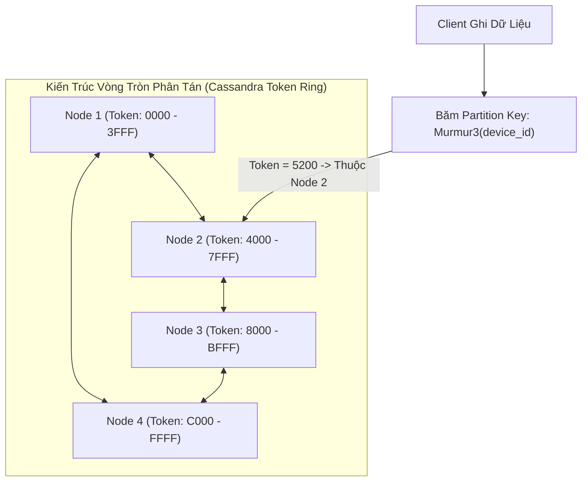

# 11.3. Wide-Column Databases (Cơ Sở Dữ Liệu Cột Rộng & Cassandra Internals)

> [!IMPORTANT]
> **Nếu bạn chỉ được nhớ một điều duy nhất:** Họ CSDL Cột rộng (Wide-Column Stores như Apache Cassandra, ScyllaDB) sinh ra để giải quyết bài toán thông lượng ghi khổng lồ ở quy mô Petabyte: kết hợp kiến trúc phi máy chủ chủ (Leaderless Dynamo-style) với mô hình động cơ LSM-Tree trên đĩa, Cassandra cung cấp khả năng điều chỉnh linh hoạt giữa tính nhất quán và tốc độ (Tunable Consistency $R + W > N$) để duy trì dịch vụ liên tục 100% ngay cả khi toàn bộ một trung tâm dữ liệu bị sập.

---

## 1. Đơn giản nhưng phải chi tiết (Intuitive & Deep Breakdown)

### 1.1. Đoạn Code Dẫn Nhập & Vấn Đề Thực Tế
Làm thế nào mà các tập đoàn công nghệ khổng lồ như Netflix hay Apple có thể ghi nhận hàng chục triệu sự kiện mỗi giây trên toàn cầu mà cơ sở dữ liệu không bao giờ bị nghẽn, và tại sao trong cơ sở dữ liệu Wide-Column (như Apache Cassandra, ScyllaDB), bạn **KHÔNG THỂ** tùy tiện viết câu lệnh `SELECT ... WHERE` nếu không có Partition Key?

```sql
-- Thiết kế Bảng theo Mô hình Wide-Column trên Cassandra (CQL)
CREATE TABLE user_sensor_readings (
    device_id UUID,          -- [Partition Key]: Xác định node nào trong cụm sẽ lưu dữ liệu này!
    recorded_at TIMESTAMP,    -- [Clustering Key]: Sắp xếp tuần tự trên đĩa theo thời gian!
    temperature DOUBLE,
    humidity DOUBLE,
    PRIMARY KEY ((device_id), recorded_at) -- Khóa chính phức hợp quy định vật lý!
) WITH CLUSTERING ORDER BY (recorded_at DESC);

-- TRUY VẤN SIÊU TỐC O(1) ĐẾN ĐÚNG NODE MẠNG:
SELECT * FROM user_sensor_readings 
WHERE device_id = 7b3a4f12-... AND recorded_at >= '2026-03-31 00:00:00';

-- CÂU LỆNH BỊ CẤM HOÀN TOÀN (Ném lỗi InvalidQueryException):
-- Không có Partition Key? Cassandra BẮT BUỘC bạn phải gõ "ALLOW FILTERING"
-- và nó sẽ quét toàn bộ hàng trăm máy chủ trên toàn cầu!
SELECT * FROM user_sensor_readings WHERE temperature > 40.0;
```

Trong thế giới Wide-Column: **Mô hình Dữ liệu được thiết kế hoàn toàn dựa theo Câu Truy Vấn (Query-driven Modeling)**, chứ không dựa theo thực thể như RDBMS. Bạn phải biết trước ứng dụng sẽ hỏi những câu gì trước khi có thể thiết kế bảng!

### 1.2. Ẩn Dụ Đời Sống & Phân Tích Cơ Chế Hoạt Động
Cơ sở dữ liệu Wide-Column giống như **Một Dãy Tủ Ngăn Kéo Khổng Lồ Trong Kho Hàng Toàn Quốc**:
- Bảng dữ liệu thực chất là một **Bản đồ đa chiều hai cấp (Two-dimensional Key-Value Store)**: `Map<PartitionKey, SortedMap<ClusteringKey, Columns>>`.
- **Partition Key (Định vị Tủ Đồ Trong Thành Phố)**:
  - Khi băm Partition Key (`device_id`), hệ thống biết chính xác chiếc tủ này được đặt ở nhà kho nào trong cụm phân tán vòng tròn (**Token Ring**). Gói tin bay thẳng tới đúng máy chủ đó mà không cần hỏi ai khác!
- **Clustering Key (Các Ngăn Kéo Xếp Ngăn Nắp Trong Tủ)**:
  - Khi mở chiếc tủ ra: Bên trong có hàng nghìn ngăn kéo nhỏ được đánh số thời gian từ mới nhất đến cũ nhất.
  - Bạn chỉ việc kéo đúng ngăn kéo giờ cần tìm (**Đọc tuần tự cực nhanh trên file SSTable**).
- **Tính chất Wide-Column**: Mỗi ngăn kéo có thể chứa số lượng cột hoàn toàn khác nhau. Ngăn hôm nay có nhiệt độ, ngăn ngày mai có thêm cảm biến độ ẩm; không bao giờ tốn một byte dung lượng nào cho các cột vắng mặt!

### 1.3. Mô Phỏng Dữ Liệu Số Nhỏ Từng Bước (Toy Walkthrough)
Mô phỏng cơ chế băm phân tán Token Ring của Cassandra với 3 Nodes mạng:

Hàm băm Murmur3 phân bổ không gian Token từ $-2^{63}$ đến $2^{63}-1$:
- Node A sở hữu dải: $-2^{63} \to 0$
- Node B sở hữu dải: $0 \to 4 \times 10^{18}$
- Node C sở hữu dải: $4 \times 10^{18} \to 2^{63}-1$

| Thao Tác Ghi / Đọc | Partition Key (`device_id`) | Giá Trị Mã Băm Murmur3 Token | Node Chịu Trách Nhiệm Lưu Trữ | Hành Động Mạng |
| :---: | :--- | :--- | :---: | :--- |
| **Ghi dòng 1** | `DEV-101` | $\text{Token} = -1.5 \times 10^{18}$ | **Node A** | Bắn thẳng gói tin vào Node A |
| **Ghi dòng 2** | `DEV-202` | $\text{Token} = +2.2 \times 10^{18}$ | **Node B** | Bắn thẳng gói tin vào Node B |
| **Ghi dòng 3** | `DEV-303` | $\text{Token} = +6.8 \times 10^{18}$ | **Node C** | Bắn thẳng gói tin vào Node C |

Mỗi máy chủ độc lập quản lý dải Token của mình; không có Master Node, không có Single Point of Failure!

### 1.4. Tác Động Thực Tế Tầng Backend & Systems
- **Thảm Họa Phình To Partition (Wide Partition Anti-pattern)**: Nếu một Partition Key chứa quá nhiều dòng dữ liệu (ví dụ chọn Shard Key là `sensor_type = 'TEMP'` cho hàng tỷ bản ghi), kích thước của một Partition duy nhất sẽ vượt quá 100MB (vượt quá dung lượng khuyến nghị). Node chứa partition đó sẽ bị tràn RAM và quá trình Garbage Collection (Java GC Pause) kéo dài hàng chục giây làm rớt kết nối mạng.
- **Tính Bền Vững Không Khóa Bằng LSM-Tree**: Dưới tầng lưu trữ, Cassandra sử dụng hoàn toàn cấu trúc LSM-Tree (CommitLog + MemTable + SSTables). Mọi thao tác ghi đều là append-only nên đạt thông lượng ghi đĩa tuyến tính theo số lượng ổ cứng.

### 1.5. Sơ Đồ Tư Duy & Kiến Trúc Hệ Thống (Mermaid)


---

## 2. Chi tiết từng Keyword (Under-the-Hood Deep Dive)

### 2.1. Kiến trúc Cụm Không Leader (Leaderless Peer-to-Peer & Gossip Protocol)

#### 1. Nguyên lý Phi Tập trung Tuyệt đối (Masterless Architecture)
- Khác với kiến trúc Master-Replica truyền thống, trong Cassandra **không tồn tại khái niệm Master hay Slave**. Tất cả các Node đều sở hữu mã nguồn giống hệt nhau và đảm nhận vai trò bình đẳng.
- **Loại bỏ Single Point of Failure (SPOF)**: Nếu bất kỳ 1, 2 hoặc thậm chí một nửa số node trong cụm bị chết vật lý, cụm vẫn tiếp tục phục vụ các yêu cầu đọc/ghi bình thường mà không cần tiến hành bầu cử Leader (No Failover Downtime).
- **Vai trò Coordinator Node**: Bất kỳ node nào nhận được kết nối TCP từ ứng dụng sẽ tạm thời đóng vai trò là **Coordinator** cho truy vấn đó: nó tính toán băm Partition Key, gửi thông điệp song song tới các Node bản sao (Replicas), gom kết quả, giải quyết xung đột và trả lời client.

#### 2. Giao thức Buôn chuyện (Gossip Protocol & Scuttlebutt)
- **Cơ chế lan truyền**: Định kỳ mỗi giây (1000ms), mỗi node trong cụm sẽ chọn ngẫu nhiên từ 1 đến 3 node khác để gửi thông điệp Gossip.
- Thông điệp chứa thông tin trạng thái cụm: địa chỉ IP, trạng thái (UP/DOWN/JOINING), nhãn thời gian nhịp tim (`heartbeat generation + version`), và vị trí trên vòng băm (Tokens).
- Nhờ thuật toán **Scuttlebutt**, thông tin về một node bị sập hoặc một node mới gia nhập sẽ lan truyền tới $100\%$ các máy chủ trong toàn bộ cụm theo cấp số nhân trong thời gian $O(\log N)$ giây.
- **Phi Accrual Failure Detector**: Cassandra không dùng ngưỡng cứng (Hard Timeout) để phán đoán một node đã chết. Thay vào đó, nó theo dõi phân phối lịch sử của các nhịp tim nhận được và tính toán một giá trị xác suất liên tục $\Phi$ (Phi):
  $$\Phi = -\log_{10}(P_{\text{later}}(t - t_{\text{last}}))$$
  Khi $\Phi > 8$ (mặc định), hệ thống kết luận với độ tin cậy $99.99999\%$ rằng node đó đã mất kết nối và bắt đầu điều hướng tải sang nút khác.

---

### 2.2. Thiết kế Khóa Cốt lõi: Partition Key vs Clustering Key

Trong ngôn ngữ truy vấn CQL, khóa chính (Primary Key) được phân định rành mạch thành hai thành phần với nhiệm vụ hoàn toàn khác nhau:

```sql
CREATE TABLE user_telemetry (
    tenant_id UUID,
    device_id VARCHAR,
    bucket_date DATE,
    event_timestamp TIMESTAMPTZ,
    payload_json TEXT,
    PRIMARY KEY ((tenant_id, device_id, bucket_date), event_timestamp)
) WITH CLUSTERING ORDER BY (event_timestamp DESC);
```

#### 1. Partition Key: `(tenant_id, device_id, bucket_date)`
- **Nhiệm vụ vật lý**: Quyết định bản ghi sẽ được lưu trữ trên **máy chủ vật lý nào** trong mạng lưới phân tán.
- Engine sử dụng hàm băm **Murmur3Partitioner** để ánh xạ Partition Key thành một số nguyên 64-bit nằm trong dải $[-2^{63}, 2^{63}-1]$.
- Vòng tròn băm (Hash Ring) chia đều các dải token cho các node. Mọi bản ghi có cùng Partition Key **chắc chắn sẽ nằm trên cùng một node vật lý** (và các bản sao của nó).

#### 2. Clustering Key: `event_timestamp`
- **Nhiệm vụ vật lý**: Quyết định **thứ tự sắp xếp vật lý của các dòng dữ liệu bên trong cùng một phân vùng trên đĩa**.
- Các hàng được lưu trữ kề sát nhau trong tệp dữ liệu SSTable, cho phép thực hiện các câu truy vấn dải (Range Scan) theo thời gian (`WHERE event_timestamp >= '2026-01-01'`) với tốc độ đọc tuần tự $O(1)$ mà không cần nhảy con trỏ đĩa ngẫu nhiên.

```text
+------------------------------------------------------------------------------------+
| PARTITION: tenant_1 # dev_99 # 2026-11-16 (Định vị qua Murmur3 Hash)              |
+------------------------------------------------------------------------------------+
|  [Clustering Key: 14:05:00] -> payload: {"temp": 24.2} (Dòng 1 trên đĩa)           |
|  [Clustering Key: 14:04:00] -> payload: {"temp": 24.1} (Dòng 2 kề sát)            |
|  [Clustering Key: 14:03:00] -> payload: {"temp": 23.9} (Dòng 3 kề sát)            |
+------------------------------------------------------------------------------------+
```

---

### 2.3. Vòng đời Ghi và Đọc trong Động cơ Lưu trữ LSM-Tree

#### 1. Luồng Ghi (Write Path) - Tối đa hóa I/O Tuần tự
1. **Commit Log (Disk Append)**: Ghi nối tiếp thông tin thay đổi vào cuối tệp Commit Log trên đĩa. Do chỉ ghi nối tiếp một chiều (Sequential Append), đầu đọc đĩa không cần di chuyển tìm sector, đạt thông lượng tối đa của phần cứng.
2. **MemTable (RAM SkipList)**: Chèn bản ghi vào cấu trúc cây trong RAM (`ConcurrentSkipListMap`). Bản ghi được sắp xếp ngay lập tức theo Clustering Key trong thời gian $O(\log N)$.
3. **Phản hồi Client tức thì**: Trả về thông báo thành công cho client ngay sau khi 2 bước trên hoàn tất! Toàn bộ quá trình chỉ mất $\approx 0.5 - 1.0\text{ ms}$.

#### 2. Luồng Đọc (Read Path) & Bộ lọc Bloom Filter
Do dữ liệu của một hàng có thể bị phân mảnh trên MemTable trong RAM và hàng chục tệp SSTable bất biến khác nhau trên đĩa, quá trình đọc đòi hỏi quy trình lọc nhiều tầng:
1. **Kiểm tra MemTable**: Đọc dữ liệu mới nhất đang nằm trong RAM.
2. **Kiểm tra Row Cache & Key Cache**: Nếu trúng Key Cache, bỏ qua việc đọc tệp chỉ mục.
3. **Kiểm tra Bloom Filter**: Mỗi tệp SSTable có một Bloom Filter độc lập nằm trên RAM:
   - Bloom Filter là một mảng bit xác suất. Nếu nó trả về `False`, **chắc chắn 100% tệp SSTable đó không chứa Partition Key**. Engine bỏ qua ngay lập tức ($0$ Disk I/O)!
   - Nếu trả về `True`, có xác suất nhỏ là dương tính giả (False Positive, thường cấu hình $\approx 1\%$). Engine tiếp tục bước 4.
4. **Đọc Partition Summary & Partition Index**: Định vị offset byte chính xác trong tệp dữ liệu `Data.db`.
5. **Hợp nhất Phiên bản (Reconciliation / LWW)**: Gom các mẩu dữ liệu từ các SSTables khác nhau, so sánh trường **Timestamp** và chọn giá trị có timestamp lớn nhất (**Last-Write-Wins**).

---

### 2.4. Quá trình Hợp nhất SSTables (Compaction) & Tombstones

#### 1. Bản chất Bất biến của SSTable (Sorted String Table)
Khi MemTable trong RAM đầy (thường đạt 256MB - 512MB), engine xả toàn bộ dữ liệu xuống đĩa thành một tệp SSTable mới. Tệp SSTable này là **bất biến (Immutable - WORM: Write Once, Read Many)**: không bao giờ bị sửa đổi in-place.

#### 2. Cơ chế Xóa dữ liệu: Tombstone (Bia mộ)
Trong kiến trúc bất biến, khi người dùng gọi lệnh `DELETE`:
- Engine **không thể tìm và xóa dòng dữ liệu cũ trên các SSTables cũ**.
- Engine chèn một bản ghi đặc biệt gọi là **Tombstone** có chứa timestamp tại thời điểm xóa.
- Khi đọc, nếu gặp Tombstone có timestamp lớn hơn bản ghi dữ liệu, engine hiểu rằng dữ liệu này đã bị xóa và bỏ qua.

#### 3. Quá trình Compaction (Hợp nhất Đĩa)
Tiến trình Compaction chạy ngầm, liên tục gom các tệp SSTable nhỏ lại và chạy thuật toán **K-Way Merge Sort**:
- Hợp nhất các bản ghi trùng khóa, chỉ giữ lại giá trị có timestamp mới nhất.
- **Tiêu hủy Tombstone**: Nếu một Tombstone có tuổi thọ lớn hơn tham số `gc_grace_seconds` (mặc định 10 ngày = 864,000 giây), nó sẽ chính thức bị loại bỏ vĩnh viễn khỏi đĩa cùng với dữ liệu cũ bị xóa.
- **Ba Chiến lược Compaction Chuẩn mực**:
  - **Size-Tiered Compaction Strategy (STCS)**: Gom các SSTable có kích thước tương đương nhau lại để hợp nhất. Thích hợp cho Write-heavy, nhưng đòi hỏi tới 50% dung lượng đĩa trống dự phòng.
  - **Leveled Compaction Strategy (LCS)**: Chia SSTable thành các tầng $L_0, L_1, L_2...$ với kích thước gấp 10 lần nhau. Tối ưu cho Read-heavy, giảm thiểu số lượng SSTable phải đọc về mức $O(1)$.
  - **Time Window Compaction Strategy (TWCS)**: Gom các SSTable được sinh ra trong cùng một khung thời gian (ví dụ: cùng 1 ngày). **Chiến lược hoàn hảo cho Time-Series Data và IoT**.

---

### 2.5. Tính Nhất quán Có thể Điều chỉnh (Tunable Consistency)

Trong Cassandra, mức độ nhất quán không bị đóng đinh ở tầng server mà do **Client tự cấu hình cho từng câu lệnh SQL/CQL**:

- Cấu hình hệ số nhân bản $N$ (Replication Factor, ví dụ: $N = 3$ nodes):
  - **`Consistency Level: ONE`**: Chỉ cần 1 node xác nhận ghi/đọc là thành công.
  - **`Consistency Level: QUORUM`**: Cần số đông quá bán xác nhận:
    $$\text{QUORUM} = \left\lfloor \frac{N}{2} \right\rfloor + 1$$
    Với $N = 3 \implies \text{QUORUM} = 2$. Với $N = 5 \implies \text{QUORUM} = 3$.
  - **`Consistency Level: ALL`**: Bắt buộc toàn bộ $N$ nodes phải xác nhận. Nếu 1 node bị chết, truy vấn sẽ bị từ chối.

#### Định lý Nhất quán Mạnh (Strong Consistency Equation)
$$\text{Write Consistency Level} + \text{Read Consistency Level} > \text{Replication Factor } (N)$$

Nếu thỏa mãn bất đẳng thức trên, theo **Nguyên lý Hộp bồ câu (Pigeonhole Principle)**: Tập hợp các node tham gia vào thao tác Ghi và tập hợp các node tham gia vào thao tác Đọc **chắc chắn sẽ giao nhau tại ít nhất một Node**. Node giao nhau này chứa Timestamp mới nhất, đảm bảo ứng dụng **luôn đọc được dữ liệu mới nhất (Strong Consistency / Linearizability)**!

```text
Ví dụ: Cụm N = 3
- Ghi với QUORUM (2 nodes): Ghi vào [Node 1, Node 2]
- Đọc với QUORUM (2 nodes): Đọc từ [Node 2, Node 3]
=> Node 2 là điểm giao nhau! Node 2 chứa dữ liệu mới nhất, đảm bảo tính nhất quán hoàn hảo!
```

---

## 3. Thực thi Mã nguồn & Mô phỏng Chuyên sâu (Dual-Engine Implementation)

### 3.1. C++20 Simulation: LSM-Tree Storage Engine với Bloom Filter & Compaction

Chương trình C++20 dưới đây mô phỏng kiến trúc hoàn chỉnh của một **LSM-Tree Storage Engine**: bao gồm `BloomFilter` (mảng bit xác suất), `MemTable` (sắp xếp trong RAM), tạo tệp `SSTable` bất biến, và tiến trình `Compaction` dọn dẹp các bản ghi mang nhãn `Tombstone`:

```cpp
// compile: g++ -std=c++20 -O3 -pthread lsm_engine.cpp -o lsm_engine
#include <iostream>
#include <vector>
#include <string>
#include <map>
#include <memory>
#include <chrono>
#include <cstdint>
#include <algorithm>
#include <iomanip>

// 1. Bloom Filter xác suất độc lập (Mảng bit RAM)
class BloomFilter {
private:
    std::vector<bool> bitset_;
    size_t size_;

    size_t hash1(const std::string& key) const {
        size_t h = 5381;
        for (char c : key) h = ((h << 5) + h) + c;
        return h % size_;
    }

    size_t hash2(const std::string& key) const {
        size_t h = 0;
        for (char c : key) h = (h * 31) + c;
        return h % size_;
    }

public:
    explicit BloomFilter(size_t bits = 1024) : bitset_(bits, false), size_(bits) {}

    void add(const std::string& key) {
        bitset_[hash1(key)] = true;
        bitset_[hash2(key)] = true;
    }

    bool might_contain(const std::string& key) const {
        return bitset_[hash1(key)] && bitset_[hash2(key)];
    }
};

struct CellValue {
    std::string value;
    uint64_t timestamp;
    bool is_tombstone{false}; // Cờ đánh dấu đã bị xóa (Tombstone)
};

// 2. SSTable Bất biến trên Đĩa
class SSTable {
public:
    int table_id;
    std::vector<std::pair<std::string, CellValue>> sorted_data;
    BloomFilter filter;

    SSTable(int id, std::vector<std::pair<std::string, CellValue>> data)
        : table_id(id), sorted_data(std::move(data)), filter(2048) {
        for (const auto& [k, v] : sorted_data) {
            filter.add(k);
        }
    }

    // Đọc nhị phân: Sử dụng Bloom Filter trước khi quét
    bool get(const std::string& key, CellValue& out_val) const {
        if (!filter.might_contain(key)) {
            return false; // 100% không có mặt, tiết kiệm 1 Disk I/O!
        }

        // Binary Search trên mảng đã sắp xếp
        auto it = std::lower_bound(sorted_data.begin(), sorted_data.end(), key,
            [](const auto& pair, const std::string& target) { return pair.first < target; });

        if (it != sorted_data.end() && it->first == key) {
            out_val = it->second;
            return true;
        }
        return false;
    }
};

// 3. LSM-Tree Engine hoàn chỉnh
class LSMStorageEngine {
private:
    std::map<std::string, CellValue> memtable_; // In-Memory SkipList tương đương
    std::vector<std::unique_ptr<SSTable>> sstables_;
    size_t memtable_threshold_{4}; // Flush khi có 4 keys
    int sstable_counter_{0};

    uint64_t current_time_us() const {
        return std::chrono::duration_cast<std::chrono::microseconds>(
            std::chrono::system_clock::now().time_since_epoch()).count();
    }

    void flush_memtable_to_sstable() {
        if (memtable_.empty()) return;
        std::cout << "  [FLUSH] MemTable đạt ngưỡng dung lượng. Đang flush ra SSTable #" 
                  << ++sstable_counter_ << " trên đĩa...\n";

        std::vector<std::pair<std::string, CellValue>> data(memtable_.begin(), memtable_.end());
        sstables_.push_back(std::make_unique<SSTable>(sstable_counter_, std::move(data)));
        memtable_.clear();
    }

public:
    void put(const std::string& key, const std::string& value) {
        memtable_[key] = CellValue{ value, current_time_us(), false };
        if (memtable_.size() >= memtable_threshold_) {
            flush_memtable_to_sstable();
        }
    }

    void remove(const std::string& key) {
        // Xóa bằng cách chèn Tombstone kèm Timestamp mới nhất
        memtable_[key] = CellValue{ "", current_time_us(), true };
        if (memtable_.size() >= memtable_threshold_) {
            flush_memtable_to_sstable();
        }
    }

    // Luồng Đọc: MemTable -> SSTables mới nhất tới cũ nhất (Last-Write-Wins)
    bool get(const std::string& key, std::string& out_value) const {
        // Bước 1: Kiểm tra MemTable
        auto it = memtable_.find(key);
        if (it != memtable_.end()) {
            if (it->second.is_tombstone) return false; // Đã bị xóa
            out_value = it->second.value;
            return true;
        }

        // Bước 2: Duyệt ngược từ SSTable mới nhất về cũ nhất
        CellValue newest_val{"", 0, false};
        bool found = false;

        for (auto sst_it = sstables_.rbegin(); sst_it != sstables_.rend(); ++sst_it) {
            CellValue candidate;
            if ((*sst_it)->get(key, candidate)) {
                if (!found || candidate.timestamp > newest_val.timestamp) {
                    newest_val = candidate;
                    found = true;
                }
            }
        }

        if (found && !newest_val.is_tombstone) {
            out_value = newest_val.value;
            return true;
        }
        return false;
    }

    // Tiến trình Compaction: Hợp nhất các SSTables và tiêu hủy Tombstone
    void run_compaction() {
        std::cout << "\n[COMPACTION] Bắt đầu tiến trình K-Way Merge Compaction trên " 
                  << sstables_.size() << " SSTables...\n";

        std::map<std::string, CellValue> merged_map;
        for (const auto& sst : sstables_) {
            for (const auto& [k, v] : sst->sorted_data) {
                if (merged_map.find(k) == merged_map.end() || v.timestamp > merged_map[k].timestamp) {
                    merged_map[k] = v;
                }
            }
        }

        // Tiêu hủy các bản ghi có Tombstone
        std::vector<std::pair<std::string, CellValue>> compacted_data;
        for (const auto& [k, v] : merged_map) {
            if (!v.is_tombstone) {
                compacted_data.push_back({k, v});
            } else {
                std::cout << "  -> Tiêu hủy vĩnh viễn Tombstone của Key: '" << k << "' khỏi đĩa!\n";
            }
        }

        sstables_.clear();
        sstables_.push_back(std::make_unique<SSTable>(999, std::move(compacted_data)));
        std::cout << "[COMPACTION] Hoàn tất. Hệ thống thu gọn về 1 SSTable hợp nhất duy nhất.\n\n";
    }
};

int main() {
    std::cout << "=== MÔ PHỎNG LSM-TREE STORAGE ENGINE & COMPACTION (C++20) ===\n\n";

    LSMStorageEngine engine;

    // Ghi 6 bản ghi (Kích hoạt flush tự động ra 2 SSTables)
    std::cout << "[Step 1] Ingesting dữ liệu vào LSM-Tree:\n";
    engine.put("user_101", "Alice_Profile_V1");
    engine.put("user_102", "Bob_Profile_V1");
    engine.put("user_103", "Charlie_Profile_V1");
    engine.put("user_104", "David_Profile_V1"); // Kích hoạt Flush #1

    engine.put("user_101", "Alice_Profile_V2_Updated"); // Ghi đè (Sẽ sinh bản ghi mới kèm timestamp cao hơn)
    engine.remove("user_103");                         // Xóa bằng Tombstone
    engine.put("user_105", "Eve_Profile_V1");
    engine.put("user_106", "Frank_Profile_V1");        // Kích hoạt Flush #2

    std::cout << "\n[Step 2] Thực hiện truy vấn đọc trước khi Compaction:\n";
    std::string val;
    if (engine.get("user_101", val)) {
        std::cout << "  - Get('user_101') -> " << val << " (Last-Write-Wins: Lấy thành công V2!)\n";
    }
    if (!engine.get("user_103", val)) {
        std::cout << "  - Get('user_103') -> NOT FOUND (Chặn bởi Tombstone!)\n";
    }

    // Chạy Compaction
    engine.run_compaction();

    std::cout << "[Step 3] Kiểm tra lại sau khi Compaction dọn dẹp Tombstone:\n";
    if (engine.get("user_101", val)) {
        std::cout << "  - Get('user_101') -> " << val << "\n";
    }
    if (!engine.get("user_103", val)) {
        std::cout << "  - Get('user_103') -> NOT FOUND (Đã bị tiêu hủy hoàn toàn khỏi đĩa!)\n";
    }

    return 0;
}
```

---

### 3.2. Python 3.11+ Simulation: Quorum Consistency & Read Repair Engine

Script Python dưới đây mô phỏng một cụm 5 nodes Masterless, chứng minh định lý $W + R > N$, và cơ chế tự động sửa lỗi ngầm **Read Repair**:

```python
#!/usr/bin/env python3
"""
Mô phỏng Leaderless Masterless Cluster với Tunable Quorum & Read Repair
Yêu cầu Python 3.11+
"""

import time
import dataclasses
from typing import List, Dict, Optional, Tuple

@dataclasses.dataclass
class Record:
    val: str
    timestamp: float

class StorageNode:
    def __init__(self, node_id: str):
        self.node_id = node_id
        self.data: Dict[str, Record] = {}

    def write(self, key: str, val: str, ts: float):
        self.data[key] = Record(val=val, timestamp=ts)

    def read(self, key: str) -> Optional[Record]:
        return self.data.get(key)

class CassandraClusterCoordinator:
    def __init__(self, nodes: List[StorageNode]):
        self.nodes = nodes
        self.rf = len(nodes) # Replication Factor = 5

    def write(self, key: str, val: str, consistency_level: str) -> bool:
        ts = time.time()
        # Xác định số lượng node cần xác nhận thành công
        if consistency_level == "ONE":
            required = 1
        elif consistency_level == "QUORUM":
            required = (self.rf // 2) + 1 # (5 // 2) + 1 = 3 nodes
        elif consistency_level == "ALL":
            required = self.rf
        else:
            raise ValueError("Unsupported consistency")

        acked = 0
        for node in self.nodes:
            node.write(key, val, ts)
            acked += 1
            if acked >= required:
                break
        return True

    def read(self, key: str, consistency_level: str) -> Tuple[Optional[str], bool]:
        if consistency_level == "ONE":
            required = 1
        elif consistency_level == "QUORUM":
            required = (self.rf // 2) + 1
        elif consistency_level == "ALL":
            required = self.rf
        else:
            raise ValueError("Unsupported consistency")

        responses: List[Tuple[StorageNode, Record]] = []
        for node in self.nodes:
            rec = node.read(key)
            if rec:
                responses.append((node, rec))
            if len(responses) >= required:
                break

        if not responses:
            return None, False

        # Thuật toán Last-Write-Wins (LWW)
        newest_node, newest_record = max(responses, key=lambda x: x[1].timestamp)

        # READ REPAIR: Phát hiện các node trả về dữ liệu cũ và cập nhật lại dữ liệu mới ngầm
        repaired = False
        for node, rec in responses:
            if rec.timestamp < newest_record.timestamp:
                print(f"  ⚡ [READ REPAIR] Node {node.node_id} chứa bản ghi cũ! Đang đồng bộ bản ghi mới ngầm...")
                node.write(key, newest_record.val, newest_record.timestamp)
                repaired = True

        return newest_record.val, repaired

def main():
    print("=" * 65)
    print("SIMULATING CASSANDRA TUNABLE CONSISTENCY & READ REPAIR")
    print("=" * 65)

    # Khởi tạo cụm 5 nodes
    nodes = [StorageNode(f"Node_{i+1}") for i in range(5)]
    coordinator = CassandraClusterCoordinator(nodes)

    print(f"\n[+] Khởi tạo cụm gồm {len(nodes)} nodes (Replication Factor N = 5)")
    print(f"    Ngưỡng QUORUM = (5 // 2) + 1 = 3 nodes.")

    # KỊCH BẢN 1: Ghi với QUORUM (3 nodes)
    print("\n--- TEST CASE 1: Write QUORUM (W = 3) ---")
    coordinator.write("account:101", "Balance: $500", consistency_level="QUORUM")
    print("Đã ghi xong vào 3 nodes đầu tiên (Node_1, Node_2, Node_3).")
    print(f"Node_4 và Node_5 hiện chưa có bản ghi mới.")

    # KỊCH BẢN 2: Đọc với QUORUM (R = 3) -> Thỏa mãn W + R (3 + 3 = 6 > 5) -> Strong Consistency
    print("\n--- TEST CASE 2: Read QUORUM (R = 3) -> Thỏa mãn W + R > N ---")
    val, was_repaired = coordinator.read("account:101", consistency_level="QUORUM")
    print(f"  • Giá trị đọc được: '{val}' (ĐẢM BẢO CHÍNH XÁC TUYỆT ĐỐI!)")

    # Giả lập làm lệch dữ liệu: Node_1 bị cập nhật đơn lẻ giá trị mới với W=ONE
    print("\n--- TEST CASE 3: Ghi cập nhật chỉ vào 1 Node duy nhất (W = ONE) ---")
    coordinator.write("account:101", "Balance: $1,200", consistency_level="ONE")
    print("Node_1 mang giá trị $1,200, các nodes khác vẫn mang giá trị $500.")

    # KỊCH BẢN 4: Đọc với QUORUM kích hoạt Read Repair
    print("\n--- TEST CASE 4: Read QUORUM phát hiện sai lệch và kích hoạt Read Repair ---")
    val, was_repaired = coordinator.read("account:101", consistency_level="QUORUM")
    print(f"  • Kết quả sau đối soát LWW: '{val}'")
    print(f"  • Trạng thái Read Repair tự động: {'ĐÃ KÍCH HOẠT THÀNH CÔNG' if was_repaired else 'KHÔNG CẦN'}")

if __name__ == "__main__":
    main()
```

### 3.3. Terminal Output Mẫu Thực Tế

```text
=== MÔ PHỎNG LSM-TREE STORAGE ENGINE & COMPACTION (C++20) ===

[Step 1] Ingesting dữ liệu vào LSM-Tree:
  [FLUSH] MemTable đạt ngưỡng dung lượng. Đang flush ra SSTable #1 trên đĩa...
  [FLUSH] MemTable đạt ngưỡng dung lượng. Đang flush ra SSTable #2 trên đĩa...

[Step 2] Thực hiện truy vấn đọc trước khi Compaction:
  - Get('user_101') -> Alice_Profile_V2_Updated (Last-Write-Wins: Lấy thành công V2!)
  - Get('user_103') -> NOT FOUND (Chặn bởi Tombstone!)

[COMPACTION] Bắt đầu tiến trình K-Way Merge Compaction trên 2 SSTables...
  -> Tiêu hủy vĩnh viễn Tombstone của Key: 'user_103' khỏi đĩa!
[COMPACTION] Hoàn tất. Hệ thống thu gọn về 1 SSTable hợp nhất duy nhất.

[Step 3] Kiểm tra lại sau khi Compaction dọn dẹp Tombstone:
  - Get('user_101') -> Alice_Profile_V2_Updated
  - Get('user_103') -> NOT FOUND (Đã bị tiêu hủy hoàn toàn khỏi đĩa!)
```

---

## 4. Systems Engineering & Production Pitfalls

### 4.1. Thảm họa Bão Tombstone (Tombstone Overwhelming Exception)
- **Bản chất lỗi**: Lập trình viên quen tư duy RDBMS chạy câu lệnh `DELETE` liên tục hoặc thường xuyên chèn các cột mang giá trị `null`.
- Trong Cassandra, mỗi thao tác này sinh ra 1 **Tombstone**.
- Khi một câu truy vấn dải `SELECT` quét qua một phân vùng có chứa hơn 100,000 Tombstones liên tiếp chưa đến hạn dọn dẹp bởi Compaction:
  ```text
  org.apache.cassandra.exceptions.ReadFailureException: 
  Scanned over 100001 tombstones in keyspace.sensor_data; query aborted
  ```
- **Hậu quả**: Database từ chối thực thi và ném ngoại lệ ngay lập tức để bảo vệ bộ nhớ JVM khỏi bị tràn RAM (OutOfMemoryError).
- **Quy tắc**: Cassandra **không sinh ra cho việc xóa hoặc cập nhật thường xuyên**. Nếu buộc phải xóa, hãy thiết kế Sharding theo khoảng thời gian và xóa nguyên cả một Table/SSTable (`DROP TABLE`).

### 4.2. Hiểm họa Phân vùng Quá khổ (Giant / Hot Partition)
- Mặc dù một phân vùng có thể chứa tối đa 2 tỷ cells, quy chuẩn vàng trong thiết kế Cassandra là: **Kích thước một phân vùng vật lý không được vượt quá 100MB** (hoặc chứa quá 100,000 dòng).
- Nếu chọn Partition Key sai (ví dụ: chỉ phân vùng theo `tenant_id` mà không chia theo ngày tháng):
  - Phân vùng phình to lên hàng chục Gigabytes.
  - Khi node chứa phân vùng này thực hiện Compaction hoặc Repair, bộ nhớ đệm JVM Heap sẽ bị bão hòa, kích hoạt tiến trình dừng toàn bộ hệ thống (**Stop-the-World GC Pause**) kéo dài hàng chục giây.

### 4.3. Lệch Giờ Phần Cứng (Hardware Clock Drift) & Last-Write-Wins
- Cassandra giải quyết xung đột dữ liệu hoàn toàn dựa trên trường **Timestamp do Client hoặc Coordinator gắn vào** (Last-Write-Wins - LWW).
- Nếu dịch vụ đồng bộ giờ **NTP (Network Time Protocol)** trên một máy chủ bị lỗi và đồng hồ chạy nhanh hơn 5 giây so với các máy khác:
  - Mọi thao tác ghi từ máy chủ đó sẽ mang timestamp "đến từ tương lai".
  - Dữ liệu này sẽ đè bẹp mọi bản ghi khác và **không thể bị ghi đè hay xóa bỏ** trong suốt 5 giây tiếp theo!
- **Khắc phục**: Luôn cài đặt và giám sát nghiêm ngặt dịch vụ `chrony` hoặc NTP daemon trên 100% các máy chủ Cassandra.

### 4.4. Production CLI Diagnostics với `nodetool`
```bash
# 1. Kiểm tra trạng thái sức khỏe tổng quan của toàn bộ cụm
nodetool status

# 2. Phân tích chi tiết độ trễ, số lượng SSTables và Tombstones của một bảng
nodetool tablestats keyspace_name.sensor_readings

# 3. Xem biểu đồ phân phối độ trễ đọc/ghi p99 và số lượng SSTable đã chạm vào
nodetool cfhistograms keyspace_name sensor_readings

# 4. Kiểm tra tắc nghẽn luồng xử lý nội bộ (Thread Pool Saturation)
nodetool tpstats
# Chú ý cột: BlockedTasks trong ReadStage và MutationStage

# 5. Kích hoạt tiến trình đồng bộ dữ liệu sửa lỗi thủ công giữa các nodes
nodetool repair -pr keyspace_name
```

---

## 5. Bảng So sánh & Decision Matrix

### 5.1. So sánh Động cơ Lưu trữ: B+ Tree vs LSM-Tree

| Đặc tính Kỹ thuật | B+ Tree (RDBMS: Postgres / MySQL InnoDB) | LSM-Tree (Wide-Column: Cassandra / RocksDB) |
| :--- | :--- | :--- |
| **Cơ chế Ghi đĩa** | Ghi đè ngẫu nhiên tại chỗ (In-Place Random Update) | **Ghi nối tiếp tuần tự (Out-of-Place Append-Only)** |
| **Hiệu năng Ghi (Write)** | Thấp - Trung bình (Bị thắt cổ chai bởi Disk Seek) | **Cực cao (Đạt trần băng thông tuần tự của NVMe)** |
| **Hiệu năng Đọc (Read)** | **Rất nhanh ($O(\log N)$ trên 1 cây chỉ mục)** | Chậm hơn (Phải kiểm tra Bloom Filter & nhiều SSTables) |
| **Hệ số Khuếch đại Ghi (WA)**| Trung bình (Ghi nguyên trang 8KB/16KB dù sửa 1 byte)| Cao (Do tiến trình Compaction đọc và ghi lại nhiều lần) |
| **Phân mảnh Bộ nhớ/Đĩa** | Dễ bị Bloat trang đĩa sau khi xóa/sửa | Triệt tiêu phân mảnh sau mỗi chu kỳ Compaction |
| **Trường hợp tối ưu** | Đọc nhiều, giao dịch tài chính ACID chặt chẽ | Ghi dữ liệu khổng lồ (IoT, Logs, Metrics, Time-Series) |

### 5.2. Ma trận Lựa chọn Chiến lược Compaction

| Tiêu chí | Size-Tiered (STCS) | Leveled (LCS) | Time Window (TWCS) |
| :--- | :--- | :--- | :--- |
| **Workload tối ưu** | Write-heavy tổng quát | Read-heavy hoặc Update nhiều | **Time-Series / IoT / Nhật ký** |
| **Dung lượng Đĩa dự phòng**| Cần tới **50% đĩa trống** | Chỉ cần $\approx 10\%$ đĩa trống | Thấp ($< 10\%$) |
| **Số SSTable cần đọc** | Cao (Nhiều tệp nhỏ) | **Tối ưu nhất ($\approx 1 - 2$ SSTables)** | Rất thấp (Chỉ đọc tệp trong khung giờ) |
| **Chi phí I/O Compaction** | Thấp | Rất cao (Khuếch đại ghi lớn) | Cực thấp |
| **Dọn dẹp Tombstones** | Kém | Tốt | Hoàn hảo (Hết hạn cả tệp cùng lúc) |

---

## 6. Enterprise Production Checklist & Verification

### 6.1. Kiến Trúc & Cấu Hình Tối Ưu (Production-Ready Architecture)
- [ ] **Thiết Kế Bảng Bắt Đầu Từ Câu Truy Vấn (Query-First Modeling)**: Tuyệt đối không cố gắng chuẩn hóa; sẵn sàng tạo nhiều bảng trùng lặp dữ liệu để phục vụ cho các mẫu truy vấn khác nhau mà không dùng JOIN.
- [ ] **Giữ Kích Thước Partition Dưới 100MB**: Luôn thiết kế khóa phân vùng tổng hợp (Compound Partition Key: ví dụ `(device_id, date)`) để mỗi partition không vượt quá 100MB hoặc 100,000 ô dữ liệu.
- [ ] **Tuyệt Đối Không Sử Dụng ALLOW FILTERING Trên Production**: Nghiêm cấm câu lệnh truy vấn có cờ `ALLOW FILTERING` vì nó kích hoạt việc quét toàn bộ các máy chủ trong cụm, gây sập hiệu năng.
- [ ] **Cấu Hình Mức Độ Nhất Quán LOCAL_QUORUM Cho Đa Vùng**: Thiết lập `ConsistencyLevel = LOCAL_QUORUM` để cân bằng giữa tính nhất quán mạnh và độ trễ thấp trong các cụm phân tán đa trung tâm dữ liệu.

### 6.2. Giám Sát, Cảnh Báo & Xử Lý Sự Cố (Observability & Incident Response)
- [ ] **Giám Sát Thời Gian Tạm Dừng Của Java GC (GC Pauses)**: Theo dõi log JVM Garbage Collection; cảnh báo khi thời gian GC pause vượt quá 500ms (dấu hiệu các phân vùng quá lớn gây áp lực lên Heap).
- [ ] **Theo Dõi Số Lượng SSTables Bị Tồn Đọng**: Cảnh báo khi số lượng SSTables per Read tăng cao (báo hiệu tiến trình Compaction đang bị chậm hơn tốc độ ghi).
- [ ] **Kiểm Tra Sức Khỏe Cụm Bằng nodetool CLI**: Sử dụng các lệnh `nodetool status`, `nodetool tablestats`, và `nodetool tpstats` để theo dõi tải I/O và hàng đợi của từng node.
