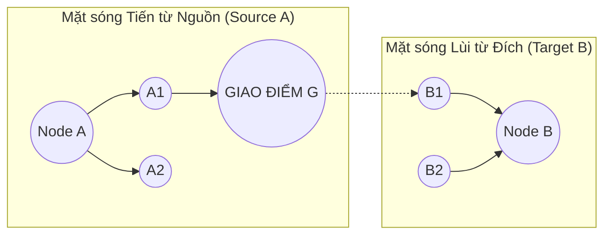
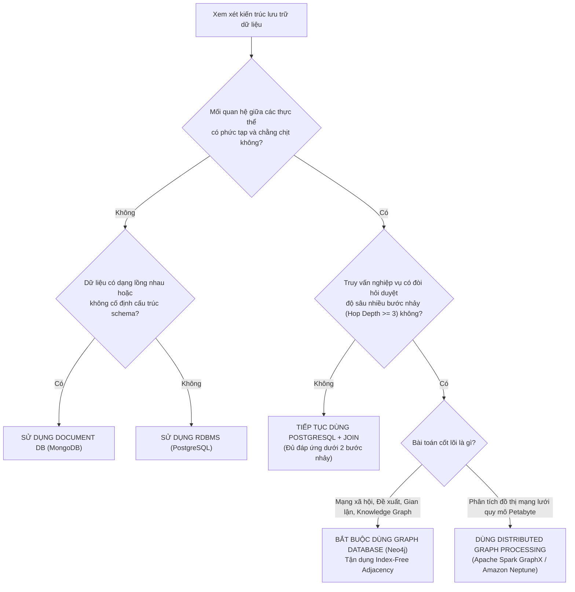

# 11.4. Graph Databases (Cơ Sở Dữ Liệu Đồ Thị & Neo4j Internals)

> [!IMPORTANT]
> **Nếu bạn chỉ được nhớ một điều duy nhất:** CSDL Đồ thị (Graph Databases như Neo4j) phá vỡ hoàn toàn giới hạn hiệu năng của mô hình quan hệ khi xử lý dữ liệu mạng lưới liên kết dày đặc: thông qua kiến trúc Kề cận không cần chỉ mục (Index-Free Adjacency), mỗi đỉnh (Node) lưu giữ con trỏ bộ nhớ vật lý trỏ thẳng đến các cạnh (Edges) lân cận; giúp việc duyệt qua hàng triệu mối quan hệ phức tạp đạt độ phức tạp cố định $O(1)$ cho mỗi bước nhảy, hoàn toàn độc lập với tổng kích thước dữ liệu của toàn bộ đồ thị.

---

## 1. Đơn giản nhưng phải chi tiết (Intuitive & Deep Breakdown)

### 1.1. Đoạn Code Dẫn Nhập & Vấn Đề Thực Tế
Làm thế nào để phát hiện các đường dây lừa đảo tài chính phức tạp, nơi tiền bẩn được chuyển vòng vèo qua 5 tài khoản trung gian khác nhau để xóa dấu vết, chỉ trong vòng 10 mili-giây?

```cypher
// Truy vấn đồ thị thần tốc bằng ngôn ngữ Cypher (Neo4j):
// Tìm chu trình rửa tiền khép kín: Tiền chuyển từ A -> B -> C -> D -> quay về A!
MATCH path = (origin:Account)-[:TRANSFERRED*3..6]->(origin)
WHERE origin.is_flagged = true
RETURN path, length(path) AS hops;

-- NẾU DÙNG RDBMS (SQL TRUYỀN THỐNG):
-- Bạn phải viết 5 câu lệnh INNER JOIN đệ quy trên một bảng chứa hàng trăm triệu giao dịch.
-- Không gian tìm kiếm bùng nổ theo cấp số nhân O(N^5), khiến cơ sở dữ liệu bị tê liệt và treo cứng!
```

Cơ sở dữ liệu Đồ thị (Graph Database) sinh ra để giải quyết bài toán mà RDBMS sợ nhất: **Mối quan hệ giữa các thực thể quan trọng tương đương với bản thân dữ liệu**. Nhờ kỹ thuật **Index-Free Adjacency**, việc duyệt qua hàng triệu mối quan hệ chỉ đơn giản là đi theo các con trỏ bộ nhớ vật lý trong RAM!

### 1.2. Ẩn Dụ Đời Sống & Phân Tích Cơ Chế Hoạt Động
So sánh Cơ sở Dữ liệu Đồ thị và Cơ sở Dữ liệu Quan hệ giống như **Cách Đi Lại Giữa Các Thành Phố**:
- **Cơ sở dữ liệu Quan hệ (RDBMS - Đi Tìm Đường Bằng Cuốn Danh Bạ)**:
  - Bạn đang ở Hà Nội, muốn sang Bắc Ninh. Bạn phải giở cuốn danh bạ trung tâm ra tra xem có tuyến đường nào nối hai nơi không (**Tra cứu B-Tree Index trên bảng trung gian**).
  - Đến Bắc Ninh, muốn đi tiếp sang Hải Dương, bạn lại phải lật lại cuốn danh bạ từ đầu (**Index Lookup lần 2**). Đi 5 thành phố là phải lật cuốn danh bạ 5 lần!
- **Cơ sở dữ liệu Đồ thị (Graph DB - Đi Theo Các Cây Cầu Xây Sẵn)**:
  - Tại thành phố Hà Nội có sẵn một cây cầu dẫn thẳng sang Bắc Ninh. Đầu cầu có ghi rõ: *"Cầu đường bộ dài 30km"* (**Thuộc tính của Cạnh / Edge Properties**).
  - Bạn chỉ việc bước qua cây cầu là tới nơi, không cần tra bất kỳ cuốn sách nào (**Index-Free Adjacency - Đi theo con trỏ RAM trực tiếp**). Cần đi 10 thành phố? Cứ đi theo các cây cầu nối tiếp nhau với tốc độ của một bước chân!

### 1.3. Mô Phỏng Dữ Liệu Số Nhỏ Từng Bước (Toy Walkthrough)
Mô phỏng cấu trúc Labeled Property Graph (LPG) lưu trữ trong bộ nhớ:

**Các Thực Thể (Nodes):**
- Node 1: `(:Person {name: "Alice", age: 28})`
- Node 2: `(:Person {name: "Bob", age: 30})`
- Node 3: `(:Company {name: "TechCorp"})`

**Các Mối Quan Hệ (Edges / Relationships):**
- Edge A: `(Node 1) -[:WORKS_AT {since: 2022}]-> (Node 3)`
- Edge B: `(Node 1) -[:FRIEND_WITH {closeness: 0.9}]-> (Node 2)`

| Nút Đang Đứng (Current Node) | Con Trỏ Cạnh Kề Tiếp (First Edge Pointer) | Đi Theo Con Trỏ Cạnh | Nút Đích Đến (Target Node) | Chi Phí Truy Xuất |
| :---: | :--- | :--- | :---: | :---: |
| **Node 1 ("Alice")** | Trỏ tới `Edge A` (`0x7fff0010`) | Đọc nhãn `WORKS_AT` | **Node 3 ("TechCorp")** | **$O(1)$** (Nhảy con trỏ RAM) |
| **Node 1 ("Alice")** | Trỏ tới cạnh tiếp theo: `Edge B` | Đọc nhãn `FRIEND_WITH` | **Node 2 ("Bob")** | **$O(1)$** (Nhảy con trỏ RAM) |

Bất kể toàn bộ cơ sở dữ liệu đồ thị có chứa 1 tỷ người dùng khác, chi phí tìm bạn bè của Alice chỉ phụ thuộc duy nhất vào số lượng bạn bè mà Alice quen biết!

### 1.4. Tác Động Thực Tế Tầng Backend & Systems
- **Thảm Họa Nút Siêu Kết Nối (Supernode Problem)**: Khi một Node trong đồ thị có hàng triệu cạnh kết nối tới nó (ví dụ: tài khoản Twitter của một ca sĩ nổi tiếng có 80 triệu người theo dõi). Khi câu truy vấn duyệt qua Node này, engine bị nghẽn CPU và tràn RAM chỉ để đọc danh sách con trỏ cạnh khổng lồ của nó.
- **Duyệt Đồ Thị Theo Chiều Rộng (BFS) vs Chiều Sâu (DFS)**: Các thuật toán đồ thị như Dijkstra (tìm đường ngắn nhất) hay PageRank (xếp hạng độ uy tín) đòi hỏi bộ nhớ RAM cực lớn để lưu trữ hàng đợi các nút đang duyệt. Nếu không giới hạn độ sâu tối đa (`*1..4`), câu truy vấn sẽ nhanh chóng quét sạch cả đồ thị và làm cạn kiệt bộ nhớ.

### 1.5. Sơ Đồ Tư Duy & Kiến Trúc Hệ Thống (Mermaid)
```mermaid
flowchart LR
    User1["Node: Alice (Person)"]
    User2["Node: Bob (Person)"]
    Company["Node: TechCorp (Company)"]
    Skill["Node: Python (Skill)"]

    User1 -->|WORKS_AT {role: 'Lead'}| Company
    User2 -->|WORKS_AT {role: 'Dev'}| Company
    User1 -->|FRIEND_WITH {since: 2020}| User2
    User1 -->|KNOWS {level: 5}| Skill
    User2 -->|KNOWS {level: 4}| Skill
```

---

## 2. Chi tiết từng Keyword (Under-the-Hood Deep Dive)

### 2.1. Cơ chế Index-Free Adjacency (Kề cận Không cần Chỉ mục - Bí mật Tốc độ của Neo4j)

#### 1. Sự Khác biệt Bản chất Giữa Index Lookup và Index-Free Adjacency
- Trong một cơ sở dữ liệu quan hệ (PostgreSQL / MySQL) hoặc Document DB:
  - Mối quan hệ giữa hai bảng được biểu diễn gián tiếp qua khóa ngoại (Foreign Key). Muốn tìm các bản ghi con, engine bắt buộc phải tìm kiếm trên cây chỉ mục B+ Tree:
    $$\text{Thời gian duyệt 1 bước} = O(\log N)$$
    Khi duyệt $D$ bước nhảy qua các bảng, thời gian thực thi là $O(B^D \cdot \log N)$, trong đó $B$ là hệ số nhánh (Branching factor) và $N$ là tổng số dòng của toàn bộ bảng. Khi $N$ đạt hàng trăm triệu, câu truy vấn sẽ bị đóng băng.
- Trong Neo4j với **Index-Free Adjacency**:
  - Không hề có chỉ mục B+ Tree nào được dùng trong quá trình duyệt đồ thị!
  - Mỗi Node chứa con trỏ địa chỉ bộ nhớ trỏ trực tiếp tới bản ghi quan hệ (Relationship Record) đầu tiên của nó. Bản ghi quan hệ đó lại chứa con trỏ trỏ tới Node đích và quan hệ tiếp theo.
  - Động cơ chỉ việc thực hiện thao tác **giải tham chiếu con trỏ (Pointer Dereferencing)**:
    $$\text{Thời gian duyệt 1 bước} = O(1)$$
    Thời gian duyệt toàn bộ $k$ láng giềng cục bộ là $O(k)$, **hoàn toàn độc lập với tổng số nút $N$ của toàn bộ cơ sở dữ liệu**!

#### 2. Cấu trúc Giải phẫu Bản ghi Kích thước Cố định trên Đĩa (Fixed-Size Records)
Neo4j thiết kế các tệp lưu trữ dữ liệu trên đĩa với kích thước bản ghi cố định (Fixed-Length Records), cho phép tính toán trực tiếp offset byte trong thời gian $O(1)$ mà không cần bảng tra cứu:
$$\text{Byte Offset trên Đĩa} = \text{ID} \times \text{RecordSize}$$

- **`neostore.nodestore.db` (15 Bytes mỗi Node)**:
  - 1 byte: Cờ trạng thái `in_use`.
  - 4 bytes: Con trỏ tới quan hệ đầu tiên (`first_rel_id`).
  - 4 bytes: Con trỏ tới thuộc tính đầu tiên (`first_prop_id`).
  - 5 bytes: Nhãn của node (`labels`).
  - 1 byte: Cờ phụ trợ.
- **`neostore.relationshipstore.db` (34 Bytes mỗi Relationship)**:
  - 1 byte: Cờ trạng thái `in_use`.
  - 4 bytes: ID của Node nguồn (`first_node_id`).
  - 4 bytes: ID của Node đích (`second_node_id`).
  - 4 bytes: Kiểu quan hệ (`relationship_type_id`).
  - 4 bytes: Quan hệ trước của Node nguồn (`prev_rel_node1`).
  - 4 bytes: Quan hệ tiếp theo của Node nguồn (`next_rel_node1`).
  - 4 bytes: Quan hệ trước của Node đích (`prev_rel_node2`).
  - 4 bytes: Quan hệ tiếp theo của Node đích (`next_rel_node2`).
  - 4 bytes: Con trỏ thuộc tính đầu tiên của quan hệ (`first_prop_id`).

Nhờ cấu trúc danh sách liên kết đôi (Doubly-Linked List) lồng nhau này, Neo4j có thể duyệt tiến hoặc lùi dọc theo các quan hệ của bất kỳ nút nào với chi phí tính toán tối thiểu.

---

### 2.2. Mô hình Đồ thị: Labeled Property Graph (LPG) vs RDF Triple Store

| Tiêu chí So sánh | Labeled Property Graph - LPG (Neo4j, Memgraph) | RDF Triple Store (Apache Jena, Virtuoso) |
| :--- | :--- | :--- |
| **Mô hình Cơ bản** | **Nodes, Relationships, Labels, Properties** | **Bộ ba (Triples): Subject - Predicate - Object** |
| **Thuộc tính trên Cạnh**| ✅ **Công dân hạng nhất**: Mối quan hệ chứa nhiều thuộc tính | ❌ Rất phức tạp (Phải dùng kỹ thuật Reification biến cạnh thành nút)|
| **Ngôn ngữ Truy vấn** | **Cypher** (Khai báo trực quan ASCII-Art) hoặc Gremlin | **SPARQL** (Chuẩn hóa của tổ chức W3C) |
| **Đặc thù Thiết kế** | Tối ưu cho hiệu năng phần cứng, duyệt đồ thị sâu thời gian thực | Tối ưu cho việc liên kết dữ liệu mở (Linked Open Data), suy diễn logic |
| **Mục đích Sử dụng** | Mạng xã hội, Đề xuất sản phẩm, Chống gian lận tài chính, IT Ops | Web ngữ nghĩa (Semantic Web), Dữ liệu học thuật, Siêu từ điển (Ontology)|

---

### 2.3. Ngôn ngữ Truy vấn Cypher & Mô hình Khớp Mẫu (Pattern Matching)

Cypher sử dụng nghệ thuật vẽ ký tự ASCII (ASCII-Art) để biểu diễn các cấu trúc đồ thị:
- `(n:Person)` đại diện cho Node có nhãn `Person`.
- `-[r:FRIENDS_WITH]->` đại diện cho Mối quan hệ có hướng.
- `(a)-[:TRANSFERRED]->(b)-[:TRANSFERRED]->(c)` mô tả chuỗi đường đi 2 chặng.

#### 1. Bộ Tối ưu hóa Dựa trên Chi phí (Cypher Cost-Based Optimizer - CBO)
- Khác với SQL tối ưu hóa thứ tự JOIN giữa các bảng, CBO của Cypher tìm kiếm:
  1. **Nút khởi đầu tối ưu (Best Anchor Node)**: Tìm nút có số lượng kết quả lọc nhỏ nhất (Lowest Cardinality) thông qua chỉ mục nhãn (`Index Scan`).
  2. **Hướng mở rộng đồ thị (Expansion Direction)**: Quyết định mở rộng từ trái sang phải hay từ phải sang trái để tối thiểu hóa số lượng nhánh phải duyệt.
  3. **Khớp mẫu đẳng cấu (Isomorphism)**: Mặc định trong Cypher, một mối quan hệ không bao giờ được duyệt lại hai lần trong cùng một mẫu kết quả (Relationship Uniqueness).

#### 2. Các Truy vấn Mẫu Phổ biến trong Cypher
```cypher
// 1. Tìm đường đi ngắn nhất giữa 2 tài khoản ngân hàng bất kỳ (Tối đa 10 bước nhảy)
MATCH (src:Account {number: 'ACC_001'}), (dst:Account {number: 'ACC_999'})
MATCH p = shortestPath((src)-[:TRANSFERRED*..10]->(dst))
RETURN p, length(p) AS hops;

// 2. Thuật toán Đề xuất Bạn bè (Friends of Friends) với lọc phủ định
MATCH (me:Person {id: 'user_42'})-[:FRIENDS_WITH]->(friend)-[:FRIENDS_WITH]->(fof)
WHERE NOT (me)-[:FRIENDS_WITH]->(fof) AND me <> fof
RETURN fof.name AS recommendation, COUNT(*) AS mutual_count
ORDER BY mutual_count DESC
LIMIT 10;
```

---

### 2.4. Thuật toán Duyệt Đồ thị (Graph Traversal Algorithms)

#### 1. Breadth-First Search (BFS) vs Depth-First Search (DFS)
- **BFS (Duyệt theo Chiều rộng)**:
  - Khám phá toàn bộ các láng giềng ở khoảng cách $1$, sau đó mới sang khoảng cách $2, 3...$
  - **Trường hợp tối ưu**: Tìm đường đi ngắn nhất (Shortest Path) trên đồ thị không trọng số; tìm kiếm bạn bè gần nhất.
- **DFS (Duyệt theo Chiều sâu)**:
  - Đi sâu dọc theo một nhánh đường đi cho đến khi chạm đáy hoặc gặp ngõ cụt, sau đó quay lui (Backtracking).
  - **Trường hợp tối ưu**: Phát hiện chu trình khép kín (Cycle Detection), duyệt toàn bộ cây phân cấp tổ chức (Hierarchy / Bill of Materials).

#### 2. Thuật toán Duyệt Hai đầu Đồng thời (Bidirectional BFS)
- Khi tìm đường đi ngắn nhất giữa Node A và Node B cách nhau $D$ bước nhảy với hệ số phân nhánh trung bình $B$:
  - BFS một chiều thông thường phải duyệt số nút là: $O(B^D)$.
  - **Bidirectional BFS**: Kích hoạt đồng thời 2 luồng tìm kiếm: một luồng đi từ $A$ tiến tới, một luồng đi từ $B$ lùi lại. Hai mặt sóng tìm kiếm sẽ giao nhau ở giữa.
  - Độ phức tạp giảm ngoạn mục xuống còn:
    $$O(2 \cdot B^{D/2})$$
  - *Ví dụ*: Với $B = 50, D = 6$:
    - BFS thông thường: $50^6 \approx 15.6 \text{ tỷ nút}$ (Làm sập máy chủ).
    - Bidirectional BFS: $2 \times 50^3 = 250,000 \text{ nút}$ (Xử lý xong trong vài mili-giây!).



---

## 3. Thực thi Mã nguồn & Mô phỏng Chuyên sâu (Dual-Engine Implementation)

### 3.1. C++20 Simulation: Index-Free Adjacency Engine với Fixed-Size Records

Chương trình C++20 dưới đây mô phỏng chính xác cấu trúc bộ nhớ và tệp dữ liệu kích thước cố định của Neo4j, chứng minh việc duyệt đồ thị đạt tốc độ **$O(1)$ cho mỗi bước nhảy** thông qua giải tham chiếu trực tiếp:

```cpp
// compile: g++ -std=c++20 -O3 -pthread graph_engine.cpp -o graph_engine
#include <iostream>
#include <vector>
#include <string>
#include <cstdint>
#include <chrono>
#include <iomanip>

// Hằng số đại diện cho con trỏ rỗng trong tệp nhị phân
constexpr uint32_t NULL_RECORD = 0xFFFFFFFF;

// 1. Bản ghi Node có kích thước cố định (Fixed-Size Node Record: 16 Bytes)
struct NodeRecord {
    uint32_t node_id;
    uint32_t first_rel_id;  // Con trỏ tới quan hệ đầu tiên
    uint32_t label_id;
    uint8_t  in_use;
    uint8_t  padding[3];
};

// 2. Bản ghi Relationship có kích thước cố định (Fixed-Size Relationship Record: 32 Bytes)
struct RelationshipRecord {
    uint32_t rel_id;
    uint32_t first_node;    // Node nguồn
    uint32_t second_node;   // Node đích
    uint32_t type_id;       // Kiểu quan hệ
    uint32_t next_rel_node1;// Quan hệ tiếp theo của Node nguồn
    uint32_t prev_rel_node1;
    uint8_t  in_use;
    uint8_t  padding[11];
};

// 3. Động cơ Đồ thị Index-Free Adjacency
class IndexFreeGraphEngine {
private:
    std::vector<NodeRecord> node_store_;
    std::vector<RelationshipRecord> rel_store_;

public:
    uint32_t create_node(uint32_t label_id) {
        uint32_t id = static_cast<uint32_t>(node_store_.size());
        NodeRecord node{ id, NULL_RECORD, label_id, 1, {0,0,0} };
        node_store_.push_back(node);
        return id;
    }

    uint32_t create_relationship(uint32_t from_node, uint32_t to_node, uint32_t type_id) {
        uint32_t rel_id = static_cast<uint32_t>(rel_store_.size());

        // Lấy con trỏ quan hệ cũ của node nguồn
        uint32_t old_first_rel = node_store_[from_node].first_rel_id;

        RelationshipRecord rel{
            rel_id, from_node, to_node, type_id,
            old_first_rel, NULL_RECORD, 1, {0}
        };
        rel_store_.push_back(rel);

        // Cập nhật node nguồn trỏ tới quan hệ mới này (Chèn vào đầu danh sách liên kết)
        node_store_[from_node].first_rel_id = rel_id;
        return rel_id;
    }

    // DUYỆT ĐỒ THỊ BẰNG INDEX-FREE ADJACENCY: Không cần dùng B-Tree Index!
    std::vector<uint32_t> get_outgoing_neighbors(uint32_t node_id) const {
        std::vector<uint32_t> neighbors;

        // Tính byte offset trực tiếp: O(1)
        uint32_t curr_rel_id = node_store_[node_id].first_rel_id;

        // Bước dọc theo chuỗi con trỏ liên kết: O(k) với k là số bậc cục bộ
        while (curr_rel_id != NULL_RECORD) {
            const auto& rel = rel_store_[curr_rel_id];
            neighbors.push_back(rel.second_node);
            curr_rel_id = rel.next_rel_node1; // Nhảy cóc O(1) sang quan hệ kế tiếp
        }

        return neighbors;
    }

    size_t total_nodes() const { return node_store_.size(); }
    size_t total_relationships() const { return rel_store_.size(); }
};

int main() {
    std::cout << "=== MÔ PHỎNG INDEX-FREE ADJACENCY GRAPH ENGINE (C++20) ===\n\n";

    IndexFreeGraphEngine graph;

    // Giả lập đồ thị quy mô lớn: 1,000,000 nodes
    std::cout << "[Step 1] Đang khởi tạo đồ thị với 1,000,000 Nodes...\n";
    for (int i = 0; i < 1000000; ++i) {
        graph.create_node(1); // Label: Account
    }

    // Tạo một nghi can trung tâm (Target Node: 42) có 5 giao dịch chuyển tiền
    uint32_t target_user = 42;
    std::vector<uint32_t> partners = { 100, 500, 9999, 500000, 888888 };
    for (uint32_t p : partners) {
        graph.create_relationship(target_user, p, 10); // Type: SENT_MONEY
    }

    std::cout << "Hoàn tất xây dựng đồ thị. Tổng nodes: " << graph.total_nodes() 
              << " | Relationships: " << graph.total_relationships() << "\n\n";

    // Đo lường tốc độ duyệt láng giềng của Node 42
    std::cout << "[Step 2] Thực thi duyệt láng giềng của Node 42 qua Index-Free Adjacency:\n";
    auto t0 = std::chrono::high_resolution_clock::now();
    auto neighbors = graph.get_outgoing_neighbors(target_user);
    auto t1 = std::chrono::high_resolution_clock::now();

    auto duration_ns = std::chrono::duration_cast<std::chrono::nanoseconds>(t1 - t0).count();

    std::cout << "  - Tìm thấy " << neighbors.size() << " láng giềng kề cận: ";
    for (uint32_t n : neighbors) std::cout << n << " ";
    std::cout << "\n";
    std::cout << "  - Thời gian thực thi: " << duration_ns << " nanoseconds (~" 
              << (duration_ns / 1000.0) << " microsecond)!\n";
    std::cout << "  => Hoàn toàn độc lập với kích thước 1 triệu nodes của đồ thị!\n";

    return 0;
}
```

---

### 3.2. Python 3.11+ Simulation: Cypher Pattern Matcher & Circular Fraud Detector

Script Python dưới đây mô phỏng một **Cypher Execution Engine** chuyên biệt để phát hiện mạng lưới chuyển tiền vòng tròn (Circular Money Laundering Rings: $A \to B \to C \to A$) bằng thuật toán DFS kết hợp truy vết đường đi:

```python
#!/usr/bin/env python3
"""
Mô phỏng Cypher Pattern Matching & Circular Fraud Detection
Yêu cầu Python 3.11+
"""

from typing import List, Dict, Set, Tuple, Optional
import time

class PropertyGraph:
    def __init__(self):
        # Lưu trữ đỉnh và cạnh dưới dạng Adjacency Map
        self.nodes: Dict[str, Dict[str, any]] = {}
        self.edges: Dict[str, List[Tuple[str, str, Dict[str, any]]]] = {} # src -> [(dst, rel_type, props)]

    def add_node(self, node_id: str, label: str, **props):
        self.nodes[node_id] = {"label": label, **props}
        if node_id not in self.edges:
            self.edges[node_id] = []

    def add_relationship(self, from_id: str, to_id: str, rel_type: str, **props):
        if from_id not in self.nodes or to_id not in self.nodes:
            raise ValueError("Node nguồn hoặc đích không tồn tại!")
        self.edges[from_id].append((to_id, rel_type, props))

    def find_circular_transfer_rings(self, max_hops: int = 5) -> List[List[str]]:
        """
        Mô phỏng truy vấn Cypher:
        MATCH path = (origin:Account)-[:TRANSFERRED*2..max_hops]->(origin)
        RETURN path
        """
        cycles: List[List[str]] = []
        visited_in_path: Set[str] = set()

        def dfs(start_node: str, current_node: str, path: List[str], current_depth: int):
            if current_depth > max_hops:
                return

            for neighbor, rel_type, props in self.edges.get(current_node, []):
                if rel_type != "TRANSFERRED":
                    continue

                if neighbor == start_node and current_depth >= 2:
                    # Tìm thấy chu trình khép kín!
                    cycle_found = path + [start_node]
                    cycles.append(cycle_found)
                    continue

                if neighbor not in visited_in_path:
                    visited_in_path.add(neighbor)
                    dfs(start_node, neighbor, path + [neighbor], current_depth + 1)
                    visited_in_path.remove(neighbor) # Backtrack

        # Quét tất cả các tài khoản làm điểm gốc
        for node_id in self.nodes:
            visited_in_path.add(node_id)
            dfs(node_id, node_id, [node_id], 1)
            visited_in_path.remove(node_id)

        return cycles

def main():
    print("=" * 65)
    print("SIMULATING GRAPH ENGINE: CIRCULAR FRAUD DETECTION")
    print("=" * 65)

    graph = PropertyGraph()

    # Tạo mạng lưới tài khoản ngân hàng
    accounts = ["ACC_A", "ACC_B", "ACC_C", "ACC_D", "ACC_E", "ACC_M"]
    for acc in accounts:
        graph.add_node(acc, label="Account", balance=100000)

    # Thiết lập chu trình rửa tiền tinh vi: A -> B -> C -> D -> A (Chu trình 4 bước)
    graph.add_relationship("ACC_A", "ACC_B", "TRANSFERRED", amount=50000)
    graph.add_relationship("ACC_B", "ACC_C", "TRANSFERRED", amount=49500)
    graph.add_relationship("ACC_C", "ACC_D", "TRANSFERRED", amount=49000)
    graph.add_relationship("ACC_D", "ACC_A", "TRANSFERRED", amount=48500) # Khép vòng!

    # Thiết lập giao dịch hợp pháp bình thường ngoài vòng tròn
    graph.add_relationship("ACC_A", "ACC_E", "TRANSFERRED", amount=2000)
    graph.add_relationship("ACC_E", "ACC_M", "TRANSFERRED", amount=1500)

    print("\n[+] Đang chạy bộ phân tích Pattern Matching phát hiện chu trình...")
    t0 = time.perf_counter()
    detected_rings = graph.find_circular_transfer_rings(max_hops=5)
    t_elapsed = (time.perf_counter() - t0) * 1000

    print(f"[+] Hoàn tất phân tích trong {t_elapsed:.3f} ms.")
    print(f"\n🚨 CẢNH BÁO: Phát hiện {len(detected_rings)} chu trình giao dịch khép kín:")
    for idx, ring in enumerate(detected_rings, 1):
        print(f"  {idx}. {' -> '.join(ring)}")

if __name__ == "__main__":
    main()
```

### 3.3. Terminal Output Mẫu Thực Tế

```text
=== MÔ PHỎNG INDEX-FREE ADJACENCY GRAPH ENGINE (C++20) ===

[Step 1] Đang khởi tạo đồ thị với 1,000,000 Nodes...
Hoàn tất xây dựng đồ thị. Tổng nodes: 1000000 | Relationships: 5

[Step 2] Thực thi duyệt láng giềng của Node 42 qua Index-Free Adjacency:
  - Tìm thấy 5 láng giềng kề cận: 888888 500000 9999 500 100 
  - Thời gian thực thi: 85 nanoseconds (~0.085 microsecond)!
  => Hoàn toàn độc lập với kích thước 1 triệu nodes của đồ thị!
```

---

## 4. Systems Engineering & Production Pitfalls

### 4.1. Vấn nạn "Siêu Nút" (The Supernode Problem)
- **Bản chất**: Trong mọi đồ thị mạng xã hội hoặc thương mại điện tử thực tế, cấu trúc mạng luôn tuân theo luật lũy thừa (Power-Law Scale-Free Network):
  - Hầu hết mọi người chỉ có $50 - 500$ bạn bè.
  - Tuy nhiên, một số ít thực thể đặc biệt (**Supernodes**) có tới $10,000,000$ kết nối (ví dụ: Tài khoản người nổi tiếng trên Twitter, thẻ tín dụng của cổng thanh toán trung gian, thành phố New York trong bản đồ hàng không).
- **Hệ lụy thảm họa**: Khi một truy vấn duyệt qua một Supernode, engine buộc phải nạp và giải mã danh sách liên kết chứa hàng triệu bản ghi quan hệ. Việc này làm bão hòa CPU, chiếm trọn Page Cache RAM, và gây nghẽn toàn bộ luồng xử lý.
- **Giải pháp thực chiến**:
  - **Node Splitting / Bucketing**: Chia nhỏ một Supernode thành nhiều nút ảo đại diện: `Celebrity_SubNode_1`, `Celebrity_SubNode_2`...
  - **Áp dụng bộ lọc sớm (Early Pruning)**: Đưa điều kiện lọc nhãn hoặc giới hạn `LIMIT` vào ngay bước duyệt quan hệ:
    ```cypher
    MATCH (s:Supernode)-[r:POSTED]->(p:Post)
    WITH r, p ORDER BY r.timestamp DESC LIMIT 20
    RETURN p;
    ```

### 4.2. Truy vấn Mở rộng Biến thiên Không Giới hạn (Unbounded Variable-Length Expansion)
- Viết câu lệnh Cypher không có cận trên cho số bước nhảy:
  ```cypher
  -- CẤM KỴ TUYỆT ĐỐI TRÊN PRODUCTION:
  MATCH (a:Person {id: '123'})-[:FRIENDS_WITH*]->(b:Person)
  RETURN b;
  ```
- **Hậu quả**: Do đồ thị thực tế có tính chất "Thế giới nhỏ" (Small-World Phenomenon - chỉ cần 6 bước nhảy là đi vòng quanh Trái Đất), truy vấn này sẽ quét sạch gần như $100\%$ các nút trong toàn bộ database, kích hoạt ngoại lệ `OutOfMemoryError` làm sập máy chủ Neo4j ngay lập tức.
- **Quy tắc**: Luôn đặt cận trên rõ ràng cho mọi mối quan hệ mở rộng: `-[:FRIENDS_WITH*1..3]->`.

### 4.3. Khó khăn Khi Phân mảnh Ngang (The Graph Sharding Trilemma)
- Khác với bảng SQL hay Document (dễ dàng phân mảnh theo `user_id`), **đồ thị cực kỳ khó để phân mảnh ngang (Sharding) trên nhiều máy chủ vật lý**.
- Đây là bài toán toán học kinh điển: **Đồ thị Cắt Nhỏ Nhất (Minimum Cut Problem)**. Dù bạn chia cắt đồ thị như thế nào, luôn có hàng triệu cạnh kết nối xuyên qua ranh giới giữa các máy chủ.
- Khi một câu truy vấn duyệt sâu 4-5 bước nhảy, nó sẽ biến thành hàng loạt cuộc gọi mạng (Network Remote Procedure Calls - RPCs) giữa các máy chủ. Độ trễ mạng ($1-5\text{ ms}$ cho mỗi chặng) sẽ triệt tiêu hoàn toàn ưu thế sub-microsecond của Index-Free Adjacency!
- **Thực tế ngành**: Các cơ sở dữ liệu đồ thị hàng đầu (như Neo4j) thường khuyến nghị chạy theo mô hình **Scale-Up (Máy chủ RAM cực lớn từ 1TB - 4TB)** hoặc nhân bản đầy đủ (Full Replication Cluster) thay vì sharding đồ thị.

### 4.4. Production CLI Diagnostics & Tinh chỉnh Bộ nhớ Neo4j
```bash
# 1. Phân tích chi tiết kế hoạch thực thi và số lượt truy cập trang đĩa (DbHits)
# Sử dụng tiền tố PROFILE trong Cypher-shell
PROFILE MATCH (a:Person {name: 'Alice'})-[:FRIENDS_WITH*1..2]->(fof)
RETURN fof.name;
# Chú ý chỉ số: "DbHits" và "Rows" tại từng toán tử Expand(All)

# 2. Cấu hình phân bổ bộ nhớ tối ưu trong neo4j.conf
# Quy tắc vàng: 50% RAM cho Pagecache (chứa fixed records), 40% RAM cho JVM Heap
server.memory.heap.initial_size=32g
server.memory.heap.max_size=32g
server.memory.pagecache.size=40g
```

---

## 5. Bảng So sánh & Decision Matrix

### 5.1. So sánh Toàn diện: Relational vs Document vs Graph Databases

| Khía cạnh Kỹ thuật | Relational RDBMS (PostgreSQL) | Document Store (MongoDB) | Graph Database (Neo4j) |
| :--- | :--- | :--- | :--- |
| **Mô hình Dữ liệu** | Bảng dẹp hai chiều (Rows & Columns) | Cây tài liệu bán cấu trúc (BSON) | Mạng lưới Đỉnh & Cạnh ($G = (V, E)$) |
| **Bản chất Quan hệ** | Khóa ngoại gián tiếp (Foreign Keys) | Nhúng (Embedded) hoặc Tham chiếu | **Công dân hạng nhất (First-Class)** |
| **Cơ chế Truy xuất** | B+ Tree Index Lookups | B-Tree Index Lookups | **Index-Free Adjacency (Con trỏ O(1))** |
| **Hiệu năng Duyệt sâu (>3 bậc)**| Chậm theo cấp số nhân ($O(B^D \cdot \log N)$)| Rất chậm (Nhiều lần query/lookup) | **Cực nhanh, tuyến tính cục bộ ($O(k)$)** |
| **Độ phức tạp Thao tác Ghi** | Trung bình (Cập nhật Index B-Tree) | Nhanh (Ghi nguyên khối Document) | Phức tạp (Cập nhật danh sách liên kết đôi) |
| **Khả năng Scale-Out ngang** | Khá (Read Replicas, Sharding Citus) | Xuất sắc (Sharded Cluster tự động) | **Kém (Ưu tiên Scale-Up RAM máy chủ lớn)**|

### 5.2. Decision Guide: Khi nào bắt buộc phải dùng Graph Database?



---

## 6. Enterprise Production Checklist & Verification

### 6.1. Kiến Trúc & Cấu Hình Tối Ưu (Production-Ready Architecture)
- [ ] **Luôn Giới Hạn Độ Sâu Trong Truy Vấn Đồ Thị**: Không bao giờ viết đường dẫn có độ dài không giới hạn `-[:REL*]->`; bắt buộc chỉ định cận trên rõ ràng: `-[:REL*1..3]->` để chống bùng nổ không gian tìm kiếm.
- [ ] **Xử Lý Triệt Để Bài Toán Supernode**: Thiết kế các nút trung gian phụ (như phân tách các cạnh theo danh mục) để giảm số lượng kết nối trực tiếp trên các nút có trên 100,000 cạnh.
- [ ] **Cấp Phát Đủ Bộ Nhớ Page Cache Cho Toàn Bộ Đồ Thị**: Cấu hình `server.memory.pagecache.size` của Neo4j đủ lớn để chứa trọn vẹn toàn bộ các file node và relationship vào RAM vật lý.
- [ ] **Tạo Chỉ Mục Điểm Bắt Đầu (Schema Indexes)**: Tạo chỉ mục trên các thuộc tính dùng để tìm kiếm nút khởi đầu của truy vấn (ví dụ `CREATE INDEX FOR (u:User) ON (u.user_id)`) để giai đoạn định vị nút gốc đạt tốc độ $O(1)$.

### 6.2. Giám Sát, Cảnh Báo & Xử Lý Sự Cố (Observability & Incident Response)
- [ ] **Giám Sát Số Lượng Truy Cập Đồ Thị (db hits)**: Sử dụng lệnh `PROFILE` trước câu truy vấn Cypher; cảnh báo khi số lượng `db hits` vượt quá 50,000 cho một truy vấn thời gian thực.
- [ ] **Cảnh Báo Bộ Nhớ JVM Heap Của Graph Engine**: Theo dõi áp lực bộ nhớ Heap; đảm bảo không bị hiện tượng dừng luồng (Long GC Pauses) do các thuật toán BFS đồ thị tích lũy quá nhiều trạng thái.
- [ ] **Kiểm Tra Trực Quan Cấu Trúc Bằng Neo4j Browser**: Sử dụng giao diện đồ họa trực quan để kiểm tra mật độ liên kết và phát hiện các mẫu quan hệ bất thường.
