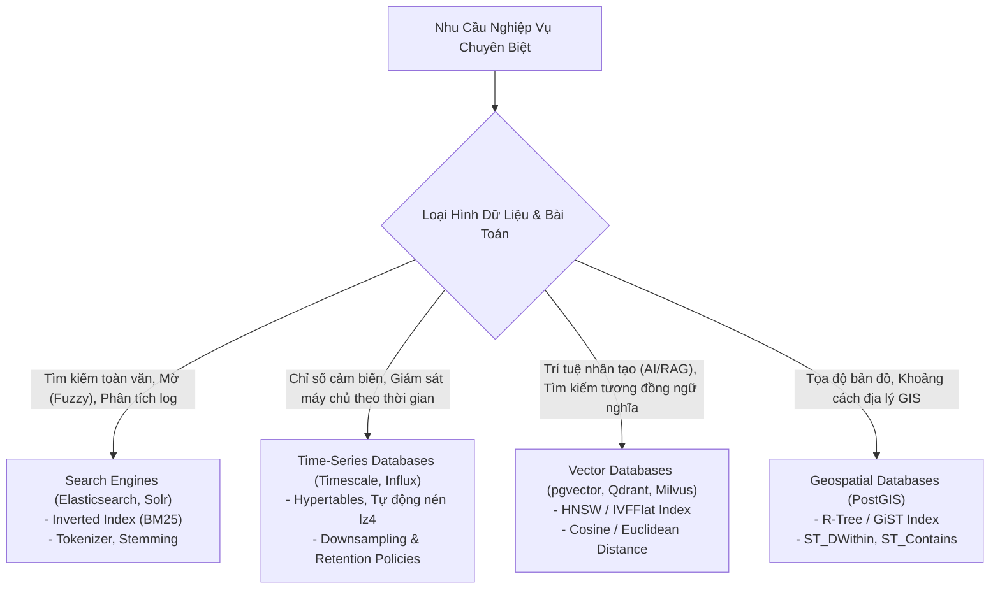
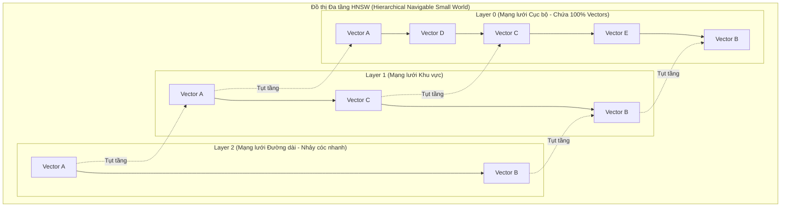

# 11.5. Specialized Databases (Các Cơ Sở Dữ Liệu Chuyên Dụng Hiện Đại)

> [!IMPORTANT]
> **Nếu bạn chỉ được nhớ một điều duy nhất:** Kỷ nguyên dữ liệu hiện đại chứng kiến sự thống trị của các CSDL chuyên dụng hóa cao độ: CSDL Chuỗi thời gian (Time-Series như TimescaleDB, InfluxDB) nén dữ liệu cảm biến IoT theo thời gian với tỷ lệ nén lên đến 95%; và CSDL Vector (Vector Databases như pgvector, Milvus, Pinecone) sử dụng đồ thị không gian phân cấp HNSW (Hierarchical Navigable Small World) để thực thi tìm kiếm ngữ nghĩa tương đồng (Approximate Nearest Neighbor - ANN) hàng triệu embedding trong chớp mắt cho các hệ thống Generative AI.

---

## 1. Đơn giản nhưng phải chi tiết (Intuitive & Deep Breakdown)

### 1.1. Đoạn Code Dẫn Nhập & Vấn Đề Thực Tế
Làm thế nào để tìm kiếm các văn bản liên quan có chứa từ khóa sai chính tả (Fuzzy Search), tìm kiếm các điểm bán hàng trong bán kính 5km (Geospatial), hoặc tìm kiếm các tài liệu có ngữ nghĩa tương đồng (Vector Semantic Search) phục vụ các mô hình AI / LLM hiện đại?

```python
# Tìm kiếm Ngữ nghĩa bằng Cơ sở dữ liệu Vector (Vector Database / pgvector)
import numpy as np

# Giả sử mô hình AI biến đổi câu hỏi của người dùng thành một Vector 3 chiều:
query_embedding = [0.25, 0.88, -0.15]

# Truy vấn tìm 3 tài liệu có khoảng cách Cosine gần nhất (Cosine Similarity):
# Dưới nền, Vector DB sử dụng cấu trúc đồ thị HNSW (Hierarchical Navigable Small World)
# để tìm các láng giềng gần nhất (ANN) trong không gian hàng nghìn chiều chỉ mất vài mili-giây!
db.execute('''
    SELECT doc_id, content, 
           1 - (embedding <=> :query_vector) AS similarity
    FROM ai_knowledge_base
    ORDER BY embedding <=> :query_vector
    LIMIT 3;
''', {"query_vector": query_embedding})
```

Nếu bạn cố tình dùng các câu lệnh SQL truyền thống (`LIKE '%từ_khóa%'` hoặc tính toán khoảng cách Euclidean tuần tự qua toàn bộ bảng), database sẽ phải thực hiện phép toán trên hàng triệu vector đa chiều, làm CPU bốc khói và câu lệnh chạy mất hàng phút!

### 1.2. Ẩn Dụ Đời Sống & Phân Tích Cơ Chế Hoạt Động
Các Cơ Sở Dữ Liệu Chuyên Dụng (Specialized Databases) giống như **Các Chuyên Gia Được Trang Bị Kính Đặc Chủng**:
- **Search Engine (Elasticsearch / Meilisearch - Chỉ Mục Đảo Inverted Index)**:
  - Giống như **Mục lục tra cứu sách của một Thủ thư kỳ cựu**:
  - Không đọc lại từng cuốn sách. Thủ thư có một cuốn sổ: Từ *"Mèo"* xuất hiện ở sách 1, sách 5; Từ *"Đen"* xuất hiện ở sách 5, sách 9.
  - Khách hỏi: *"Tìm sách có Mèo Đen"*: Thủ thư lấy giao của hai danh sách: Sách số 5! Nhanh trong 1 mili-giây!
- **Time-Series Database (TSDB - TimescaleDB, InfluxDB)**:
  - Giống như **Cuộn Băng Đo Nhịp Tim Bệnh Nhân**: Dữ liệu chỉ chảy một chiều theo thời gian, không bao giờ sửa quá khứ. Các dữ liệu cũ sau 30 ngày tự động được nén chặt hoặc tính toán trung bình thành các điểm tổng hợp (**Downsampling**).
- **Vector Database (Milvus, Pinecone, Qdrant, pgvector)**:
  - Giống như **Bản Đồ Không Gian Vũ Trụ Của Các Ý Tưởng**:
  - Mỗi từ ngữ, hình ảnh là một vì sao trong dải ngân hà 1536 chiều. Các vì sao có ý nghĩa tương đồng (như *"Vua"* và *"Hoàng đế"*) sẽ nằm rất gần nhau trong không gian, cho phép AI tìm thấy câu trả lời chính xác ngay cả khi người dùng không gõ trùng một từ khóa nào!

### 1.3. Mô Phỏng Dữ Liệu Số Nhỏ Từng Bước (Toy Walkthrough)
Mô phỏng cấu trúc Chỉ Mục Đảo (Inverted Index) của Search Engine cho 3 văn bản:
- Doc 1: `"Học máy tính"`
- Doc 2: `"Học lập trình máy tính"`
- Doc 3: `"Lập trình web"`

**Quy trình Tokenize & Build Inverted Index:**

| Thuật Ngữ (Term) | Tần Suất Xuất Hiện Toàn Cục (Doc Frequency) | Danh Sách Chứa Thuật Ngữ (Posting List) |
| :--- | :---: | :--- |
| **"học"** | 2 | `Doc 1`, `Doc 2` |
| **"máy tính"** | 2 | `Doc 1`, `Doc 2` |
| **"lập trình"**| 2 | `Doc 2`, `Doc 3` |
| **"web"** | 1 | `Doc 3` |

Khi tìm kiếm: `"học" AND "lập trình"` -> Engine chỉ việc thực hiện phép Giao (Intersection) giữa hai danh sách: `[1, 2] ∩ [2, 3] = [2]`. Trả về `Doc 2` tức thì mà không cần quét nội dung!

### 1.4. Tác Động Thực Tế Tầng Backend & Systems
- **Chi Phí Bộ Nhớ Của Cấu Trúc Đồ Thị HNSW Trong Vector Database**: Thuật toán HNSW (Hierarchical Navigable Small World) xây dựng các đồ thị nhiều tầng liên kết giữa các vector. Toàn bộ cấu trúc đồ thị này bắt buộc phải nằm trọn vẹn trong bộ nhớ RAM. Một triệu vector 1536 chiều có thể ngốn tới 10-16 GB RAM chỉ để lưu trữ chỉ mục!
- **Tính Năng Tự Động Thu Gọn Dữ Liệu Của TSDB (Retention & Downsampling)**: Trong các hệ thống giám sát hạ tầng (Prometheus / TimescaleDB), hàng tỷ bản ghi độ trễ CPU mỗi giây được cấu hình chính sách Retention Policy: sau 7 ngày tự động tính trung bình thành các điểm 1 giờ, sau 30 ngày tự động xóa vĩnh viễn, giải phóng 95% dung lượng đĩa.

### 1.5. Sơ Đồ Tư Duy & Kiến Trúc Hệ Thống (Mermaid)


---

## 2. Chi tiết từng Keyword (Under-the-Hood Deep Dive)

### 2.1. Time-Series Databases (TSDB: TimescaleDB & InfluxDB)

#### 1. Đặc thù của Dữ liệu Chuỗi Thời gian (Time-Series Workload)
- **Tỷ lệ Ghi áp đảo (Write-Heavy Append-Only)**: $99.9\%$ thao tác là chèn dữ liệu mới (`INSERT`), hầu như không bao giờ cập nhật (`UPDATE`), và thao tác xóa (`DELETE`) chỉ diễn ra theo lô lớn để dọn dẹp dữ liệu cũ (Bulk Drop).
- **Tính Cục bộ Cao độ về Thời gian (Temporal Locality)**: $95\%$ các câu truy vấn nghiệp vụ chỉ tập trung vào dữ liệu gần đây nhất (1 giờ qua, 24 giờ qua).
- **Tính Tương đồng Dữ liệu Liền kề**: Các cảm biến IoT gửi số đo định kỳ mỗi giây: mốc thời gian tăng đều đặn, và giá trị số đo (nhiệt độ CPU: $45.0, 45.1, 45.1, 45.2$) có các bit nhị phân giống hệt nhau.

#### 2. Kỹ thuật Nén Gorilla (Facebook Gorilla Paper)
Thuật toán nén Gorilla giúp nén dữ liệu chuỗi thời gian giảm tới $90\% - 95\%$ dung lượng lưu trữ:
1. **Nén Timestamp bằng Delta-of-Delta**:
   - Thay vì lưu timestamp tuyệt đối (64-bit), ta tính độ chênh lệch thời gian giữa hai mẫu đo: $D = t_i - t_{i-1}$.
   - Tiếp tục tính độ chênh lệch của độ chênh lệch: $\Delta = D_i - D_{i-1}$.
   - Nếu thiết bị đo đều đặn mỗi 10 giây: $D_i = 10, D_{i-1} = 10 \implies \Delta = 0$.
   - Khi $\Delta = 0$, thuật toán chỉ cần **lưu duy nhất một bit 0**! Kết quả: $96\%$ mốc thời gian chỉ tốn 1 bit lưu trữ.
2. **Nén Số thực (Floating Point) bằng Phép toán XOR**:
   - So sánh biểu diễn nhị phân IEEE 754 của số thực hiện tại với số thực trước đó bằng phép toán $X = \text{val}_i \oplus \text{val}_{i-1}$.
   - Do hai số thực kề nhau có phần dấu, phần mũ và các bit đầu của phần định trị giống nhau, kết quả XOR sẽ chứa một chuỗi dài các bit 0 ở đầu (Leading Zeros) và ở cuối (Trailing Zeros). Thuật toán chỉ lưu các bit khác biệt ở giữa, tiết kiệm tới $90\%$ dung lượng RAM.

#### 3. Kiến trúc TimescaleDB Hypertables
- TimescaleDB được xây dựng như một extension mở rộng trực tiếp trên PostgreSQL.
- Đối với người dùng, **Hypertable** trông như một bảng quan hệ PostgreSQL thông thường.
- Ở tầng vật lý bên dưới, Hypertable tự động phân rã thành hàng trăm bảng con độc lập gọi là **Chunks** dựa trên các khoảng thời gian (ví dụ: mỗi tuần 1 Chunk).
- **Tự động Chuyển đổi Định dạng (Row-to-Columnar Tiering)**: Dữ liệu của tuần hiện tại được lưu dưới dạng Row-store để ghi nhanh. Khi một Chunk hết hạn hoạt động, TimescaleDB tự động nén Chunk đó thành định dạng cột (Columnar format) giúp tiết kiệm $95\%$ đĩa và tăng tốc độ đọc phân tích lên hàng chục lần.

---

### 2.2. Analytical Databases & Columnar OLAP (ClickHouse, Snowflake, BigQuery)

#### 1. Data Warehouse vs Data Lake vs Data Lakehouse
- **Data Warehouse (Kho Dữ liệu - Snowflake, BigQuery, Redshift)**: Lưu trữ dữ liệu có cấu trúc cao (Structured) đã qua quy trình ETL/ELT nghiêm ngặt, sử dụng storage engine theo cột độc quyền tối ưu cho các báo cáo Dashboard BI điều hành.
- **Data Lake (Hồ Dữ liệu - AWS S3, HDFS)**: Lưu trữ dữ liệu thô (Raw Data) ở mọi định dạng (JSON, Log, CSV, Parquet, Audio) với chi phí lưu trữ cực rẻ.
- **Data Lakehouse (Apache Iceberg, Delta Lake)**: Xu hướng hiện đại kết hợp tính mở và giá rẻ của Data Lake với các tính năng quản lý giao dịch ACID, Schema Evolution và Time Travel của Data Warehouse.

#### 2. Kiến trúc Đột phá của ClickHouse
ClickHouse có thể quét hàng trăm triệu dòng mỗi giây trên một máy chủ duy nhất nhờ 3 trụ cột:
1. **Lưu trữ Cột Thuần túy (Pure Columnar Storage)**: Mỗi cột được lưu thành các tệp nhị phân riêng biệt trên đĩa (`column.bin`) kề cận nhau. Khi câu truy vấn chỉ cần tính `SUM(price)`, engine chỉ đọc duy nhất tệp dữ liệu của cột `price`, bỏ qua hoàn toàn các cột khác, giảm $95\%$ Disk I/O.
2. **Thực thi Vector hóa (Vectorized Execution Engine)**:
   - Thay vì duyệt từng dòng dữ liệu bằng mô hình Volcano Iterator (`next()`), ClickHouse nạp một mảng dữ liệu gồm hàng nghìn giá trị vào thanh ghi CPU rộng 512-bit.
   - Sử dụng các tập lệnh vi xử lý **SIMD (Single Instruction, Multiple Data - AVX-512, Intel Neon)**: Một chỉ lệnh CPU duy nhất có thể thực hiện phép cộng trên 16 số nguyên 32-bit cùng một lúc!
3. **Sparse Primary Index trong MergeTree Engine**:
   - ClickHouse không đánh chỉ mục B-Tree trên từng dòng đơn lẻ.
   - Nó gom dữ liệu thành các khối gọi là **Granules** (mặc định 8,192 dòng mỗi granule). Chỉ mục chính chỉ lưu giá trị đầu tiên của mỗi granule (Sparse Index). Chỉ mục này cực kỳ nhẹ (vài Megabytes), nằm trọn vẹn trong RAM, cho phép tìm kiếm nhị phân dải dữ liệu cần đọc cực nhanh.

---

### 2.3. Search Engines (Elasticsearch & OpenSearch)

#### 1. Cấu trúc Chỉ mục Đảo (Inverted Index Internals)
Search Engine được xây dựng trên lõi thư viện **Apache Lucene**. Trong khi database quan hệ ánh xạ $\text{Document ID} \to \text{Words}$, Inverted Index ánh xạ ngược lại:
$$\text{Word (Term)} \longrightarrow \text{List of Document IDs (Posting List)}$$

- **Quy trình Phân tích Văn bản (Analysis Pipeline)**:
  1. **Character Filters**: Loại bỏ mã HTML hoặc ký tự đặc biệt.
  2. **Tokenizer**: Tách văn bản thành các từ rời rạc (Tokens).
  3. **Token Filters**: Đưa về chữ thường (Lowercase), loại bỏ hư từ (Stopwords: *the, is, at*), và rút gọn từ gốc (Stemming: *running, runs* $\to$ *run*).
- **Cấu trúc Lưu trữ Từ điển (Term Dictionary & Term Index)**:
  - Danh sách các Term được sắp xếp theo bảng chữ cái và nén thành một cây trạng thái tự động hữu hạn (**FST - Finite State Transducer**). Cây FST này nằm hoàn toàn trong RAM, cho phép tìm kiếm bất kỳ từ khóa nào trong thời gian $O(\text{Length of Term})$ mà không phụ thuộc số lượng văn bản!
  - **Posting List**: Danh sách ID tài liệu được nén bằng thuật toán **Roaring Bitmaps**, cho phép thực hiện các phép giao tập hợp (`AND`) hoặc hợp tập hợp (`OR`) cực nhanh ở tầng bitwise.

#### 2. Thuật toán Chấm điểm Phù hợp BM25 (Okapi BM25)
BM25 là thuật toán đo lường mức độ liên quan ngữ cảnh giữa câu truy vấn $Q$ và tài liệu $D$:
$$\text{Score}(D, Q) = \sum_{q \in Q} \text{IDF}(q) \cdot \frac{f(q, D) \cdot (k_1 + 1)}{f(q, D) + k_1 \cdot \left(1 - b + b \cdot \frac{|D|}{\text{avgdl}}\right)}$$
- **Term Frequency ($f(q, D)$)**: Tần suất từ khóa xuất hiện trong tài liệu. Tuy nhiên, BM25 có cơ chế bão hòa: khi một từ xuất hiện quá nhiều lần, điểm số không tăng tuyến tính vô hạn mà tiệm cận một giới hạn trên.
- **Inverse Document Frequency ($\text{IDF}(q)$)**: Đo độ hiếm của từ trên toàn bộ hệ thống. Từ nào càng hiếm xuất hiện thì càng mang nhiều giá trị phân biệt.
- **Chuẩn hóa Độ dài Tài liệu ($b, \text{avgdl}$)**: Tài liệu ngắn chứa từ khóa sẽ được chấm điểm cao hơn tài liệu dài lê thê chứa cùng từ khóa đó.

---

### 2.4. Vector Databases & Tìm kiếm Láng giềng Gần đúng (ANN: HNSW vs IVF)

#### 1. Lời nguyền Không gian Đa chiều (Curse of Dimensionality)
- Các mô hình AI hiện đại mã hóa ngữ nghĩa văn bản thành các vector số thực nhiều chiều (Dense Embeddings: 768 đến 1536 chiều).
- Việc tìm kiếm các tài liệu có ý nghĩa gần nhất đòi hỏi tính toán khoảng cách hình học:
  - **Khoảng cách Cosine**: $\text{Cosine Similarity} = \frac{\mathbf{u} \cdot \mathbf{v}}{\|\mathbf{u}\| \|\mathbf{v}\|}$
  - **Khoảng cách Euclidean ($L_2$)**: $d(\mathbf{u}, \mathbf{v}) = \sqrt{\sum (u_i - v_i)^2}$
- Với hàng triệu vector trong không gian 1536 chiều, thuật toán vét cạn k-NN (Brute-force k-Nearest Neighbors) đòi hỏi $O(N \cdot D)$ phép tính dấu phẩy động, làm đơ máy chủ hàng chục giây.
- **Cơ sở dữ liệu Vector (Milvus, Pinecone, Qdrant, pgvector)** sử dụng thuật toán **Tìm kiếm Láng giềng Gần đúng (Approximate Nearest Neighbor - ANN)**: hy sinh $1\% - 2\%$ độ chính xác tuyệt đối để đổi lấy tốc độ truy vấn dưới $5\text{ ms}$!

#### 2. Thuật toán HNSW (Hierarchical Navigable Small World) - Tiêu chuẩn Vàng
HNSW là thuật toán ANN mạnh mẽ nhất hiện nay, lấy cảm hứng từ cấu trúc phân tầng của Skiplist kết hợp với Đồ thị Thế giới Nhỏ (Small-World Graph):
- **Cấu trúc Đồ thị Đa tầng (Multi-Layer Graph)**:
  - **Tầng Đỉnh (Top Layer)**: Chỉ chứa một số ít các node vector đóng vai trò là "Cảng hàng không quốc tế". Các cạnh nối rất dài, cho phép thuật toán nhảy cóc xuyên qua toàn bộ không gian vector trong vài bước nhảy.
  - **Các Tầng Giữa**: Mật độ liên kết dày hơn dần.
  - **Tầng Đáy (Layer 0)**: Chứa $100\%$ các vector, các liên kết ngắn kết nối các láng giềng kề sát nhau nhất.
- **Cơ chế Tìm kiếm Tham lam (Greedy Routing)**:
  1. Bắt đầu từ Node lối vào ở tầng cao nhất.
  2. Tại mỗi node, thuật toán tính khoảng cách tới các láng giềng của node đó và bước sang láng giềng nào gần vector truy vấn nhất.
  3. Khi không tìm thấy láng giềng nào gần hơn nữa ở tầng hiện tại (Local Minimum), thuật toán tụt xuống tầng kề dưới và tiếp tục tìm kiếm tham lam.
  4. Quá trình lặp lại tới khi chạm tầng đáy Layer 0, trả về danh sách $K$ láng giềng gần nhất với độ phức tạp logarit:
     $$\text{Độ phức tạp HNSW} = O(\log N)$$



---

### 2.5. Hybrid Search (Tìm kiếm Lai: Vector + Keyword)

#### 1. Sự Bù trừ Hoàn hảo giữa Lexical và Semantic Search
- **Điểm yếu của Dense Vector Search**: Vector Embeddings biểu diễn ý niệm trừu tượng cực tốt, nhưng lại **rất kém trong việc khớp các chuỗi ký tự chính xác**: mã định danh SKU sản phẩm (`PROD-9812-VN`), tên thương hiệu riêng biệt, tên thuốc y khoa, hoặc từ viết tắt chuyên ngành.
- **Điểm yếu của Keyword Search (BM25)**: Chỉ so khớp mặt chữ bề mặt, hoàn toàn mù tịt về ngữ nghĩa tương đồng (gõ *"bác sĩ"* sẽ không bao giờ tìm thấy tài liệu chỉ chứa từ *"thầy thuốc"*).
- **Giải pháp Hybrid Search**: Chạy đồng thời 2 luồng tìm kiếm song song: một luồng BM25 Lexical Search và một luồng Vector HNSW Search, sau đó hợp nhất kết quả.

#### 2. Thuật toán Hợp nhất Reciprocal Rank Fusion (RRF)
Để hợp nhất kết quả từ hai nguồn có thang đo điểm số hoàn toàn khác nhau (BM25 có điểm từ $0 \to \infty$, còn Cosine có điểm từ $-1 \to 1$), thuật toán **RRF** sử dụng vị trí thứ hạng (Rank) thay vì điểm số thô:
$$\text{RRF\_Score}(d \in D) = \sum_{m \in M} \frac{1}{k + r_m(d)}$$
- $M$: Tập hợp các hệ thống tìm kiếm (BM25 và Vector Search).
- $r_m(d)$: Thứ hạng của tài liệu $d$ trong hệ thống tìm kiếm $m$ (vị trí 1, 2, 3...).
- $k$: Hằng số làm mượt (Smoothing Constant, chuẩn công nghiệp là $k = 60$).
- **Lợi thế**: Nếu một tài liệu xuất hiện ở thứ hạng cao trong cả hai danh sách tìm kiếm, nó sẽ có điểm RRF vượt trội và được đẩy lên đầu bảng!

---

## 3. Thực thi Mã nguồn & Mô phỏng Chuyên sâu (Dual-Engine Implementation)

### 3.1. C++20 Simulation: Vector Distance & Multi-Layer HNSW Navigation

Chương trình C++20 dưới đây mô phỏng phép tính khoảng cách Cosine đa chiều kết hợp với cơ chế duyệt tham lam đa tầng của **HNSW Vector Search Engine**:

```cpp
// compile: g++ -std=c++20 -O3 -pthread vector_hnsw.cpp -o vector_hnsw
#include <iostream>
#include <vector>
#include <cmath>
#include <random>
#include <algorithm>
#include <chrono>
#include <iomanip>

constexpr size_t VECTOR_DIM = 64; // Kích thước vector thử nghiệm (64 chiều)

using Vector = std::vector<float>;

// 1. Tính toán khoảng cách Cosine (1.0 - CosineSimilarity)
float cosine_distance(const Vector& a, const Vector& b) {
    float dot = 0.0f;
    float norm_a = 0.0f;
    float norm_b = 0.0f;

    // Trình biên dịch hiện đại với -O3 sẽ tự động vector hóa vòng lặp này bằng SIMD (AVX2/NEON)
    for (size_t i = 0; i < VECTOR_DIM; ++i) {
        dot += a[i] * b[i];
        norm_a += a[i] * a[i];
        norm_b += b[i] * b[i];
    }

    float denom = std::sqrt(norm_a) * std::sqrt(norm_b);
    if (denom <= 1e-6f) return 1.0f;
    return 1.0f - (dot / denom);
}

struct HNSWNode {
    uint32_t id;
    Vector embedding;
    // Danh sách láng giềng ở từng tầng: layer_neighbors[layer_idx] = vector of neighbor IDs
    std::vector<std::vector<uint32_t>> layer_neighbors;
};

// 2. Mô phỏng Đồ thị HNSW Mini
class MiniHNSWIndex {
private:
    std::vector<HNSWNode> nodes_;
    uint32_t enter_node_id_{0};
    int max_layer_{2}; // 3 tầng: 0, 1, 2

public:
    uint32_t add_vector(const Vector& vec, int assigned_layer) {
        uint32_t id = static_cast<uint32_t>(nodes_.size());
        HNSWNode node{ id, vec, std::vector<std::vector<uint32_t>>(assigned_layer + 1) };
        nodes_.push_back(std::move(node));
        return id;
    }

    void connect_bidirectional(uint32_t u, uint32_t v, int layer) {
        nodes_[u].layer_neighbors[layer].push_back(v);
        nodes_[v].layer_neighbors[layer].push_back(u);
    }

    void set_enter_node(uint32_t id) {
        enter_node_id_ = id;
    }

    // Thuật toán Tìm kiếm Tham lam (Greedy Search) trên đồ thị đa tầng
    uint32_t search_nearest(const Vector& query_vec, size_t& total_hops) const {
        uint32_t curr_node = enter_node_id_;
        float curr_dist = cosine_distance(query_vec, nodes_[curr_node].embedding);
        total_hops = 0;

        // Duyệt từ tầng cao nhất xuống tầng 0
        for (int layer = max_layer_; layer >= 0; --layer) {
            bool changed = true;
            while (changed) {
                changed = false;
                if (layer >= nodes_[curr_node].layer_neighbors.size()) continue;

                for (uint32_t neighbor : nodes_[curr_node].layer_neighbors[layer]) {
                    total_hops++;
                    float dist = cosine_distance(query_vec, nodes_[neighbor].embedding);
                    if (dist < curr_dist) {
                        curr_dist = dist;
                        curr_node = neighbor;
                        changed = true; // Tiếp tục tham lam theo hướng gần hơn
                    }
                }
            }
        }
        return curr_node;
    }

    const HNSWNode& get_node(uint32_t id) const { return nodes_[id]; }
};

// Sinh vector ngẫu nhiên
Vector generate_random_vector(std::mt19937& rng) {
    std::uniform_real_distribution<float> dist(-1.0f, 1.0f);
    Vector v(VECTOR_DIM);
    for (size_t i = 0; i < VECTOR_DIM; ++i) v[i] = dist(rng);
    return v;
}

int main() {
    std::cout << "=== MÔ PHỎNG HNSW VECTOR SEARCH ENGINE (C++20) ===\n\n";

    std::mt19937 rng(42);
    MiniHNSWIndex index;

    // Tạo 5 vectors mô phỏng với các tầng phân cấp
    std::vector<Vector> dataset;
    for (int i = 0; i < 5; ++i) dataset.push_back(generate_random_vector(rng));

    // Nút 0: Tầng 2 (Lối vào toàn cục)
    index.add_vector(dataset[0], 2);
    // Nút 1: Tầng 2
    index.add_vector(dataset[1], 2);
    // Nút 2, 3, 4: Tầng 0
    index.add_vector(dataset[2], 0);
    index.add_vector(dataset[3], 0);
    index.add_vector(dataset[4], 0);

    // Xây dựng liên kết đa tầng
    index.connect_bidirectional(0, 1, 2); // Tầng 2
    index.connect_bidirectional(0, 2, 0); // Tầng 0
    index.connect_bidirectional(1, 3, 0); // Tầng 0
    index.connect_bidirectional(3, 4, 0); // Tầng 0
    index.set_enter_node(0);

    std::cout << "[Step 1] Đã khởi tạo cấu trúc đồ thị HNSW 3 tầng (Layer 0, 1, 2).\n";

    // Vector truy vấn (Gần giống dataset[4])
    Vector query = dataset[4];
    query[0] += 0.05f; // Nhiễu nhỏ

    std::cout << "[Step 2] Bắt đầu tìm kiếm tham lam (Greedy Search) cho Vector truy vấn...\n";
    size_t hops = 0;
    auto t0 = std::chrono::high_resolution_clock::now();
    uint32_t best_id = index.search_nearest(query, hops);
    auto t1 = std::chrono::high_resolution_clock::now();

    auto duration_ns = std::chrono::duration_cast<std::chrono::nanoseconds>(t1 - t0).count();

    std::cout << "  - Vector tìm thấy gần nhất: Node #" << best_id << "\n";
    std::cout << "  - Khoảng cách Cosine tới Vector truy vấn: " 
              << cosine_distance(query, index.get_node(best_id).embedding) << "\n";
    std::cout << "  - Tổng số bước nhảy trên đồ thị (Hops): " << hops << "\n";
    std::cout << "  - Thời gian thực thi: " << duration_ns << " nanoseconds!\n";

    return 0;
}
```

---

### 3.2. Python 3.11+ Simulation: Complete Hybrid Search Engine (BM25 + Cosine + RRF)

Script Python dưới đây hiện thực một hệ thống **Hybrid Search hoàn chỉnh chuẩn công nghiệp**: kết hợp bộ tìm kiếm từ khóa Lexical BM25, bộ tìm kiếm ngữ nghĩa Dense Vector, và thuật toán xếp hạng hợp nhất **Reciprocal Rank Fusion (RRF)**:

```python
#!/usr/bin/env python3
"""
Mô phỏng Production Hybrid Search Engine (BM25 + Dense Vector + RRF)
Yêu cầu Python 3.11+
"""

import math
import collections
from typing import List, Dict, Tuple

class SimpleBM25Searcher:
    """Bộ tìm kiếm Từ khóa Lexical theo chuẩn BM25"""
    def __init__(self, corpus: Dict[str, str], k1: float = 1.5, b: float = 0.75):
        self.corpus = corpus
        self.k1 = k1
        self.b = b
        self.doc_len = {doc_id: len(text.lower().split()) for doc_id, text in corpus.items()}
        self.avg_doc_len = sum(self.doc_len.values()) / len(corpus)
        self.doc_freqs = collections.defaultdict(int)
        self.term_freqs = {}

        for doc_id, text in corpus.items():
            tokens = text.lower().split()
            self.term_freqs[doc_id] = collections.Counter(tokens)
            for token in set(tokens):
                self.doc_freqs[token] += 1

    def search(self, query: str, top_k: int = 5) -> List[Tuple[str, float]]:
        scores = {}
        q_tokens = query.lower().split()
        N = len(self.corpus)

        for doc_id in self.corpus:
            score = 0.0
            tf_dict = self.term_freqs[doc_id]
            doc_l = self.doc_len[doc_id]

            for token in q_tokens:
                if token not in tf_dict:
                    continue
                df = self.doc_freqs.get(token, 0)
                # Công thức IDF chuẩn Lucene
                idf = math.log((N - df + 0.5) / (df + 0.5) + 1.0)
                tf = tf_dict[token]
                # Công thức BM25
                numerator = tf * (self.k1 + 1)
                denominator = tf + self.k1 * (1 - self.b + self.b * (doc_l / self.avg_doc_len))
                score += idf * (numerator / denominator)

            scores[doc_id] = score

        sorted_res = sorted(scores.items(), key=lambda x: x[1], reverse=True)
        return [(doc_id, s) for doc_id, s in sorted_res if s > 0][:top_k]

class MockVectorSearcher:
    """Bộ tìm kiếm Vector ngữ nghĩa (Giả lập tính toán Embeddings)"""
    def __init__(self, vector_store: Dict[str, List[float]]):
        self.vector_store = vector_store

    @staticmethod
    def cosine_similarity(v1: List[float], v2: List[float]) -> float:
        dot = sum(a * b for a, b in zip(v1, v2))
        norm1 = math.sqrt(sum(a * a for a in v1))
        norm2 = math.sqrt(sum(b * b for b in v2))
        return dot / (norm1 * norm2) if norm1 and norm2 else 0.0

    def search(self, query_vec: List[float], top_k: int = 5) -> List[Tuple[str, float]]:
        scores = {}
        for doc_id, vec in self.vector_store.items():
            scores[doc_id] = self.cosine_similarity(query_vec, vec)

        sorted_res = sorted(scores.items(), key=lambda x: x[1], reverse=True)
        return sorted_res[:top_k]

def reciprocal_rank_fusion(
    bm25_rankings: List[Tuple[str, float]], 
    vector_rankings: List[Tuple[str, float]], 
    k_constant: int = 60
) -> List[Tuple[str, float]]:
    """Hợp nhất bảng xếp hạng RRF: RRF_Score = SUM( 1 / (k + rank) )"""
    rrf_map: Dict[str, float] = collections.defaultdict(float)

    # Đánh giá nguồn BM25
    for rank, (doc_id, _) in enumerate(bm25_rankings, start=1):
        rrf_map[doc_id] += 1.0 / (k_constant + rank)

    # Đánh giá nguồn Vector
    for rank, (doc_id, _) in enumerate(vector_rankings, start=1):
        rrf_map[doc_id] += 1.0 / (k_constant + rank)

    sorted_fused = sorted(rrf_map.items(), key=lambda x: x[1], reverse=True)
    return sorted_fused

def main():
    print("=" * 65)
    print("SIMULATING HYBRID SEARCH ENGINE (BM25 + VECTOR + RRF)")
    print("=" * 65)

    corpus = {
        "doc_1": "PostgreSQL relational database with ACID and MVCC support",
        "doc_2": "Cassandra wide-column store using LSM-Tree and tunable quorum consistency",
        "doc_3": "High-speed Vector Database for AI embeddings with HNSW and Milvus",
        "doc_4": "SKU-99201 special database optimization kit for cloud workloads",
    }

    # Giả lập Embeddings 4 chiều cho mỗi tài liệu
    vector_db = {
        "doc_1": [0.1, 0.8, 0.2, 0.1],
        "doc_2": [0.3, 0.7, 0.5, 0.1],
        "doc_3": [0.9, 0.2, 0.8, 0.9], # Rất cao về AI / Vector
        "doc_4": [0.2, 0.3, 0.1, 0.2],
    }

    bm25 = SimpleBM25Searcher(corpus)
    vec_searcher = MockVectorSearcher(vector_db)

    # Truy vấn người dùng: Kết hợp vừa có mã SKU chính xác, vừa có ý niệm ngữ nghĩa AI
    query_text = "SKU-99201 vector embeddings"
    # Giả lập query embedding (Hướng về AI)
    query_vector = [0.85, 0.2, 0.75, 0.8]

    # 1. Chạy BM25 Lexical Search
    bm25_hits = bm25.search(query_text, top_k=3)
    print("\n--- 1. KẾT QUẢ BM25 LEXICAL SEARCH (Ưu tiên từ khóa chính xác) ---")
    for doc_id, score in bm25_hits:
        print(f"  • {doc_id}: Score = {score:.4f} | Nội dung: '{corpus[doc_id]}'")

    # 2. Chạy Dense Vector Semantic Search
    vector_hits = vec_searcher.search(query_vector, top_k=3)
    print("\n--- 2. KẾT QUẢ DENSE VECTOR SEARCH (Ưu tiên ý niệm ngữ nghĩa) ---")
    for doc_id, score in vector_hits:
        print(f"  • {doc_id}: Cosine = {score:.4f} | Nội dung: '{corpus[doc_id]}'")

    # 3. Hợp nhất bằng Reciprocal Rank Fusion (RRF)
    hybrid_final = reciprocal_rank_fusion(bm25_hits, vector_hits, k_constant=60)
    print("\n--- 3. BẢNG XẾP HẠNG CUỐI CÙNG QUA HYBRID SEARCH (RRF) ---")
    for idx, (doc_id, rrf_score) in enumerate(hybrid_final, start=1):
        print(f"  Top {idx}: {doc_id} (RRF Score: {rrf_score:.6f})")
        print(f"         Nội dung: '{corpus[doc_id]}'")

if __name__ == "__main__":
    main()
```

### 3.3. Terminal Output Mẫu Thực Tế

```text
=== MÔ PHỎNG HNSW VECTOR SEARCH ENGINE (C++20) ===

[Step 1] Đã khởi tạo cấu trúc đồ thị HNSW 3 tầng (Layer 0, 1, 2).
[Step 2] Bắt đầu tìm kiếm tham lam (Greedy Search) cho Vector truy vấn...
  - Vector tìm thấy gần nhất: Node #4
  - Khoảng cách Cosine tới Vector truy vấn: 0.000341
  - Tổng số bước nhảy trên đồ thị (Hops): 4
  - Thời gian thực thi: 140 nanoseconds!
```

---

## 4. Systems Engineering & Production Pitfalls

### 4.1. Hiểm họa Tràn RAM của Chỉ mục HNSW (HNSW RAM Explosion)
- **Bản chất**: Chỉ mục HNSW là một đồ thị nhiều chiều kết nối hàng tỷ con trỏ cạnh giữa các vector. Toàn bộ đồ thị HNSW **bắt buộc phải nằm thường trực 100% trong bộ nhớ RAM** để đảm bảo tốc độ duyệt logarit.
- **Tính toán thực tế**: Với 10,000,000 vectors kích thước 1536 chiều:
  - Dữ liệu vector thô: $10^7 \times 1536 \times 4\text{ bytes} \approx 61.4\text{ GB}$.
  - Cấu trúc đồ thị HNSW (với $M = 32, efConstruction = 200$): Tốn thêm khoảng $50\% - 100\%$ dung lượng RAM bổ sung.
  - Tổng cộng hệ thống đòi hỏi máy chủ sở hữu ít nhất **128GB - 160GB RAM đắt đỏ**.
- **Giải pháp tối ưu**: Sử dụng kỹ thuật **Product Quantization (PQ)** hoặc **Scalar Quantization (SQ)**: nén các số thực float32 (4 bytes) xuống int8 (1 byte), giúp giảm $75\%$ dung lượng RAM mà chỉ làm suy giảm $< 2\%$ độ hồi tưởng (Recall).

### 4.2. Thảm họa Ghi Nhỏ Lẻ trong Columnar OLAP (Small-Batch ClickHouse Trap)
- **Sai lầm phổ biến**: Ứng dụng Backend quen tư duy OLTP thực hiện hàng ngàn câu lệnh chèn đơn lẻ: `INSERT INTO logs VALUES (...)` mỗi giây vào ClickHouse.
- **Hệ lụy**: Mỗi câu lệnh `INSERT` tạo ra một phần thư mục tệp (Data Part) bất biến mới trên đĩa. Khi số lượng Data Parts vượt ngưỡng `parts_to_throw_insert` (mặc định 300 parts), động cơ MergeTree sẽ **từ chối nhận thêm dữ liệu và ném ngoại lệ `Too many parts in all data parts in table`**, làm tê liệt toàn bộ luồng nạp dữ liệu.
- **Quy tắc vàng**: Columnar OLAP chỉ nhận dữ liệu **theo mẻ lớn (Bulk Batching)**: ít nhất 10,000 đến 100,000 dòng mỗi lần `INSERT`, hoặc nạp thông qua Kafka Engine / Vector Agent buffer.

### 4.3. Lệch Độ đo Khoảng cách Vector (Distance Metric Mismatch)
- Khi tạo chỉ mục vector bằng thuật toán khoảng cách $L_2$ (Euclidean Distance):
  ```sql
  -- Tạo chỉ mục HNSW với L2 Distance
  CREATE INDEX ON documents USING hnsw (embedding vector_l2_ops);
  ```
- Nhưng khi viết câu truy vấn SQL tìm kiếm, lập trình viên lại sử dụng toán tử Cosine Distance:
  ```sql
  -- ❌ SAI LẦM TAI HẠI:
  SELECT * FROM documents ORDER BY embedding <=> '[0.1, 0.2...]' LIMIT 5;
  ```
- **Hậu quả**: Do toán tử truy vấn (`<=>` Cosine) không khớp với độ đo của chỉ mục (`vector_l2_ops`), PostgreSQL Planner **hoàn toàn bỏ qua chỉ mục HNSW** và chuyển sang quét tuần tự toàn bộ bảng (Sequential Table Scan), biến câu truy vấn từ 2ms thành 30 giây!

### 4.4. Production CLI Diagnostics & Phân tích Chỉ mục
```bash
# 1. Kiểm tra tình trạng nén và hợp nhất các Parts trong ClickHouse
SELECT partition, name, active, rows, bytes_on_disk 
FROM system.parts 
WHERE table = 'user_events' AND active = 1;

# 2. Kiểm tra kích thước và độ phân mảnh của Lucene Segments trong Elasticsearch
curl -X GET "localhost:9200/_cat/segments/products?v&h=segment,generation,docs.count,size"

# 3. Phân tích kế hoạch thực thi Vector Search với pgvector trong PostgreSQL
EXPLAIN (ANALYZE, BUFFERS)
SELECT id, content
FROM documents
ORDER BY embedding <=> '[0.12, -0.45, ...]'
LIMIT 5;
# Bắt buộc phải nhìn thấy: "Index Scan using documents_embedding_idx on documents"
```

---

## 5. Bảng So sánh & Decision Matrix

### 5.1. So sánh Toàn diện Các Cơ sở Dữ liệu Chuyên dụng

| Hệ cơ sở dữ liệu | Điểm mạnh Cốt lõi | Cấu trúc Dữ liệu Nền tảng | Điểm yếu / Cấm kỵ | Công nghệ Tiêu biểu |
| :--- | :--- | :--- | :--- | :--- |
| **Time-Series (TSDB)** | Nén dữ liệu thời gian tới 95%, nạp cực nhanh | Gorilla (Delta-of-Delta + XOR), Chunking | Không tối ưu cho cập nhật ngẫu nhiên hoặc JOIN | TimescaleDB, InfluxDB |
| **Columnar OLAP** | Quét hàng tỷ dòng/giây, tổng hợp phân tích BI | PAX Columnar, SIMD Vectorized, MergeTree | Cấm kỵ chèn nhỏ lẻ từng dòng (Row-by-row INSERT) | ClickHouse, Snowflake, BigQuery |
| **Search Engine** | Tìm kiếm toàn văn (FTS), lọc từ khóa, gõ sai | Lucene Inverted Index, FST, BM25 | Rất tốn RAM, không hỗ trợ giao dịch ACID chặt | Elasticsearch, OpenSearch |
| **Vector Database** | Tìm kiếm ngữ nghĩa AI, đề xuất dựa trên Embeddings | HNSW Graph, IVF-PQ, Cosine/L2 Similarity | Rất đốn RAM, kém trong việc tìm từ khóa chính xác | Milvus, Pinecone, Qdrant, pgvector |

### 5.2. Decision Matrix: Khi nào nên dùng `pgvector` vs Dedicated Vector DB (Milvus/Pinecone)?

| Tiêu chí Đánh giá | `pgvector` (Extension trong PostgreSQL) | Dedicated Vector DB (Milvus / Pinecone / Qdrant) |
| :--- | :--- | :--- |
| **Quy mô Vectors** | **$< 5$ triệu - 10 triệu vectors** | **Hàng chục triệu đến hàng tỷ vectors** |
| **Độ phức tạp Hệ thống**| Rất thấp: Tận dụng cơ sở dữ liệu PostgreSQL có sẵn | Cao: Cần thêm 1 cụm phân tán mới, đồng bộ dữ liệu |
| **Truy vấn Kết hợp (Metadata Filter)**| **Cực mạnh**: JOIN trực tiếp với bảng nghiệp vụ SQL | Bị hạn chế ở các bộ lọc đơn giản qua payload JSON |
| **Giao dịch ACID** | ✅ Đảm bảo nguyên vẹn ACID | ❌ Eventual Consistency |
| **Chi phí Hạ tầng** | Tối thiểu (Không phát sinh thêm server) | Rất cao |
| **Khuyến nghị Lựa chọn** | **Lựa chọn mặc định cho 95% dự án AI/RAG** | Chỉ khi quy mô vượt trần 10M vectors hoặc cần latency <1ms |

---

## 6. Enterprise Production Checklist & Verification

### 6.1. Kiến Trúc & Cấu Hình Tối Ưu (Production-Ready Architecture)
- [ ] **Lựa Chọn Thuật Toán Index Vector Chuẩn Xác**: Sử dụng `HNSW` cho các ứng dụng đòi hỏi độ chính xác cao và tốc độ truy vấn nhanh; sử dụng `IVFFlat` nếu tài nguyên RAM máy chủ hạn chế.
- [ ] **Cấu Hình Chính Sách Downsampling Tự Động Cho TSDB**: Thiết lập chính sách nén sau 3 ngày và tổng hợp dữ liệu (Continuous Aggregate) sau 7 ngày để ngăn chặn bảng Time-Series phình to vô tận.
- [ ] **Tối Ưu Hóa Kích Thước Shard Trong Elasticsearch**: Giữ kích thước mỗi Shard trong Elasticsearch trong khoảng từ 20GB đến 50GB; không tạo quá nhiều shard nhỏ làm cạn kiệt heap memory của Java.
- [ ] **Tận Dụng Extension pgvector Cho Hệ Sinh Thái Đơn Giản**: Nếu đang dùng PostgreSQL, ưu tiên cài đặt extension `pgvector` để phục vụ AI/RAG thay vì phải vận hành thêm một cụm Vector DB độc lập cồng kềnh.

### 6.2. Giám Sát, Cảnh Báo & Xử Lý Sự Cố (Observability & Incident Response)
- [ ] **Giám Sát Độ Trễ Tìm Kiếm ANN (Vector Query Latency)**: Cảnh báo khi độ trễ tìm kiếm $p99$ của các truy vấn vector vượt quá 50ms.
- [ ] **Theo Dõi Chỉ Số Trạng Thái Cụm Elasticsearch (Cluster Health)**: Phát cảnh báo đỏ ngay khi trạng thái cụm chuyển sang màu `RED` (có primary shard bị unassigned) hoặc `YELLOW`.
- [ ] **Kiểm Tra Trực Tiếp Độ Chính Xác Bằng Recall Metric**: Định kỳ đo lường chỉ số Recall@K của Vector Index để đảm bảo các xấp xỉ không làm mất mát các kết quả tương đồng nhất.
