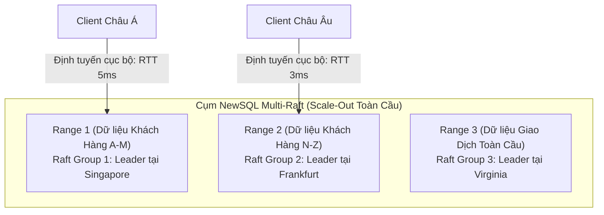
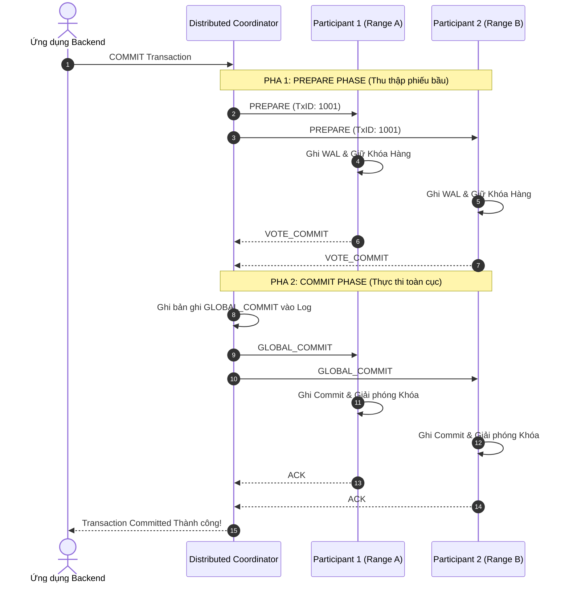
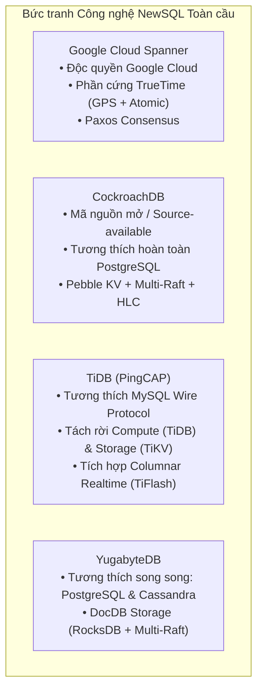
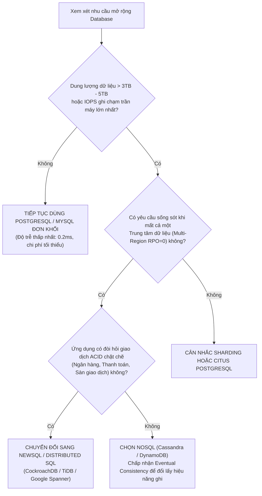

# 12.1. Distributed Database Architecture (Kiến Trúc Cơ Sở Dữ Liệu Phân Tán & NewSQL)

> [!IMPORTANT]
> **Nếu bạn chỉ được nhớ một điều duy nhất:** Định lý CAP là định luật vật lý bất khả biến của mọi hệ thống phân tán khi xảy ra Phân tách mạng (Network Partition): bạn bắt buộc phải lựa chọn giữa Tính nhất quán nghiêm ngặt (Consistency - từ chối phục vụ để bảo vệ tính đúng đắn) hoặc Tính sẵn sàng (Availability - tiếp tục trả lời dù dữ liệu có thể đã cũ); các hệ thống tiên tiến thế hệ mới như Google Spanner tận dụng hạ tầng đồng hồ nguyên tử phần cứng TrueTime API để mang lại khả năng tuần tự hóa toàn cầu (External Consistency) mà không làm suy giảm tính sẵn sàng.

---

## 1. Đơn giản nhưng phải chi tiết (Intuitive & Deep Breakdown)

### 1.1. Đoạn Code Dẫn Nhập & Vấn Đề Thực Tế
Làm thế nào mà các cơ sở dữ liệu phân tán toàn cầu thế hệ mới (NewSQL như Google Spanner hay CockroachDB) có thể cung cấp giao dịch ACID toàn diện trên phạm vi nhiều lục địa mà không cần một đồng hồ nguyên tử vật lý đồng bộ hoàn hảo ở mỗi máy chủ?

```sql
-- Giao dịch phân tán đa trung tâm dữ liệu (Multi-Region Distributed Transaction)
-- Dữ liệu được phân mảnh thành các Ranges nhỏ và quản lý bởi các nhóm Raft Consensus riêng biệt:
BEGIN;
-- Khách hàng tại Tokyo chuyển tiền cho khách hàng tại New York:
UPDATE accounts SET balance = balance - 100 WHERE id = 'tokyo_user';
UPDATE accounts SET balance = balance + 100 WHERE id = 'ny_user';
COMMIT;

-- DƯỚI NỀN:
-- 1. Hai dải Range độc lập chạy giao thức đồng thuận Raft để ghi nhận bản ghi.
-- 2. Hệ thống sử dụng Hybrid Logical Clocks (HLC) kết hợp NTP hoặc TrueTime API
--    để gán nhãn thời gian (Timestamp) tuyệt đối, đảm bảo tính tuần tự External Consistency!
```

Thách thức lớn nhất của các hệ thống phân tán là **Đồng hồ vật lý của các máy tính không bao giờ chạy bằng nhau (Clock Drift)**. Nếu chỉ dựa vào giờ của máy chủ, hai sự kiện xảy ra trước sau có thể bị đảo ngược thứ tự thời gian, dẫn tới việc ghi đè phá hủy dữ liệu của nhau!

### 1.2. Ẩn Dụ Đời Sống & Phân Tích Cơ Chế Hoạt Động
Cơ sở dữ liệu Phân tán giống như **Hội Nghị Thượng Đỉnh Của Các Quốc Gia Thành Viên Liên Hợp Quốc**:
- Không có một vị vua tối cao duy nhất nào được phép tự ý ra lệnh (**No Single Master / Leaderless & Multi-Raft**).
- Mỗi vấn đề (mỗi dải dữ liệu Range) có một Tiểu ban gồm 3 hoặc 5 quốc gia phụ trách (**Raft Consensus Group**).
- **Quy tắc Bầu cử và Biểu quyết (Quorum $N/2 + 1$)**:
  - Khi cần thông qua một quyết định: Tiểu ban bỏ phiếu. Chỉ cần đa số thành viên (3 trên 5 nước) bỏ phiếu tán thành là nghị quyết chính thức có hiệu lực!
  - Dù 2 nước còn lại có bị mất điện hoặc đường truyền internet bị đứt (**Network Partition**), tiểu ban vẫn tiếp tục biểu quyết thông qua các nghị quyết khác bình thường (**Khả năng Chống Chịu Lỗi Tuyệt Đối**).
- **Đồng hồ TrueTime (GPS + Đồng Hồ Nguyên Tử)**: Thay vì đoán mò giờ chính xác, các đại sứ thừa nhận: *"Bây giờ là khoảng giữa 10h00:00 và 10h00:02"*. Khi cần ra quyết định quan trọng, họ đứng chờ 2 giây cho khoảng sai số này trôi qua (**Commit Wait**) để chắc chắn $100\%$ không ai có thể làm sai lệch thứ tự lịch sử!

### 1.3. Mô Phỏng Dữ Liệu Số Nhỏ Từng Bước (Toy Walkthrough)
Mô phỏng quy trình ghi dữ liệu qua thuật toán đồng thuận Raft trong nhóm 3 Nodes ($A, B, C$):
- Node A đang là Leader.
- Node B và C là Followers.

| Bước | Thực Thể Hành Động | Thông Điệp Trao Đổi Qua Mạng | Trạng Thái Nhật Ký (Raft Log) | Quyết Định Commit |
| :---: | :--- | :--- | :--- | :--- |
| **1** | Client gửi yêu cầu | `SET key = "X"` | Node A ghi log nháp tại Index 5 | Chưa commit |
| **2** | Node A (Leader) | Bắn RPC `AppendEntries(Index=5, Value="X")` tới Node B và C | Bắn song song qua mạng | Chờ phản hồi |
| **3** | Node B | Ghi log vào đĩa, phản hồi: `ACK` | Node B đã an toàn | **Đạt Quorum (2/3 nodes: A và B)!** |
| **4** | Node C | Đang bị lag mạng, chưa trả lời | Chưa ghi log | Không cần chờ Node C! |
| **5** | **Node A (Leader)** | **Đạt đa số -> Commit Index 5! Trả kết quả thành công cho Client!** | Đã commit chính thức | **Giao dịch kết thúc (< 5ms)** |
| **6** | Node C | Mạng thông trở lại, nhận bản tin sau -> Bắt kịp log Index 5 | Cả 3 nodes đồng bộ | Hoàn tất |

### 1.4. Tác Động Thực Tế Tầng Backend & Systems
- **Kiến Trúc Multi-Raft Trong NewSQL (CockroachDB / TiDB)**: Thay vì chạy 1 nhóm Raft duy nhất cho toàn bộ database (bị thắt cổ chai bởi 1 leader duy nhất), NewSQL chia dữ liệu thành hàng trăm nghìn Ranges (mỗi dải 64MB). Mỗi Range có một nhóm Raft riêng biệt. Hàng nghìn Leader nằm rải rác trên hàng trăm máy chủ, cho phép mở rộng thông lượng ghi ngang (Horizontal Scalability) không giới hạn!
- **Độ Trễ Xuyên Lục Địa Do Rào Cản Tốc Độ Ánh Sáng**: Khi triển khai cụm phân tán toàn cầu (Mỹ - Châu Âu - Châu Á), độ trễ vật lý của ánh sáng truyền trong cáp quang giữa New York và Tokyo là tối thiểu $\approx 70\text{ms}$. Do đó, một vòng đồng thuận Raft xuyên lục địa bắt buộc phải tốn từ $150\text{ms}$ đến $200\text{ms}$ RTT, đòi hỏi kiến trúc sư phải quy hoạch dữ liệu cục bộ (Geo-partitioning).

### 1.5. Sơ Đồ Tư Duy & Kiến Trúc Hệ Thống (Mermaid)


---

## 2. Chi tiết từng Keyword (Under-the-Hood Deep Dive)

### 2.1. Phân định: Traditional RDBMS vs NoSQL vs NewSQL (Distributed SQL)

| Đặc tính Kỹ thuật | Traditional RDBMS (Postgres, MySQL) | NoSQL (Cassandra, MongoDB) | NewSQL / Distributed SQL (CockroachDB, TiDB, Spanner) |
| :--- | :--- | :--- | :--- |
| **Mô hình Dữ liệu** | Bảng quan hệ quan hệ chặt chẽ | Key-Value, Document, Wide-Column | **Bảng quan hệ logic phân tán (Relational Schema)** |
| **Giao diện Truy vấn**| SQL Chuẩn | API độc quyền hoặc biến thể CQL | **Chuẩn SQL (PostgreSQL/MySQL Wire Protocol)** |
| **Mức độ ACID** | Toàn diện (Chỉ trên 1 máy chủ vật lý) | Thường chỉ trên đơn dòng (Single-row) | **ACID nghiêm ngặt toàn cụm (Multi-Node Distributed ACID)** |
| **Khả năng Mở rộng** | **Scale-Up** (Giới hạn trần phần cứng) | **Scale-Out** tuyến tính | **Scale-Out Đàn hồi tự động (Auto-Rebalancing)** |
| **Cơ chế Nhân bản** | Master-Replica bất đồng bộ | Masterless Quorum (Eventual) | **Thuật toán Đồng thuận Raft / Multi-Paxos** |
| **Xử lý Điểm chết** | Cần can thiệp Failover (Nguy cơ rớt dữ liệu) | Tự động sống sót | **Tự phục hồi tức thì trong $O(1)$ giây, RPO = 0** |

---

### 2.2. Giao thức Cam kết Hai Pha (Two-Phase Commit - 2PC) & Three-Phase Commit (3PC)

Khi một giao dịch phân tán cần cập nhật đồng thời nhiều Range/Shard nằm trên các máy chủ vật lý khác nhau, hệ thống buộc phải sử dụng giao thức cam kết nguyên tử:

#### 1. Cơ chế Hoạt động của Two-Phase Commit (2PC)
- **Phase 1: Pha Chuẩn bị (Prepare Phase / Voting Phase)**:
  1. Transaction Coordinator gán một mã giao dịch toàn cục `TxID` và gửi thông điệp `PREPARE` tới tất cả các nút tham gia (Participants).
  2. Mỗi Participant ghi thông tin thay đổi vào WAL cục bộ, xin các khóa độc quyền (`Exclusive Locks`) trên hàng cần sửa, và bỏ phiếu:
     - Trả lời `VOTE_COMMIT`: *"Tôi đã ghi đĩa an toàn, đang giữ khóa, sẵn sàng commit!"*
     - Trả lời `VOTE_ABORT`: *"Tôi bị lỗi, hết bộ nhớ hoặc gặp Deadlock, đề nghị hủy!"*
- **Phase 2: Pha Cam kết (Commit Phase / Completion Phase)**:
  1. **Quyết định Commit**: Nếu và chỉ nếu **100% Participants đều bỏ phiếu `VOTE_COMMIT`**:
     - Coordinator ghi bản ghi `COMMIT` vào nhật ký phân tán của nó.
     - Coordinator phát lệnh `GLOBAL_COMMIT` tới tất cả Participants.
     - Các nút ghi Commit chính thức xuống đĩa, giải phóng toàn bộ khóa tài nguyên, và phản hồi `ACK`.
  2. **Quyết định Abort**: Nếu có **ít nhất một Participant bỏ phiếu `VOTE_ABORT`** (hoặc hết thời gian chờ Timeout):
     - Coordinator ghi bản ghi `ABORT` và phát lệnh `GLOBAL_ROLLBACK` tới tất cả các nút để hoàn tác mọi thay đổi.



#### 2. Điểm yếu Chí tử của 2PC: Trạng thái Khóa Treo (The Blocking Problem)
Nếu Coordinator bị sập nguồn đột ngột **ngay sau khi Participants đã bỏ phiếu `VOTE_COMMIT` nhưng trước khi kịp phát lệnh Pha 2**:
- Các Participants rơi vào trạng thái **In-Doubt (Lơ lửng không xác định)**: Chúng không biết Coordinator đã quyết định Commit hay Abort!
- Các nút này **bắt buộc phải tiếp tục giữ chặt các khóa độc quyền trên tài nguyên và đứng chờ vô thời hạn (Blocked)**, khiến toàn bộ các câu truy vấn khác chạm vào các hàng này bị treo cứng, dẫn tới sụp đổ dây chuyền trên toàn hệ thống.

#### 3. Giao thức Three-Phase Commit (3PC)
- Để giải quyết vấn đề khóa treo của 2PC, 3PC bổ sung thêm một pha trung gian: `Can-Commit` $\to$ `Pre-Commit` $\to$ `Do-Commit`.
- Sử dụng cơ chế Timeout để các nút tự động quyết định trạng thái mà không cần chờ Coordinator vô hạn.
- **Tại sao 3PC không được dùng trong thực tế?**: Khi mạng máy tính bị chia cắt (Network Partition - hiện tượng xảy ra liên tục trong các đám mây AWS/GCP), 3PC dễ dàng rơi vào thảm họa **Split-Brain**: một nửa cụm tự ý Commit trong khi nửa cụm kia tự ý Abort, làm sai lệch dữ liệu vĩnh viễn!

---

### 2.3. Thuật toán Đồng thuận Raft / Paxos & Mô hình Multi-Raft

Thay vì dùng 2PC cho việc nhân bản dữ liệu, các cơ sở dữ liệu NewSQL hiện đại kết hợp **Multi-Raft**:

#### 1. Thuật toán Đồng thuận Raft Cốt lõi
Raft đảm bảo một nhóm máy chủ thống nhất một chuỗi nhật ký lệnh (Replicated State Machine) thông qua 3 quy tắc thép:
- **Leader Election**: Chỉ có duy nhất 1 Leader hợp lệ trong một nhiệm kỳ (Term). Nếu Leader mất tín hiệu nhịp tim (Heartbeat), các Follower tự động tăng Term và bầu cử Leader mới.
- **Log Replication**: Mọi thao tác ghi phải gửi qua Leader. Leader ghi vào Log của mình và gửi thông điệp `AppendEntries` tới các Followers.
- **Quorum Majority**: Khi **quá bán thành viên** ($\lfloor N/2 \rfloor + 1$) ghi nhận thành công vào đĩa, Leader mới chính thức Commit bản ghi và áp dụng vào máy trạng thái (State Machine).

#### 2. Kiến trúc Multi-Raft (Bí mật Mở rộng của CockroachDB & TiDB)
- Nếu toàn bộ cụm máy chủ 100 nodes chỉ chạy một nhóm Raft duy nhất, một Leader duy nhất sẽ trở thành điểm nghẽn cổ chai I/O của toàn thế giới.
- **Giải pháp Multi-Raft**:
  - Không gian khóa của toàn bộ cơ sở dữ liệu được chia nhỏ thành hàng trăm nghìn dải liên tục gọi là **Ranges** (CockroachDB: 64MB mỗi range) hoặc **Regions** (TiDB: 96MB mỗi region).
  - **Mỗi Range là một Raft Group độc lập hoàn toàn** gồm 3 hoặc 5 bản sao phân bổ trên các máy chủ khác nhau.
  - Trên một máy chủ vật lý duy nhất có thể có hàng ngàn Range khác nhau: nó đóng vai trò là Leader của Range 1, nhưng lại là Follower của Range 2 và Range 3.
  - Khi một Range vượt quá kích thước 64MB do dữ liệu chèn thêm liên tục, nó tự động kích hoạt tiến trình **Range Split**: chia đôi thành hai Range mới và nhân bản độc lập mà không cần dừng hệ thống.

---

### 2.4. Vấn đề Thời gian Vật lý & Kiến trúc Google Spanner TrueTime

#### 1. Thách thức Trật tự Nhân quả và Độ Lệch Đồng hồ (Clock Drift)
Trong một cơ sở dữ liệu phân tán toàn cầu, để đảm bảo tính khả tuần tự tuyệt đối (Strict Serializability / External Consistency): Nếu giao dịch $T_2$ bắt đầu **sau khi** giao dịch $T_1$ đã commit ở thế giới thực, thì mốc thời gian commit của $T_2$ bắt buộc phải lớn hơn mốc thời gian của $T_1$:
$$t_{\text{commit}}(T_1) < t_{\text{commit}}(T_2)$$
Tuy nhiên, đồng hồ tinh thể thạch anh trong máy tính luôn bị trôi (Drift) do nhiệt độ và dao động vật lý. Độ lệch giữa hai máy chủ có thể lên tới $100\text{ms} - 500\text{ms}$, khiến $T_2$ có thể vô tình nhận được timestamp nhỏ hơn $T_1$, phá vỡ toàn bộ tính đúng đắn của dữ liệu.

#### 2. Giải pháp Phần cứng Đỉnh cao của Google Spanner: TrueTime API
Google trang bị phần cứng chuyên dụng trực tiếp trong mỗi trung tâm dữ liệu:
- **Bộ thu tín hiệu GPS** (gắn ăng-ten trên nóc datacenter).
- **Đồng hồ Nguyên tử Rubidium (Atomic Clocks)** đặt trong từng cụm rack máy chủ để đối soát chéo khi tín hiệu GPS bị nhiễu.
- **TrueTime API**: Hàm `TrueTime.now()` không trả về một con số thời gian đơn lẻ, mà trả về một **khoảng thời gian không chắc chắn $[\text{earliest}, \text{latest}]$** với độ lệch cực đại $\epsilon \le 7\text{ms}$:
  $$\text{now}() = [t - \epsilon, t + \epsilon]$$
- **Nguyên lý Chờ đợi Cam kết (Commit Wait Rule)**:
  - Khi giao dịch $T_1$ muốn commit, nó chọn timestamp $s = \text{now().latest}$.
  - Điều phối viên bắt buộc phải **cho giao dịch đi ngủ (Sleep) trong khoảng thời gian $2\epsilon$ ($\approx 14\text{ms}$)** trước khi trả kết quả thành công cho client!
  - Nhờ việc chờ đợi này, khi client nhận kết quả và phát lệnh cho giao dịch $T_2$, thời gian tuyệt đối của toàn vũ trụ **chắc chắn $100\%$ đã vượt qua mốc $s$**, bảo đảm tính tuần tự nhân quả hoàn hảo trên quy mô toàn cầu mà không cần dùng đến khóa đọc tập trung!

#### 3. Giải pháp Phần mềm: Hybrid Logical Clocks (HLC) của CockroachDB
Không sở hữu hạ tầng đồng hồ nguyên tử đắt đỏ như Google, CockroachDB sử dụng **Hybrid Logical Clock (HLC)**:
- Mỗi mốc thời gian là một cặp số: $(l, c)$ trong đó $l$ là thời gian vật lý cao nhất từng ghi nhận (Physical Component), và $c$ là bộ đếm logic Lamport (Logical Counter).
- Khi hai node trao đổi tin nhắn, HLC tự động điều chỉnh mốc thời gian của node nhận tiến lên phía trước để bảo toàn trật tự nhân quả.
- Nếu độ lệch đồng hồ vật lý của một máy chủ vượt quá ngưỡng an toàn cấu hình (`max_offset = 500ms`), node đó sẽ tự động ngắt kết nối và tự sát (Suicide) để bảo vệ tính toàn vẹn của cụm.

---

### 2.5. Khái quát Các Hệ cơ sở dữ liệu NewSQL Tiêu biểu



---

## 3. Thực thi Mã nguồn & Mô phỏng Chuyên sâu (Dual-Engine Implementation)

### 3.1. C++20 Simulation: Distributed Two-Phase Commit (2PC) Engine

Chương trình C++20 dưới đây mô phỏng đầy đủ hoạt động của một **Distributed 2PC Engine**: bao gồm `Coordinator`, các `Participant` với WAL riêng biệt, cơ chế thu thập phiếu bầu đồng thuận, và xử lý kịch bản Rollback khi có một nút từ chối:

```cpp
// compile: g++ -std=c++20 -O3 -pthread distributed_2pc.cpp -o distributed_2pc
#include <iostream>
#include <vector>
#include <string>
#include <memory>
#include <chrono>
#include <algorithm>

enum class VoteResponse { VOTE_COMMIT, VOTE_ABORT };
enum class GlobalDecision { GLOBAL_COMMIT, GLOBAL_ABORT };

// Đại diện cho một Phân mảnh / Node tham gia giao dịch phân tán
class DistributedParticipant {
public:
    std::string node_name;
    bool is_healthy{true};
    bool is_prepared{false};
    bool is_committed{false};
    bool is_aborted{false};

    explicit DistributedParticipant(std::string name, bool healthy = true)
        : node_name(std::move(name)), is_healthy(healthy) {}

    // PHA 1: Nhận lệnh PREPARE từ Coordinator
    VoteResponse prepare(uint64_t tx_id) {
        if (!is_healthy) {
            std::cout << "  [" << node_name << "] Gặp lỗi phần cứng/hết đĩa! Bỏ phiếu: VOTE_ABORT\n";
            is_aborted = true;
            return VoteResponse::VOTE_ABORT;
        }

        // Ghi WAL và giữ khóa tài nguyên
        std::cout << "  [" << node_name << "] Đã ghi WAL TxID=" << tx_id 
                  << ", khóa tài nguyên thành công. Bỏ phiếu: VOTE_COMMIT\n";
        is_prepared = true;
        return VoteResponse::VOTE_COMMIT;
    }

    // PHA 2: Nhận quyết định toàn cục
    void commit(uint64_t tx_id) {
        if (is_prepared) {
            is_committed = true;
            is_prepared = false;
            std::cout << "  [" << node_name << "] Đã áp dụng thay đổi TxID=" << tx_id 
                      << " xuống đĩa & giải phóng khóa (COMMITTED).\n";
        }
    }

    void abort(uint64_t tx_id) {
        is_aborted = true;
        is_prepared = false;
        std::cout << "  [" << node_name << "] Đã hoàn tác thay đổi TxID=" << tx_id 
                  << " & nhả toàn bộ khóa (ABORTED).\n";
    }
};

// Bộ Điều phối Giao dịch Phân tán (Distributed Transaction Coordinator)
class TransactionCoordinator {
private:
    uint64_t tx_sequence_{1000};

public:
    bool execute_distributed_transaction(std::vector<std::shared_ptr<DistributedParticipant>>& participants) {
        uint64_t tx_id = ++tx_sequence_;
        std::cout << "\n>>> [COORDINATOR] BẮT ĐẦU GIAO DỊCH PHÂN TÁN 2PC (TxID: " << tx_id << ") <<<\n";

        // ==========================================
        // PHA 1: PREPARE PHASE (THU THẬP PHIẾU BẦU)
        // ==========================================
        std::cout << "[PHA 1] Gửi thông điệp PREPARE tới " << participants.size() << " Participants...\n";
        bool all_voted_commit = true;

        for (const auto& p : participants) {
            VoteResponse vote = p->prepare(tx_id);
            if (vote != VoteResponse::VOTE_COMMIT) {
                all_voted_commit = false;
            }
        }

        // ==========================================
        // PHA 2: COMMIT PHASE (RA QUYẾT ĐỊNH TOÀN CỤC)
        // ==========================================
        if (all_voted_commit) {
            std::cout << "\n[PHA 2] 100% Participants đồng thuận! Coordinator ghi WAL: GLOBAL_COMMIT\n";
            for (const auto& p : participants) {
                p->commit(tx_id);
            }
            std::cout << ">>> GIAO DỊCH TxID=" << tx_id << " COMMIT TOÀN CỤC THÀNH CÔNG! <<<\n";
            return true;
        } else {
            std::cout << "\n[PHA 2] Có ít nhất một nút từ chối! Coordinator ghi WAL: GLOBAL_ABORT\n";
            for (const auto& p : participants) {
                p->abort(tx_id);
            }
            std::cout << ">>> GIAO DỊCH TxID=" << tx_id << " ĐÃ ĐƯỢC ROLLBACK TOÀN CỤC AN TOÀN! <<<\n";
            return false;
        }
    }
};

int main() {
    std::cout << "=== MÔ PHỎNG DISTRIBUTED TWO-PHASE COMMIT (2PC) ENGINE (C++20) ===\n";

    TransactionCoordinator coordinator;

    // Kịch bản 1: Cả 3 nút đều khỏe mạnh -> Commit thành công
    std::cout << "\n--- KỊCH BẢN 1: TẤT CẢ CÁC NÚT ĐỒNG THUẬN ---";
    std::vector<std::shared_ptr<DistributedParticipant>> cluster_healthy = {
        std::make_shared<DistributedParticipant>("Shard_North_VN", true),
        std::make_shared<DistributedParticipant>("Shard_Central_VN", true),
        std::make_shared<DistributedParticipant>("Shard_South_VN", true)
    };
    coordinator.execute_distributed_transaction(cluster_healthy);

    // Kịch bản 2: Có 1 nút bị lỗi phần cứng -> Tự động Rollback toàn bộ
    std::cout << "\n--- KỊCH BẢN 2: MỘT NÚT BỊ SẬP (ROLLBACK TOÀN CỤC) ---";
    std::vector<std::shared_ptr<DistributedParticipant>> cluster_with_failure = {
        std::make_shared<DistributedParticipant>("Shard_US_East", true),
        std::make_shared<DistributedParticipant>("Shard_EU_West", false), // Node lỗi!
        std::make_shared<DistributedParticipant>("Shard_APAC_Tokyo", true)
    };
    coordinator.execute_distributed_transaction(cluster_with_failure);

    return 0;
}
```

---

### 3.2. Python 3.11+ Simulation: Multi-Range Raft Quorum & HLC Ordering

Script Python dưới đây mô phỏng kiến trúc **Multi-Raft Range Splitting** kết hợp với đồng hồ logic lai **Hybrid Logical Clock (HLC)** đảm bảo trật tự quan hệ nhân quả:

```python
#!/usr/bin/env python3
"""
Mô phỏng Multi-Raft Consensus & Hybrid Logical Clocks (Python 3.11+)
"""

import time
import dataclasses
from typing import List, Dict, Optional, Tuple

@dataclasses.dataclass(order=True)
class HLC:
    """Hybrid Logical Clock: (physical_time, logical_counter)"""
    physical: int # Unix epoch milliseconds
    counter: int

    def update_send(self, current_wall_time: int) -> "HLC":
        if current_wall_time > self.physical:
            self.physical = current_wall_time
            self.counter = 0
        else:
            self.counter += 1
        return HLC(self.physical, self.counter)

    def update_receive(self, current_wall_time: int, msg_hlc: "HLC") -> "HLC":
        max_phys = max(self.physical, msg_hlc.physical, current_wall_time)
        if max_phys == self.physical and max_phys == msg_hlc.physical:
            self.counter = max(self.counter, msg_hlc.counter) + 1
        elif max_phys == self.physical:
            self.counter += 1
        elif max_phys == msg_hlc.physical:
            self.counter = msg_hlc.counter + 1
        else:
            self.counter = 0
        self.physical = max_phys
        return HLC(self.physical, self.counter)

class RaftRangeGroup:
    """Mô phỏng một Range độc lập có 3 bản sao nhân bản qua Raft Quorum"""
    def __init__(self, range_id: str, key_start: str, key_end: str, node_members: List[str]):
        self.range_id = range_id
        self.key_start = key_start
        self.key_end = key_end
        self.nodes = node_members
        self.leader = node_members[0] # Giả lập node đầu tiên là Leader
        self.log: List[Tuple[str, str, HLC]] = []

    def handle_write(self, key: str, val: str, hlc_clock: HLC) -> bool:
        # Bắt buộc phải có quá bán (Quorum Majority = 2/3) đồng thuận
        required_quorum = (len(self.nodes) // 2) + 1
        # Mô phỏng ghi nhận log
        self.log.append((key, val, hlc_clock))
        print(f"  [Raft {self.range_id}] Leader '{self.leader}' nhận lệnh ghi key='{key}'. "
              f"Nhận được Quorum ({required_quorum}/3 nodes xác nhận) -> COMMIT!")
        return True

class MultiRaftDatabase:
    """Tầng lưu trữ phân tán quản lý hàng nghìn Ranges"""
    def __init__(self):
        self.ranges: List[RaftRangeGroup] = [
            RaftRangeGroup("Range_1", "A", "M", ["Node_1", "Node_2", "Node_3"]),
            RaftRangeGroup("Range_2", "M", "Z", ["Node_2", "Node_3", "Node_4"]),
        ]
        self.node_clocks = {f"Node_{i}": HLC(physical=1700000000000, counter=0) for i in range(1, 5)}

    def route_key(self, key: str) -> RaftRangeGroup:
        for r in self.ranges:
            if r.key_start <= key < r.key_end:
                return r
        return self.ranges[-1]

    def put(self, key: str, val: str, client_node: str):
        target_range = self.route_key(key)
        now_ms = int(time.time() * 1000)
        # Cập nhật HLC trên client node
        hlc_ts = self.node_clocks[client_node].update_send(now_ms)
        print(f"\n[Client @ {client_node}] Gửi lệnh: SET {key} = '{val}' | HLC: ({hlc_ts.physical}, {hlc_ts.counter})")
        target_range.handle_write(key, val, hlc_ts)

def main():
    print("=" * 65)
    print("SIMULATING MULTI-RAFT & HYBRID LOGICAL CLOCKS (PYTHON 3.11+)")
    print("=" * 65)

    db = MultiRaftDatabase()

    # 1. Ghi vào Range 1 (Keys A - M)
    db.put("Alice_Account", "1500_USD", client_node="Node_1")

    # 2. Ghi vào Range 2 (Keys M - Z)
    db.put("Zara_Store", "9900_USD", client_node="Node_2")

    # 3. Ghi cùng mốc thời gian vật lý trên Node 1 để kiểm chứng bộ đếm Logic Counter
    db.put("Bob_Account", "200_USD", client_node="Node_1")

if __name__ == "__main__":
    main()
```

### 3.3. Terminal Output Mẫu Thực Tế

```text
=== MÔ PHỎNG DISTRIBUTED TWO-PHASE COMMIT (2PC) ENGINE (C++20) ===

--- KỊCH BẢN 1: TẤT CẢ CÁC NÚT ĐỒNG THUẬN ---
>>> [COORDINATOR] BẮT ĐẦU GIAO DỊCH PHÂN TÁN 2PC (TxID: 1001) <<<
[PHA 1] Gửi thông điệp PREPARE tới 3 Participants...
  [Shard_North_VN] Đã ghi WAL TxID=1001, khóa tài nguyên thành công. Bỏ phiếu: VOTE_COMMIT
  [Shard_Central_VN] Đã ghi WAL TxID=1001, khóa tài nguyên thành công. Bỏ phiếu: VOTE_COMMIT
  [Shard_South_VN] Đã ghi WAL TxID=1001, khóa tài nguyên thành công. Bỏ phiếu: VOTE_COMMIT

[PHA 2] 100% Participants đồng thuận! Coordinator ghi WAL: GLOBAL_COMMIT
  [Shard_North_VN] Đã áp dụng thay đổi TxID=1001 xuống đĩa & giải phóng khóa (COMMITTED).
  [Shard_Central_VN] Đã áp dụng thay đổi TxID=1001 xuống đĩa & giải phóng khóa (COMMITTED).
  [Shard_South_VN] Đã áp dụng thay đổi TxID=1001 xuống đĩa & giải phóng khóa (COMMITTED).
>>> GIAO DỊCH TxID=1001 COMMIT TOÀN CỤC THÀNH CÔNG! <<<

--- KỊCH BẢN 2: MỘT NÚT BỊ SẬP (ROLLBACK TOÀN CỤC) ---
>>> [COORDINATOR] BẮT ĐẦU GIAO DỊCH PHÂN TÁN 2PC (TxID: 1002) <<<
[PHA 1] Gửi thông điệp PREPARE tới 3 Participants...
  [Shard_US_East] Đã ghi WAL TxID=1002, khóa tài nguyên thành công. Bỏ phiếu: VOTE_COMMIT
  [Shard_EU_West] Gặp lỗi phần cứng/hết đĩa! Bỏ phiếu: VOTE_ABORT
  [Shard_APAC_Tokyo] Đã ghi WAL TxID=1002, khóa tài nguyên thành công. Bỏ phiếu: VOTE_COMMIT

[PHA 2] Có ít nhất một nút từ chối! Coordinator ghi WAL: GLOBAL_ABORT
  [Shard_US_East] Đã hoàn tác thay đổi TxID=1002 & nhả toàn bộ khóa (ABORTED).
  [Shard_EU_West] Đã hoàn tác thay đổi TxID=1002 & nhả toàn bộ khóa (ABORTED).
  [Shard_APAC_Tokyo] Đã hoàn tác thay đổi TxID=1002 & nhả toàn bộ khóa (ABORTED).
>>> GIAO DỊCH TxID=1002 ĐÃ ĐƯỢC ROLLBACK TOÀN CỤC AN TOÀN! <<<
```

---

## 4. Systems Engineering & Production Pitfalls

### 4.1. Cạm bẫy Độ trễ Đơn Truy vấn (The Single-Query Latency Penalty)
- **Sai lầm kỳ vọng**: Nhiều đội ngũ kỹ thuật chuyển đổi từ PostgreSQL đơn lẻ sang CockroachDB hoặc TiDB và hoang mang khi thấy:
  - Một câu lệnh `INSERT INTO users ...` trên PostgreSQL mất $0.2\text{ ms}$.
  - Trên CockroachDB hoặc TiDB, câu lệnh đó mất tới **$5\text{ ms} - 15\text{ ms}$** (chậm hơn 50 lần!).
- **Bản chất**: Trên PostgreSQL đơn khối, lệnh ghi chỉ nạp vào RAM và ghi WAL cục bộ. Trong khi đó, Distributed SQL bắt buộc phải:
  1. Gửi gói tin mạng từ SQL Node tới Raft Leader.
  2. Leader gửi tiếp gói tin tới các Raft Followers qua mạng nội bộ.
  3. Chờ quá bán Followers xác nhận (Network Round-Trip Time - RTT).
  4. Nếu là giao dịch đa Range, phải kích hoạt tiếp 2 chặng mạng của 2PC!
- **Bài học kiến trúc**: NewSQL **không sinh ra để tối ưu độ trễ cho một truy vấn đơn lẻ**, mà sinh ra để đảm bảo **tổng thông lượng (Throughput) không bao giờ bị nghẽn khi có hàng trăm nghìn truy vấn đồng thời** và đảm bảo hệ thống không bao giờ chết khi mất cả trung tâm dữ liệu.

### 4.2. Hiểm họa Khóa Chính Tự Tăng (Monotonically Increasing Key Hotspot)
- **Bản chất lỗi**: Trong PostgreSQL, tạo khóa chính tự tăng `id BIGSERIAL` là chuẩn mực. Nhưng trong các NewSQL phân vùng theo dải (Range-based Sharding như CockroachDB, Spanner):
  - Giá trị `id` luôn tăng dần: $1001, 1002, 1003...$
  - Toàn bộ các giá trị mới luôn rơi vào **Range duy nhất chứa cận trên cao nhất**.
  - **Hậu quả**: $100\%$ lưu lượng ghi của toàn cầu bị dồn về **duy nhất 1 Raft Leader**! Các máy chủ khác trong cụm 100 nodes hoàn toàn nhàn rỗi, trong khi máy chủ chứa Range cuối cùng bị sập vì quá tải.
- **Giải pháp**: Luôn sử dụng khóa chính ngẫu nhiên phân tán: **UUIDv7, Snowflake ID, hoặc Hash-Sharded Index** (`CREATE TABLE ... (id INT PRIMARY KEY USING HASH)`).

### 4.3. Sự cố Lệch Giờ Phần Cứng Vượt Ngưỡng (Clock Offset Crash)
- Trong CockroachDB, mỗi node chạy một luồng giám sát độ lệch đồng hồ với các node láng giềng.
- Nếu dịch vụ NTP hoặc chrony trên một máy chủ vật lý bị treo và độ lệch đồng hồ vượt quá ngưỡng an toàn:
  $$\Delta t > \text{max\_offset} \quad (\text{Mặc định } 500\text{ms})$$
- Node đó sẽ **ngay lập tức tự sát (Fatal Panic / Crash)** để ngăn chặn dữ liệu bị ghi sai lệch trật tự nhân quả.
- **Khắc phục**: Luôn cấu hình cụm máy chủ đồng bộ giờ qua NTP server nội bộ chất lượng cao (như Amazon Time Sync Service hoặc Google NTP).

---

## 5. Bảng So sánh & Decision Matrix

### 5.1. So sánh Cơ chế Đồng bộ Thời gian: TrueTime vs HLC

| Tiêu chí So sánh | Google Spanner TrueTime | Hybrid Logical Clocks - HLC (CockroachDB) |
| :--- | :--- | :--- |
| **Yêu cầu Hạ tầng** | **Bắt buộc phần cứng chuyên dụng**: Ăng-ten GPS + Đồng hồ Nguyên tử | Thuần túy phần mềm (Chạy trên mọi VPS, AWS, GCP, Bare-metal) |
| **Cơ chế Đảm bảo Thứ tự**| **Commit Wait**: Ngủ $2\epsilon$ ($\approx 14\text{ms}$) trước khi commit | Điều chỉnh Logical Counter khi Physical Time bị trùng |
| **Mức độ Nhất quán** | **Strict Serializability Toàn cầu Tuyệt đối** | Serializability nội bộ cụm (Phụ thuộc vào `max_offset`) |
| **Chi phí Vận hành** | Cực kỳ đắt đỏ (Chỉ có trên Google Cloud) | Miễn phí, linh hoạt trên môi trường On-Premise & Cloud |

### 5.2. Decision Matrix: Khi nào nên chuyển đổi sang NewSQL / Distributed SQL?



---

## 6. Enterprise Production Checklist & Verification

### 6.1. Kiến Trúc & Cấu Hình Tối Ưu (Production-Ready Architecture)
- [ ] **Luôn Duy Trì Số Lượng Nodes Lẻ Trong Mỗi Raft Group**: Luôn cấu hình Replication Factor là 3 hoặc 5 nodes để đảm bảo công thức đa số Quorum hoạt động chính xác và không lãng phí tài nguyên.
- [ ] **Áp Dụng Geo-Partitioning Ghim Dữ Liệu Theo Địa Lý**: Cấu hình các bảng người dùng sao cho dữ liệu của người dùng châu nào được lưu trên các node thuộc châu đó để giữ độ trễ truy vấn dưới 10ms và tuân thủ luật bảo vệ dữ liệu (GDPR).
- [ ] **Cấu Hình Đồng Bộ Giờ Chuẩn Bằng Chrony / PTP**: Trên mọi máy chủ trong cụm phân tán, bắt buộc cài đặt Chrony đồng bộ với máy chủ NTP nội bộ để giữ độ lệch đồng hồ (Clock Offset) dưới 500 micro-giây.
- [ ] **Tách Rời Network Interface Phục Vụ Raft Heartbeat**: Sử dụng card mạng vật lý riêng cho luồng giao tiếp đồng thuận Raft để không bị ảnh hưởng bởi lưu lượng tải nặng từ client.

### 6.2. Giám Sát, Cảnh Báo & Xử Lý Sự Cố (Observability & Incident Response)
- [ ] **Giám Sát Độ Lệch Đồng Hồ Hệ Thống (Clock Drift)**: Cảnh báo khẩn cấp khi độ lệch giờ `node_timex_offset_seconds` giữa các máy chủ trong cụm vượt quá 10 mili-giây (nguy cơ sập cơ chế TrueTime/HLC).
- [ ] **Cảnh Báo Hiện Tượng Bầu Cử Lại Leader (Raft Leader Elections)**: Theo dõi số lần bầu cử leader; nếu số lần bầu lại tăng đột biến, mạng nội bộ đang bị mất gói hoặc node bị nghẽn CPU.
- [ ] **Kiểm Tra Trạng Thái Sức Khỏe Vùng Range Bằng CLI**: Sử dụng công cụ quản trị (như `cockroach node status` hoặc `pd-ctl` trên TiDB) để xác thực không có Range nào bị rơi vào trạng thái thiếu bản sao (Under-replicated).
