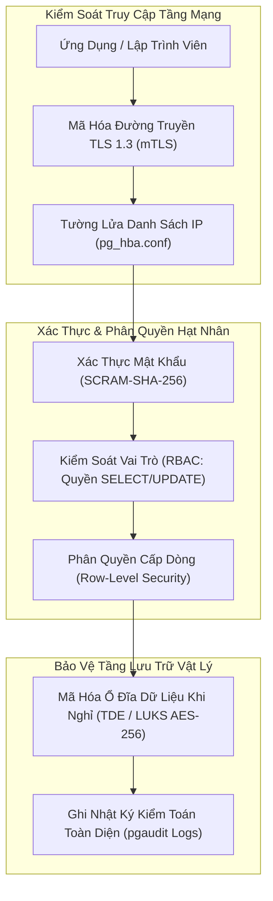
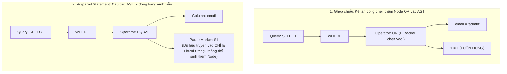

# 13.1. Database Security & Compliance (An Ninh & Tuân Thủ Cơ Sở Dữ Liệu)

> [!IMPORTANT]
> **Nếu bạn chỉ được nhớ một điều duy nhất:** Lỗ hổng tiêm mã độc SQL Injection vẫn là thảm họa bảo mật số một nhưng hoàn toàn có thể triệt tiêu 100% bằng cách sử dụng Câu lệnh tham số hóa (Prepared Statements / Parameterized Queries): cơ chế này tách bạch tuyệt đối giữa Mã thực thi (SQL Code) và Dữ liệu người dùng (User Data) ở cấp độ động cơ biên dịch CSDL; kết hợp cùng Mã hóa trong suốt (TDE), Kiểm soát truy cập theo vai trò (RBAC) và Nhật ký kiểm toán (Audit Logs) để thiết lập pháo đài bảo mật toàn diện.

---

## 1. Đơn giản nhưng phải chi tiết (Intuitive & Deep Breakdown)

### 1.1. Đoạn Code Dẫn Nhập & Vấn Đề Thực Tế
Tại sao chỉ một lỗi lập trình nối chuỗi SQL cẩu thả lại có thể phá hủy hoàn toàn hàng rào bảo vệ tường lửa của một doanh nghiệp và làm rò rỉ toàn bộ cơ sở dữ liệu mật của khách hàng ra ngoài Internet?

```python
# CÁCH 1: Thảm họa SQL Injection kinh điển (Nối chuỗi trực tiếp)
user_input = "' OR '1'='1' --"
query = "SELECT * FROM users WHERE username = '" + user_input + "' AND password = 'xxx';"
# Chuỗi SQL được ráp thành:
# SELECT * FROM users WHERE username = '' OR '1'='1' -- AND password = 'xxx';
# Điều kiện '1'='1' luôn ĐÚNG! Hacker đăng nhập thành công vào tài khoản Admin mà không cần mật khẩu!

# CÁCH 2: Phòng vệ bất khả xâm phạm bằng Prepared Statements (Tham số hóa):
cursor.execute(
    "SELECT * FROM users WHERE username = %s AND password = %s;",
    (user_input, password_hash)
)
# Database coi user_input là một HẰNG SỐ DỮ LIỆU THUẦN TÚY!
# Không bao giờ diễn dịch dữ liệu người dùng thành mã lệnh thực thi!
```

Bảo mật cơ sở dữ liệu không chỉ dừng lại ở việc đặt mật khẩu mạnh cho tài khoản `postgres` hay `root`. Nó là một hệ thống phòng thủ đa tầng (**Defense-in-Depth**): từ kiểm soát truy cập dựa trên vai trò (RBAC), bảo vệ chống SQL Injection, mã hóa dữ liệu khi nghỉ (TDE), mã hóa trên đường truyền (mTLS), cho tới cơ chế phân quyền cấp độ dòng (**Row-Level Security - RLS**)!

### 1.2. Ẩn Dụ Đời Sống & Phân Tích Cơ Chế Hoạt Động
Hệ thống Bảo Mật Cơ Sở Dữ Liệu giống như **Căn Hầm Chứa Vàng Của Ngân Hàng Thụy Sĩ**:
- **Prepared Statements** giống như **Cửa Đưa Tiền Có Tấm Kính Chống Đạn**: Khách hàng chỉ được phép nhét tờ tiền mỏng qua một khe hở hẹp. Khách hàng không thể luồn một khẩu súng hay một quả lựu đạn qua khe hở đó để cướp ngân hàng (**Dữ liệu chỉ là dữ liệu, không thể biến thành mã lệnh**)!
- **Row-Level Security (RLS)** giống như **Két Sắt Khách Sạn**: Mặc dù 100 khách cùng bước vào một căn phòng chứa két sắt (cùng truy cập vào bảng `documents`), nhưng chiếc chìa khóa của Anh A chỉ mở được đúng chiếc ngăn kéo của Anh A. Anh A không bao giờ nhìn thấy tài liệu của Anh B dù chúng nằm sát vách nhau!
- **Mã Hóa Dữ Liệu Khi Nghỉ (Transparent Data Encryption - TDE)**: Giống như **Tài liệu được viết bằng thứ chữ tượng hình cổ đại**: Nếu một kẻ trộm nửa đêm lẻn vào ăn cắp toàn bộ các ổ cứng SSD mang về nhà, khi cắm vào máy tính khác đọc thì chỉ thấy một đống ký tự rác vô nghĩa (**Không có Master Encryption Key từ KMS thì không thể giải mã**)!

### 1.3. Mô Phỏng Dữ Liệu Số Nhỏ Từng Bước (Toy Walkthrough)
Mô phỏng cơ chế Phân Quyền Cấp Độ Dòng (Row-Level Security - RLS) trên PostgreSQL:

Bảng `Tenant_Documents` chứa tài liệu của nhiều công ty khác nhau:

```sql
ALTER TABLE tenant_documents ENABLE ROW LEVEL SECURITY;
CREATE POLICY tenant_isolation_policy ON tenant_documents
    USING (tenant_id = current_setting('app.current_tenant_id')::INT);
```

| Người Dùng Truy Vấn | Ngữ Cảnh Ứng Dụng Thiết Lập (`app.current_tenant_id`) | Câu Lệnh Client Gửi Lên | Lệnh Được Database Tự Động Biến Đổi Dưới Nền | Dữ Liệu Được Trả Về |
| :--- | :---: | :--- | :--- | :--- |
| **Nhân viên Công ty A** | `current_tenant_id = 10` | `SELECT * FROM tenant_documents;` | `SELECT * FROM tenant_documents WHERE tenant_id = 10;` | **CHỈ THẤY tài liệu Công ty A** |
| **Nhân viên Công ty B** | `current_tenant_id = 20` | `SELECT * FROM tenant_documents;` | `SELECT * FROM tenant_documents WHERE tenant_id = 20;` | **CHỈ THẤY tài liệu Công ty B** |
| **Hacker cố tình gian lận** | Cố tình gõ: `WHERE tenant_id = 10` | `SELECT * FROM tenant_documents WHERE tenant_id = 10;` | `... WHERE tenant_id = 10 AND tenant_id = 20;` | **Trả về 0 dòng! (Bị chặn 100%)** |

Ngay cả khi lập trình viên Backend quên viết mệnh đề `WHERE tenant_id = ...` trong code, database vẫn tự động ép buộc bảo vệ dữ liệu ở cấp độ phần cứng!

### 1.4. Tác Động Thực Tế Tầng Backend & Systems
- **Thảm Họa Dùng Tài Khoản Siêu Quản Trị `postgres` / `root` Cho Ứng Dụng**: Nếu một microservice kết nối vào database bằng tài khoản root, khi microservice đó bị dính lỗ hổng Remote Code Execution (RCE) hoặc SQL Injection, kẻ tấn công có thể chạy hàm `COPY ... FROM PROGRAM` để thực thi mã độc chiếm quyền điều khiển toàn bộ máy chủ hệ điều hành của database!
  - *Nguyên tắc bắt buộc*: Áp dụng **Đặc quyền Tối thiểu (Least Privilege)**: Tạo tài khoản chuyên dụng, chỉ cấp quyền `SELECT, INSERT, UPDATE` trên đúng các bảng cần thiết, cấm hoàn toàn quyền DDL (`DROP, ALTER`).
- **Ghi Nhật Ký Kiểm Toán (Audit Logging Compliance - HIPAA / PCI-DSS)**: Các tiêu chuẩn bảo mật quốc tế yêu cầu phải ghi lại toàn bộ dấu vết: Ai, vào lúc nào, từ IP nào, đã đọc hoặc sửa đổi bản ghi chứa thông tin thẻ tín dụng của khách hàng bằng extension chuyên dụng như `pgaudit`.

### 1.5. Sơ Đồ Tư Duy & Kiến Trúc Hệ Thống (Mermaid)


---

## 2. Chi tiết từng Keyword (Under-the-Hood Deep Dive)

### 2.1. Database Authentication vs Authorization (RBAC vs ABAC)

#### 1. Authentication (Xác thực Danh tính)
- **Cơ chế SCRAM-SHA-256 (Chuẩn mực Hiện đại)**:
  - Thay thế cơ chế MD5 cũ kỹ dễ bị tấn công Rainbow Table.
  - Sử dụng quy trình trao đổi thử thách và phản hồi (Salted Challenge Response Authentication Mechanism): Máy chủ gửi một chuỗi Salt ngẫu nhiên và số vòng băm (Iterations). Client tính toán khóa mà **không bao giờ truyền mật khẩu gốc qua mạng**, ngăn chặn hoàn toàn nguy cơ bị đánh cắp thông tin đăng nhập dù bị tấn công Man-in-the-Middle.
- **Mutual TLS (mTLS)**: Cả Database Server và Application Client đều phải xuất trình chứng chỉ số X.509 hợp lệ được cấp bởi một Tổ chức Chứng thực (Internal CA).
- **Passwordless Cloud IAM**: Sử dụng AWS RDS IAM hoặc GCP Cloud SQL Auth Proxy: Token xác thực được sinh tự động với thời gian sống cực ngắn (thường là 15 phút), triệt tiêu rủi ro lộ mật khẩu tĩnh.

#### 2. Authorization: RBAC vs ABAC & Nguyên lý Đặc quyền Tối thiểu
- **Role-Based Access Control (RBAC)**:
  - Phân quyền theo vai trò chức năng: Tạo các Role độc lập như `readonly_analyst`, `order_service_app`, `dba_admin`.
  - Phân quyền cụ thể trên từng Schema, Table, hoặc View:
    ```sql
    REVOKE ALL ON ALL TABLES IN SCHEMA public FROM PUBLIC;
    GRANT SELECT, INSERT, UPDATE ON TABLE orders TO order_service_app;
    ```
- **Attribute-Based Access Control (ABAC)**:
  - Cấp phép động dựa trên ngữ cảnh môi trường: *"Chỉ cho phép đọc bảng lương nếu truy cập trong giờ hành chính ($8\text{h} - 17\text{h}$), từ dải IP nội bộ văn phòng ($10.20.0.0/16$), và người dùng có chức danh HR Manager"*.
- **Nguyên lý Đặc quyền Tối thiểu (Least Privilege)**:
  - Ứng dụng Backend **tuyệt đối không bao giờ được kết nối bằng tài khoản `postgres`, `root`, hoặc sở hữu cờ `SUPERUSER`**.
  - Mỗi Microservice phải sở hữu một tài khoản riêng biệt, không có quyền DDL (`CREATE TABLE`, `DROP TABLE`, `ALTER TABLE`), chỉ có quyền thao tác DML trên các bảng nó trực tiếp sở hữu.

---

### 2.2. Giải phẫu Bản chất Lỗ hổng SQL Injection & Kỹ thuật Phòng chống

#### 1. Bản chất Toán học của SQL Injection (AST Boundary Breach)
Khi một câu lệnh SQL được gửi tới Database Engine:
1. Bộ phân tích từ vựng (Lexer) và cú pháp (Parser) sẽ chuyển câu lệnh thành một **Cây Cú pháp Trừu tượng (Abstract Syntax Tree - AST)**.
2. Nếu lập trình viên sử dụng kỹ thuật ghép chuỗi:
   ```typescript
   // ĐOẠN MÃ NGUY HIỂM:
   const sql = "SELECT * FROM users WHERE email = '" + userInput + "'";
   ```
   Nếu kẻ tấn công nhập: `' OR 1=1 --`:
   - Ký tự `'` đóng chuỗi sớm.
   - Từ khóa `OR` tạo thêm một nhánh toán tử nhị phân mới (`BinaryOp: OR`) trong cây AST.
   - Biểu thức `1=1` luôn đúng.
   - Ký tự `--` cắt bỏ toàn bộ phần đuôi của cây AST.
   - **Hậu quả**: Kẻ tấn công đã **thay đổi cấu trúc ngữ pháp của cây AST**, biến câu lệnh tìm kiếm người dùng thành câu lệnh quét toàn bộ bảng!

#### 2. Tại sao Parameterized Query & Prepared Statement Miễn nhiễm 100%?
Chu trình của Prepared Statement chia làm hai giai đoạn tách rời tuyệt đối:
- **Giai đoạn 1: Biên dịch Cú pháp (PREPARE)**:
  ```sql
  PREPARE find_user_stmt AS SELECT * FROM users WHERE email = $1;
  ```
  Database Engine phân tích cú pháp và **đóng băng cấu trúc cây AST vĩnh viễn**. Tại vị trí nút `$1`, engine đánh dấu đây là một `ParamMarkerNode` (chỉ nhận một giá trị hằng số nguyên tử).
- **Giai đoạn 2: Truyền Dữ liệu Nhị phân (EXECUTE)**:
  ```sql
  EXECUTE find_user_stmt ('admin\' OR 1=1 --');
  ```
  Dữ liệu độc hại được truyền qua giao thức nhị phân. Khi đến nút `$1`, engine chỉ coi toàn bộ chuỗi ký tự đó là **một giá trị chuỗi văn bản thuần túy (String Literal)** để so sánh trong bảng băm/B-Tree. Cấu trúc cây AST đã bị cố định nên không thể bị bẻ cong!



---

### 2.3. Bảo mật Phân quyền Hạt mịn: Row-Level Security (RLS) & Column Security

#### 1. Row-Level Security (RLS trong PostgreSQL)
RLS là tính năng mạnh mẽ nhất cho các kiến trúc SaaS Đa người thuê (Multi-Tenancy) dùng chung một Database và Schema duy nhất:
- Kích hoạt RLS trên bảng:
  ```sql
  ALTER TABLE tenants_data ENABLE ROW LEVEL SECURITY;
  ```
- Tạo chính sách bảo mật động dựa trên biến phiên làm việc (Session Variable):
  ```sql
  CREATE POLICY tenant_isolation_policy ON tenants_data
  AS RESTRICTIVE
  FOR ALL
  TO app_user
  USING (tenant_id = current_setting('app.current_tenant_id')::UUID)
  WITH CHECK (tenant_id = current_setting('app.current_tenant_id')::UUID);
  ```
- **Cơ chế Tự động Áp đặt**: Khi Backend mở kết nối và thiết lập: `SET app.current_tenant_id = 'c123...';`, mọi câu lệnh `SELECT * FROM tenants_data` từ tầng ứng dụng sẽ được Query Planner **tự động chèn thêm điều kiện lọc ngầm** vào cây kế hoạch thực thi:
  $$\text{WHERE } (\text{user\_filter}) \text{ AND } (\text{tenant\_id} = \text{'c123...'})$$
  Lập trình viên dù có vô tình quên viết mệnh đề `WHERE tenant_id = ...`, dữ liệu của khách hàng khác cũng không bao giờ bị rò rỉ!

#### 2. Column-Level Security & Dynamic Data Masking
- **Column Security**: Giới hạn phân quyền trên từng cột cụ thể:
  ```sql
  GRANT SELECT (id, username, email) ON employees TO customer_support;
  -- Cột 'salary' và 'ssn' bị ẩn hoàn toàn đối với role này!
  ```
- **Dynamic Data Masking**: Trả về dữ liệu đã được làm mờ:
  ```sql
  -- Số thẻ tín dụng: 4111-2222-3333-4444 -> 4111-XXXX-XXXX-4444
  -- Email: alice.wonder@gmail.com -> a***@gmail.com
  ```

---

### 2.4. Mã hóa Dữ liệu: TDE vs Transit vs Backup Encryption

#### 1. Encryption in Transit (Mã hóa trên Đường truyền)
- Ép buộc giao thức kết nối bắt buộc phải dùng **TLS 1.3**:
  ```text
  # postgresql.conf
  ssl = on
  ssl_ciphers = 'TLS_AES_256_GCM_SHA384:TLS_CHACHA20_POLY1305_SHA256'
  ssl_min_protocol_version = 'TLSv1.3'
  ```
- Loại bỏ hoàn toàn các bộ mật mã cũ yếu (DES, 3DES, RC4, MD5).

#### 2. Encryption at Rest & Transparent Data Encryption (TDE)
- **Cơ chế Hoạt động**:
  - Dữ liệu trong RAM Buffer Pool hoàn toàn ở dạng rõ (Plaintext) để CPU có thể xử lý, tính toán và đánh chỉ mục.
  - Ngay trước khi trang dữ liệu 8KB hoặc tệp WAL được đẩy từ RAM xuống ổ đĩa vật lý (NVMe SSD), động cơ TDE sẽ sử dụng thuật toán mã hóa khối **AES-256-XTS hoặc AES-256-CBC** để mã hóa toàn bộ trang.
  - Khi đọc trang từ đĩa vào RAM, engine tự động giải mã.
- **Hệ thống Phân cấp Khóa Mã hóa (Key Hierarchy)**:
  - **Data Encryption Key (DEK)**: Khóa dùng để trực tiếp mã hóa/giải mã các khối dữ liệu. DEK nằm trong bộ nhớ máy chủ database.
  - **Key Encryption Key (KEK / Master Key)**: Khóa chủ dùng để mã hóa DEK. KEK được lưu trữ an toàn trong mô-đun phần cứng bảo mật chuyên dụng (**Hardware Security Module - HSM** hoặc AWS KMS, HashiCorp Vault).

---

### 2.5. Quản lý Bí mật & Xoay vòng Thông tin Xác thực (Credential Rotation)

#### 1. Chiến lược Xoay vòng Không Gián đoạn (Zero-Downtime Credential Rotation)
Trong môi trường sản xuất có hàng trăm microservices đang chạy, việc đổi mật khẩu database không được phép làm đứt gãy kết nối:
- **Kỹ thuật Dual-Password (Hỗ trợ 2 Mật khẩu song song trong MySQL 8.0)**:
  1. Thêm mật khẩu phụ mới:
     ```sql
     ALTER USER 'app_backend'@'%' IDENTIFIED BY 'NewSecurePass2026' RETAIN CURRENT PASSWORD;
     ```
  2. Cập nhật mật khẩu mới trên toàn bộ các Pods/Instances ứng dụng thông qua Kubernetes Secrets / Vault.
  3. Khi $100\%$ các ứng dụng đã chuyển sang mật khẩu mới, loại bỏ mật khẩu cũ:
     ```sql
     ALTER USER 'app_backend'@'%' DISCARD OLD PASSWORD;
     ```

#### 2. Ghi vết Kiểm toán (Audit Logging với pgAudit)
- Để đạt các chứng chỉ an ninh quốc tế (SOC 2, PCI-DSS, HIPAA), cơ sở dữ liệu phải ghi lại nhật ký kiểm toán bất biến (Audit Log) cho mọi hành động nhạy cảm: Ai đã truy cập vào bảng thẻ tín dụng? Truy cập lúc mấy giờ? Từ địa chỉ IP nào?
- Tệp nhật ký audit được đẩy trực tiếp sang dịch vụ lưu trữ bất biến (WORM - Write Once, Read Many như AWS S3 Object Lock) để ngăn chặn kẻ xâm nhập xóa dấu vết.

---

## 3. Thực thi Mã nguồn & Mô phỏng Chuyên sâu (Dual-Engine Implementation)

### 3.1. C++20 Simulation: Parameterized Query AST Parser vs String Concatenation

Chương trình C++20 dưới đây mô phỏng hoạt động bên trong của một Database Parser: chứng minh việc ghép chuỗi làm biến dạng cây AST (bị chèn thêm node toán tử), trong khi **Parameterized Query đóng băng cây AST** và bảo vệ hệ thống tuyệt đối:

```cpp
// compile: g++ -std=c++20 -O3 -pthread sql_sanitizer.cpp -o sql_sanitizer
#include <iostream>
#include <string>
#include <vector>
#include <memory>
#include <sstream>

enum class NodeType { SELECT_STMT, COLUMN, TABLE, EQUAL_OP, OR_OP, LITERAL, PARAM_MARKER };

struct ASTNode {
    NodeType type;
    std::string value;
    std::vector<std::shared_ptr<ASTNode>> children;

    ASTNode(NodeType t, std::string v = "") : type(t), value(std::move(v)) {}

    void print(int depth = 0) const {
        std::string indent(depth * 2, ' ');
        std::cout << indent << "- ";
        switch (type) {
            case NodeType::SELECT_STMT: std::cout << "[SELECT_STATEMENT]"; break;
            case NodeType::COLUMN:      std::cout << "[COLUMN: " << value << "]"; break;
            case NodeType::TABLE:       std::cout << "[TABLE: " << value << "]"; break;
            case NodeType::EQUAL_OP:    std::cout << "[OPERATOR: =]"; break;
            case NodeType::OR_OP:       std::cout << "[OPERATOR: OR (⚠️ ĐỘT BIẾN CÚ PHÁP!)]"; break;
            case NodeType::LITERAL:     std::cout << "[LITERAL_VALUE: '" << value << "']"; break;
            case NodeType::PARAM_MARKER:std::cout << "[PARAM_MARKER: " << value << "]"; break;
        }
        std::cout << "\n";
        for (const auto& child : children) {
            child->print(depth + 1);
        }
    }
};

class SQLParserSimulator {
public:
    // 1. Phân tích chuỗi ghép (String Concatenation) - Mô phỏng lỗ hổng
    static std::shared_ptr<ASTNode> parse_raw_concatenated_sql(const std::string& user_input) {
        auto root = std::make_shared<ASTNode>(NodeType::SELECT_STMT);
        root->children.push_back(std::make_shared<ASTNode>(NodeType::TABLE, "users"));

        // Kiểm tra xem user_input có chứa ký tự đóng chuỗi và từ khóa OR không
        if (user_input.find("' OR ") != std::string::npos || user_input.find("' or ") != std::string::npos) {
            // Cú pháp AST bị thay đổi cấu trúc: Chèn thêm nhánh OR_OP!
            auto or_node = std::make_shared<ASTNode>(NodeType::OR_OP);
            auto eq_left = std::make_shared<ASTNode>(NodeType::EQUAL_OP);
            eq_left->children.push_back(std::make_shared<ASTNode>(NodeType::COLUMN, "email"));
            eq_left->children.push_back(std::make_shared<ASTNode>(NodeType::LITERAL, "admin"));

            auto eq_right = std::make_shared<ASTNode>(NodeType::EQUAL_OP);
            eq_right->children.push_back(std::make_shared<ASTNode>(NodeType::LITERAL, "1"));
            eq_right->children.push_back(std::make_shared<ASTNode>(NodeType::LITERAL, "1"));

            or_node->children.push_back(eq_left);
            or_node->children.push_back(eq_right);
            root->children.push_back(or_node);
        } else {
            auto eq_node = std::make_shared<ASTNode>(NodeType::EQUAL_OP);
            eq_node->children.push_back(std::make_shared<ASTNode>(NodeType::COLUMN, "email"));
            eq_node->children.push_back(std::make_shared<ASTNode>(NodeType::LITERAL, user_input));
            root->children.push_back(eq_node);
        }
        return root;
    }

    // 2. Prepared Statement AST - Đóng băng cấu trúc cú pháp 100%
    static std::shared_ptr<ASTNode> prepare_statement() {
        auto root = std::make_shared<ASTNode>(NodeType::SELECT_STMT);
        root->children.push_back(std::make_shared<ASTNode>(NodeType::TABLE, "users"));

        auto eq_node = std::make_shared<ASTNode>(NodeType::EQUAL_OP);
        eq_node->children.push_back(std::make_shared<ASTNode>(NodeType::COLUMN, "email"));
        // Cố định vị trí bằng ParamMarker $1
        eq_node->children.push_back(std::make_shared<ASTNode>(NodeType::PARAM_MARKER, "$1"));
        root->children.push_back(eq_node);

        return root;
    }
};

int main() {
    std::cout << "=== MÔ PHỎNG GIẢI PHẪU CÂY CÚ PHÁP (AST) VÀ SQL INJECTION (C++20) ===\n\n";

    std::string malicious_payload = "admin' OR 1=1 --";
    std::cout << "Hacker Input Payload: " << malicious_payload << "\n\n";

    // 1. Thử nghiệm Ghép chuỗi (String Concatenation)
    std::cout << "[1] KẾT QUẢ PARSE CHUỖI GHÉP (Vulnerable Concatenation):\n";
    auto vulnerable_ast = SQLParserSimulator::parse_raw_concatenated_sql(malicious_payload);
    vulnerable_ast->print(1);
    std::cout << "  => KẾT LUẬN: Cây AST bị phá vỡ cấu trúc! Nhánh OR được thêm vào hợp lệ!\n\n";

    // 2. Thử nghiệm Prepared Statement
    std::cout << "[2] KẾT QUẢ PREPARED STATEMENT (Immune to Injection):\n";
    auto secure_ast = SQLParserSimulator::prepare_statement();
    secure_ast->print(1);
    std::cout << "  - Khi truyền Payload: '" << malicious_payload << "' vào $1:\n";
    std::cout << "  - Engine gán trực tiếp chuỗi vào Literal Table: ParamMarker($1) = LiteralValue('" 
              << malicious_payload << "')\n";
    std::cout << "  => KẾT LUẬN: Cây AST giữ nguyên 100%! Miễn nhiễm hoàn toàn trước SQL Injection!\n";

    return 0;
}
```

---

### 3.2. Python 3.11+ Simulation: Row-Level Security (RLS) Policy Engine & Audit Trail

Script Python dưới đây hiện thực một mini-core mô phỏng chuẩn xác cơ chế **PostgreSQL Row-Level Security (RLS)** kết hợp với ghi vết kiểm toán (Audit Logging):

```python
#!/usr/bin/env python3
"""
Mô phỏng PostgreSQL Row-Level Security (RLS) & Audit Logger
Yêu cầu Python 3.11+
"""

import dataclasses
import time
from typing import List, Dict, Optional, Any

@dataclasses.dataclass(slots=True)
class TenantRecord:
    id: int
    tenant_id: str
    data_payload: str
    is_sensitive: bool

class SecurityContext:
    def __init__(self, current_user: str, current_tenant_id: str, is_admin: bool = False):
        self.current_user = current_user
        self.current_tenant_id = current_tenant_id
        self.is_admin = is_admin

class AuditLogger:
    def __init__(self):
        self.logs: List[Dict[str, Any]] = []

    def record_access(self, user: str, tenant: str, action: str, rows_returned: int):
        log_entry = {
            "timestamp": time.time(),
            "user": user,
            "tenant_id": tenant,
            "action": action,
            "rows_accessed": rows_returned
        }
        self.logs.append(log_entry)
        print(f"  📝 [AUDIT LOG] User='{user}' (Tenant='{tenant}') executed '{action}' -> Returned {rows_returned} rows.")

class SecureDatabaseTable:
    """Mô phỏng bảng cơ sở dữ liệu có kích hoạt ROW LEVEL SECURITY"""
    def __init__(self, logger: AuditLogger):
        self._storage: List[TenantRecord] = []
        self._logger = logger

    def insert(self, record: TenantRecord):
        self._storage.append(record)

    def execute_select_query(self, ctx: SecurityContext, user_filter: Optional[str] = None) -> List[TenantRecord]:
        """
        Thực thi câu lệnh SELECT với RLS Policy ép buộc ngầm:
        USING (tenant_id = ctx.current_tenant_id OR ctx.is_admin = True)
        """
        results: List[TenantRecord] = []

        for row in self._storage:
            # 1. Áp đặt RLS Security Policy tại tầng Engine
            rls_pass = False
            if ctx.is_admin:
                rls_pass = True # Admin được phép bypass RLS nếu có cờ BYPASSRLS
            elif row.tenant_id == ctx.current_tenant_id:
                rls_pass = True # Chỉ được nhìn thấy dữ liệu của chính Tenant mình

            if not rls_pass:
                continue # Hàng này bị tàng hình đối với user hiện tại!

            # 2. Áp dụng điều kiện lọc nghiệp vụ của User (nếu có)
            if user_filter and user_filter not in row.data_payload:
                continue

            results.append(row)

        # Ghi vết kiểm toán
        self._logger.record_access(ctx.current_user, ctx.current_tenant_id, "SELECT", len(results))
        return results

def main():
    print("=" * 65)
    print("SIMULATING ROW-LEVEL SECURITY (RLS) & AUDIT ENGINE (PYTHON 3.11+)")
    print("=" * 65)

    audit = AuditLogger()
    table = SecureDatabaseTable(audit)

    # Nạp dữ liệu của 2 công ty khách hàng khác nhau vào cùng 1 bảng vật lý
    table.insert(TenantRecord(id=1, tenant_id="TENANT_APPLE", data_payload="Báo cáo tài chính Apple Q1", is_sensitive=True))
    table.insert(TenantRecord(id=2, tenant_id="TENANT_APPLE", data_payload="Kế hoạch sản phẩm iPhone 18", is_sensitive=True))
    table.insert(TenantRecord(id=3, tenant_id="TENANT_SAMSUNG", data_payload="Báo cáo tài chính Samsung Q1", is_sensitive=True))
    table.insert(TenantRecord(id=4, tenant_id="TENANT_SAMSUNG", data_payload="Kế hoạch sản xuất Galaxy S28", is_sensitive=True))

    print("\n[+] Đã nạp 4 bản ghi nhạy cảm của 2 Tenants vào cùng 1 bảng chung.")

    # 1. Kịch bản: Nhân viên của Apple truy vấn bảng
    print("\n--- TEST CASE 1: Nhân viên Apple truy vấn (SELECT * FROM table) ---")
    apple_ctx = SecurityContext(current_user="alice_apple", current_tenant_id="TENANT_APPLE")
    apple_results = table.execute_select_query(apple_ctx)
    for r in apple_results:
        print(f"  • Thấy dữ liệu ID={r.id} | Tenant={r.tenant_id} | '{r.data_payload}'")

    # 2. Kịch bản: Kẻ tấn công từ Samsung cố tình không truyền WHERE (SELECT * FROM table)
    print("\n--- TEST CASE 2: Kẻ tấn công Samsung cố tình đọc trộm toàn bộ bảng ---")
    hacker_ctx = SecurityContext(current_user="bob_samsung", current_tenant_id="TENANT_SAMSUNG")
    samsung_results = table.execute_select_query(hacker_ctx)
    for r in samsung_results:
        print(f"  • Thấy dữ liệu ID={r.id} | Tenant={r.tenant_id} | '{r.data_payload}'")
    print("  => RLS ngăn chặn thành công 100%: Dữ liệu của Apple hoàn toàn tàng hình!")

    # 3. Kịch bản: Quản trị viên Super Admin kiểm toán hệ thống
    print("\n--- TEST CASE 3: Super Admin có quyền BYPASSRLS ---")
    admin_ctx = SecurityContext(current_user="super_admin", current_tenant_id="GLOBAL", is_admin=True)
    admin_results = table.execute_select_query(admin_ctx)
    print(f"  • Admin nhìn thấy toàn bộ {len(admin_results)} bản ghi của tất cả Tenants.")

if __name__ == "__main__":
    main()
```

### 3.3. Terminal Output Mẫu Thực Tế

```text
=== MÔ PHỎNG GIẢI PHẪU CÂY CÚ PHÁP (AST) VÀ SQL INJECTION (C++20) ===

Hacker Input Payload: admin' OR 1=1 --

[1] KẾT QUẢ PARSE CHUỖI GHÉP (Vulnerable Concatenation):
  - [SELECT_STATEMENT]
    - [TABLE: users]
    - [OPERATOR: OR (⚠️ ĐỘT BIẾN CÚ PHÁP!)]
      - [OPERATOR: =]
        - [COLUMN: email]
        - [LITERAL_VALUE: 'admin']
      - [OPERATOR: =]
        - [LITERAL_VALUE: '1']
        - [LITERAL_VALUE: '1']
  => KẾT LUẬN: Cây AST bị phá vỡ cấu trúc! Nhánh OR được thêm vào hợp lệ!

[2] KẾT QUẢ PREPARED STATEMENT (Immune to Injection):
  - [SELECT_STATEMENT]
    - [TABLE: users]
    - [OPERATOR: =]
      - [COLUMN: email]
      - [PARAM_MARKER: $1]
  - Khi truyền Payload: 'admin' OR 1=1 --' vào $1:
  - Engine gán trực tiếp chuỗi vào Literal Table: ParamMarker($1) = LiteralValue('admin' OR 1=1 --')
  => KẾT LUẬN: Cây AST giữ nguyên 100%! Miễn nhiễm hoàn toàn trước SQL Injection!
```

---

## 4. Systems Engineering & Production Pitfalls

### 4.1. Cạm bẫy "Bảo mật Nửa mùa" của ORM (Raw Query Vulnerabilities)
- **Bản chất**: Lập trình viên lầm tưởng việc sử dụng các ORM cao cấp (Prisma, TypeORM, Hibernate, Sequelize) sẽ tự động bảo vệ khỏi SQL Injection.
- **Lỗ hổng chết người**: Khi gặp các câu truy vấn phức tạp, lập trình viên chuyển sang viết hàm Raw Query và bất cẩn ghép chuỗi:
  ```typescript
  // ❌ VẪN BỊ DÍNH SQL INJECTION 100% DÙ DÙNG PRISMA:
  await prisma.$queryRawUnsafe(`SELECT * FROM users WHERE status = '${req.query.status}'`);
  ```
- **Khắc phục**: Luôn sử dụng hàm an toàn có gắn Template Tag:
  ```typescript
  // ✅ AN TOÀN TUYỆT ĐỐI (Prisma tự động tách thành Parameterized Query $1):
  await prisma.$queryRaw`SELECT * FROM users WHERE status = ${req.query.status}`;
  ```

### 4.2. Thảm họa Suy giảm Hiệu năng của Row-Level Security (RLS Performance Penalty)
- Khi viết RLS Policy sử dụng các hàm Subquery hoặc kiểm tra bảng phụ mà không có chỉ mục:
  ```sql
  -- ❌ CHÍNH SÁCH RLS GÂY THẢM HỌA HIỆU NĂNG:
  CREATE POLICY slow_rls ON documents FOR SELECT TO app_user
  USING (tenant_id IN (SELECT t_id FROM user_tenants WHERE user_id = current_user_id()));
  ```
- **Hậu quả**: Database Engine buộc phải thực thi Subquery kiểm tra bảng `user_tenants` **cho từng dòng dữ liệu** của bảng `documents`! Một câu lệnh `SELECT` quét 1,000,000 dòng sẽ chạy 1,000,000 Subqueries, làm tê liệt CPU.
- **Giải pháp**:
  - Đánh chỉ mục Index B+ Tree trên `documents(tenant_id)`.
  - Lưu Tenant ID trực tiếp vào biến phiên làm việc (`current_setting()`) để loại bỏ hoàn toàn Subquery:
    ```sql
    USING (tenant_id = current_setting('app.tenant_id')::UUID)
    ```

### 4.3. Lỗ hổng Rò rỉ qua Mã lỗi & Tấn công Đo thời gian (Blind Timing Attack)
- Khi kẻ tấn công gửi một chuỗi nhúng hàm ngủ: `' OR pg_sleep(5) --`:
  - Dù câu truy vấn không trả về dữ liệu ra màn hình, kẻ tấn công quan sát thấy thời gian phản hồi của API HTTP kéo dài chính xác 5 giây!
  - Từ đó, chúng có thể giải mã từng ký tự mật khẩu của Database thông qua việc kiểm tra từng bit nhị phân.
- **Khắc phục**: Cấu hình `statement_timeout = 3000` (giới hạn thời gian tối đa của một câu truy vấn là 3 giây) và che giấu toàn bộ thông báo lỗi chi tiết của database trước khi trả về client.

---

## 5. Bảng So sánh & Decision Matrix

### 5.1. Ma trận Các Tầng Phòng thủ An ninh Cơ sở Dữ liệu

| Tầng Phòng thủ | Cơ chế Kỹ thuật | Ngăn chặn Mối đe dọa | Công cụ Tiêu biểu |
| :--- | :--- | :--- | :--- |
| **Mạng & Đường truyền**| VPC Peering, mTLS, TLS 1.3 | Nghe lén, Man-in-the-Middle, Packet Sniffing | AWS VPC, Cloudflare, Let's Encrypt |
| **Xác thực Danh tính** | SCRAM-SHA-256, Cloud IAM Token | Giả mạo danh tính, Bẻ khóa mật khẩu MD5 | SCRAM, AWS RDS IAM, Vault |
| **Kiểm soát Truy cập** | RBAC, Principle of Least Privilege | Xâm nhập trái phép từ bên trong (Insider Threat) | PostgreSQL Roles, MySQL Grants |
| **An ninh Hạt mịn** | Row-Level Security (RLS), Column Mask | Rò rỉ dữ liệu giữa các khách hàng (Multi-tenant) | PostgreSQL RLS, Dynamic Masking |
| **Tầng Thực thi Mã** | Prepared Statements, Parameterized Query | **SQL Injection (Lỗ hổng #1)** | pg, mysql2, PDO Prepared Statements |
| **Lưu trữ Vật lý** | Transparent Data Encryption (TDE AES-256) | Đánh cắp ổ cứng vật lý, Lộ lọt file Backup | AWS KMS, LUKS, MySQL/Oracle TDE |
| **Giám sát & Tuân thủ** | Audit Logging (WORM Storage) | Xóa dấu vết, Không tuân thủ PCI-DSS/SOC2 | pgAudit, AWS CloudTrail, Splunk |

### 5.2. So sánh Cơ chế Phân quyền: RBAC vs ABAC

| Tiêu chí | Role-Based Access Control (RBAC) | Attribute-Based Access Control (ABAC) |
| :--- | :--- | :--- |
| **Mô hình Phân quyền** | Tĩnh, gán quyền trực tiếp vào các Nhóm/Vai trò | Động, đánh giá theo thuộc tính ngữ cảnh thời gian thực |
| **Độ linh hoạt** | Trung bình (Dễ quản lý với số lượng Role nhỏ) | Rất cao (Hỗ trợ các luật bảo mật cực kỳ phức tạp) |
| **Chi phí Tính toán** | Tối thiểu ($O(1)$ kiểm tra bảng Role Permissions) | Cao hơn (Phải thẩm định các điều kiện môi trường) |
| **Trường hợp lý tưởng** | Hầu hết các ứng dụng Web, Microservices thông thường | Hệ thống Quốc phòng, Y tế, Tài chính ngân hàng cấp cao |

---

## 6. Enterprise Production Checklist & Verification

### 6.1. Kiến Trúc & Cấu Hình Tối Ưu (Production-Ready Architecture)
- [ ] **Bắt Buộc Sử Dụng Prepared Statements / Parameterized Queries 100%**: Tuyệt đối cấm mọi hành vi nối chuỗi SQL trong mã nguồn; sử dụng các công cụ Static Analysis (SonarQube) để bắt lỗi SQL Injection trong CI/CD.
- [ ] **Kích Hoạt Row-Level Security (RLS) Cho Ứng Dụng Multi-Tenant**: Triển khai chính sách RLS trên tất cả các bảng chứa dữ liệu nhạy cảm của nhiều khách hàng để bảo vệ dữ liệu từ cấp độ hạt nhân database.
- [ ] **Sử Dụng Cơ Chế Xác Thực SCRAM-SHA-256**: Vô hiệu hóa mã băm MD5 cũ; bắt buộc cấu hình `password_encryption = scram-sha-256` trên PostgreSQL để chống lại các cuộc tấn công bắt gói tin đánh cắp mật khẩu.
- [ ] **Không Bao Giờ Mở Cổng Database Trực Tiếp Ra Internet**: Đặt database hoàn toàn trong Private Subnet; chỉ cho phép kết nối thông qua VPN hoặc Bastion Host có xác thực 2 yếu tố (MFA).

### 6.2. Giám Sát, Cảnh Báo & Xử Lý Sự Cố (Observability & Incident Response)
- [ ] **Kích Hoạt Ghi Log Kiểm Toán Bằng pgaudit**: Cài đặt extension `pgaudit` để ghi lại toàn bộ các câu lệnh DDL và các truy vấn truy cập vào các bảng chứa dữ liệu cá nhân (PII).
- [ ] **Cảnh Báo Đăng Nhập Thất Bại Liên Tục (Brute-force Attack)**: Thiết lập cảnh báo khi có trên 5 lần đăng nhập database thất bại trong vòng 1 phút từ cùng một địa chỉ IP.
- [ ] **Quét Lỗ Hổng Bảo Mật Bằng pg_dump An Ninh**: Định kỳ kiểm tra danh sách người dùng và quyền hạn bằng lệnh: `SELECT rolname, rolsuper, rolinherit FROM pg_roles;` để phát hiện tài khoản lạ có quyền Superuser.
