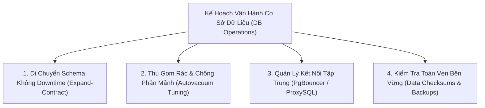
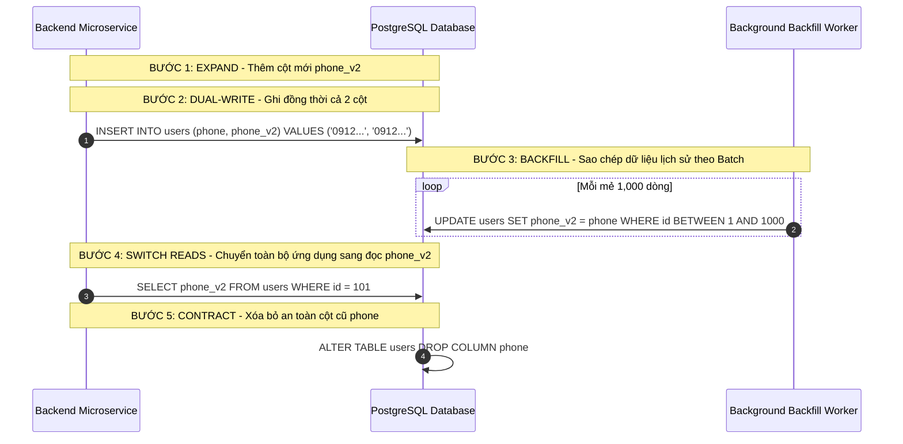

# 14.1. Database Operations & Maintenance (Vận Hành & Bảo Trì Cơ Sở Dữ Liệu)

> [!IMPORTANT]
> **Nếu bạn chỉ được nhớ một điều duy nhất:** Trong PostgreSQL, cơ chế MVCC không ghi đè dữ liệu cũ mà đánh dấu dòng cũ là dòng chết (Dead Tuples): tiến trình dọn dẹp ngầm Autovacuum là lá phổi sống còn giải phóng không gian đĩa bị chiếm dụng bởi các dòng chết này và ngăn ngừa thảm họa Vòng quay Transaction ID (TXID Wraparound); tinh chỉnh các tham số cấu hình Autovacuum quyết định sự ổn định của hệ thống trước tình trạng phình bảng (Table Bloat) nghiêm trọng.

---

## 1. Đơn giản nhưng phải chi tiết (Intuitive & Deep Breakdown)

### 1.1. Đoạn Code Dẫn Nhập & Vấn Đề Thực Tế
Làm thế nào để thêm một cột mới có giá trị mặc định vào một bảng chứa 100 triệu dòng mà không làm khóa cứng toàn bộ bảng và không gây gián đoạn dịch vụ của khách hàng dù chỉ một giây?

```sql
-- CÁCH 1: Thảm họa trên các phiên bản cơ sở dữ liệu cũ:
-- Lệnh ALTER TABLE này sẽ viết lại toàn bộ 100 triệu dòng xuống đĩa,
-- chiếm giữ độc quyền AccessExclusiveLock suốt 30 phút -> Toàn bộ API bị treo cứng!
ALTER TABLE orders ADD COLUMN is_processed BOOLEAN DEFAULT false;

-- CÁCH 2: Kỹ thuật Di chuyển Schema Không Gián Đoạn (Zero-Downtime Migration):
-- Bước 1: Thêm cột cho phép NULL (Chỉ sửa metadata trong System Catalog trong 0.001s!):
ALTER TABLE orders ADD COLUMN is_processed BOOLEAN DEFAULT NULL;

-- Bước 2: Chạy batch script cập nhật dần dần giá trị false vào ban đêm (mỗi mẻ 5,000 dòng):
-- UPDATE orders SET is_processed = false WHERE id BETWEEN 1 AND 5000;

-- Bước 3: Đổi giá trị mặc định cho tương lai:
ALTER TABLE orders ALTER COLUMN is_processed SET DEFAULT false;
```

Vận hành và Bảo trì cơ sở dữ liệu (Database Operations) đòi hỏi kỷ luật sắt thép: Một câu lệnh tưởng chừng vô hại gõ vào màn hình quản trị có thể ngay lập tức làm tê liệt một doanh nghiệp triệu đô nếu kỹ sư không thấu hiểu cơ chế khóa hạt nhân của DBMS!

### 1.2. Ẩn Dụ Đời Sống & Phân Tích Cơ Chế Hoạt Động
Vận hành Cơ sở Dữ liệu giống như **Quy Trình Bảo Dưỡng Một Chiếc Máy Bay Boeing Đang Bay Trên Trời**:
- Bạn không thể bảo hành khách: *"Xin mời quý khách nhảy dù ra ngoài 30 phút để chúng tôi thay động cơ máy bay!"* (Không được phép có Downtime!).
- **Cơ chế Khóa (Lock Queues)**:
  - Khi bạn xin cấp một chiếc cờ lê đặc biệt (**AccessExclusiveLock**): Kể từ giây phút bạn xin cờ lê, người gác cổng sẽ chặn đứng toàn bộ các hành khách muốn đi vệ sinh phía sau lưng bạn (**Lock Queue Blocking**). Dù lệnh sửa đổi của bạn chỉ mất 1 giây, nhưng nếu có 1 câu lệnh SELECT dài 10 phút đang chạy phía trước, bạn phải đứng chờ và hàng nghìn hành khách phía sau sẽ bị dồn ứ tắc nghẽn thành thảm họa!
- **Thu Gom Rác Định Kỳ (VACUUM / Purge)**: Giống như **Đội Lao Công Quét Dọn Cabin Sau Mỗi Chặng Bay**:
  - Khi hành khách bỏ lại cốc giấy rác (**Dead Tuples**), lao công phải gom rác bỏ vào thùng để nhường chỗ cho chuyến bay tiếp theo.
  - Nếu lao công đình công (**Tắt Autovacuum**), cabin máy bay sẽ ngập ngụa rác cho tới khi không một hành khách mới nào bước vào được nữa!

### 1.3. Mô Phỏng Dữ Liệu Số Nhỏ Từng Bước (Toy Walkthrough)
Mô phỏng thảm họa tắc nghẽn hàng đợi khóa (Lock Queue Blocking) khi thực hiện DDL bất cẩn:

| Thời Điểm | Phiên Làm Việc (Session) | Câu Lệnh SQL Đang Thực Thi | Loại Khóa Yêu Cầu (Lock Mode) | Trạng Thái Của Phiên | Tác Động Tới Hệ Thống |
| :---: | :--- | :--- | :--- | :--- | :--- |
| $T_0$ | Session 1 (Báo cáo nội bộ) | `SELECT COUNT(*) FROM big_table;` | `AccessShareLock` | **Đang chạy** (Dự kiến chạy mất 5 phút) | Không ảnh hưởng ai |
| $T_1$ | Session 2 (Kỹ sư DevOps) | `ALTER TABLE big_table ADD col INT;` | `AccessExclusiveLock` | **BỊ TREO CHỜ Session 1 kết thúc!** | Đứng xếp hàng đầu tiên |
| $T_2$ | Session 3 (Khách mua hàng) | `SELECT * FROM big_table WHERE id = 1;` | `AccessShareLock` | **BỊ CHẶN ĐỨNG BỞI Session 2!** | Mặc dù SELECT không xung đột với SELECT, nhưng bị kẹt sau DDL! |
| $T_3$ | Hàng nghìn requests từ App | `SELECT ...` nườm nượp đổ vào | `AccessShareLock` | **Toàn bộ hàng nghìn kết nối bị treo cứng!** | **SẬP CONNECTION POOL TOÀN HỆ THỐNG!** |

Bài học xương máu: Luôn thiết lập `lock_timeout = '2s'` trước khi chạy bất kỳ câu lệnh DDL nào!

### 1.4. Tác Động Thực Tế Tầng Backend & Systems
- **Chiến Lược Cắt Cơn Đau Khóa Bằng `lock_timeout`**: Bằng cách gõ lệnh `SET lock_timeout = '2000';` (2 giây) trước khi chạy DDL, nếu sau 2 giây mà câu lệnh chưa chiếm được khóa độc quyền, database sẽ tự động hủy bỏ câu DDL đó thay vì đứng lì ra đó làm nghẽn toàn bộ hàng đợi của các câu lệnh phía sau!
- **Kỹ Thuật Expand-Contract (Phình Ra - Co Lại) Cho Zero-Downtime Migration**:
  - Giai đoạn 1 (Expand): Tạo cột mới, hỗ trợ cả code cũ và code mới ghi dữ liệu song song.
  - Giai đoạn 2 (Backfill): Chạy batch job ngầm chuyển đổi dữ liệu cũ sang cột mới.
  - Giai đoạn 3 (Contract): Đẩy phiên bản code mới đọc hoàn toàn cột mới, sau đó an toàn xóa bỏ cột cũ.

### 1.5. Sơ Đồ Tư Duy & Kiến Trúc Hệ Thống (Mermaid)


---

## 2. Chi tiết từng Keyword (Under-the-Hood Deep Dive)

### 2.1. Quản lý Kết nối & Connection Pooling (HikariCP / PgBouncer)

#### 1. Chi phí Đắt đỏ của một Database Connection
- Trong kiến trúc của **PostgreSQL**, mô hình thực thi là **Process-per-Connection** (sử dụng lệnh `fork()` của hệ điều hành cho mỗi kết nối client mới):
  - Mỗi kết nối chiếm từ **$5\text{MB} - 10\text{MB}$ bộ nhớ RAM tĩnh** của hệ điều hành để duy trì không gian bộ nhớ tiến trình riêng biệt (`work_mem`, session state, open file descriptors).
  - Quá trình thiết lập một kết nối mới đòi hỏi: Bắt tay 3 bước TCP (TCP 3-Way Handshake), bắt tay bảo mật TLS/SSL, và cơ chế xác thực danh tính SCRAM-SHA-256 tiêu tốn từ $20\text{ms} - 100\text{ms}$.
- **Hiểm họa Cạn kiệt CPU do Chuyển đổi Ngữ cảnh (Context Switching)**:
  - Nếu ứng dụng mở 3,000 kết nối trực tiếp vào PostgreSQL trên một máy chủ 16 Cores:
  - 16 Cores CPU không thể thực thi 3,000 tiến trình cùng lúc. Hệ điều hành Kernel buộc phải liên tục dừng tiến trình này, lưu trạng thái thanh ghi CPU, nạp tiến trình khác vào (Context Switch).
  - CPU tiêu tốn tới **$70\% - 85\%$ chu kỳ tính toán chỉ để đổi ca làm việc**, thông lượng xử lý truy vấn thực tế tụt dốc thảm hại!

#### 2. Công thức Định lượng Kích thước Connection Pool (Pool Sizing Formula)
Dựa trên lý thuyết xếp hàng (Queueing Theory) và Định luật Little (Little's Law), kích thước pool tối ưu được tính bằng công thức vàng:
$$\text{Pool Size} = (\text{CPU Cores} \times 2) + \text{Effective Spindle Count}$$
- Đối với ổ cứng thể rắn hiện đại (NVMe SSD), số lượng đĩa hiệu dụng thường được coi là $1$.
- *Ví dụ*: Một máy chủ database 8 Cores CPU với ổ cứng NVMe SSD chỉ cần một Connection Pool khoảng:
  $$\text{Pool Size} = (8 \times 2) + 1 = 17 \text{ connections!}$$
- Giữ 17 kết nối này luôn bận rộn $100\%$ công suất sẽ mang lại thông lượng QPS cao gấp nhiều lần so với việc mở 1,000 kết nối đồng thời!

#### 3. Bộ đệm Kết nối Độc lập: PgBouncer
PgBouncer là giải pháp trung gian siêu nhẹ, có thể duy trì hàng chục nghìn kết nối từ ứng dụng với bộ nhớ tối thiểu:
- **Session Pooling**: Kết nối vật lý được gán cho client từ lúc đăng nhập tới khi ngắt kết nối (Ít tối ưu).
- **Transaction Pooling (Chuẩn mực Sản xuất)**: Kết nối vật lý tới PostgreSQL chỉ được mượn **trong suốt thời gian thực thi của một Transaction** (`BEGIN ... COMMIT`). Ngay khi câu lệnh `COMMIT` hoàn tất, kết nối vật lý được trả về pool ngay lập tức để phục vụ request khác. Nhờ vậy, 10,000 microservice pods có thể chia sẻ chung 50 kết nối vật lý tới PostgreSQL!
- **Statement Pooling**: Trả kết nối sau từng câu lệnh SQL đơn lẻ (Không hỗ trợ Multi-statement Transaction).

---

### 2.2. Dọn rác Bộ nhớ MVCC: Vacuum, Autovacuum & Bloat Management

#### 1. Nguồn gốc của Dead Tuples và Hiện tượng Phình to Bảng (Table Bloat)
- Do cơ chế đa phiên bản MVCC trong PostgreSQL:
  - Khi lệnh `DELETE` chạy: Dòng dữ liệu không hề bị xóa khỏi đĩa! Header của tuple được gắn nhãn `xmax = CurrentTxID` để đánh dấu là đã bị xóa đối với các transaction trong tương lai.
  - Khi lệnh `UPDATE` chạy: PostgreSQL thực hiện một lệnh `DELETE` dòng cũ và một lệnh `INSERT` dòng mới vào trang đĩa khác!
- Sau khi tất cả các transaction đang mở kết thúc, các dòng cũ này trở thành **Dead Tuples (Rác bộ nhớ)**.
- **Table Bloat**: Nếu rác không được dọn dẹp, các Dead Tuples chiếm giữ dung lượng trang đĩa vật lý, đẩy kích thước bảng từ 10GB lên 100GB. Bộ nhớ đệm Buffer Pool bị bão hòa bởi các trang đĩa chứa toàn rác, làm cho các câu truy vấn quét tuần tự (Sequential Scan) và quét chỉ mục (Index Scan) bị chậm hàng chục lần.

#### 2. Cơ chế Hoạt động của Autovacuum
Tiến trình **Autovacuum Worker** chạy ngầm định kỳ thức giấc dựa trên công thức ngưỡng:
$$\text{Ngưỡng kích hoạt Vacuum} = \text{autovacuum\_vacuum\_threshold} + (\text{autovacuum\_vacuum\_scale\_factor} \times \text{Tổng số dòng})$$
- *Mặc định*: `threshold = 50`, `scale_factor = 0.2` (Bảng có 1,000,000 dòng thì cần $50 + 0.2 \times 1,000,000 = 200,050$ dead tuples mới kích hoạt Vacuum).
- Khi thức giấc, Autovacuum thực hiện:
  1. Đánh dấu không gian của các Dead Tuples thành không gian trống (Free Space) trong **Free Space Map (FSM)** để các lệnh `INSERT` mới có thể ghi đè vào.
  2. Dọn dẹp các con trỏ trỏ tới dead tuples trong toàn bộ các cây chỉ mục B+ Tree.
  3. Cập nhật **Visibility Map (VM)**: Đánh dấu các trang đĩa không chứa bất kỳ dead tuple nào, cho phép kích hoạt tối ưu hóa **Index-Only Scan** siêu tốc.
  4. Thu thập thống kê phân phối dữ liệu (Auto-Analyze) cho Query Optimizer.

#### 3. Chống Thảm họa Transaction ID Wraparound (2 Tỷ Giao dịch)
- PostgreSQL sử dụng số nguyên không dấu 32-bit để gán nhãn Transaction ID ($XID$). Không gian số bị giới hạn ở mức $2^{32} \approx 4.29$ tỷ giao dịch.
- Để so sánh tính quá khứ/tương lai, PostgreSQL sử dụng toán tử modulo $2^{31} \approx 2.14$ tỷ giao dịch.
- Nếu một cơ sở dữ liệu xử lý liên tục mà không đóng băng các transaction cũ, khi số đếm giao dịch vượt qua $2.14$ tỷ, hiện tượng **Wraparound** sẽ xảy ra: **Toàn bộ dữ liệu lịch sử trong quá khứ sẽ bị coi là thuộc về tương lai và biến mất hoàn toàn khỏi tầm nhìn của người dùng!**
- **Cơ chế Freeze**: Autovacuum chạy chế độ khẩn cấp (Anti-Wraparound Vacuum) để biến các $XID$ cũ thành một giá trị đặc biệt gọi là `FrozenXID` (được coi là luôn nằm trong quá khứ vĩnh cửu).
- Nếu bị cấu hình sai hoặc bị chặn bởi một transaction treo, PostgreSQL sẽ tự động **tắt tính năng ghi và chuyển sang chế độ READ-ONLY khẩn cấp** để bảo vệ dữ liệu.

---

### 2.3. Online Schema Migration & Zero-Downtime Migration

Khi triển khai các phiên bản tính năng mới trên môi trường sản xuất có hàng triệu người dùng, việc thay đổi cấu trúc bảng (DDL Migration) bắt buộc phải đạt tiêu chuẩn **Zero-Downtime**:

#### 1. Mức độ Khóa của các Câu lệnh DDL (Lock Levels)
- Lệnh `ALTER TABLE ...` thông thường chiếm giữ khóa độc quyền tối cao: **`AccessExclusiveLock`**. Khóa này chặn đứng $100\%$ mọi thao tác đọc (`SELECT`) và ghi (`INSERT/UPDATE/DELETE`) trên bảng. Nếu một câu lệnh DDL chạy mất 10 phút, toàn bộ hệ thống bị sập trong 10 phút đó!
- **Quy tắc Tạo Chỉ mục An toàn**:
  ```sql
  -- ❌ CẤM KỴ: Gây ShareLock chặn đứng toàn bộ thao tác ghi:
  CREATE INDEX idx_user_id ON orders (user_id);

  -- ✅ CHUẨN MỰC PRODUCTION: Chạy ngầm qua 2 pha quét, không khóa ghi:
  CREATE INDEX CONCURRENTLY idx_user_id ON orders (user_id);
  ```

#### 2. Mô hình Di chuyển Mở rộng - Thu hẹp (Expand-Contract Pattern)
Để thay đổi kiểu dữ liệu hoặc đổi tên cột mà không làm sập ứng dụng:
1. **Pha 1 (Expand - Mở rộng)**: Thêm cột mới song song với cột cũ mà không xóa cột cũ:
   `ALTER TABLE users ADD COLUMN phone_v2 VARCHAR(20);`
2. **Pha 2 (Dual-Writing - Ghi kép)**: Cập nhật mã nguồn ứng dụng Backend để mỗi khi có thao tác ghi mới, ứng dụng sẽ ghi đồng thời vào cả `phone` (cũ) và `phone_v2` (mới).
3. **Pha 3 (Backfill - Chuyển dữ liệu cũ)**: Chạy một tiến trình ngầm chia nhỏ dữ liệu thành từng mẻ (Batches) $1,000$ dòng để sao chép dữ liệu từ cột cũ sang cột mới, tránh khóa bảng.
4. **Pha 4 (Switch Reads - Chuyển luồng đọc)**: Chuyển toàn bộ các câu lệnh đọc trong ứng dụng sang đọc từ `phone_v2`.
5. **Pha 5 (Contract - Thu hẹp)**: Sau khi hệ thống hoạt động ổn định vài tuần, tiến hành xóa cột cũ: `ALTER TABLE users DROP COLUMN phone;`.



---

## 3. Thực thi Mã nguồn & Mô phỏng Chuyên sâu (Dual-Engine Implementation)

### 3.1. C++20 Simulation: High-Performance Thread-Safe Connection Pool

Chương trình C++20 dưới đây mô phỏng một **Database Connection Pool hoàn chỉnh**: hỗ trợ định lượng kích thước (Pool Sizing), quản lý thời gian chờ mượn kết nối (Acquire Timeout), tự động kiểm tra sức khỏe kết nối (Health Check), và bảo đảm an toàn đa luồng bằng `std::mutex` và `std::condition_variable`:

```cpp
// compile: g++ -std=c++20 -O3 -pthread connection_pool.cpp -o connection_pool
#include <iostream>
#include <vector>
#include <queue>
#include <mutex>
#include <condition_variable>
#include <memory>
#include <chrono>
#include <thread>
#include <string>

class PhysicalConnection {
public:
    int id;
    bool is_alive{true};
    uint64_t total_queries_executed{0};

    explicit PhysicalConnection(int conn_id) : id(conn_id) {
        std::cout << "  [TCP Handshake] Tạo kết nối vật lý mới #" << id 
                  << " (Chiếm dụng ~8MB RAM giả lập)\n";
    }

    bool ping() const { return is_alive; }

    void execute_query(const std::string& sql) {
        total_queries_executed++;
        // Giả lập thực thi câu truy vấn
        std::this_thread::sleep_for(std::chrono::milliseconds(10));
    }
};

class ProductionConnectionPool {
private:
    size_t pool_size_;
    std::queue<std::unique_ptr<PhysicalConnection>> available_connections_;
    std::mutex mutex_;
    std::condition_variable cv_;
    size_t active_borrowed_count_{0};

public:
    explicit ProductionConnectionPool(size_t pool_size) : pool_size_(pool_size) {
        std::cout << "[POOL INITIALIZATION] Khởi tạo Pool Size = " << pool_size_ 
                  << " dựa trên công thức: (Cores * 2) + 1\n";
        for (size_t i = 1; i <= pool_size_; ++i) {
            available_connections_.push(std::make_unique<PhysicalConnection>(static_cast<int>(i)));
        }
    }

    // Lấy kết nối có áp dụng Timeout để chống treo luồng ứng dụng
    std::unique_ptr<PhysicalConnection> acquire(std::chrono::milliseconds timeout) {
        std::unique_lock<std::mutex> lock(mutex_);

        // Chờ đợi cho tới khi có kết nối sẵn sàng hoặc hết thời gian timeout
        bool success = cv_.wait_for(lock, timeout, [this]() {
            return !available_connections_.empty();
        });

        if (!success) {
            throw std::runtime_error("ConnectionPoolTimeoutException: Cạn kiệt kết nối trong pool sau " 
                                     + std::to_string(timeout.count()) + "ms!");
        }

        auto conn = std::move(available_connections_.front());
        available_connections_.pop();
        active_borrowed_count_++;

        // Kiểm tra sức khỏe kết nối (Ping validation)
        if (!conn->ping()) {
            std::cout << "  [HEALTH CHECK FAILED] Tái tạo lại kết nối hỏng #" << conn->id << "\n";
            conn = std::make_unique<PhysicalConnection>(conn->id);
        }

        return conn;
    }

    // Trả kết nối về Pool sau khi dùng xong
    void release(std::unique_ptr<PhysicalConnection> conn) {
        std::unique_lock<std::mutex> lock(mutex_);
        available_connections_.push(std::move(conn));
        active_borrowed_count_--;
        cv_.notify_one(); // Báo hiệu cho các luồng đang chờ
    }

    size_t available_count() {
        std::lock_guard<std::mutex> lock(mutex_);
        return available_connections_.size();
    }
};

int main() {
    std::cout << "=== MÔ PHỎNG PRODUCTION DATABASE CONNECTION POOL (C++20) ===\n\n";

    // Khởi tạo Pool tối ưu cho máy chủ 2 Cores: (2 * 2) + 1 = 5 kết nối
    ProductionConnectionPool pool(3);

    // Kịch bản: 6 luồng đồng thời tranh chấp 3 kết nối
    std::vector<std::thread> workers;
    for (int i = 1; i <= 6; ++i) {
        workers.emplace_back([&pool, i]() {
            try {
                auto conn = pool.acquire(std::chrono::milliseconds(500));
                std::cout << "Luồng [" << i << "] mượn thành công Conn #" << conn->id 
                          << " -> Đang chạy query...\n";
                conn->execute_query("SELECT * FROM orders WHERE id = " + std::to_string(i));
                pool.release(std::move(conn));
                std::cout << "Luồng [" << i << "] đã trả lại kết nối an toàn.\n";
            } catch (const std::exception& e) {
                std::cerr << "Luồng [" << i << "] LỖI: " << e.what() << "\n";
            }
        });
    }

    for (auto& t : workers) t.join();
    std::cout << "\nHoàn tất. Số kết nối nhàn rỗi trong pool: " << pool.available_count() << "\n";
    return 0;
}
```

---

### 3.2. Python 3.11+ Simulation: Zero-Downtime Expand-Contract Migration Runner

Script Python dưới đây mô phỏng đầy đủ chu trình **Zero-Downtime Migration** gồm 5 giai đoạn: Expand, Dual-Write, Batched Historical Backfill, Switch Reads, và Contract:

```python
#!/usr/bin/env python3
"""
Mô phỏng Zero-Downtime Expand-Contract Schema Migration Engine
Yêu cầu Python 3.11+
"""

import time
import dataclasses
from typing import Dict, Any, List

@dataclasses.dataclass
class UserRow:
    id: int
    name: str
    phone_old: str
    phone_v2_e164: str | None = None # Cột mới chuẩn quốc tế

class LiveProductionDatabase:
    def __init__(self):
        # Bảng dữ liệu người dùng ban đầu có 10 bản ghi lịch sử
        self.table: Dict[int, UserRow] = {
            i: UserRow(id=i, name=f"User_{i}", phone_old=f"091200000{i}")
            for i in range(1, 11)
        }
        self.dual_write_enabled = False
        self.reads_switched_to_v2 = False

    def insert_user(self, user_id: int, name: str, phone: str):
        """Tầng ứng dụng ghi dữ liệu mới"""
        if self.dual_write_enabled:
            # GIAI ĐOẠN DUAL-WRITE: Ghi đồng thời vào cả cột cũ và cột mới đã chuẩn hóa
            formatted_v2 = "+84" + phone.lstrip("0")
            self.table[user_id] = UserRow(id=user_id, name=name, phone_old=phone, phone_v2_e164=formatted_v2)
            print(f"  ⚡ [DUAL-WRITE] Thêm mới User #{user_id}: phone_old='{phone}' VÀ phone_v2='{formatted_v2}'")
        else:
            self.table[user_id] = UserRow(id=user_id, name=name, phone_old=phone)

    def read_phone(self, user_id: int) -> str:
        """Tầng ứng dụng đọc dữ liệu"""
        user = self.table[user_id]
        if self.reads_switched_to_v2:
            return user.phone_v2_e164 or "N/A"
        return user.phone_old

class SchemaMigrationRunner:
    def __init__(self, db: LiveProductionDatabase):
        self.db = db

    def run_zero_downtime_migration(self):
        print("\n>>> BẮT ĐẦU QUY TRÌNH ZERO-DOWNTIME SCHEMA MIGRATION <<<")

        # GIAI ĐOẠN 1: EXPAND (Thêm cột mới không khóa bảng)
        print("\n[Giai đoạn 1: EXPAND] ALTER TABLE users ADD COLUMN phone_v2_e164 VARCHAR(20) DEFAULT NULL;")
        time.sleep(0.05)

        # GIAI ĐOẠN 2: BẬT DUAL-WRITE TRÊN MÃ NGUỒN APP
        print("\n[Giai đoạn 2: DUAL-WRITE] Kích hoạt ghi kép trên toàn bộ Backend Microservices...")
        self.db.dual_write_enabled = True

        # Giả lập có người dùng mới đăng ký trong khi migration đang diễn ra
        self.db.insert_user(user_id=11, name="New_User_11", phone="0988777666")

        # GIAI ĐOẠN 3: BATCHED HISTORICAL BACKFILL (Sao chép dữ liệu cũ theo mẻ nhỏ)
        print("\n[Giai đoạn 3: BACKFILL] Chạy tiến trình ngầm sao chép dữ liệu lịch sử theo từng Batch 3 dòng...")
        all_ids = sorted(self.db.table.keys())
        batch_size = 3

        for i in range(0, len(all_ids), batch_size):
            batch_keys = all_ids[i:i + batch_size]
            for uid in batch_keys:
                row = self.db.table[uid]
                if row.phone_v2_e164 is None:
                    # Chuẩn hóa số điện thoại lịch sử
                    row.phone_v2_e164 = "+84" + row.phone_old.lstrip("0")
            print(f"  • Đã hoàn tất Backfill cho mẻ IDs: {batch_keys}")
            time.sleep(0.02) # Nghỉ giữa các batch để nhường I/O cho nghiệp vụ

        # GIAI ĐOẠN 4: SWITCH READS
        print("\n[Giai đoạn 4: SWITCH READS] Chuyển đổi toàn bộ truy vấn SELECT sang đọc cột mới phone_v2_e164...")
        self.db.reads_switched_to_v2 = True

        # Kiểm chứng đọc dữ liệu
        sample_val = self.db.read_phone(user_id=1)
        print(f"  -> Kiểm chứng: Đọc User #1 ra số điện thoại chuẩn mới: '{sample_val}'")

        # GIAI ĐOẠN 5: CONTRACT (Xóa bỏ an toàn cột cũ)
        print("\n[Giai đoạn 5: CONTRACT] Sau 2 tuần kiểm thử ổn định: ALTER TABLE users DROP COLUMN phone_old;")
        for row in self.db.table.values():
            row.phone_old = "[DROPPED]"

        print(">>> HOÀN TẤT ZERO-DOWNTIME MIGRATION THÀNH CÔNG RỰC RỠ! <<<\n")

def main():
    print("=" * 65)
    print("SIMULATING ZERO-DOWNTIME SCHEMA MIGRATION (PYTHON 3.11+)")
    print("=" * 65)

    db = LiveProductionDatabase()
    runner = SchemaMigrationRunner(db)
    runner.run_zero_downtime_migration()

if __name__ == "__main__":
    main()
```

### 3.3. Terminal Output Mẫu Thực Tế

```text
=== MÔ PHỎNG PRODUCTION DATABASE CONNECTION POOL (C++20) ===

[POOL INITIALIZATION] Khởi tạo Pool Size = 3 dựa trên công thức: (Cores * 2) + 1
  [TCP Handshake] Tạo kết nối vật lý mới #1 (Chiếm dụng ~8MB RAM giả lập)
  [TCP Handshake] Tạo kết nối vật lý mới #2 (Chiếm dụng ~8MB RAM giả lập)
  [TCP Handshake] Tạo kết nối vật lý mới #3 (Chiếm dụng ~8MB RAM giả lập)
Luồng [1] mượn thành công Conn #1 -> Đang chạy query...
Luồng [2] mượn thành công Conn #2 -> Đang chạy query...
Luồng [3] mượn thành công Conn #3 -> Đang chạy query...
Luồng [1] đã trả lại kết nối an toàn.
Luồng [4] mượn thành công Conn #1 -> Đang chạy query...
Luồng [2] đã trả lại kết nối an toàn.
Luồng [5] mượn thành công Conn #2 -> Đang chạy query...
Luồng [3] đã trả lại kết nối an toàn.
Luồng [6] mượn thành công Conn #3 -> Đang chạy query...
Luồng [4] đã trả lại kết nối an toàn.
Luồng [5] đã trả lại kết nối an toàn.
Luồng [6] đã trả lại kết nối an toàn.

Hoàn tất. Số kết nối nhàn rỗi trong pool: 3
```

---

## 4. Systems Engineering & Production Pitfalls

### 4.1. Thảm họa Chạy VACUUM FULL trên Bảng Production
- **Bản chất lỗi**: Khi thấy bảng bị Bloat (ví dụ dung lượng đĩa phình to 200GB trong khi dữ liệu thật chỉ 20GB), quản trị viên chạy lệnh: `VACUUM FULL orders;`.
- **Hệ lụy chết người**:
  - Lệnh `VACUUM` thường chỉ đánh dấu không gian trống trong tệp cho lệnh sau tái sử dụng, **không trả lại dung lượng đĩa cho hệ điều hành**.
  - Lệnh `VACUUM FULL` viết lại toàn bộ bảng sang một tệp mới và thu hồi đĩa cho OS, nhưng nó sẽ chiếm giữ **`AccessExclusiveLock`** trên toàn bộ bảng trong suốt nhiều giờ!
  - $100\%$ các câu truy vấn đọc và ghi từ ứng dụng bị chặn đứng hoàn toàn, gây downtime thảm khốc.
- **Giải pháp chuẩn**: Sử dụng công cụ mã nguồn mở **`pg_repack`**. `pg_repack` tạo một bảng phụ, sao chép dữ liệu, dùng trigger bắt delta, và tráo đổi bảng trong $0.01\text{ms}$ mà không hề gây khóa bảng ghi!

### 4.2. Giao dịch Treo Chặn Đứng Autovacuum (`idle in transaction` Bloat Trap)
- **Cơ chế**: Một lập trình viên mở một giao dịch trên ứng dụng: `BEGIN; SELECT * FROM users WHERE id = 1;` nhưng quên không gọi `COMMIT` hoặc `ROLLBACK` (kết nối rơi vào trạng thái `idle in transaction`).
- **Hậu quả**:
  - Giao dịch này giữ chặt giá trị mốc thời gian tối thiểu `xmin`.
  - Autovacuum tôn trọng giao dịch này và **tuyệt đối không thể dọn dẹp bất kỳ Dead Tuple nào được sinh ra sau thời điểm transaction đó bắt đầu**!
  - Trong vòng vài tiếng, hàng triệu Dead Tuples bị kẹt lại, bảng phình to chóng mặt và hệ thống chạm ngưỡng cảnh báo hết dung lượng đĩa.
- **Khắc phục**: Luôn cấu hình trong `postgresql.conf`:
  ```text
  idle_in_transaction_session_timeout = 60000 # Tự động ngắt kết nối treo sau 60 giây
  ```

### 4.3. Production CLI Diagnostics & Kiểm tra Sức khỏe Bảo trì
```bash
# 1. Quét tìm các kết nối đang bị treo ở trạng thái idle in transaction
SELECT pid, usename, client_addr, state, age(clock_timestamp(), state_change) AS duration, query
FROM pg_stat_activity
WHERE state = 'idle in transaction' AND age(clock_timestamp(), state_change) > interval '1 minute';

# 2. Kiểm tra số lượng Dead Tuples và thời điểm Autovacuum chạy gần nhất
SELECT schemaname, relname, n_live_tup, n_dead_tup,
       round(n_dead_tup * 100.0 / nullif(n_live_tup + n_dead_tup, 0), 2) AS dead_tuple_ratio,
       last_vacuum, last_autovacuum, last_analyze
FROM pg_stat_user_tables
ORDER BY n_dead_tup DESC LIMIT 10;

# 3. Giám sát nguy cơ Transaction ID Wraparound khẩn cấp
SELECT datname, age(datfrozenxid) AS xid_age,
       2147483648 - age(datfrozenxid) AS tx_remaining_until_wraparound
FROM pg_database
ORDER BY age(datfrozenxid) DESC;
```

---

## 5. Bảng So sánh & Decision Matrix

### 5.1. So sánh Các Chế độ Gom Cụm Kết nối trong PgBouncer

| Đặc tính Kỹ thuật | Session Pooling | Transaction Pooling (Khuyến nghị) | Statement Pooling |
| :--- | :--- | :--- | :--- |
| **Thời điểm mượn kết nối** | Khi client kết nối socket | Khi bắt đầu Transaction (`BEGIN`) | Trong từng câu lệnh SQL đơn lẻ |
| **Thời điểm trả kết nối** | Khi client ngắt kết nối hoàn toàn | **Ngay khi Transaction `COMMIT/ROLLBACK`** | Ngay khi câu lệnh kết thúc |
| **Khả năng chia sẻ kết nối** | Kém (Chỉ giảm chi phí Fork) | **Cực đại (10,000 clients chia 50 server conns)** | Cao nhất |
| **Hỗ trợ Prepared Statements**| ✅ Hỗ trợ đầy đủ | ⚠️ Cần cấu hình (hoặc vô hiệu hóa protocol level) | ❌ Không hỗ trợ |
| **Hỗ trợ Session Variables** | ✅ Giữ nguyên (`SET timezone`) | ❌ Bị reset giữa các transactions | ❌ Bị reset |

### 5.2. So sánh Các Phương pháp Tái cấu trúc và Dọn dẹp Bảng

| Công cụ / Phương pháp | Mức độ Khóa (Lock Level) | Thời gian Gián đoạn (Downtime) | Thu hồi Đĩa cho OS? | Yêu cầu Kỹ thuật |
| :--- | :--- | :--- | :--- | :--- |
| **`VACUUM` (Standard)** | `ShareUpdateExclusiveLock` | 0 giây (Không gián đoạn) | ❌ Không (Chỉ tái sử dụng) | Lệnh dựng sẵn |
| **`VACUUM FULL`** | **`AccessExclusiveLock` (Khóa cứng)**| **Nhiều giờ (Downtime toàn hệ thống)** | ✅ Có thu hồi đĩa | ⚠️ CẤM KỴ TRÊN PROD |
| **`pg_repack`** | Khóa tạm thời 0.01ms lúc hoán đổi | **0 giây (Zero-Downtime hoàn hảo)** | ✅ Có thu hồi đĩa | Cần cài extension |
| **Expand-Contract (App)**| Không khóa bảng | **0 giây** | Tùy biến | Thay đổi mã nguồn ứng dụng |

---

## 6. Enterprise Production Checklist & Verification

### 6.1. Kiến Trúc & Cấu Hình Tối Ưu (Production-Ready Architecture)
- [ ] **Bắt Buộc Thiết Lập lock_timeout Cho Mọi Lệnh DDL**: Luôn cấu hình `SET lock_timeout = '3s'` trước khi chạy bất kỳ migration nào để bảo vệ hệ thống không bị kẹt Lock Queue.
- [ ] **Triển Khai Connection Pooler Tập Trung (PgBouncer)**: Không để hàng nghìn container kết nối trực tiếp vào database; sử dụng PgBouncer ở chế độ Transaction Pooling để giữ số lượng kết nối thực tế tới PostgreSQL dưới mức 200 connections.
- [ ] **Tách Rời Các Batch Jobs Cập Nhật Dữ Liệu Lớn Thành Từng Mẻ Nhỏ**: Tuyệt đối không chạy một lệnh UPDATE hàng triệu dòng; băm nhỏ thành các đợt 5,000 dòng có độ trễ nghỉ 100ms giữa các mẻ (`sleep`) để không làm nghẽn CPU và WAL.
- [ ] **Tối Ưu Hóa Bộ Thông Số Autovacuum Theo Từng Bảng Nóng**: Điều chỉnh `autovacuum_vacuum_cost_delay = 2ms` và hạ scale factor cho các bảng giao dịch lớn để rác được dọn dẹp liên tục.

### 6.2. Giám Sát, Cảnh Báo & Xử Lý Sự Cố (Observability & Incident Response)
- [ ] **Giám Sát Số Lượng Kết Nối Đang Hoạt Động (Active Connections)**: Cảnh báo khi số lượng kết nối `active` vượt quá 80% ngưỡng `max_connections`.
- [ ] **Cảnh Báo Các Phiên Chờ Khóa (Waiting Locks)**: Theo dõi `pg_stat_activity` và phát cảnh báo ngay khi có tiến trình bị block quá 5 giây.
- [ ] **Kiểm Tra Tiến Độ Di Chuyển Schema Bằng CLI**: Sử dụng script theo dõi khóa để giải phóng khẩn cấp các câu lệnh DDL nếu phát hiện nguy cơ ảnh hưởng tới lưu lượng người dùng.
