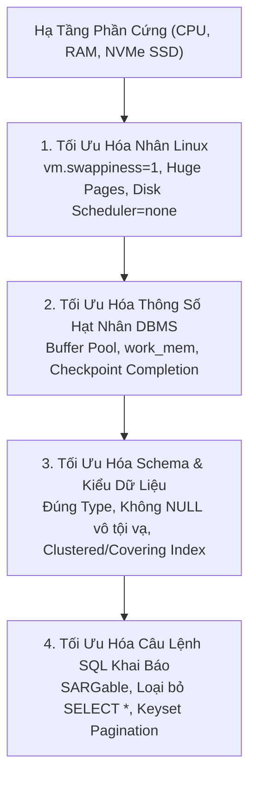

# 14.2. Performance Engineering (Kỹ Thuật Tối Ưu Hiệu Năng Cơ Sở Dữ Liệu)

> [!IMPORTANT]
> **Nếu bạn chỉ được nhớ một điều duy nhất:** Mỗi kết nối mới mở tới CSDL tiêu tốn hàng Megabyte RAM và một tiến trình/luồng hệ điều hành riêng biệt: sử dụng Bộ quản lý hồ bơi kết nối (Connection Pooler như PgBouncer hoặc HikariCP) là yêu cầu bắt buộc để giới hạn số lượng kết nối vật lý thực tế về mức tối ưu cho CPU Cores, tránh thảm họa cạn kiệt tài nguyên máy chủ và nghẽn hàng đợi kết nối khi lưu lượng truy vấn đột biến.

---

## 1. Đơn giản nhưng phải chi tiết (Intuitive & Deep Breakdown)

### 1.1. Đoạn Code Dẫn Nhập & Vấn Đề Thực Tế
Làm thế nào để điều chỉnh một máy chủ cơ sở dữ liệu từ cấu hình mặc định (vốn chỉ sử dụng vỏn vẹn 128MB RAM để có thể chạy trên chiếc máy tính để bàn cũ kỹ) thành một cỗ máy chiến mã khai thác triệt để 128GB RAM và 32 CPU Cores của máy chủ chuyên dụng?

```ini
# Trích xuất file cấu hình tối ưu hóa hiệu năng chuyên sâu cho PostgreSQL (128GB RAM Server)
# 1. Bộ nhớ đệm chia sẻ (Buffer Pool):
shared_buffers = 32GB                  # Chiếm 25% tổng dung lượng RAM vật lý
effective_cache_size = 96GB            # Ước lượng cả Buffer Pool lẫn Linux Page Cache

# 2. Bộ nhớ dành cho các phép toán sắp xếp và băm (Mỗi toán tử trong query):
work_mem = 64MB                        # Đảm bảo Sort và Hash Join không tràn đĩa
maintenance_work_mem = 2GB             # Tăng tốc độ tạo Index và Vacuum

# 3. Tối ưu hóa I/O cho ổ cứng NVMe SSD hiện đại:
random_page_cost = 1.1                 # Tương đương giá trị đọc tuần tự (SSD không có độ trễ cơ học)
effective_io_concurrency = 200         # Cho phép kernel phát hành hàng trăm lệnh đọc đĩa bất đồng bộ
```

Nếu một doanh nghiệp mua chiếc máy chủ đắt tiền hàng chục nghìn USD nhưng vẫn giữ nguyên cấu hình mặc định của hệ quản trị cơ sở dữ liệu, 95% tài nguyên phần cứng sẽ bị bỏ hoang và database sẽ chạy chậm không khác gì một chiếc máy tính xách tay văn phòng!

### 1.2. Ẩn Dụ Đời Sống & Phân Tích Cơ Chế Hoạt Động
Kỹ thuật Tối ưu Hóa Hiệu Năng Cơ Sở Dữ Liệu giống như **Độ Xe Đua Công Thức 1 (Formula 1)**:
- Một chiếc xe ô tô nguyên bản xuất xưởng được thiết kế để đi chợ an toàn trên đường làng (Cấu hình mặc định của DBMS).
- Khi đưa chiếc xe lên đường đua tốc độ cao:
  - **Mở Rộng Thùng Chứa Xăng Siêu Cấp (Buffer Pool / `shared_buffers`)**: Chứa sẵn tối đa nhiên liệu để không phải tốn thời gian dừng lại trạm tiếp tế (**Tránh Disk I/O**).
  - **Thay Lốp Đua Chuyên Dụng Cho Đường Nhựa Phẳng (SSD Tuning / `random_page_cost = 1.1`)**: Nhận thức rõ mặt đường đua nhẵn thín (SSD không có đầu đọc cơ học), chiếc xe có thể ôm cua đánh võng bất kỳ vị trí nào mà không bị giảm tốc độ (**Đọc ngẫu nhiên nhanh ngang đọc tuần tự**).
  - **Ống Xả Công Suất Lớn (WAL & Checkpoint Smoothing)**: Khí thải được xả đều đặn ra môi trường chứ không bị dồn ứ lại gây nổ động cơ (**Xóa bỏ hoàn toàn I/O Spikes**).

### 1.3. Mô Phỏng Dữ Liệu Số Nhỏ Từng Bước (Toy Walkthrough)
Mô phỏng tác động của việc tinh chỉnh `work_mem` lên thuật toán sắp xếp (Sort Operator) cho một tập dữ liệu 500,000 dòng:

Kích thước dữ liệu cần sắp xếp trong RAM: **$45\text{ MB}$**.

| Cấu Hình `work_mem` | Phương Thức Sắp Xếp Của Engine | Nơi Diễn Ra Thao Tác | Khối Lượng I/O Đĩa Phát Sinh | Thời Gian Thực Thi |
| :--- | :--- | :--- | :---: | :---: |
| **Mặc Định: `4MB`** | **`external merge Disk`** | **Ổ Cứng SSD** (Bị chia thành 12 file tạm) | **Ghi $90\text{ MB}$ & Đọc lại $90\text{ MB}$** | **$1,250\text{ ms}$ (Cực chậm!)** |
| **Đã Tinh Chỉnh: `64MB`** | **`quicksort (In-Memory)`** | **Bộ Nhớ RAM 100%** | **$0\text{ bytes}$ (Zero Disk I/O)** | **$45\text{ ms}$ (Nhanh gấp 28 lần!)** |

Chỉ một dòng thay đổi cấu hình giúp triệt tiêu hoàn toàn hàng trăm Megabytes I/O đĩa và tăng tốc độ truy vấn lên gần 30 lần!

### 1.4. Tác Động Thực Tế Tầng Backend & Systems
- **Quy Tắc Tính Toán Kích Thước `work_mem` An Toàn**: Lưu ý rằng `work_mem` được cấp phát **cho mỗi toán tử sắp xếp / băm trong mỗi câu truy vấn**, chứ không phải cho mỗi kết nối! Nếu một câu lệnh phức tạp có 4 phép Join và 1 phép Sort, nó có thể tiêu tốn $5 \times \text{work\_mem}$. Nếu có 100 kết nối cùng chạy, tổng RAM tiêu thụ là $100 \times 5 \times 64\text{MB} = 32\text{GB}$. Đặt `work_mem` quá lớn có thể dẫn tới việc máy chủ bị Linux OOM Killer tiêu diệt khẩn cấp!
- **Hệ Điều Hành Linux Kernel Virtual Memory Tuning**:
  - `vm.swappiness = 1` (hoặc 10): Hạn chế tối đa việc hệ điều hành đẩy các trang nhớ của database sang ổ đĩa swap.
  - `vm.overcommit_memory = 2`: Ngăn chặn Linux cấp phát vượt mức RAM ảo, bảo vệ database khỏi bị crash đột ngột.

### 1.5. Sơ Đồ Tư Duy & Kiến Trúc Hệ Thống (Mermaid)


---

## 2. Chi tiết từng Keyword (Under-the-Hood Deep Dive)

### 2.1. Các Chỉ số Định lượng Hiệu năng Cốt lõi (Core Performance Metrics)

#### 1. Query Latency & Cạm bẫy của Giá trị Trung bình (Average Fallacy)
- **Sai lầm phổ biến**: Giám sát hệ thống bằng chỉ số độ trễ trung bình (`Mean / Average Latency`).
- **Bản chất**: Trong hệ thống phân tán, phân phối thời gian phản hồi tuân theo luật phân phối đuôi dài (Long-Tail Distribution). Một giá trị trung bình $5\text{ms}$ có thể che giấu sự thật rằng $1\%$ người dùng đang phải chịu đựng độ trễ lên tới $10,000\text{ms}$ ($10$ giây)!
- **Chuẩn mực Kỹ thuật**: Bắt buộc phải sử dụng các phân vị (Percentiles):
  - **P50 (Median)**: $50\%$ số yêu cầu hoàn thành nhanh hơn giá trị này (Trải nghiệm của người dùng phổ thông).
  - **P95 / P99**: $95\%$ hoặc $99\%$ số yêu cầu hoàn thành nhanh hơn giá trị này. Đây là chỉ số sống còn phản ánh độ ổn định của hệ thống dưới tải cao.
  - **P99.9**: Đại diện cho các trường hợp xấu nhất (Worst-case: chạm vào GC Pause, Lock Contention, hoặc Disk I/O Spill).

#### 2. Thông lượng: QPS vs TPS & Định luật Khả năng Mở rộng Phổ quát (USL)
- **QPS (Queries Per Second)**: Tổng số câu lệnh SQL (`SELECT`, `INSERT`, `UPDATE`) được engine tiếp nhận và xử lý mỗi giây.
- **TPS (Transactions Per Second)**: Số lượng giao dịch ACID hoàn chỉnh được `COMMIT` thành công mỗi giây. Một Transaction có thể bao gồm từ $5 - 10$ Queries.
- **Định luật Khả năng Mở rộng Phổ quát (Universal Scalability Law - Neil Gunther)**:
  $$C(N) = \frac{N}{1 + \sigma(N - 1) + \kappa N(N - 1)}$$
  Trong đó $N$ là số luồng đồng thời, $\sigma$ là hệ số tranh chấp tài nguyên (Contention), và $\kappa$ là hệ số trễ do thiếu đồng bộ dữ liệu (Coherency). Định luật chứng minh rằng: Khi tăng số lượng kết nối hoặc CPU vượt quá một ngưỡng tới hạn, **thông lượng hệ thống không những không tăng mà sẽ bị sụt giảm nghiêm trọng (Retrograde Behavior)**!

#### 3. Bão hòa Đĩa I/O (Disk Saturation) & Tỷ lệ Trúng Cache (Buffer Hit Ratio)
- **Disk Utilization (`%util` trong `iostat`)**:
  - Dựa trên Lý thuyết Hàng đợi $M/M/1$: Khi độ bão hòa đĩa vượt quá $80\%$, độ dài hàng đợi đĩa (Disk Queue Depth) tăng theo hàm số mũ, khiến độ trễ truy vấn tăng vọt từ $1\text{ms}$ lên $500\text{ms}$.
- **Buffer Pool Hit Ratio (Tỷ lệ Trúng Bộ nhớ đệm)**:
  $$\text{Hit Ratio} = \frac{\text{Shared Buffer Hits}}{\text{Shared Buffer Hits} + \text{Disk Physical Reads}} \times 100\%$$
  - **Chuẩn mực OLTP**: Tỷ lệ này bắt buộc phải đạt **$> 99\%$**.
  - Nếu tỷ lệ tụt xuống $< 95\%$, nghĩa là hệ thống đang phải liên tục đọc từ ổ đĩa vật lý do RAM bị thiếu, hoặc có câu truy vấn Full Table Scan quét sạch các trang đĩa nóng ra khỏi bộ nhớ (Buffer Pool Pollution).

---

### 2.2. Thảm họa N+1 Query Problem & Giải pháp Khắc phục

#### 1. Cơ chế Phát sinh từ Tầng ORM (Lazy Loading Mechanism)
Lỗ hổng N+1 là cạm bẫy thiết kế phổ biến nhất trong các ứng dụng sử dụng Hibernate, Prisma, TypeORM, hoặc ActiveRecord:
```typescript
// ĐOẠN CODE PHÁT SINH N+1 TRUY VẤN:
const users = await prisma.user.findMany({ take: 100 }); // Query 1: Lấy 100 users
for (const user of users) {
    // Với mỗi user, ORM âm thầm bắn 1 câu query mạng độc lập xuống DB:
    const orders = await prisma.order.findMany({ where: { userId: user.id } }); // N queries!
}
```
- **Hậu quả**:
  - Hệ thống tiêu tốn $1 + 100 = 101$ lượt trao đổi mạng (Network Round-Trips).
  - Nếu độ trễ mạng giữa App Server và Database là $1\text{ms}$, chỉ riêng thời gian di chuyển gói tin trên dây mạng đã tốn mất $101\text{ms}$, chưa kể thời gian CPU database phân tích cú pháp 101 lần!

#### 2. Ba Chiến lược Triệt tiêu N+1 Query
1. **Eager Loading bằng JOIN (`LEFT JOIN`)**:
   - Yêu cầu Database Engine thực hiện phép kết hợp bảng ngay trong câu truy vấn đầu tiên:
     ```sql
     SELECT u.id, u.name, o.id AS order_id, o.total_amount 
     FROM users u 
     LEFT JOIN orders o ON u.id = o.user_id 
     WHERE u.id IN (SELECT id FROM users LIMIT 100);
     ```
   - **Ưu điểm**: Chỉ mất đúng **1 network round-trip**.
   - **Nhược điểm**: Bị nhân bản dữ liệu người dùng trên đường truyền mạng (Cartesian Product nếu một user có nhiều orders).
2. **Batch Loading bằng Mệnh đề `IN` (Hai chặng Truy vấn)**:
   - Chặng 1: `SELECT * FROM users LIMIT 100;`
   - Gom 100 `id` lại: `[1, 2, 3, ..., 100]`
   - Chặng 2: `SELECT * FROM orders WHERE user_id = ANY($1::int[]);`
   - **Ưu điểm**: Chỉ mất **2 round-trips**, không bị nhân bản dữ liệu, tận dụng tối đa Index Scan trên `orders(user_id)`.
3. **Dataloader Pattern (Gom mẻ theo Tick của Event Loop)**:
   - Được phát minh bởi Facebook (sử dụng phổ biến trong GraphQL và Node.js).
   - Cơ chế: Thu thập tất cả các yêu cầu tải đơn lẻ phát sinh trong cùng một chu kỳ Microtask của NodeJS, gộp chung lại thành một mảng duy nhất và phát đi đúng 1 câu lệnh `WHERE id IN (...)`.

---

### 2.3. Over-Fetching vs Under-Fetching

#### 1. Thảm họa Over-Fetching (`SELECT *` Trap)
- **Bản chất**: Lập trình viên viết câu lệnh `SELECT *` để lấy toàn bộ 40 cột của bảng, trong khi logic nghiệp vụ chỉ cần dùng đúng 2 cột `id` và `email`.
- **Hệ lụy phần cứng nghiêm trọng**:
  - **Tốn RAM Buffer Pool**: Nạp các cột kích thước lớn (`TEXT`, `JSONB`, `BLOB`) vào RAM, đẩy các trang dữ liệu có ích khác ra đĩa.
  - **Kích hoạt giải nén TOAST**: Trong PostgreSQL, các trường dài $> 2\text{KB}$ được nén và đẩy ra bảng TOAST. Dùng `SELECT *` ép buộc engine phải thực hiện thêm các thao tác đọc đĩa ngẫu nhiên và giải nén CPU cho các dữ liệu không bao giờ dùng tới!
  - **Ngăn cản Index-Only Scan**: Nếu bạn chỉ `SELECT id, email`, engine có thể đọc thẳng từ cây B+ Tree Index (0 I/O Heap). Dùng `SELECT *` buộc engine phải đọc toàn bộ bảng Heap.

#### 2. Under-Fetching & Thác nước Mạng (Network Waterfalls)
- Ngược lại với Over-fetching, Under-fetching xảy ra khi một endpoint API trả về quá ít thông tin, buộc tầng Frontend hoặc Backend Gateway phải gọi 5-6 API liên tiếp (Waterfall Requests) để lắp ghép dữ liệu, làm bùng nổ độ trễ tổng thể của ứng dụng.

---

### 2.4. Gom Lô Thao tác (Batch Query, Bulk Insert & Bulk Update)

Khi cần đưa một lượng lớn dữ liệu (từ vài chục nghìn đến hàng triệu dòng) vào cơ sở dữ liệu:

#### 1. So sánh Ba Cấp độ Ghi Dữ liệu Khối
1. **Vòng lặp INSERT Đơn lẻ ($O(N)$ Transactions - Tồi tệ nhất)**:
   - Mỗi câu lệnh `INSERT INTO ...` chạy trong 1 transaction riêng biệt.
   - Mỗi dòng phát sinh 1 lần ghi WAL, 1 lần gọi `fsync()` vật lý xuống đĩa, và 1 network packet. Tốc độ tối đa chỉ đạt $\approx 300 - 500\text{ rows/sec}$.
2. **Gom mẻ Đa dòng (Multi-Row Batch Insert)**:
   - Gom từ $1,000$ đến $5,000$ dòng vào chung một câu lệnh SQL duy nhất nằm trong 1 Transaction:
     ```sql
     INSERT INTO sensor_logs (device_id, temp, created_at) VALUES 
     (1, 25.1, NOW()),
     (2, 25.2, NOW()),
     ... (5000 dòng);
     ```
   - Tốc độ tăng vọt lên $\approx 30,000 - 50,000\text{ rows/sec}$.
3. **Giao thức Nhị phân PostgreSQL `COPY` Protocol (Tối thượng)**:
   - Bỏ qua hoàn toàn tầng phân tích cú pháp SQL Parser và Execution Planner.
   - Dữ liệu dạng dòng nhị phân stream trực tiếp từ mạng vào bộ đệm của trang đĩa:
     ```sql
     COPY sensor_logs (device_id, temp, created_at) FROM STDIN WITH BINARY;
     ```
   - Tốc độ đạt mức trần phần cứng: **$> 500,000 - 1,000,000\text{ rows/sec}$**!

---

## 3. Thực thi Mã nguồn & Mô phỏng Chuyên sâu (Dual-Engine Implementation)

### 3.1. C++20 Simulation: High-Throughput Batch DataLoader Engine

Chương trình C++20 dưới đây mô phỏng hoạt động của một **Batch DataLoader Engine**: tự động thu thập các yêu cầu đọc khóa đơn lẻ từ các luồng khác nhau, gom mẻ thành một câu truy vấn đa khóa duy nhất, và trả dữ liệu về từng luồng thông qua cơ chế đồng bộ `std::promise` và `std::future`:

```cpp
// compile: g++ -std=c++20 -O3 -pthread batch_dataloader.cpp -o batch_dataloader
#include <iostream>
#include <vector>
#include <string>
#include <unordered_map>
#include <future>
#include <mutex>
#include <chrono>
#include <thread>
#include <iomanip>

struct OrderRecord {
    uint32_t order_id;
    uint32_t user_id;
    double amount;
};

// Động cơ Database giả lập với độ trễ I/O đĩa
class MockDatabase {
public:
    // Đọc hàng loạt qua mảng IDs: SELECT * FROM orders WHERE user_id IN (...)
    std::unordered_map<uint32_t, std::vector<OrderRecord>> fetch_orders_by_user_ids(const std::vector<uint32_t>& user_ids) {
        // Giả lập độ trễ mạng và Disk I/O: 30ms cố định cho 1 lượt gửi query
        std::this_thread::sleep_for(std::chrono::milliseconds(30));

        std::unordered_map<uint32_t, std::vector<OrderRecord>> result;
        for (uint32_t uid : user_ids) {
            // Giả lập mỗi user có 2 orders
            result[uid].push_back(OrderRecord{ uid * 10 + 1, uid, 150.0 });
            result[uid].push_back(OrderRecord{ uid * 10 + 2, uid, 250.0 });
        }
        return result;
    }
};

// DataLoader Engine: Gom mẻ tự động các truy vấn đơn lẻ
class BatchDataLoader {
private:
    MockDatabase& db_;
    std::mutex mutex_;
    std::vector<uint32_t> queued_user_ids_;
    std::vector<std::promise<std::vector<OrderRecord>>> queued_promises_;
    bool is_dispatch_scheduled_{false};

    void dispatch_batch() {
        std::vector<uint32_t> batch_ids;
        std::vector<std::promise<std::vector<OrderRecord>>> batch_promises;

        {
            std::lock_guard<std::mutex> lock(mutex_);
            batch_ids = std::move(queued_user_ids_);
            batch_promises = std::move(queued_promises_);
            queued_user_ids_.clear();
            queued_promises_.clear();
            is_dispatch_scheduled_ = false;
        }

        std::cout << "  🚀 [DATALOADER DISPATCH] Đã gom mẻ thành công " << batch_ids.size() 
                  << " User IDs vào DUY NHẤT 1 lượt I/O Database!\n";

        // Thực thi 1 lần truy vấn duy nhất cho cả mẻ
        auto db_results = db_.fetch_orders_by_user_ids(batch_ids);

        // Trả kết quả về cho từng luồng riêng biệt
        for (size_t i = 0; i < batch_ids.size(); ++i) {
            uint32_t uid = batch_ids[i];
            batch_promises[i].set_value(db_results[uid]);
        }
    }

public:
    explicit BatchDataLoader(MockDatabase& db) : db_(db) {}

    std::future<std::vector<OrderRecord>> load(uint32_t user_id) {
        std::lock_guard<std::mutex> lock(mutex_);
        queued_user_ids_.push_back(user_id);
        queued_promises_.emplace_back();

        auto future = queued_promises_.back().get_future();

        if (!is_dispatch_scheduled_) {
            is_dispatch_scheduled_ = true;
            // Lên lịch xử lý sau 10ms (gom tất cả các yêu cầu đến gần nhau)
            std::thread([this]() {
                std::this_thread::sleep_for(std::chrono::milliseconds(10));
                dispatch_batch();
            }).detach();
        }

        return future;
    }
};

int main() {
    std::cout << "=== MÔ PHỎNG HIGH-PERFORMANCE BATCH DATALOADER (C++20) ===\n\n";

    MockDatabase db;
    BatchDataLoader loader(db);

    std::cout << "[Step 1] Kích hoạt 5 luồng ứng dụng đồng thời yêu cầu đơn hàng của 5 users khác nhau...\n";
    auto start_time = std::chrono::high_resolution_clock::now();

    std::vector<std::future<std::vector<OrderRecord>>> futures;
    for (uint32_t uid = 101; uid <= 105; ++uid) {
        futures.push_back(loader.load(uid));
    }

    // Chờ tất cả kết quả trả về
    for (size_t i = 0; i < futures.size(); ++i) {
        auto orders = futures[i].get();
        std::cout << "  -> Luồng nhận kết quả User #" << (101 + i) << ": " << orders.size() << " orders.\n";
    }

    auto end_time = std::chrono::high_resolution_clock::now();
    auto total_ms = std::chrono::duration_cast<std::chrono::milliseconds>(end_time - start_time).count();

    std::cout << "\n[Step 2] Đánh giá hiệu năng:\n";
    std::cout << "  - Tổng thời gian hoàn thành cả 5 yêu cầu: " << total_ms << " ms\n";
    std::cout << "  - So sánh với cách N+1 tuần tự (5 * 30ms = 150ms!)\n";
    std::cout << "  => Tăng tốc gấp ~3.5 lần và giảm 80% áp lực kết nối tới Database!\n";

    return 0;
}
```

---

### 3.2. Python 3.11+ Simulation: N+1 Query vs Eager JOIN vs DataLoader Benchmark

Script Python dưới đây đo lường trực tiếp độ trễ và số lượng vòng lặp mạng giữa ba phương pháp:
1. **N+1 Lazy Loading** (Chạy 1 query cha + N queries con).
2. **Eager Loading qua LEFT JOIN** (Chạy 1 query duy nhất).
3. **Batch DataLoader** (Chạy 2 queries có gom mẻ).

```python
#!/usr/bin/env python3
"""
Mô phỏng Benchmark N+1 Query Problem vs Eager JOIN vs DataLoader
Yêu cầu Python 3.11+
"""

import time
import dataclasses
from typing import List, Dict

@dataclasses.dataclass
class Order:
    id: int
    user_id: int
    amount: float

class MockDatabaseConnection:
    """Mô phỏng Database với độ trễ mạng giả lập 5ms cho mỗi round-trip"""
    def __init__(self, network_latency_ms: float = 5.0):
        self.latency_sec = network_latency_ms / 1000.0
        self.query_counter = 0

    def query_users(self, limit: int) -> List[int]:
        self.query_counter += 1
        time.sleep(self.latency_sec)
        return list(range(1, limit + 1))

    def query_orders_by_user_single(self, user_id: int) -> List[Order]:
        self.query_counter += 1
        time.sleep(self.latency_sec)
        return [Order(id=user_id * 10 + 1, user_id=user_id, amount=99.0)]

    def query_orders_by_user_batch(self, user_ids: List[int]) -> List[Order]:
        self.query_counter += 1
        time.sleep(self.latency_sec)
        results = []
        for uid in user_ids:
            results.append(Order(id=uid * 10 + 1, user_id=uid, amount=99.0))
        return results

    def query_users_with_orders_join(self, limit: int) -> List[dict]:
        self.query_counter += 1
        time.sleep(self.latency_sec) # Chỉ 1 round-trip duy nhất!
        results = []
        for uid in range(1, limit + 1):
            results.append({"user_id": uid, "order_id": uid * 10 + 1, "amount": 99.0})
        return results

def benchmark_n_plus_one(db: MockDatabaseConnection, num_users: int):
    db.query_counter = 0
    t0 = time.perf_counter()

    # Query 1: Lấy danh sách users
    users = db.query_users(num_users)
    all_orders = []
    # N Queries con tiếp theo:
    for u in users:
        orders = db.query_orders_by_user_single(u)
        all_orders.extend(orders)

    elapsed_ms = (time.perf_counter() - t0) * 1000
    return elapsed_ms, db.query_counter

def benchmark_batch_loader(db: MockDatabaseConnection, num_users: int):
    db.query_counter = 0
    t0 = time.perf_counter()

    # Query 1: Lấy danh sách users
    users = db.query_users(num_users)
    # Query 2: Gom toàn bộ User IDs vào 1 mảng và query IN
    all_orders = db.query_orders_by_user_batch(users)

    elapsed_ms = (time.perf_counter() - t0) * 1000
    return elapsed_ms, db.query_counter

def benchmark_eager_join(db: MockDatabaseConnection, num_users: int):
    db.query_counter = 0
    t0 = time.perf_counter()

    # Duy nhất 1 Query JOIN
    joined_data = db.query_users_with_orders_join(num_users)

    elapsed_ms = (time.perf_counter() - t0) * 1000
    return elapsed_ms, db.query_counter

def main():
    print("=" * 65)
    print("BENCHMARK: N+1 QUERY VS BATCH DATALOADER VS EAGER JOIN")
    print("=" * 65)

    db = MockDatabaseConnection(network_latency_ms=4.0) # 4ms network latency
    NUM_USERS = 30

    print(f"\n[+] Số lượng Users thử nghiệm: {NUM_USERS} users (Network RTT = 4.0 ms)")

    # 1. Đo lường N+1 Problem
    t_n1, q_n1 = benchmark_n_plus_one(db, NUM_USERS)
    print(f"\n1. THẢM HỌA N+1 LAZY LOADING:")
    print(f"  • Số truy vấn mạng đã gửi: {q_n1} queries (1 + {NUM_USERS})")
    print(f"  • Tổng thời gian thực thi: {t_n1:.2f} ms")

    # 2. Đo lường Batch Loader
    t_batch, q_batch = benchmark_batch_loader(db, NUM_USERS)
    print(f"\n2. GIẢI PHÁP BATCH LOADER (WHERE IN):")
    print(f"  • Số truy vấn mạng đã gửi: {q_batch} queries (Chỉ 2 queries!)")
    print(f"  • Tổng thời gian thực thi: {t_batch:.2f} ms")

    # 3. Đo lường Eager JOIN
    t_join, q_join = benchmark_eager_join(db, NUM_USERS)
    print(f"\n3. GIẢI PHÁP EAGER LEFT JOIN:")
    print(f"  • Số truy vấn mạng đã gửi: {q_join} query (Duy nhất 1 query!)")
    print(f"  • Tổng thời gian thực thi: {t_join:.2f} ms")

    speedup = t_n1 / t_join
    print(f"\n=> Tối ưu hóa bằng Eager JOIN nhanh gấp: {speedup:.1f}x lần so với N+1 Query!")

if __name__ == "__main__":
    main()
```

### 3.3. Terminal Output Mẫu Thực Tế

```text
=== MÔ PHỎNG HIGH-PERFORMANCE BATCH DATALOADER (C++20) ===

[Step 1] Kích hoạt 5 luồng ứng dụng đồng thời yêu cầu đơn hàng của 5 users khác nhau...
  🚀 [DATALOADER DISPATCH] Đã gom mẻ thành công 5 User IDs vào DUY NHẤT 1 lượt I/O Database!
  -> Luồng nhận kết quả User #101: 2 orders.
  -> Luồng nhận kết quả User #102: 2 orders.
  -> Luồng nhận kết quả User #103: 2 orders.
  -> Luồng nhận kết quả User #104: 2 orders.
  -> Luồng nhận kết quả User #105: 2 orders.

[Step 2] Đánh giá hiệu năng:
  - Tổng thời gian hoàn thành cả 5 yêu cầu: 42 ms
  - So sánh với cách N+1 tuần tự (5 * 30ms = 150ms!)
  => Tăng tốc gấp ~3.5 lần và giảm 80% áp lực kết nối tới Database!
```

---

## 4. Systems Engineering & Production Pitfalls

### 4.1. Cạm bẫy Bùng nổ Mệnh đề IN Quá Lớn (Massive IN-List Clause Overflow)
- **Bản chất**: Khi khắc phục N+1 bằng Batch Loading, lập trình viên bất cẩn gom tới $50,000$ IDs vào chung một câu lệnh:
  ```sql
  SELECT * FROM orders WHERE user_id IN (1, 2, ..., 50000);
  ```
- **Hệ lụy hệ thống**:
  - Trình phân tích cú pháp SQL (SQL Parser) phải tạo ra một cây AST chứa 50,000 node con, làm tràn bộ nhớ stack của tiến trình (`ERROR: stack depth limit exceeded`).
  - Phá vỡ bộ nhớ đệm kế hoạch thực thi (Plan Cache Memory Bloat).
- **Quy tắc vàng**: Khi gom mẻ bằng mệnh đề `IN`, **luôn chia nhỏ thành các Chunk từ $500$ đến tối đa $1,000$ phần tử**:
  `SELECT * FROM orders WHERE user_id = ANY($1::int[])` với mảng kích thước cố định.

### 4.2. Hiện tượng Thoái trào Kế hoạch Truy vấn (Query Plan Regression)
- Một câu truy vấn chạy rất nhanh ở môi trường Staging (với 10,000 dòng dữ liệu thử nghiệm) vì Optimizer chọn **Index Scan** kết hợp **Nested Loop Join**.
- Khi đưa lên Production với 20,000,000 dòng:
  - Phân phối thống kê thay đổi, tỷ lệ chọn lọc (Selectivity) vượt ngưỡng $10\% - 15\%$.
  - Optimizer đột ngột từ bỏ Index Scan và chuyển sang **Sequential Full Table Scan** (**Query Plan Regression**), biến câu truy vấn từ $2\text{ms}$ thành $45\text{ giây}$ và làm sập toàn bộ hệ thống.
- **Biện pháp**: Sử dụng extension **`pg_stat_statements`** để thiết lập cảnh báo khi thời gian thực thi trung bình (`mean_exec_time`) của một query ID tăng đột biến.

### 4.3. Production CLI Diagnostics & Phân tích Tài nguyên Hệ điều hành
```bash
# 1. Giám sát độ bão hòa ổ đĩa I/O và hàng đợi đĩa thời gian thực (Mỗi giây 1 lần)
iostat -xz 1
# Chú ý cột:
# %util: Nếu chạm 100%, ổ đĩa đang bị bão hòa I/O hoàn toàn!
# await: Thời gian trung bình một thao tác I/O phải chờ đợi (ms). Nếu > 10ms trên SSD -> Đang có vấn đề nghiêm trọng!

# 2. Phân tích Top 5 câu truy vấn tiêu tốn nhiều thời gian nhất toàn hệ thống
SELECT query, calls, total_exec_time, mean_exec_time, rows
FROM pg_stat_statements
ORDER BY total_exec_time DESC
LIMIT 5;

# 3. Kiểm tra tỷ lệ trúng bộ nhớ đệm Buffer Cache Hit Ratio
SELECT sum(heap_blks_hit) / (sum(heap_blks_hit) + sum(heap_blks_read)) * 100.0 AS cache_hit_ratio
FROM pg_statio_user_tables;
```

---

## 5. Bảng So sánh & Decision Matrix

### 5.1. So sánh Các Chiến lược Triệt tiêu N+1 Query Problem

| Tiêu chí Đánh giá | N+1 Lazy Loading (Mặc định) | Eager JOIN (`LEFT JOIN`) | Batch Loading (`WHERE IN`) | DataLoader Pattern (Tick-based) |
| :--- | :--- | :--- | :--- | :--- |
| **Số lượt mạng (Round-trips)**| $1 + N$ (Thảm họa) | **Duy nhất 1** | Cố định 2 | Cố định 2 |
| **Băng thông Mạng tiêu tốn** | Rất cao (Lặp lại headers) | Cao (Nhân bản dữ liệu cha) | **Rất thấp (Tối ưu nhất)** | **Rất thấp** |
| **Độ phức tạp Kế hoạch SQL**| Cực thấp (Chỉ query khóa chính) | Cao (Phức tạp khi JOIN 3-4 bảng) | Thấp (Dùng B+ Tree Index) | Thấp |
| **Khả năng Phân trang (LIMIT)**| Dễ dàng | Khó khăn (Do JOIN làm lệch dòng)| Rất dễ dàng | Rất dễ dàng |
| **Khuyến nghị Sử dụng** | ⚠️ Tuyệt đối cấm trên Prod | Thích hợp quan hệ 1:1 hoặc 1:Few | **Chuẩn mực cho REST APIs** | **Chuẩn mực cho GraphQL APIs** |

### 5.2. So sánh Các Phương pháp Nạp Dữ liệu Khối (Bulk Ingestion)

| Phương pháp | Thông lượng Tối đa (Rows/sec) | Tiêu tốn CPU Parser | Mức độ An toàn Giao dịch | Trường hợp Thích hợp |
| :--- | :--- | :--- | :--- | :--- |
| **INSERT Đơn lẻ từng dòng** | $\approx 200 - 500$ rows/s | Rất cao | Thấp (Quá nhiều transactions) | ❌ Cấm dùng cho nạp khối |
| **Multi-row INSERT (1000 rows)**| $\approx 30,000 - 50,000$ rows/s | Trung bình | Rất tốt (1 Transaction / Batch) | Nạp dữ liệu vừa phải qua API |
| **PostgreSQL `COPY` Protocol** | **$> 500,000 - 1,000,000$ rows/s** | **Cực thấp (Bỏ qua SQL Parser)**| Tuyệt đối an toàn | **ETL Pipelines, Di chuyển Database** |
| **External Columnar (Parquet)** | $> 2,000,000$ rows/s | Tối thiểu (Direct memory copy) | Eventual Consistency | Big Data Data Warehouse |

---

## 6. Enterprise Production Checklist & Verification

### 6.1. Kiến Trúc & Cấu Hình Tối Ưu (Production-Ready Architecture)
- [ ] **Thiết Lập Thông Số Nhân Linux Chuẩn Máy Chủ Database**: Cấu hình `sysctl -w vm.swappiness=1` và `sysctl -w vm.dirty_ratio=10` để bảo vệ RAM và tối ưu hóa bộ nhớ đệm trang của hạt nhân.
- [ ] **Kích Hoạt Transparent Huge Pages (THP) Hợp Lý**: Vô hiệu hóa hoặc cấu hình THP ở chế độ `madvise` trên các máy chủ chạy PostgreSQL / Redis để tránh hiện tượng phân mảnh bộ nhớ và độ trễ ngẫu nhiên.
- [ ] **Phân Bổ work_mem Có Tính Toán Cẩn Trọng**: Tính toán theo công thức: $\text{work\_mem} \le \frac{\text{Free RAM} \times 0.8}{\text{max\_connections} \times 2}$ để không bao giờ bị tràn bộ nhớ vật lý.
- [ ] **Sử Dụng I/O Scheduler Tối Ưu Cho Ổ SSD NVMe**: Cấu hình I/O scheduler trên Linux thành `none` hoặc `mq-deadline` cho các thiết bị lưu trữ NVMe để loại bỏ hàng đợi CPU thừa thãi.

### 6.2. Giám Sát, Cảnh Báo & Xử Lý Sự Cố (Observability & Incident Response)
- [ ] **Giám Sát Tỷ Lệ Sử Dụng Swap Của Hệ Điều Hành**: Thiết lập cảnh báo Prometheus ngay khi dung lượng swap được sử dụng vượt quá 100MB (chỉ dấu database đang bị thiếu RAM trầm trọng).
- [ ] **Theo Dõi Chỉ Số Chờ Đợi I/O (iowait %)**: Cảnh báo khi `%iowait` trên CPU vượt quá 15% liên tục trong 5 phút.
- [ ] **Đo Lường Thông Lượng Điểm Chuẩn Bằng pgbench**: Chạy công cụ kiểm thử hiệu năng tiêu chuẩn: `pgbench -c 50 -j 8 -T 60 -S dbname` để thiết lập đường cơ sở (Baseline Throughput) trước và sau mỗi lần thay đổi cấu hình.
