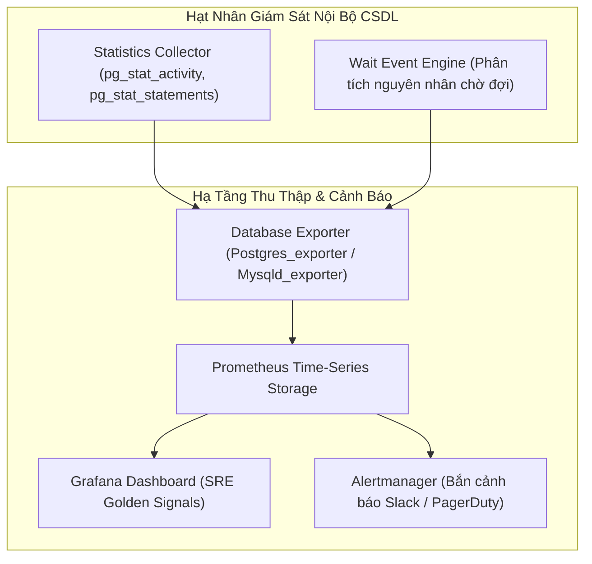
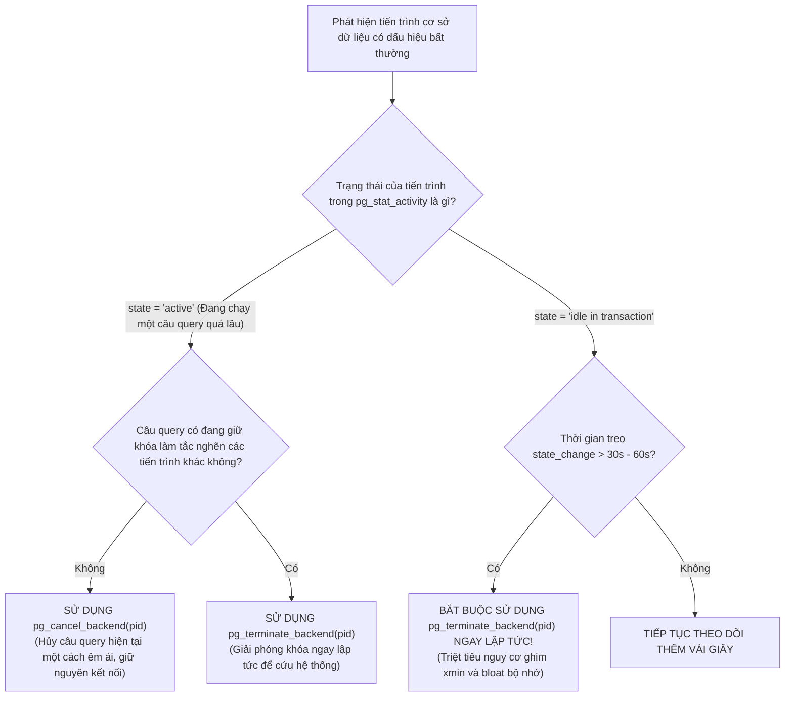

# 14.3. Database Monitoring & Diagnostics (Giám Sát & Chẩn Đoán Sự Cố CSDL)

> [!IMPORTANT]
> **Nếu bạn chỉ được nhớ một điều duy nhất:** Giám sát CSDL hiệu quả đòi hỏi sự tập trung cao độ vào 4 chỉ số sinh tồn cốt lõi: Tỷ lệ trúng đệm bộ nhớ (Buffer Cache Hit Ratio phải luôn duy trì > 99%), Độ trễ nhân bản (Replication Lag tính bằng bytes/seconds), Số lượng giao dịch chạy quá lâu (Long-Running Transactions chặn tiến trình dọn dẹp rác), và Tình trạng tranh chấp khóa (Lock Waits & Deadlock Rate); chủ động phát hiện và cảnh báo sớm các chỉ số này sẽ giúp bạn ngăn chặn thảm họa sập hệ thống trước khi khách hàng kịp phàn nàn.

---

## 1. Đơn giản nhưng phải chi tiết (Intuitive & Deep Breakdown)

### 1.1. Đoạn Code Dẫn Nhập & Vấn Đề Thực Tế
Làm thế nào để phát hiện chính xác nguyên nhân một câu lệnh SQL bị treo cứng: do đang chờ đọc đĩa SSD, do đang chờ khóa dòng bị chiếm giữ bởi một giao dịch khác, hay do đang chờ nhận dữ liệu từ card mạng?

```sql
-- Giải mã sự kiện chờ thời gian thực bằng Wait Events trên PostgreSQL:
SELECT 
    pid, 
    usename, 
    wait_event_type, -- [Loại sự kiện chờ]: Lock, IO, IPC, Client
    wait_event,      -- [Chi tiết sự kiện]: relation, data_file_read, wal_sync
    state,
    NOW() - query_start AS duration,
    query
FROM pg_stat_activity
WHERE state != 'idle'
ORDER BY duration DESC;

-- NẾU THẤY: wait_event_type = 'Lock'      -> Đang bị nghẽn do tranh chấp khóa giữa các transaction!
-- NẾU THẤY: wait_event_type = 'IO'        -> Đang bị thắt cổ chai do tốc độ đọc ghi của ổ đĩa SSD!
-- NẾU THẤY: wait_event_type = 'Client'    -> Database đã chạy xong, đang nằm chờ App đọc kết quả!
```

Giám sát và Chẩn đoán Cơ sở Dữ liệu hiện đại không đơn thuần là nhìn vào biểu đồ phần trăm sử dụng CPU hay RAM của máy chủ. Trọng tâm cốt lõi của kỹ thuật giám sát hiện đại nằm ở **Phân Tích Giao Thức Sự Kiện Chờ (Wait Event Analysis / Performance Insights)**: Tìm ra thời gian của CPU đang bị lãng phí để chờ đợi điều gì!

### 1.2. Ẩn Dụ Đời Sống & Phân Tích Cơ Chế Hoạt Động
Giám sát Cơ sở Dữ liệu giống như **Quy Trình Quản Lý Khoa Cấp Cứu Của Bệnh Viện**:
- Nhìn vào tỷ lệ lấp đầy giường bệnh (**Phần trăm RAM / CPU**): Bạn thấy giường kín 80%, nhưng điều đó không cho biết các bác sĩ có đang cứu chữa bệnh nhân hiệu quả hay không!
- **Phương Pháp Phân Tích Sự Kiện Chờ (Wait Event Analysis)**: Giống như **Đi Phỏng Vấn Từng Bệnh Nhân Đang Nằm Chờ**:
  - Bệnh nhân 1: *"Tôi đang chờ lấy kết quả xét nghiệm máu từ phòng thí nghiệm!"* (**I/O Wait: `data_file_read`**).
  - Bệnh nhân 2: *"Tôi đang chờ bác sĩ trưởng buồng ký giấy duyệt mổ!"* (**Lock Wait: Tranh chấp khóa**).
  - Bệnh nhân 3: *"Tôi đã mổ xong rồi, đang nằm chờ người nhà mang xe đến đón!"* (**Client Wait: Ứng dụng đọc dữ liệu chậm**).
  - Bác sĩ trưởng nhìn vào danh sách chờ sẽ biết ngay bệnh viện đang bị nghẽn ở khâu nào để giải phóng nút thắt tức thì!

### 1.3. Mô Phỏng Dữ Liệu Số Nhỏ Từng Bước (Toy Walkthrough)
Mô phỏng bảng ma trận 4 Tín Hiệu Vàng (The 4 Golden Signals của Google SRE) áp dụng cho Cơ sở Dữ liệu:

| Tín Hiệu Vàng SRE | Chỉ Số Đo Lường Cốt Lõi | Ngưỡng Báo Động Chuẩn | Hành Động Điều Tra Khi Vượt Ngưỡng |
| :--- | :--- | :---: | :--- |
| **1. Latency** (Độ trễ) | Thời gian thực thi trung bình & $p99$ của truy vấn | $p99 > 100\text{ ms}$ | Mở `pg_stat_statements` tìm câu lệnh chậm mới xuất hiện |
| **2. Traffic** (Lưu lượng) | Số lượng giao dịch mỗi giây (TPS / QPS) | Vượt $\pm 50\%$ so với baseline | Kiểm tra có đợt sale đột biến hoặc bão retry từ client |
| **3. Errors** (Lỗi) | Tỷ lệ giao dịch bị Rollback, Deadlock, Abort | Rollback rate $> 1.5\%$ | Điều tra lỗi logic code backend hoặc xung đột khóa dữ liệu |
| **4. Saturation** (Bão hòa) | Tỷ lệ sử dụng Connection Pool, Dung lượng đĩa, IOPS | Connections $> 85\%$ | Scale thêm Read Replicas hoặc dọn dẹp kết nối rò rỉ |

### 1.4. Tác Động Thực Tế Tầng Backend & Systems
- **Hiện Tượng Database Connection Exhaustion (Bão Kết Nối)**: Khi cơ sở dữ liệu bị chậm nhẹ, các request từ ứng dụng backend bị ứ đọng lại. Các worker threads của backend liên tục mở thêm kết nối mới vào database cho tới khi chạm trần `max_connections` (mặc định 100 trên Postgres). Khi đó, mọi câu truy vấn tiếp theo bị từ chối với lỗi: `FATAL: sorry, too many clients already`.
- **Giám Sát Bằng eBPF Ở Cấp Độ Nhân Hệ Điều Hành**: Các công cụ giám sát eBPF hiện đại (như BCC tools, Cilium) có thể đo lường trực tiếp thời gian thực hiện từng hàm bên trong mã nguồn C của PostgreSQL/MySQL mà không gây ra bất kỳ suy giảm hiệu năng nào (Zero Overhead Profiling).

### 1.5. Sơ Đồ Tư Duy & Kiến Trúc Hệ Thống (Mermaid)


---

## 2. Chi tiết từng Keyword (Under-the-Hood Deep Dive)

### 2.1. Giải phẫu Trạng thái Kết nối: Active vs Idle vs Idle in Transaction

Trong PostgreSQL, bảng danh mục hệ thống **`pg_stat_activity`** cung cấp một cửa sổ thời gian thực soi vào từng tiến trình con đang chạy:

| Trạng thái (`state`) | Ý nghĩa Bản chất | Đánh giá Sức khỏe |
| :--- | :--- | :--- |
| **`active`** | Tiến trình đang tiêu tốn CPU để biên dịch AST, chạy query hoặc ghi dữ liệu. | Bình thường (Nếu kéo dài quá lâu sẽ là Long-running Query). |
| **`idle`** | Kết nối đang mở socket và nằm im chờ yêu cầu tiếp theo từ ứng dụng. | Rất bình thường (Trạng thái tự nhiên của Connection Pool). |
| **`idle in transaction`** | **Giao dịch đã `BEGIN`, nhưng chưa hề `COMMIT` hay `ROLLBACK`!** | **CỰC KỲ NGUY HIỂM: KẺ THÙ SỐ 1 CỦA POSTGRESQL!** |
| **`idle in transaction (aborted)`** | Giao dịch bị lỗi ở một câu lệnh trước đó nhưng ứng dụng chưa `ROLLBACK`. | Nguy hiểm (Vẫn giữ khóa tài nguyên cho tới khi rollback). |
| **`fastpath function call`** | Tiến trình đang thực thi một hàm gọi nhanh C-API. | Hiếm gặp. |
| **`disabled`** | Tính năng theo dõi thống kê bị vô hiệu hóa. | Cần bật lại `track_activities = on`. |

#### Tại sao `idle in transaction` là Kẻ hủy diệt Cơ sở dữ liệu?
1. **Ghim chặt mốc thời gian `xmin` (Horizon Pinning)**:
   - Trong cơ chế MVCC, một giao dịch mở mang một mốc định danh `xmin` (ID của transaction lâu nhất còn sống).
   - Tiến trình **Autovacuum bắt buộc phải tôn trọng mốc `xmin` này**: nó tuyệt đối **không được phép xóa bất kỳ Dead Tuple nào sinh ra sau thời điểm transaction đó bắt đầu**!
   - Nếu một kết nối bị treo `idle in transaction` trong suốt 12 tiếng: Toàn bộ rác thải của hàng triệu câu lệnh `UPDATE/DELETE` của toàn bộ hệ thống bị ứ đọng lại, gây phình to bảng (Table Bloat) và phình to chỉ mục (Index Bloat) khủng khiếp.
2. **Giữ chặt các Khóa Độc quyền (Lock Holding)**:
   - Nếu trong giao dịch treo đó có câu lệnh `UPDATE orders WHERE id = 101`, khóa độc quyền trên dòng 101 sẽ bị giữ vô thời hạn. Mọi yêu cầu khác chạm vào dòng này đều bị xếp hàng chờ đợi, làm tắc nghẽn toàn bộ Connection Pool.

#### Câu truy vấn "Dao mổ" Dò tìm và Tiêu diệt Kết nối Treo
```sql
-- 1. Liệt kê các kết nối 'idle in transaction' nguy hiểm kéo dài hơn 60 giây
SELECT 
    pid, 
    usename, 
    client_addr, 
    state, 
    now() - state_change AS idle_duration,
    now() - xact_start AS total_transaction_duration,
    query
FROM pg_stat_activity
WHERE state IN ('idle in transaction', 'idle in transaction (aborted)')
  AND (now() - state_change) > interval '60 seconds'
ORDER BY idle_duration DESC;

-- 2. Tiêu diệt khẩn cấp tiến trình thủ phạm (Giải phóng khóa và xmin ngay lập tức):
SELECT pg_terminate_backend(12345); -- Truyền PID của tiến trình treo
```

---

### 2.2. Dò tìm Truy vấn Chạy quá Lâu (Long-Running Queries) & Lock Waits

#### 1. Dò tìm Truy vấn Chạy Quá Lâu (Active Queries)
Một câu lệnh `SELECT` phức tạp thiếu Index hoặc chạy vòng lặp vô tận có thể chiếm dụng $100\%$ một Core CPU và nuốt trọn băng thông I/O:
```sql
SELECT 
    pid,
    usename,
    client_addr,
    now() - query_start AS running_duration,
    wait_event_type,
    wait_event,
    query
FROM pg_stat_activity
WHERE state = 'active'
  AND (now() - query_start) > interval '30 seconds'
ORDER BY running_duration DESC;
```

#### 2. Phân loại Sự kiện Chờ (Wait Events Taxonomy)
Cột `wait_event_type` cho biết chính xác câu truy vấn đang bị nghẽn ở đâu:
- **`wait_event_type = 'Lock'`**: Câu truy vấn đang bị **chặn đứng bởi một tiến trình khác** đang giữ khóa (bảng hoặc dòng).
- **`wait_event_type = 'IO'`**: Đang chờ đọc/ghi đĩa vật lý (DataFileRead, WALWrite). Dấu hiệu hệ thống thiếu RAM hoặc ổ cứng quá chậm.
- **`wait_event_type = 'BufferPin'`**: Đang chờ một tiến trình khác nhả khóa ghim trang bộ đệm.
- **`wait_event_type = 'Client'`**: Đang chờ ứng dụng gửi thêm dữ liệu (ClientRead).

#### 3. Truy vết Cây Khóa Chờ (Lock Dependency Tree)
Câu truy vấn thần thánh giúp tìm ra chính xác: **Tiến trình nào đang chặn tiến trình nào?**
```sql
SELECT 
    blocked_locks.pid     AS blocked_pid,
    blocked_activity.usename  AS blocked_user,
    blocking_locks.pid    AS blocking_pid,
    blocking_activity.usename AS blocking_user,
    blocked_activity.query    AS blocked_statement,
    blocking_activity.query   AS blocking_statement
FROM  pg_catalog.pg_locks         blocked_locks
JOIN pg_catalog.pg_stat_activity blocked_activity ON blocked_activity.pid = blocked_locks.pid
JOIN pg_catalog.pg_locks         blocking_locks 
    ON blocking_locks.locktype = blocked_locks.locktype
    AND blocking_locks.database IS NOT DISTINCT FROM blocked_locks.database
    AND blocking_locks.relation IS NOT DISTINCT FROM blocked_locks.relation
    AND blocking_locks.page IS NOT DISTINCT FROM blocked_locks.page
    AND blocking_locks.tuple IS NOT DISTINCT FROM blocked_locks.tuple
    AND blocking_locks.virtualxid IS NOT DISTINCT FROM blocked_locks.virtualxid
    AND blocking_locks.transactionid IS NOT DISTINCT FROM blocked_locks.transactionid
    AND blocking_locks.classid IS NOT DISTINCT FROM blocked_locks.classid
    AND blocking_locks.objid IS NOT DISTINCT FROM blocked_locks.objid
    AND blocking_locks.objsubid IS NOT DISTINCT FROM blocked_locks.objsubid
    AND blocking_locks.pid != blocked_locks.pid
JOIN pg_catalog.pg_stat_activity blocking_activity ON blocking_activity.pid = blocking_locks.pid
WHERE NOT blocked_locks.granted;
```

---

### 2.3. Giám sát Tỷ lệ Trúng Bộ đệm (Buffer Cache Hit Ratio)

Đo lường mức độ hiệu quả của bộ nhớ RAM (`shared_buffers`):
$$\text{Buffer Hit Ratio} = \frac{\sum \text{heap\_blks\_hit}}{\sum \text{heap\_blks\_hit} + \sum \text{heap\_blks\_read}} \times 100\%$$

```sql
SELECT 
    sum(heap_blks_hit) AS total_ram_hits,
    sum(heap_blks_read) AS total_disk_reads,
    round(sum(heap_blks_hit) * 100.0 / nullif(sum(heap_blks_hit) + sum(heap_blks_read), 0), 2) AS hit_ratio_pct
FROM pg_statio_user_tables;
```
- **Phân tích Chẩn đoán**:
  - **$\ge 99\%$**: Hệ thống OLTP cực kỳ khỏe mạnh. Hầu hết các trang dữ liệu đều được phục vụ trực tiếp từ RAM trong microsecond.
  - **$< 95\%$**: Nguy hiểm! Cơ sở dữ liệu liên tục phải thực hiện Disk I/O.
  - **Nguyên nhân**: Cấu hình `shared_buffers` quá nhỏ, hoặc xuất hiện các câu truy vấn thiếu Index quét sạch các trang đĩa nóng ra khỏi RAM (**Buffer Pool Pollution**).

---

### 2.4. Giám sát Rác Bộ nhớ: Dead Tuples & Table Bloat

Kiểm tra tỷ lệ rác bộ nhớ MVCC trên từng bảng:
```sql
SELECT 
    schemaname, 
    relname AS table_name, 
    n_live_tup, 
    n_dead_tup,
    round(n_dead_tup * 100.0 / nullif(n_live_tup + n_dead_tup, 0), 2) AS dead_ratio_pct,
    last_autovacuum,
    last_autoanalyze
FROM pg_stat_user_tables
WHERE (n_live_tup + n_dead_tup) > 5000
ORDER BY n_dead_tup DESC 
LIMIT 10;
```
- Nếu `dead_ratio_pct > 20%` và `last_autovacuum` đã diễn ra từ nhiều ngày trước: Autovacuum đang bị quá tải hoặc bị chặn bởi một transaction treo. Cần can thiệp ngay lập tức!

---

### 2.5. Giám sát Độ trễ Nhân bản (Replication Lag Monitoring)

Trong kiến trúc Master-Replica Streaming Replication, việc đồng bộ dữ liệu trải qua 4 cột mốc LSN (Log Sequence Number):
1. **`sent_lsn`**: Vị trí WAL mà Primary đã gửi qua socket mạng.
2. **`write_lsn`**: Vị trí WAL mà Replica đã nhận và ghi vào bộ đệm hệ điều hành.
3. **`flush_lsn`**: Vị trí WAL mà Replica đã xả bền vững xuống đĩa NVMe (`fsync`).
4. **`replay_lsn`**: Vị trí WAL mà Replica đã **thực sự giải mã và áp dụng lên dữ liệu**.

#### Câu truy vấn Đo lường Độ trễ Chi tiết từng Chặng trên Primary Node
```sql
SELECT 
    client_addr AS replica_ip,
    application_name,
    state,
    sync_state,
    -- Độ trễ gửi mạng:
    pg_wal_lsn_diff(pg_current_wal_lsn(), sent_lsn) AS send_lag_bytes,
    -- Độ trễ ghi OS:
    pg_wal_lsn_diff(sent_lsn, write_lsn) AS write_lag_bytes,
    -- Độ trễ fsync đĩa:
    pg_wal_lsn_diff(write_lsn, flush_lsn) AS flush_lag_bytes,
    -- Độ trễ Replay (CHỈ SỐ SỐNG CÒN QUAN TRỌNG NHẤT):
    pg_wal_lsn_diff(flush_lsn, replay_lsn) AS replay_lag_bytes,
    replay_lag AS time_lag
FROM pg_stat_replication;
```
- Nếu `replay_lag_bytes` tăng cao đột biến: Replica đang bị quá tải CPU hoặc bị nghẽn đĩa I/O, khiến dữ liệu đọc trên Replica bị trễ so với Primary (Stale Reads).

---

## 3. Thực thi Mã nguồn & Mô phỏng Chuyên sâu (Dual-Engine Implementation)

### 3.1. C++20 Simulation: Telemetry Metrics Engine & Lock Graph Analyzer

Chương trình C++20 dưới đây mô phỏng một **Database Telemetry Engine**: theo dõi các phiên làm việc, tự động phát hiện các tiến trình bị kẹt ở trạng thái `idle in transaction`, và phân tích đồ thị khóa phụ thuộc (Lock Wait Dependency Graph) để tìm ra nút gốc gây nghẽn:

```cpp
// compile: g++ -std=c++20 -O3 -pthread db_telemetry.cpp -o db_telemetry
#include <iostream>
#include <vector>
#include <string>
#include <unordered_map>
#include <chrono>
#include <algorithm>
#include <iomanip>

enum class SessionState { ACTIVE, IDLE, IDLE_IN_TRANSACTION };

struct BackendSession {
    uint32_t pid;
    std::string username;
    SessionState state;
    std::chrono::system_clock::time_point state_change_time;
    std::string current_query;
    uint32_t blocking_pid{0}; // 0 nghĩa là không bị ai chặn
};

class DatabaseMonitorEngine {
private:
    std::unordered_map<uint32_t, BackendSession> sessions_;

public:
    void register_session(const BackendSession& session) {
        sessions_[session.pid] = session;
    }

    // 1. Dò tìm và cảnh báo các kết nối 'idle in transaction' nguy hiểm
    void scan_idle_in_transaction(std::chrono::seconds threshold_sec) const {
        auto now = std::chrono::system_clock::now();
        std::cout << "[DIAGNOSTIC] Quét tìm các kết nối 'idle in transaction' vượt quá " 
                  << threshold_sec.count() << "s...\n";

        for (const auto& [pid, s] : sessions_) {
            if (s.state == SessionState::IDLE_IN_TRANSACTION) {
                auto duration = std::chrono::duration_cast<std::chrono::seconds>(now - s.state_change_time);
                if (duration >= threshold_sec) {
                    std::cout << "  🚨 [CẢNH BÁO NGUY HIỂM] PID=" << pid 
                              << " (User: " << s.username << ") bị TREO trong Transaction suốt " 
                              << duration.count() << "s!\n"
                              << "     Lệnh cuối cùng chạy: '" << s.current_query << "'\n"
                              << "     => HÀNH ĐỘNG KHUYẾN NGHỊ: SELECT pg_terminate_backend(" << pid << ");\n";
                }
            }
        }
    }

    // 2. Phân tích đồ thị khóa chờ (Lock Graph Analysis)
    void analyze_lock_wait_chains() const {
        std::cout << "\n[DIAGNOSTIC] Phân tích cây phụ thuộc khóa chờ (Lock Dependency Chains)...\n";
        bool found_deadlock_or_block = false;

        for (const auto& [pid, s] : sessions_) {
            if (s.blocking_pid != 0) {
                found_deadlock_or_block = true;
                std::cout << "  • Tiến trình [PID: " << pid << "] BỊ CHẶN BỞI -> [PID: " << s.blocking_pid << "]\n";
                
                // Kiểm tra xem tiến trình gây nghẽn đang làm gì
                auto it = sessions_.find(s.blocking_pid);
                if (it != sessions_.end()) {
                    std::string state_str = (it->second.state == SessionState::IDLE_IN_TRANSACTION) 
                                            ? "IDLE_IN_TRANSACTION" : "ACTIVE";
                    std::cout << "    |_ Tiến trình gốc [PID: " << it->second.pid 
                              << "] đang ở trạng thái: " << state_str 
                              << " | Query: '" << it->second.current_query << "'\n";
                }
            }
        }

        if (!found_deadlock_or_block) {
            std::cout << "  ✅ Không có xung đột khóa chờ (No Lock Waits).\n";
        }
    }
};

int main() {
    std::cout << "=== MÔ PHỎNG DATABASE TELEMETRY & DIAGNOSTICS ENGINE (C++20) ===\n\n";

    DatabaseMonitorEngine monitor;
    auto now = std::chrono::system_clock::now();

    // Giả lập 3 sessions:
    // Session 1: Gây họa - mở transaction, chạy UPDATE rồi treo
    monitor.register_session(BackendSession{
        1001, "app_order_service", SessionState::IDLE_IN_TRANSACTION,
        now - std::chrono::seconds(180), // Đã treo 180s (3 phút)
        "UPDATE accounts SET balance = balance - 100 WHERE id = 42;", 0
    });

    // Session 2: Bị Session 1 chặn khóa
    monitor.register_session(BackendSession{
        1002, "app_payment_service", SessionState::ACTIVE,
        now - std::chrono::seconds(20),
        "SELECT * FROM accounts WHERE id = 42 FOR UPDATE;", 1001 // Bị chặn bởi 1001!
    });

    // Session 3: Hoạt động bình thường
    monitor.register_session(BackendSession{
        1003, "app_analytics", SessionState::ACTIVE,
        now - std::chrono::seconds(2),
        "SELECT COUNT(*) FROM products;", 0
    });

    // 1. Quét tìm Idle in Transaction
    monitor.scan_idle_in_transaction(std::chrono::seconds(60));

    // 2. Phân tích chuỗi khóa chờ
    monitor.analyze_lock_wait_chains();

    return 0;
}
```

---

### 3.2. Python 3.11+ Simulation: Prometheus Database Metrics Exporter

Script Python dưới đây hiện thực một **Prometheus Database Exporter hoàn chỉnh**: thu thập các chỉ số sinh tử từ hệ thống và định dạng chuẩn theo định dạng văn bản Prometheus Exposition Format (`text/plain`):

```python
#!/usr/bin/env python3
"""
Mô phỏng Prometheus PostgreSQL Metrics Exporter Engine
Yêu cầu Python 3.11+
"""

import time
import dataclasses
from typing import Dict, Any

@dataclasses.dataclass
class DatabaseTelemetrySnapshot:
    active_connections: int
    idle_in_transaction_connections: int
    buffer_cache_hit_ratio: float
    max_transaction_age_seconds: float
    replication_replay_lag_bytes: int
    dead_tuples_total: int

class MockPostgresCatalog:
    """Mô phỏng dữ liệu thu thập từ các System Catalogs của PostgreSQL"""
    def query_system_telemetry(self) -> DatabaseTelemetrySnapshot:
        # Giả lập số liệu đo lường thực tế từ server
        return DatabaseTelemetrySnapshot(
            active_connections=18,
            idle_in_transaction_connections=3,
            buffer_cache_hit_ratio=99.25,
            max_transaction_age_seconds=125.4,
            replication_replay_lag_bytes=1048576, # 1MB lag
            dead_tuples_total=45200
        )

class PrometheusMetricsExporter:
    def __init__(self, catalog: MockPostgresCatalog):
        self.catalog = catalog

    def generate_prometheus_metrics(self) -> str:
        snap = self.catalog.query_system_telemetry()
        lines = []

        lines.append("# HELP pg_stat_activity_connections_active Number of active backend connections")
        lines.append("# TYPE pg_stat_activity_connections_active gauge")
        lines.append(f'pg_stat_activity_connections_active{{db="production"}} {snap.active_connections}')

        lines.append("\n# HELP pg_stat_activity_connections_idle_in_tx Dangerous idle in transaction connections")
        lines.append("# TYPE pg_stat_activity_connections_idle_in_tx gauge")
        lines.append(f'pg_stat_activity_connections_idle_in_tx{{db="production"}} {snap.idle_in_transaction_connections}')

        lines.append("\n# HELP pg_buffer_cache_hit_ratio Percentage of pages read from RAM Buffer Pool")
        lines.append("# TYPE pg_buffer_cache_hit_ratio gauge")
        lines.append(f'pg_buffer_cache_hit_ratio{{db="production"}} {snap.buffer_cache_hit_ratio:.2f}')

        lines.append("\n# HELP pg_stat_activity_max_tx_duration_seconds Age of oldest active transaction in seconds")
        lines.append("# TYPE pg_stat_activity_max_tx_duration_seconds gauge")
        lines.append(f'pg_stat_activity_max_tx_duration_seconds{{db="production"}} {snap.max_transaction_age_seconds:.1f}')

        lines.append("\n# HELP pg_replication_replay_lag_bytes Bytes of WAL not yet replayed on replica")
        lines.append("# TYPE pg_replication_replay_lag_bytes gauge")
        lines.append(f'pg_replication_replay_lag_bytes{{replica="replica_asia_1"}} {snap.replication_replay_lag_bytes}')

        lines.append("\n# HELP pg_stat_user_tables_dead_tuples Total count of dead tuples across all tables")
        lines.append("# TYPE pg_stat_user_tables_dead_tuples gauge")
        lines.append(f'pg_stat_user_tables_dead_tuples{{db="production"}} {snap.dead_tuples_total}')

        return "\n".join(lines)

def main():
    print("=" * 65)
    print("PROMETHEUS POSTGRESQL METRICS EXPORTER SIMULATOR (PYTHON 3.11+)")
    print("=" * 65)

    catalog = MockPostgresCatalog()
    exporter = PrometheusMetricsExporter(catalog)

    print("\n[+] Đang tạo bản xuất bản chỉ số chuẩn định dạng Prometheus (/metrics endpoint):\n")
    metrics_output = exporter.generate_prometheus_metrics()
    print(metrics_output)

    print("\n" + "=" * 65)
    print("KIỂM TRA CẢNH BÁO NGUY HIỂM DỰA TRÊN NGƯỠNG SLI/SLO:")
    snap = catalog.query_system_telemetry()
    if snap.idle_in_transaction_connections > 0:
        print(f"  ⚠️ CẢNH BÁO: Có {snap.idle_in_transaction_connections} kết nối 'idle in transaction'!")
    if snap.buffer_cache_hit_ratio < 98.0:
        print(f"  🚨 BÁO ĐỘNG ĐỎ: Buffer Hit Ratio tụt xuống {snap.buffer_cache_hit_ratio}%!")
    else:
        print(f"  ✅ Buffer Cache Hit Ratio hoàn hảo: {snap.buffer_cache_hit_ratio}% (> 98%)")

if __name__ == "__main__":
    main()
```

### 3.3. Terminal Output Mẫu Thực Tế

```text
=== MÔ PHỎNG DATABASE TELEMETRY & DIAGNOSTICS ENGINE (C++20) ===

[DIAGNOSTIC] Quét tìm các kết nối 'idle in transaction' vượt quá 60s...
  🚨 [CẢNH BÁO NGUY HIỂM] PID=1001 (User: app_order_service) bị TREO trong Transaction suốt 180s!
     Lệnh cuối cùng chạy: 'UPDATE accounts SET balance = balance - 100 WHERE id = 42;'
     => HÀNH ĐỘNG KHUYẾN NGHỊ: SELECT pg_terminate_backend(1001);

[DIAGNOSTIC] Phân tích cây phụ thuộc khóa chờ (Lock Dependency Chains)...
  • Tiến trình [PID: 1002] BỊ CHẶN BỞI -> [PID: 1001]
    |_ Tiến trình gốc [PID: 1001] đang ở trạng thái: IDLE_IN_TRANSACTION | Query: 'UPDATE accounts SET balance = balance - 100 WHERE id = 42;'
```

---

## 4. Systems Engineering & Production Pitfalls

### 4.1. Thảm họa Tự Gây Quá Tải do Truy vấn Giám sát (Monitoring Overhead Trap)
- **Sai lầm phổ biến**: Đội ngũ giám sát thiết lập Prometheus Exporter chạy câu truy vấn tính toán kích thước Bloat bằng extension `pgstattuple` hoặc quét toàn bộ bảng dung lượng 2TB mỗi 10 giây một lần.
- **Hệ lụy**: Bản thân câu lệnh của công cụ giám sát chiếm dụng $100\%$ CPU và quét sạch toàn bộ RAM Buffer Pool, biến công cụ giám sát thành **kẻ phá hoại số 1 làm sập hệ thống**!
- **Quy tắc**: Các câu truy vấn giám sát định kỳ chỉ được phép đọc các bảng Catalog thống kê tích lũy trong bộ nhớ (`pg_stat_*`), tuyệt đối không được quét bảng vật lý.

### 4.2. Thảm họa Tràn Ổ đĩa do Replication Slot bị Bỏ rơi
- **Cơ chế**: Khi tạo một Logical Replication Slot (để cấp dữ liệu cho Debezium/Kafka) hoặc Physical Slot cho Replica:
  - PostgreSQL cam kết: **Sẽ giữ lại toàn bộ các tệp WAL trên đĩa và không bao giờ xóa chúng cho đến khi Slot này xác nhận đã đọc xong**!
- **Hậu quả**: Nếu máy chủ Replica hoặc tiến trình Debezium bị chết và không bao giờ kết nối lại, Primary Node sẽ liên tục tích lũy hàng chục nghìn tệp WAL trên đĩa. Trong vòng vài tiếng, ổ cứng đĩa đạt $100\%$ dung lượng (Disk Full), khiến PostgreSQL **ngừng hoạt động hoàn toàn**!
- **Khắc phục**: Luôn cấu hình tham số an toàn trong `postgresql.conf`:
  ```ini
  max_slot_wal_keep_size = '50GB' # Giới hạn tối đa dung lượng WAL giữ lại cho một slot
  ```

### 4.3. Phân biệt `pg_cancel_backend()` vs `pg_terminate_backend()`
- **`pg_cancel_backend(pid)`**: Gửi tín hiệu `SIGINT` để **chỉ hủy bỏ duy nhất câu lệnh SQL đang chạy hiện tại**. Kết nối TCP giữa client và server vẫn được giữ nguyên. Thích hợp để dừng một câu truy vấn báo cáo chạy quá lâu.
- **`pg_terminate_backend(pid)`**: Gửi tín hiệu `SIGTERM` để **tiêu diệt hoàn toàn tiến trình con của hệ điều hành**, ngắt kết nối socket mạng ngay lập tức. Đây là "vũ khí hạt nhân" bắt buộc phải dùng để tiêu diệt các kết nối bị treo `idle in transaction`!

---

## 5. Bảng So sánh & Decision Matrix

### 5.1. Bảng Phân loại Tín hiệu Vàng trong Giám sát Cơ sở Dữ liệu (SRE 4 Golden Signals)

| Tín hiệu Vàng | Chỉ số Cần Đo lường | Ngưỡng Báo Động (Alert Threshold) | Hành động Khắc phục |
| :--- | :--- | :--- | :--- |
| **1. Latency (Độ trễ)** | Phân vị P95 và P99 của thời gian chạy câu lệnh | $\text{P99} > 50\text{ms}$ (cho OLTP) | Phân tích `pg_stat_statements`, thêm Index |
| **2. Traffic (Lưu lượng)** | QPS (Queries/sec) và TPS (Transactions/sec) | Tăng đột biến $> 300\%$ bình thường | Kiểm tra tấn công DDoS, bật Caching |
| **3. Errors (Lỗi)** | Tỷ lệ Deadlocks, Connection Pool Exhaustion | $\text{Errors} > 0.1\%$ tổng số requests | Điều chỉnh lock order, tăng Pool Size |
| **4. Saturation (Bão hòa)** | CPU Util, Disk IOPS `%util`, Buffer Hit Ratio | CPU $> 85\%$, Disk Util $> 80\%$, Cache $< 98\%$ | Nâng cấp phần cứng, scale-out read replicas |

### 5.2. Quyết định Xử lý Sự cố Khẩn cấp: Hủy lệnh (`Cancel`) vs Ngắt kết nối (`Terminate`)



---

## 6. Enterprise Production Checklist & Verification

### 6.1. Kiến Trúc & Cấu Hình Tối Ưu (Production-Ready Architecture)
- [ ] **Triển Khai Cặp Đôi Giám Sát Chuẩn Doanh Nghiệp (Prometheus + Grafana)**: Cài đặt `postgres_exporter` hoặc `mysqld_exporter` để thu thập liên tục hàng trăm thông số hiệu năng hạt nhân của database.
- [ ] **Kích Hoạt Thu Thập Wait Events Thời Gian Thực**: Sử dụng các công cụ như AWS Performance Insights, PMM (Percona Monitoring and Management), hoặc script `pg_wait_sampling` để phân tích các sự kiện chờ đợi.
- [ ] **Cấu Hình Giới Hạn Kết Nối Nghiêm Ngặt Phía Client**: Không bao giờ đặt kích thước Connection Pool trên ứng dụng quá lớn; giữ tổng số kết nối từ toàn bộ các pods/servers dưới ngưỡng chịu tải tối ưu của CPU database.
- [ ] **Thiết Lập Các Bảng Dashboard Chuẩn SRE**: Xây dựng biểu đồ hiển thị đồng thời 4 tín hiệu vàng: Độ trễ $p99$, QPS, Tỷ lệ lỗi, và Mức độ bão hòa tài nguyên đĩa/RAM.

### 6.2. Giám Sát, Cảnh Báo & Xử Lý Sự Cố (Observability & Incident Response)
- [ ] **Cảnh Báo Tỷ Lệ Đĩa Trống Dưới 20% (Disk Space Alarm)**: Đặt cảnh báo nhiều tầng: Cảnh báo vàng khi dung lượng ổ đĩa đạt 75%, cảnh báo đỏ P1 khi đạt 85% để kịp thời mở rộng volume trước khi database bị crash.
- [ ] **Theo Dõi Chỉ Số Chờ Khóa Trực Tiếp Bằng CLI**: Sử dụng lệnh `SELECT * FROM pg_stat_activity WHERE wait_event_type = 'Lock';` để phát hiện ngay lập tức các phiên giao dịch đang gây nghẽn hệ thống.
- [ ] **Thẩm Định Độ Trễ Từng Câu Lệnh Bằng pg_stat_statements**: Định kỳ truy vấn `SELECT query, mean_exec_time, calls FROM pg_stat_statements ORDER BY mean_exec_time DESC LIMIT 10;` để lên kế hoạch tối ưu hóa mã nguồn hàng tuần.
