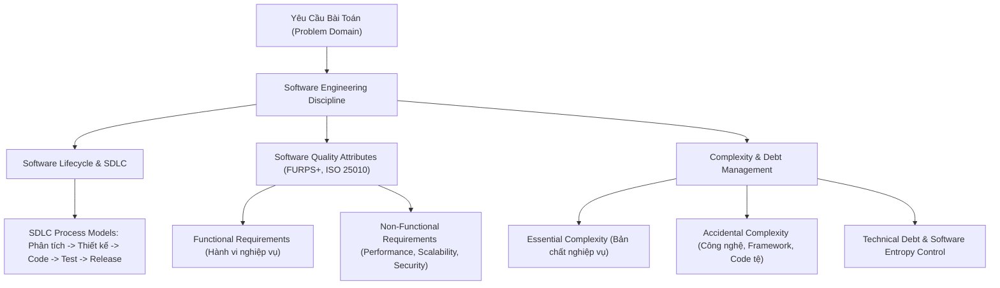
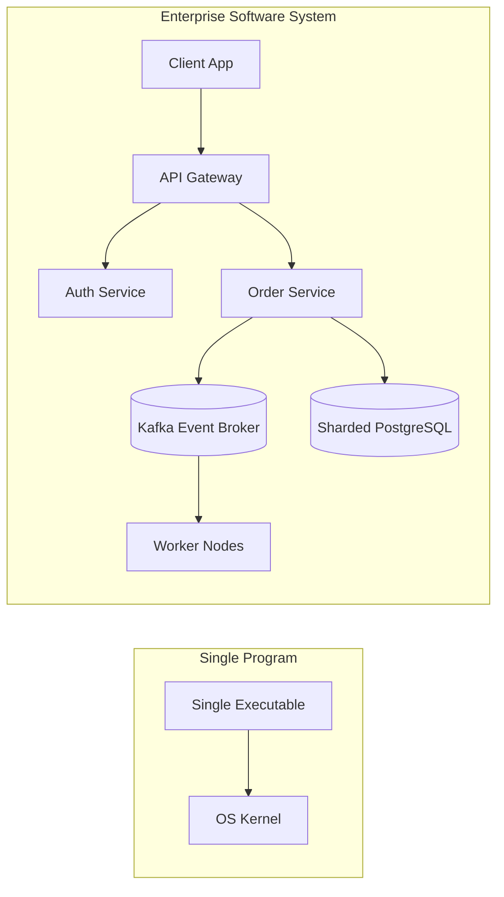
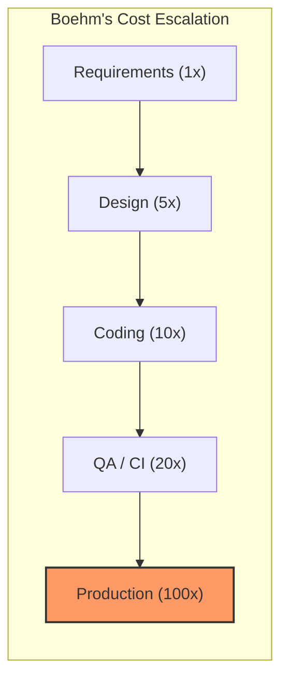
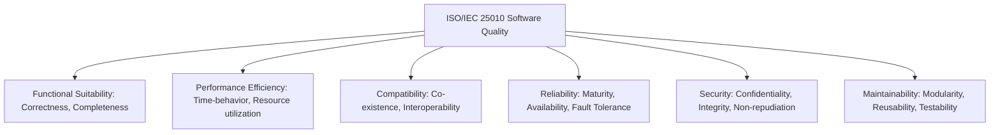
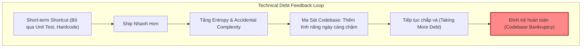

# 1.1. Khái Niệm Cốt Lõi Kỹ Nghệ Phần Mềm (Software Engineering Concepts)

## Tổng quan về Software Engineering Concepts
Kỹ nghệ phần mềm (Software Engineering - SE) không đơn thuần là hoạt động viết mã (coding/programming). Trong khi lập trình tập trung vào việc tạo ra các chỉ thị để CPU thực thi đúng một chức năng tại một thời điểm, kỹ nghệ phần mềm là một **ngành kỷ luật kỹ thuật có hệ thống nhằm thiết kế, phát triển, kiểm thử, triển khai và bảo trì các hệ thống phần mềm phức tạp trong suốt vòng đời của chúng**, dưới các ràng buộc khắt khe về thời gian, tài nguyên máy tính, ngân sách kinh doanh và yếu tố con người.

Bản chất của kỹ nghệ phần mềm là quản lý và kiểm soát **độ phức tạp (Complexity)** và **sự suy thoái entropy phần mềm (Software Entropy)** theo thời gian.



---

## 2. Chi tiết từng Keyword (Under-the-Hood Deep Dive)

---

### 1. Software Engineering Principles, Software Development & Product vs System

#### 1. Khái niệm bản chất (What & Why)
* **Software Engineering Principles**: Tập hợp các quy tắc chỉ đạo nền tảng (Modularity, Separation of Concerns, Abstraction, Anticipation of Change, Generality, Consistency) giúp duy trì tính ổn định của hệ thống khi quy mô mở rộng.
* **Software Development**: Toàn bộ quá trình từ khi thai nghén ý tưởng đến khi hiện thực hóa thành phần mềm chạy được.
* **Software Product vs Software System**: 
  * *Software Product*: Một phần mềm hoàn chỉnh đóng gói, có tài liệu, được bảo đảm chất lượng để cung cấp cho người dùng cuối hoặc thị trường (ví dụ: PostgreSQL, NGINX, Stripe API).
  * *Software System*: Một tập hợp phối hợp phức tạp gồm nhiều thành phần phần mềm (Microservices, Databases, Caches, Event Brokers), phần cứng, mạng và con người tương tác lẫn nhau để đạt được mục tiêu chung.

#### 2. Cơ chế hoạt động sâu (Under the hood / Hardcore Internals)
Trong kỹ thuật hạ tầng Backend, một "Software System" phân tán vận hành dựa trên các giao thức mạng tầng thấp (TCP socket, Unix domain sockets) và các syscall của nhân Linux (`epoll`, `clone`, `futex`). Sự chuyển dịch từ một chương trình đơn lẻ (Script/Program) sang một Software System đòi hỏi:
1. **Quản lý trạng thái phân tán (State Management)**: Xử lý tính nhất quán (CAP theorem, PACELC).
2. **Failure Domains**: Hệ thống phải giả định mạng luôn trễ, phân mảnh (network partition) và máy chủ có thể sập bất kỳ lúc nào.
3. **Resource Isolation**: Tận dụng Linux cgroups v2 và namespaces để giới hạn CPU/Memory bandwidth, tránh một tiến trình làm sập toàn bộ nút (Noisy Neighbor problem).

#### 3. Sơ đồ minh họa (Mermaid / ASCII Diagram)


#### 4. Code ví dụ thực chiến (C++20: Module Boundary & Interface Isolation)
```cpp
// Minh họa sự phân tách giữa Product Contract (Interface) và System Implementation (Concrete)
#include <iostream>
#include <memory>
#include <string_view>
#include <system_error>

// 1. Nguyên lý trừu tượng hóa & Hợp đồng (Software Engineering Principle)
class IOrderRepository {
public:
    virtual ~IOrderRepository() = default;
    virtual std::error_code saveOrder(int64_t orderId, double amount) = 0;
};

// 2. Hiện thực cụ thể (PostgreSQL Repository implementation)
class PostgresOrderRepository final : public IOrderRepository {
public:
    std::error_code saveOrder(int64_t orderId, double amount) override {
        // Giả lập tương tác libpq / socket write
        std::cout << "[PostgresEngine] Executing INSERT INTO orders VALUES (" 
                  << orderId << ", " << amount << ") with WAL sync.\n";
        return {}; // std::error_code success
    }
};

// 3. Hệ thống Service cấp cao phụ thuộc vào Abstraction (DIP)
class OrderProcessingService {
private:
    std::shared_ptr<IOrderRepository> repository_;
public:
    explicit OrderProcessingService(std::shared_ptr<IOrderRepository> repo)
        : repository_(std::move(repo)) {}

    bool process(int64_t orderId, double amount) {
        if (amount <= 0.0) return false;
        auto ec = repository_->saveOrder(orderId, amount);
        return !ec;
    }
};

int main() {
    auto repo = std::make_shared<PostgresOrderRepository>();
    OrderProcessingService service(repo);
    service.process(1001, 249.99);
    return 0;
}
```

#### 5. Ưu / Nhược điểm, Pitfalls & Anti-patterns
* **Pitfall**: Nhầm lẫn giữa một script tiện ích (automation script) với một sản phẩm kỹ thuật phần mềm. Viết code không xử lý lỗi ngầm (swallowed errors), hardcode cấu hình hoặc bỏ qua giới hạn tài nguyên bộ nhớ.
* **Anti-pattern**: Monolithic Scripting — gom toàn bộ logic nghiệp vụ, kết nối mạng và truy vấn database vào một hàm dài 2000 dòng.

#### 6. Ứng dụng thực tế trong Backend / Systems
Một Backend Engineer cấp cao không chỉ triển khai thuật toán sắp xếp mà phải đóng gói logic đó vào một Service có graceful shutdown (`SIGTERM` handling), health check endpoints (`/healthz`, `/readyz`), structured JSON logs và metric instrumentation (Prometheus counters/histograms).

---

### 2. Software Lifecycle, SDLC, Software Process, Process Models & Methodologies

#### 1. Khái niệm bản chất (What & Why)
* **Software Lifecycle (Vòng đời phần mềm)**: Khoảng thời gian từ khi một phần mềm được thai nghén đến khi bị loại bỏ hoàn toàn (Decommission/Retirement).
* **Software Development Life Cycle (SDLC)**: Khung cấu trúc gồm các pha tuần tự hoặc lặp đi lặp lại:
  1. *Requirements Analysis* (Phân tích yêu cầu)
  2. *Architectural Design* (Thiết kế kiến trúc)
  3. *Implementation* (Hiện thực hóa / Lập trình)
  4. *Verification & Testing* (Kiểm thử)
  5. *Deployment* (Triển khai sản xuất)
  6. *Operations & Maintenance* (Vận hành & Bảo trì)
* **Software Process**: Chuỗi các hành động kỹ thuật, công cụ và tài liệu quy định cách thức đội ngũ tạo ra sản phẩm.
* **Process Model & Methodology**: Mô hình hóa quy trình (Waterfall, Iterative, Agile, Scrum, Kanban, Extreme Programming) nhằm tối ưu hóa chu kỳ phản hồi và chất lượng đầu ra.

#### 2. Cơ chế hoạt động sâu (Under the hood / Hardcore Internals)
* **Chi phí sửa lỗi theo pha (Boehm's Cost of Change Curve)**: Sửa một lỗi trong pha Requirements tốn $1\times$; phát hiện ở pha Architecture tốn $5\times$; ở pha Coding tốn $10\times$; ở pha Testing tốn $20\times$; và sửa khi đã lên Production tốn từ $60\times$ đến $100\times$.
* **Shift-Left Testing**: Đưa hoạt động kiểm thử và thẩm định kiến trúc về giai đoạn sớm nhất của chu trình nhằm triệt tiêu lỗi tại nguồn.



#### 3. Code ví dụ thực chiến (TypeScript: Strict Lifecycle State Pattern)
```typescript
// Trạng thái vòng đời của một Đơn hàng trong hệ thống E-Commerce
export type OrderState = 'CREATED' | 'PAID' | 'FULFILLED' | 'CANCELLED';

export interface OrderTransition {
  from: OrderState;
  to: OrderState;
  action: string;
}

export class OrderStateMachine {
  private static readonly VALID_TRANSITIONS: Set<string> = new Set([
    'CREATED->PAID',
    'CREATED->CANCELLED',
    'PAID->FULFILLED',
    'PAID->CANCELLED'
  ]);

  public static transition(currentState: OrderState, nextState: OrderState): OrderState {
    const key = `${currentState}->${nextState}`;
    if (!this.VALID_TRANSITIONS.has(key)) {
      throw new Error(`Invalid lifecycle transition: ${currentState} to ${nextState}`);
    }
    return nextState;
  }
}
```

#### 4. Ưu / Nhược điểm & Pitfalls
* **Cạm bẫy**: Thiếu pha kiểm thử tải (Load Testing) và bảo mật (Penetration Testing) trong SDLC trước khi release.
* **Quy chuẩn**: Mọi thay đổi kiến trúc phải được ghi nhận dưới dạng ADR (Architecture Decision Record) trước khi bước vào pha coding.

---

### 3. Software Quality, Quality Attributes (FURPS+, ISO 25010), Requirements & Constraints

#### 1. Khái niệm bản chất (What & Why)
* **Software Quality**: Mức độ một phần mềm đáp ứng đúng và vượt các yêu cầu chức năng lẫn phi chức năng, tuân thủ tiêu chuẩn chất lượng kỹ thuật.
* **ISO/IEC 25010 / FURPS+ Quality Model**:
  * **Functionality**: Tính chính xác, tính đầy đủ của nghiệp vụ.
  * **Usability**: Trải nghiệm giao diện, tính công thái học.
  * **Reliability (Độ tin cậy)**: Khả năng chịu lỗi (fault-tolerance), tính sẵn sàng (Availability: $99.99\%$).
  * **Performance Efficiency**: Độ trễ (Latency $p99 \le 10\text{ms}$), thông lượng (Throughput $\ge 50,000 \text{ RPS}$), mức tiêu thụ CPU/RAM.
  * **Supportability / Maintainability**: Tính module hóa, khả năng đọc hiểu mã nguồn, khả năng kiểm thử (Testability).
  * **Security**: Bảo mật dữ liệu, xác thực (AuthN), ủy quyền (AuthZ), chống rò rỉ.
* **Functional Requirements (FR)**: Định nghĩa *Hệ thống làm gì* (Ví dụ: "Người dùng có thể chuyển tiền qua API `/transfers`").
* **Non-Functional Requirements (NFR)**: Định nghĩa *Hệ thống vận hành như thế nào* (Ví dụ: "Giao dịch phải hoàn tất trong vòng $200\text{ms}$ ở phân vị $99$").
* **Constraints (Ràng buộc)**:
  * *Technical Constraints*: Sử dụng hạ tầng Linux x86_64, cơ sở dữ liệu PostgreSQL 16, giao thức truyền tin gRPC HTTP/2.
  * *Business Constraints*: Tuân thủ chứng chỉ bảo mật PCI-DSS, ngân sách hạ tầng dưới $\$5,000/\text{tháng}$, thời hạn bàn giao Q2.

#### 2. Cơ chế hoạt động sâu (Under the hood / Hardcore Internals)
Đo lường NFR trong Backend:
* **Tail Latency ($p99$ và $p99.9$)**: Không dùng giá trị trung bình (Average Latency) vì bị sai lệch bởi hiện tượng Long Tail. Độ trễ đuôi phản ánh hiện tượng STW (Stop-The-World) GC pauses, CPU context switching, hoặc lock contention trong nhân OS.
* **High-Resolution Clocks**: Để đo lường performance NFR, sử dụng `clock_gettime(CLOCK_MONOTONIC_RAW)` hoặc chỉ thị asm CPU `rdtsc` nhằm tránh sai số do NTP drift.

#### 3. Sơ đồ phân cấp chất lượng phần mềm (ISO 25010)


#### 4. Code ví dụ thực chiến (C++: Monotonic High-Precision Latency Benchmark)
```cpp
#include <iostream>
#include <chrono>
#include <vector>
#include <numeric>

class LatencyTracker {
private:
    std::chrono::time_point<std::chrono::steady_clock> start_time_;
public:
    void start() noexcept {
        start_time_ = std::chrono::steady_clock::now();
    }

    uint64_t stopMicroseconds() noexcept {
        auto end_time = std::chrono::steady_clock::now();
        return std::chrono::duration_cast<std::chrono::microseconds>(end_time - start_time_).count();
    }
};

int main() {
    LatencyTracker tracker;
    tracker.start();

    // Giả lập xử lý nghiệp vụ với yêu cầu NFR Latency < 500us
    volatile uint64_t sum = 0;
    for (int i = 0; i < 100'000; ++i) {
        sum += i;
    }

    uint64_t elapsedUs = tracker.stopMicroseconds();
    std::cout << "Operation elapsed: " << elapsedUs << " us. NFR Pass: " 
              << (elapsedUs < 500 ? "YES" : "NO") << "\n";
    return 0;
}
```

---

### 4. Software Complexity (Essential vs Accidental), Technical Debt & Entropy

#### 1. Khái niệm bản chất (What & Why)
* **Essential Complexity (Độ phức tạp cốt lõi - Fred Brooks, "No Silver Bullet")**: Độ phức tạp bắt nguồn từ chính bài toán nghiệp vụ thực tế mà phần mềm phải giải quyết. Ví dụ: Tính toán thuế suất đa quốc gia với hàng nghìn điều kiện pháp lý, hoặc thuật toán đồng thuận Paxos/Raft trong hệ phân tán. Bạn không thể loại bỏ nó mà chỉ có thể mô hình hóa nó một cách chuẩn xác.
* **Accidental Complexity (Độ phức tạp ngẫu nhiên/nhân tạo)**: Độ phức tạp do con người tạo ra khi lựa chọn công nghệ, ngôn ngữ, công cụ hoặc thiết kế sai lầm. Ví dụ: Dùng Microservices cho một ứng dụng CRUD 100 người dùng, dùng C++ làm web landing page, hoặc lạm dụng Design Patterns (AbstractFactorySingletonBuilder).
* **Technical Debt (Nợ kỹ thuật - Ward Cunningham)**: Chi phí phát sinh trong tương lai do chọn giải pháp "nhanh và bẩn" (quick-and-dirty) ở hiện tại thay vì giải pháp thiết kế chuẩn mực. Nợ kỹ thuật phải trả bằng lãi suất (năng suất lập trình giảm dần, bug tăng theo cấp số nhân).
* **Software Entropy (Entropy phần mềm - Định luật Lehman về sự tiến hóa phần mềm)**: Xu hướng tự nhiên của một hệ sinh thái code trở nên mất trật tự, lộn xộn và suy thoái theo thời gian khi liên tục có các tính năng mới được chắp vá vào mà không refactor.
* **Software Evolution, Maintenance & Sustainability**: Khả năng của mã nguồn tồn tại, thích nghi và được bảo trì qua 5-10 năm mà không cần phải viết lại từ đầu.

#### 2. Cơ chế hoạt động sâu (Under the hood / Hardcore Internals)
Khi Accidental Complexity và Technical Debt tích tụ:
1. **Instruction Cache (I-Cache) Misses**: Codebase phình to với hàng nghìn lớp trừu tượng thừa thãi, các lời gọi hàm ảo (virtual call) phân tán khiến CPU Instruction Pipeline bị stall liên tục, I-Cache L1 ($32\text{KB}$) bị flush liên tục.
2. **Context Switching & Goroutine/Thread Bloat**: Lạm dụng concurrency primitives không cần thiết làm cạn kiệt stack memory và gây nghẽn Scheduler.
3. **Cognitive Load Overhead**: Lập trình viên mất $70\%$ thời gian đọc code và truy vết luồng thay vì viết logic mới.



#### 3. Code ví dụ thực chiến (TypeScript: Loại bỏ Accidental Complexity)
```typescript
// --- PHIÊN BẢN OVERENGINEERED (Accidental Complexity cực nặng) ---
interface IStrategyFactoryProvider<T> {
  createStrategy(): (val: T) => boolean;
}
class AbstractIntegerValidationStrategyFactory implements IStrategyFactoryProvider<number> {
  createStrategy(): (val: number) => boolean {
    return (val: number) => val > 0;
  }
}

// --- PHIÊN BẢN CLEAN & ESSENTIAL (Đơn giản, đúng bản chất nghiệp vụ) ---
// Nghiệp vụ cốt lõi: Số tiền nạp phải dương.
export function isDepositAmountValid(amount: number): boolean {
  return Number.isFinite(amount) && amount > 0;
}
```

#### 4. Ứng dụng thực tế trong Backend / Systems
1. **Kiểm soát Software Entropy**: Thiết lập Quality Gates tự động trên CI/CD (SonarQube với ngưỡng Technical Debt Ratio $< 5\%$, chặn Merge Request nếu Cyclomatic Complexity tăng).
2. **Tránh phá sản kiến trúc**: Định kỳ trích $20\%$ dung lượng (capacity) của mỗi Sprint để trả nợ kỹ thuật (Refactoring, nâng cấp thư viện, viết tài liệu ADR, xóa dead code).
3. **Software Sustainability**: Kiến trúc hệ thống dựa trên Loose Coupling (Hexagonal Architecture / Clean Architecture) để các thành phần bên ngoài (DB driver, HTTP framework) có thể thay thế mà không ảnh hưởng tới Core Domain.
