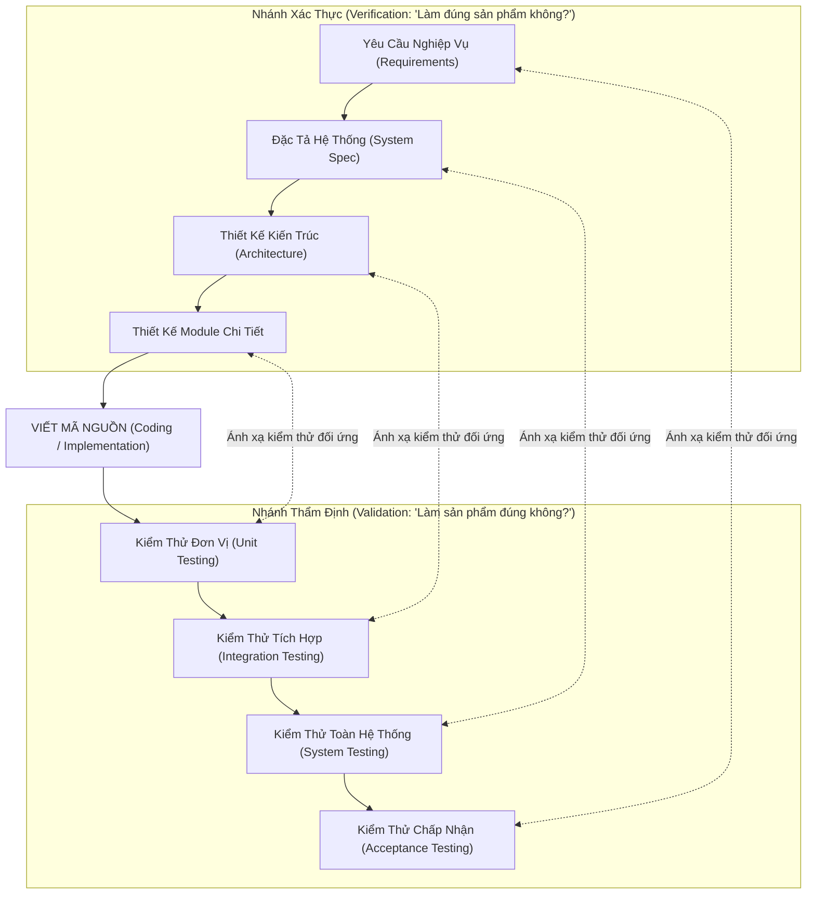
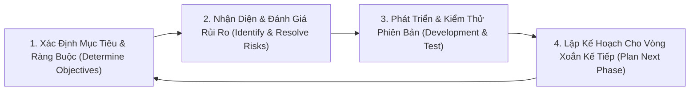
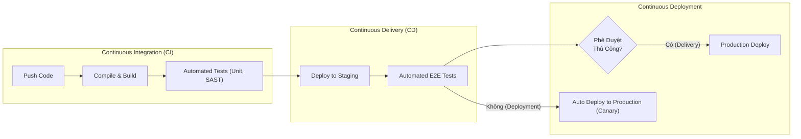

# 1.2. Các Mô Hình Quy Trình Phát Triển Phần Mềm (Software Development Process Models)

> [!IMPORTANT]
> **Nếu bạn chỉ được nhớ một điều duy nhất:** Không có một mô hình quy trình phát triển phần mềm nào (SDLC) là tối ưu cho mọi bối cảnh: **Waterfall và V-Model** đánh đổi tính linh hoạt để lấy sự kiểm soát nghiêm ngặt và tính dự đoán cao trong các hệ thống an toàn tính mạng (Hàng không, Thiết bị y tế, Hạt nhân); trong khi **Agile, Lean và DevOps** chấp nhận sự biến động liên tục để tối đa hóa tốc độ phản hồi thị trường và giảm thiểu chu kỳ phản hồi (Feedback Loop) từ hàng tháng xuống còn vài phút. Bản chất của kỹ nghệ phần mềm là nhận diện chính xác **Mức độ Rủi ro (Risk Profile)** và **Tốc độ Thay đổi Yêu cầu (Volatility)** để lựa chọn mô hình quy trình phù hợp, thay vì cuồng tín áp đặt Agile một cách mù quáng vào mọi dự án.

---

## 1. Kiến trúc Tổng quan & Mô hình Tư duy (Mental Model)

### 1.1. Ẩn dụ Đời sống: Xây Dựng Cầu Vượt Thép vs Thiết Kế Xe Đua Công Thức 1

Hãy hình dung sự khác biệt giữa hai dự án kỹ thuật quy mô lớn:
- **Xây cầu vượt bắc qua sông (Waterfall & V-Model)**:
  - Bạn không thể đổ móng trụ cầu bằng phiên bản thử nghiệm "Beta" rồi tuần sau "Refactor" lại khi thấy nứt!
  - Mọi bản vẽ địa chất, tính toán tải trọng bê tông và sức chịu gió bão bắt buộc phải được thẩm định, ký duyệt nghiêm ngặt qua từng chốt kiểm soát (Phase Gates). Khâu kiểm thử vật liệu (Validation) ánh xạ đối ứng trực tiếp với từng khâu thiết kế (Verification).
- **Đội đua xe Công thức 1 (F1) (Agile, Lean & Continuous Delivery)**:
  - Đội ngũ kỹ thuật không chờ hết mùa giải 1 năm mới nâng cấp xe một lần.
  - Sau mỗi chặng đua (Sprint), dữ liệu cảm biến telemetry được phân tích lập tức để tinh chỉnh cánh gió và áp suất lốp (Iterative Feedback). Chiếc xe liên tục được nâng cấp từng chi tiết nhỏ sau mỗi tuần để thích ứng với thời tiết và chiến thuật của đối thủ.

```mermaid
graph TD
    classDef predictive fill:#e1f5fe,stroke:#0288d1,stroke-width:2px;
    classDef iterative fill:#fff3e0,stroke:#f57c00,stroke-width:2px;
    classDef agile fill:#e8f5e9,stroke:#388e3c,stroke-width:2px;
    classDef devops fill:#f3e5f5,stroke:#7b1fa2,stroke-width:2px;

    Root["CÁC MÔ HÌNH QUY TRÌNH PHÁT TRIỂN PHẦN MỀM (SDLC)"]

    Root --> M1["1. Mô Hình Tuyến Tính & Xác Định (Predictive)"]:::predictive
    Root --> M2["2. Mô Hình Lặp & Quản Trị Rủi Ro (Iterative / Risk-Driven)"]:::iterative
    Root --> M3["3. Mô Hình Thích Ứng & Tinh Gọn (Adaptive & Lean)"]:::agile
    Root --> M4["4. Mô Hình Tích Hợp Vận Hành Liên Tục (DevOps / CD)"]:::devops

    M1 --> M1A["Waterfall Model (Thác Nước Cổ Điển)"]
    M1 --> M1B["V-Model (Xác Thực & Thẩm Định Song Song)"]

    M2 --> M2A["Iterative & Incremental Development"]
    M2 --> M2B["Boehm's Spiral Model (Xoắn Ốc Hướng Rủi Ro)"]
    M2 --> M2C["Prototyping & Evolutionary Development"]

    M3 --> M3A["Agile Frameworks (Scrum, Kanban, XP)"]
    M3 --> M3B["Lean Software Development (Loại Bỏ Lãng Phí)"]
    M3 --> M3C["RAD & RUP (Rational Unified Process)"]

    M4 --> M4A["DevOps Culture & Continuous Delivery"]
    M4 --> M4B["Continuous Deployment (Zero-Downtime)"]
    M4 --> M4C["Hybrid SDLC Models (Water-Scrum-Fall)"]
```



---

## 2. Chi tiết từng Keyword (Under-the-Hood Deep Dive)

### 2.1. Waterfall Model & V-Model

#### 1. Waterfall Model (Mô Hình Thác Nước)
Được đề xuất lần đầu bởi Winston Royce vào năm 1970, Waterfall là mô hình quy trình tuyến tính tuần tự:
- Dòng chảy đi qua các giai đoạn cố định: **Yêu cầu (Requirements) $\to$ Thiết kế (Design) $\to$ Triển khai (Implementation) $\to$ Kiểm thử (Verification) $\to$ Vận hành & Bảo trì (Maintenance)**.
- **Cơ chế Chốt Kiểm Soát (Phase Gate Reviews)**: Một giai đoạn chỉ được phép bắt đầu sau khi giai đoạn trước đó đã hoàn thành $100\%$ và được phê duyệt bằng văn bản chính thức (Sign-off). Nghiêm cấm việc quay ngược lại giai đoạn trước để sửa đổi yêu cầu.
- **Bản chất phù hợp**: Các dự án có yêu cầu rõ ràng, đóng băng từ đầu, công nghệ quen thuộc và hợp đồng trọn gói (Fixed-price contracts).

#### 2. V-Model (Mô Hình Chữ V - Verification & Validation)
V-Model mở rộng mô hình thác nước bằng cách liên kết chặt chẽ từng giai đoạn phát triển ở nhánh đi xuống với giai đoạn kiểm thử tương ứng ở nhánh đi lên:



- Kế hoạch kiểm thử chấp nhận (Acceptance Test Plan) được thiết kế ngay khi đang thu thập Yêu cầu nghiệp vụ; Kế hoạch Unit Test được viết ngay khi thiết kế module.
- Ứng dụng: Bắt buộc trong tiêu chuẩn kỹ thuật an toàn quốc tế như **ISO 26262 (Ô tô tự hành)**, **DO-178C (Hàng không dân dụng)** và **IEC 62304 (Thiết bị y tế cứu sinh)**.

---

### 2.2. Iterative, Incremental, Spiral, Prototyping & Evolutionary Development

#### 1. Phát Triển Tăng Dần (Incremental) vs Lặp Đi Lặp Lại (Iterative)
- **Incremental (Tăng dần)**: Xây dựng từng phần của hệ thống hoàn chỉnh theo từng đợt (Ví dụ: Đợt 1 làm module Đăng nhập, Đợt 2 làm module Thanh toán, Đợt 3 làm module Báo cáo).
- **Iterative (Lặp)**: Xây dựng toàn bộ hệ thống ở mức độ thô sơ, sau đó tinh chỉnh và nâng cấp độ chi tiết qua từng vòng lặp (Ví dụ: Vòng 1 làm bản nháp phác thảo toàn bộ ứng dụng, Vòng 2 hoàn thiện tính năng cơ bản, Vòng 3 tối ưu hóa hiệu năng).

#### 2. Mô Hình Xoắn Ốc Boehm (Spiral Model - Risk-Driven Development)
Phát minh bởi Barry Boehm vào năm 1986, Spiral Model là mô hình quy trình lấy **Quản trị Rủi ro (Risk Management)** làm trung tâm điều phối. Quy trình xoay quanh 4 góc phần tư lặp lại theo hình xoắn ốc nở rộng:



- Nếu rủi ro kỹ thuật quá cao (ví dụ chưa rõ thuật toán AI có chạy kịp thời gian thực hay không), vòng xoắn tập trung xây dựng một bản thử nghiệm (Prototype) để đo lường. Nếu rủi ro kinh doanh không khả thi, dự án có thể hủy bỏ ngay lập tức trước khi tiêu tốn hàng triệu USD tiền phát triển.

#### 3. Prototyping & Evolutionary Development
- **Throwaway Prototyping (Bản mẫu vứt bỏ)**: Viết nhanh một ứng dụng mô phỏng giao diện hoặc kiến trúc để người dùng trải nghiệm và xác nhận yêu cầu, sau đó xóa bỏ hoàn toàn mã nguồn này để viết lại chuẩn mực.
- **Evolutionary Prototyping (Bản mẫu tiến hóa)**: Bắt đầu từ một hạt nhân tối thiểu có thể chạy được (MVP - Minimum Viable Product), sau đó liên tục tiếp thu phản hồi của người dùng thực để phát triển mã nguồn thành sản phẩm chính thức.

---

### 2.3. Agile, Lean Software Development, RAD & RUP

#### 1. Agile Frameworks & Bản Tuyên Ngôn Agile 2001
Agile không phải là một công cụ hay quy trình cứng nhắc, mà là một tập hợp các giá trị và nguyên tắc:
1. Cá nhân và sự tương tác **hơn là** quy trình và công cụ.
2. Phần mềm chạy tốt **hơn là** tài liệu đầy đủ.
3. Cộng tác với khách hàng **hơn là** đàm phán hợp đồng.
4. Phản hồi với sự thay đổi **hơn là** bám sát kế hoạch.
- Các khung triển khai phổ biến: **Scrum** (Sprints 1-4 tuần, Product Backlog, Daily Standup), **Kanban** (Giới hạn công việc đang làm WIP - Work in Progress, trực quan hóa luồng giá trị), và **XP - Extreme Programming** (Pair Programming, TDD, Continuous Integration).

#### 2. Lean Software Development (7 Nguyên Lý Tinh Gọn)
Chuyển hóa từ triết lý sản xuất của Toyota (TPS) vào kỹ nghệ phần mềm bởi Mary & Tom Poppendieck:
1. **Loại bỏ lãng phí (Eliminate Waste)**: Xóa bỏ các tính năng không ai dùng, tài liệu thừa thãi, thời gian chờ đợi bàn giao.
2. **Xây dựng chất lượng từ gốc (Build Integrity In)**: Tự động hóa kiểm thử, Refactoring liên tục, ngăn chặn bug ngay từ khi viết code thay vì chờ QA bắt lỗi.
3. **Khuếch đại học hỏi (Amplify Learning)**: Tạo các vòng lặp phản hồi ngắn để đội ngũ liên tục thử nghiệm và rút kinh nghiệm.
4. **Trì hoãn quyết định đến phút chót (Decide as Late as Possible)**: Giữ các phương án kiến trúc mở cho đến khi có đủ dữ liệu thực tế, tránh quyết định sớm dựa trên giả định mơ hồ.
5. **Giao hàng nhanh nhất có thể (Deliver as Fast as Possible)**.
6. **Tôn trọng và trao quyền cho con người (Empower the Team)**.
7. **Tối ưu hóa toàn cục (Optimize the Whole)**: Tối ưu hóa toàn bộ dòng chảy giá trị từ lúc nảy ra ý tưởng tới khi khách hàng nhận được giá trị, thay vì chỉ tối ưu cục bộ từng phòng ban.

#### 3. RAD & RUP (Rational Unified Process)
- **RAD (Rapid Application Development)**: Tập trung vào phát triển nhanh bằng cách sử dụng các công cụ kéo thả, sinh code tự động và tương tác trực tiếp với người dùng.
- **RUP**: Khung quy trình lặp có cấu trúc chặt chẽ của IBM Rational chia dự án thành 4 pha lớn: **Inception (Khởi tạo) $\to$ Elaboration (Làm rõ kiến trúc) $\to$ Construction (Xây dựng) $\to$ Transition (Chuyển giao)**.

---

### 2.4. DevOps, Continuous Delivery, Continuous Deployment & Hybrid Models

#### 1. DevOps & Văn Hóa Xóa Bỏ Bức Tường Ngăn Cách (Wall of Confusion)
Trước đây, Đội ngũ Phát triển (Dev) muốn thay đổi nhanh để ra tính năng mới, trong khi Đội ngũ Vận hành (Ops) muốn hệ thống ổn định và từ chối cập nhật. DevOps phá vỡ xung đột này bằng cách thống nhất trách nhiệm: **"You build it, you run it" (Werner Vogels)**.



- **Continuous Integration (CI)**: Mọi commit đều được tích hợp vào nhánh chính hàng ngày và kích hoạt kiểm thử tự động.
- **Continuous Delivery (CD)**: Mã nguồn luôn ở trạng thái sẵn sàng phát hành lên Production bất kỳ lúc nào chỉ bằng một nút bấm phê duyệt.
- **Continuous Deployment (Triển khai liên tục)**: Mọi thay đổi vượt qua bộ kiểm thử tự động đều được đẩy thẳng ra môi trường Production thực tế mà không cần con người can thiệp thủ công (như tại Netflix, Amazon triển khai hàng nghìn lần mỗi ngày).

#### 2. Hybrid Models (Mô Hình Lai: Water-Scrum-Fall)
Thực tế trong các tập đoàn lớn: Pha lập kế hoạch ngân sách và ký hợp đồng thực hiện theo kiểu **Waterfall**; Đội ngũ kỹ sư lập trình chạy Sprint theo **Scrum**; nhưng khâu phát hành và phê duyệt an ninh lại quay về **Waterfall** nặng nề. Kỹ sư giỏi phải nhận diện được mô hình lai này để thiết lập các lớp đệm bảo vệ đội ngũ phát triển.

---

## 3. Thực thi Mã nguồn & Mô phỏng Chuyên sâu (Dual-Engine Implementation)

### 3.1. C++20 Clean Architecture Repository với Design Contract (Build Integrity In)

Chương trình minh chứng nguyên lý Lean Software Development: "Build Integrity In" bằng cách sử dụng C++20 Concepts, Interface Segregation và Dependency Inversion để tạo ra mã nguồn có khả năng kiểm thử độc lập tuyệt đối (Testability), tách rời hoàn toàn nghiệp vụ khỏi cơ sở dữ liệu:

```cpp
// clean_domain_service.cpp
// Biên dịch: g++ -std=c++20 -O3 clean_domain_service.cpp -o clean_domain_service
#include <iostream>
#include <string>
#include <vector>
#include <memory>
#include <optional>
#include <concepts>
#include <stdexcept>

// 1. Entity Nghiệp vụ cốt lõi
struct UserAccount {
    int id;
    std::string username;
    double balance;
    bool is_active;
};

// 2. C++20 Concept định nghĩa Hợp đồng Repository (Design by Contract)
template <typename T>
concept UserRepositoryContract = requires(T repo, int id, const UserAccount& user) {
    { repo.find_by_id(id) } -> std::same_as<std::optional<UserAccount>>;
    { repo.save(user) } -> std::same_as<void>;
};

// 3. In-Memory Mock Repository phục vụ kiểm thử nhanh tức thì trong Sprint (TDD/Agile)
class InMemoryUserRepository {
private:
    std::vector<UserAccount> database_;

public:
    std::optional<UserAccount> find_by_id(int id) {
        for (const auto& u : database_) {
            if (u.id == id) return u;
        }
        return std::nullopt;
    }

    void save(const UserAccount& user) {
        for (auto& u : database_) {
            if (u.id == user.id) {
                u = user;
                return;
            }
        }
        database_.push_back(user);
    }
};

// 4. Use Case Nghiệp vụ: Chuyển tiền (Không phụ thuộc vào Database thật)
template <UserRepositoryContract Repo>
class FundTransferService {
private:
    Repo& repo_;

public:
    explicit FundTransferService(Repo& repo) : repo_(repo) {}

    void transfer(int from_id, int to_id, double amount) {
        if (amount <= 0.0) {
            throw std::invalid_argument("Số tiền chuyển phải lớn hơn 0!");
        }

        auto sender_opt = repo_.find_by_id(from_id);
        auto receiver_opt = repo_.find_by_id(to_id);

        if (!sender_opt || !receiver_opt) {
            throw std::runtime_error("Không tìm thấy tài khoản người gửi hoặc người nhận!");
        }

        UserAccount sender = *sender_opt;
        UserAccount receiver = *receiver_opt;

        if (!sender.is_active || !receiver.is_active) {
            throw std::runtime_error("Tài khoản đang bị khóa, không thể giao dịch!");
        }

        if (sender.balance < amount) {
            throw std::runtime_error("Số dư người gửi không đủ để thực hiện giao dịch!");
        }

        sender.balance -= amount;
        receiver.balance += amount;

        repo_.save(sender);
        repo_.save(receiver);

        std::cout << "  [TRANSACTION SUCCESS] Chuyển $" << amount 
                  << " từ User #" << from_id << " sang User #" << to_id << " thành công!\n";
    }
};

int main() {
    std::cout << "=======================================================================\n";
    std::cout << "        C++20 LEAN CLEAN ARCHITECTURE & TESTABILITY SIMULATION         \n";
    std::cout << "=======================================================================\n\n";

    InMemoryUserRepository mock_repo;
    mock_repo.save({1, "alice_dev", 500.0, true});
    mock_repo.save({2, "bob_ops", 100.0, true});

    FundTransferService<InMemoryUserRepository> service(mock_repo);

    std::cout << "[PHASE 1] Thực thi chuyển tiền hợp lệ:\n";
    service.transfer(1, 2, 150.0);

    auto alice = mock_repo.find_by_id(1);
    auto bob = mock_repo.find_by_id(2);
    std::cout << "  -> Số dư Alice: $" << alice->balance << " | Số dư Bob: $" << bob->balance << "\n";

    std::cout << "\n[PHASE 2] Thử nghiệm chuyển tiền vượt số dư (Bảo vệ Invariant):\n";
    try {
        service.transfer(1, 2, 1000.0);
    } catch (const std::exception& ex) {
        std::cout << "  -> BẮT NGOẠI LỆ HỢP LỆ: " << ex.what() << "\n";
    }

    return 0;
}
```

#### Terminal Output Mẫu:
```text
=======================================================================
        C++20 LEAN CLEAN ARCHITECTURE & TESTABILITY SIMULATION         
=======================================================================

[PHASE 1] Thực thi chuyển tiền hợp lệ:
  [TRANSACTION SUCCESS] Chuyển $150 từ User #1 sang User #2 thành công!
  -> Số dư Alice: $350 | Số dư Bob: $250

[PHASE 2] Thử nghiệm chuyển tiền vượt số dư (Bảo vệ Invariant):
  -> BẮT NGOẠI LỆ HỢP LỆ: Số dư người gửi không đủ để thực hiện giao dịch!
```

---

### 3.2. Python 3.11+ SDLC Process Simulator: Waterfall vs Agile Feedback Loop

Chương trình minh chứng sự khác biệt toán học về **Chu kỳ phản hồi (Feedback Loop Delay)** và **Chi phí sửa chữa lỗi (Defect Cost Amplification)** giữa mô hình Waterfall cổ điển và mô hình Agile Sprint hiện đại:

```python
#!/usr/bin/env python3
"""
sdlc_process_simulator.py
Mô phỏng Đánh Đổi Chu Kỳ Phản Hồi và Chi Phí Sửa Lỗi: Waterfall vs Agile
"""
from dataclasses import dataclass
from typing import List

@dataclass
class Defect:
    defect_id: str
    introduced_phase: str
    detected_phase: str
    base_cost: float

    def calculate_actual_cost(self) -> float:
        # Quy tắc 1:10:100 của IBM / Boehm: Chi phí nhân lên gấp 10 lần qua mỗi giai đoạn trễ
        phase_order = ["Requirements", "Design", "Implementation", "Testing", "Production"]
        idx_intro = phase_order.index(self.introduced_phase)
        idx_detect = phase_order.index(self.detected_phase)
        delay_stages = max(0, idx_detect - idx_intro)
        return self.base_cost * (10 ** delay_stages)

def simulate_waterfall():
    print("[MÔ HÌNH WATERFALL TRUYỀN THỐNG: 12 THÁNG DỰ ÁN]")
    # Trong Waterfall, lỗi yêu cầu thường chỉ phát hiện ở pha Testing hoặc Production
    bugs = [
        Defect("BUG-01", introduced_phase="Requirements", detected_phase="Testing", base_cost=100.0),
        Defect("BUG-02", introduced_phase="Requirements", detected_phase="Production", base_cost=100.0),
        Defect("BUG-03", introduced_phase="Design", detected_phase="Production", base_cost=200.0),
    ]

    total_cost = 0.0
    for b in bugs:
        cost = b.calculate_actual_cost()
        total_cost += cost
        print(f"  - {b.defect_id}: Sinh ra tại '{b.introduced_phase}', Phát hiện tại '{b.detected_phase}' "
              f"-> Chi phí khắc phục: ${cost:,.2f}")

    print(f"  >>> TỔNG THIỆT HẠI SỬA LỖI WATERFALL: ${total_cost:,.2f}\n")

def simulate_agile():
    print("[MÔ HÌNH AGILE / SPRINT 2 TUẦN: VÒNG LẶP NGẮN]")
    # Trong Agile, lỗi yêu cầu được phát hiện ngay trong Sprint Review hoặc Unit Test
    bugs = [
        Defect("BUG-01", introduced_phase="Requirements", detected_phase="Design", base_cost=100.0),
        Defect("BUG-02", introduced_phase="Requirements", detected_phase="Implementation", base_cost=100.0),
        Defect("BUG-03", introduced_phase="Design", detected_phase="Testing", base_cost=200.0),
    ]

    total_cost = 0.0
    for b in bugs:
        cost = b.calculate_actual_cost()
        total_cost += cost
        print(f"  - {b.defect_id}: Sinh ra tại '{b.introduced_phase}', Phát hiện tại '{b.detected_phase}' "
              f"-> Chi phí khắc phục: ${cost:,.2f}")

    print(f"  >>> TỔNG THIỆT HẠI SỬA LỖI AGILE: ${total_cost:,.2f}\n")

def main():
    print("=" * 80)
    print("      MÔ PHỎNG SO SÁNH HIỆU QUẢ KINH TẾ: WATERFALL vs AGILE FEEDBACK LOOPS     ")
    print("=" * 80)
    simulate_waterfall()
    simulate_agile()
    print("=" * 80)
    print("KẾT LUẬN: Chu kỳ phản hồi ngắn của Agile giúp tiết kiệm hàng trăm lần chi phí khắc phục lỗi!")

if __name__ == "__main__":
    main()
```

#### Terminal Output Mẫu:
```text
================================================================================
      MÔ PHỎNG SO SÁNH HIỆU QUẢ KINH TẾ: WATERFALL vs AGILE FEEDBACK LOOPS     
================================================================================
[MÔ HÌNH WATERFALL TRUYỀN THỐNG: 12 THÁNG DỰ ÁN]
  - BUG-01: Sinh ra tại 'Requirements', Phát hiện tại 'Testing' -> Chi phí khắc phục: $100,000.00
  - BUG-02: Sinh ra tại 'Requirements', Phát hiện tại 'Production' -> Chi phí khắc phục: $1,000,000.00
  - BUG-03: Sinh ra tại 'Design', Phát hiện tại 'Production' -> Chi phí khắc phục: $200,000.00
  >>> TỔNG THIỆT HẠI SỬA LỖI WATERFALL: $1,300,000.00

[MÔ HÌNH AGILE / SPRINT 2 TUẦN: VÒNG LẶP NGẮN]
  - BUG-01: Sinh ra tại 'Requirements', Phát hiện tại 'Design' -> Chi phí khắc phục: $1,000.00
  - BUG-02: Sinh ra tại 'Requirements', Phát hiện tại 'Implementation' -> Chi phí khắc phục: $10,000.00
  - BUG-03: Sinh ra tại 'Design', Phát hiện tại 'Testing' -> Chi phí khắc phục: $20,000.00
  >>> TỔNG THIỆT HẠI SỬA LỖI AGILE: $31,000.00

================================================================================
KẾT LUẬN: Chu kỳ phản hồi ngắn của Agile giúp tiết kiệm hàng trăm lần chi phí khắc phục lỗi!
```

---

## 4. Systems Engineering & Production Pitfalls

### 4.1. Cạm Bẫy Thực Chiến Thường Gặp (Production Pitfalls)

#### 1. Sự Cố "Cargo Cult Agile" (Tôn Sùng Nghi Thức Rỗng Tuếch)
- **Hiện tượng**: Đội ngũ tổ chức đầy đủ Daily Standup 15 phút, vẽ bảng Jira hoành tráng, làm Sprint Planning và Retrospective đều đặn, nhưng mã nguồn không có Unit Test, không có CI/CD, và mỗi lần release mất 2 tháng kiểm thử thủ công.
- **Nguyên nhân**: Áp dụng hình thức bên ngoài của Agile nhưng thiếu các kỷ luật kỹ thuật cốt lõi (XP Practices: TDD, Pair Programming, Continuous Integration).
- **Giải pháp**: Agile không thể tồn tại nếu thiếu nền tảng kỹ thuật tự động hóa (Automated Testing & Deployment Automation).

#### 2. Thảm Họa "Big-Bang Release" Trong Mô Hình Waterfall
- **Hiện tượng**: Tích hợp toàn bộ mã nguồn của 20 lập trình viên viết riêng lẻ trong suốt 6 tháng vào đúng ngày cuối cùng trước ngày bàn giao.
- **Hậu quả**: Xuất hiện hàng trăm xung đột git (Merge Hell), các module không thể giao tiếp được với nhau, lỗi văng ra ngập tràn mà không biết do dòng code nào gây ra.
- **Giải pháp**: Bắt buộc áp dụng **Trunk-Based Development** và tích hợp liên tục (CI) ít nhất một lần mỗi ngày.

#### 3. Bẫy Ngộ Nhận "DevOps Là Một Chức Danh Tuyển Dụng"
- **Hiện tượng**: Doanh nghiệp tuyển một "Kỹ sư DevOps" về và giao cho họ toàn bộ việc release và sửa lỗi máy chủ, biến kỹ sư này thành một đội Ops cô lập mới.
- **Giải pháp**: DevOps là **Văn hóa Hợp tác và Tự Động Hóa** của toàn bộ tổ chức kỹ thuật, nơi mọi kỹ sư phần mềm đều phải có trách nhiệm quan sát và vận hành mã nguồn của mình trên Production.

---

### 4.2. CLI Diagnostics & Công Cụ Đo Lường Hiệu Năng Quy Trình

```bash
# 1. Đo lường chỉ số Lead Time for Changes bằng git log
git log --pretty=format:"%h - %an, %ar : %s" -n 20

# 2. Kiểm tra tỷ lệ commit được build thành công trên CI Pipeline (GitHub Actions CLI)
gh run list --limit 10

# 3. Quét kiểm tra các vi phạm kiến trúc Clean Architecture tự động trong mã nguồn
sonar-scanner -Dsonar.projectKey=my_backend_project
```

---

## 5. Bảng So sánh & Decision Matrix

| Mô Hình Quy Trình | Mức Độ Rủi Ro Thích Hợp | Tốc Độ Thay Đổi Yêu Cầu | Chu Kỳ Phản Hồi (Feedback) | Tác Động Khi Đổi Yêu Cầu | Kịch Bản Khuyên Dùng |
| :--- | :--- | :--- | :--- | :--- | :--- |
| **Waterfall** | Rất thấp (Yêu cầu cố định) | Cực thấp (Đóng băng từ đầu) | Hàng tháng đến hàng năm | Cực kỳ tốn kém và nguy hiểm | Xây cầu đường, Hệ thống vệ tinh vũ trụ |
| **V-Model** | Cực thấp (Safety-critical) | Thấp (Tuân thủ tiêu chuẩn) | Trung bình (Theo từng tầng test)| Rất tốn kém | Thiết bị y tế, Hệ thống phanh ABS ô tô |
| **Spiral Model** | Rất cao (Nhiều rủi ro chưa rõ)| Trung bình | Theo từng vòng xoắn (1-3 tháng) | Được kiểm soát qua Risk Review | Dự án R&D công nghệ mới, Game bom tấn |
| **Agile / Scrum** | Trung bình - Cao | Rất cao (Thị trường biến động)| 1 - 2 tuần (Sprint) | Rất linh hoạt, chi phí thấp | Ứng dụng Web, SaaS, Mobile Apps |
| **DevOps / CD** | Trung bình - Cao | Liên tục theo thời gian thực | Vài phút đến vài giờ | Tức thì (Zero friction) | Hệ thống Cloud-Native, Big Data, FinTech |
