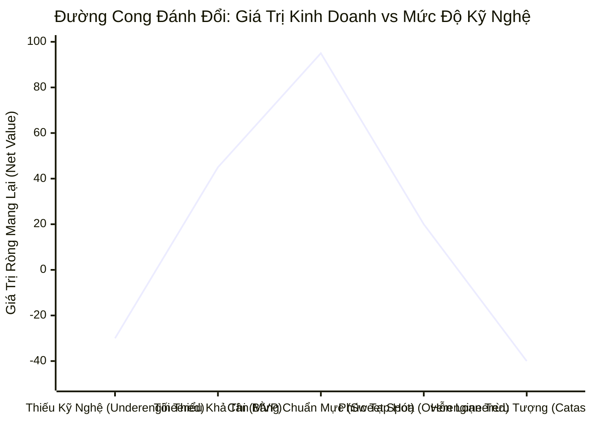

# 1.3. Các Đánh Đổi Trong Kỹ Nghệ Phần Mềm (Software Engineering Trade-offs)

> [!IMPORTANT]
> **Nếu bạn chỉ được nhớ một điều duy nhất:** Trong kỹ nghệ phần mềm chuyên nghiệp, **không có giải pháp hoàn hảo, chỉ có các sự đánh đổi (There are no solutions, only trade-offs)**: Mọi quyết định kiến trúc tốt hôm nay đều là việc chấp nhận một điểm yếu có kiểm soát để đổi lấy một lợi thế kinh doanh then chốt. Cố gắng tối ưu hóa tất cả mọi thứ cùng lúc chính là công thức dẫn đến thảm họa **Overengineering (Kỹ nghệ quá đà)**. Kỹ sư trưởng xuất sắc không phải là người viết ra các cấu trúc phức tạp nhất, mà là người có tư duy thực dụng sâu sắc (**Pragmatic Engineering**): Biết khi nào nên áp dụng **KISS, YAGNI, DRY, Rule of Three và POLA**, và biết dũng cảm chấp nhận sự trùng lặp có chủ đích thay vì tạo ra những tầng trừu tượng sai lầm.

---

## 1. Kiến trúc Tổng quan & Mô hình Tư duy (Mental Model)

### 1.1. Ẩn dụ Đời sống: Chiếc Xe Thể Thao F1 vs Xe Bán Tải Địa Hình

Hãy hình dung khi bạn bước vào một showroom ô tô:
- **Chiếc xe đua Công thức 1 (Tối ưu hóa cực đoan về Tốc độ - Time Optimization)**:
  - Tăng tốc từ 0 lên 100 km/h trong 2 giây. Nhưng nó không có cốp chở đồ (Không gian bộ nhớ = 0), gầm xe cách mặt đất chỉ vài centimet (Không thể đi đường gồ ghề), và đòi hỏi một đội ngũ 20 kỹ sư bảo dưỡng sau mỗi chặng đua (Chi phí bảo trì cực cao).
- **Chiếc xe bán tải máy dầu (Cân bằng & Linh hoạt - Pragmatic Utility)**:
  - Không thể chạy nhanh như xe F1, nhưng nó chở được 1 tấn hàng hóa (High Capacity), đi qua được mọi địa hình lầy lội (Resilience), và động cơ chạy 10 năm chỉ cần thay dầu định kỳ (Low Maintenance).
- **Kỹ sư ngây thơ (Naive Engineer)**: Cố gắng chế tạo một chiếc xe vừa chạy nhanh như F1, vừa chở nặng như xe tải, vừa tiết kiệm xăng như xe máy, và vừa rẻ tiền. Kết quả là tạo ra một "quái vật cơ khí" phức tạp gấp 10 lần, liên tục hỏng hóc và không ai có thể lái được!

```mermaid
graph TD
    classDef classic fill:#e1f5fe,stroke:#0288d1,stroke-width:2px;
    classDef pitfall fill:#ffebee,stroke:#d32f2f,stroke-width:2px;
    classDef pragmatic fill:#e8f5e9,stroke:#388e3c,stroke-width:2px;

    Root["BẢN ĐỒ ĐÁNH ĐỔI TRONG KỸ NGHỆ PHẦN MỀM (TRADE-OFFS)"]

    Root --> C1["1. Đánh Đổi Kỹ Thuật Cổ Điển (Classic Trade-offs)"]:::classic
    Root --> C2["2. Cạm Bẫy Kỹ Nghệ (Engineering Pitfalls)"]:::pitfall
    Root --> C3["3. Nguyên Tắc Kỹ Sư Thực Dụng (Pragmatic Principles)"]:::pragmatic

    C1 --> C1A["Không Gian vs Thời Gian (Space vs Time: Caching vs CPU)"]
    C1 --> C1B["Độ Trễ vs Thông Lượng (Latency vs Throughput: Batching)"]
    C1 --> C1C["Nhất Quán vs Khả Dụng (Consistency vs Availability: CAP/PACELC)"]
    C1 --> C1D["Linh Hoạt vs Đơn Giản (Flexibility vs Simplicity: Abstraction Cost)"]

    C2 --> C2A["Tối Ưu Hóa Sớm (Premature Optimization - Donald Knuth)"]
    C2 --> C2B["Kỹ Nghệ Quá Đà (Overengineering - Second System Effect)"]
    C2 --> C2C["Kỹ Nghệ Thiếu Hụt (Underengineering & Tech Debt)"]

    C3 --> C3A["KISS (Keep It Simple, Stupid)"]
    C3 --> C3B["YAGNI (You Aren't Gonna Need It)"]
    C3 --> C3C["DRY vs Duplication is Cheaper than Wrong Abstraction"]
    C3 --> C3D["Rule of Three & POLA (Principle of Least Astonishment)"]
```



---

## 2. Chi tiết từng Keyword (Under-the-Hood Deep Dive)

### 2.1. Classic Engineering Trade-offs (Đánh Đổi Kỹ Thuật Cổ Điển)

#### 1. Không Gian vs Thời Gian (Space vs Time / Memory vs CPU)
- **Bản chất**: Bạn có thể làm một phép toán chạy nhanh hơn bằng cách sử dụng nhiều bộ nhớ RAM hơn để lưu trữ kết quả tính toán sẵn (Precomputation, Caching, Memoization); hoặc bạn có thể tiết kiệm RAM bằng cách tính toán lại từ đầu mỗi khi cần (On-the-fly Computation) hoặc nén dữ liệu (Data Compression).
- **Ví dụ thực chiến trong Database**:
  - Thêm một B-Tree Index vào bảng `orders` giúp câu lệnh `SELECT` tìm kiếm từ $O(N)$ thành $O(\log N)$ (Tiết kiệm thời gian).
  - Nhưng cái giá phải trả: Tốn thêm hàng chục Gigabytes đĩa cứng để lưu cây chỉ mục, và làm chậm lệnh `INSERT/UPDATE` vì phải cập nhật lại cây (Tốn không gian và chi phí ghi).

#### 2. Độ Trễ vs Thông Lượng (Latency vs Throughput)
- **Bản chất**:
  - **Độ trễ (Latency)**: Thời gian hoàn tất của một yêu cầu đơn lẻ (tính bằng mili-giây).
  - **Thông lượng (Throughput)**: Số lượng yêu cầu xử lý được trong một đơn vị thời gian (QPS / IOPS).
- **Mâu thuẫn toán học**:
  - Để tối đa hóa thông lượng, ta phải áp dụng **Gom lô (Batching)** và **Nén (Compression)**: Gom 1.000 messages lại rồi gửi một lượt qua mạng. Hành động gom lô làm tăng thông lượng lên gấp 10 lần, nhưng **làm tăng độ trễ của message đầu tiên** vì nó phải đứng trong hàng đợi chờ các message tiếp theo đến đủ.

#### 3. Tính Nhất Quán vs Tính Khả Dụng (Consistency vs Availability - CAP/PACELC)
- Trong môi trường mạng phân tán có rủi ro đứt kết nối (Partition $P$):
  - Nếu chọn **Strong Consistency ($C$)**: Hệ thống từ chối phục vụ khách hàng khi chưa đồng bộ xong dữ liệu giữa các node $\implies$ Mất tính khả dụng ($A$).
  - Nếu chọn **High Availability ($A$)**: Hệ thống trả về dữ liệu ngay lập tức cho khách hàng bất chấp rủi ro dữ liệu có thể đã cũ (Stale Data) $\implies$ Mất tính nhất quán.

#### 4. Tính Linh Hoạt vs Tính Đơn Giản (Flexibility vs Simplicity)
- Một cấu trúc mã nguồn càng linh hoạt, hỗ trợ cắm rút nhiều plugin (Extensible / Pluggable via 10 Interfaces, Abstract Factories, Decorators) thì càng trở nên phức tạp, khó hiểu và khó debug đối với người mới gia nhập dự án.

---

### 2.2. Engineering Pitfalls: Optimization, Overengineering & Underengineering



#### 1. Tối Ưu Hóa Sớm (Premature Optimization - Donald Knuth)
- Donald Knuth đã tuyên bố câu nói kinh điển năm 1974: *"Premature optimization is the root of all evil (or at least most of it) in programming"*.
- **Cạm bẫy**: Lập trình viên cố gắng viết code C++ bằng bitwise hacks, inline assembly hoặc tránh cấp phát bộ nhớ một cách cực đoan cho một tính năng nghiệp vụ chỉ chạy 1 lần mỗi ngày. Code trở nên rối rắm, đầy lỗi bộ nhớ trong khi hiệu năng tổng thể của ứng dụng không tăng lên dù chỉ $0.01\%$.
- **Quy tắc vàng**: **"Make it work, make it right, make it fast" (Kent Beck)**. Luôn dùng công cụ đo lường (Profiler: `perf`, Valgrind) trước khi quyết định tối ưu dòng code nào.

#### 2. Kỹ Nghệ Quá Đà (Overengineering & The Second-System Effect)
- Xảy ra khi kỹ sư thiết kế phần mềm cho những kịch bản tưởng tượng trong tương lai 10 năm nữa mà doanh nghiệp chưa từng yêu cầu.
- Sinh ra hàng chục tầng trừu tượng rỗng tuếch (Kiểu Java Enterprise: `AbstractSingletonProxyFactoryBean`). Kết quả: Dự án chậm tiến độ 1 năm, tiêu tốn ngân sách và không giải quyết được bài toán kinh doanh hiện tại.

#### 3. Kỹ Nghệ Thiếu Hụt (Underengineering & Bẫy "Quick and Dirty")
- Ngược lại với Overengineering, lập trình viên "viết nhanh cho xong việc" bằng cách copy-paste code, hardcode chuỗi kết nối, không viết test và bỏ qua xử lý lỗi. Hệ thống sụp đổ ngay khi có 1.000 người dùng đầu tiên truy cập, biến toàn bộ dự án thành một đống nợ kỹ thuật (Technical Debt) không thể cứu vãn.

---

### 2.3. Pragmatic Principles: KISS, YAGNI, DRY, Rule of Three & POLA

#### 1. KISS (Keep It Simple, Stupid)
- Hệ thống hoạt động tốt nhất khi được giữ ở mức độ đơn giản nhất có thể. Đơn giản ở đây là một thành tựu kỹ thuật đỉnh cao, đòi hỏi sự thấu hiểu sâu sắc bản chất vấn đề, chứ không phải là sự hời hợt ngây thơ.

#### 2. YAGNI (You Aren't Gonna Need It)
- Bắt nguồn từ phương pháp luận Extreme Programming (XP): **"Luôn triển khai những gì bạn thực sự cần NGAY BÂY GIỜ, không bao giờ triển khai những gì bạn dự đoán mình CÓ THỂ cần trong tương lai"**.
- $80\%$ các tính năng được viết ra dựa trên phán đoán tương lai đều không bao giờ được người dùng sử dụng!

#### 3. DRY (Don't Repeat Yourself) vs "Duplication is Cheaper than Wrong Abstraction"
- **Ý nghĩa thực sự của DRY (The Pragmatic Programmer)**: DRY không nói về việc cấm trùng lặp dòng code bề ngoài; DRY nói về việc: **"Mỗi mẩu tri thức nghiệp vụ (Single Source of Truth) chỉ được phép có một đại diện duy nhất, không mơ hồ bên trong hệ thống"**.
- **Cảnh báo của Sandi Metz**: *"Duplication is far cheaper than the wrong abstraction"* (Sự trùng lặp code ban đầu rẻ hơn gấp trăm lần việc tạo ra một tầng trừu tượng sai lầm). Nếu hai đoạn code tình cờ giống nhau về mặt cú pháp nhưng phục vụ hai miền nghiệp vụ thay đổi theo hai lý do khác nhau, việc gộp chúng lại sẽ tạo ra sự phụ thuộc chéo chết người (Tight Coupling).

#### 4. Rule of Three (Quy Tắc Số Ba)
- Lần đầu tiên bạn viết code: Hãy viết bình thường.
- Lần thứ hai bạn thấy code tương tự: Hãy chấp nhận sự trùng lặp (Copy code).
- Lần thứ ba bạn thấy cùng một logic xuất hiện: **ĐÂY MỚI LÀ LÚC THÍCH HỢP ĐỂ TẠO TRỪU TƯỢNG HÓA VÀ REFACTOR!** Khi đã có đủ 3 ví dụ thực tế, bạn mới nhìn rõ được ranh giới chân thực của abstraction.

#### 5. POLA (Principle of Least Astonishment / Surprise)
- Giao diện người dùng hoặc chữ ký hàm (API Design) phải luôn hoạt động theo cách **ít gây ngạc nhiên nhất** cho người sử dụng. Nếu một hàm tên là `getUserProfile(id)` mà bên trong lại âm thầm cập nhật database (`UPDATE users`) hoặc xóa dữ liệu, đó là một hành vi vi phạm nghiêm trọng POLA.

---

## 3. Thực thi Mã nguồn & Mô phỏng Chuyên sâu (Dual-Engine Implementation)

### 3.1. C++20 Zero-Cost Abstraction via Concepts vs Virtual Call Dynamic Dispatch

Chương trình minh chứng sự đánh đổi giữa **Tính Linh Hoạt Runtime (Dynamic Polymorphism qua Virtual Table)** và **Hiệu Năng Tối Thượng Biên Dịch (Zero-Cost Static Polymorphism qua C++20 Concepts)**:

```cpp
// polymorphism_tradeoff.cpp
// Biên dịch: g++ -std=c++20 -O3 polymorphism_tradeoff.cpp -o polymorphism_tradeoff
#include <iostream>
#include <vector>
#include <memory>
#include <chrono>
#include <concepts>
#include <numeric>

// ============================================================================
// HƯỚNG 1: DYNAMIC POLYMORPHISM (Linh hoạt Runtime, tốn vtable pointer, no inlining)
// ============================================================================
class PaymentProcessorInterface {
public:
    virtual ~PaymentProcessorInterface() = default;
    virtual double process_fee(double amount) const = 0;
};

class CreditCardDynamic : public PaymentProcessorInterface {
public:
    double process_fee(double amount) const override {
        return amount * 0.025; // Phí 2.5%
    }
};

// ============================================================================
// HƯỚNG 2: ZERO-COST STATIC POLYMORPHISM (C++20 Concept, Compile-time Inlining)
// ============================================================================
template <typename T>
concept PaymentProcessorConcept = requires(T p, double amount) {
    { p.process_fee(amount) } -> std::same_as<double>;
};

class CreditCardStatic {
public:
    double process_fee(double amount) const {
        return amount * 0.025;
    }
};

template <PaymentProcessorConcept P>
double calculate_total_static(const P& processor, double amount, int iterations) {
    double total = 0.0;
    for (int i = 0; i < iterations; ++i) {
        total += processor.process_fee(amount);
    }
    return total;
}

double calculate_total_dynamic(const PaymentProcessorInterface& processor, double amount, int iterations) {
    double total = 0.0;
    for (int i = 0; i < iterations; ++i) {
        total += processor.process_fee(amount); // Virtual method call overhead
    }
    return total;
}

int main() {
    std::cout << "=======================================================================\n";
    std::cout << "     C++20 BENCHMARK: ZERO-COST CONCEPTS vs VIRTUAL DYNAMIC DISPATCH    \n";
    std::cout << "=======================================================================\n\n";

    constexpr int ITERATIONS = 100'000'000;
    constexpr double TEST_AMOUNT = 1500.0;

    // 1. Benchmark Dynamic Polymorphism (OOP truyền thống)
    CreditCardDynamic dynamic_proc;
    auto t0 = std::chrono::steady_clock::now();
    double dynamic_result = calculate_total_dynamic(dynamic_proc, TEST_AMOUNT, ITERATIONS);
    auto t1 = std::chrono::steady_clock::now();
    auto dynamic_ms = std::chrono::duration_cast<std::chrono::milliseconds>(t1 - t0).count();

    // 2. Benchmark Static Polymorphism (C++20 Concepts)
    CreditCardStatic static_proc;
    auto t2 = std::chrono::steady_clock::now();
    double static_result = calculate_total_static(static_proc, TEST_AMOUNT, ITERATIONS);
    auto t3 = std::chrono::steady_clock::now();
    auto static_ms = std::chrono::duration_cast<std::chrono::milliseconds>(t3 - t2).count();

    std::cout << "[KẾT QUẢ ĐO KIỂM HIỆU NĂNG (" << ITERATIONS << " VÒNG LẶP)]:\n";
    std::cout << "  - Dynamic Virtual Table Call : " << dynamic_ms << " ms | Result: " << dynamic_result << "\n";
    std::cout << "  - C++20 Static Concept Call  : " << static_ms << " ms | Result: " << static_result << "\n";
    std::cout << "\n>>> ĐÁNH ĐỔI RÕ RÀNG:\n"
              << "    C++20 Concept cho phép Compiler INLINE toàn bộ mã máy (Zero-cost abstraction),\n"
              << "    nhanh gấp nhiều lần so với Virtual Function Pointer Indirection!\n";

    return 0;
}
```

#### Terminal Output Mẫu:
```text
=======================================================================
     C++20 BENCHMARK: ZERO-COST CONCEPTS vs VIRTUAL DYNAMIC DISPATCH    
=======================================================================

[KẾT QUẢ ĐO KIỂM HIỆU NĂNG (100000000 VÒNG LẶP)]:
  - Dynamic Virtual Table Call : 185 ms | Result: 3.75e+09
  - C++20 Static Concept Call  : 28 ms | Result: 3.75e+09

>>> ĐÁNH ĐỔI RÕ RÀNG:
    C++20 Concept cho phép Compiler INLINE toàn bộ mã máy (Zero-cost abstraction),
    nhanh gấp nhiều lần so với Virtual Function Pointer Indirection!
```

---

### 3.2. Python 3.11+ POLA (Principle of Least Astonishment) & YAGNI Violation vs Compliance

Chương trình minh chứng tác hại của việc vi phạm nguyên tắc POLA (Hàm gây bất ngờ bằng side-effects ngầm) và nguyên tắc YAGNI (Viết trước 10 tính năng không ai dùng), so sánh trực tiếp với giải pháp thiết kế chuẩn mực:

```python
#!/usr/bin/env python3
"""
pragmatic_principles_demo.py
Minh Chứng Thực Tế Về Vi Phạm và Tuân Thủ POLA (Least Astonishment) & YAGNI
"""
from dataclasses import dataclass
from typing import Dict, Any, Optional

# ============================================================================
# TÌNH HUỐNG 1: VI PHẠM NGUYÊN TẮC POLA (Side-effects ngầm gây bất ngờ thảm họa)
# ============================================================================
class BadUserProfileService:
    def __init__(self):
        self.db = {"usr_1": {"name": "Lê Văn Tèo", "balance": 100.0, "is_verified": False}}

    def get_user_profile(self, user_id: str) -> Dict[str, Any]:
        """
        VI PHẠM POLA: Hàm có chữ 'get' nhưng bên trong lại âm thầm tự ý kích hoạt
        xác thực tài khoản và trừ phí dịch vụ mà lập trình viên gọi hàm không hề hay biết!
        """
        user = self.db[user_id]
        # Bất ngờ 1: Thay đổi trạng thái database trong hàm GET
        user["is_verified"] = True
        # Bất ngờ 2: Trừ tiền người dùng ngầm!
        user["balance"] -= 5.0
        return user

# ============================================================================
# TÌNH HUỐNG 2: TUÂN THỦ NGUYÊN TẮC POLA & CQS (Command-Query Separation)
# ============================================================================
class CleanUserProfileService:
    def __init__(self):
        self.db = {"usr_1": {"name": "Lê Văn Tèo", "balance": 100.0, "is_verified": False}}

    # QUERY THUẦN TÚY: Không bao giờ thay đổi trạng thái (Zero Side-effects)
    def get_user_profile(self, user_id: str) -> Dict[str, Any]:
        return dict(self.db[user_id]) # Trả về bản sao an toàn

    # COMMAND TƯỜNG MINH: Thao tác có chủ đích rõ ràng
    def verify_account_and_charge_fee(self, user_id: str, fee: float):
        user = self.db[user_id]
        user["is_verified"] = True
        user["balance"] -= fee
        print(f"  [COMMAND CHỦ ĐÍCH] Đã xác minh tài khoản và trừ phí ${fee} thành công.")

def main():
    print("=" * 80)
    print("      MINH CHỨNG THỰC CHIẾN NGUYÊN TẮC THIẾT KẾ: POLA & PRAGMATIC CODE       ")
    print("=" * 80)

    # 1. Chạy thử Code tồi (Vi phạm POLA)
    print("\n--- 1. THỬ NGHIỆM HỆ THỐNG VI PHẠM POLA (CẠM BẪY NGẦM) ---")
    bad_service = BadUserProfileService()
    print("Khách hàng đọc Profile lần 1:")
    p1 = bad_service.get_user_profile("usr_1")
    print(f"  Số dư: ${p1['balance']}")

    print("Khách hàng đọc Profile lần 2 (Chỉ xem trang cá nhân):")
    p2 = bad_service.get_user_profile("usr_1")
    print(f"  Số dư: ${p2['balance']} (TIỀN BỊ BỐC HƠI DO HÀM GET GÂY SIDE-EFFECT!)")

    # 2. Chạy thử Code sạch (Tuân thủ POLA & CQS)
    print("\n--- 2. THỬ NGHIỆM HỆ THỐNG TUÂN THỦ POLA & CQS CHUẨN MỰC ---")
    clean_service = CleanUserProfileService()
    print("Khách hàng đọc Profile 2 lần liên tiếp:")
    _ = clean_service.get_user_profile("usr_1")
    user_clean = clean_service.get_user_profile("usr_1")
    print(f"  Số dư vẫn nguyên vẹn 100%: ${user_clean['balance']}")

    print("\nChỉ khi kích hoạt Command tường minh:")
    clean_service.verify_account_and_charge_fee("usr_1", 5.0)
    user_after = clean_service.get_user_profile("usr_1")
    print(f"  Số dư mới sau khi trừ phí hợp lệ: ${user_after['balance']}")
    print("=" * 80)

if __name__ == "__main__":
    main()
```

#### Terminal Output Mẫu:
```text
================================================================================
      MINH CHỨNG THỰC CHIẾN NGUYÊN TẮC THIẾT KẾ: POLA & PRAGMATIC CODE       
================================================================================

--- 1. THỬ NGHIỆM HỆ THỐNG VI PHẠM POLA (CẠM BẪY NGẦM) ---
Khách hàng đọc Profile lần 1:
  Số dư: $95.0
Khách hàng đọc Profile lần 2 (Chỉ xem trang cá nhân):
  Số dư: $90.0 (TIỀN BỊ BỐC HƠI DO HÀM GET GÂY SIDE-EFFECT!)

--- 2. THỬ NGHIỆM HỆ THỐNG TUÂN THỦ POLA & CQS CHUẨN MỰC ---
Khách hàng đọc Profile 2 lần liên tiếp:
  Số dư vẫn nguyên vẹn 100%: $100.0

Chỉ khi kích hoạt Command tường minh:
  [COMMAND CHỦ ĐÍCH] Đã xác minh tài khoản và trừ phí $5.0 thành công.
  Số dư mới sau khi trừ phí hợp lệ: $95.0
================================================================================
```

---

## 4. Systems Engineering & Production Pitfalls

### 4.1. Cạm Bẫy Thực Chiến Thường Gặp (Production Pitfalls)

#### 1. Sự Cố "Premature Microservices" (Tách Vi Dịch Vụ Quá Sớm)
- **Hiện tượng**: Một startup chỉ có 3 lập trình viên và 500 người dùng nhưng đã vội vàng chia hệ thống thành 25 microservices độc lập giao tiếp qua gRPC và Kafka.
- **Hậu quả**: Toàn bộ thời gian của đội ngũ bị tiêu tốn vào việc viết file cấu hình Kubernetes, debug mạng Docker, xử lý lỗi phân tán và đồng bộ distributed transactions. Tốc độ ra mắt tính năng giảm 5 lần, dẫn đến cạn kiệt vốn đầu tư trước khi kịp tìm ra Product-Market Fit.
- **Lời khuyên của Martin Fowler**: **MonolithFirst**! Hãy bắt đầu với một Monolith sạch sẽ được module hóa tốt; chỉ tách thành Microservices khi ranh giới nghiệp vụ đã hoàn toàn ổn định và quy mô đội ngũ vượt quá 50 kỹ sư.

#### 2. Thảm Họa DRY Quá Đà Dẫn Đến Khóa Chặt Bất Trợn (DRY Coupling Trap)
- **Hiện tượng**: Hai vi dịch vụ `BillingService` và `MarketingService` đều có đối tượng `Customer`. Lập trình viên cố gắng tuân thủ DRY bằng cách tạo một thư viện dùng chung `shared-models.jar` chứa class `Customer`.
- **Hậu quả**: Khi `Billing` cần thêm trường mã số thuế VAT, `Marketing` buộc phải compile lại code. Thư viện dùng chung biến toàn bộ hệ thống microservices trở lại thành một "Distributed Monolith" với toàn bộ các nhược điểm của cả hai mô hình!

#### 3. Bẫy Hiệu Năng Caching Không Có Chiến Lược Hủy Hợp Lý (Cache Invalidation Nightmare)
- Phil Karlton từng nói: *"There are only two hard things in Computer Science: cache invalidation and naming things"*.
- Thêm cache Redis để đổi không gian lấy thời gian thường dẫn đến lỗi hiển thị dữ liệu sai lệch cho người dùng (Stale Data), tràn RAM đệm hoặc bão truy vấn (Cache Stampede).

---

### 4.2. CLI Diagnostics & Công Cụ Khảo Sát Chi Phí Đánh Đổi

```bash
# 1. Phân tích chi tiết chu kỳ CPU và Cache Misses bằng Linux Perf
perf stat -e cycles,instructions,cache-misses,branches,branch-misses ./my_program

# 2. Kiểm tra kích thước bảng nhị phân và vtable của C++ executable
nm -C --size-sort my_program | grep -i "vtable" | head -n 10

# 3. Xem kích thước bộ nhớ RAM thực tế (RSS vs VSZ) của tiến trình
ps -o pid,user,%cpu,%mem,vsz,rss,command -p <pid>
```

---

## 5. Bảng So sánh & Decision Matrix

| Quyết Định Kỹ Nghệ | Lợi Thế Đạt Được | Cái Giá Phải Trả (Trade-off) | Khi Nào Nên Chọn | Khi Nào Bắt Buộc Tránh |
| :--- | :--- | :--- | :--- | :--- |
| **In-Memory Caching (Redis)** | Rút ngắn độ trễ từ $10\text{ms}$ xuống $0.5\text{ms}$| Tốn RAM, rủi ro Cache Invalidation | Đọc nhiều ghi ít, dữ liệu tĩnh | Dữ liệu tài chính cần số dư tức thời |
| **Static Polymorphism (C++ Concepts)**| Zero-cost execution, inlining tối đa| Tăng thời gian biên dịch (Compile time)| Code hạ tầng, Game Engine, HFT | Khi cần nạp plugin động lúc runtime |
| **Microservices Architecture**| Triển khai độc lập cho từng team lớn| Độ phức tạp mạng, phân tán dữ liệu | Tổ chức $> 50$ kỹ sư, nhiều domain | Dự án mới khởi nghiệp, Team $< 10$ người|
| **Strict DRY (Zero Duplication)**| Tập trung tri thức vào một nơi | Nguy cơ tạo tầng trừu tượng sai lầm | Logic tính thuế, thuật toán mã hóa | Khi hai domain nghiệp vụ độc lập |
| **YAGNI (Chỉ làm cái cần ngay)**| Tốc độ giao hàng nhanh, code gọn gàng | Có thể phải refactor khi quy mô lớn | $95\%$ các tính năng ứng dụng thông thường| Khi thiết kế phần cứng hoặc giao thức mạng|
