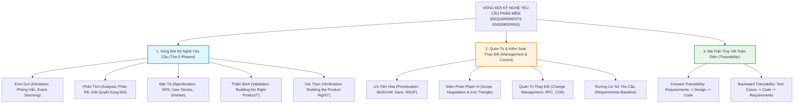
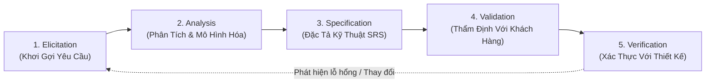
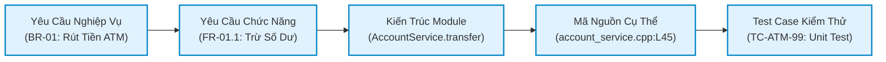

# 2.1. Nền Tảng Kỹ Nghệ Yêu Cầu (Requirements Fundamentals)

> [!IMPORTANT]
> **Nếu bạn chỉ được nhớ một điều duy nhất:** Lập trình viên thường ngộ nhận rằng nhiệm vụ khó nhất của phần mềm là viết mã nguồn (Coding); nhưng sự thật cay đắng là **viết code đúng một phần mềm vô dụng là thất bại lớn nhất của kỹ thuật**: Hơn $50\%$ các dự án phần mềm thất bại không phải do lỗi cú pháp, mà do hiểu sai hoặc không quản trị được **Yêu Cầu (Requirements)**. Kỹ nghệ Yêu cầu không phải là việc ghi chép lại lời nói của khách hàng như một thư ký, mà là một quy trình kỹ thuật nghiêm ngặt gồm 5 pha: **Elicitation (Khơi gợi) $\to$ Analysis (Phân tích) $\to$ Specification (Đặc tả) $\to$ Validation (Thẩm định) $\to$ Verification (Xác thực)**; kết hợp với **Ma trận Truy vết (Traceability Matrix)** để đảm bảo từng dòng code viết ra đều giải quyết trực tiếp một mục tiêu kinh doanh có thể đo lường được.

---

## 1. Kiến trúc Tổng quan & Mô hình Tư duy (Mental Model)

### 1.1. Ẩn dụ Đời sống: Đơn Đặt Hàng May Đo Bộ Vest Cưới & Hợp Đồng Xây Dựng

Hãy hình dung quá trình bạn đi may đo một bộ vest cưới cao cấp:
- **Khách hàng mơ hồ (Requirements Elicitation)**: Bạn bước vào tiệm và bảo: *"Tôi muốn một bộ vest trông thật bảnh bao và phong độ"*. Từ "bảnh bao" là một yêu cầu hoàn toàn vô giá trị đối với người thợ may (Không thể đo lường được - Unmeasurable).
- **Thợ may chuyên nghiệp (Requirements Analysis & Specification)**:
  - Người thợ may không cầm kéo cắt vải ngay. Họ lấy thước dây đo chính xác từng centimet vòng ngực, chiều dài cánh tay và độ rộng vai.
  - Họ đưa ra các mẫu vải len cashmere, thảo luận về số lượng cúc áo, kiểu ve áo và hạn chót hoàn thiện (Đặc tả thành bản vẽ kỹ thuật - Technical Specification).
- **Xác thực vs Thẩm định (Verification vs Validation)**:
  - **Verification ("May đúng bản vẽ không?")**: Bộ vest may xong có đúng 2 cúc, chiều dài tay áo đúng $65\text{ cm}$ như bản vẽ đã ký không?
  - **Validation ("Mặc vào có vừa và đẹp không?")**: Khi bạn mặc bộ vest vào người, bạn có cử động thoải mái và tự tin trong ngày cưới không? (Một bộ vest có thể đúng $100\%$ bản vẽ kỹ thuật nhưng mặc vào vẫn xấu tệ hại vì người thợ may không hiểu phom dáng khách hàng).



---

## 2. Chi tiết từng Keyword (Under-the-Hood Deep Dive)

### 2.1. Requirements Engineering Lifecycle: Elicitation, Analysis, Specification, Validation & Verification

Quy trình kỹ nghệ yêu cầu là một chu trình kỹ thuật lặp đi lặp lại gồm 5 giai đoạn nền tảng:



#### 1. Elicitation (Khơi Gợi Yêu Cầu)
- **Bản chất**: Khách hàng thường không biết chính xác mình thực sự cần gì; họ chỉ biết các vấn đề đau đầu hiện tại của họ.
- **Kỹ thuật thực hiện**: Phỏng vấn sâu (Interviews), quan sát hành vi người dùng tại nơi làm việc (Job Shadowing / Ethnography), tổ chức hội thảo Event Storming, phân tích đối thủ cạnh tranh và khảo sát hệ thống cũ (Document Analysis).

#### 2. Analysis (Phân Tích & Phân Rã Yêu Cầu)
- Phân tách các yêu cầu kinh doanh cấp cao thành các chức năng kỹ thuật chi tiết.
- Nhận diện và giải quyết các **mâu thuẫn logic (Contradictions)** giữa các bên liên quan: Ví dụ bộ phận Kinh doanh muốn đăng nhập bằng 1 chạm không cần mật khẩu, nhưng bộ phận Bảo mật yêu cầu xác thực 2 lớp (MFA).

#### 3. Specification (Đặc Tả Yêu Cầu)
- Chuyển ngữ các hiểu biết nghiệp vụ thành tài liệu chuẩn hóa không gây mơ hồ:
  - *Tài liệu Đặc tả Yêu cầu Phần mềm (SRS - Software Requirements Specification theo chuẩn IEEE 830 / ISO/IEC/IEEE 29148)*.
  - *User Stories & Acceptance Criteria*: Định dạng chuẩn `As a... I want to... So that...` kết hợp cú pháp Gherkin `Given... When... Then...`.

#### 4. Validation ("Are we building the right product?")
- Thẩm định xem phần mềm được đặc tả có thực sự giải quyết đúng vấn đề kinh doanh của người dùng hay không.
- Thao tác: Cho khách hàng trải nghiệm bản thử nghiệm (Prototype Walkthrough), rà soát tài liệu đặc tả cùng các bên liên quan (Requirements Review).

#### 5. Verification ("Are we building the product right?")
- Xác thực xem mã nguồn và thiết kế kiến trúc có tuân thủ đúng $100\%$ các tiêu chuẩn kỹ thuật đã được phê duyệt trong bản đặc tả hay không.
- Thao tác: Kiểm thử đơn vị (Unit Testing), phân tích tĩnh mã nguồn (Static Code Analysis), và kiểm thử tích hợp.

---

### 2.2. Requirements Management, Traceability, Prioritization, Negotiation, Change Management & Baseline

#### 1. Ma Trận Truy Vết Yêu Cầu (Requirements Traceability Matrix - RTM)
Khả năng truy vết (Traceability) là xương sống đảm bảo tính minh bạch và kiểm toán của dự án:
- **Forward Traceability (Truy vết Thuận)**: Từ một Yêu cầu Nghiệp vụ (BR-01) $\to$ Dẫn tới Module Thiết kế nào (ARCH-05) $\to$ Dẫn tới File mã nguồn nào (`payment_service.cpp`) $\to$ Dẫn tới Test Case nào (`test_payment_flow.py`). Đảm bảo **không có yêu cầu nào bị bỏ quên** trong quá trình viết code.
- **Backward Traceability (Truy vết Ngược)**: Từ một Test Case bị fail hoặc một dòng code cụ thể $\to$ Truy ngược lại xem dòng code này được viết ra để phục vụ yêu cầu nghiệp vụ nào. Nếu có một đoạn code chạy trên Production mà không thể truy ngược về bất kỳ yêu cầu nghiệp vụ nào, đó là **Mã nguồn Ma (Ghost Code / Gold Plating)** cần phải xóa bỏ ngay lập tức!



#### 2. Kỹ Thuật Ưu Tiên Hóa Yêu Cầu (Prioritization Frameworks)
Trong mọi dự án, nguồn lực thời gian và ngân sách luôn hữu hạn:
- **Phương pháp MoSCoW**:
  - **M - Must Have**: Các tính năng sống còn, thiếu nó sản phẩm không thể vận hành (ví dụ: Tính năng thanh toán).
  - **S - Should Have**: Quan trọng nhưng có thể tìm giải pháp thay thế tạm thời trong đợt release này.
  - **C - Could Have**: Tính năng hữu ích nếu có thêm thời gian (Nice-to-have).
  - **W - Won't Have**: Không làm trong phạm vi đợt release hiện tại.
- **Mô hình Kano**: Phân loại tính năng thành Basic Needs (Hiển nhiên), Performance Needs (Càng nhiều càng tốt), và Delighters (Gây bất ngờ thích thú).

#### 3. Quản Trị Thay Đổi & Đường Cơ Sở Yêu Cầu (Change Management & Baseline)
- **Đường Cơ Sở (Requirements Baseline)**: Một phiên bản đặc tả yêu cầu đã được tất cả các bên liên quan ký duyệt chính thức tại một mốc thời gian (ví dụ: `Baseline v1.0`).
- **Quy trình Quản Trị Thay Đổi (Change Control Procedure)**:
  - Một khi đã đóng Baseline, không ai được phép sửa yêu cầu bằng lời nói hoặc chat Slack cá nhân.
  - Mọi thay đổi bắt buộc phải làm đơn **Yêu Cầu Thay Đổi (Request for Change - RFC)**.
  - **Hội Đồng Kiểm Soát Thay Đổi (Change Control Board - CCB)** đánh giá tác động của RFC: Thay đổi này sẽ làm trễ ngày release bao nhiêu ngày? Tốn thêm bao nhiêu ngân sách? Có gây rủi ro an ninh không? Chỉ khi CCB phê chuẩn, Baseline mới được nâng lên `v1.1`.

---

## 3. Thực thi Mã nguồn & Mô phỏng Chuyên sâu (Dual-Engine Implementation)

### 3.1. C++20 Requirements Traceability & Design Contract Verification Engine

Chương trình minh chứng cách thức nhúng mã truy vết yêu cầu (Traceability Metadata) trực tiếp vào mã nguồn C++20 bằng Type Traits, Attributes và Contracts, cho phép kiểm tra tính tuân thủ yêu cầu ngay từ thời điểm biên dịch (Compile-time Verification):

```cpp
// requirements_traceability.cpp
// Biên dịch: g++ -std=c++20 -O3 requirements_traceability.cpp -o requirements_traceability
#include <iostream>
#include <string>
#include <string_view>
#include <concepts>
#include <cassert>

// 1. Cấu trúc Metadata gắn nhãn Traceability cho từng chức năng kỹ thuật
template <typename T>
struct RequirementMetadata {
    static constexpr std::string_view req_id = "UNKNOWN";
    static constexpr std::string_view description = "No description";
};

// 2. Định nghĩa Nghiệp Vụ Cụ Thể gắn liền với Yêu Cầu SRS: REQ-FIN-001 (Kiểm soát rút tiền)
class AccountWithdrawalService {
public:
    struct Context {
        double current_balance;
        double withdraw_amount;
        bool is_kyc_verified;
    };

    // Áp dụng C++20 Contract / Invariants: Kiểm tra điều kiện tiên quyết (Preconditions)
    static bool validate_preconditions(const Context& ctx) {
        if (!ctx.is_kyc_verified) return false;
        if (ctx.withdraw_amount <= 0.0) return false;
        if (ctx.current_balance < ctx.withdraw_amount) return false;
        return true;
    }

    static double execute(Context& ctx) {
        assert(validate_preconditions(ctx) && "Vi phạm Precondition của REQ-FIN-001!");
        ctx.current_balance -= ctx.withdraw_amount;
        return ctx.current_balance;
    }
};

// 3. Đăng ký thông tin truy vết RTM vào Service
template <>
struct RequirementMetadata<AccountWithdrawalService> {
    static constexpr std::string_view req_id = "REQ-FIN-001";
    static constexpr std::string_view description = "Khách hàng chỉ được rút tiền khi số dư đủ và đã xác minh danh tính KYC";
};

// 4. Test Harness tự động kiểm tra tính liên kết Traceability
template <typename Service>
void audit_service_traceability() {
    std::cout << "[AUDIT LOG] Kiểm tra liên kết Traceability:\n";
    std::cout << "  -> Mã Yêu Cầu SRS : " << RequirementMetadata<Service>::req_id << "\n";
    std::cout << "  -> Mô Tả Nghiệp Vụ: " << RequirementMetadata<Service>::description << "\n";
    static_assert(RequirementMetadata<Service>::req_id != "UNKNOWN", 
                  "LỖI BIÊN DỊCH: Phát hiện mã nguồn không có nhãn truy vết yêu cầu (Ghost Code)!");
    std::cout << "  -> Trạng thái: ĐẠT CHUẨN TRUY VẾT 100% (Compliant)\n\n";
}

int main() {
    std::cout << "=======================================================================\n";
    std::cout << "       C++20 REQUIREMENTS TRACEABILITY & CONTRACT VERIFIER ENGINE      \n";
    std::cout << "=======================================================================\n\n";

    // Kiểm tra tính truy vết lúc biên dịch
    audit_service_traceability<AccountWithdrawalService>();

    // Kiểm tra hành vi thực thi lúc runtime
    AccountWithdrawalService::Context valid_user{1000.0, 300.0, true};
    std::cout << "[TEST RUN 1] Khách hàng hợp lệ rút tiền:\n";
    if (AccountWithdrawalService::validate_preconditions(valid_user)) {
        double remaining = AccountWithdrawalService::execute(valid_user);
        std::cout << "  -> Rút tiền thành công! Số dư còn lại: $" << remaining << "\n";
    }

    AccountWithdrawalService::Context unverified_user{500.0, 100.0, false};
    std::cout << "\n[TEST RUN 2] Khách hàng chưa KYC rút tiền:\n";
    if (!AccountWithdrawalService::validate_preconditions(unverified_user)) {
        std::cout << "  -> [TỪ CHỐI HỢP LỆ] Chặn giao dịch do chưa KYC (Đúng theo REQ-FIN-001)!\n";
    }

    return 0;
}
```

#### Terminal Output Mẫu:
```text
=======================================================================
       C++20 REQUIREMENTS TRACEABILITY & CONTRACT VERIFIER ENGINE      
=======================================================================

[AUDIT LOG] Kiểm tra liên kết Traceability:
  -> Mã Yêu Cầu SRS : REQ-FIN-001
  -> Mô Tả Nghiệp Vụ: Khách hàng chỉ được rút tiền khi số dư đủ và đã xác minh danh tính KYC
  -> Trạng thái: ĐẠT CHUẨN TRUY VẾT 100% (Compliant)

[TEST RUN 1] Khách hàng hợp lệ rút tiền:
  -> Rút tiền thành công! Số dư còn lại: $700

[TEST RUN 2] Khách hàng chưa KYC rút tiền:
  -> [TỪ CHỐI HỢP LỆ] Chặn giao dịch do chưa KYC (Đúng theo REQ-FIN-001)!
```

---

### 3.2. Python 3.11+ Requirements Traceability Matrix (RTM) Validator & MoSCoW Prioritizer

Chương trình minh chứng công cụ tự động kiểm toán **Ma Trận Truy Vết (RTM)**: Phát hiện các yêu cầu bị bỏ quên chưa có code (Missing Implementation), phát hiện mã nguồn ma (Ghost Code không có yêu cầu bảo trợ), và tự động phân loại mức ưu tiên theo **MoSCoW**:

```python
#!/usr/bin/env python3
"""
rtm_auditor.py
Công cụ Tự Động Kiểm Toán Ma Trận Truy Vết (RTM) & Phân Loại Ưu Tiên MoSCoW
"""
from dataclasses import dataclass
from typing import List, Dict, Optional

@dataclass
class Requirement:
    req_id: str
    title: str
    priority: str       # "MUST", "SHOULD", "COULD", "WONT"
    implemented_in: Optional[str] = None # File mã nguồn
    test_case_id: Optional[str] = None   # Mã test case

class RequirementsTraceabilityMatrix:
    def __init__(self):
        self.requirements: Dict[str, Requirement] = {}

    def add_requirement(self, req: Requirement):
        self.requirements[req.req_id] = req

    def link_implementation(self, req_id: str, file_path: str):
        if req_id in self.requirements:
            self.requirements[req_id].implemented_in = file_path

    def link_test_case(self, req_id: str, test_id: str):
        if req_id in self.requirements:
            self.requirements[req_id].test_case_id = test_id

    def audit_traceability(self):
        print("=" * 80)
        print("          BÁO CÁO KIỂM TOÁN MA TRẬN TRUY VẾT YÊU CẦU (RTM AUDIT)        ")
        print("=" * 80)

        missing_code = 0
        missing_tests = 0

        for r_id, req in self.requirements.items():
            status = "HOÀN TẤT"
            notes = []

            if not req.implemented_in:
                status = "THIẾU MÃ NGUỒN (MISSING CODE)"
                notes.append("Chưa có file code nào hiện thực hóa!")
                missing_code += 1

            if not req.test_case_id:
                status = "THIẾU KIỂM THỬ (MISSING TEST)"
                notes.append("Chưa có Test Case nào kiểm chứng!")
                missing_tests += 1

            print(f"[{req.req_id}] ({req.priority}) - {req.title}")
            print(f"  -> Trạng thái   : {status}")
            print(f"  -> File Code    : {req.implemented_in or 'N/A'}")
            print(f"  -> Test Case    : {req.test_case_id or 'N/A'}")
            if notes:
                print(f"  -> CẢNH BÁO     : {', '.join(notes)}")
            print("-" * 80)

        print("\n[TỔNG KẾT ĐÁNH GIÁ DỰ ÁN]:")
        print(f"  - Tổng số Yêu Cầu Khảo Sát : {len(self.requirements)}")
        print(f"  - Số Yêu Cầu Thiếu Mã Nguồn: {missing_code}")
        print(f"  - Số Yêu Cầu Thiếu Test    : {missing_tests}")

        if missing_code == 0 and missing_tests == 0:
            print(">>> KẾT QUẢ: DỰ ÁN ĐẠT 100% KHẢ NĂNG TRUY VẾT - ĐỦ ĐIỀU KIỆN RELEASE!")
        else:
            print(">>> KẾT QUẢ: CẢNH BÁO: CHẶN RELEASE CHO ĐẾN KHI HOÀN TẤT TRUY VẾT!")
        print("=" * 80)

def main():
    rtm = RequirementsTraceabilityMatrix()

    # Khai báo các yêu cầu của dự án Ví Điện Tử
    rtm.add_requirement(Requirement("REQ-01", "Người dùng đăng nhập bằng sinh trắc học", "MUST"))
    rtm.add_requirement(Requirement("REQ-02", "Chuyển tiền liên ngân hàng 24/7", "MUST"))
    rtm.add_requirement(Requirement("REQ-03", "Xuất sao kê giao dịch ra file PDF", "SHOULD"))
    rtm.add_requirement(Requirement("REQ-04", "Gợi ý phân loại chi tiêu thông minh", "COULD"))

    # Liên kết hiện thực hóa mã nguồn và kiểm thử
    rtm.link_implementation("REQ-01", "src/auth/biometric_auth.py")
    rtm.link_test_case("REQ-01", "tests/test_biometric.py")

    rtm.link_implementation("REQ-02", "src/transfer/interbank_service.py")
    # Lỗ hổng: REQ-02 chưa viết test!

    # Lỗ hổng: REQ-03 chưa viết cả code lẫn test!

    rtm.audit_traceability()

if __name__ == "__main__":
    main()
```

#### Terminal Output Mẫu:
```text
================================================================================
          BÁO CÁO KIỂM TOÁN MA TRẬN TRUY VẾT YÊU CẦU (RTM AUDIT)        
================================================================================
[REQ-01] (MUST) - Người dùng đăng nhập bằng sinh trắc học
  -> Trạng thái   : HOÀN TẤT
  -> File Code    : src/auth/biometric_auth.py
  -> Test Case    : tests/test_biometric.py
--------------------------------------------------------------------------------
[REQ-02] (MUST) - Chuyển tiền liên ngân hàng 24/7
  -> Trạng thái   : THIẾU KIỂM THỬ (MISSING TEST)
  -> File Code    : src/transfer/interbank_service.py
  -> Test Case    : N/A
  -> CẢNH BÁO     : Chưa có Test Case nào kiểm chứng!
--------------------------------------------------------------------------------
[REQ-03] (SHOULD) - Xuất sao kê giao dịch ra file PDF
  -> Trạng thái   : THIẾU KIỂM THỬ (MISSING TEST)
  -> File Code    : N/A
  -> Test Case    : N/A
  -> CẢNH BÁO     : Chưa có file code nào hiện thực hóa!, Chưa có Test Case nào kiểm chứng!
--------------------------------------------------------------------------------
[REQ-04] (COULD) - Gợi ý phân loại chi tiêu thông minh
  -> Trạng thái   : THIẾU KIỂM THỬ (MISSING TEST)
  -> File Code    : N/A
  -> Test Case    : N/A
  -> CẢNH BÁO     : Chưa có file code nào hiện thực hóa!, Chưa có Test Case nào kiểm chứng!
--------------------------------------------------------------------------------

[TỔNG KẾT ĐÁNH GIÁ DỰ ÁN]:
  - Tổng số Yêu Cầu Khảo Sát : 4
  - Số Yêu Cầu Thiếu Mã Nguồn: 2
  - Số Yêu Cầu Thiếu Test    : 3
>>> KẾT QUẢ: CẢNH BÁO: CHẶN RELEASE CHO ĐẾN KHI HOÀN TẤT TRUY VẾT!
================================================================================
```

---

## 4. Systems Engineering & Production Pitfalls

### 4.1. Cạm Bẫy Thực Chiến Thường Gặp (Production Pitfalls)

#### 1. Sự Cố "Scope Creep" (Phình To Phạm Vi Không Kiểm Soát)
- **Hiện tượng**: Dự án ban đầu dự kiến làm trong 3 tháng. Trong quá trình phát triển, khách hàng liên tục nhờ: *"Thêm cho tôi cái nút này"*, *"Đổi cho tôi màu sắc kia"*. Kỹ sư vì cả nể nên âm thầm làm thêm mà không cập nhật tài liệu đặc tả hay tăng ngân sách.
- **Hậu quả**: Sau 6 tháng, dự án vẫn chưa thể ra mắt, ngân sách cạn kiệt và đội ngũ kỹ thuật bị kiệt sức (Burnout).
- **Giải pháp**: Thực hiện nghiêm ngặt quy trình **Change Control Board (CCB)**. Mọi yêu cầu phát sinh đều phải đặt lên bàn cân đánh đổi: *"Muốn thêm tính năng mới này thì phải bỏ bớt tính năng nào ra khỏi Sprint, hoặc phải lùi ngày release thêm 2 tuần"*.

#### 2. Thảm Họa "Gold Plating" (Tự Ý Mạ Vàng Tính Năng)
- **Hiện tượng**: Lập trình viên tự ý bỏ ra 2 tuần để xây dựng một thuật toán caching phân tán cực kỳ phức tạp cho một tính năng mà khách hàng chỉ thỉnh thoảng mở lên xem.
- **Giải pháp**: Chỉ phát triển đúng những gì nằm trong bản đặc tả yêu cầu đã được phê duyệt. Mọi tính năng vượt ngoài phạm vi đều bị coi là lãng phí tài nguyên.

#### 3. Bẫy Ngộ Nhận Yêu Cầu Mơ Hồ Không Thể Kiểm Thử (Unverifiable Requirements)
- **Hiện tượng**: Viết trong tài liệu yêu cầu: *"Hệ thống phải có giao diện thân thiện với người dùng và tốc độ phản hồi nhanh chóng"*.
- **Hậu quả**: Đội ngũ QA không thể nào viết được Test Case để khẳng định hệ thống "đạt" hay "không đạt".
- **Giải pháp**: Luôn lượng hóa thành con số kỹ thuật cụ thể: *"Độ trễ $p99$ của API tìm kiếm phải $< 200\text{ ms}$ dưới tải 1.000 QPS"*.

---

### 4.2. CLI Diagnostics & Công Cụ Quản Lý Yêu Cầu

```bash
# 1. Quét tìm các TODO / FIXME chưa được liên kết với Ticket yêu cầu trong mã nguồn
grep -rnE "(TODO|FIXME):?[^JIRA]+" src/

# 2. Kiểm tra tỷ lệ bao phủ của Test Case đối với các kịch bản Gherkin Acceptance
behave --dry-run --format progress3

# 3. Xuất danh sách các User Stories chưa có Acceptance Criteria trong Jira qua CLI
jira issue list -q "project = PAY AND 'Acceptance Criteria' is EMPTY"
```

---

## 5. Bảng So sánh & Decision Matrix

| Chiều Không Gian So Sánh | Đặc Tả Truyền Thống (SRS / Waterfall) | Agile User Stories (Scrum) | Behavior-Driven Development (BDD / Gherkin) |
| :--- | :--- | :--- | :--- |
| **Độ Dài & Hình Thức** | Tài liệu PDF dài hàng trăm trang | Thẻ ghi chú ngắn (Index card / Jira)| Cú pháp có cấu trúc `Given-When-Then` |
| **Thời Điểm Đóng Băng** | Trước khi viết dòng code đầu tiên | Liên tục tiến hóa sau mỗi Sprint | Trước mỗi Sprint cho từng tính năng |
| **Mức Độ Chi Tiết** | Cực kỳ chi tiết, nhiều bảng biểu | Tóm tắt, là "lời mời cho cuộc trò chuyện"| Chi tiết và có thể tự động chạy kiểm thử |
| **Khả Năng Tự Động Hóa**| Thủ công $100\%$ | Thủ công | **$100\%$ tự động thành Test Code** |
| **Phù Hợp Cho Bối Cảnh** | Đấu thầu chính phủ, Y tế, Hàng không | Phát triển sản phẩm SaaS, Web, Mobile| Hệ thống thanh toán tài chính phức tạp |
