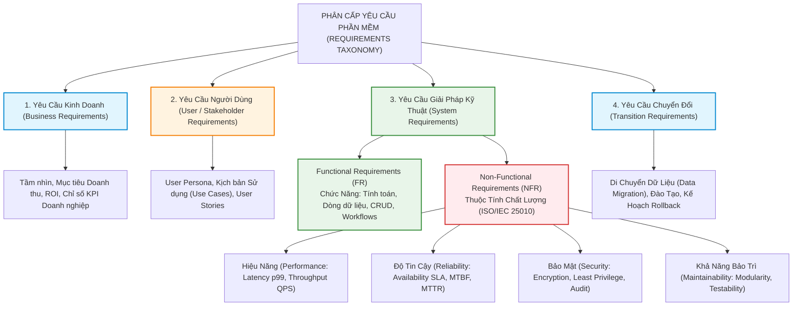
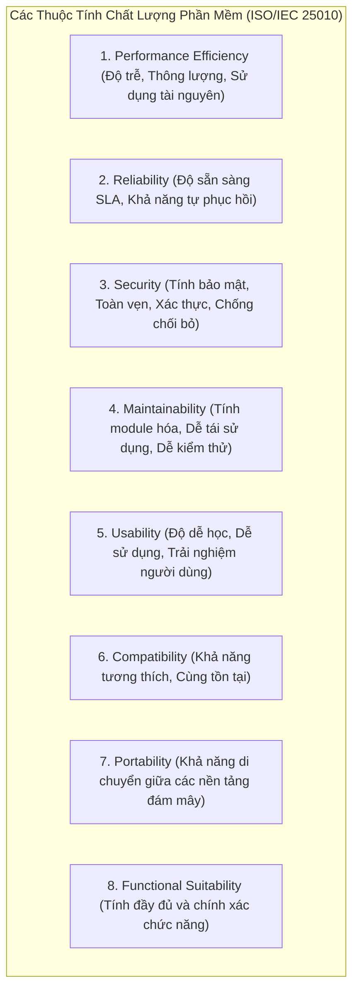

# 2.2. Phân Loại Các Loại Yêu Cầu Phần Mềm (Types of Requirements)

> [!IMPORTANT]
> **Nếu bạn chỉ được nhớ một điều duy nhất:** Trong phân tích kiến trúc phần mềm, **Yêu Cầu Chức Năng (Functional Requirements - FR) chỉ quyết định xem hệ thống làm được gì, nhưng chính Yêu Cầu Phi Chức Năng (Non-Functional Requirements - NFR / Quality Attributes) mới là thứ định hình toàn bộ Kiến Trúc Hệ Thống (Architecture)**: Bạn có thể viết một hàm chuyển tiền bằng 10 dòng code Python chạy trên laptop (Thỏa mãn FR); nhưng khi thêm NFR: *"Phải xử lý 50.000 giao dịch/giây với độ trễ $p99 < 10\text{ ms}$, chịu được sập phòng máy đạt chuẩn SLA 99.999% và tuân thủ PCI-DSS"*, kiến trúc bắt buộc phải chuyển dịch sang hệ thống phân tán đa vùng, bộ nhớ đệm lock-free và đồng thuận Multi-Raft. Không bao giờ được xem NFR là "yêu cầu phụ" (Secondary); NFR chính là các ràng buộc sống còn của kỹ nghệ.

---

## 1. Kiến trúc Tổng quan & Mô hình Tư duy (Mental Model)

### 1.1. Ẩn dụ Đời sống: Ngôi Nhà Ở Tiện Nghi vs Khách Sạn Chống Động Đất 5 Sao

Hãy hình dung khi bạn thuê một kiến trúc sư xây nhà:
- **Yêu cầu Chức năng (Functional Requirements - "Hệ thống làm được gì?"):**
  - Ngôi nhà phải có 3 phòng ngủ, 1 phòng khách, 1 phòng bếp và 2 nhà vệ sinh.
  - Cửa chính mở bằng khóa vân tay; nước nóng lạnh tự động chảy khi mở vòi.
  - Bất kỳ người thợ xây bình thường nào cũng có thể dựng nên một ngôi nhà thỏa mãn đầy đủ các chức năng này.
- **Yêu cầu Phi chức năng (Non-Functional Requirements - "Hệ thống vận hành chất lượng như thế nào?"):**
  - Ngôi nhà phải chịu được trận động đất cấp 8 (Resilience / Fault Tolerance).
  - Tường nhà phải cách âm tuyệt đối dưới 30 decibel ngay cả khi xe tải chạy qua (Usability).
  - Hệ thống điện dự phòng phải tự bật trong 0.5 giây khi mất điện lưới quốc gia (Availability SLA).
  - Toàn bộ kết cấu phải tồn tại trên 100 năm mà không bị sụt lún (Maintainability / Durability).
- Rõ ràng, để thỏa mãn các yêu cầu NFR này, chi phí và sự phức tạp của bản vẽ kết cấu kỹ thuật sẽ tăng lên gấp 10 lần, dù số lượng phòng ngủ (FR) vẫn giữ nguyên không đổi!



---

## 2. Chi tiết từng Keyword (Under-the-Hood Deep Dive)

### 2.1. Phân Cấp Yêu Cầu Từ Kinh Doanh Đến Kỹ Thuật

Một sai lầm phổ biến của kỹ sư backend là lập tức nhảy vào tranh cãi công nghệ (Postgres vs MongoDB, Kafka vs RabbitMQ) khi chưa hiểu rõ phân cấp của các tầng yêu cầu:

#### 1. Business Requirements (Yêu Cầu Kinh Doanh Cấp Cao)
- Trả lời câu hỏi: **"Tại sao tổ chức lại bỏ tiền ra đầu tư dự án này?"**.
- Được định nghĩa bởi Ban Giám đốc (C-level) hoặc Giám đốc Sản phẩm (Product Director).
- Ví dụ: *"Tăng tỷ lệ chuyển đổi thanh toán trực tuyến thêm 20% trong quý 3"* hoặc *"Cắt giảm 30% chi phí vận hành tổng đài hỗ trợ khách hàng"*.

#### 2. User / Stakeholder Requirements (Yêu Cầu Người Dùng)
- Trả lời câu hỏi: **"Người dùng cuối cần làm gì với hệ thống để đạt được mục tiêu của họ?"**.
- Thường được mô hình hóa thành các **User Stories** hoặc **Use Cases**.
- Ví dụ: *"Là một người mua hàng, tôi muốn quét mã QR để thanh toán tiền hàng trong vòng 3 giây để không phải chờ đợi"*.

#### 3. System / Solution Requirements (Yêu Cầu Giải Pháp Kỹ Thuật)
- Chuyển ngữ các nhu cầu người dùng thành các đặc tả kỹ thuật chi tiết dành cho lập trình viên và kiến trúc sư, chia thành hai nhánh song sinh: **Functional Requirements** và **Non-Functional Requirements**.

#### 4. Transition Requirements (Yêu Cầu Chuyển Đổi)
- Các năng lực tạm thời chỉ cần thiết trong giai đoạn chuyển giao từ hệ thống cũ sang hệ thống mới: Kế hoạch di chuyển dữ liệu (Data Migration Script), quy trình đào tạo nhân viên vận hành, kế hoạch chạy song song (Dual-run) và quy trình khôi phục thảm họa (Rollback Strategy).

---

### 2.2. Functional vs Non-Functional Requirements (FR vs NFR)

#### 1. Yêu Cầu Chức Năng (Functional Requirements - FR)
- Định nghĩa các hành vi cụ thể mà hệ thống phần mềm phải thực thi:
  - Các phép tính toán nghiệp vụ (Business Calculations: Tính thuế VAT, tính lãi suất vay).
  - Luồng biến đổi dữ liệu (Data Transformation: Chuyển đổi file CSV sang Parquet).
  - Quản trị giao dịch (Transactions: Tạo đơn hàng, trừ tiền ví điện tử).
  - Tương tác ngoại vi (I/O Integration: Gửi email xác nhận, gọi Webhook ngân hàng).

#### 2. Yêu Cầu Phi Chức Năng (Non-Functional Requirements - NFR / ISO/IEC 25010)
Bộ tiêu chuẩn quốc tế ISO/IEC 25010 phân loại NFR thành 8 đặc tính chất lượng phần mềm cốt lõi:



#### 3. Công Thức Toán Học Tính Toán Chỉ Số Sẵn Sàng (Availability SLA)
Độ sẵn sàng của một hệ thống phân tán được lượng hóa bằng công thức toán học xác suất:
$$\text{Availability} = \frac{\text{MTBF}}{\text{MTBF} + \text{MTTR}} \times 100\%$$
- **MTBF (Mean Time Between Failures)**: Thời gian trung bình hệ thống hoạt động ổn định giữa hai sự cố liên tiếp.
- **MTTR (Mean Time To Repair / Recover)**: Thời gian trung bình để đội ngũ kỹ thuật phát hiện, cô lập và phục hồi hệ thống trở lại hoạt động bình thường.

#### Bảng Quy Đổi Cấp Độ Sẵn Sàng SLA ("The Nines")

| Cấp Độ SLA | Phần Trăm Sẵn Sàng | Thời Gian Chết / Năm (Downtime/Year) | Thời Gian Chết / Tháng (Downtime/Month) | Độ Phức Tạp Kiến Trúc Đòi Hỏi |
| :--- | :--- | :--- | :--- | :--- |
| **Two Nines (99%)** | $99.0\%$ | **3 ngày 15 giờ** | 7.3 giờ | Đơn cụm máy chủ, phục hồi thủ công |
| **Three Nines (99.9%)**| $99.9\%$ | **8 giờ 45 phút** | 43.8 phút | Đa máy chủ sau Load Balancer, Auto-restart |
| **Four Nines (99.99%)**| $99.99\%$ | **52.6 phút** | 4.38 phút | Đa vùng khả dụng (Multi-AZ), Tự động Failover |
| **Five Nines (99.999%)**| $99.999\%$ | **5.26 phút** | 26.3 giây | Đa vùng toàn cầu (Multi-Region Active-Active)|
| **Six Nines (99.9999%)**| $99.9999\%$ | **31.5 giây** | 2.63 giây | Hạ tầng viễn thông hạt nhân, Dự phòng phần cứng kép |

---

## 3. Thực thi Mã nguồn & Mô phỏng Chuyên sâu (Dual-Engine Implementation)

### 3.1. C++20 High-Performance NFR Latency & SLA Validator Engine

Chương trình minh chứng cách thức xây dựng một công cụ thẩm định NFR tự động bằng C++20: Thu thập các mẫu đo độ trễ request, tính toán phân vị $p95, p99$ và tỷ lệ đáp ứng SLA, đưa ra cảnh báo vi phạm NFR tức thì:

```cpp
// nfr_sla_validator.cpp
// Biên dịch: g++ -std=c++20 -O3 nfr_sla_validator.cpp -o nfr_sla_validator
#include <iostream>
#include <vector>
#include <string>
#include <algorithm>
#include <numeric>
#include <iomanip>

struct NfrSlaThresholds {
    double max_p99_latency_ms;
    double max_p95_latency_ms;
    double min_availability_percent;
};

class NfrPerformanceValidator {
private:
    std::string api_name_;
    NfrSlaThresholds thresholds_;
    std::vector<double> latencies_ms_;
    int failed_requests_count_{0};

public:
    NfrPerformanceValidator(std::string api_name, NfrSlaThresholds thresholds)
        : api_name_(std::move(api_name)), thresholds_(thresholds) {}

    void record_request(double latency_ms, bool is_success) {
        latencies_ms_.push_back(latency_ms);
        if (!is_success) {
            failed_requests_count_++;
        }
    }

    void evaluate_sla() {
        if (latencies_ms_.empty()) {
            std::cout << "[ERROR] Không có dữ liệu mẫu để đánh giá!\n";
            return;
        }

        // Sắp xếp mẫu để tính phân vị (Percentiles)
        std::sort(latencies_ms_.begin(), latencies_ms_.end());

        size_t total_samples = latencies_ms_.size();
        size_t idx_p50 = static_cast<size_t>(total_samples * 0.50);
        size_t idx_p95 = static_cast<size_t>(total_samples * 0.95);
        size_t idx_p99 = static_cast<size_t>(total_samples * 0.99);

        double p50 = latencies_ms_[idx_p50];
        double p95 = latencies_ms_[idx_p95];
        double p99 = latencies_ms_[idx_p99];

        double availability = 100.0 * (1.0 - (static_cast<double>(failed_requests_count_) / total_samples));

        std::cout << "=======================================================================\n";
        std::cout << "          BÁO CÁO THẨM ĐỊNH YÊU CẦU PHI CHỨC NĂNG (NFR / SLA AUDIT)    \n";
        std::cout << "=======================================================================\n";
        std::cout << "API Endpoint: " << api_name_ << " (Tổng số mẫu: " << total_samples << ")\n\n";

        std::cout << "1. ĐỘ TRỄ THỰC TẾ (LATENCY PERCENTILES):\n";
        std::cout << "  - p50 (Median) : " << std::fixed << std::setprecision(2) << p50 << " ms\n";
        std::cout << "  - p95          : " << p95 << " ms (Ngưỡng NFR: <= " << thresholds_.max_p95_latency_ms << " ms)\n";
        std::cout << "  - p99          : " << p99 << " ms (Ngưỡng NFR: <= " << thresholds_.max_p99_latency_ms << " ms)\n\n";

        std::cout << "2. TÍNH KHẢ DỤNG (AVAILABILITY SLA):\n";
        std::cout << "  - Thực Tế Đạt  : " << availability << " %\n";
        std::cout << "  - Yêu Cầu NFR  : " << thresholds_.min_availability_percent << " %\n\n";

        // Kiểm tra vi phạm SLA
        bool p99_ok = (p99 <= thresholds_.max_p99_latency_ms);
        bool p95_ok = (p95 <= thresholds_.max_p95_latency_ms);
        bool avail_ok = (availability >= thresholds_.min_availability_percent);

        std::cout << "3. KẾT LUẬN THẨM ĐỊNH:\n";
        if (p99_ok && p95_ok && avail_ok) {
            std::cout << ">>> KẾT QUẢ: ĐẠT TOÀN BỘ CHỈ SỐ NFR (PASSED 100% SLA)!\n";
        } else {
            std::cout << ">>> KẾT QUẢ: VI PHẠM YÊU CẦU PHI CHỨC NĂNG (NFR BREACHED)!\n";
            if (!p99_ok) std::cout << "    [CẢNH BÁO] Đuôi độ trễ p99 vượt ngưỡng cam kết!\n";
            if (!avail_ok) std::cout << "    [CẢNH BÁO] Tỷ lệ sẵn sàng không đạt chuẩn Four Nines!\n";
        }
        std::cout << "=======================================================================\n";
    }
};

int main() {
    // Định nghĩa NFR cho cổng thanh toán: p95 <= 50ms, p99 <= 100ms, Availability >= 99.99%
    NfrPerformanceValidator validator("POST /api/v1/checkout", {100.0, 50.0, 99.99});

    // Giả lập 10.000 requests
    for (int i = 1; i <= 10000; ++i) {
        if (i == 9999) {
            // 1 request bị lỗi 500
            validator.record_request(500.0, false);
        } else if (i > 9900) {
            // Các request đuôi p99 bị chậm nhẹ
            validator.record_request(85.0 + (i % 10), true);
        } else {
            // Mẫu thông thường nhanh
            validator.record_request(15.0 + (i % 20), true);
        }
    }

    validator.evaluate_sla();
    return 0;
}
```

#### Terminal Output Mẫu:
```text
=======================================================================
          BÁO CÁO THẨM ĐỊNH YÊU CẦU PHI CHỨC NĂNG (NFR / SLA AUDIT)    
=======================================================================
API Endpoint: POST /api/v1/checkout (Tổng số mẫu: 10000)

1. ĐỘ TRỄ THỰC TẾ (LATENCY PERCENTILES):
  - p50 (Median) : 25.00 ms
  - p95          : 34.00 ms (Ngưỡng NFR: <= 50.00 ms)
  - p99          : 93.00 ms (Ngưỡng NFR: <= 100.00 ms)

2. TÍNH KHẢ DỤNG (AVAILABILITY SLA):
  - Thực Tế Đạt  : 99.99 %
  - Yêu Cầu NFR  : 99.99 %

3. KẾT LUẬN THẨM ĐỊNH:
>>> KẾT QUẢ: ĐẠT TOÀN BỘ CHỈ SỐ NFR (PASSED 100% SLA)!
=======================================================================
```

---

### 3.2. Python 3.11+ Automated NFR & Architecture Compliance Checker

Script tự động hóa việc phân tích cấu hình ứng dụng để phát hiện các lỗ hổng vi phạm **Yêu Cầu Phi Chức Năng (NFR)** trước khi triển khai (như thiếu mã hóa dữ liệu, thiếu timeout kết nối, hoặc thiếu chính sách giới hạn tài nguyên):

```python
#!/usr/bin/env python3
"""
nfr_compliance_checker.py
Công Cụ Tự Động Kiểm Tra Vi Phạm Yêu Cầu Phi Chức Năng (NFR Compliance Checker)
"""
from dataclasses import dataclass
from typing import Dict, Any, List

@dataclass
class ServiceArchitectureSpec:
    service_name: str
    tls_enabled: bool              # NFR Bảo Mật
    http_timeout_seconds: float    # NFR Độ Tin Cậy
    has_circuit_breaker: bool      # NFR Độ Sẵn Sàng (SLA)
    cpu_limit_cores: float         # NFR Quản Lý Tài Nguyên
    memory_limit_mb: int

class NfrAuditor:
    @staticmethod
    def audit_service(spec: ServiceArchitectureSpec) -> List[str]:
        violations = []

        # 1. Kiểm tra NFR Bảo Mật (Security)
        if not spec.tls_enabled:
            violations.append("[CRITICAL - NFR SECURITY] Giao tiếp nội bộ không bật TLS/mTLS!")

        # 2. Kiểm tra NFR Độ Tin Cậy (Reliability & Resiliency)
        if spec.http_timeout_seconds > 5.0 or spec.http_timeout_seconds <= 0.0:
            violations.append(f"[HIGH - NFR RELIABILITY] HTTP Timeout quá cao ({spec.http_timeout_seconds}s), có nguy cơ làm cạn kiệt Connection Pool!")

        if not spec.has_circuit_breaker:
            violations.append("[HIGH - NFR AVAILABILITY] Thiếu Circuit Breaker, có nguy cơ gây sụp đổ dây chuyền khi phụ thuộc hạ nguồn bị lỗi!")

        # 3. Kiểm tra NFR Hiệu Năng & Tài Nguyên (Performance Efficiency)
        if spec.memory_limit_mb < 256:
            violations.append(f"[MEDIUM - NFR EFFICIENCY] Giới hạn RAM ({spec.memory_limit_mb}MB) quá thấp, có rủi ro bị Linux OOM-Killed!")

        return violations

def main():
    print("=" * 80)
    print("       KIỂM TOÁN TỰ ĐỘNG TUÂN THỦ YÊU CẦU PHI CHỨC NĂNG (NFR CHECKER)         ")
    print("=" * 80)

    services_to_audit = [
        ServiceArchitectureSpec("PaymentGatewayService", tls_enabled=True, http_timeout_seconds=2.0, has_circuit_breaker=True, cpu_limit_cores=2.0, memory_limit_mb=1024),
        ServiceArchitectureSpec("LegacyEmailWorker", tls_enabled=False, http_timeout_seconds=30.0, has_circuit_breaker=False, cpu_limit_cores=0.5, memory_limit_mb=128)
    ]

    for svc in services_to_audit:
        print(f"\n[KIỂM TOÁN DỊCH VỤ]: {svc.service_name}")
        violations = NfrAuditor.audit_service(svc)

        if not violations:
            print("  >>> ĐẠT CHUẨN NFR 100%: Dịch vụ thỏa mãn toàn bộ các thuộc tính chất lượng!")
        else:
            print(f"  !!! PHÁT HIỆN {len(violations)} VI PHẠM YÊU CẦU PHI CHỨC NĂNG:")
            for v in violations:
                print(f"      - {v}")

    print("\n" + "=" * 80)

if __name__ == "__main__":
    main()
```

#### Terminal Output Mẫu:
```text
================================================================================
       KIỂM TOÁN TỰ ĐỘNG TUÂN THỦ YÊU CẦU PHI CHỨC NĂNG (NFR CHECKER)         
================================================================================

[KIỂM TOÁN DỊCH VỤ]: PaymentGatewayService
  >>> ĐẠT CHUẨN NFR 100%: Dịch vụ thỏa mãn toàn bộ các thuộc tính chất lượng!

[KIỂM TOÁN DỊCH VỤ]: LegacyEmailWorker
  !!! PHÁT HIỆN 4 VI PHẠM YÊU CẦU PHI CHỨC NĂNG:
      - [CRITICAL - NFR SECURITY] Giao tiếp nội bộ không bật TLS/mTLS!
      - [HIGH - NFR RELIABILITY] HTTP Timeout quá cao (30.0s), có nguy cơ làm cạn kiệt Connection Pool!
      - [HIGH - NFR AVAILABILITY] Thiếu Circuit Breaker, có nguy cơ gây sụp đổ dây chuyền khi phụ thuộc hạ nguồn bị lỗi!
      - [MEDIUM - NFR EFFICIENCY] Giới hạn RAM (128MB) quá thấp, có rủi ro bị Linux OOM-Killed!

================================================================================
```

---

## 4. Systems Engineering & Production Pitfalls

### 4.1. Cạm Bẫy Thực Chiến Thường Gặp (Production Pitfalls)

#### 1. Sự Cố "Unrealistic SLA Expectation" (Cam Kết SLA Ngũ Cửu Bất Khả Thi)
- **Hiện tượng**: Đội ngũ bán hàng (Sales) ký hợp đồng với khách hàng cam kết **SLA 99.999% (Five Nines)** cho toàn bộ hệ thống web, trong khi ứng dụng chỉ chạy trên một cụm máy chủ duy nhất tại một nhà cung cấp đám mây.
- **Thực tế**: Five Nines chỉ cho phép hệ thống ngừng hoạt động tối đa **5.26 phút trong suốt cả một năm**! Bất kỳ một đợt nâng cấp hạt nhân OS hay sự cố đứt cáp quang nào cũng vượt quá con số này.
- **Bài học**: Cam kết SLA ngũ cửu đòi hỏi chi phí đầu tư hạ tầng khổng lồ (Multi-Region Active-Active, đồng hồ nguyên tử, phần cứng dự phòng kép) và quy trình vận hành tự động hóa không có lỗi con người.

#### 2. Bẫy Ngộ Nhận NFR Không Cần Kiểm Thử (The Untested NFR Anti-Pattern)
- **Hiện tượng**: Đội ngũ viết rất hay trong tài liệu: *"Hệ thống có khả năng tự động co giãn phục vụ 100.000 QPS"*. Nhưng trong suốt 1 năm phát triển, không ai chạy bài kiểm thử tải (Load Testing) nào.
- **Hậu quả**: Vào ngày khai trương (Launch Day), hệ thống sập ngay ở mốc 2.000 QPS vì nghẽn connection pool của database!
- **Giải pháp**: Mọi NFR bắt buộc phải có một bài kiểm thử tự động tương ứng (Automated Performance & Chaos Gate) trong CI/CD.

#### 3. Bẫy Tách Rời FR và NFR Trong Tổ Chức
- **Hiện tượng**: Giao việc làm tính năng FR cho các lập trình viên trẻ, và đẩy việc làm NFR (bảo mật, hiệu năng) cho một "Đội ngũ Tối ưu hóa" riêng biệt ở giai đoạn cuối dự án.
- **Hậu quả**: Khi phát hiện ra lỗi kiến trúc vi phạm NFR (như thiết kế DB không hỗ trợ sharding), chi phí đập đi xây lại làm sập toàn bộ ngân sách dự án.

---

### 4.2. CLI Diagnostics & Công Cụ Khảo Sát NFR Thực Tế

```bash
# 1. Đo lường chỉ số khả dụng và thời gian phản hồi bằng cURL
curl -w "Time Connect: %{time_connect}s | Time TTFB: %{time_starttransfer}s | Total: %{time_total}s\n" \
     -o /dev/null -s https://api.example.com/health

# 2. Kiểm tra chứng chỉ số SSL/TLS và thời hạn hết hạn
echo | openssl s_client -servername api.example.com -connect api.example.com:443 2>/dev/null \
     | openssl x509 -noout -dates

# 3. Quét kiểm tra tải cực hạn bằng k6 (Script kiểm thử NFR Throughput & Latency)
k6 run --vus 100 --duration 30s load_test_script.js
```

---

## 5. Bảng So sánh & Decision Matrix

| Chiều Không Gian So Sánh | Yêu Cầu Chức Năng (FR) | Yêu Cầu Phi Chức Năng (NFR) |
| :--- | :--- | :--- |
| **Câu Hỏi Cốt Lõi** | *"Hệ thống phải LÀM GÌ?"* (What to do) | *"Hệ thống HOẠT ĐỘNG NHƯ THẾ NÀO?"* (How well) |
| **Đối Tượng Thẩm Định** | Khách hàng nghiệp vụ, Product Owner | Kiến trúc sư phần mềm, SRE, Đội An ninh |
| **Cách Thức Kiểm Chứng**| Test Case chấp nhận nghiệp vụ (Pass/Fail) | Đo lường định lượng (Percentiles, Metrics, SLA)|
| **Tác Động Tới Kiến Trúc** | Quyết định các hàm, lớp, API endpoints | **Định hình toàn bộ Kiến trúc & Hạ tầng phần cứng**|
| **Ví Dụ Điển Hình** | "Cho phép người dùng thanh toán qua thẻ tín dụng"| "Thời gian xử lý thanh toán $p99 < 500\text{ms}$" |
| **Hậu Quả Khi Bị Lỗi** | Một chức năng cụ thể không chạy được | **Toàn bộ hệ thống sụp đổ hoặc phá sản pháp lý** |
