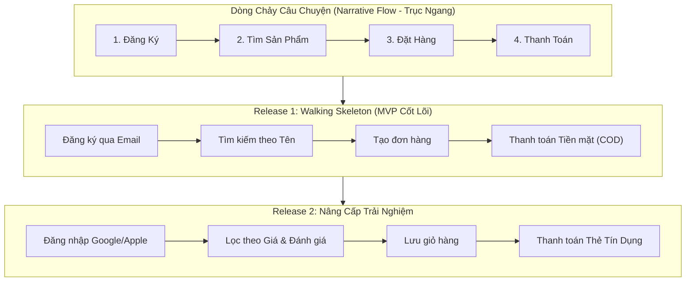
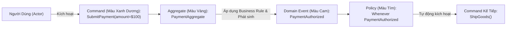

# 2.3. Các Kỹ Thuật Khơi Gợi Yêu Cầu (Requirements Elicitation Techniques)

> [!IMPORTANT]
> **Nếu bạn chỉ được nhớ một điều duy nhất:** Khách hàng không bao giờ nói cho bạn biết chính xác những gì họ cần, bởi vì chính họ cũng không biết; họ chỉ nói những gì họ muốn hoặc những gì họ tưởng rằng công nghệ có thể làm được: **"Nếu tôi hỏi khách hàng họ muốn gì, họ sẽ bảo họ muốn một con ngựa chạy nhanh hơn" (Henry Ford)**. Do đó, kỹ sư phần mềm không được đóng vai một người ghi chép thụ động, mà phải là một "nhà nhân chủng học công nghệ" thành thạo phối hợp giữa các kỹ thuật truyền thống (**Phỏng vấn sâu, Quan sát tại chỗ Job Shadowing để khai mở tri thức ngầm Tacit Knowledge**) và các kỹ thuật mô hình hóa hiện đại (**User Story Mapping, Prototyping, và đặc biệt là Event Storming của Alberto Brandolini**) để bóc tách các sự kiện nghiệp vụ cốt lõi trước khi chạm vào bàn phím viết mã.

---

## 1. Kiến trúc Tổng quan & Mô hình Tư duy (Mental Model)

### 1.1. Ẩn dụ Đời sống: Thám Tử Điều Tra Vụ Án & Bác Sĩ Chẩn Đoán Bệnh

Hãy hình dung quá trình bạn đi khám bệnh tại một bệnh viện trung ương:
- **Người bệnh (Khách hàng nghiệp vụ)**: Bước vào phòng khám và than phiền: *"Bác sĩ ơi, tôi bị đau đầu quá, hãy kê cho tôi thuốc giảm đau liều mạnh nhất"*.
- **Bác sĩ tồi (Lập trình viên thiếu kỹ năng khơi gợi)**: Lập tức kê đơn thuốc giảm đau đúng như yêu cầu của bệnh nhân (Làm theo đúng những gì khách hàng nói). Kết quả: Bệnh nhân uống thuốc đỡ đau tạm thời, nhưng khối u não tiềm ẩn bên trong không được phát hiện và tiếp tục phát triển!
- **Bác sĩ giỏi (Kỹ sư Khơi gợi Yêu cầu Chuyên nghiệp)**:
  - Bác sĩ không vội kê thuốc. Họ bắt đầu đặt các câu hỏi truy vấn sâu (Interviewing): Cơn đau bắt đầu từ khi nào? Có kèm theo chóng mặt hay buồn nôn không?
  - Họ yêu cầu xét nghiệm máu, chụp cộng hưởng từ MRI (Observation & Document Analysis).
  - Họ cùng hội chẩn với các bác sĩ chuyên khoa khác trên phim chụp (Event Storming Workshop) để tìm ra **nguyên nhân gốc rễ (Root Cause)** của căn bệnh thay vì chỉ chữa trị triệu chứng bề ngoài.

```mermaid
graph TD
    classDef trad fill:#e1f5fe,stroke:#0288d1,stroke-width:2px;
    classDef modern fill:#fff3e0,stroke:#f57c00,stroke-width:2px;
    classDef domain fill:#e8f5e9,stroke:#388e3c,stroke-width:2px;

    Root["CÁC KỸ THUẬT KHƠI GỢI YÊU CẦU (REQUIREMENTS ELICITATION)"]

    Root --> T1["1. Kỹ Thuật Truyền Thống (Traditional Techniques)"]:::trad
    Root --> T2["2. Kỹ Thuật Hiện Đại & Tương Tác (Modern Collaborative)"]:::modern
    Root --> T3["3. Khám Phá Miền Nghiệp Vụ Chuyên Sâu (Event Storming)"]:::domain

    T1 --> T1A["Phỏng Vấn Sâu (Interviews: Cấu trúc & Bán cấu trúc)"]
    T1 --> T1B["Quan Sát Tại Chỗ (Observation / Job Shadowing / Ethnography)"]
    T1 --> T1C["Hội Thảo JAD (Joint Application Development Workshops)"]
    T1 --> T1D["Khảo Sát Định Lượng (Questionnaires & Surveys)"]
    T1 --> T1E["Phân Tích Tài Liệu & Đảo Ngược Hệ Thống Cũ (Document Analysis)"]

    T2 --> T2A["Làm Bản Thử Nghiệm (Prototyping: Low-fi vs High-fi)"]
    T2 --> T2B["Phân Tích Ca Sử Dụng (Use Case Analysis)"]
    T2 --> T2C["Bản Đồ Câu Chuyện Người Dùng (User Story Mapping - Jeff Patton)"]

    T3 --> T3A["Domain Events (Sự Kiện Miền Màu Cam)"]
    T3 --> T3B["Commands (Lệnh Người Dùng Màu Xanh)"]
    T3 --> T3C["Aggregates & Read Models (Thực Thể & Mô Hình Đọc)"]
    T3 --> T3D["Bounded Contexts (Ranh Giới Ngữ Cảnh)"]
```



---

## 2. Chi tiết từng Keyword (Under-the-Hood Deep Dive)

### 2.1. Kỹ Thuật Truyền Thống: Interview, Workshop, Questionnaire, Observation & Document Analysis

#### 1. Phỏng Vấn Sâu (Interviews)
- **Structured Interview (Phỏng vấn có cấu trúc)**: Chuẩn bị sẵn danh sách câu hỏi cố định. Phù hợp để thu thập thông tin chuẩn hóa từ nhiều người.
- **Semi-structured Interview (Phỏng vấn bán cấu trúc - Hiệu quả nhất)**: Chuẩn bị một khung câu hỏi mở, cho phép người phỏng vấn đào sâu vào các câu trả lời bất thường của khách hàng bằng kỹ thuật **5 Whys (Năm câu hỏi Tại sao của Toyota)** để tìm ra bản chất vấn đề.

#### 2. Quan Sát Tại Chỗ (Observation / Job Shadowing / Ethnography)
- **Khai mở Tri thức Ngầm (Tacit Knowledge)**: Người dùng thực hiện công việc hàng ngày như một phản xạ tự nhiên (ví dụ nhân viên kế toán bấm tổ hợp phím tắt hoặc kiểm tra lại một con số trong sổ tay). Họ không bao giờ nhớ để kể cho bạn trong phòng họp!
- Chỉ bằng cách ngồi cạnh họ suốt một ngày làm việc (Job Shadowing) và quan sát từng thao tác click chuột, bạn mới nhận ra các bước rườm rà và các điểm nghẽn thực sự của quy trình.

#### 3. Hội Thảo Chung (JAD Workshops - Joint Application Development)
- Đưa tất cả các bên liên quan (Khách hàng, Lập trình viên, Kiến trúc sư, Tester, Chuyên gia bảo mật) vào cùng một phòng kín trong 2-3 ngày.
- **Lợi ích**: Giải quyết ngay tại chỗ các mâu thuẫn quan điểm mà nếu gửi email trao đổi qua lại có thể mất 6 tháng.

#### 4. Khảo Sát Bằng Bảng Câu Hỏi (Surveys & Questionnaires)
- Thu thập dữ liệu định lượng từ hàng nghìn người dùng phân tán trên diện rộng. Hạn chế: Câu hỏi đóng dễ dẫn đến định kiến của người soạn câu hỏi.

#### 5. Phân Tích Tài Liệu (Document Analysis & Legacy Reverse Engineering)
- Đọc lại các quy trình vận hành chuẩn (SOP), hợp đồng pháp lý, tài liệu hướng dẫn sử dụng và kiểm tra trực tiếp cơ sở dữ liệu của hệ thống cũ để hiểu các quy tắc nghiệp vụ ngầm (Business Rules).

---

### 2.2. Kỹ Thuật Hiện Đại: Prototyping, Use Case Analysis, User Story Mapping & Event Storming

#### 1. Bản Mẫu Thử Nghiệm (Prototyping)
- **Low-fidelity Prototypes (Bản mẫu độ trung thực thấp)**: Phác thảo trên giấy (Paper sketches) hoặc vẽ khung xương wireframe trên bảng trắng. Chi phí cực rẻ, giúp thảo luận luồng giao diện mà không làm người dùng bị phân tâm bởi màu sắc, đồ họa.
- **High-fidelity Prototypes (Bản mẫu độ trung thực cao)**: Sử dụng Figma/Framer có tính năng click tương tác mô phỏng ứng dụng thật để người dùng trải nghiệm thực tế.

#### 2. Bản Đồ Câu Chuyện Người Dùng (User Story Mapping - Jeff Patton)
Giải quyết vấn đề "mù mờ ngữ cảnh" của danh sách phẳng Product Backlog trong Jira:
- **Trục ngang (The Backbone / Narrative Flow)**: Dòng thời gian các bước hành động chính của người dùng từ trái sang phải (Ví dụ: Tìm kiếm hàng $\to$ Xem chi tiết $\to$ Bỏ vào giỏ $\to$ Thanh toán $\to$ Nhận hàng).
- **Trục dọc (Priority / Slices)**: Phân rã từng bước thành các User Stories chi tiết, sắp xếp theo mức độ ưu tiên từ trên xuống dưới.
- **Walking Skeleton (Lát cắt tối thiểu - Release 1 / MVP)**: Cắt một đường ngang trên cùng đi qua tất cả các bước của xương sống để tạo ra phiên bản sản phẩm chạy được đầu tiên.



---

### 2.3. Bão Sự Kiện (Event Storming - Alberto Brandolini)

**Event Storming** là phương pháp tương tác bùng nổ giúp các kỹ sư phần mềm và chuyên gia nghiệp vụ (Domain Experts) thấu hiểu toàn bộ miền kiến trúc phức tạp chỉ trong vài giờ:

#### 1. Ngôn Ngữ Màu Sắc Của Giấy Ghi Chú (Sticky Notes Legend)
- **Màu Cam (Domain Events)**: Những sự kiện nghiệp vụ quan trọng **đã xảy ra trong quá khứ** (Viết ở thì quá khứ: `OrderPlaced`, `PaymentReceived`, `InventoryReserved`).
- **Màu Xanh Dương (Commands)**: Quyết định hoặc hành động do người dùng kích hoạt (Viết ở thể mệnh lệnh: `PlaceOrder`, `MakePayment`).
- **Màu Vàng (User / Aggregates / Actors)**: Người thực thi hoặc ranh giới thực thể nghiệp vụ chứa trạng thái logic (`OrderAggregate`, `Customer`).
- **Màu Xanh Lá Cây (Read Models)**: Màn hình hoặc chế độ xem dữ liệu giúp người dùng đưa ra quyết định (`ProductCatalogView`).
- **Màu Hồng Tím (Policies / Business Rules)**: Quy tắc phản ứng tự động: *"KHI sự kiện X xảy ra THÌ thực thi lệnh Y"* (`When PaymentReceived then SendEmailConfirmation`).



---

## 3. Thực thi Mã nguồn & Mô phỏng Chuyên sâu (Dual-Engine Implementation)

### 3.1. C++20 Domain Event Representation Derived from Event Storming

Chương trình minh chứng cách thức chuyển hóa trực tiếp kết quả của một buổi **Event Storming** thành mã nguồn C++20: Mô hình hóa các Domain Events bất biến, Command xử lý nghiệp vụ, và hàm phản ứng Policy tự động:

```cpp
// event_storming_domain.cpp
// Biên dịch: g++ -std=c++20 -O3 event_storming_domain.cpp -o event_storming_domain
#include <iostream>
#include <string>
#include <vector>
#include <chrono>
#include <memory>
#include <variant>

// 1. DOMAIN EVENTS (Các sự kiện màu Cam từ Event Storming - Đã xảy ra)
struct OrderCreatedEvent {
    std::string order_id;
    double amount;
    std::string customer_id;
};

struct PaymentAuthorizedEvent {
    std::string order_id;
    std::string transaction_id;
    double amount;
};

struct OrderShippedEvent {
    std::string order_id;
    std::string tracking_number;
};

using DomainEvent = std::variant<OrderCreatedEvent, PaymentAuthorizedEvent, OrderShippedEvent>;

// 2. AGGREGATE ROOT (Thực thể màu Vàng bảo vệ Invariants)
class OrderAggregate {
public:
    enum class Status { DRAFT, PAID, SHIPPED };

private:
    std::string order_id_;
    double amount_{0.0};
    Status status_{Status::DRAFT};
    std::vector<DomainEvent> uncommitted_events_;

public:
    OrderAggregate(std::string order_id, double amount) 
        : order_id_(std::move(order_id)), amount_(amount) {
        // Sinh sự kiện OrderCreated
        record_event(OrderCreatedEvent{order_id_, amount_, "CUST-99"});
    }

    // COMMAND (Màu Xanh Dương): AuthorizePayment
    void authorize_payment(const std::string& txn_id) {
        if (status_ != Status::DRAFT) {
            throw std::runtime_error("Đơn hàng không ở trạng thái hợp lệ để thanh toán!");
        }
        status_ = Status::PAID;
        record_event(PaymentAuthorizedEvent{order_id_, txn_id, amount_});
    }

    // COMMAND: ShipOrder (Bị kích hoạt bởi Policy tự động)
    void ship_order(const std::string& tracking_no) {
        if (status_ != Status::PAID) {
            throw std::runtime_error("Chưa thanh toán, không thể giao hàng!");
        }
        status_ = Status::SHIPPED;
        record_event(OrderShippedEvent{order_id_, tracking_no});
    }

    const std::vector<DomainEvent>& get_uncommitted_events() const {
        return uncommitted_events_;
    }

private:
    void record_event(DomainEvent event) {
        uncommitted_events_.push_back(event);
    }
};

// 3. POLICY DISPATCHER (Màu Hồng Tím): Phản ứng tự động giữa các Bounded Contexts
void handle_event_policy(const DomainEvent& event, OrderAggregate& order) {
    std::visit([&order](auto&& arg) {
        using T = std::decay_t<decltype(arg)>;
        if constexpr (std::is_same_v<T, OrderCreatedEvent>) {
            std::cout << "  [EVENT NOTIFICATION] Đơn hàng #" << arg.order_id 
                      << " đã tạo thành công với giá trị $" << arg.amount << "\n";
        } else if constexpr (std::is_same_v<T, PaymentAuthorizedEvent>) {
            std::cout << "  [EVENT NOTIFICATION] Thanh toán thành công cho đơn #" << arg.order_id 
                      << " (Mã GD: " << arg.transaction_id << ")\n";
            // Kích hoạt Policy: "Khi thanh toán xong thì tự động đóng gói giao hàng"
            std::cout << "  >>> [POLICY TRIGGER] Tự động chuyển đơn hàng sang kho vận giao hàng!\n";
            order.ship_order("VN-POST-8888");
        } else if constexpr (std::is_same_v<T, OrderShippedEvent>) {
            std::cout << "  [EVENT NOTIFICATION] Đơn hàng #" << arg.order_id 
                      << " đã xuất kho! Mã vận đơn: " << arg.tracking_number << "\n";
        }
    }, event);
}

int main() {
    std::cout << "=======================================================================\n";
    std::cout << "        C++20 DOMAIN EVENT STORMING IMPLEMENTATION SIMULATION          \n";
    std::cout << "=======================================================================\n\n";

    // 1. Tạo đơn hàng mới
    OrderAggregate order("ORD-2026-X1", 250.0);
    handle_event_policy(order.get_uncommitted_events().back(), order);

    // 2. Người dùng bấm thanh toán
    std::cout << "\n[USER ACTION] Khách hàng thực hiện thanh toán qua thẻ tín dụng:\n";
    order.authorize_payment("TXN-VISA-9911");
    
    // Xử lý sự kiện thanh toán và kiểm tra policy tự động kích hoạt giao hàng
    handle_event_policy(order.get_uncommitted_events()[1], order);
    handle_event_policy(order.get_uncommitted_events()[2], order);

    return 0;
}
```

#### Terminal Output Mẫu:
```text
=======================================================================
        C++20 DOMAIN EVENT STORMING IMPLEMENTATION SIMULATION          
=======================================================================

  [EVENT NOTIFICATION] Đơn hàng #ORD-2026-X1 đã tạo thành công với giá trị $250

[USER ACTION] Khách hàng thực hiện thanh toán qua thẻ tín dụng:
  [EVENT NOTIFICATION] Thanh toán thành công cho đơn #ORD-2026-X1 (Mã GD: TXN-VISA-9911)
  >>> [POLICY TRIGGER] Tự động chuyển đơn hàng sang kho vận giao hàng!
  [EVENT NOTIFICATION] Đơn hàng #ORD-2026-X1 đã xuất kho! Mã vận đơn: VN-POST-8888
```

---

### 3.2. Python 3.11+ User Story Mapping Slicer & MVP Release Planner

Chương trình minh chứng cách tổ chức dữ liệu **User Story Mapping** của Jeff Patton: Quản lý dòng chảy hoạt động (Backbone), gắn các User Stories vào từng bước, và tự động cắt lát các câu chuyện thành các đợt phát hành (Release Slices / Walking Skeleton):

```python
#!/usr/bin/env python3
"""
story_mapping_planner.py
Mô phỏng Bản Đồ Câu Chuyện Người Dùng (User Story Mapping) & Lập Kế Hoạch Cắt Lát MVP
"""
from dataclasses import dataclass, field
from typing import List, Dict

@dataclass
class Story:
    title: str
    points: int
    release_slice: int # 1: MVP (Walking Skeleton), 2: Release 2, 3: Future

@dataclass
class ActivityStep:
    step_name: str
    stories: List[Story] = field(default_factory=list)

class UserStoryMap:
    def __init__(self, project_name: str):
        self.project_name = project_name
        self.backbone_steps: List[ActivityStep] = []

    def add_step(self, step_name: str) -> ActivityStep:
        step = ActivityStep(step_name)
        self.backbone_steps.append(step)
        return step

    def print_release_plan(self, target_slice: int, slice_name: str):
        print(f"\n================================================================================")
        print(f"  KẾ HOẠCH PHÁT HÀNH: {slice_name.upper()} (LÁT CẮT SLICE #{target_slice})")
        print(f"================================================================================")
        
        total_points = 0
        for step in self.backbone_steps:
            matching_stories = [s for s in step.stories if s.release_slice == target_slice]
            step_points = sum(s.points for s in matching_stories)
            total_points += step_points

            print(f"► BƯỚC: [{step.step_name}] (Điểm: {step_points} pts)")
            if not matching_stories:
                print("   (Không có tính năng nào trong lát cắt này)")
            for s in matching_stories:
                print(f"   - [ ] {s.title} ({s.points} story points)")

        print(f"\n>>> TỔNG NỖ LỰC SPRINT: {total_points} Story Points")
        print(f"================================================================================")

def main():
    story_map = UserStoryMap("Sàn Thương Mại Điện Tử Siêu Tốc")

    # 1. Xây dựng Xương Sống Dòng Chảy Hành Động (The Backbone)
    step_auth = story_map.add_step("1. Định Danh Khách Hàng")
    step_search = story_map.add_step("2. Khám Phá & Tìm Kiếm")
    step_order = story_map.add_step("3. Giỏ Hàng & Đặt Hàng")
    step_pay = story_map.add_step("4. Thanh Toán")
    step_track = story_map.add_step("5. Theo Dõi Đơn Hàng")

    # 2. Gắn các User Stories vào từng bước và chia Lát Cắt (Slices)
    # Bước 1
    step_auth.stories.append(Story("Đăng ký bằng Email & Mật khẩu", points=3, release_slice=1))
    step_auth.stories.append(Story("Đăng nhập bằng Google / Apple ID", points=5, release_slice=2))

    # Bước 2
    step_search.stories.append(Story("Tìm kiếm theo tên sản phẩm chính xác", points=3, release_slice=1))
    step_search.stories.append(Story("Bộ lọc nâng cao theo giá và danh mục", points=5, release_slice=2))

    # Bước 3
    step_order.stories.append(Story("Tạo đơn hàng 1 sản phẩm", points=2, release_slice=1))
    step_order.stories.append(Story("Quản lý giỏ hàng đa sản phẩm", points=5, release_slice=2))

    # Bước 4
    step_pay.stories.append(Story("Thanh toán tiền mặt khi nhận hàng (COD)", points=1, release_slice=1))
    step_pay.stories.append(Story("Tích hợp cổng thẻ tín dụng Stripe", points=8, release_slice=2))

    # Bước 5
    step_track.stories.append(Story("Xem trạng thái đơn hàng trên web", points=2, release_slice=1))
    step_track.stories.append(Story("Thông báo đẩy qua ứng dụng di động", points=5, release_slice=2))

    # 3. Xuất kế hoạch Release MVP (Walking Skeleton)
    story_map.print_release_plan(target_slice=1, slice_name="Release 1: Walking Skeleton (MVP)")
    story_map.print_release_plan(target_slice=2, slice_name="Release 2: Trải Nghiệm Hoàn Thiện")

if __name__ == "__main__":
    main()
```

#### Terminal Output Mẫu:
```text
================================================================================
  KẾ HOẠCH PHÁT HÀNH: RELEASE 1: WALKING SKELETON (MVP) (LÁT CẮT SLICE #1)
================================================================================
► BƯỚC: [1. Định Danh Khách Hàng] (Điểm: 3 pts)
   - [ ] Đăng ký bằng Email & Mật khẩu (3 story points)
► BƯỚC: [2. Khám Phá & Tìm Kiếm] (Điểm: 3 pts)
   - [ ] Tìm kiếm theo tên sản phẩm chính xác (3 story points)
► BƯỚC: [3. Giỏ Hàng & Đặt Hàng] (Điểm: 2 pts)
   - [ ] Tạo đơn hàng 1 sản phẩm (2 story points)
► BƯỚC: [4. Thanh Toán] (Điểm: 1 pts)
   - [ ] Thanh toán tiền mặt khi nhận hàng (COD) (1 story points)
► BƯỚC: [5. Theo Dõi Đơn Hàng] (Điểm: 2 pts)
   - [ ] Xem trạng thái đơn hàng trên web (2 story points)

>>> TỔNG NỖ LỰC SPRINT: 11 Story Points
================================================================================

================================================================================
  KẾ HOẠCH PHÁT HÀNH: RELEASE 2: TRẢI NGHIỆM HOÀN THIỆN (LÁT CẮT SLICE #2)
================================================================================
► BƯỚC: [1. Định Danh Khách Hàng] (Điểm: 5 pts)
   - [ ] Đăng nhập bằng Google / Apple ID (5 story points)
► BƯỚC: [2. Khám Phá & Tìm Kiếm] (Điểm: 5 pts)
   - [ ] Bộ lọc nâng cao theo giá và danh mục (5 story points)
► BƯỚC: [3. Giỏ Hàng & Đặt Hàng] (Điểm: 5 pts)
   - [ ] Quản lý giỏ hàng đa sản phẩm (5 story points)
► BƯỚC: [4. Thanh Toán] (Điểm: 8 pts)
   - [ ] Tích hợp cổng thẻ tín dụng Stripe (8 story points)
► BƯỚC: [5. Theo Dõi Đơn Hàng] (Điểm: 5 pts)
   - [ ] Thông báo đẩy qua ứng dụng di động (5 story points)

>>> TỔNG NỖ LỰC SPRINT: 28 Story Points
================================================================================
```

---

## 4. Systems Engineering & Production Pitfalls

### 4.1. Cạm Bẫy Thực Chiến Thường Gặp (Production Pitfalls)

#### 1. Sự Cố "Analysis Paralysis" (Tê Liệt Vì Phân Tích Quá Đà)
- **Hiện tượng**: Đội ngũ tổ chức hàng chục cuộc họp Event Storming và hội thảo phỏng vấn kéo dài suốt 4 tháng mà không viết ra một dòng mã nguồn nào để kiểm chứng thực tế.
- **Hậu quả**: Dự án bị đình trệ trong các cuộc tranh cãi lý thuyết trừu tượng về tên gọi của các Entity.
- **Giải pháp**: Giới hạn thời gian (Timebox) cho khâu khơi gợi. Ngay sau khi vẽ xong Walking Skeleton, lập tức bắt tay vào xây dựng bản mẫu Prototype hoặc MVP để thử nghiệm với người dùng thật.

#### 2. Thảm Họa "The Loudest Voice in the Room" (Ý Kiến Của Kẻ Nói To Nhất)
- **Hiện tượng**: Trong các buổi hội thảo phỏng vấn, một giám đốc kinh doanh áp đặt toàn bộ ý chí cá nhân của mình vào thiết kế sản phẩm, trong khi nhân viên vận hành trực tiếp (người hiểu rõ nhất vấn đề) không dám lên tiếng.
- **Giải pháp**: Áp dụng kỹ thuật **Silent Brainstorming** của Event Storming: Mọi người tự viết ý tưởng lên giấy dán màu trong yên lặng trong 10 phút đầu tiên trước khi dán lên tường và thảo luận công khai.

#### 3. Bẫy Ngộ Nhận Khách Hàng Biết Rõ Quy Tắc Nghiệp Vụ
- **Hiện tượng**: Lập trình viên tin tưởng tuyệt đối vào mô tả của một nhân viên nghiệp vụ rằng: *"Dữ liệu này không bao giờ có thể mang giá trị âm"*.
- **Thực tế**: Khi hệ thống chạy trên Production với dữ liệu thật, xuất hiện hàng nghìn trường hợp ngoại lệ có giá trị âm do lỗi nhập liệu của hệ thống cũ, làm sập toàn bộ database!
- **Giải pháp**: Luôn kiểm tra đối chiếu (Cross-validation) giữa lời nói của khách hàng với dữ liệu thực tế được trích xuất từ cơ sở dữ liệu lịch sử.

---

### 4.2. CLI Diagnostics & Công Cụ Khảo Sát Nghiệp Vụ

```bash
# 1. Kiểm tra phân bổ tần suất các sự kiện nghiệp vụ trong cơ sở dữ liệu cũ
psql -d legacy_db -c "
SELECT event_type, count(*), min(created_at), max(created_at) 
FROM audit_logs 
GROUP BY event_type 
ORDER BY count(*) DESC;
"

# 2. Khảo sát cấu trúc schema thực tế để phát hiện các trường dữ liệu dị biệt
pg_dump --schema-only -d production_db > schema_dump.sql
grep -rnE "NOT NULL|CHECK" schema_dump.sql | head -n 20
```

---

## 5. Bảng So sánh & Decision Matrix

| Kỹ Thuật Khơi Gợi | Đối Tượng Tham Gia | Chi Phí & Thời Gian | Khả Năng Khai Mở Tri Thức Ẩn | Khi Nào Nên Áp Dụng |
| :--- | :--- | :--- | :--- | :--- |
| **Phỏng Vấn Sâu (Interviews)** | 1-on-1 với Chuyên gia / Quản lý | Thấp (Vài giờ) | Trung bình (Tùy kỹ năng hỏi) | Khi bắt đầu dự án để nắm bức tranh tổng thể |
| **Quan Sát (Job Shadowing)**| Ngồi cùng Người dùng cuối | Trung bình (Vài ngày) | **Rất cao (Thấy tận mắt thao tác)** | Tối ưu hóa quy trình nghiệp vụ phức tạp |
| **Bảng Khảo Sát (Surveys)** | Hàng nghìn người dùng đại chúng | Rất thấp | Thấp (Chỉ có số liệu định lượng) | Khảo sát nhu cầu tính năng sản phẩm B2C |
| **User Story Mapping** | Toàn bộ Đội ngũ Phát triển + PO | Trung bình (1-2 ngày) | Cao (Làm rõ dòng chảy câu chuyện) | Lập kế hoạch phân chia các đợt phát hành MVP|
| **Event Storming Workshop** | Toàn bộ Kỹ sư + Domain Experts | Trung bình (1 ngày tập trung) | **Cực cao (Đỉnh cao của DDD)** | Khởi động dự án mới, Chia tách Microservices |
