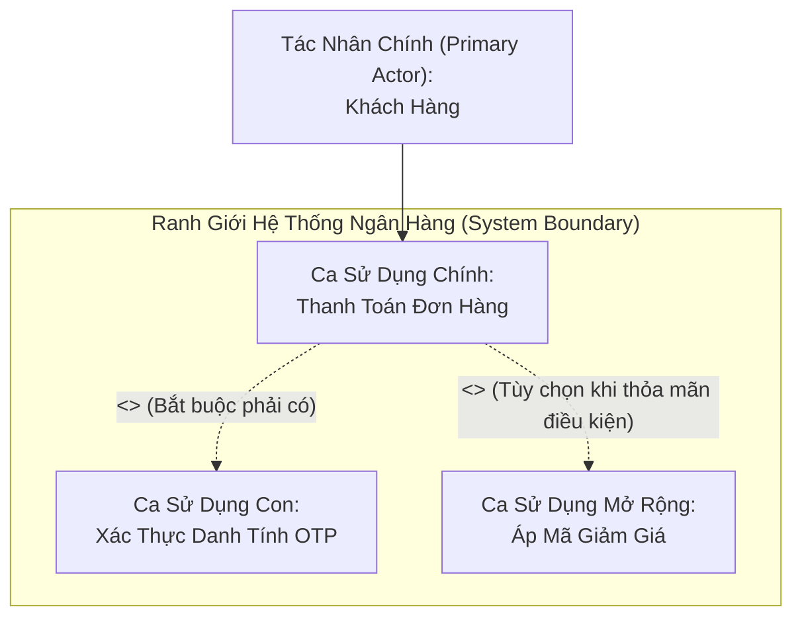
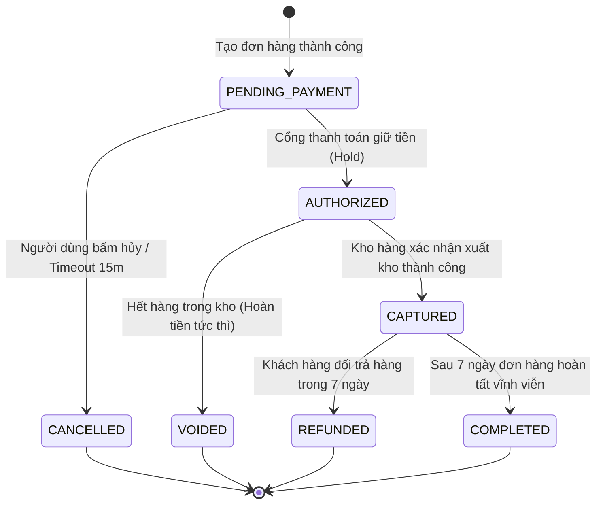

# 2.4. Mô Hình Hóa Yêu Cầu (Requirements Modeling)

> [!IMPORTANT]
> **Nếu bạn chỉ được nhớ một điều duy nhất:** Ngôn ngữ tự nhiên (Văn bản tiếng Việt hay tiếng Anh) là phương tiện giao tiếp đầy rẫy sự mơ hồ, nhập nhằng và đa nghĩa: **"Một bức tranh có giá trị bằng một vạn dòng chữ đặc tả"**. Mô hình hóa yêu cầu (Requirements Modeling) là cầu nối biến các mô tả ngôn ngữ lộn xộn thành các **mô hình kỹ thuật chuẩn xác về mặt cấu trúc và hành vi**: Kết hợp giữa **Mô hình Tĩnh (Use Case, User Stories với Acceptance Criteria chuẩn Gherkin)**, **Mô hình Động (State Machine Diagram để kiểm soát chặt chẽ trạng thái giao dịch, Sequence Diagram để bản đồ hóa thông điệp phân tán)**, và **Mô hình Logic Nghiệp Vụ (Decision Tables để vét cạn $100\%$ các tổ hợp điều kiện biên mà không bỏ sót bất kỳ kịch bản nào)**.

---

## 1. Kiến trúc Tổng quan & Mô hình Tư duy (Mental Model)

### 1.1. Ẩn dụ Đời sống: Bản Vẽ Cơ Khí Động Cơ Máy Bay vs Văn Bản Mô Tả

Hãy hình dung khi một kỹ sư hàng không thiết kế động cơ phản lực:
- **Nếu chỉ dùng văn bản mô tả suông (Text-based Specification)**:
  - *"Động cơ gồm nhiều cánh quạt hút gió vào buồng đốt, sau đó phun nhiên liệu đốt cháy rồi xả khí ra phía sau để đẩy máy bay về phía trước"*.
  - Đoạn văn bản này hoàn toàn vô dụng cho đội ngũ chế tạo cơ khí! Nó không cho biết cánh quạt quay bao nhiêu vòng/phút, góc nghiêng cánh bao nhiêu độ, và áp suất buồng đốt cực đại là bao nhiêu.
- **Mô hình hóa kỹ thuật đa góc nhìn (Multidimensional Modeling)**:
  - **Bản vẽ mặt cắt tĩnh (Structural Blueprint - Use Case / Domain Model)**: Cho thấy vị trí chính xác của từng trục bi, van nhiên liệu và buồng đốt.
  - **Sơ đồ chu trình nhiệt động học (Behavioral State Machine)**: Mô tả các trạng thái chuyển dịch của buồng đốt: `OFF` $\to$ `IGNITING` $\to$ `RUNNING` $\to$ `OVERHEAT_SHUTDOWN`.
  - **Bảng ma trận kiểm soát nhiên liệu (Decision Table)**: Quy định chính xác: Với độ cao $H$ và nhiệt độ $T$, lượng nhiên liệu phun vào bắt buộc phải là bao nhiêu mililit/giây.

```mermaid
graph TD
    classDef agile fill:#e1f5fe,stroke:#0288d1,stroke-width:2px;
    classDef usecase fill:#fff3e0,stroke:#f57c00,stroke-width:2px;
    classDef dynamic fill:#e8f5e9,stroke:#388e3c,stroke-width:2px;
    classDef logic fill:#f3e5f5,stroke:#7b1fa2,stroke-width:2px;

    Root["CÁC CHIỀU KHÔNG GIAN MÔ HÌNH HÓA YÊU CẦU (MODELING DIMENSIONS)"]

    Root --> M1["1. Mô Hình Hóa Linh Hoạt (Agile Modeling)"]:::agile
    Root --> M2["2. Mô Hình Hóa Ca Sử Dụng (Use Case Modeling)"]:::usecase
    Root --> M3["3. Mô Hình Hóa Động & Hành Vi (Dynamic & Behavioral)"]:::dynamic
    Root --> M4["4. Mô Hình Hóa Logic & Quy Tắc (Logic & Rules Modeling)"]:::logic

    M1 --> M1A["User Stories (Connextra Template: As a... I want... So that...)"]
    M1 --> M1B["Tiêu Chí Chấp Nhận (Acceptance Criteria - Gherkin Given/When/Then)"]
    M1 --> M1C["Bản Đồ Hành Trình (User Journey Map)"]

    M2 --> M2A["Tác Nhân (Actors: Primary, Secondary, System)"]
    M2 --> M2B["Luồng Thực Thi: Happy Path, Alternative, Exception Flows"]
    M2 --> M2C["Quan Hệ Use Case: <<include>> vs <<extend>>"]

    M3 --> M3A["State Machine Diagram (Trạng Thái, Chuyển Dịch, Guards)"]
    M3 --> M3B["Sequence Diagram (Tương Tác Theo Trục Thời Gian)"]
    M3 --> M3C["Activity Diagram & BPMN (Quy Trình Nghiệp Vụ)"]

    M4 --> M4A["Bảng Quyết Định (Decision Tables Matrix)"]
    M4 --> M4B["Cây Quyết Định (Decision Trees)"]
    M4 --> M4C["Quy Tắc Nghiệp Vụ Tường Minh (Business Rules)"]
```



---

## 2. Chi tiết từng Keyword (Under-the-Hood Deep Dive)

### 2.1. Agile Modeling: User Story, Template, Acceptance Criteria & User Journey

#### 1. Mẫu User Story Chuẩn Connextra
Được định hình bởi Rachel Davies tại Connextra vào năm 2001, đây là tiêu chuẩn vàng của Agile:
$$\textbf{As a } \langle\text{Role/Persona}\rangle, \; \textbf{I want to } \langle\text{Action/Capability}\rangle, \; \textbf{So that } \langle\text{Business Value/Benefit}\rangle$$
- **Role**: Xác định rõ ai là người hưởng lợi (không bao giờ viết chung chung là "người dùng", mà phải là "Khách hàng VIP", "Nhân viên thẩm định tín dụng").
- **Action**: Năng lực phần mềm cần cung cấp.
- **Benefit**: Giá trị kinh doanh thực sự mang lại (Nếu không thể chỉ ra được giá trị kinh doanh, tính năng đó không xứng đáng được viết code!).

#### 2. Tiêu Chí Chấp Nhận Chuẩn Gherkin (Acceptance Criteria - BDD)
Chuyển hóa câu chuyện thành bài kiểm thử tự động (Executable Specification) bằng cú pháp **Given - When - Then**:
- **Given (Bối cảnh ban đầu)**: Trạng thái của hệ thống trước khi hành động diễn ra.
- **When (Hành động kích hoạt)**: Thao tác của người dùng hoặc sự kiện bên ngoài.
- **Then (Kết quả mong đợi)**: Trạng thái mới của hệ thống và các phản hồi có thể kiểm chứng.

```gherkin
Scenario: Rút tiền ATM thành công khi số dư khả dụng
  Given Tài khoản của "Alice" có số dư là 500 USD
    And Thẻ ATM của "Alice" đang hợp lệ
   When "Alice" yêu cầu rút 100 USD từ cây ATM
   Then Cây ATM phải nhả ra 100 USD tiền mặt
    And Số dư tài khoản của "Alice" phải còn lại 400 USD
    And Hệ thống phải ghi một dòng Audit Log giao dịch
```

---

### 2.2. Use Case Modeling: Actor, Scenarios, Main, Alternative & Exception Flows

Phát minh bởi Ivar Jacobson, Use Case là phương pháp mô hình hóa hướng chức năng cực kỳ mạnh mẽ cho các hệ thống lớn:



#### 1. Phân Loại Tác Nhân (Actors)
- **Primary Actor**: Người trực tiếp kích hoạt Use Case để đạt được mục tiêu (ví dụ: Khách hàng).
- **Secondary / Supporting Actor**: Hệ thống phụ trợ cung cấp dịch vụ cho Use Case (ví dụ: Cổng thanh toán VISA, Dịch vụ gửi SMS).

#### 2. Cấu Trúc Luồng Thực Thi Của Một Use Case
1. **Main Success Scenario (Happy Path - Luồng thành công chính)**: Con đường lý tưởng khi mọi thứ diễn ra trôi chảy, không có bất kỳ lỗi nào.
2. **Alternative Flows (Luồng thay thế)**: Các con đường khác nhau cũng dẫn đến thành công (ví dụ: Thay vì trả bằng thẻ tín dụng, người dùng chọn chuyển khoản ngân hàng).
3. **Exception Flows (Luồng ngoại lệ)**: Các tình huống xảy ra lỗi khiến mục tiêu không thể hoàn thành (ví dụ: Thẻ hết hạn, tài khoản không đủ tiền, hệ thống ngân hàng bị timeout).

#### 3. Quan Hệ `<<include>>` vs `<<extend>>`
- `<<include>>`: Hành vi con **bắt buộc phải thực hiện** trong quá trình chạy Use Case cha (Ví dụ: Thanh toán đơn hàng bắt buộc phải `<<include>>` Xác thực OTP).
- `<<extend>>`: Hành vi mở rộng **chỉ được kích hoạt khi có một điều kiện cụ thể (Extension Point)** (Ví dụ: Thanh toán đơn hàng có thể được `<<extend>>` bởi Áp dụng mã giảm giá khi khách hàng có voucher).

---

### 2.3. Dynamic & Behavioral Modeling: State Machine & Sequence Diagrams

Trong kỹ nghệ Backend phân tán, mã nguồn thường bị lỗi khi xử lý các giao dịch có vòng đời phức tạp (như Đơn hàng thương mại điện tử hoặc Giao dịch ngân hàng). **State Machine Diagram (Biểu đồ Máy trạng thái)** là vũ khí tối thượng để loại bỏ các trạng thái không hợp lệ:



- **Nguyên Tắc Bất Biến (State Invariants & Guard Conditions)**:
  - Một đơn hàng ở trạng thái `CANCELLED` **tuyệt đối không bao giờ được phép chuyển sang `CAPTURED`**.
  - Việc mô hình hóa máy trạng thái giúp lập trình viên viết code với các hàm bảo vệ (State Guard / State Pattern), ngăn chặn hoàn toàn các lỗi gian lận hoặc race condition khi nhiều webhook gọi về cùng lúc.

---

### 2.4. Logic & Rules Modeling: Business Rules & Decision Tables

Khi một chính sách kinh doanh phụ thuộc vào quá nhiều điều kiện kết hợp (ví dụ: Thuật toán duyệt hồ sơ vay tiền ngân hàng hoặc tính phí bảo hiểm), việc viết các khối lệnh `if-else` lồng nhau là công thức dẫn đến thảm họa bug:

#### Ma Trận Bảng Quyết Định (Decision Table Matrix)

| Thành Phần Khảo Sát | Quy Tắc 1 (R1) | Quy Tắc 2 (R2) | Quy Tắc 3 (R3) | Quy Tắc 4 (R4) |
| :--- | :---: | :---: | :---: | :---: |
| **Điều kiện 1: Điểm tín dụng $\ge 700$** | **Y** | **Y** | **N** | **N** |
| **Điều kiện 2: Thu nhập $> 20$ triệu/tháng** | **Y** | **N** | **Y** | **N** |
| **Điều kiện 3: Có tài sản thế chấp** | - | **Y** | **Y** | **N** |
| **Hành động 1: Duyệt khoản vay tự động** | **[X]** | **[X]** | [ ] | [ ] |
| **Hành động 2: Chuyển sang thẩm định thủ công**| [ ] | [ ] | **[X]** | [ ] |
| **Hành động 3: Từ chối hồ sơ lập tức** | [ ] | [ ] | [ ] | **[X]** |

- Bảng quyết định đảm bảo kiểm tra đầy đủ toàn bộ $2^N$ tổ hợp điều kiện có thể xảy ra, loại bỏ hoàn toàn các trường hợp sót (Missing edge cases) trong mã nguồn.

---

## 3. Thực thi Mã nguồn & Mô phỏng Chuyên sâu (Dual-Engine Implementation)

### 3.1. C++20 Clean Decision Table Engine via Functional Mapping

Chương trình minh chứng cách thức triển khai một **Bảng Quyết Định (Decision Table)** chuẩn mực bằng C++20: Biểu diễn các điều kiện và hành động dưới dạng các hàm thuần túy (Lambdas), tự động đánh giá ma trận quy tắc và thực thi hành động tương ứng:

```cpp
// decision_table_engine.cpp
// Biên dịch: g++ -std=c++20 -O3 decision_table_engine.cpp -o decision_table_engine
#include <iostream>
#include <vector>
#include <string>
#include <functional>
#include <optional>

struct LoanApplication {
    std::string applicant_name;
    int credit_score;
    double monthly_income;
    bool has_collateral;
};

enum class LoanDecision {
    AUTO_APPROVED,
    MANUAL_REVIEW,
    REJECTED
};

// Cấu trúc một Rule trong Decision Table
struct DecisionRule {
    std::string rule_name;
    std::function<bool(const LoanApplication&)> condition_predicate;
    LoanDecision action_decision;
};

class LoanDecisionTableEngine {
private:
    std::vector<DecisionRule> rules_;

public:
    LoanDecisionTableEngine() {
        // R1: Điểm tín dụng cao (>=700) và Thu nhập tốt (>=20M) -> Duyệt tự động
        rules_.push_back({
            "R1: Điểm tín dụng cao & Thu nhập tốt",
            [](const LoanApplication& app) {
                return app.credit_score >= 700 && app.monthly_income >= 20.0;
            },
            LoanDecision::AUTO_APPROVED
        });

        // R2: Điểm tín dụng cao (>=700) nhưng thu nhập thấp, có tài sản thế chấp -> Duyệt tự động
        rules_.push_back({
            "R2: Điểm cao, có tài sản thế chấp",
            [](const LoanApplication& app) {
                return app.credit_score >= 700 && app.monthly_income < 20.0 && app.has_collateral;
            },
            LoanDecision::AUTO_APPROVED
        });

        // R3: Điểm thấp (<700) nhưng thu nhập tốt và có tài sản -> Thẩm định thủ công
        rules_.push_back({
            "R3: Điểm thấp, thu nhập tốt & có thế chấp",
            [](const LoanApplication& app) {
                return app.credit_score < 700 && app.monthly_income >= 20.0 && app.has_collateral;
            },
            LoanDecision::MANUAL_REVIEW
        });

        // R4: Mặc định còn lại -> Từ chối
        rules_.push_back({
            "R4: Không đủ điều kiện an toàn",
            [](const LoanApplication&) { return true; }, // Fallback rule
            LoanDecision::REJECTED
        });
    }

    void evaluate(const LoanApplication& app) {
        std::cout << "[HỒ SƠ KHÁCH HÀNG]: " << app.applicant_name 
                  << " (Điểm: " << app.credit_score 
                  << ", Thu nhập: " << app.monthly_income 
                  << "M, Thế chấp: " << (app.has_collateral ? "CÓ" : "KHÔNG") << ")\n";

        for (const auto& rule : rules_) {
            if (rule.condition_predicate(app)) {
                std::cout << "  -> Khớp Quy Tắc: [" << rule.rule_name << "]\n";
                std::cout << "  >>> QUYẾT ĐỊNH CUỐI CÙNG: ";
                switch (rule.action_decision) {
                    case LoanDecision::AUTO_APPROVED:
                        std::cout << "DUYỆT TỰ ĐỘNG (LOAN APPROVED)!\n\n";
                        break;
                    case LoanDecision::MANUAL_REVIEW:
                        std::cout << "CHUYỂN THẨM ĐỊNH THỦ CÔNG (MANUAL REVIEW)!\n\n";
                        break;
                    case LoanDecision::REJECTED:
                        std::cout << "TỪ CHỐI HỒ SƠ (APPLICATION REJECTED)!\n\n";
                        break;
                }
                return;
            }
        }
    }
};

int main() {
    std::cout << "=======================================================================\n";
    std::cout << "          C++20 REQUIREMENTS LOGIC DECISION TABLE ENGINE               \n";
    std::cout << "=======================================================================\n\n";

    LoanDecisionTableEngine engine;

    engine.evaluate({"Alice Nguyen", 750, 35.0, false}); // Khớp R1
    engine.evaluate({"Bob Tran",     720, 15.0, true});  // Khớp R2
    engine.evaluate({"Charlie Le",   620, 25.0, true});  // Khớp R3
    engine.evaluate({"David Pham",   580, 10.0, false}); // Khớp R4

    return 0;
}
```

#### Terminal Output Mẫu:
```text
=======================================================================
          C++20 REQUIREMENTS LOGIC DECISION TABLE ENGINE               
=======================================================================

[HỒ SƠ KHÁCH HÀNG]: Alice Nguyen (Điểm: 750, Thu nhập: 35M, Thế chấp: KHÔNG)
  -> Khớp Quy Tắc: [R1: Điểm tín dụng cao & Thu nhập tốt]
  >>> QUYẾT ĐỊNH CUỐI CÙNG: DUYỆT TỰ ĐỘNG (LOAN APPROVED)!

[HỒ SƠ KHÁCH HÀNG]: Bob Tran (Điểm: 720, Thu nhập: 15M, Thế chấp: CÓ)
  -> Khớp Quy Tắc: [R2: Điểm cao, có tài sản thế chấp]
  >>> QUYẾT ĐỊNH CUỐI CÙNG: DUYỆT TỰ ĐỘNG (LOAN APPROVED)!

[HỒ SƠ KHÁCH HÀNG]: Charlie Le (Điểm: 620, Thu nhập: 25M, Thế chấp: CÓ)
  -> Khớp Quy Tắc: [R3: Điểm thấp, thu nhập tốt & có thế chấp]
  >>> QUYẾT ĐỊNH CUỐI CÙNG: CHUYỂN THẨM ĐỊNH THỦ CÔNG (MANUAL REVIEW)!

[HỒ SƠ KHÁCH HÀNG]: David Pham (Điểm: 580, Thu nhập: 10M, Thế chấp: KHÔNG)
  -> Khớp Quy Tắc: [R4: Không đủ điều kiện an toàn]
  >>> QUYẾT ĐỊNH CUỐI CÙNG: TỪ CHỐI HỒ SƠ (APPLICATION REJECTED)!
```

---

### 3.2. Python 3.11+ Order State Machine & BDD Acceptance Test Simulator

Chương trình minh chứng cách triển khai **Máy trạng thái đơn hàng (Order State Machine)** với các điều kiện chuyển dịch nghiêm ngặt (Transition Guards) và kiểm chứng tự động theo phong cách **BDD Acceptance Criteria**:

```python
#!/usr/bin/env python3
"""
order_state_machine_bdd.py
Mô phỏng Máy Trạng Thái Đơn Hàng (State Machine) & Kiểm Thử Chấp Nhận BDD Gherkin
"""
from enum import Enum
from dataclasses import dataclass
from typing import Optional

class OrderState(Enum):
    PENDING_PAYMENT = "PENDING_PAYMENT"
    AUTHORIZED = "AUTHORIZED"
    CAPTURED = "CAPTURED"
    CANCELLED = "CANCELLED"
    REFUNDED = "REFUNDED"

class InvalidStateTransitionError(Exception):
    pass

class OrderStateMachine:
    def __init__(self, order_id: str, total_amount: float):
        self.order_id = order_id
        self.total_amount = total_amount
        self.current_state = OrderState.PENDING_PAYMENT

    def authorize_payment(self, hold_amount: float):
        # BDD Rule: Chỉ cho phép Authorize khi đang ở PENDING_PAYMENT
        if self.current_state != OrderState.PENDING_PAYMENT:
            raise InvalidStateTransitionError(f"Không thể Authorize đơn hàng đang ở trạng thái {self.current_state.value}!")
        if hold_amount < self.total_amount:
            raise ValueError("Số tiền phong tỏa không đủ để thanh toán đơn hàng!")
        
        self.current_state = OrderState.AUTHORIZED
        print(f"  [STATE CHANGE] Order {self.order_id}: PENDING_PAYMENT -> AUTHORIZED (Hold ${hold_amount})")

    def capture(self):
        # BDD Rule: Chỉ cho phép Capture khi đã AUTHORIZED
        if self.current_state != OrderState.AUTHORIZED:
            raise InvalidStateTransitionError(f"Không thể Capture đơn hàng khi chưa được Authorize (Trạng thái: {self.current_state.value})!")
        
        self.current_state = OrderState.CAPTURED
        print(f"  [STATE CHANGE] Order {self.order_id}: AUTHORIZED -> CAPTURED (Tiền đã vào tài khoản cửa hàng)")

    def cancel(self):
        # BDD Rule: Không thể Cancel một đơn hàng đã Capture tiền
        if self.current_state in [OrderState.CAPTURED, OrderState.REFUNDED]:
            raise InvalidStateTransitionError(f"Đơn hàng đã thanh toán xong ({self.current_state.value}), bắt buộc phải qua quy trình REFUND!")
        
        self.current_state = OrderState.CANCELLED
        print(f"  [STATE CHANGE] Order {self.order_id}: -> CANCELLED (Đã hủy đơn hàng)")

def run_bdd_acceptance_tests():
    print("=" * 80)
    print("      KIỂM THỬ CHẤP NHẬN BDD: QUY CHUẨN MÁY TRẠNG THÁI ĐƠN HÀNG       ")
    print("=" * 80)

    # Kịch bản 1: Happy Path
    print("\n[KỊCH BẢN 1: Giao dịch thành công trọn vẹn (Happy Path)]")
    order1 = OrderStateMachine("ORD-001", 100.0)
    order1.authorize_payment(100.0)
    order1.capture()
    assert order1.current_state == OrderState.CAPTURED
    print(">>> KỊCH BẢN 1: ĐẠT CHUẨN (PASSED)")

    # Kịch bản 2: Vi phạm State Transition (Cố tình hủy đơn hàng đã Capture)
    print("\n[KỊCH BẢN 2: Thử nghiệm vi phạm logic chuyển dịch trạng thái]")
    order2 = OrderStateMachine("ORD-002", 200.0)
    order2.authorize_payment(200.0)
    order2.capture()

    try:
        print("  Thực hiện thao tác bất hợp pháp: Cố tình Cancel đơn hàng đã Capture...")
        order2.cancel()
    except InvalidStateTransitionError as ex:
        print(f"  -> [BẮT NGOẠI LỆ HỢP LỆ]: {ex}")
        print(">>> KỊCH BẢN 2: BẢO VỆ TRẠNG THÁI AN TOÀN 100% (PASSED)")

    print("\n" + "=" * 80)

if __name__ == "__main__":
    run_bdd_acceptance_tests()
```

#### Terminal Output Mẫu:
```text
================================================================================
      KIỂM THỬ CHẤP NHẬN BDD: QUY CHUẨN MÁY TRẠNG THÁI ĐƠN HÀNG       
================================================================================

[KỊCH BẢN 1: Giao dịch thành công trọn vẹn (Happy Path)]
  [STATE CHANGE] Order ORD-001: PENDING_PAYMENT -> AUTHORIZED (Hold $100.0)
  [STATE CHANGE] Order ORD-001: AUTHORIZED -> CAPTURED (Tiền đã vào tài khoản cửa hàng)
>>> KỊCH BẢN 1: ĐẠT CHUẨN (PASSED)

[KỊCH BẢN 2: Thử nghiệm vi phạm logic chuyển dịch trạng thái]
  [STATE CHANGE] Order ORD-002: PENDING_PAYMENT -> AUTHORIZED (Hold $200.0)
  [STATE CHANGE] Order ORD-002: AUTHORIZED -> CAPTURED (Tiền đã vào tài khoản cửa hàng)
  Thực hiện thao tác bất hợp pháp: Cố tình Cancel đơn hàng đã Capture...
  -> [BẮT NGOẠI LỆ HỢP LỆ]: Đơn hàng đã thanh toán xong (CAPTURED), bắt buộc phải qua quy trình REFUND!
>>> KỊCH BẢN 2: BẢO VỆ TRẠNG THÁI AN TOÀN 100% (PASSED)

================================================================================
```

---

## 4. Systems Engineering & Production Pitfalls

### 4.1. Cạm Bẫy Thực Chiến Thường Gặp (Production Pitfalls)

#### 1. Sự Cố "Missing Edge Case Explosion" Do Viết `if-else` Tự Phát
- **Hiện tượng**: Một tính năng tính phí bảo hiểm có 4 điều kiện đầu vào. Lập trình viên viết các khối `if` lồng nhau và chỉ bao quát 5 trường hợp.
- **Hậu quả**: Khi một khách hàng có tổ hợp điều kiện thứ 6 xuất hiện trên Production, hệ thống rơi vào nhánh `else` mặc định và tính giá bảo hiểm bằng \$0, gây thất thoát hàng trăm nghìn USD!
- **Giải pháp**: Bắt buộc vẽ **Decision Table** trước khi gõ code. Bảng quyết định bắt buộc lập trình viên phải định nghĩa hành vi cho đầy đủ $2^4 = 16$ trường hợp.

#### 2. Thảm Họa "State Machine Race Conditions" Trong Hệ Thống Phân Tán
- **Hiện tượng**: Hai Webhook từ cổng thanh toán gửi về gần như cùng một tích tắc: Webhook 1 báo `PaymentSucceeded`, Webhook 2 báo `PaymentCancelled` do người dùng thao tác nhanh.
- **Hậu quả**: Nếu không có cơ chế khóa lạc quan (Optimistic Locking via Version) hoặc State Machine bảo vệ, trạng thái của đơn hàng có thể bị nhảy lùi từ `COMPLETED` về `CANCELLED`.
- **Giải pháp**: Thiết kế bảng Database với ràng buộc trạng thái hoặc kiểm tra version:
  ```sql
  UPDATE orders SET status = 'CAPTURED', version = version + 1 
  WHERE id = 101 AND status = 'AUTHORIZED' AND version = 2;
  ```

#### 3. Bẫy Biến Sequence Diagram Thành "Văn Bản Bất Di Bất Dịch"
- **Hiện tượng**: Đội ngũ vẽ một Sequence Diagram chi tiết đến từng tên hàm riêng tư (Private methods) và từng biến nội tại.
- **Hậu quả**: Mỗi khi lập trình viên đổi tên một hàm con, tài liệu kiến trúc lập tức bị lỗi thời (Outdated).
- **Giải pháp**: Sequence Diagram chỉ nên mô hình hóa tương tác giữa các ranh giới lớn (**Microservices, API Endpoints, Database**), không vẽ chi tiết mã nguồn nội bộ bên trong một class.

---

### 4.2. CLI Diagnostics & Công Cụ Khảo Sát Mô Hình Hóa

```bash
# 1. Chạy bài kiểm thử chấp nhận BDD tự động bằng Behave CLI
behave features/order_lifecycle.feature

# 2. Sinh biểu đồ State Machine trực tiếp từ mã nguồn PlantUML
plantuml -tpng order_state_machine.puml

# 3. Quét kiểm tra độ phức tạp phân nhánh Cyclomatic Complexity của các hàm if-else
lizard src/ -C 10
```

---

## 5. Bảng So sánh & Decision Matrix

| Kỹ Thuật Mô Hình Hóa | Chiều Không Gian Đại Diện | Độ Chính Xác Kỹ Thuật | Phù Hợp Cho Đối Tượng | Khi Nào Bắt Buộc Dùng |
| :--- | :--- | :--- | :--- | :--- |
| **User Stories & Gherkin** | Tương tác & Chấp nhận (BDD) | Trung bình - Cao | Lập trình viên, Tester, PO | Lập kế hoạch Sprint, Viết Test tự động |
| **Use Case Diagram** | Ranh giới & Mục tiêu tổng thể | Trung bình | Khách hàng, Ban quản lý | Báo cáo phạm vi dự án trong hợp đồng |
| **State Machine Diagram** | Vòng đời & Trạng thái thực thể| **Rất cao (Nghiêm ngặt)** | Kỹ sư Backend, Kiến trúc sư | Quản lý Đơn hàng, Giao dịch tài chính, Game|
| **Sequence Diagram** | Giao tiếp mạng theo thời gian | Cao | Kỹ sư phân tán, API Designer | Thiết kế tương tác liên dịch vụ gRPC/REST|
| **Decision Tables Matrix** | Logic phân nhánh điều kiện | **Tuyệt đối ($100\%$ vét cạn)**| Lập trình viên thuật toán, BA | Tính thuế, Duyệt hồ sơ vay, Chấm điểm tín dụng|
