# 2.5. Chất Lượng Kỹ Nghệ Yêu Cầu (Requirements Quality)

> [!IMPORTANT]
> **Nếu bạn chỉ được nhớ một điều duy nhất:** Một yêu cầu phần mềm tồi tệ viết trên tài liệu sẽ được nhân bản thành hàng nghìn dòng code rác trên môi trường Production: **"Rác vào thì Rác ra" (Garbage In, Garbage Out)**. Tiêu chuẩn quốc tế **ISO/IEC/IEEE 29148 và IEEE 830** quy định rằng một yêu cầu kỹ thuật chuẩn mực bắt buộc phải thỏa mãn đồng thời 6 thuộc tính vàng: **Đúng đắn (Correct), Không mơ hồ (Unambiguous), Đầy đủ (Complete), Nhất quán (Consistent), Có thể kiểm chứng được (Verifiable/Testable) và Có thể truy vết được (Traceable)**. Bất kỳ yêu cầu nào chứa các từ ngữ mơ hồ như *"nhanh chóng"*, *"thân thiện"*, *"linh hoạt"* hoặc *"tối ưu"* đều là các "mùi hôi yêu cầu" (Requirements Smells) chết người cần phải bị loại bỏ ngay từ khâu thẩm định.

---

## 1. Kiến trúc Tổng quan & Mô hình Tư duy (Mental Model)

### 1.1. Ẩn dụ Đời sống: Hợp Đồng Mua Bán Bất Động Sản & Đơn Thuốc Bác Sĩ

Hãy hình dung hai văn bản pháp lý và y tế quan trọng:
- **Đơn thuốc viết tay mập mờ (Ambiguous Requirement)**:
  - Bác sĩ viết chữ ngoằn ngoèo: *"Cho bệnh nhân uống thuốc giảm đau liều lượng thích hợp khi thấy khó chịu"*.
  - Người dược sĩ bán thuốc không biết "thích hợp" là 1 viên hay 10 viên! Nếu bệnh nhân uống quá liều, hậu quả là nguy hiểm đến tính mạng.
- **Hợp đồng công chứng mua bán nhà đất (High-Quality Requirement)**:
  - Không bao giờ ghi: *"Bán cho bên B một mảnh đất rộng rãi ở khu vực đẹp"*.
  - Hợp đồng bắt buộc phải ghi: *"Bán thửa đất số 42, tờ bản đồ số 10, diện tích chính xác $125.5\text{ m}^2$, ranh giới tọa độ VN-2000 được cắm mốc bê tông bởi văn phòng đăng ký đất đai"*.
  - Từng câu chữ đều chính xác tuyệt đối, có thể đo đạc bằng thước đo vật lý, không ai có thể diễn giải thành hai nghĩa khác nhau, và có giá trị làm bằng chứng kiểm toán trước tòa án (**Verifiable & Unambiguous**).

```mermaid
graph TD
    classDef quality fill:#e1f5fe,stroke:#0288d1,stroke-width:2px;
    classDef defect fill:#ffebee,stroke:#d32f2f,stroke-width:2px;
    classDef gate fill:#e8f5e9,stroke:#388e3c,stroke-width:2px;

    Root["BẢN ĐỒ CHẤT LƯỢNG YÊU CẦU PHẦN MỀM (REQUIREMENTS QUALITY)"]

    Root --> Q1["1. Sáu Thuộc Tính Vàng (Quality Attributes - IEEE 29148)"]:::quality
    Root --> Q2["2. Các Khiếm Khuyết Thường Gặp (Requirements Defects)"]:::defect
    Root --> Q3["3. Cổng Chất Lượng & Thẩm Định (Quality Gates)"]:::gate

    Q1 --> Q1A["Correctness (Đúng đắn thực tế)"]
    Q1 --> Q1B["Unambiguity (Chỉ có duy nhất một cách hiểu)"]
    Q1 --> Q1C["Completeness (Bao quát 100% kịch bản, không có TBD)"]
    Q1 --> Q1D["Consistency (Không xung đột với các yêu cầu khác)"]
    Q1 --> Q1E["Verifiability / Testability (Có thể kiểm chứng định lượng)"]
    Q1 --> Q1F["Traceability (Truy vết được tới mã nguồn và Test Case)"]

    Q2 --> Q2A["Tính Mơ Hồ (Semantic Ambiguity: 'nhanh', 'tối ưu')"]
    Q2 --> Q2B["Mâu Thuẫn Logic (Logical Conflicts & Inconsistencies)"]
    Q2 --> Q2C["Thiếu Hụt Thông Tin (Incompleteness & Missing Edge Cases)"]

    Q3 --> Q3A["Definition of Ready (DoR: Đủ chuẩn mới vào Sprint)"]
    Q3 --> Q3B["Definition of Done (DoD: Tiêu chí nghiệm thu hoàn tất)"]
    Q3 --> Q3C["Requirements Linter & Peer Review Checklist"]
```



---

## 2. Chi tiết từng Keyword (Under-the-Hood Deep Dive)

### 2.1. The Quality Attributes of Good Requirements (Tiêu Chuẩn Đo Lường Yêu Cầu Tốt)

Bộ tiêu chuẩn kỹ thuật quốc tế **ISO/IEC/IEEE 29148:2018** (thay thế cho IEEE 830 cổ điển) quy chuẩn 6 thuộc tính bắt buộc của một yêu cầu phần mềm đạt chuẩn:

#### 1. Correctness (Tính Đúng Đắn)
- Yêu cầu phải phản ánh chính xác mục tiêu kinh doanh của khách hàng và tuân thủ các quy định pháp luật (GDPR, PCI-DSS, chuẩn kế toán).

#### 2. Unambiguity (Tính Không Mơ Hồ)
- Yêu cầu chỉ được phép có **đúng một cách diễn giải duy nhất**. Mọi người đọc (Khách hàng, Lập trình viên, Tester, Giám đốc) khi đọc câu văn đều phải cùng hiểu về một kết quả giống hệt nhau.

#### 3. Completeness (Tính Đầy Đủ)
- Tài liệu phải bao quát toàn bộ mọi thông tin cần thiết để phát triển: Giá trị đầu vào hợp lệ, giá trị đầu vào không hợp lệ, phản hồi lỗi, và hành vi khi xảy ra sự cố mạng. **Tuyệt đối nghiêm cấm các từ ngữ đánh dấu tạm bợ như `TBD` (To Be Determined) hoặc `Sẽ cập nhật sau` khi đưa vào Sprint**.

#### 4. Consistency (Tính Nhất Quán)
- Yêu cầu không được mâu thuẫn với chính nó hoặc xung đột với các yêu cầu khác trong cùng tài liệu (ví dụ: Trang A quy định mật khẩu dài tối đa 16 ký tự, nhưng Trang B lại yêu cầu mật khẩu phải từ 20 ký tự trở lên).

#### 5. Verifiability / Testability (Tính Có Thể Kiểm Chứng Được)
- Bắt buộc phải tồn tại một quy trình đo lường hữu hạn bằng con người hoặc máy móc để khẳng định phần mềm hoàn thành là **ĐẠT (PASS)** hay **KHÔNG ĐẠT (FAIL)**.

#### 6. Traceability (Tính Có Thể Truy Vết)
- Mỗi yêu cầu phải có một mã định danh duy nhất (Unique ID: e.g. `REQ-AUTH-001`) để liên kết xuyên suốt sang thiết kế kiến trúc, mã nguồn và ca kiểm thử.

---

### 2.2. Requirements Defects: Ambiguity, Conflicts, Coverage & Acceptance Testing

#### 1. Bảng Đối Chiếu: Yêu Cầu Kém vs Yêu Cầu Chuẩn Kỹ Thuật

```
┌─────────────────────────────────┬─────────────────────────────────┬──────────────────────────────────────────┐
│ Yêu Cầu Kém (Mơ Hồ / Lỗi)       │ Lỗi Khiếm Khuyết Bản Chất       │ Yêu Cầu Chuẩn Kỹ Thuật (S.M.A.R.T)       │
├─────────────────────────────────┼─────────────────────────────────┼──────────────────────────────────────────┤
│ "Hệ thống phải phản hồi nhanh   │ Mơ hồ (Ambiguous) & Không thể   │ "Độ trễ phản hồi (Response Latency) p99  │
│ chóng cho người dùng."          │ kiểm chứng (Unverifiable).      │ của API không được vượt quá 200ms dưới   │
│                                 │ 'Nhanh' là 1ms hay 5 giây?      │ tải 1.000 QPS."                          │
├─────────────────────────────────┼─────────────────────────────────┼──────────────────────────────────────────┤
│ "Giao diện phải thân thiện và   │ Hoàn toàn mang tính cảm tính    │ "Người dùng mới phải có khả năng hoàn tất│
│ dễ sử dụng."                    │ chủ quan của từng người.        │ đặt hàng trong vòng 3 phút mà không cần  │
│                                 │                                 │ tài liệu hướng dẫn (Đo qua Usability Lab)│
├─────────────────────────────────┼─────────────────────────────────┼──────────────────────────────────────────┤
│ "Hệ thống tự động sao lưu dữ    │ Thiếu hụt thông tin             │ "Cơ sở dữ liệu phải tự động snapshot mỗi │
│ liệu thường xuyên."             │ (Incomplete). 'Thường xuyên' là │ 01:00 UTC hàng ngày, nén mã hóa AES-256  │
│                                 │ 5 phút hay 1 tuần?              │ và lưu trữ trên AWS S3 với RPO <= 24h."  │
├─────────────────────────────────┼─────────────────────────────────┼──────────────────────────────────────────┤
│ "Hệ thống không bao giờ bị sập."│ Bất khả thi về mặt vật lý       │ "Hệ thống cam kết độ sẵn sàng đạt chuẩn  │
│                                 │ (Unrealistic / Unachievable).   │ SLA 99.95% (Downtime tối đa 4.38h/năm)." │
└─────────────────────────────────┴─────────────────────────────────┴──────────────────────────────────────────┘
```

#### 2. Danh Sách Các Từ Ngữ Nguy Hiểm Cần Cấm Chỉ (Escape Words / Weasel Words)
Khi rà soát tài liệu yêu cầu, hãy gắn cờ đỏ ngay lập tức nếu thấy các từ sau:
- *Tương đối (Approximately), Linh hoạt (Flexible), Tối ưu (Optimized), Thân thiện (User-friendly), Nhanh chóng (Fast), Thường xuyên (Regularly), Nếu có thể (If possible), Và vân vân (Etc., And so on)*.

#### 3. Chốt Kiểm Soát Nghiệm Thu: Definition of Ready (DoR) vs Definition of Done (DoD)
- **Definition of Ready (DoR)**: Bộ tiêu chuẩn bắt buộc một User Story phải đạt được **trước khi** được phép đưa vào Sprint Planning: Phải có mô tả giá trị nghiệp vụ, tiêu chí chấp nhận Acceptance Criteria rõ ràng, đã được phân tích rủi ro, và đội ngũ kỹ thuật hiểu rõ $100\%$ phạm vi.
- **Definition of Done (DoD)**: Tiêu chuẩn hoàn thành bắt buộc **trước khi** một tính năng được coi là xong: Code đã qua Code Review, độ bao phủ Unit Test $> 80\%$, kiểm thử tích hợp Pass $100\%$, tài liệu API Swagger được cập nhật, và đã deploy lên Staging.

---

## 3. Thực thi Mã nguồn & Mô phỏng Chuyên sâu (Dual-Engine Implementation)

### 3.1. C++20 Contract-Based Verification of Testable Requirements

Chương trình minh chứng cách sử dụng kỹ thuật lập trình theo hợp đồng (**Design by Contract**) kết hợp `std::expected` trong C++20 để biến các yêu cầu kỹ thuật thành các điều kiện tiên quyết (Preconditions), hậu điều kiện (Postconditions) có thể kiểm chứng toán học:

```cpp
// contract_requirement_verifier.cpp
// Biên dịch: g++ -std=c++20 -O3 contract_requirement_verifier.cpp -o contract_requirement_verifier
#include <iostream>
#include <string>
#include <string_view>
#include <expected>
#include <chrono>

// Định nghĩa mã lỗi kỹ thuật chuẩn hóa
enum class RequirementErrorCode {
    INVALID_AMOUNT_NEGATIVE,
    DAILY_LIMIT_EXCEEDED,
    INSUFFICIENT_FUNDS,
    ACCOUNT_INACTIVE
};

struct TransferRequest {
    int sender_id;
    int receiver_id;
    double amount;
    double sender_balance;
    double sender_daily_transferred_today;
    bool is_active;
};

// ============================================================================
// ĐẶC TẢ KỸ THUẬT REQ-TRANSFER-001:
// 1. Số tiền chuyển phải > 0.
// 2. Tổng hạn mức chuyển trong ngày không được vượt quá $5,000.
// 3. Số dư tài khoản phải đủ để thanh toán.
// 4. Tài khoản người gửi phải ở trạng thái hoạt động (Active).
// ============================================================================
class BankTransferContractVerifier {
public:
    static constexpr double DAILY_LIMIT = 5000.0;

    static std::expected<double, RequirementErrorCode> verify_and_execute(TransferRequest& req) {
        // PRECONDITION 1: Số tiền phải dương
        if (req.amount <= 0.0) {
            return std::unexpected(RequirementErrorCode::INVALID_AMOUNT_NEGATIVE);
        }

        // PRECONDITION 2: Tài khoản phải Active
        if (!req.is_active) {
            return std::unexpected(RequirementErrorCode::ACCOUNT_INACTIVE);
        }

        // PRECONDITION 3: Không vượt hạn mức ngày
        if (req.sender_daily_transferred_today + req.amount > DAILY_LIMIT) {
            return std::unexpected(RequirementErrorCode::DAILY_LIMIT_EXCEEDED);
        }

        // PRECONDITION 4: Đủ số dư
        if (req.sender_balance < req.amount) {
            return std::unexpected(RequirementErrorCode::INSUFFICIENT_FUNDS);
        }

        // THỰC THI CHUYỂN TIỀN
        double old_balance = req.sender_balance;
        req.sender_balance -= req.amount;
        req.sender_daily_transferred_today += req.amount;

        // POSTCONDITION: Đảm bảo tính toàn vẹn số học
        if (req.sender_balance != old_balance - req.amount) {
            std::terminate(); // Lỗi vi phạm bất biến dữ liệu!
        }

        return req.sender_balance;
    }
};

int main() {
    std::cout << "=======================================================================\n";
    std::cout << "      C++20 CONTRACT-BASED TESTABLE REQUIREMENTS VERIFIER ENGINE       \n";
    std::cout << "=======================================================================\n\n";

    // Kịch bản 1: Thỏa mãn 100% hợp đồng yêu cầu
    TransferRequest valid_req{101, 102, 500.0, 2000.0, 1000.0, true};
    auto res1 = BankTransferContractVerifier::verify_and_execute(valid_req);
    if (res1.has_value()) {
        std::cout << "[REQ TEST 1: THÀNH CÔNG] Đạt chuẩn hợp đồng! Số dư mới: $" << *res1 << "\n";
    }

    // Kịch bản 2: Vi phạm hạn mức ngày ($1000 + $4500 = $5500 > $5000)
    TransferRequest limit_req{101, 102, 4500.0, 10000.0, 1000.0, true};
    auto res2 = BankTransferContractVerifier::verify_and_execute(limit_req);
    if (!res2.has_value()) {
        std::cout << "[REQ TEST 2: BỊ CHẶN HỢP LỆ] Mã lỗi: DAILY_LIMIT_EXCEEDED (Vượt hạn mức $5000/ngày)\n";
    }

    // Kịch bản 3: Vi phạm số dư khả dụng
    TransferRequest poor_req{101, 102, 500.0, 200.0, 0.0, true};
    auto res3 = BankTransferContractVerifier::verify_and_execute(poor_req);
    if (!res3.has_value()) {
        std::cout << "[REQ TEST 3: BỊ CHẶN HỢP LỆ] Mã lỗi: INSUFFICIENT_FUNDS (Số dư khả dụng không đủ)\n";
    }

    return 0;
}
```

#### Terminal Output Mẫu:
```text
=======================================================================
      C++20 CONTRACT-BASED TESTABLE REQUIREMENTS VERIFIER ENGINE       
=======================================================================

[REQ TEST 1: THÀNH CÔNG] Đạt chuẩn hợp đồng! Số dư mới: $1500
[REQ TEST 2: BỊ CHẶN HỢP LỆ] Mã lỗi: DAILY_LIMIT_EXCEEDED (Vượt hạn mức $5000/ngày)
[REQ TEST 3: BỊ CHẶN HỢP LỆ] Mã lỗi: INSUFFICIENT_FUNDS (Số dư khả dụng không đủ)
```

---

### 3.2. Python 3.11+ Automated Requirements Linter & Ambiguity Smell Detector

Script tự động phân tích tĩnh văn bản tài liệu yêu cầu (Requirements Smell Analysis): Quét và phát hiện các "từ ngữ mơ hồ" (Ambiguous Weasel Words), phát hiện các thẻ chưa hoàn tất (`TBD`), và chấm điểm chất lượng tài liệu đặc tả:

```python
#!/usr/bin/env python3
"""
requirements_smell_linter.py
Công Cụ Phân Tích Tĩnh Phát Hiện Mùi Hôi Mơ Hồ Trong Tài Liệu Yêu Cầu
"""
import re
from dataclasses import dataclass
from typing import List, Dict

@dataclass
class QualityIssue:
    line_number: int
    rule_name: str
    issue_snippet: str
    suggestion: str

class RequirementsLinter:
    # Danh sách các từ ngữ nguy hiểm cần cảnh báo
    AMBIGUOUS_WORDS = [
        "nhanh", "thân thiện", "dễ dùng", "tối ưu", "linh hoạt", 
        "thường xuyên", "khoảng", "tương đối", "vân vân", "etc"
    ]

    UNVERIFIABLE_PATTERNS = [
        r"\b100%\s+không bao giờ\b",
        r"\btuyệt đối an toàn\b",
        r"\bchạy ngay lập tức\b"
    ]

    def lint_specification_text(self, text_lines: List[str]) -> List[QualityIssue]:
        issues = []

        for idx, line in enumerate(text_lines, start=1):
            line_lower = line.lower()

            # 1. Quét tìm từ ngữ mơ hồ
            for word in self.AMBIGUOUS_WORDS:
                if re.search(rf"\b{word}\b", line_lower):
                    issues.append(QualityIssue(
                        line_number=idx,
                        rule_name="AMBIGUOUS_LANGUAGE",
                        issue_snippet=f"Chứa từ ngữ mơ hồ '{word}'",
                        suggestion=f"Thay thế '{word}' bằng chỉ số kỹ thuật có thể đo lường định lượng cụ thể."
                    ))

            # 2. Quét tìm thẻ chưa hoàn tất (Incompleteness)
            if "tbd" in line_lower or "cập nhật sau" in line_lower:
                issues.append(QualityIssue(
                    line_number=idx,
                    rule_name="INCOMPLETE_SPECIFICATION",
                    issue_snippet="Chứa thẻ đánh dấu chưa hoàn thiện 'TBD'",
                    suggestion="Đặc tả đầy đủ thông tin hoặc xóa bỏ tính năng này ra khỏi phạm vi Sprint hiện tại."
                ))

            # 3. Quét tìm các phát biểu bất khả thi (Unverifiable)
            for pat in self.UNVERIFIABLE_PATTERNS:
                if re.search(pat, line_lower):
                    issues.append(QualityIssue(
                        line_number=idx,
                        rule_name="UNVERIFIABLE_PROMISE",
                        issue_snippet=f"Cam kết bất khả thi theo mẫu '{pat}'",
                        suggestion="Quy đổi thành cam kết SLA toán học xác suất (ví dụ SLA 99.9%)."
                    ))

        return issues

def main():
    print("=" * 80)
    print("       CÔNG CỤ QUÉT PHÂN TÍCH TĨNH CHẤT LƯỢNG YÊU CẦU (REQ LINTER)           ")
    print("=" * 80)

    sample_srs_document = [
        "REQ-01: Hệ thống phải có giao diện thân thiện và dễ dùng cho mọi lứa tuổi.",
        "REQ-02: Tốc độ phản hồi của trang web phải nhanh chóng khi người dùng click chuột.",
        "REQ-03: Cơ sở dữ liệu phải tuyệt đối an toàn và 100% không bao giờ bị hacker tấn công.",
        "REQ-04: Hệ thống cho phép thanh toán qua thẻ tín dụng, ví điện tử, và vân vân.",
        "REQ-05: Chính sách tính điểm thưởng cho thành viên VIP: TBD sẽ cập nhật sau.",
        "REQ-06: Độ trễ p99 của API tìm kiếm phải nhỏ hơn 150ms dưới tải 500 QPS." # Câu chuẩn duy nhất!
    ]

    linter = RequirementsLinter()
    detected_issues = linter.lint_specification_text(sample_srs_document)

    print(f"\nPhát hiện tổng cộng {len(detected_issues)} lỗi chất lượng nghiêm trọng trong tài liệu:")
    print("-" * 80)
    for issue in detected_issues:
        print(f"Dòng {issue.line_number}: [{issue.rule_name}]")
        print(f"  -> Lỗi      : {issue.issue_snippet}")
        print(f"  -> Khắc phục: {issue.suggestion}")
        print("-" * 80)

    score = max(0, 100 - len(detected_issues) * 15)
    print(f"\n>>> ĐIỂM CHẤT LƯỢNG TÀI LIỆU YÊU CẦU: {score} / 100")
    if score < 80:
        print(">>> KẾT QUẢ: BÁC BỎ ĐẶC TẢ! Yêu cầu viết lại trước khi chuyển sang pha Thiết kế.")
    print("=" * 80)

if __name__ == "__main__":
    main()
```

#### Terminal Output Mẫu:
```text
================================================================================
       CÔNG CỤ QUÉT PHÂN TÍCH TĨNH CHẤT LƯỢNG YÊU CẦU (REQ LINTER)           
================================================================================

Phát hiện tổng cộng 8 lỗi chất lượng nghiêm trọng trong tài liệu:
--------------------------------------------------------------------------------
Dòng 1: [AMBIGUOUS_LANGUAGE]
  -> Lỗi      : Chứa từ ngữ mơ hồ 'thân thiện'
  -> Khắc phục: Thay thế 'thân thiện' bằng chỉ số kỹ thuật có thể đo lường định lượng cụ thể.
--------------------------------------------------------------------------------
Dòng 1: [AMBIGUOUS_LANGUAGE]
  -> Lỗi      : Chứa từ ngữ mơ hồ 'dễ dùng'
  -> Khắc phục: Thay thế 'dễ dùng' bằng chỉ số kỹ thuật có thể đo lường định lượng cụ thể.
--------------------------------------------------------------------------------
Dòng 2: [AMBIGUOUS_LANGUAGE]
  -> Lỗi      : Chứa từ ngữ mơ hồ 'nhanh'
  -> Khắc phục: Thay thế 'nhanh' bằng chỉ số kỹ thuật có thể đo lường định lượng cụ thể.
--------------------------------------------------------------------------------
Dòng 3: [UNVERIFIABLE_PROMISE]
  -> Lỗi      : Cam kết bất khả thi theo mẫu '\b100%\s+không bao giờ\b'
  -> Khắc phục: Quy đổi thành cam kết SLA toán học xác suất (ví dụ SLA 99.9%).
--------------------------------------------------------------------------------
Dòng 3: [UNVERIFIABLE_PROMISE]
  -> Lỗi      : Cam kết bất khả thi theo mẫu '\btuyệt đối an toàn\b'
  -> Khắc phục: Quy đổi thành cam kết SLA toán học xác suất (ví dụ SLA 99.9%).
--------------------------------------------------------------------------------
Dòng 4: [AMBIGUOUS_LANGUAGE]
  -> Lỗi      : Chứa từ ngữ mơ hồ 'vân vân'
  -> Khắc phục: Thay thế 'vân vân' bằng chỉ số kỹ thuật có thể đo lường định lượng cụ thể.
--------------------------------------------------------------------------------
Dòng 5: [INCOMPLETE_SPECIFICATION]
  -> Lỗi      : Chứa thẻ đánh dấu chưa hoàn thiện 'TBD'
  -> Khắc phục: Đặc tả đầy đủ thông tin hoặc xóa bỏ tính năng này ra khỏi phạm vi Sprint hiện tại.
--------------------------------------------------------------------------------

>>> ĐIỂM CHẤT LƯỢNG TÀI LIỆU YÊU CẦU: 0 / 100
>>> KẾT QUẢ: BÁC BỎ ĐẶC TẢ! Yêu cầu viết lại trước khi chuyển sang pha Thiết kế.
================================================================================
```

---

## 4. Systems Engineering & Production Pitfalls

### 4.1. Cạm Bẫy Thực Chiến Thường Gặp (Production Pitfalls)

#### 1. Sự Cố "The Silent Assumption" (Giả Định Ngầm Không Được Viết Ra)
- **Hiện tượng**: Khách hàng mặc định rằng: *"Đã là hệ thống ngân hàng thì đương nhiên phải chạy được trên iPad"*. Nhưng lập trình viên chỉ phát triển cho trình duyệt Chrome trên Desktop.
- **Hậu quả**: Vào ngày nghiệm thu bàn giao, khách hàng từ chối ký biên bản vì không mở được trên máy tính bảng của Tổng Giám đốc.
- **Quy tắc vàng**: **"If it's not written down, it doesn't exist" (Cái gì không được viết thành văn bản thì coi như không tồn tại)**.

#### 2. Thảm Họa "The TBD Plague" (Dịch Hạch TBD Lây Lan Ra Production)
- **Hiện tượng**: Trong tài liệu đặc tả ghi: *"Cơ chế xử lý khi giao dịch thất bại: TBD (Sẽ bổ sung sau)"*. Lập trình viên để lại một khối `catch (Exception e) { /* TODO */ }` rỗng.
- **Hậu quả**: Khi giao dịch gặp lỗi mạng trên Production, tiền bị trừ khỏi tài khoản người dùng nhưng hệ thống nuốt chửng ngoại lệ, không hoàn tiền và không có bất kỳ log nào!
- **Giải pháp**: Thiết lập cấm merge code nếu phát hiện các khối TODO chưa có ticket xử lý rõ ràng.

#### 3. Bẫy Chấp Nhận Yêu Cầu Vượt Quá Năng Lực Phần Cứng
- **Hiện tượng**: Cam kết với khách hàng: *"Ứng dụng xử lý tìm kiếm thời gian thực trên 1 tỷ bản ghi dữ liệu chỉ trong vòng 5 mili-giây"*, nhưng ngân sách hạ tầng chỉ cấp một máy ảo 2 vCPU và 4GB RAM.
- **Giải pháp**: Luôn thực hiện tính toán sơ bộ (Back-of-the-envelope calculation) về năng lực phần cứng (Băng thông ổ đĩa NVMe, dung lượng RAM, giới hạn tốc độ mạng) trước khi phê duyệt bất kỳ chỉ số NFR nào.

---

### 4.2. CLI Diagnostics & Công Cụ Đánh Giá Chất Lượng Yêu Cầu

```bash
# 1. Quét tìm toàn bộ các từ khóa chưa hoàn thiện TBD và TODO trong tài liệu Markdown
grep -rnEi "(TBD|TODO|sẽ cập nhật|chưa xác định)" docs/

# 2. Kiểm tra các liên kết chết (Dead Links) trong tài liệu đặc tả kiến trúc
npx markdown-link-check docs/requirements/*.md

# 3. Phân tích độ phức tạp ngôn ngữ (Flesch-Kincaid Readability) để đảm bảo câu văn ngắn gọn
textstat docs/requirements/srs.md
```

---

## 5. Bảng So sánh & Decision Matrix

| Thuộc Tính Chất Lượng | Phương Pháp Kiểm Chứng Khả Thi | Công Cụ Tự Động Hóa Hỗ Trợ | Hậu Quả Khủng Khiếp Khi Vi Phạm |
| :--- | :--- | :--- | :--- |
| **Tính Không Mơ Hồ (Unambiguity)** | Rà soát chéo giữa Dev và QA (Peer Review) | Requirements Linter, Regex Scanner | Code sai logic, tranh cãi trách nhiệm khi bàn giao|
| **Tính Có Thể Kiểm Chứng (Testability)**| Viết trước Test Case chấp nhận (TDD/BDD) | Behave, Cucumber, K6, JMeter | Không thể nghiệm thu, khách hàng từ chối thanh toán|
| **Tính Đầy Đủ (Completeness)** | Ma trận Decision Table vét cạn điều kiện | Formal Verification, TLA+ | Sập hệ thống do gặp các trường hợp biên chưa lường|
| **Tính Nhất Quán (Consistency)** | Rà soát ma trận Traceability Matrix | Enterprise Architect, Jira RTM | Xung đột tính năng, bug phá hủy dữ liệu lẫn nhau |
| **Tính Truy Vết (Traceability)** | Forward & Backward Traceability Audit | Jira Traceability, Git Commit Hooks | Sinh ra mã nguồn ma (Ghost code), lãng phí ngân sách|
