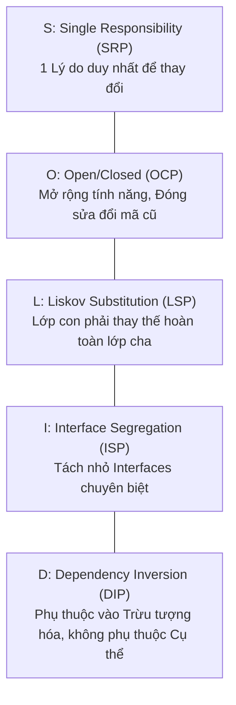
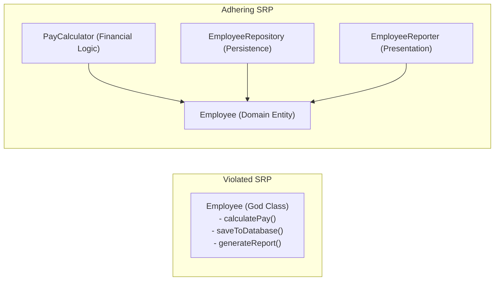
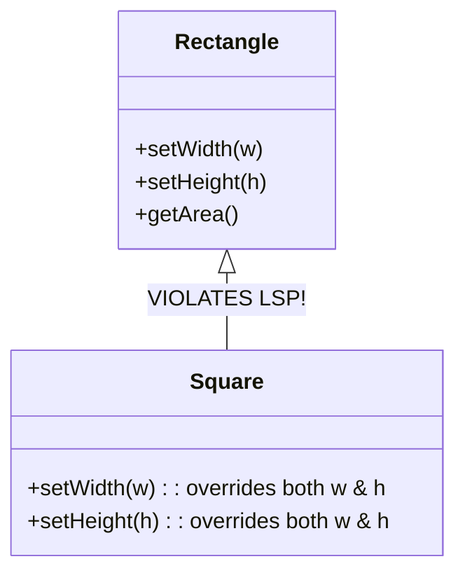
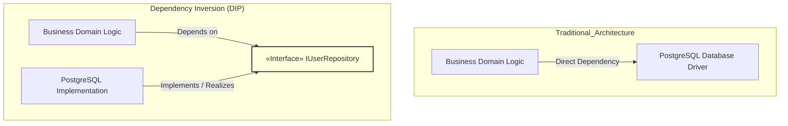

# 3.1. Các Nguyên Lý Thiết Kế SOLID (SOLID Principles)

## Tổng quan về SOLID Principles
SOLID là bộ 5 nguyên lý thiết kế hướng đối tượng (OOP Design Principles) do Robert C. Martin ("Uncle Bob") tổng hợp vào đầu những năm 2000. Đây là kim chỉ nam tối quan trọng giúp các kỹ sư xây dựng hệ thống phần mềm **dễ bảo trì (Maintainable), dễ hiểu (Understandable), linh hoạt trước các thay đổi nghiệp vụ (Flexible), và có khả năng mở rộng bền bỉ (Scalable)** mà không làm suy thoái kiến trúc.



---

## 2. Chi tiết từng Keyword (Under-the-Hood Deep Dive)

---

### 1. Single Responsibility Principle (SRP) — Nguyên Lý Đơn Trách Nhiệm

#### 1. Khái niệm bản chất (What & Why)
* **Định nghĩa chuẩn xác**: *"A class should have one, and only one, reason to change"* (Một lớp chỉ nên có một lý do duy nhất để thay đổi).
* **Lý do để thay đổi (Reason to change)**: Bắt nguồn từ chính các tác nhân (Actors) hoặc các bên liên quan khác nhau trong doanh nghiệp. Nếu một class vừa phục vụ phòng Kế toán (tính lương), vừa phục vụ phòng Nhân sự (quản lý ngày nghỉ), vừa phục vụ đội IT (lưu xuống DB), thì class đó đang gánh vác 3 trách nhiệm và có 3 lý do độc lập để bị chỉnh sửa.
* **Hậu quả vi phạm**: Thay đổi logic cho một bên sẽ ngầm phá vỡ luồng hoạt động của bên khác (Rigidity & Fragility).

#### 2. Cơ chế hoạt động sâu & Phân rã Trách nhiệm


#### 3. Code ví dụ thực chiến (C++20: SRP in Domain & Infrastructure Separation)
```cpp
#include <iostream>
#include <string>
#include <memory>

// 1. Core Domain Entity: Chỉ chịu trách nhiệm về dữ liệu & quy tắc nghiệp vụ bản thân
class User {
private:
    uint64_t id_;
    std::string email_;
public:
    User(uint64_t id, std::string email) : id_(id), email_(std::move(email)) {}
    [[nodiscard]] uint64_t id() const noexcept { return id_; }
    [[nodiscard]] const std::string& email() const noexcept { return email_; }
};

// 2. Persistence Responsibility: Chỉ chịu trách nhiệm về I/O & Database
class UserRepository {
public:
    void save(const User& user) {
        std::cout << "[DB Engine] Saving User #" << user.id() << " to PostgreSQL.\n";
    }
};

// 3. Notification Responsibility: Chỉ chịu trách nhiệm gửi thông điệp mạng
class EmailNotifier {
public:
    void sendWelcomeEmail(const User& user) {
        std::cout << "[SMTP Client] Sending welcome email to " << user.email() << "\n";
    }
};
```

---

### 2. Open-Closed Principle (OCP) — Nguyên Lý Đóng/Mở

#### 1. Khái niệm bản chất (What & Why)
* **Định nghĩa (Bertrand Meyer)**: *"Software entities (classes, modules, functions, etc.) should be open for extension, but closed for modification"*.
* **Mở cho mở rộng (Open for extension)**: Khi có yêu cầu nghiệp vụ mới xuất hiện, hệ thống có thể bổ sung hành vi mới một cách dễ dàng.
* **Đóng cho sửa đổi (Closed for modification)**: Việc thêm hành vi mới không được làm biến đổi mã nguồn đã tồn tại, đã được kiểm thử và đang chạy ổn định trên Production.
* **Cơ chế thực thi**: Sử dụng tính đa hình (Polymorphism), Strategy Pattern, hoặc Dependency Injection.

#### 2. Code ví dụ thực chiến (C++20: OCP qua Strategy & Virtual Dispatch)
```cpp
#include <iostream>
#include <vector>
#include <memory>

// Interface đóng cho việc sửa đổi
class IPaymentProcessor {
public:
    virtual ~IPaymentProcessor() = default;
    virtual void processPayment(double amount) = 0;
};

// Mở rộng thêm cổng Stripe mà KHÔNG cần sửa code lõi
class StripeProcessor final : public IPaymentProcessor {
public:
    void processPayment(double amount) override {
        std::cout << "[Stripe API] Charging $" << amount << " via Stripe Token.\n";
    }
};

// Mở rộng thêm cổng Crypto mà KHÔNG đụng đến Stripe
class CryptoProcessor final : public IPaymentProcessor {
public:
    void processPayment(double amount) override {
        std::cout << "[Web3 RPC] Transferring equivalent $" << amount << " in USDT.\n";
    }
};

// Checkout Service hoàn toàn khép kín trước các cổng thanh toán mới
class CheckoutService {
public:
    void executeCheckout(IPaymentProcessor& processor, double amount) {
        processor.processPayment(amount);
    }
};
```

---

### 3. Liskov Substitution Principle (LSP) — Nguyên Lý Thay Thế Liskov

#### 1. Khái niệm bản chất (What & Why)
* **Định nghĩa toán học (Barbara Liskov, 1987)**: Nếu $S$ là một kiểu con của $T$, thì các đối tượng thuộc kiểu $T$ có thể được thay thế bằng các đối tượng thuộc kiểu $S$ mà không làm thay đổi bất kỳ đặc tính đúng đắn nào của chương trình.
* **Quy tắc về Hợp đồng (Design by Contract Rules in LSP)**:
  1. **Preconditions cannot be strengthened**: Lớp con không được đòi hỏi điều kiện đầu vào khắt khe hơn lớp cha.
  2. **Postconditions cannot be weakened**: Lớp con không được trả về kết quả lỏng lẻo hơn hoặc không đáp ứng cam kết của lớp cha.
  3. **Invariants must be preserved**: Lớp con phải duy trì mọi bất biến trạng thái của lớp cha.
  4. **History Constraint**: Lớp con không được phép biến đổi các trường mà lớp cha định nghĩa là bất biến (immutable).
* **Ví dụ kinh điển vi phạm**: Bài toán *Hình chữ nhật (Rectangle) và Hình vuông (Square)*. Trong toán học, Hình vuông là Hình chữ nhật, nhưng trong OOP, nếu `Square` kế thừa `Rectangle` và override `setWidth()` làm thay đổi cả `height`, thì nó phá vỡ giả định của client về `Rectangle`.

#### 2. Sơ đồ vi phạm LSP


#### 3. Code ví dụ thực chiến (C++20: Vi phạm và Khắc phục LSP)
```cpp
#include <iostream>
#include <cassert>

// --- VI PHẠM LSP ---
class BadRectangle {
protected:
    int width_{0}, height_{0};
public:
    virtual void setWidth(int w) { width_ = w; }
    virtual void setHeight(int h) { height_ = h; }
    int area() const { return width_ * height_; }
};

class BadSquare : public BadRectangle {
public:
    void setWidth(int w) override { width_ = height_ = w; }
    void setHeight(int h) override { width_ = height_ = h; }
};

void clientExpectation(BadRectangle& rect) {
    rect.setWidth(5);
    rect.setHeight(10);
    // Client kỳ vọng diện tích là 50, nhưng nếu truyền BadSquare vào thì area = 100!
    assert(rect.area() == 50); // SẼ CRASH NẾU TRUYỀN BADSQUARE!
}

// --- KHẮC PHỤC CHUẨN MỰC BẰNG INTERFACE SHAPE ĐỘC LẬP ---
class IShape {
public:
    virtual ~IShape() = default;
    virtual int area() const = 0;
};

class CorrectRectangle final : public IShape {
private:
    int w_, h_;
public:
    CorrectRectangle(int w, int h) : w_(w), h_(h) {}
    int area() const override { return w_ * h_; }
};

class CorrectSquare final : public IShape {
private:
    int side_;
public:
    explicit CorrectSquare(int s) : side_(s) {}
    int area() const override { return side_ * side_; }
};
```

---

### 4. Interface Segregation Principle (ISP) — Nguyên Lý Phân Tách Giao Diện

#### 1. Khái niệm bản chất (What & Why)
* **Định nghĩa**: *"Clients should not be forced to depend upon interfaces that they do not use"* (Không nên ép buộc client phụ thuộc vào các giao diện mà chúng không sử dụng).
* **Vấn đề**: Các "Giao diện béo phì" (Fat/Polluted Interfaces) gom hàng chục phương thức không liên quan vào một interface duy nhất. Khi một phương thức trong interface thay đổi, toàn bộ các lớp con hiện thực interface đó bắt buộc phải recompile và redeploy dù chúng không hề dùng tới phương thức đó.
* **Giải pháp**: Phân rã interface lớn thành nhiều interface nhỏ, cô đọng, chuyên biệt (Role Interfaces).

#### 2. Code ví dụ thực chiến (TypeScript: Phân tách Fat Interface)
```typescript
// --- FAT INTERFACE (VI PHẠM ISP) ---
interface BadWorker {
  work(): void;
  eat(): void;
  sleep(): void;
}

// Robot không bao giờ ăn hay ngủ nhưng vẫn bị ép buộc implement!
class RobotWorker implements BadWorker {
  work(): void { console.log("Robotic automation running..."); }
  eat(): void { throw new Error("Robots don't eat!"); }
  sleep(): void { throw new Error("Robots don't sleep!"); }
}

// --- CHUẨN HÓA THEO ISP ---
interface Workable {
  work(): void;
}

interface Feedable {
  eat(): void;
}

class Human implements Workable, Feedable {
  work(): void { console.log("Human programming..."); }
  eat(): void { console.log("Human having lunch..."); }
}

class IndustrialRobot implements Workable {
  work(): void { console.log("Autonomous assembly running 24/7."); }
}
```

---

### 5. Dependency Inversion Principle (DIP) — Nguyên Lý Đảo Ngược Phụ Thuộc

#### 1. Khái niệm bản chất (What & Why)
* **Định nghĩa gồm 2 vế của Uncle Bob**:
  1. *High-level modules should not depend on low-level modules. Both should depend on abstractions* (Các module cấp cao không được phụ thuộc vào các module cấp thấp. Cả hai phải phụ thuộc vào trừu tượng hóa).
  2. *Abstractions should not depend on details. Details should depend on abstractions* (Trừu tượng hóa không được phụ thuộc vào chi tiết. Chi tiết phải phụ thuộc vào trừu tượng hóa).
* **Đảo ngược luồng phụ thuộc**: Trong mô hình cấu trúc truyền thống, Module Nghiệp vụ (High-level) phụ thuộc trực tiếp vào Database Library hoặc HTTP Client (Low-level). DIP đảo ngược mũi tên phụ thuộc: Module Nghiệp vụ sở hữu Interface trừu tượng, và Database Driver ở bên ngoài phải hiện thực (implements) interface đó.

#### 2. Sơ đồ Đảo ngược Phụ thuộc (Inversion of Control Flow)


#### 3. Code ví dụ thực chiến (TypeScript: DIP qua Inversion of Control & Injection)
```typescript
// 1. Abstraction (Hợp đồng thuộc về High-level domain)
export interface MessageGateway {
  send(recipient: string, message: string): Promise<boolean>;
}

// 2. High-level Domain Module: Hoàn toàn không biết gửi qua SMS, Twilio hay SendGrid
export class UserNotificationService {
  constructor(private readonly gateway: MessageGateway) {}

  public async alertSecurityBreach(userEmail: string): Promise<void> {
    const success = await this.gateway.send(userEmail, "CRITICAL: Security Breach Detected!");
    if (!success) {
      console.error("[Audit] Alert delivery failed.");
    }
  }
}

// 3. Low-level Detail Module: Hiện thực hóa hợp đồng
export class TwilioSmsGateway implements MessageGateway {
  public async send(recipient: string, message: string): Promise<boolean> {
    console.log(`[Twilio Driver] Dispatching SMS to ${recipient}: ${message}`);
    return true;
  }
}
```

#### 4. Ứng dụng thực tế trong Backend / Systems
SOLID là nền tảng cốt lõi của **Clean Architecture** và **Hexagonal Architecture**.
Khi áp dụng triệt để SOLID:
1. Đội ngũ có thể tráo đổi cơ sở dữ liệu từ MySQL sang DynamoDB mà không phải sửa một dòng mã nghiệp vụ nào (DIP & OCP).
2. Viết Unit Test trở nên dễ dàng tuyệt đối: Có thể Mock/Stub toàn bộ hạ tầng I/O và mạng trong vài mili-giây (DIP & ISP).
3. Hệ thống tránh được các vụ sập bất ngờ do hành vi sai lệch của các lớp dẫn xuất khi xử lý đa luồng (LSP).
