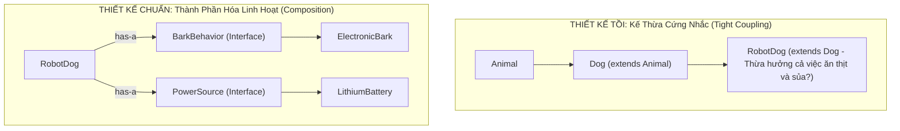

# 3.2. Các Nguyên Lý Thiết Kế Phần Mềm Tổng Quát (General Design Principles)

> [!IMPORTANT]
> **Nếu bạn chỉ được nhớ một điều duy nhất:** Thiết kế phần mềm không phải là việc áp dụng máy móc các mẫu thiết kế (Design Patterns), mà là nghệ thuật làm chủ các **Nguyên Lý Nền Tảng (First Principles)**: **Đóng Gói (Encapsulation)** và **Ẩn Dấu Thông Tin (Information Hiding - David Parnas 1972)** để cô lập các quyết định thiết kế dễ thay đổi; **Ưu Tiên Thành Phần Hóa Hơn Kế Thừa (Composition over Inheritance)** để phá vỡ sự gắn kết chặt chẽ (Tight Coupling); **Quy Tắc Demeter (Law of Demeter - "Chỉ nói chuyện với bạn bè thân thiết")** để ngăn chặn chuỗi gọi xuyên thủng tầng trừu tượng (`a.getB().getC().doD()`); và **Thất Bại Sớm (Fail Fast)** để phát hiện lỗi ngay tại thời điểm phát sinh thay vì để dữ liệu rác âm thầm tàn phá hệ thống trên Production.

---

## 1. Kiến trúc Tổng quan & Mô hình Tư duy (Mental Model)

### 1.1. Ẩn dụ Đời sống: Chiếc Điện Thoại Thông Minh & Bộ Lắp Ráp Lego

Hãy hình dung sự khác biệt giữa hai cấu trúc cơ khí:
- **Chiếc điện thoại thông minh (Information Hiding & Program to Interface)**:
  - Bạn chỉ nhìn thấy màn hình cảm ứng, nút bấm và cổng cắm sạc Type-C (Public Interface).
  - Toàn bộ sự phức tạp về điện áp bo mạch, chip sóng 5G và thuật toán điều khiển pin đều được đóng gói kín mít bên trong lớp vỏ nhôm (Encapsulation & Information Hiding). Nếu nhà sản xuất nâng cấp chip xử lý từ 5nm lên 3nm bên trong, bạn vẫn sử dụng cổng sạc và màn hình như cũ mà không hề hay biết!
- **Kế thừa sai lầm (Inheritance Fragility) vs Thành phần hóa (Composition)**:
  - Nếu bạn thiết kế một chiếc xe hơi bằng cách cho nó *kế thừa* từ động cơ đốt trong (`class Car extends CombustionEngine`): Chiếc xe sẽ bị trói chặt vào nhiên liệu xăng. Muốn biến thành xe điện, bạn phải đập bỏ toàn bộ khung gầm chiếc xe!
  - Nhưng nếu chiếc xe *sở hữu* động cơ (`Car has-a Engine`): Bạn chỉ việc rút khối động cơ xăng ra và cắm khối pin điện vào (Composition).
- **Quy tắc Demeter (Law of Demeter - Khách hàng đi mua cà phê)**:
  - Khi bạn mua một cốc cà phê $2: Bạn rút tờ $2 từ ví và đưa cho nhân viên thu ngân.
  - Bạn không bao giờ đưa cả chiếc ví của mình cho thu ngân, để thu ngân tự mở ví, rút thẻ căn cước, lục tìm ngăn kéo và tự rút tiền (`customer.getWallet().getMoney()`)! Đó là sự vi phạm thô bạo tính đóng gói và ranh giới trách nhiệm.

```mermaid
graph TD
    classDef struct fill:#e1f5fe,stroke:#0288d1,stroke-width:2px;
    classDef rel fill:#fff3e0,stroke:#f57c00,stroke-width:2px;
    classDef exec fill:#e8f5e9,stroke:#388e3c,stroke-width:2px;
    classDef prag fill:#f3e5f5,stroke:#7b1fa2,stroke-width:2px;

    Root["BẢN ĐỒ CÁC NGUYÊN LÝ THIẾT KẾ PHẦN MỀM TỔNG QUÁT"]

    Root --> G1["1. Nguyên Lý Cấu Trúc (Structural Principles)"]:::struct
    Root --> G2["2. Nguyên Lý Mối Quan Hệ (Relationship Principles)"]:::rel
    Root --> G3["3. Nguyên Lý Thực Thi & Bảo Vệ (Execution & Protection)"]:::exec
    Root --> G4["4. Triết Lý Kỹ Sư Thực Dụng (Pragmatic Philosophy)"]:::prag

    G1 --> G1A["Separation of Concerns (SoC - Tách Rời Mối Quan Tâm)"]
    G1 --> G1B["Encapsulation & Abstraction (Đóng Gói & Trừu Tượng Hóa)"]
    G1 --> G1C["Information Hiding (David Parnas 1972)"]
    G1 --> G1D["Modularity & Cohesive Components"]

    G2 --> G2A["Composition over Inheritance (Thành Phần Hơn Kế Thừa)"]
    G2 --> G2B["Program to Interface, not Implementation"]
    G2 --> G2C["Law of Demeter (Principle of Least Knowledge)"]
    G2 --> G2D["Explicit Dependencies (Phụ Thuộc Tường Minh)"]

    G3 --> G3A["Fail Fast (Thất Bại Sớm, Không Nuốt Lỗi)"]
    G3 --> G3B["Defensive Programming vs Design by Contract"]
    G3 --> G3C["Command-Query Separation (CQS - Bertrand Meyer)"]

    G4 --> G4A["DRY (Don't Repeat Yourself - Single Source of Truth)"]
    G4 --> G4B["KISS (Keep It Simple, Stupid)"]
    G4 --> G4C["YAGNI (You Aren't Gonna Need It)"]
```



---

## 2. Chi tiết từng Keyword (Under-the-Hood Deep Dive)

### 2.1. Structural Principles: SoC, Encapsulation, Abstraction, Information Hiding & Modularity

#### 1. Separation of Concerns (SoC - Tách Rời Mối Quan Tâm)
- Được định nghĩa bởi Edsger W. Dijkstra vào năm 1974: Chia nhỏ chương trình thành các phần riêng biệt, mỗi phần chịu trách nhiệm giải quyết trọn vẹn một mối bận tâm duy nhất.
- Ví dụ: Tầng Web chỉ lo nhận request HTTP và format JSON; Tầng Nghiệp vụ chỉ lo tính toán quy tắc logic; Tầng Database chỉ lo lưu trữ dữ liệu. Trộn lẫn SQL vào hàm render HTML là sự vi phạm thô bạo SoC.

#### 2. Encapsulation (Đóng Gói) vs Information Hiding (Ẩn Dấu Thông Tin)
Hai khái niệm này thường bị đánh đồng nhưng có bản chất kỹ thuật khác nhau:
- **Encapsulation (Đóng gói)**: Gom nhóm dữ liệu (State) và các hàm thao tác trên dữ liệu đó (Behavior) vào trong cùng một đơn vị duy nhất (Class/Module), đồng thời giới hạn quyền truy cập trực tiếp bằng các từ khóa (`private`, `protected`).
- **Information Hiding (David Parnas 1972)**: Nguyên lý kiến trúc ở tầm vĩ mô hơn: **"Một module phải ẩn giấu các quyết định thiết kế có khả năng bị thay đổi nhiều nhất khỏi phần còn lại của hệ thống"**.
  - Ví dụ: Ẩn giấu việc lưu trữ cấu trúc dữ liệu bên trong (Dùng Hash Map hay B-Tree), ẩn giấu thư viện bên thứ ba. Nhờ đó, khi ta thay thế thư viện cũ bằng thư viện mới, toàn bộ mã nguồn bên ngoài hoàn toàn không bị ảnh hưởng.

#### 3. Abstraction (Trừu Tượng Hóa) & Modularity (Tính Module Hóa)
- Trừu tượng hóa là việc chỉ tập trung vào các đặc tính cốt lõi cần thiết cho ngữ cảnh hiện tại và bỏ qua các chi tiết phụ trợ.
- Modularity chia hệ thống thành các khối độc lập (Modules) có độ gắn kết nội tại cao (High Cohesion) và ghép nối lỏng lẻo với bên ngoài (Loose Coupling).

---

### 2.2. Relationship Principles: Composition over Inheritance, Program to Interface, Law of Demeter & Explicit Dependencies

#### 1. Composition over Inheritance (Ưu Tiên Thành Phần Hóa Hơn Kế Thừa)
- **Cạm bẫy của Kế thừa (Inheritance Fragility)**:
  - Phá vỡ tính đóng gói: Lớp con phụ thuộc chặt chẽ vào các chi tiết cài đặt nội bộ của lớp cha (White-box reuse). Khi lớp cha thay đổi một phương thức, toàn bộ các lớp con có thể bị lỗi hành vi không mong muốn.
  - Vấn đề "Banana Monkey Jungle": Bạn chỉ muốn một quả chuối, nhưng kế thừa bắt bạn phải kéo theo cả con khỉ đang cầm quả chuối và toàn bộ khu rừng nhiệt đới nơi con khỉ sinh sống!
- **Giải pháp Thành phần hóa (Composition)**:
  - Lớp cha chứa một con trỏ hoặc interface tới đối tượng chức năng (Black-box reuse).
  - Cho phép hoán đổi hành vi linh hoạt lúc runtime (Strategy Pattern) mà không cần tạo hàng chục lớp con phức tạp.



#### 2. Program to an Interface, Not an Implementation
- Lập trình viên không bao giờ nên phụ thuộc vào lớp cụ thể (`MySQLConnection`), mà phải phụ thuộc vào giao diện trừu tượng (`DatabaseConnectionInterface`). Điều này cho phép thay thế hệ thống cơ sở dữ liệu hoặc cắm Mock Object để chạy Unit Test cực nhanh mà không cần máy chủ thật.

#### 3. Law of Demeter (LoD - Nguyên Tắc Ít Hiểu Biết Nhất / Principle of Least Knowledge)
- Một phương thức của đối tượng $A$ chỉ được phép gọi các phương thức của:
  1. Chính bản thân đối tượng $A$.
  2. Các tham số được truyền vào phương thức.
  3. Bất kỳ đối tượng nào do chính phương thức đó khởi tạo hoặc cấp phát.
  4. Các thuộc tính thành viên trực tiếp của đối tượng $A$.
- **Dấu hiệu vi phạm (Train Wreck Smell)**: Các chuỗi gọi hàm dài ngoằng nối tiếp nhau:
  ```java
  // VI PHẠM THÔ BẠO LAW OF DEMETER: Chuỗi gọi tai nạn tàu hỏa
  String city = order.getCustomer().getProfile().getAddress().getCity();
  ```
- Chuỗi gọi này biến class hiện tại phụ thuộc vào toàn bộ cấu trúc phân cấp nội bộ của 4 đối tượng khác nhau! Khi `Address` đổi cấu trúc, đoạn code này lập tức bị sập.

#### 4. Explicit Dependencies (Phụ Thuộc Tường Minh)
- Mọi phụ thuộc của một lớp bắt buộc phải được truyền công khai qua Hàm khởi tạo (Constructor Injection). Nghiêm cấm việc ẩn giấu phụ thuộc bên trong bằng các biến toàn cục (Global Variables) hoặc mẫu Singleton bí mật.

---

### 2.3. Execution & Protection Principles: Fail Fast, Defensive Programming, DbC & CQS

#### 1. Nguyên Tắc Thất Bại Sớm (Fail Fast)
- Khi một lỗi hoặc dữ liệu đầu vào không hợp lệ xuất hiện, hệ thống phải **ném ngoại lệ hoặc dừng thực thi NGAY LẬP TỨC** tại dòng code đầu tiên.
- **Phản mẫu nguy hiểm (Silent Failure)**: Trả về giá trị `null`, âm thầm nuốt ngoại lệ `catch (Exception e) {}` hoặc trả về mã lỗi giả tạo. Dữ liệu lỗi sẽ trôi dạt sâu vào hệ thống và tàn phá cơ sở dữ liệu hàng giờ sau đó mà không ai biết nguồn gốc xuất phát từ đâu.

#### 2. Defensive Programming vs Design by Contract (DbC)
- **Defensive Programming (Lập trình phòng thủ)**: Kiểm tra mọi thứ ở mọi nơi vì không tin tưởng bất kỳ ai. Dẫn đến việc các hàm nội bộ chứa hàng chục câu lệnh kiểm tra `if (param == null)` lặp đi lặp lại vô ích.
- **Design by Contract (DbC - Bertrand Meyer)**: Thiết lập một hợp đồng ràng buộc: Bên gọi (Caller) có trách nhiệm đảm bảo **Tiền điều kiện (Preconditions)**; Bên thực thi (Callee) có trách nhiệm bảo đảm **Hậu điều kiện (Postconditions)**. Nếu bên gọi vi phạm, lỗi thuộc về bên gọi và chương trình dừng lập tức.

#### 3. Command-Query Separation (CQS - Phân Tách Lệnh và Truy Vấn)
- Được phát minh bởi Bertrand Meyer (cha đẻ ngôn ngữ Eiffel):
  - **Command (Mệnh lệnh)**: Thay đổi trạng thái của hệ thống nhưng **không trả về dữ liệu** (Trả về `void`).
  - **Query (Truy vấn)**: Trả về dữ liệu kết quả nhưng **tuyệt đối không được phép thay đổi trạng thái của hệ thống** (Không có side-effects).
  - *"Hỏi một câu hỏi không bao giờ được phép làm thay đổi câu trả lời"*.

---

## 3. Thực thi Mã nguồn & Mô phỏng Chuyên sâu (Dual-Engine Implementation)

### 3.1. C++20 PIMPL Idiom (Pointer to Implementation) for Absolute Information Hiding & Fail Fast

Chương trình minh chứng cách thức thực thi nguyên lý **Information Hiding tuyệt đối** bằng kỹ thuật kinh điển PIMPL trong C++20: Ẩn giấu toàn bộ các biến thành viên và thư viện phụ thuộc nội bộ khỏi tệp Header công khai, kết hợp cơ chế kiểm tra **Fail Fast** ngay tại hàm khởi tạo:

```cpp
// pimpl_engine.cpp
// Biên dịch: g++ -std=c++20 -O3 pimpl_engine.cpp -o pimpl_engine
#include <iostream>
#include <string>
#include <memory>
#include <stdexcept>
#include <chrono>

// ============================================================================
// HEADER FILE GIAO DIỆN CÔNG KHAI (Chỉ chứa Interface, 0 chi tiết nội bộ)
// ============================================================================
class NetworkCryptoService {
public:
    // Khởi tạo có kiểm tra Fail-Fast
    explicit NetworkCryptoService(const std::string& secret_key);
    ~NetworkCryptoService();

    // Di chuyển quyền sở hữu (Move semantics)
    NetworkCryptoService(NetworkCryptoService&&) noexcept;
    NetworkCryptoService& operator=(NetworkCryptoService&&) noexcept;

    // Ngăn chặn sao chép vô tội vạ
    NetworkCryptoService(const NetworkCryptoService&) = delete;
    NetworkCryptoService& operator=(const NetworkCryptoService&) = delete;

    std::string encrypt_payload(const std::string& raw_data);

private:
    // PIMPL: Toàn bộ cấu trúc nội bộ được ẩn dấu sau một con trỏ duy nhất!
    struct Impl;
    std::unique_ptr<Impl> pimpl_;
};

// ============================================================================
// IMPLEMENTATION FILE NỘI BỘ (Information Hiding - Thay đổi không cần recompile Client)
// ============================================================================
struct NetworkCryptoService::Impl {
    std::string key_;
    int iterations_{1000};
    uint64_t operations_count_{0};

    explicit Impl(std::string k) : key_(std::move(k)) {}

    std::string do_encrypt(const std::string& data) {
        operations_count_++;
        // Giả lập thuật toán mã hóa nội bộ
        std::string cipher = "[ENCRYPTED-AES256:" + data + "|KEY_HASH:" + std::to_string(key_.length()) + "]";
        return cipher;
    }
};

NetworkCryptoService::NetworkCryptoService(const std::string& secret_key) {
    // 1. NGUYÊN TẮC FAIL FAST: Kiểm tra dữ liệu đầu vào ngay lập tức!
    if (secret_key.empty()) {
        throw std::invalid_argument("[FAIL FAST ERROR] Khóa bí mật không được để trống!");
    }
    if (secret_key.length() < 8) {
        throw std::length_error("[FAIL FAST ERROR] Độ dài khóa tối thiểu phải từ 8 ký tự trở lên!");
    }

    // 2. Khởi tạo đối tượng Implementation nội bộ
    pimpl_ = std::make_unique<Impl>(secret_key);
    std::cout << "[PIMPL INITIALIZED] Khởi tạo thành công với cơ chế ẩn dấu thông tin tuyệt đối.\n";
}

NetworkCryptoService::~NetworkCryptoService() = default;
NetworkCryptoService::NetworkCryptoService(NetworkCryptoService&&) noexcept = default;
NetworkCryptoService& NetworkCryptoService::operator=(NetworkCryptoService&&) noexcept = default;

std::string NetworkCryptoService::encrypt_payload(const std::string& raw_data) {
    if (raw_data.empty()) {
        throw std::invalid_argument("[FAIL FAST ERROR] Dữ liệu mã hóa không được rỗng!");
    }
    return pimpl_->do_encrypt(raw_data);
}

// ============================================================================
// MAIN APPLICATION DRIVER
// ============================================================================
int main() {
    std::cout << "=======================================================================\n";
    std::cout << "      C++20 PIMPL INFORMATION HIDING & FAIL FAST VERIFICATION          \n";
    std::cout << "=======================================================================\n\n";

    // Kịch bản 1: Thử nghiệm Fail Fast với khóa không hợp lệ
    std::cout << "[TEST 1] Thử nghiệm Fail Fast khi truyền khóa yếu:\n";
    try {
        NetworkCryptoService bad_service("123"); // Ngắn hơn 8 ký tự
    } catch (const std::exception& ex) {
        std::cout << "  -> BẮT NGOẠI LỆ FAIL FAST HỢP LỆ: " << ex.what() << "\n\n";
    }

    // Kịch bản 2: Khởi tạo hợp lệ và mã hóa payload
    std::cout << "[TEST 2] Khởi tạo dịch vụ hợp lệ và mã hóa dữ liệu:\n";
    NetworkCryptoService secure_service("SuperSecretKey2026!@#");
    std::string cipher = secure_service.encrypt_payload("Sensitive Customer Credit Card Data");
    std::cout << "  -> Bản mã kết quả: " << cipher << "\n";

    return 0;
}
```

#### Terminal Output Mẫu:
```text
=======================================================================
      C++20 PIMPL INFORMATION HIDING & FAIL FAST VERIFICATION          
=======================================================================

[TEST 1] Thử nghiệm Fail Fast khi truyền khóa yếu:
  -> BẮT NGOẠI LỆ FAIL FAST HỢP LỆ: [FAIL FAST ERROR] Độ dài khóa tối thiểu phải từ 8 ký tự trở lên!

[TEST 2] Khởi tạo dịch vụ hợp lệ và mã hóa dữ liệu:
[PIMPL INITIALIZED] Khởi tạo thành công với cơ chế ẩn dấu thông tin tuyệt đối.
  -> Bản mã kết quả: [ENCRYPTED-AES256:Sensitive Customer Credit Card Data|KEY_HASH:21]
```

---

### 3.2. Python 3.11+ Law of Demeter (LoD) & Command-Query Separation (CQS) Simulator

Chương trình minh chứng tác hại của việc vi phạm **Quy tắc Demeter (Law of Demeter)** tạo ra sự gắn kết chết người, so sánh trực tiếp với giải pháp thiết kế chuẩn mực tuân thủ **Tell, Don't Ask** và **CQS**:

```python
#!/usr/bin/env python3
"""
law_of_demeter_cqs_demo.py
Mô phỏng Vi Phạm và Tuân Thủ Law of Demeter (LoD) & Command-Query Separation (CQS)
"""
from dataclasses import dataclass
from typing import Dict, Any

# ============================================================================
# CẤU TRÚC THỰC THỂ
# ============================================================================
@dataclass
class Wallet:
    balance: float

    def deduct(self, amount: float):
        if self.balance < amount:
            raise ValueError("Số dư ví không đủ!")
        self.balance -= amount

@dataclass
class Customer:
    name: str
    wallet: Wallet

    # TUÂN THỦ LAW OF DEMETER: Cung cấp phương thức trực tiếp, không để lộ Wallet
    def make_payment(self, amount: float):
        print(f"  [Customer: {self.name}] Tự quản lý ví và thanh toán ${amount}")
        self.wallet.deduct(amount)

# ============================================================================
# TÌNH HUỐNG 1: VI PHẠM THÔ BẠO LAW OF DEMETER (Train Wreck)
# ============================================================================
class BadCashier:
    def charge_customer(self, customer: Customer, bill_amount: float):
        """
        VI PHẠM LoD: Thu ngân tự ý thò tay vào người khách hàng -> lấy ví -> tự rút tiền!
        Cashier phụ thuộc chặt chẽ vào cấu trúc nội bộ của Customer và Wallet.
        """
        print("[BAD CASHIER] Thu ngân tự mở ví khách hàng (Vi phạm Law of Demeter):")
        # Train Wreck: customer.wallet.balance / customer.wallet.deduct
        customer.wallet.deduct(bill_amount)
        print(f"  -> Đã trừ tiền thành công. Số dư ví còn lại: ${customer.wallet.balance}")

# ============================================================================
# TÌNH HUỐNG 2: TUÂN THỦ CHUẨN MỰC LAW OF DEMETER ("Tell, Don't Ask")
# ============================================================================
class GoodCashier:
    def charge_customer(self, customer: Customer, bill_amount: float):
        """
        TUÂN THỦ LoD: Thu ngân chỉ 'nói' cho khách hàng biết số tiền cần trả.
        Khách hàng tự quyết định cách thức thanh toán trong ví của mình.
        """
        print("[GOOD CASHIER] Thu ngân yêu cầu khách hàng thanh toán (Tuân thủ LoD):")
        customer.make_payment(bill_amount)

def main():
    print("=" * 80)
    print("        MINH CHỨNG THỰC CHIẾN NGUYÊN TẮC: LAW OF DEMETER (LoD) & CQS          ")
    print("=" * 80)

    # 1. Chạy thử nghiệm Vi phạm
    print("\n--- 1. THỬ NGHIỆM VI PHẠM LAW OF DEMETER ---")
    c1 = Customer("Alice", Wallet(100.0))
    bad_cashier = BadCashier()
    bad_cashier.charge_customer(c1, 30.0)

    # 2. Chạy thử nghiệm Tuân thủ
    print("\n--- 2. THỬ NGHIỆM TUÂN THỦ LAW OF DEMETER (TELL, DON'T ASK) ---")
    c2 = Customer("Bob", Wallet(100.0))
    good_cashier = GoodCashier()
    good_cashier.charge_customer(c2, 30.0)
    print(f"  -> Kết quả: Bob tự thanh toán an toàn, số dư ví còn lại: ${c2.wallet.balance}")

    print("\n" + "=" * 80)
    print("KẾT LUẬN: Tuân thủ Law of Demeter giúp hệ thống có thể thay đổi cấu trúc Ví")
    print("          (ví dụ đổi sang Apple Pay/Crypto) mà không làm sửa một dòng code nào của Thu Ngân!")
    print("=" * 80)

if __name__ == "__main__":
    main()
```

#### Terminal Output Mẫu:
```text
================================================================================
        MINH CHỨNG THỰC CHIẾN NGUYÊN TẮC: LAW OF DEMETER (LoD) & CQS          
================================================================================

--- 1. THỬ NGHIỆM VI PHẠM LAW OF DEMETER ---
[BAD CASHIER] Thu ngân tự mở ví khách hàng (Vi phạm Law of Demeter):
  -> Đã trừ tiền thành công. Số dư ví còn lại: $70.0

--- 2. THỬ NGHIỆM TUÂN THỦ LAW OF DEMETER (TELL, DON'T ASK) ---
[GOOD CASHIER] Thu ngân yêu cầu khách hàng thanh toán (Tuân thủ LoD):
  [Customer: Bob] Tự quản lý ví và thanh toán $30.0
  -> Kết quả: Bob tự thanh toán an toàn, số dư ví còn lại: $70.0

================================================================================
KẾT LUẬN: Tuân thủ Law of Demeter giúp hệ thống có thể thay đổi cấu trúc Ví
          (ví dụ đổi sang Apple Pay/Crypto) mà không làm sửa một dòng code nào của Thu Ngân!
================================================================================
```

---

## 4. Systems Engineering & Production Pitfalls

### 4.1. Cạm Bẫy Thực Chiến Thường Gặp (Production Pitfalls)

#### 1. Sự Cố "Deep Inheritance Tree" (Cây Kế Thừa Sâu 10 Tầng Làm Tê Liệt Bảo Trì)
- **Hiện tượng**: Một hệ thống sử dụng cây kế thừa sâu: `BaseEntity -> AuditableEntity -> SecurableEntity -> TenantEntity -> BusinessEntity -> Order`.
- **Hậu quả**: Khi muốn thêm một thuộc tính vào `AuditableEntity`, toàn bộ 100 lớp con bên dưới bị ảnh hưởng. Không một lập trình viên nào dám sửa đổi mã nguồn vì sợ sập dây chuyền toàn bộ ứng dụng!
- **Giải pháp**: Áp dụng quy tắc: **Độ sâu kế thừa không bao giờ được vượt quá 2-3 tầng**. Ưu tiên sử dụng Composition và Interfaces.

#### 2. Thảm Họa "Silent Error Swallowing" (Nuốt Lỗi Âm Thầm)
- **Hiện tượng**: Viết code kiểu:
  ```python
  try:
      save_to_database(record)
  except Exception:
      pass # Bỏ qua để hệ thống không bị crash!
  ```
- **Hậu quả**: Đây là tội ác kỹ thuật lớn nhất! Lỗi kết nối database bị bỏ qua, khách hàng tưởng đơn hàng đã lưu thành công nhưng thực chất dữ liệu bị bốc hơi vĩnh viễn.
- **Giải pháp**: Tuân thủ triệt để nguyên tắc **Fail Fast**: Log đầy đủ stack trace và trả về lỗi rõ ràng ngay lập tức.

#### 3. Bẫy Vi Phạm CQS Gây Race Condition Trong Distributed Systems
- **Hiện tượng**: Một hàm `getLatestStockAndDecrement(itemId)` vừa đọc tồn kho vừa tự động giảm số lượng trong Redis.
- **Hậu quả**: Khi có 100 requests đồng thời đọc dữ liệu để hiển thị lên màn hình, số lượng tồn kho bị trừ sạch 100 lần dù khách hàng chưa hề bấm nút mua!
- **Giải pháp**: Tách biệt rõ ràng: Hàm đọc chỉ đọc; lệnh trừ tồn kho bắt buộc phải là một Command riêng biệt được bảo vệ bởi atomic operations.

---

### 4.2. CLI Diagnostics & Công Cụ Khảo Sát Ranh Giới Thiết Kế

```bash
# 1. Quét tìm các chuỗi gọi vi phạm Law of Demeter trong mã nguồn Java/Kotlin
pmd check -d src/ -R category/java/design.xml/LawOfDemeter

# 2. Phân tích độ sâu của cây kế thừa (Depth of Inheritance Tree - DIT)
radon cc src/ -a -s

# 3. Quét tìm các khối lệnh nuốt ngoại lệ rỗng (Empty Catch Blocks)
semgrep --pattern 'try { ... } catch ($E) { }' --lang java src/
```

---

## 5. Bảng So sánh & Decision Matrix

| Nguyên Lý Thiết Kế | Lợi Ích Cốt Tử Mang Lại | Hậu Quả Khủng Khiếp Khi Vi Phạm | Chi Phí Kỹ Thuật Đánh Đổi |
| :--- | :--- | :--- | :--- |
| **Information Hiding** | Thay đổi chi tiết nội bộ mà không sửa Client | Mỗi lần đổi DB là phải viết lại toàn bộ UI | Tốn thêm một lớp Interface/Proxy trung gian|
| **Composition over Inheritance**| Hoán đổi hành vi linh hoạt lúc runtime | Cây kế thừa giòn gãy, "Banana Monkey Jungle"| Viết thêm các hàm ủy quyền (Delegation code)|
| **Law of Demeter (LoD)**| Giảm thiểu phụ thuộc chéo giữa các Module | Lỗi dây chuyền khi một Entity con đổi cấu trúc | Phải viết thêm các Wrapper methods trên lớp cha|
| **Fail Fast** | Định vị chính xác dòng code sinh ra bug | Dữ liệu rác âm thầm tàn phá Database | Ứng dụng ném ngoại lệ sớm hơn bình thường |
| **Command-Query Separation**| Triệt tiêu các tác dụng phụ ngầm (Zero side-effects)| Dữ liệu bốc hơi bí ẩn do các hàm đọc tự ý sửa| Tách thành 2 hàm độc lập thay vì gom vào 1 hàm |
