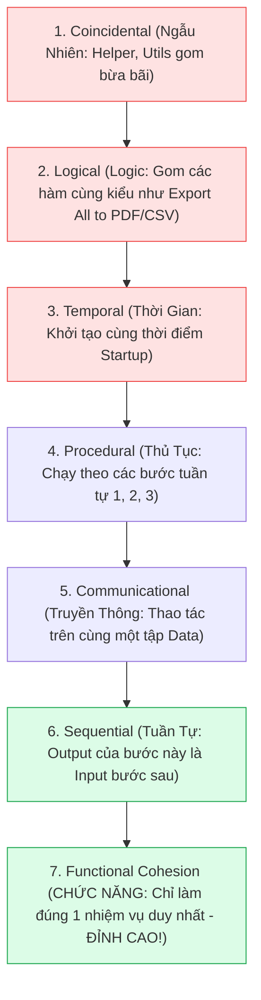
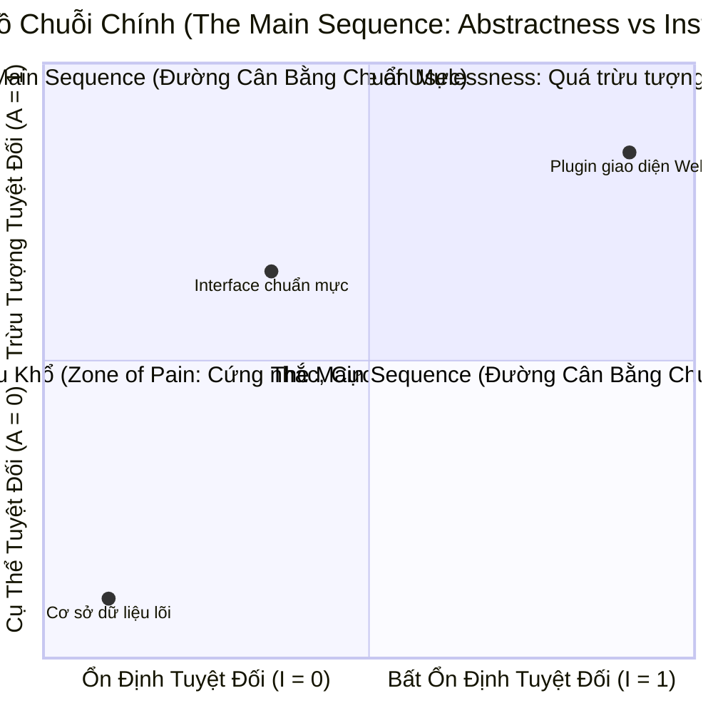

# 3.3. Độ Ghép Nối và Độ Gắn Kết (Coupling and Cohesion)

> [!IMPORTANT]
> **Nếu bạn chỉ được nhớ một điều duy nhất:** Mọi mục tiêu tối thượng của kiến trúc phần mềm từ xưa đến nay đều quy tụ về đúng một chân lý kinh điển: **"Độ Gắn Kết Cao và Độ Ghép Nối Thấp" (High Cohesion & Low Coupling - Larry Constantine 1974)**. Một module có độ gắn kết cao (**Functional Cohesion**) chỉ tập trung giải quyết trọn vẹn một trách nhiệm duy nhất; trong khi việc giảm thiểu độ ghép nối từ các cấp độ tồi tệ (**Content & Common Coupling**) sang cấp độ lý tưởng (**Data & Message Coupling**) là ranh giới sống còn giúp bạn có thể sửa đổi, nâng cấp một thành phần mà không làm sụp đổ các thành phần còn lại. Khi thiết kế kiến trúc gói (Packages), hai định luật **SDP (Phụ thuộc vào hướng ổn định)** và **SAP (Ổn định phải đi đôi với Trừu tượng)** của Robert C. Martin cung cấp thước đo toán học định lượng $D = |A + I - 1|$ để ngăn chặn các "Vùng Đau Khổ" (Zone of Pain) trong hệ thống.

---

## 1. Kiến trúc Tổng quan & Mô hình Tư duy (Mental Model)

### 1.1. Ẩn dụ Đời sống: Dây Tai Nghe Bị Rối vs Ổ Cắm Điện Gia Đình

Hãy hình dung hai hiện tượng vật lý quen thuộc:
- **Hệ thống có Độ Ghép Nối Cao (Tight Coupling - Cuộn dây tai nghe bị rối tung)**:
  - Bạn để 5 chiếc tai nghe có dây trong balo. Khi lấy ra, chúng quấn chặt vào nhau thành một búi bùi nhùi.
  - Bạn chỉ muốn rút chiếc tai nghe màu đen, nhưng khi kéo nó ra, cả 4 chiếc tai nghe còn lại đều bị giật theo và đứt dây!
  - Trong phần mềm: Sửa một dòng code trong hàm tính thuế (`BillingService`) lại làm sập tính năng đổi ảnh đại diện (`UserProfileService`) vì hai bên cùng can thiệp vào một biến toàn cục chung (**Common Coupling**).
- **Hệ thống có Độ Gắn Kết Cao & Ghép Nối Thấp (High Cohesion, Loose Coupling - Ổ cắm điện âm tường)**:
  - Ổ cắm điện trên tường chỉ làm đúng một việc duy nhất: Cung cấp dòng điện xoay chiều 220V chuẩn hóa (Functional Cohesion).
  - Chiếc quạt máy, máy sấy tóc và máy tính xách tay đều có thể cắm vào ổ điện này thông qua phích cắm chuẩn 2 chấu (Interface / Data Coupling). Ổ cắm điện không cần biết thiết bị cắm vào là máy sấy hay laptop; và chiếc máy tính xách tay có thể rút phích cắm mang sang phòng khác mà không làm chiếc quạt bị ngừng quay!

```mermaid
graph TD
    classDef high fill:#e8f5e9,stroke:#388e3c,stroke-width:2px;
    classDef bad fill:#ffebee,stroke:#d32f2f,stroke-width:2px;
    classDef metric fill:#e1f5fe,stroke:#0288d1,stroke-width:2px;

    Root["BẢN ĐỒ ĐỘ GHÉP NỐI VÀ ĐỘ GẮN KẾT (COUPLING & COHESION)"]

    Root --> C["1. Phân Phổ Độ Ghép Nối (Coupling Spectrum)"]:::bad
    Root --> CN["2. Lý Thuyết Connascence (Meilir Page-Jones)"]:::metric
    Root --> H["3. Phân Phổ Độ Gắn Kết (Cohesion Spectrum)"]:::high
    Root --> PKG["4. Các Nguyên Lý Kiến Trúc Gói (SDP & SAP)"]:::metric

    C --> C1["Content Coupling (Tồi Tệ Nhất: Chọc trực tiếp vào Private State)"]
    C --> C2["Common / Global Coupling (Dùng chung Biến Toàn Cục / Shared DB)"]
    C --> C3["Control Coupling (Truyền cờ boolean điều khiển if-else bên trong)"]
    C --> C4["Stamp Coupling (Truyền cả Object lớn chỉ để dùng 1 trường)"]
    C --> C5["Data Coupling (Chỉ truyền đúng dữ liệu cần thiết - Chuẩn Mực)"]
    C --> C6["Message Coupling (Bất đồng bộ qua Hàng đợi - Tối Ưu)"]

    H --> H1["Coincidental Cohesion (Tồi Tệ Nhất: Helper/Utils gom bừa bãi)"]
    H --> H2["Logical Cohesion (Gom các hàm cùng kiểu thao tác: Parse mọi thứ)"]
    H --> H3["Temporal Cohesion (Gom các hàm chạy cùng thời điểm: Init/Startup)"]
    H --> H4["Functional Cohesion (Lý Tưởng: Chỉ làm đúng 1 nhiệm vụ duy nhất)"]

    PKG --> PKG1["SDP (Stable Dependencies Principle: Phụ thuộc vào nơi Ổn định)"]
    PKG --> PKG2["SAP (Stable Abstractions Principle: Ổn định phải Trừu tượng)"]
    PKG --> PKG3["The Main Sequence Metric: D = |A + I - 1|"]
```



---

## 2. Chi tiết từng Keyword (Under-the-Hood Deep Dive)

### 2.1. Phân Cấp Các Cấp Độ Ghép Nối (Coupling Spectrum: Từ Tồi Tệ Nhất Đến Tốt Nhất)

Độ ghép nối (Coupling) đo lường mức độ phụ thuộc qua lại giữa hai module. Larry Constantine và Glenford Myers đã phân loại thành 6 cấp độ từ nguy hiểm nhất đến an toàn nhất:

```
┌─────────────────────────────────┬─────────────────────────────────┬──────────────────────────────────────────┐
│ Cấp Độ Ghép Nối (Coupling)      │ Bản Chất Kỹ Thuật               │ Đánh Giá Mức Độ Nguy Hiểm & Giải Pháp    │
├─────────────────────────────────┼─────────────────────────────────┼──────────────────────────────────────────┤
│ 1. **Content Coupling**         │ Module A sửa trực tiếp biến nội │ **CỰC KỲ TỒI TỆ (Thảm Họa)**: Phá vỡ     │
│ (Ghép nối nội dung)             │ bộ hoặc nhảy vào giữa code của B│ tính đóng gói $100\%$. Bắt buộc cấm chỉ! │
├─────────────────────────────────┼─────────────────────────────────┼──────────────────────────────────────────┤
│ 2. **Common Coupling**          │ Hai hay nhiều modules cùng đọc  │ **RẤT XẤU**: Biến toàn cục hoặc Shared DB│
│ (Ghép nối toàn cục)             │ và ghi vào một Global Variable  │ khiến khó truy vết ai đã làm thay đổi data│
├─────────────────────────────────┼─────────────────────────────────┼──────────────────────────────────────────┤
│ 3. **External Coupling**        │ Các modules phụ thuộc vào một   │ **TRUNG BÌNH - XẤU**: Thay đổi giao thức │
│ (Ghép nối ngoại vi)             │ định dạng phần cứng/OS bên ngoài│ bên ngoài làm sập toàn bộ các modules    │
├─────────────────────────────────┼─────────────────────────────────┼──────────────────────────────────────────┤
│ 4. **Control Coupling**         │ Module A truyền một cờ boolean  │ **XẤU**: Module A chỉ đạo module B phải  │
│ (Ghép nối điều khiển)           │ để ép B chạy theo nhánh `if/else│ thực thi thế nào. Cần refactor đa hình!  │
├─────────────────────────────────┼─────────────────────────────────┼──────────────────────────────────────────┤
│ 5. **Stamp Coupling**           │ Truyền nguyên cả cấu trúc dữ    │ **CHẤP NHẬN ĐƯỢC**: Làm lộ thông tin thừa│
│ (Ghép nối cấu trúc)             │ liệu lớn (Object) chỉ để lấy 1 số│ Cần bóc tách interface hẹp hơn.         │
├─────────────────────────────────┼─────────────────────────────────┼──────────────────────────────────────────┤
│ 6. **Data Coupling**            │ Chỉ truyền đúng các giá trị     │ **CHUẨN MỰC TỐT**: Các hàm giao tiếp độc │
│ (Ghép nối dữ liệu)              │ nguyên thủy cần thiết (Parameters)│ lập, dễ dàng Unit Test độc lập.          │
├─────────────────────────────────┼─────────────────────────────────┼──────────────────────────────────────────┤
│ 7. **Message / No Coupling**    │ Giao tiếp bất đồng bộ qua bản tin│ **LÝ TƯỞNG NHẤT**: Hoàn toàn không biết  │
│ (Ghép nối thông điệp)           │ phi tập trung (Event Broker)    │ sự tồn tại của nhau (Decoupled Runtime). │
└─────────────────────────────────┴─────────────────────────────────┴──────────────────────────────────────────┘
```

---

### 2.2. Connascence — Lý Thuyết Ghép Nối Nâng Cao (Meilir Page-Jones)

Trong kỹ nghệ phần mềm hiện đại, Meilir Page-Jones đã nâng cấp khái niệm ghép nối thành lý thuyết **Connascence** (Sự cùng sinh / Cùng biến đổi): *"Hai thành phần phần mềm có tính Connascence nếu sự thay đổi ở thành phần này đòi hỏi thành phần kia cũng phải thay đổi để duy trì tính đúng đắn của toàn hệ thống"*.

#### 1. Static Connascence (Nhận biết lúc biên dịch / Compile-time)
- **Connascence of Name (CoN)**: Hai bên phải thống nhất tên hàm/biến (Cấp độ nhẹ nhất, công cụ Refactor tự đổi được).
- **Connascence of Type (CoT)**: Hai bên phải thống nhất kiểu dữ liệu (ví dụ truyền `int` hay `string`).
- **Connascence of Meaning (CoM)**: Hai bên cùng hiểu ngầm ý nghĩa một giá trị đặc biệt (Ví dụ: `status = 1` là Active, `status = -99` là Đã xóa $\implies$ Magic Numbers nguy hiểm).
- **Connascence of Position (CoP)**: Thứ tự tham số truyền vào hàm: `createUser(name, email, age, address)` $\implies$ Nếu đổi vị trí tham số sẽ gây lỗi âm thầm.
- **Connascence of Algorithm (CoA)**: Hai bên phải dùng chung một thuật toán mã hóa hoặc checksum (MD5, SHA-256) thì mới giải mã được.

#### 2. Dynamic Connascence (Chỉ nhận biết lúc chạy / Runtime - Rất nguy hiểm)
- **Connascence of Execution (CoE)**: Hàm A **bắt buộc phải được gọi trước** hàm B (Ví dụ: phải gọi `init()` trước khi gọi `connect()`).
- **Connascence of Timing (CoT)**: Hai tiến trình phải chạy trong một khoảng thời gian nhất định mới không bị dính Race Condition.
- **Connascence of Values (CoV)**: Giá trị của biến ở node A phải tương thích với giá trị ở node B (Ví dụ: Cấu hình phân tán giữa 2 microservices).

---

### 2.3. Phân Cấp Các Cấp Độ Gắn Kết (Cohesion Spectrum: Từ Tồi Tệ Nhất Đến Tốt Nhất)

Độ gắn kết (Cohesion) đo lường mức độ các phần tử bên trong một module thuộc về nhau và cùng phục vụ một mục đích duy nhất:



- **Coincidental Cohesion (Thảm họa lớp `CommonUtils / GeneralHelper`)**: Một class rác chứa cả hàm tính căn bậc hai, hàm format ngày tháng, và hàm gửi email! Các hàm này hoàn toàn không có bất kỳ mối liên hệ logic nào với nhau.
- **Functional Cohesion (Đỉnh cao của SRP)**: Mọi dòng code bên trong module đều phục vụ cho một chức năng cốt lõi duy nhất (Ví dụ: `XmlPayloadParser` chỉ làm đúng việc phân tích cú pháp XML, `BcryptPasswordHasher` chỉ làm đúng việc băm mật khẩu).

---

### 2.4. Package Coupling Principles: SDP & SAP (Robert C. Martin - Uncle Bob)

Khi cấu trúc các Package / Thư mục trong dự án Backend lớn, Uncle Bob định nghĩa hai nguyên lý toán học để giữ hệ thống không bị mục rỗng:



#### 1. Stable Dependencies Principle (SDP - Nguyên Lý Phụ Thuộc Ổn Định)
- **Định luật**: *"Hướng của các mối quan hệ phụ thuộc phải luôn luôn đi về phía của sự ổn định"*.
- **Chỉ số Bất Ổn Định (Instability Metric $I$)**:
  $$I = \frac{C_e}{C_a + C_e}$$
  - $C_a$ (Afferent Coupling - Khách hàng): Số lượng package bên ngoài phụ thuộc vào package này.
  - $C_e$ (Efferent Coupling - Nhà cung cấp): Số lượng package bên ngoài mà package này phải phụ thuộc vào.
  - $I = 0$: **Ổn định tuyệt đối** (Nhiều người phụ thuộc vào nó, nó không phụ thuộc vào ai $\implies$ Rất khó thay đổi).
  - $I = 1$: **Bất ổn định tối đa** (Không ai phụ thuộc vào nó, nó phụ thuộc vào nhiều nơi $\implies$ Rất dễ thay đổi).

#### 2. Stable Abstractions Principle (SAP - Nguyên Lý Trừu Tượng Ổn Định)
- **Định luật**: *"Một package càng ổn định ($I \to 0$) thì nó càng bắt buộc phải trừu tượng ($A \to 1$)"*.
- **Chỉ số Trừu Tượng (Abstractness Metric $A$)**:
  $$A = \frac{N_a}{N_c}$$
  - $N_a$: Số lượng Interface và Abstract Class trong package.
  - $N_c$: Tổng số lượng Class trong package.
- **Khoảng cách đến Chuỗi Chính (Distance from the Main Sequence $D$)**:
  $$D = |A + I - 1|$$
  - Một package lý tưởng phải nằm sát đường $A + I = 1 \implies D \approx 0$.
  - Nếu $D \to 1$ ở góc dưới ($A = 0, I = 0$): Package rơi vào **"Vùng Đau Khổ" (Zone of Pain)**: Quá nhiều nơi phụ thuộc vào nó nhưng nó lại viết bằng các class cụ thể cứng nhắc, khiến mỗi lần sửa đổi là một cơn ác mộng!

---

## 3. Thực thi Mã nguồn & Mô phỏng Chuyên sâu (Dual-Engine Implementation)

### 3.1. C++20 Refactoring Control Coupling thành Polymorphic Strategy

Chương trình minh chứng cách loại bỏ mã hôi **Control Coupling** (Truyền cờ boolean điều khiển if-else bên trong hàm khác) và tái cấu trúc thành thiết kế ghép nối lỏng lẻo bằng C++20 Lambdas và Polymorphism:

```cpp
// control_coupling_refactoring.cpp
// Biên dịch: g++ -std=c++20 -O3 control_coupling_refactoring.cpp -o control_coupling_refactoring
#include <iostream>
#include <string>
#include <vector>
#include <memory>
#include <functional>

// ============================================================================
// PHẢN MẪU THIẾT KẾ: CONTROL COUPLING (Truyền cờ boolean ép hàm phân nhánh)
// ============================================================================
class BadInvoiceService {
public:
    void print_invoice(double amount, bool is_vip_customer, bool send_email) {
        // Hàm bị Control Coupling: Bên ngoài điều khiển luồng nội bộ của hàm
        double final_price = amount;
        if (is_vip_customer) {
            final_price *= 0.85; // Giảm giá VIP 15%
        }

        std::cout << "[BAD INVOICE] Hóa đơn: $" << final_price << "\n";

        if (send_email) {
            std::cout << "  -> Âm thầm kích hoạt gửi email hóa đơn nội bộ...\n";
        }
    }
};

// ============================================================================
// THIẾT KẾ CHUẨN MỰC: DATA COUPLING & STRATEGY (Loại bỏ hoàn toàn Control Flag)
// ============================================================================
struct DiscountPolicy {
    std::function<double(double)> apply_discount;
};

class CleanInvoiceService {
public:
    // Chỉ nhận dữ liệu thuần túy (Data Coupling) và Strategy đã được cấu hình trước
    double calculate_final_amount(double raw_amount, const DiscountPolicy& policy) {
        return policy.apply_discount(raw_amount);
    }
};

int main() {
    std::cout << "=======================================================================\n";
    std::cout << "       REFACTORING CONTROL COUPLING SANG DATA / STRATEGY COUPLING      \n";
    std::cout << "=======================================================================\n\n";

    // 1. Chạy thử nghiệm Phản mẫu Control Coupling
    std::cout << "--- 1. CHẠY THỬ MÃ HÔI CONTROL COUPLING ---\n";
    BadInvoiceService bad_svc;
    bad_svc.print_invoice(100.0, true, true); // Các cờ boolean mơ hồ: true, true là gì?

    // 2. Chạy thử nghiệm Thiết kế Sạch (Strategy Injection)
    std::cout << "\n--- 2. CHẠY THỬ THIẾT KẾ SẠCH (DATA COUPLING) ---\n";
    CleanInvoiceService clean_svc;

    DiscountPolicy vip_discount{ [](double a) { return a * 0.85; } };
    DiscountPolicy regular_discount{ [](double a) { return a * 1.0; } };

    double vip_final = clean_svc.calculate_final_amount(100.0, vip_discount);
    double regular_final = clean_svc.calculate_final_amount(100.0, regular_discount);

    std::cout << "[CLEAN INVOICE] Hóa đơn VIP         : $" << vip_final << "\n";
    std::cout << "[CLEAN INVOICE] Hóa đơn Thường      : $" << regular_final << "\n";

    std::cout << "\n>>> KẾT QUẢ: Tách rời việc tính tiền và gửi email thành 2 trách nhiệm riêng,\n"
              << "    loại bỏ hoàn toàn cờ boolean điều khiển nội bộ!\n";

    return 0;
}
```

#### Terminal Output Mẫu:
```text
=======================================================================
       REFACTORING CONTROL COUPLING SANG DATA / STRATEGY COUPLING      
=======================================================================

--- 1. CHẠY THỬ MÃ HÔI CONTROL COUPLING ---
[BAD INVOICE] Hóa đơn: $85
  -> Âm thầm kích hoạt gửi email hóa đơn nội bộ...

--- 2. CHẠY THỬ THIẾT KẾ SẠCH (DATA COUPLING) ---
[CLEAN INVOICE] Hóa đơn VIP         : $85
[CLEAN INVOICE] Hóa đơn Thường      : $100

>>> KẾT QUẢ: Tách rời việc tính tiền và gửi email thành 2 trách nhiệm riêng,
    loại bỏ hoàn toàn cờ boolean điều khiển nội bộ!
```

---

### 3.2. Python 3.11+ Package Metrics Calculator: Instability ($I$), Abstractness ($A$) & Distance ($D$)

Chương trình minh chứng cách tính toán toán học các chỉ số kiến trúc của Robert C. Martin: Đo lường độ bất ổn định $I$, độ trừu tượng $A$, và khoảng cách tới Chuỗi Chính $D$, tự động phát hiện các package rơi vào **"Vùng Đau Khổ" (Zone of Pain)**:

```python
#!/usr/bin/env python3
"""
package_metrics_analyzer.py
Công Cụ Tính Toán Toán Học Các Chỉ Số Package Coupling: SDP, SAP và The Main Sequence
"""
from dataclasses import dataclass
from typing import List

@dataclass
class PackageMetrics:
    name: str
    ca: int            # Afferent Coupling: Số package bên ngoài phụ thuộc vào package này
    ce: int            # Efferent Coupling: Số package bên ngoài mà package này phụ thuộc vào
    num_classes: int   # Tổng số class cụ thể (Nc)
    num_abstract: int  # Số lượng interfaces / abstract classes (Na)

    @property
    def instability(self) -> float:
        """I = Ce / (Ca + Ce)"""
        total = self.ca + self.ce
        return (self.ce / total) if total > 0 else 0.0

    @property
    def abstractness(self) -> float:
        """A = Na / Nc"""
        return (self.num_abstract / self.num_classes) if self.num_classes > 0 else 0.0

    @property
    def distance_from_main_sequence(self) -> float:
        """D = |A + I - 1|"""
        return abs(self.abstractness + self.instability - 1.0)

    def diagnose_zone(self) -> str:
        d = self.distance_from_main_sequence
        if d < 0.2:
            return "THE MAIN SEQUENCE (Cân Bằng Hoàn Hảo)"
        elif self.abstractness < 0.3 and self.instability < 0.3:
            return "!!! VÙNG ĐAU KHỔ (ZONE OF PAIN: Quá cụ thể nhưng quá nhiều người phụ thuộc!) !!!"
        elif self.abstractness > 0.7 and self.instability > 0.7:
            return "VÙNG VÔ DỤNG (ZONE OF USELESSNESS: Quá trừu tượng nhưng không ai dùng)"
        return "CHẤP NHẬN ĐƯỢC"

def main():
    print("=" * 80)
    print("     CÔNG CỤ PHÂN TÍCH TOÁN HỌC CHỈ SỐ PACKAGE COUPLING (SDP & SAP)            ")
    print("=" * 80)

    packages = [
        # Gói lõi cơ sở dữ liệu: Nhiều người dùng (Ca=20), không phụ thuộc ai (Ce=0), nhưng toàn class cụ thể (Na=0)
        PackageMetrics("com.app.core.database", ca=20, ce=0, num_classes=15, num_abstract=0),
        # Gói giao diện trừu tượng chuẩn mực: Ca=15, Ce=2, nhiều interface (Na=8)
        PackageMetrics("com.app.domain.interfaces", ca=15, ce=2, num_classes=10, num_abstract=8),
        # Gói Web Controllers ở ngoại vi: Không ai dùng (Ca=0), phụ thuộc nhiều nơi (Ce=12)
        PackageMetrics("com.app.web.controllers", ca=0, ce=12, num_classes=12, num_abstract=1),
    ]

    for pkg in packages:
        print(f"\n[PHÂN TÍCH PACKAGE]: {pkg.name}")
        print(f"  - Phụ thuộc vào/ra : Ca = {pkg.ca} | Ce = {pkg.ce}")
        print(f"  - Bất Ổn Định (I)  : {pkg.instability:.3f} (0: Rất Ổn Định, 1: Rất Bất Ổn)")
        print(f"  - Trừu Tượng (A)   : {pkg.abstractness:.3f} (Tỷ lệ Interfaces: {pkg.num_abstract}/{pkg.num_classes})")
        print(f"  - Khoảng Cách (D)  : {pkg.distance_from_main_sequence:.3f} (Càng gần 0 càng chuẩn)")
        print(f"  >>> CHẨN ĐOÁN      : {pkg.diagnose_zone()}")

    print("\n" + "=" * 80)

if __name__ == "__main__":
    main()
```

#### Terminal Output Mẫu:
```text
================================================================================
     CÔNG CỤ PHÂN TÍCH TOÁN HỌC CHỈ SỐ PACKAGE COUPLING (SDP & SAP)            
================================================================================

[PHÂN TÍCH PACKAGE]: com.app.core.database
  - Phụ thuộc vào/ra : Ca = 20 | Ce = 0
  - Bất Ổn Định (I)  : 0.000 (0: Rất Ổn Định, 1: Rất Bất Ổn)
  - Trừu Tượng (A)   : 0.000 (Tỷ lệ Interfaces: 0/15)
  - Khoảng Cách (D)  : 1.000 (Càng gần 0 càng chuẩn)
  >>> CHẨN ĐOÁN      : !!! VÙNG ĐAU KHỔ (ZONE OF PAIN: Quá cụ thể nhưng quá nhiều người phụ thuộc!) !!!

[PHÂN TÍCH PACKAGE]: com.app.domain.interfaces
  - Phụ thuộc vào/ra : Ca = 15 | Ce = 2
  - Bất Ổn Định (I)  : 0.118 (0: Rất Ổn Định, 1: Rất Bất Ổn)
  - Trừu Tượng (A)   : 0.800 (Tỷ lệ Interfaces: 8/10)
  - Khoảng Cách (D)  : 0.082 (Càng gần 0 càng chuẩn)
  >>> CHẨN ĐOÁN      : THE MAIN SEQUENCE (Cân Bằng Hoàn Hảo)

[PHÂN TÍCH PACKAGE]: com.app.web.controllers
  - Phụ thuộc vào/ra : Ca = 0 | Ce = 12
  - Bất Ổn Định (I)  : 1.000 (0: Rất Ổn Định, 1: Rất Bất Ổn)
  - Trừu Tượng (A)   : 0.083 (Tỷ lệ Interfaces: 1/12)
  - Khoảng Cách (D)  : 0.083 (Càng gần 0 càng chuẩn)
  >>> CHẨN ĐOÁN      : THE MAIN SEQUENCE (Cân Bằng Hoàn Hảo)

================================================================================
```

---

## 4. Systems Engineering & Production Pitfalls

### 4.1. Cạm Bẫy Thực Chiến Thường Gặp (Production Pitfalls)

#### 1. Sự Cố "Zone of Pain" Khiến Toàn Đội Không Thể Refactor
- **Hiện tượng**: Một class `CoreEntity.java` nằm ở đáy kiến trúc có $I = 0$ (Toàn bộ 50 microservices phụ thuộc vào nó), nhưng $A = 0$ (Nó là một class cụ thể chứa hàng nghìn dòng code logic thô).
- **Hậu quả**: Khi một yêu cầu nghiệp vụ mới đòi hỏi sửa đổi một phương thức của `CoreEntity`, rủi ro sập hệ thống lớn đến mức không một lập trình viên nào dám động vào, biến nó thành một "khối u di căn" của dự án.
- **Giải pháp**: Tách `CoreEntity` thành một Interface trừu tượng ($A \to 1$) và sử dụng Dependency Inversion.

#### 2. Thảm Họa "God Class / Kitchen Sink Utility"
- **Hiện tượng**: Class `StringHelper` hoặc `SystemManager` phình to lên 10.000 dòng code với Cohesion ngẫu nhiên (Coincidental Cohesion).
- **Hậu quả**: Bất kỳ pull request nào cũng chạm vào file này, gây ra Merge Conflict liên tục và làm thời gian chạy Unit Test kéo dài hàng chục phút.
- **Giải pháp**: Chia nhỏ class theo các miền trách nhiệm cụ thể: `DateFormatter`, `UrlSanitizer`, `PasswordValidator`.

#### 3. Bẫy "Connascence of Position" Khi Tham Số Hàm Vượt Quá 5 Biến
- **Hiện tượng**: Hàm `processPayment(userId, merchantId, amount, tax, fee, currency, isRefund, discount)` có 8 tham số cùng kiểu dữ liệu.
- **Hậu quả**: Lập trình viên vô tình đảo nhầm vị trí giữa `amount` và `tax`, gây ra lỗi tính tiền sai lệch hàng tháng trời mà compiler không hề báo lỗi!
- **Giải pháp**: Gom các tham số thành một **Parameter Object / DTO** có tên thuộc tính tường minh.

---

### 4.2. CLI Diagnostics & Công Cụ Đo Lường Coupling

```bash
# 1. Phân tích ma trận phụ thuộc giữa các Packages bằng JDepend
jdepend-ui src/

# 2. Đo lường chỉ số khớp nối Afferent/Efferent coupling bằng PyCG hoặc Radon
radon raw -s src/

# 3. Quét tìm các hàm có danh sách tham số quá dài (Long Parameter List)
lizard src/ -a 5
```

---

## 5. Bảng So sánh & Decision Matrix

| Chiều Không Gian So Sánh | Cấp Độ Tồi Tệ (Cần Loại Bỏ) | Cấp Độ Tốt (Chuẩn Mực) | Cấp Độ Lý Tưởng (Phân Tán) |
| :--- | :--- | :--- | :--- |
| **Phổ Ghép Nối (Coupling)** | Content Coupling, Common Coupling | Data Coupling (Truyền Parameters hẹp)| Message Coupling (Event Bus bất đồng bộ) |
| **Phổ Gắn Kết (Cohesion)** | Coincidental Cohesion (Utils/Helper) | Sequential / Communicational Cohesion | Functional Cohesion (Single Responsibility)|
| **Vị Trí Trên Chuỗi Chính** | Zone of Pain ($A=0, I=0$) | Main Sequence ($A + I \approx 1$) | Main Sequence ($D < 0.1$) |
| **Tác Động Khi Sửa Code** | Lỗi lan truyền domino toàn hệ thống | Chỉ ảnh hưởng trong phạm vi module | Hoàn toàn cô lập, không ảnh hưởng ai |
| **Độ Khó Khi Viết Unit Test**| Phải dựng toàn bộ hệ thống giả lập | Dễ dàng Mocking qua Interface | Cực kỳ đơn giản, kiểm thử độc lập |
