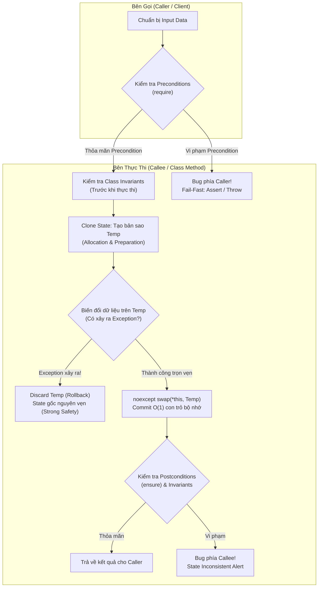
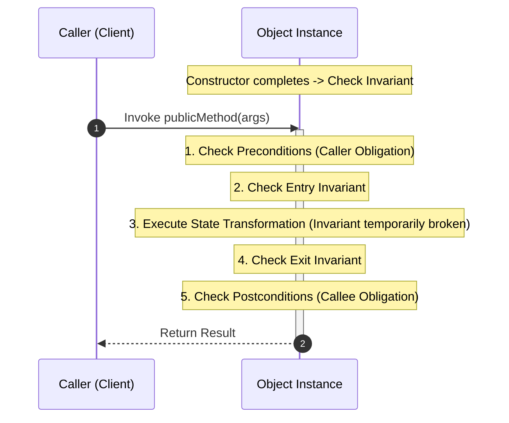
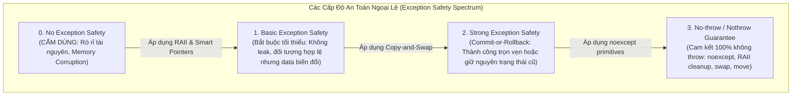

# 3.4. Thiết Kế Theo Hợp Đồng và An Toàn Ngoại Lệ (Design by Contract & Exception Safety)

> [!IMPORTANT]
> **Nếu bạn chỉ được nhớ một điều duy nhất:** Design by Contract (DbC) biến các giả định ngầm thành các ràng buộc pháp lý tường minh giữa bên gọi (Caller) và bên thực thi (Callee), trong khi Exception Safety đảm bảo rằng ngay cả khi thảm họa xảy ra giữa chừng, hệ thống vẫn duy trì tính toàn vẹn bộ nhớ và không bao giờ để rò rỉ tài nguyên hay rơi vào trạng thái bất định (undefined state).

---

## 1. Kiến trúc Tổng quan & Mô hình Tư duy (Mental Model)

### Ẩn dụ Đời sống: Hợp Đồng Ngoại Thương và Cơ Chế Ký Quỹ Escrow
Hãy hình dung mối quan hệ giữa hai module phần mềm như một thương vụ mua bán hàng hóa quốc tế có bảo lãnh ngân hàng:
- **Precondition (Tiền điều kiện)**: Người mua phải chuyển đủ tiền vào tài khoản ký quỹ (Escrow) trước 17h00 ngày ký. Nếu người mua không chuyển tiền, người bán hoàn toàn không có nghĩa vụ xuất kho hàng hóa. Lỗi thuộc về bên mua.
- **Postcondition (Hậu điều kiện)**: Sau khi nhận đủ tiền, người bán cam kết giao đúng $10.000$ tấn thép tiêu chuẩn ASTM đến cảng đích. Nếu hàng giao thiếu hoặc sai chuẩn, bên bán vi phạm hợp đồng và phải chịu phạt.
- **Class Invariant (Bất biến lớp)**: Tổng số tiền trong két sắt của ngân hàng bảo lãnh cộng với nợ xấu không bao giờ được nhỏ hơn vốn điều lệ bắt buộc. Trạng thái này phải đúng trước giờ mở cửa và sau khi đóng cửa giao dịch mỗi ngày.
- **Strong Exception Safety (Copy-and-Swap)**: Khi bốc xếp hàng lên tàu, nếu gặp bão lớn giữa chừng, toàn bộ hàng hóa được cẩu trả lại nguyên vẹn kho bãi cũ; tiền cọc trả về cho người mua như thể giao dịch chưa từng diễn ra (All-or-Nothing / Rollback semantics).



---

## 2. Chi tiết từng Keyword (Under-the-Hood Deep Dive)

### 2.1. Trụ Cột của Design by Contract: Preconditions, Postconditions & Class Invariants
Phương pháp luận Design by Contract (DbC) do Bertrand Meyer sáng tạo trong ngôn ngữ Eiffel xác lập 3 trụ cột toán học:

1. **Preconditions (Tiền điều kiện - `require`)**:
   - Định nghĩa nghĩa vụ của **Bên gọi (Caller)** và quyền lợi của **Bên thực thi (Callee)**.
   - Thể hiện các điều kiện tiên quyết mà dữ liệu đầu vào và trạng thái hệ thống phải đáp ứng trước khi hàm được kích hoạt.
   - *Nguyên tắc thiết kế*: Nếu Precondition bị vi phạm, Callee **không có nghĩa vụ** phải phục hồi hay xử lý khoan nhượng; hệ thống áp dụng cơ chế Fail-Fast (ném exception hoặc panic) vì đây là lỗi logic (bug) của lập trình viên phía Caller.

2. **Postconditions (Hậu điều kiện - `ensure`)**:
   - Định nghĩa quyền lợi của Caller và nghĩa vụ của Callee.
   - Cam kết trạng thái của hệ thống và giá trị trả về sau khi phương thức hoàn thành bình thường.
   - Callee phải chịu trách nhiệm hoàn toàn nếu Postcondition không được đáp ứng dù Precondition đã hợp lệ.

3. **Class Invariants (Bất biến của Lớp)**:
   - Các thuộc tính chân lý định lượng về tính toàn vẹn của đối tượng luôn luôn có giá trị `true` trong suốt vòng đời của nó.
   - Invariant có thể bị phá vỡ tạm thời **bên trong** thân phương thức trong quá trình biến đổi trạng thái, nhưng bắt buộc phải được khôi phục nguyên vẹn trước khi phương thức trả quyền điều khiển về cho thế giới bên ngoài.
   - Được kiểm tra tự động tại 2 thời điểm cốt lõi:
     - Ngay sau khi Constructor hoàn tất khởi tạo.
     - Trước khi bắt đầu và sau khi kết thúc mọi phương thức `public`.



---

### 2.2. Subcontracting và Nguyên lý Thay thế Liskov (LSP Enforcement)
Khi áp dụng tính kế thừa trong lập trình hướng đối tượng, DbC cung cấp quy tắc toán học khắt khe để kiểm soát đa hình (Polymorphism), trực tiếp thực thi **Nguyên lý Thay thế Liskov (Liskov Substitution Principle - LSP)**:

$$\text{Pre}_{\text{derived}} \Leftarrow \text{Pre}_{\text{base}} \quad (\text{Contravariance: Tiền điều kiện chỉ được nới lỏng hoặc giữ nguyên})$$
$$\text{Post}_{\text{derived}} \Rightarrow \text{Post}_{\text{base}} \quad (\text{Covariance: Hậu điều kiện chỉ được thắt chặt hoặc giữ nguyên})$$
$$\text{Invariant}_{\text{derived}} \Rightarrow \text{Invariant}_{\text{base}} \quad (\text{Bất biến lớp con bao hàm toàn bộ bất biến lớp cha})$$

- **Không bao giờ đòi hỏi nhiều hơn lớp cha**: Lớp con không được quyền từ chối các đối số mà lớp cha chấp nhận. Nếu lớp cha nhận mọi số nguyên $x \in \mathbb{R}$, lớp con không thể đặt precondition $x > 0$.
- **Luôn luôn cam kết nhiều hơn hoặc bằng lớp cha**: Nếu lớp cha hứa trả về danh sách được sắp xếp, lớp con không thể trả về danh sách xáo trộn.

---

### 2.3. Defensive Programming vs Design by Contract & Fail-Fast
Trong kỹ nghệ phần mềm hiện đại, có sự phân định ranh giới rõ rệt giữa hai trường phái:

| Đặc tính | Defensive Programming | Design by Contract (DbC) |
| :--- | :--- | :--- |
| **Triết lý cốt lõi** | Không tin tưởng bất kỳ module nào; giả định mọi thứ đều có thể sai. | Ranh giới trách nhiệm rõ ràng; coi vi phạm tiền điều kiện là bug logic. |
| **Xử lý khi Input sai** | Cố gắng che giấu: Trả về `null`, chuỗi rỗng `""`, hoặc giá trị mặc định. | **Fail-Fast**: Ném exception lập tức hoặc dừng chương trình để lộ bug. |
| **Chi phí mã nguồn** | Mã nguồn bị phình to (Bloated) bởi các tầng kiểm tra `if (ptr == nullptr)` trùng lặp. | Tinh gọn; chỉ kiểm tra tại ranh giới công khai (API Boundary) hoặc qua assertions. |
| **Môi trường phù hợp** | Ranh giới công cộng không tin cậy (Public REST APIs, Input từ người dùng). | Ranh giới nội bộ giữa các tầng kiến trúc (Internal Domain Services, Core Engine). |

---

### 2.4. The 4 Levels of Exception Safety (Bốn Cấp Độ An Toàn Ngoại Lệ)
Được chuẩn hóa bởi Bjarne Stroustrup và David Abrahams, an toàn ngoại lệ phân định 4 cấp độ cam kết bảo vệ trạng thái bộ nhớ:



1. **No Exception Safety (Không an toàn - Mức 0)**:
   - Khi có exception xảy ra giữa chừng, tài nguyên (bộ nhớ heap, file handle, socket, database connection) bị rò rỉ vĩnh viễn. Con trỏ có thể bị trỏ vào vùng nhớ rác (Dangling Pointer), dẫn đến Crash hoặc lỗ hổng bảo mật.
2. **Basic Exception Safety (Cam kết Cơ bản - Mức 1 - Tối thiểu bắt buộc)**:
   - Đảm bảo **không có rò rỉ tài nguyên** nhờ cơ chế RAII (Resource Acquisition Is Initialization).
   - Mọi đối tượng vẫn duy trì trạng thái hợp lệ (Class Invariants được bảo tồn), nhưng dữ liệu có thể đã bị thay đổi một phần và không thể dự đoán chính xác giá trị cũ.
3. **Strong Exception Safety (Cam kết Mạnh - Mức 2 - Commit/Rollback)**:
   - Hoạt động theo ngữ nghĩa giao dịch nguyên tử (Atomic Transaction): Nếu thao tác thành công, trạng thái mới được commit; nếu thao tác thất bại do exception, trạng thái hệ thống được phục hồi nguyên vẹn như trước khi hàm được gọi.
4. **No-throw / Nothrow Guarantee (Cam kết Không ném ngoại lệ - Mức 3 - Tuyệt đối)**:
   - Phương thức cam kết thành công $100\%$ và không bao giờ để bất kỳ ngoại lệ nào thoát ra ngoài.
   - Bắt buộc phải có cho: **Destructors**, **Move Constructors**, **Move Assignment Operators**, và các hàm hoán đổi **`swap()`**. Trong C++, điều này được chỉ định bằng từ khóa `noexcept`.

---

### 2.5. Thành ngữ Copy-and-Swap và Cam kết Strong Exception Safety
Kỹ thuật chuẩn mực nhất để đạt được Strong Exception Safety mà không cần viết các khối `try/catch` cồng kềnh là **Copy-and-Swap Idiom**:

1. **Bước Copy (Có thể throw)**: Khởi tạo một đối tượng tạm thời `temp` bằng cách sao chép trạng thái hiện tại của `*this`. Nếu việc cấp phát bộ nhớ bị lỗi (`std::bad_alloc`), exception lập tức bắn ra, đối tượng gốc `*this` hoàn toàn chưa bị chạm tới.
2. **Bước Biến đổi (Có thể throw)**: Tiến hành toàn bộ các phép toán, cấp phát, thêm bớt trên đối tượng tạm `temp`. Nếu có bất kỳ bước nào ném lỗi, `temp` tự động bị hủy theo cơ chế RAII, `*this` vẫn nguyên vẹn.
3. **Bước Swap (Cam kết noexcept)**: Thực hiện hoán đổi con trỏ bộ nhớ giữa `*this` và `temp` bằng hàm swap không bao giờ ném ngoại lệ. Quá trình swap diễn ra ở độ phức tạp $O(1)$.
4. **Bước Hủy**: Khi hàm kết thúc, `temp` (hiện đang giữ tài nguyên cũ của `*this`) bị hủy bình thường.

---

### 2.6. No-throw Guarantee và Tầm quan trọng của `noexcept`
Tại sao Destructor và Move Constructor bắt buộc phải là `noexcept`?
- **Destructor throwing**: Nếu một ngoại lệ đang trong quá trình giải phóng ngăn xếp (Stack Unwinding) mà một Destructor của đối tượng trên stack lại ném tiếp một ngoại lệ thứ hai, runtime C++ không thể xử lý đồng thời 2 exception và buộc phải kích hoạt `std::terminate()`, làm sập toàn bộ tiến trình ngay lập tức.
- **Move operations**: Chuẩn C++ (`std::vector::push_back` hoặc `resize`) sẽ kiểm tra `std::is_nothrow_move_constructible<T>::value`. Nếu move constructor không được đánh dấu `noexcept`, vector sẽ lùi về dùng copy constructor để đảm bảo Strong Exception Safety, làm suy giảm hiệu năng nghiêm trọng.

---

## 3. Thực thi Mã nguồn & Mô phỏng Chuyên sâu (Dual-Engine Implementation)

### 3.1. C++20 Implementation: Enterprise Resilient Ledger with Copy-and-Swap & DbC
Chương trình dưới đây minh họa hệ thống quản lý số dư tài khoản ngân hàng đáp ứng đầy đủ DbC, Class Invariants, và Strong Exception Safety thông qua Copy-and-Swap Idiom.

```cpp
#include <iostream>
#include <vector>
#include <string>
#include <stdexcept>
#include <cassert>
#include <utility>
#include <memory>
#include <sstream>

// Custom Exception biểu thị lỗi hệ thống khi phân bổ
class LedgerStorageException : public std::runtime_error {
public:
    explicit LedgerStorageException(const std::string& msg) : std::runtime_error(msg) {}
};

// Mô phỏng cấu trúc mục kế toán
struct LedgerEntry {
    uint64_t transactionId;
    int64_t amountCents;
    std::string description;
};

// Class thực hiện DbC và Strong Exception Safety
class ResilientAccount {
private:
    uint64_t accountId_{0};
    int64_t balanceCents_{0};
    std::vector<LedgerEntry> auditTrail_;

    // CLASS INVARIANT: Số dư không bao giờ được âm, accountId > 0
    void verifyInvariant() const noexcept {
        assert(accountId_ > 0 && "Invariant Violated: Account ID must be positive!");
        assert(balanceCents_ >= 0 && "Invariant Violated: Balance cannot be negative!");
    }

public:
    // Constructor có kiểm tra Precondition và Invariant
    ResilientAccount(uint64_t id, int64_t initialBalanceCents)
        : accountId_(id), balanceCents_(initialBalanceCents) {
        // Precondition
        if (id == 0) {
            throw std::invalid_argument("Precondition Failed: ID must be non-zero");
        }
        if (initialBalanceCents < 0) {
            throw std::invalid_argument("Precondition Failed: Initial balance cannot be negative");
        }
        verifyInvariant();
    }

    // Copy Constructor (Có thể throw std::bad_alloc)
    ResilientAccount(const ResilientAccount& other)
        : accountId_(other.accountId_),
          balanceCents_(other.balanceCents_),
          auditTrail_(other.auditTrail_) {
        verifyInvariant();
    }

    // Move Constructor (Cam kết noexcept)
    ResilientAccount(ResilientAccount&& other) noexcept
        : accountId_(std::exchange(other.accountId_, 0)),
          balanceCents_(std::exchange(other.balanceCents_, 0)),
          auditTrail_(std::move(other.auditTrail_)) {
    }

    // Destructor (Cam kết noexcept tuyệt đối)
    ~ResilientAccount() noexcept = default;

    // NO-THROW SWAP: Hoán đổi con trỏ bộ nhớ nội tại ở O(1)
    void swap(ResilientAccount& other) noexcept {
        using std::swap;
        swap(accountId_, other.accountId_);
        swap(balanceCents_, other.balanceCents_);
        swap(auditTrail_, other.auditTrail_);
    }

    // Copy Assignment Operator sử dụng Copy-and-Swap (Strong Exception Safety)
    ResilientAccount& operator=(ResilientAccount other) noexcept {
        this->swap(other);
        return *this;
    }

    // STRONG EXCEPTION SAFETY METHOD: Nạp tiền / Giao dịch nguyên tử
    void applyTransaction(uint64_t txId, int64_t amountCents, const std::string& desc, bool simulateFailure = false) {
        // 1. PRECONDITION ENFORCEMENT
        if (txId == 0) {
            throw std::invalid_argument("Precondition Failed: Transaction ID must be > 0");
        }
        if (amountCents == 0) {
            throw std::invalid_argument("Precondition Failed: Transaction amount cannot be zero");
        }
        if (balanceCents_ + amountCents < 0) {
            throw std::domain_error("Precondition Failed: Insufficient funds for withdrawal");
        }

        // 2. COPY STEP: Sao chép trạng thái hiện tại sang bản sao tạm thời
        ResilientAccount tempSnapshot(*this);

        // 3. TRANSFORM STEP TRÊN BẢN SAO TẠM
        tempSnapshot.balanceCents_ += amountCents;
        tempSnapshot.auditTrail_.push_back(LedgerEntry{txId, amountCents, desc});

        // Giả lập lỗi I/O hoặc lỗi Disk Full xảy ra giữa chừng
        if (simulateFailure) {
            throw LedgerStorageException("Disk I/O failure while writing audit entry!");
        }

        // Kiểm tra Invariant trên bản sao tạm trước khi commit
        tempSnapshot.verifyInvariant();

        // 4. COMMIT STEP QUA NOEXCEPT SWAP: O(1)
        this->swap(tempSnapshot);

        // 5. POSTCONDITION VERIFICATION
        verifyInvariant();
        assert(balanceCents_ >= 0 && "Postcondition Violated: Balance is corrupt!");
    }

    [[nodiscard]] int64_t balanceCents() const noexcept { return balanceCents_; }
    [[nodiscard]] size_t auditCount() const noexcept { return auditTrail_.size(); }
};

int main() {
    std::cout << "=== C++20 Design by Contract & Strong Exception Safety Demo ===\n";

    try {
        ResilientAccount account(1001, 50'000); // $500.00
        std::cout << "[Init] Account 1001 initialized with balance: " << account.balanceCents() << " cents\n";

        // Giao dịch 1: Thành công
        account.applyTransaction(1, 25'000, "Salary Deposit");
        std::cout << "[Tx 1 Success] Balance after deposit: " << account.balanceCents() 
                  << " cents | Audits: " << account.auditCount() << "\n";

        // Giao dịch 2: Rút tiền quá số dư (Vi phạm Precondition)
        try {
            std::cout << "\n[Tx 2 Test] Attempting withdrawal exceeding balance...\n";
            account.applyTransaction(2, -100'000, "Luxury Watch Purchase");
        } catch (const std::exception& ex) {
            std::cout << "  -> Caught Precondition Error: " << ex.what() << "\n";
            std::cout << "  -> Account State Untouched: " << account.balanceCents() << " cents\n";
        }

        // Giao dịch 3: Mô phỏng lỗi hệ thống phần cứng (Strong Exception Safety Rollback)
        try {
            std::cout << "\n[Tx 3 Test] Attempting deposit with Simulated Hardware Crash...\n";
            account.applyTransaction(3, 10'000, "Bonus", /*simulateFailure=*/true);
        } catch (const LedgerStorageException& ex) {
            std::cout << "  -> Caught Critical Hardware Error: " << ex.what() << "\n";
            std::cout << "  -> State preserved via Copy-and-Swap! Balance: " 
                      << account.balanceCents() << " cents | Audits: " << account.auditCount() << "\n";
        }

    } catch (const std::exception& ex) {
        std::cerr << "Fatal unexpected error: " << ex.what() << "\n";
        return 1;
    }

    return 0;
}
```

#### Terminal Output Mẫu (C++20):
```text
=== C++20 Design by Contract & Strong Exception Safety Demo ===
[Init] Account 1001 initialized with balance: 50000 cents
[Tx 1 Success] Balance after deposit: 75000 cents | Audits: 1

[Tx 2 Test] Attempting withdrawal exceeding balance...
  -> Caught Precondition Error: Precondition Failed: Insufficient funds for withdrawal
  -> Account State Untouched: 75000 cents

[Tx 3 Test] Attempting deposit with Simulated Hardware Crash...
  -> Caught Critical Hardware Error: Disk I/O failure while writing audit entry!
  -> State preserved via Copy-and-Swap! Balance: 75000 cents | Audits: 1
```

---

### 3.2. Python 3.11+ Implementation: Contract Decorators & Transactional State Manager
Chương trình dưới đây sử dụng Higher-Order Decorators để bắt buộc thực thi Preconditions, Postconditions và Class Invariants trong Python 3.11+, kết hợp Context Manager mô phỏng ngữ nghĩa Strong Exception Safety.

```python
from __future__ import annotations
import copy
import functools
from typing import Callable, Any, TypeVar

F = TypeVar("F", bound=Callable[..., Any])

class ContractViolationError(RuntimeError):
    """Ném ra khi có vi phạm hợp đồng (DbC)."""
    pass

class PreconditionError(ContractViolationError):
    """Lỗi vi phạm trách nhiệm bên gọi (Caller)."""
    pass

class PostconditionError(ContractViolationError):
    """Lỗi vi phạm cam kết bên thực thi (Callee)."""
    pass

class InvariantError(ContractViolationError):
    """Lỗi làm hỏng bất biến của thực thể."""
    pass


def require(predicate: Callable[..., bool], error_msg: str) -> Callable[[F], F]:
    """Decorator kiểm tra Tiền điều kiện (Precondition)."""
    def decorator(func: F) -> F:
        @functools.wraps(func)
        def wrapper(*args, **kwargs):
            if not predicate(*args, **kwargs):
                raise PreconditionError(f"Precondition Failed in '{func.__name__}': {error_msg}")
            return func(*args, **kwargs)
        return wrapper  # type: ignore
    return decorator


def ensure(predicate: Callable[..., bool], error_msg: str) -> Callable[[F], F]:
    """Decorator kiểm tra Hậu điều kiện (Postcondition)."""
    def decorator(func: F) -> F:
        @functools.wraps(func)
        def wrapper(*args, **kwargs):
            result = func(*args, **kwargs)
            if not predicate(result, *args, **kwargs):
                raise PostconditionError(f"Postcondition Failed in '{func.__name__}': {error_msg}")
            return result
        return wrapper  # type: ignore
    return decorator


class TransactionalContext:
    """
    Context Manager hỗ trợ Strong Exception Safety (Rollback Semantics).
    Nếu có exception xảy ra trong block 'with', trạng thái đối tượng tự động rollback.
    """
    def __init__(self, target_instance: Any):
        self._target = target_instance
        self._backup_state = None

    def __enter__(self):
        # Deepcopy trạng thái ban đầu trước khi biến đổi
        self._backup_state = copy.deepcopy(self._target.__dict__)
        return self._target

    def __exit__(self, exc_type, exc_val, exc_tb):
        if exc_type is not None:
            # Xảy ra lỗi -> Rollback nguyên trạng
            self._target.__dict__.clear()
            self._target.__dict__.update(self._backup_state)
            print(f"  [TransactionalContext] Rollback triggered! Reverted state for {self._target}")
            # Trả về False để exception tiếp tục lan truyền
            return False
        return True


class SecureWallet:
    def __init__(self, owner: str, initial_balance: float):
        if initial_balance < 0.0:
            raise PreconditionError("Initial balance cannot be negative")
        self.owner = owner
        self.balance = initial_balance
        self.transaction_history: list[str] = []
        self._verify_invariant()

    def _verify_invariant(self) -> None:
        """Class Invariant: Số dư ví không bao giờ được nhỏ hơn 0."""
        if self.balance < 0.0:
            raise InvariantError(f"Invariant Violated: Balance {self.balance} is negative!")

    @require(lambda self, amount: amount > 0, "Deposit amount must be strictly positive")
    @ensure(lambda result, self, amount: result == self.balance, "Return value must match current balance")
    def deposit(self, amount: float) -> float:
        self.balance += amount
        self.transaction_history.append(f"Deposit: +${amount:.2f}")
        self._verify_invariant()
        return self.balance

    @require(lambda self, amount: amount > 0, "Withdrawal amount must be positive")
    def withdraw_atomic(self, amount: float, simulate_network_drop: bool = False) -> float:
        # Sử dụng ngữ nghĩa Strong Exception Safety
        with TransactionalContext(self):
            if amount > self.balance:
                raise PreconditionError(f"Insufficient balance ({self.balance}) for withdrawal of {amount}")
            
            self.balance -= amount
            self.transaction_history.append(f"Withdraw: -${amount:.2f}")

            if simulate_network_drop:
                raise ConnectionResetError("Connection lost while notifying Payment Gateway!")

            self._verify_invariant()
            return self.balance

    def __repr__(self) -> str:
        return f"SecureWallet(owner='{self.owner}', balance=${self.balance:.2f}, txs={len(self.transaction_history)})"


if __name__ == "__main__":
    print("=== Python 3.11+ Design by Contract & Transactional Safety Demo ===")
    wallet = SecureWallet("Alice", 1000.0)
    print(f"[Init] {wallet}")

    # Case 1: Thao tác bình thường
    wallet.deposit(500.0)
    print(f"[Deposit Success] {wallet}")

    # Case 2: Vi phạm Precondition
    try:
        print("\n[Test Precondition] Attempting negative deposit...")
        wallet.deposit(-200.0)
    except PreconditionError as pe:
        print(f"  -> Caught Expected Precondition Error: {pe}")

    # Case 3: Thất bại giữa chừng với Atomic Rollback (Strong Safety)
    try:
        print("\n[Test Atomic Rollback] Attempting $300 withdrawal with network error...")
        wallet.withdraw_atomic(300.0, simulate_network_drop=True)
    except ConnectionResetError as ce:
        print(f"  -> Caught Network Error: {ce}")
        print(f"  -> Final Wallet State Untouched: {wallet}")
```

#### Terminal Output Mẫu (Python 3.11+):
```text
=== Python 3.11+ Design by Contract & Transactional Safety Demo ===
[Init] SecureWallet(owner='Alice', balance=$1000.00, txs=0)
[Deposit Success] SecureWallet(owner='Alice', balance=$1500.00, txs=1)

[Test Precondition] Attempting negative deposit...
  -> Caught Expected Precondition Error: Precondition Failed in 'deposit': Deposit amount must be strictly positive

[Test Atomic Rollback] Attempting $300 withdrawal with network error...
  [TransactionalContext] Rollback triggered! Reverted state for SecureWallet(owner='Alice', balance=$1200.00, txs=2)
  -> Caught Network Error: Connection lost while notifying Payment Gateway!
  -> Final Wallet State Untouched: SecureWallet(owner='Alice', balance=$1500.00, txs=1)
```

---

## 4. Systems Engineering & Production Pitfalls

### Các Cạm Bẫy Thực Chiến (Gotchas & Production Antipatterns)

1. **Exception Thrown inside Destructor causing `std::terminate`**:
   - *Bản chất*: Trong C++, nếu một exception nảy sinh trong hàm hủy (destructor) trong khi đang diễn ra quá trình unwinding stack của một exception khác, runtime sẽ gọi ngay lập tức `std::terminate()`. Toàn bộ ứng dụng chết ngay lập tức mà không ghi được log.
   - *Khắc phục*: Mọi destructor mặc định là `noexcept(true)`. Nếu destructor cần đóng tài nguyên có nguy cơ lỗi (như `fclose` hoặc `socket.close()`), phải tự bắt và nuốt exception hoặc ghi log tại chỗ bên trong destructor.

2. **Sự đánh đổi về chi phí bộ nhớ của Copy-and-Swap**:
   - *Bản chất*: Để đạt được Strong Exception Safety, kỹ thuật Copy-and-Swap bắt buộc phải cấp phát một bản sao độc lập của đối tượng. Nếu đối tượng đang nắm giữ $2\,\text{GB}$ bộ nhớ đệm trong RAM, việc tạo bản sao sẽ tiêu tốn thêm $2\,\text{GB}$ RAM tạm thời và gây áp lực lên Garbage Collector hoặc CPU Memory Bus.
   - *Khắc phục*: Với các cấu trúc dữ liệu khổng lồ, sử dụng **Persistent Data Structures** (như Finger Trees, HAMT) hoặc kỹ thuật **Write-Ahead Logging (WAL)** và **Undo Log** tương tự cơ sở dữ liệu thay vì sao chép toàn bộ thực thể.

3. **Lạm dụng Assertions thay cho Input Validation ở Public Boundaries**:
   - *Bản chất*: Lập trình viên nhầm lẫn giữa kiểm tra Precondition trong DbC và kiểm tra dữ liệu đầu vào từ người dùng (Input Validation). Lệnh `assert()` thường bị loại bỏ khi compile ở cờ `-O3` hoặc `NDEBUG`. Nếu dùng `assert` để kiểm tra request payload từ REST API, khi lên môi trường Production, hệ thống sẽ bỏ qua toàn bộ việc kiểm tra, dẫn đến SQL Injection hoặc Remote Code Execution.
   - *Khắc phục*: Phân chia rõ ràng: Dùng Input Validation (throw `InvalidArgumentException` hoặc trả về `HTTP 400`) tại API Gateway/Controller; chỉ dùng `assert` cho các bất biến nội bộ và hàm private của Domain Logic.

4. **Kỹ thuật Chẩn đoán & Debugging bằng CLI**:
   ```bash
   # 1. Phát hiện Memory Leak và rò rỉ tài nguyên khi có Exception ném ra bằng Valgrind
   valgrind --leak-check=full --show-leak-kinds=all --track-origins=yes ./resilient_service

   # 2. Truy vết điểm kích hoạt std::terminate khi ném exception trong destructor bằng GDB
   gdb ./resilient_service
   (gdb) catch throw
   (gdb) catch terminate
   (gdb) run
   (gdb) bt full

   # 3. Kiểm tra các hàm vi phạm cam kết noexcept bằng Clang-Tidy
   clang-tidy src/resilient_account.cpp -checks="bugprone-exception-escape,modernize-use-noexcept" -- -std=c++20
   ```

---

## 5. Bảng So sánh & Decision Matrix

### 5.1. Ma trận Các Cấp độ An toàn Ngoại lệ (Exception Safety Spectrum)

| Tiêu chí | No Safety | Basic Guarantee | Strong Guarantee | No-throw (Nothrow) |
| :--- | :--- | :--- | :--- | :--- |
| **Rò rỉ Tài nguyên (Leaks)** | Có thể xảy ra | **Tuyệt đối không** | **Tuyệt đối không** | **Tuyệt đối không** |
| **Tính hợp lệ của Đối tượng** | Bị hư hỏng (Corrupted) | Luôn hợp lệ (Valid state) | Luôn hợp lệ (Valid state) | Luôn hợp lệ (Valid state) |
| **Dữ liệu khi gặp lỗi** | Không xác định | Có thể bị thay đổi dở dang | Giữ nguyên trạng 100% | Không bao giờ xảy ra lỗi |
| **Chi phí Thực thi (Overhead)** | Thấp nhất | Thấp (chỉ cần RAII) | Trung bình / Cao (Copy state) | Thấp nhất (Không có code unwinding) |
| **Cơ chế Kỹ thuật** | Con trỏ thô, manual delete | Smart Pointers (`std::unique_ptr`), RAII | Copy-and-Swap, Transactions | `noexcept`, `std::move`, `swap` |
| **Trường hợp Áp dụng** | Mã legacy cũ (Cấm dùng) | Mọi hàm mặc định trong hệ thống | Giao dịch tài chính, chuyển khoản, DB | Destructors, Swaps, Move Ctors |

### 5.2. So sánh Triết lý: DbC vs Defensive vs Tolerant Reader

| Đặc trưng | Design by Contract (DbC) | Defensive Programming | Tolerant Reader Pattern |
| :--- | :--- | :--- | :--- |
| **Khẩu hiệu** | "Tin tưởng theo hợp đồng, sai là phạt" | "Không tin bất kỳ ai, tự bảo vệ mình" | "Nhận vào dễ dãi, xuất ra khắt khe" |
| **Mục tiêu chính** | Phát hiện bug nhanh nhất (Fail-Fast) | Giữ tiến trình không bị crash | Tương thích ngược phiên bản dữ liệu |
| **Vị trí lý tưởng** | Lõi nghiệp vụ (Domain Layer), Shared Libraries | Public API Gateway, Network Deserializer | Message Queue Consumers, Microservice Events |
| **Nhược điểm** | Đòi hỏi tư duy thiết kế khắt khe ban đầu | Che giấu bug tiềm ẩn, sinh ra zombie state | Có thể bỏ sót các trường dữ liệu sai lệch |
