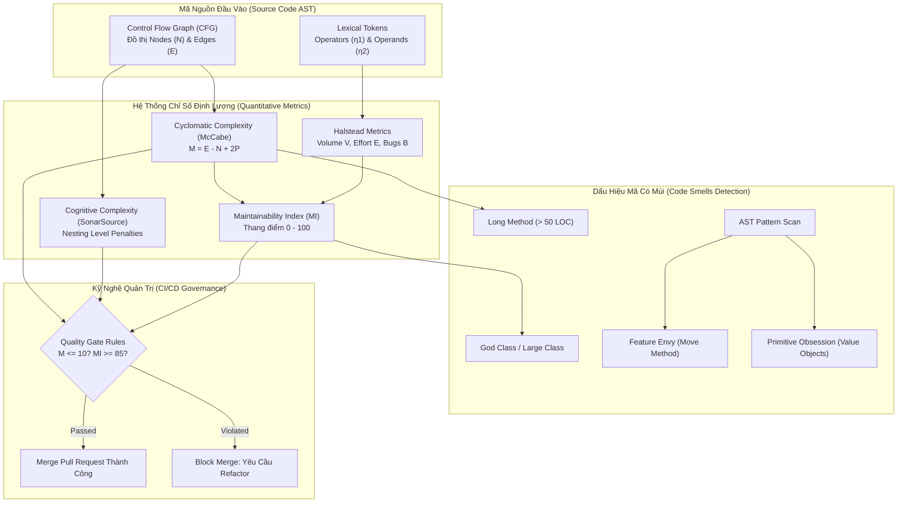
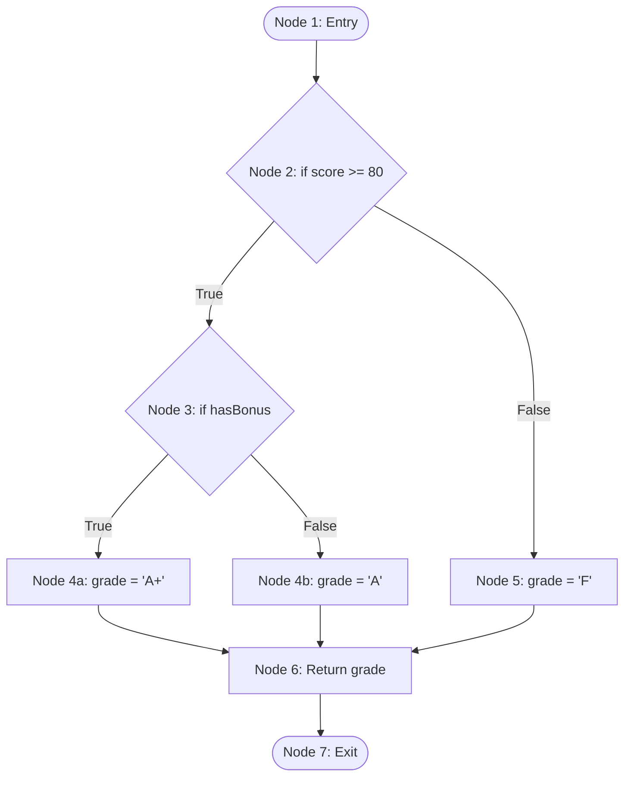

# 3.5. Độ Phức Tạp Phần Mềm và Quản Trị Mã Nguồn (Software Complexity & Code Smells)

> [!IMPORTANT]
> **Nếu bạn chỉ được nhớ một điều duy nhất:** Độ phức tạp của phần mềm không đo bằng số dòng mã (LOC), mà đo bằng gánh nặng nhận thức đặt lên bộ nhớ làm việc của con người ($7 \pm 2$ chunks) và số lượng đường dẫn thực thi độc lập xuyên suốt đồ thị luồng điều khiển; khi độ phức tạp vượt ngưỡng kiểm soát, xác suất sinh lỗi sẽ tăng theo hàm mũ.

---

## 1. Kiến trúc Tổng quan & Mô hình Tư duy (Mental Model)

### Ẩn dụ Đời sống: Nút Giao Thông Đa Tầng và Dung Lượng Bộ Nhớ Làm Việc
Hãy hình dung hệ thống mã nguồn như một mạng lưới giao thông đô thị:
- **Đoạn đường thẳng (Mã tuần tự - Linear Code)**: Phương tiện di chuyển với vận tốc đều, không có điểm giao cắt, tài xế không cần xử lý nhiều tín hiệu. Độ phức tạp chu trình bằng $1$.
- **Bùng binh và Ngã năm lồng nhau (Nested Branching - Cyclomatic & Cognitive Complexity)**: Càng nhiều lối rẽ (`if-else`, `switch`, `for`), người lái càng phải phanh gấp, quan sát 360 độ và tính toán rủi ro va chạm. Nếu có 4 ngã rẽ lồng nhau, não bộ tài xế bị quá tải (vượt quá giới hạn $7 \pm 2$ thông tin của George Miller), tai nạn (bugs) chắc chắn xảy ra.
- **Xe chở rác quá tải (God Class / Long Method)**: Một chiếc xe container chở mọi thứ từ xi măng, thực phẩm đến rác thải, đi qua mọi ngõ ngách, gây tắc nghẽn toàn bộ luồng lưu thông của cả thành phố.
- **Thước đo Radar & Trạm cân tự động (Quality Gates & Complexity Budget)**: Các cảm biến đo mật độ phương tiện trên đường cao tốc. Nếu vượt quá ngưỡng an toàn cho phép, barie tự động hạ xuống chặn xe (Block Pull Request) để tránh sụp đổ mạng lưới.



---

## 2. Chi tiết từng Keyword (Under-the-Hood Deep Dive)

### 2.1. Cyclomatic Complexity (McCabe) và Đồ thị Luồng Điều khiển (CFG)
Được đề xuất bởi Thomas J. McCabe năm 1976, **Cyclomatic Complexity (Độ phức tạp chu trình - $M$)** là chỉ số toán học định lượng số lượng đường dẫn thực thi độc lập tuyến tính xuyên suốt một module chương trình.

Về mặt lý thuyết đồ thị, mã nguồn được biểu diễn dưới dạng một **Control Flow Graph (CFG)** gồm tập các đỉnh $N$ (các khối lệnh tuần tự cơ bản) và tập các cạnh $E$ (luồng chuyển hướng thực thi):

$$M = E - N + 2P$$

Trong đó:
- $E$: Số lượng cạnh kết nối trong đồ thị.
- $N$: Số lượng nút (nút lệnh và nút rẽ nhánh).
- $P$: Số lượng thành phần liên thông (Connected Components, đối với một hàm đơn lẻ, $P = 1$).

*Quy tắc tính nhanh*: Một hàm bắt đầu với $M = 1$. Mỗi khi xuất hiện một điểm rẽ nhánh hoặc toán tử điều kiện (`if`, `while`, `for`, `case`, `catch`, `&&`, `||`, `?:`), giá trị $M$ được cộng thêm $1$.


*Phân tích đồ thị trên: $N = 7$, $E = 9$, $P = 1 \implies M = 9 - 7 + 2(1) = 4$. Cần ít nhất 4 ca kiểm thử Unit Test độc lập để bao phủ $100\%$ các đường rẽ nhánh (Branch Coverage).*

**Ngưỡng Chuẩn Kỹ Thuật**:
- $1 \le M \le 10$: Cấu trúc tinh giản, rủi ro thấp, khả năng bảo trì cao.
- $11 \le M \le 20$: Độ phức tạp trung bình, cần chú ý khi viết test.
- $21 \le M \le 50$: Rất phức tạp, rủi ro cao, bắt buộc phải refactor.
- $M > 50$: Mã nguồn không thể kiểm thử hoàn chỉnh (Untestable), là quả bom nổ chậm trong hệ thống.

---

### 2.2. Cognitive Complexity (SonarSource) và Trọng số Nhận thức
Mặc dù Cyclomatic Complexity rất hữu ích cho việc tính toán số lượng Unit Tests, nó có một nhược điểm nghiêm trọng: **Không phản ánh độ khó của não bộ khi đọc hiểu code**.

Ví dụ: Một cấu trúc `switch-case` với 10 nhánh đơn giản có Cyclomatic Complexity bằng $10$, nhưng rất dễ đọc. Ngược lại, 4 vòng lặp `for` lồng nhau sâu 4 tầng có cùng điểm Cyclomatic bằng $10$, nhưng làm cạn kiệt trí nhớ làm việc của lập trình viên.

Để giải quyết vấn đề này, SonarSource phát triển **Cognitive Complexity (Độ phức tạp nhận thức)** dựa trên 3 nguyên tắc:
1. **Bỏ qua các cú pháp rút gọn**: Các cấu trúc ngữ nghĩa đơn giản, quen thuộc không bị phạt điểm nặng.
2. **Phạt điểm lũy tiến theo độ sâu lồng nhau (Nesting Penalties)**: Một mệnh đề `if` ở tầng thứ nhất chỉ nhận $+1$ điểm. Nhưng nếu mệnh đề `if` đó nằm bên trong một vòng `for` và một khối `try-catch`, nó sẽ nhận $1 + 2 = 3$ điểm!
3. **Phạt các cấu trúc làm gián đoạn luồng suy nghĩ**: Đệ quy, nhảy nhãn (`goto`, `break label`), toán tử logic kết hợp phức tạp (`a && b || c && d`).

---

### 2.3. Halstead Complexity Metrics & Maintainability Index (MI)

#### 1. Các Đại lượng Halstead
Maurice Halstead (1977) phân tích mã nguồn dưới góc độ độ dài từ vựng dựa trên hai tập hợp nguyên tử:
- $\eta_1$: Số lượng toán tử phân biệt (Unique Operators: `+`, `-`, `*`, `if`, `return`...).
- $\eta_2$: Số lượng toán hạng phân biệt (Unique Operands: tên biến, hằng số...).
- $N_1$: Tổng số lần xuất hiện của các toán tử.
- $N_2$: Tổng số lần xuất hiện của các toán hạng.

Từ các đại lượng trên, Halstead tính toán:
- **Từ vựng chương trình (Program Vocabulary)**: $\eta = \eta_1 + \eta_2$.
- **Chiều dài chương trình (Program Length)**: $N = N_1 + N_2$.
- **Dung lượng chương trình (Program Volume)**: $V = N \times \log_2(\eta)$ (Đơn vị: bits).
- **Độ khó của chương trình (Difficulty)**: $D = \frac{\eta_1}{2} \times \frac{N_2}{\eta_2}$.
- **Nỗ lực lập trình (Effort)**: $E = D \times V$.
- **Số lỗi ước tính trong mã (Estimated Bugs)**: $B = \frac{V}{3000}$.

#### 2. Maintainability Index (Chỉ Số Khả Năng Bảo Trì - MI)
Được phát triển bởi Viện Công nghệ Phần mềm Đại học Idaho và chuẩn hóa bởi Microsoft Visual Studio, MI là chỉ số tổng hợp đánh giá độ "lành mạnh" của mã nguồn trên thang điểm $0 - 100$:

$$\text{MI} = \max\left(0, \frac{171 - 5.2 \ln(V) - 0.23 M - 16.2 \ln(\text{LOC})}{171}\right) \times 100$$

- $\text{MI} \ge 85$: **Xanh lá (High Maintainability)** - Mã sạch, module hóa tốt.
- $65 \le \text{MI} < 85$: **Vàng (Moderate Maintainability)** - Bắt đầu xuất hiện nợ kỹ thuật, cần theo dõi.
- $\text{MI} < 65$: **Đỏ (Low Maintainability)** - Mã di sản (Legacy code), rủi ro cao khi thay đổi.

---

### 2.4. Classic Code Smells: Long Method, Large Class & Feature Envy
Theo định nghĩa của Martin Fowler và Kent Beck trong cuốn sách kinh điển *Refactoring*, **Code Smells (Mùi của mã)** là những triệu chứng bề mặt cho thấy những khiếm khuyết sâu xa trong kiến trúc phần mềm:

1. **Long Method (Phương thức Quá Dài)**:
   - Một hàm kéo dài trên 50 dòng thực hiện cùng lúc nhiều cấp độ trừu tượng khác nhau (vừa phân tích JSON, vừa ghi cơ sở dữ liệu, vừa gửi email).
   - *Liều thuốc*: Áp dụng kỹ thuật `Extract Method` để đưa các khối lệnh con về đúng tên gọi ngữ nghĩa, giữ mỗi hàm chỉ làm một việc duy nhất (SRP).

2. **Large Class / God Class (Lớp Thần Thánh)**:
   - Một class nắm giữ hàng chục biến thành viên và hàng nghìn dòng lệnh, đóng vai trò điều khiển mọi thực thể khác trong hệ thống.
   - *Liều thuốc*: Áp dụng `Extract Class`, phân rã thành các Aggregate Roots và Domain Services nhỏ hơn.

3. **Feature Envy (Ghen Tị Tính Năng)**:
   - Xảy ra khi một phương thức của Class $A$ liên tục truy vấn và thao tác trên các trường dữ liệu của Class $B$ nhiều hơn chính dữ liệu của Class $A$.
   - *Liều thuốc*: Áp dụng `Move Method`, chuyển logic tính toán sang chính Class $B$ để tuân thủ nguyên lý *Information Expert* (Dữ liệu ở đâu, hành vi ở đó).

---

### 2.5. Primitive Obsession và Giải pháp Domain Value Objects
**Primitive Obsession (Ám ảnh kiểu nguyên thủy)** là thói quen xấu phổ biến của các lập trình viên mới vào nghề: Sử dụng tràn lan các kiểu dữ liệu cơ bản (`std::string`, `int`, `float`, `dict`) để mô tả các khái niệm nghiệp vụ phức tạp:
- Dùng `std::string` để lưu cả Email, Địa chỉ IP, Mã tiền tệ, UUID, Số điện thoại.
- Dùng `double` để tính toán tiền tệ (gây sai số dấu phẩy động IEEE-754: $0.1 + 0.2 \ne 0.3$).
- Truyền liên tiếp 5 tham số kiểu `std::string` vào hàm: `createUser(name, email, address, phone, zip)`. Khi bên gọi truyền nhầm thứ tự `name` và `email`, Compiler hoàn toàn bất lực không thể cảnh báo!

**Giải pháp Chuẩn mực**: Xây dựng **Strongly-Typed Domain Value Objects**:
- Đóng gói dữ liệu nguyên thủy vào một cấu trúc có kiểu định danh rõ ràng.
- Tự động kiểm tra tính hợp lệ (Self-Validation) ngay trong Constructor.
- Bất biến (Immutable): Một khi đã tạo ra thì không thể thay đổi giá trị.
- Bình đẳng theo giá trị (Value Equality), không bình đẳng theo con trỏ ID.

---

### 2.6. Complexity Budget & Governance trong Modern CI/CD
Để giữ cho hệ thống không bị mục ruỗng qua năm tháng, các đội ngũ kỹ thuật hàng đầu áp dụng **Complexity Budget (Ngân sách Độ phức tạp)** vào chu trình tích hợp liên tục (CI/CD):

1. **Static Quality Gates**:
   - Mọi Pull Request (PR) phải chạy qua các công cụ phân tích tĩnh (SonarQube, Clang-Tidy, ESLint, Lizard).
   - **Quy tắc Chặn (Block Merging)**:
     - Không cho phép bất kỳ hàm mới nào có $M > 10$ hoặc Cognitive Complexity $> 15$.
     - Maintainability Index tổng thể của repository không được giảm quá $0.5\%$ sau mỗi đợt phát hành.
     - Tỷ lệ mã trùng lặp (Duplication Density) phải $< 3\%$.
2. **Boy Scout Rule trong Quản Trị**:
   - "Hãy luôn để khu cắm trại sạch hơn lúc bạn đến". Khi một kỹ sư sửa một dòng bug trong một hàm có $M = 30$, họ được yêu cầu phải chiết xuất và hạ độ phức tạp của hàm đó xuống ít nhất $20\%$.

---

## 3. Thực thi Mã nguồn & Mô phỏng Chuyên sâu (Dual-Engine Implementation)

### 3.1. C++20 Implementation: Khắc Phục Primitive Obsession Bằng Strongly-Typed Value Objects
Đoạn mã C++20 dưới đây minh họa việc chuyển đổi từ mã nguồn "mắc mùi" Primitive Obsession sang kiến trúc Type-Safe chuẩn Domain-Driven Design sử dụng Value Objects bất biến.

```cpp
#include <iostream>
#include <string>
#include <regex>
#include <stdexcept>
#include <compare>
#include <utility>

// ============================================================================
// 1. CÁCH LÀM KÉM (PRIMITIVE OBSESSION ANTIPATTERN)
// ============================================================================
// Hàm nhận các tham số thô: Rất dễ bị hoán đổi nhầm thứ tự giữa sender & receiver!
void unsafeTransfer(std::string senderEmail, std::string receiverEmail, double amount) {
    // Trình biên dịch không thể bắt lỗi nếu lập trình viên gọi:
    // unsafeTransfer("bob@example.com", "alice@example.com", -50.0);
    std::cout << "[Unsafe] Transferring $" << amount << " from " << senderEmail << " to " << receiverEmail << "\n";
}

// ============================================================================
// 2. GIẢI PHÁP ENTERPRISE: DOMAIN VALUE OBJECTS CHUẨN C++20
// ============================================================================

// Value Object: EmailAddress (Bất biến, Tự kiểm tra, Type-Safe)
class EmailAddress {
private:
    std::string value_;

    static bool validate(const std::string& email) {
        // Biểu thức chính quy kiểm tra định dạng email tiêu chuẩn
        static const std::regex kEmailRegex(
            R"(^[a-zA-Z0-9_.+-]+@[a-zA-Z0-9-]+\.[a-zA-Z0-9-.]+$)"
        );
        return std::regex_match(email, kEmailRegex);
    }

public:
    explicit EmailAddress(std::string email) : value_(std::move(email)) {
        if (!validate(value_)) {
            throw std::invalid_argument("Invalid Email Format: '" + value_ + "'");
        }
    }

    [[nodiscard]] const std::string& str() const noexcept { return value_; }

    // C++20 Spaceship Operator cho phép so sánh giá trị tự động
    auto operator<=>(const EmailAddress&) const = default;
};

// Value Object: Money (Ngăn chặn sai số Floating-point bằng cách dùng Cents)
class Money {
private:
    int64_t cents_{0};

public:
    explicit constexpr Money(int64_t cents) : cents_(cents) {
        if (cents < 0) {
            throw std::invalid_argument("Money cannot be negative!");
        }
    }

    [[nodiscard]] static constexpr Money fromDollars(int64_t dollars, int64_t cents) {
        return Money(dollars * 100 + cents);
    }

    [[nodiscard]] int64_t cents() const noexcept { return cents_; }
    [[nodiscard]] double toDollars() const noexcept { return static_cast<double>(cents_) / 100.0; }

    constexpr Money operator+(const Money& other) const {
        return Money(cents_ + other.cents_);
    }

    auto operator<=>(const Money&) const = default;
};

// Hàm có tính toàn vẹn tuyệt đối: Compiler phát hiện lỗi lập tức nếu sai kiểu!
void safeTransfer(const EmailAddress& from, const EmailAddress& to, Money amount) {
    std::cout << "[Type-Safe Core Domain] Transferring $" << amount.toDollars() 
              << " (" << amount.cents() << " cents) from " 
              << from.str() << " to " << to.str() << " -> SUCCESS\n";
}

int main() {
    std::cout << "=== C++20 Value Objects & Type-Safety Demo ===\n";

    // Thử nghiệm cách làm nguy hiểm (Primitive Obsession)
    unsafeTransfer("alice@corp.com", "bob@corp.com", 150.0);

    // Thử nghiệm cách làm Type-Safe
    try {
        EmailAddress sender("alice@corp.com");
        EmailAddress recipient("bob@corp.com");
        Money transferAmount = Money::fromDollars(250, 75); // $250.75

        safeTransfer(sender, recipient, transferAmount);

        // Kiểm tra Equality theo giá trị
        EmailAddress senderClone("alice@corp.com");
        if (sender == senderClone) {
            std::cout << "[Value Object Equality] Sender and Clone are strictly equal by value!\n";
        }

        // Test Case cố tình truyền sai định dạng email
        std::cout << "\n[Validation Test] Attempting to construct invalid email...\n";
        EmailAddress malformed("not-an-email-string");

    } catch (const std::exception& ex) {
        std::cout << "  -> Compiler & Runtime Shield: Caught exception: " << ex.what() << "\n";
    }

    return 0;
}
```

#### Terminal Output Mẫu (C++20):
```text
=== C++20 Value Objects & Type-Safety Demo ===
[Unsafe] Transferring $150 from alice@corp.com to bob@corp.com
[Type-Safe Core Domain] Transferring $250.75 (25075 cents) from alice@corp.com to bob@corp.com -> SUCCESS
[Value Object Equality] Sender and Clone are strictly equal by value!

[Validation Test] Attempting to construct invalid email...
  -> Compiler & Runtime Shield: Caught exception: Invalid Email Format: 'not-an-email-string'
```

---

### 3.2. Python 3.11+ Implementation: AST-Based Cyclomatic & Cognitive Complexity Analyzer
Script Python 3.11+ dưới đây phân tích cú pháp trừu tượng (Abstract Syntax Tree - AST) của mã nguồn Python để tự động tính toán Cyclomatic Complexity ($M = E - N + 2P$) và phạt điểm Cognitive Complexity theo độ sâu lồng nhau.

```python
from __future__ import annotations
import ast
import inspect
from typing import Any

class ComplexityAnalyzer(ast.NodeVisitor):
    def __init__(self):
        self.cyclomatic_complexity: int = 1
        self.cognitive_complexity: int = 0
        self.current_nesting: int = 0

    def _increase_cognitive(self, base_cost: int = 1):
        """Phạt điểm nhận thức: Phí gốc + Phí theo độ sâu lồng nhau."""
        self.cognitive_complexity += (base_cost + self.current_nesting)

    # 1. Đo lường rẽ nhánh If
    def visit_If(self, node: ast.If):
        self.cyclomatic_complexity += 1
        self._increase_cognitive(1)
        
        # Tăng nesting khi bước vào thân if
        self.current_nesting += 1
        self.generic_visit(node)
        self.current_nesting -= 1

    # 2. Đo lường vòng lặp For
    def visit_For(self, node: ast.For):
        self.cyclomatic_complexity += 1
        self._increase_cognitive(1)
        
        self.current_nesting += 1
        self.generic_visit(node)
        self.current_nesting -= 1

    # 3. Đo lường vòng lặp While
    def visit_While(self, node: ast.While):
        self.cyclomatic_complexity += 1
        self._increase_cognitive(1)
        
        self.current_nesting += 1
        self.generic_visit(node)
        self.current_nesting -= 1

    # 4. Đo lường khối Except (Try-Catch)
    def visit_ExceptHandler(self, node: ast.ExceptHandler):
        self.cyclomatic_complexity += 1
        self._increase_cognitive(1)
        
        self.current_nesting += 1
        self.generic_visit(node)
        self.current_nesting -= 1

    # 5. Đo lường các toán tử logic Booleans (and, or)
    def visit_BoolOp(self, node: ast.BoolOp):
        # Mỗi toán tử and/or làm tăng 1 đường rẽ nhánh
        self.cyclomatic_complexity += len(node.values) - 1
        self.cognitive_complexity += len(node.values) - 1
        self.generic_visit(node)


def audit_function(func: Any) -> tuple[int, int]:
    source = inspect.getsource(func)
    tree = ast.parse(source)
    analyzer = ComplexityAnalyzer()
    analyzer.visit(tree)
    return analyzer.cyclomatic_complexity, analyzer.cognitive_complexity


# ============================================================================
# CÁC HÀM THỬ NGHIỆM ĐÁNH GIÁ ĐỘ PHỨC TẠP
# ============================================================================

def simple_function(x: int) -> int:
    """Mã tuần tự đơn giản: M = 1, Cognitive = 0"""
    result = x * 2
    return result + 10


def complex_nested_spaghetti(data: list[list[int]], threshold: int, flag: bool) -> int:
    """Hàm phức tạp với nhiều tầng lồng nhau: Sinh ra Cognitive Complexity rất cao"""
    total = 0
    if flag:                                # CC +1, Cog +1
        for row in data:                    # CC +1, Cog +(1 + 1) = +2
            for val in row:                 # CC +1, Cog +(1 + 2) = +3
                if val > threshold and val % 2 == 0:  # CC +2, Cog +(1 + 3) + 1 = +5
                    total += val
                else:
                    total -= 1
    return total


if __name__ == "__main__":
    print("=== Python 3.11+ AST Software Complexity Scanner ===")
    
    # Đánh giá hàm 1
    m1, c1 = audit_function(simple_function)
    print(f"\n[simple_function]")
    print(f"  -> Cyclomatic Complexity (McCabe) : {m1}")
    print(f"  -> Cognitive Complexity (Sonar)   : {c1}")
    print(f"  -> Evaluation                     : Clean & Maintainable")

    # Đánh giá hàm 2
    m2, c2 = audit_function(complex_nested_spaghetti)
    print(f"\n[complex_nested_spaghetti]")
    print(f"  -> Cyclomatic Complexity (McCabe) : {m2}")
    print(f"  -> Cognitive Complexity (Sonar)   : {c2}")
    print(f"  -> Evaluation                     : CRITICAL WARNING! Exceeds mental budget (Nesting depth)")

    # Quality Gate Assertion
    COMPLEXITY_BUDGET = 5
    print(f"\n[CI/CD Quality Gate Check (Max Allowed = {COMPLEXITY_BUDGET})]")
    if m2 > COMPLEXITY_BUDGET or c2 > COMPLEXITY_BUDGET:
        print("  ❌ QUALITY GATE FAILED: Pull Request rejected! Please refactor nested loops.")
    else:
        print("  ✅ QUALITY GATE PASSED.")
```

#### Terminal Output Mẫu (Python 3.11+):
```text
=== Python 3.11+ AST Software Complexity Scanner ===

[simple_function]
  -> Cyclomatic Complexity (McCabe) : 1
  -> Cognitive Complexity (Sonar)   : 0
  -> Evaluation                     : Clean & Maintainable

[complex_nested_spaghetti]
  -> Cyclomatic Complexity (McCabe) : 6
  -> Cognitive Complexity (Sonar)   : 12
  -> Evaluation                     : CRITICAL WARNING! Exceeds mental budget (Nesting depth)

[CI/CD Quality Gate Check (Max Allowed = 5)]
  ❌ QUALITY GATE FAILED: Pull Request rejected! Please refactor nested loops.
```

---

## 4. Systems Engineering & Production Pitfalls

### Các Cạm Bẫy Thực Chiến (Gotchas & Production Antipatterns)

1. **Sự Bất Lực Của Cyclomatic Complexity Đối Với Bất Đồng Bộ (Async/Await & Concurrency)**:
   - *Bản chất*: Cyclomatic Complexity tính toán dựa trên mã đồng bộ tuần tự (Sequential CFG). Khi xuất hiện các luồng bất đồng bộ (`async`/`await`, Goroutines, Thread Pools), một hàm có thể có $M = 2$ nhưng độ phức tạp về mặt Race Conditions, Deadlocks và Non-deterministic State lại là vô cực!
   - *Khắc phục*: Không chỉ dựa vào McCabe; kết hợp mô hình hóa hình thức (Formal Verification như TLA+ hoặc Petri Nets) và công cụ ThreadSanitizer cho các module đa luồng.

2. **Hội Chứng Refactoring Hình Thức (Cheat Complexity Metrics)**:
   - *Bản chất*: Để qua mặt Quality Gate trên CI ($M \le 10$), kỹ sư dùng mẹo chia nhỏ một hàm phức tạp thành 10 hàm con 3 dòng (`helper1`, `helper2`...) nhưng vẫn chia sẻ trạng thái toàn cục hoặc truyền tham số dày đặc. Việc này làm giảm Cyclomatic Complexity của từng hàm nhưng làm tăng tổng độ phức tạp toàn cục (Shotgun Surgery Smell) và làm mã khó đọc hơn trước!
   - *Khắc phục*: Refactor phải đi kèm việc cô lập trách nhiệm nghiệp vụ (Domain Boundaries) chứ không đơn thuần là cắt vụn dòng code.

3. **Cơ Chế Bỏ Qua Cổng Chất Lượng Khi Hotfix Khẩn Cấp**:
   - *Bản chất*: Khi hệ thống Production bị sập, ban lãnh đạo thường cho phép gắn cờ `[skip ci]` hoặc `// NOSONAR` để đẩy bản vá lỗi nhanh nhất có thể. Tuy nhiên, hơn $70\%$ các khoản nợ kỹ thuật độc hại nhất lại bắt nguồn từ các bản hotfix này và không bao giờ được trả lại.
   - *Khắc phục*: Thiết lập quy trình "Technical Debt Ticket": Mọi lệnh bypass Quality Gate trong trường hợp khẩn cấp phải tự động kích hoạt tạo một Jira Ticket mức P1 để đội ngũ tái cấu trúc lại trong sprint kế tiếp.

4. **Kỹ Thuật Chẩn Đoán Độ Phức Tạp Bằng CLI**:
   ```bash
   # 1. Quét Cyclomatic Complexity toàn bộ dự án C++ / Python bằng Lizard CLI
   lizard src/ -C 10 -a 5 -w

   # 2. Quét Maintainability Index (MI) cho Python bằng Radon
   radon mi src/ -s

   # 3. Quét phát hiện Code Smells và Primitive Obsession bằng SonarScanner CLI
   sonar-scanner \
     -Dsonar.projectKey=core-enterprise-engine \
     -Dsonar.sources=src \
     -Dsonar.qualitygate.wait=true

   # 4. Kiểm tra cảnh báo hàm quá dài trong C++ bằng Clang-Tidy
   clang-tidy src/main.cpp -checks="readability-function-size,readability-cognitive-complexity" -- -std=c++20
   ```

---

## 5. Bảng So sánh & Decision Matrix

### 5.1. So Sánh Các Thước Đo Độ Phức Tạp Mã Nguồn

| Thước Đo | Cơ Chế Đo Lường | Điểm Mạnh | Hạn Chế Cốt Lõi | Ngưỡng Khuyến Nghị |
| :--- | :--- | :--- | :--- | :--- |
| **Cyclomatic Complexity (McCabe)** | Đồ thị luồng điều khiển ($M = E - N + 2P$) | Xác định chính xác số lượng ca kiểm thử Unit Test cần thiết | Coi các rẽ nhánh phẳng (`switch-case`) nặng bằng lồng sâu (`nested if`) | $\le 10$ per function |
| **Cognitive Complexity (SonarSource)** | Phạt điểm gia tăng theo độ sâu lồng nhau (Nesting) | Phản ánh chân thực nỗ lực nhận thức của não bộ lập trình viên | Không trực tiếp ánh xạ ra số lượng ca kiểm thử cần viết | $\le 15$ per function |
| **Halstead Program Volume** | Số lượng Toán tử ($\eta_1$) và Toán hạng ($\eta_2$) | Đánh giá dung lượng thông tin và thời gian code dự kiến | Bị phụ thuộc vào phong cách đặt tên biến và độ dài biểu thức | $V \le 1000$ bits |
| **Maintainability Index (MI)** | Kết hợp Logarit của Volume, McCabe và LOC | Cung cấp chỉ số tổng quan từ $0 - 100$ cho cấp độ quản lý | Công thức thực nghiệm, đôi khi đánh giá quá cao số dòng mã | $\ge 85$ (Green Zone) |

### 5.2. Ma Trận Phát Hiện & Xử Lý Code Smells Kinh Điển

| Code Smell | Dấu Hiệu Nhận Biết | Hậu Quả Hệ Thống | Kỹ Thuật Refactoring Chuẩn Mực |
| :--- | :--- | :--- | :--- |
| **Long Method** | Hàm $> 50$ dòng, cuộn chuột mỏi tay | Khó kiểm thử, độ phức tạp nhận thức cao | `Extract Method`, `Replace Temp with Query` |
| **Large Class (God Class)** | Class $> 500$ dòng, quá nhiều trách nhiệm | Vi phạm SRP, xung đột Git khi merge liên tục | `Extract Class`, `Extract Subclass`, DDD Aggregates |
| **Feature Envy** | Class $A$ gọi nhiều getter của Class $B$ | Ghép nối chặt (Tight Coupling), phân tán logic | `Move Method`, `Extract & Move Method` |
| **Primitive Obsession** | Dùng `string`/`int` cho Email, Tiền, Phone | Dễ truyền nhầm thứ tự, thiếu xác thực giá trị | `Replace Primitive with Value Object` |
| **Shotgun Surgery** | Mỗi lần đổi 1 logic phải sửa ở 10 files khác nhau | Dễ bỏ sót file dẫn đến bug ngầm trên production | `Move Field/Method`, `Inline Class` gom logic lại |
