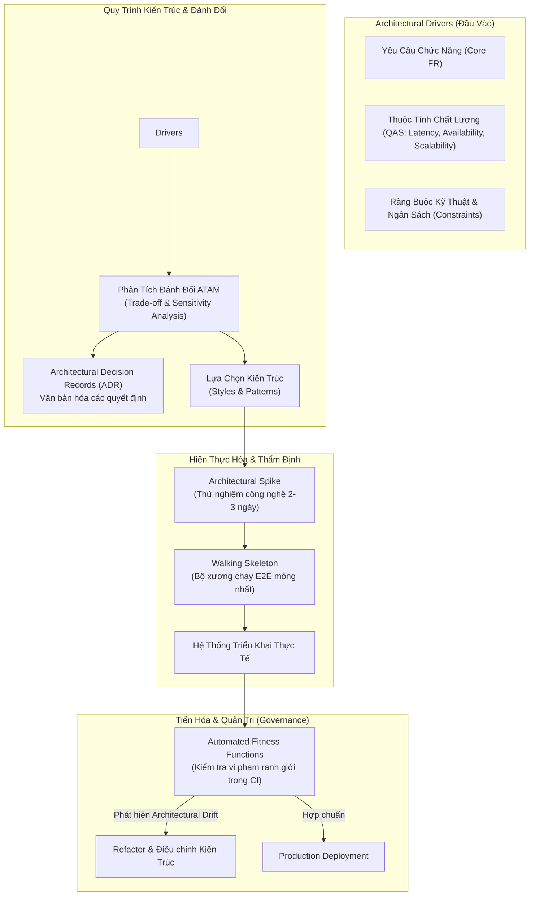
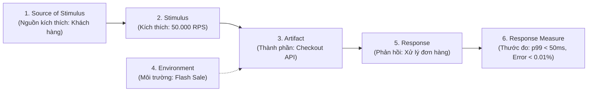
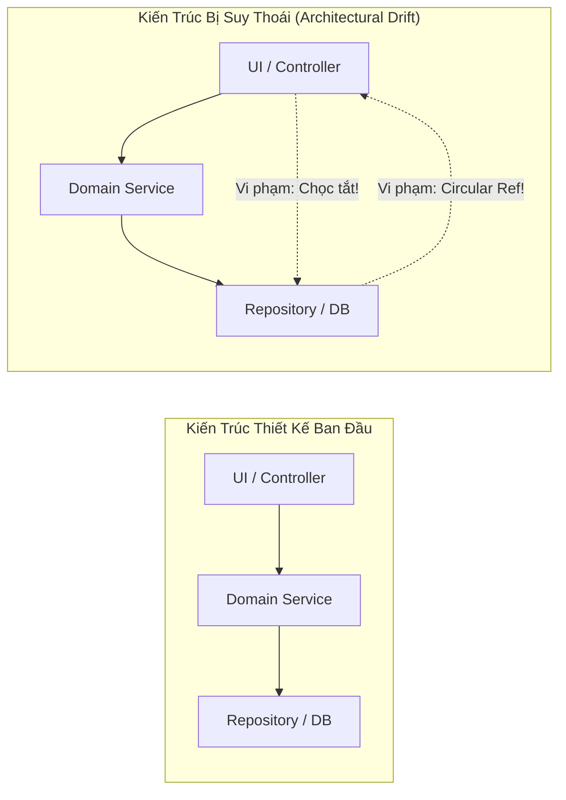

# 4.1. Nền Tảng Kiến Trúc Phần Mềm (Software Architecture Fundamentals)

> [!IMPORTANT]
> **Nếu bạn chỉ được nhớ một điều duy nhất:** Kiến trúc phần mềm không phải là việc lựa chọn framework thời thượng, mà là tập hợp các quyết định cấu trúc quan trọng nhất, khó đảo ngược nhất và tốn kém nhất nếu làm sai; một kiến trúc thành công là kiến trúc cân bằng tối ưu giữa các thuộc tính chất lượng (Trade-offs) và có khả năng tiến hóa liên tục thông qua các hàm thích ứng tự động (Automated Fitness Functions).

---

## 1. Kiến trúc Tổng quan & Mô hình Tư duy (Mental Model)

### Ẩn dụ Đời sống: Kết Cấu Chịu Lực Tòa Nhà vs Trang Trí Nội Thất
Hãy so sánh việc xây dựng một hệ thống phần mềm với một tòa tháp chọc trời $81$ tầng:
- **Chi tiết Triển khai (Code Implementation / Interior Decor)**: Màu sơn tường, rèm cửa, bố trí bàn ghế. Bạn có thể thay đổi màu sơn hoặc đổi vị trí sofa trong một buổi chiều với chi phí rất nhỏ. Đây là các dòng code cụ thể, thuật toán hay thư viện tiện ích.
- **Kiến trúc Phần mềm (Software Architecture / Structural Engineering)**: Vị trí móng cọc khoan nhồi sâu 80m vào tầng địa chất, lõi bê tông cốt thép chịu động đất cấp 8, và hệ thống ống dẫn kỹ thuật chạy ngầm xuyên suốt tòa nhà. Nếu đã xây xong tầng 50 mà bạn nhận ra móng cọc chịu lực kém hoặc muốn chuyển toàn bộ lõi thang máy sang góc khác, chi phí đập đi xây lại tương đương với phá sản.
- **Architectural Drivers (Yếu tố Thúc đẩy)**: Địa chấn khu vực, sức gió bão 150 km/h, tải trọng 10.000 cư dân, và ngân sách dự án.
- **Fitness Functions (Cảm biến Kết cấu)**: Các cảm biến đo độ nghiêng và độ rung lắc gắn trên đỉnh tháp. Nếu tòa nhà dao động vượt quá biên độ an toàn, còi báo động lập tức kích hoạt (CI/CD Pipeline báo đỏ).



---

## 2. Chi tiết từng Keyword (Under-the-Hood Deep Dive)

### 2.1. Software Architecture, Architecture Styles, Patterns và Architectural Drivers

#### 1. Software Architecture (Kiến trúc Phần mềm)
Theo định nghĩa chuẩn mực IEEE 1471 / ISO 42010 và các chuyên gia Ralph Johnson, Martin Fowler:
- Kiến trúc phần mềm là cấu trúc cơ bản của một hệ thống, bao gồm các **thành phần phần mềm (Components)**, các **mối quan hệ tương tác (Connectors)**, và các nguyên lý chỉ đạo việc thiết kế và tiến hóa của chúng.
- Kiến trúc tập trung vào *"những quyết định tốn kém nhất nếu phải làm lại"*.

#### 2. Architecture Styles vs Architecture Patterns
- **Architecture Style (Phong cách kiến trúc)**: Một họ các cấu trúc hệ thống ở mức vĩ mô định hình cách tổ chức toàn cục (ví dụ: Monolithic, Microservices, Event-Driven, Layered, Pipe and Filter, Space-Based). Style trả lời câu hỏi: *Hình thái tổng thể của hệ thống trông như thế nào?*
- **Architecture Pattern (Mẫu kiến trúc)**: Một giải pháp cấu trúc đã được chuẩn hóa để giải quyết một bài toán lặp đi lặp lại trong một bối cảnh cụ thể ở quy mô nhỏ hơn Style (ví dụ: CQRS, Saga Pattern, Circuit Breaker, Outbox Pattern, BFF - Backend for Frontend).

#### 3. Architectural Drivers (Yếu Tố Thúc Đẩy Kiến Trúc)
Không có kiến trúc nào sinh ra trong chân không. Mọi quyết định kiến trúc đều chịu sự thúc đẩy của 4 trụ cột:
1. **Functional Requirements (FR)**: Nghiệp vụ cốt lõi mà hệ thống phải thực hiện.
2. **Quality Attributes (Non-Functional Requirements - NFR)**: Tốc độ, độ tin cậy, khả năng chịu lỗi, tính co giãn, bảo mật.
3. **Business Constraints (Ràng buộc Kinh doanh)**: Thời gian ra mắt (Time-to-Market), ngân sách hạ tầng máy chủ (\$5,000/tháng), trình độ hiện tại của đội ngũ kỹ sư.
4. **Technical Constraints (Ràng buộc Kỹ thuật)**: Bắt buộc phải tích hợp hệ thống Core Banking qua chuẩn ISO 8583, hệ sinh thái đám mây chỉ định (AWS/GCP), cơ chế xác thực OAuth2.

---

### 2.2. Quality Attribute Scenario (QAS) và Đo lường Phi Chức năng
Các yêu cầu phi chức năng mơ hồ như *"Hệ thống phải nhanh"*, *"Hệ thống phải có tính sẵn sàng cao"* là nguồn gốc của mọi thảm họa phần mềm. Để biến chúng thành tiêu chí kỹ thuật có thể kiểm chứng toán học, Viện Kỹ nghệ Phần mềm SEI (Carnegie Mellon University) đề xuất cấu trúc **Quality Attribute Scenario (QAS)** gồm 6 thành phần bắt buộc:



| Thành phần QAS | Ý Nghĩa Kỹ Thuật | Ví Dụ Cụ Thể |
| :--- | :--- | :--- |
| **1. Source of Stimulus** | Thực thể kích hoạt sự kiện (Người dùng, Hacker, Cron, Sensor) | $100.000$ người dùng đồng thời trên Mobile App |
| **2. Stimulus** | Tác nhân hoặc điều kiện cần xử lý | Gửi yêu cầu thanh toán giỏ hàng trong giờ Flash Sale |
| **3. Artifact** | Bộ phận hoặc phân hệ phần mềm chịu tác động | Service Thanh toán (Payment Gateway & Ledger DB) |
| **4. Environment** | Trạng thái của hệ thống khi kích thích xảy ra | Hệ thống đang chịu tải đỉnh (Peak Load), một cụm DB bị lag |
| **5. Response** | Hành vi mà hệ thống phải thực hiện khi bị kích thích | Tiếp nhận yêu cầu, bảo lưu thứ tự hàng đợi, ghi nhận giao dịch |
| **6. Response Measure** | Thước đo định lượng để xác định Pass/Fail | Độ trễ $p99 \le 120\,\text{ms}$, tỷ lệ thất bại $5\text{xx} \le 0.001\%$ |

---

### 2.3. Phương pháp Đánh giá Đánh đổi Kiến trúc (ATAM)
**Architecture Trade-off Analysis Method (ATAM)** là quy trình khoa học được phát triển bởi SEI nhằm phân tích rủi ro và đánh giá các phương án kiến trúc trước khi đầu tư nhân lực lập trình.

Cốt lõi của ATAM là xác định:
- **Sensitivity Points (Điểm nhạy cảm)**: Một quyết định kiến trúc tác động mạnh mẽ đến một thuộc tính chất lượng duy nhất. (Ví dụ: Thêm thuật toán mã hóa AES-256 tăng mạnh tính Bảo mật).
- **Trade-off Points (Điểm đánh đổi)**: Một quyết định kiến trúc làm tăng thuộc tính chất lượng $A$ nhưng lại trực tiếp làm suy giảm thuộc tính chất lượng $B$. (Ví dụ: Mã hóa AES-256 tăng Bảo mật nhưng làm suy giảm Throughput và tăng CPU Latency).
- **Risks (Rủi ro)**: Các quyết định kiến trúc chưa rõ ràng hoặc có xác suất cao không thỏa mãn QAS.
- **Non-Risks (Phi rủi ro)**: Các quyết định thiết kế an toàn, có tiền lệ kiểm chứng tốt.

---

### 2.4. Evolutionary Architecture, Architectural Spikes & Walking Skeleton

#### 1. Evolutionary Architecture (Kiến trúc Tiến hóa)
Được Neal Ford, Rebecca Parsons và Patrick Kua định nghĩa: *"Kiến trúc tiến hóa là kiến trúc hỗ trợ sự thay đổi có định hướng và liên tục qua nhiều chiều (multiple dimensions) mà không làm suy thoái các thuộc tính chất lượng cốt lõi"*. Thay vì cố gắng dự đoán toàn bộ tương lai (Big Design Up Front - BDUF), kiến trúc sư tạo ra một hệ thống có khả năng thích nghi khi nghiệp vụ và công nghệ thay đổi.

#### 2. Architectural Spikes (Đợt Thử Nghiệm Kiến Trúc)
- Thuật ngữ bắt nguồn từ eXtreme Programming (XP).
- Là một thử nghiệm lập trình có giới hạn thời gian (Time-boxed, thường từ 1 đến 3 ngày) nhằm trả lời một câu hỏi kỹ thuật cụ thể hoặc loại bỏ rủi ro lớn nhất (ví dụ: *Kafka có thể xử lý $500.000$ messages/s trên cụm 3 node t3.medium không?*).
- Code của Spike thường bị vứt bỏ (Throwaway code) sau khi đã thu thập đủ dữ liệu đo lường.

#### 3. Walking Skeleton (Bộ Xương Chuyển Động)
- Do Alistair Cockburn khởi xướng.
- Là một hiện thực hóa nhỏ nhất từ đầu đến cuối (End-to-End) của toàn bộ kiến trúc hệ thống: Client $\to$ API Gateway $\to$ Business Service $\to$ Database $\to$ Monitoring $\to$ CI/CD Pipeline.
- Dù chức năng nghiệp vụ chỉ là một hàm rỗng (`return "Hello World"`), Walking Skeleton chứng minh rằng toàn bộ các đường ống kết nối kỹ thuật, cấu hình mạng và tự động hóa triển khai đã hoạt động trơn tru ngay từ Sprint 1.

---

### 2.5. Architectural Fitness Functions và Ngăn Chặn Architectural Drift

#### 1. Architectural Drift (Sự Suy Thoái Kiến Trúc)
Là hiện tượng kiến trúc thực tế được hiện thực hóa trong code dần dần bị xói mòn, biến dạng và rời xa bản thiết kế ban đầu. Nguyên nhân do áp lực tiến độ (Deadlines), sự thiếu hiểu biết của các lập trình viên mới, dẫn đến các vi phạm nghiêm trọng: Controller gọi thẳng vào Database, Service tầng dưới gọi ngược lên tầng trên, sinh ra Circular Dependencies.



#### 2. Architectural Fitness Functions (Hàm Thích Ứng Kiến Trúc)
Là bất kỳ cơ chế kiểm tra tự động nào (Unit Test, ArchUnit, AST Linter, Benchmark) dùng để đo lường tính toàn vẹn của kiến trúc trong chu trình CI/CD:
- **Kiểm tra Ranh giới Tầng (Layer Integrity)**: Domain model không bao giờ được phép import bất kỳ package nào từ Infrastructure hoặc Framework.
- **Kiểm tra Phụ thuộc Vòng (Circular Dependency)**: Cấm tiệt Package $A \to B \to A$.
- **Kiểm tra Thuộc tính Hiệu năng**: Thời gian response $p95$ không được vượt quá $200\,\text{ms}$ trong đợt chạy performance regression test.

---

### 2.6. Architecture Governance và Architectural Decision Records (ADR)
Để ngăn ngừa kiến trúc trở thành "truyền thuyết miệng", mọi quyết định quan trọng phải được văn bản hóa dưới dạng **ADR (Architectural Decision Record)**:

```markdown
# ADR-007: Sử Dụng PostgreSQL Cho Bảng Kế Toán Thay Vì MongoDB

## Bối cảnh (Context)
Hệ thống cần lưu trữ giao dịch tiền tệ với yêu cầu bảo toàn tuyệt đối tính nhất quán (ACID), ngăn chặn chi tiêu kép (Double Spending). Đội ngũ đang cân nhắc giữa PostgreSQL và MongoDB.

## Quyết định (Decision)
Chúng tôi quyết định chọn **PostgreSQL** làm cơ sở dữ liệu chính cho Ledger Service, sử dụng mức cô lập giao dịch Serializable Isolation.

## Trạng thái (Status)
Đã duyệt (Accepted).

## Hệ quả & Đánh đổi (Consequences)
- Tích cực: Đảm bảo ACID tuyệt đối ở tầng cơ sở dữ liệu, hỗ trợ SQL quan hệ chuẩn mực.
- Tiêu cực: Khả năng mở rộng ghi ngang (Sharding) khó khăn hơn MongoDB; đội ngũ cần thiết lập giải pháp Read-Replica để chia tải truy vấn.
```

---

## 3. Thực thi Mã nguồn & Mô phỏng Chuyên sâu (Dual-Engine Implementation)

### 3.1. C++20 Implementation: Compile-Time Architecture Layer Constraint Verifier
Chương trình C++20 dưới đây sử dụng C++20 Concepts và Type Traits để hiện thực hóa một **Architectural Fitness Function** hoạt động ngay trong quá trình biên dịch (Compile-time), ngăn chặn việc các tầng nghiệp vụ bị ô nhiễm bởi các kiểu dữ liệu từ tầng hạ tầng (Infrastructure).

```cpp
#include <iostream>
#include <type_traits>
#include <concepts>
#include <string>

// ============================================================================
// ĐỊNH NGHĨA CÁC TAG PHÂN TẦNG KIẾN TRÚC (ARCHITECTURAL LAYER TAGS)
// ============================================================================
struct DomainLayerTag {};
struct InfrastructureLayerTag {};
struct PresentationLayerTag {};

// C++20 Concept: Bắt buộc thực thể phải thuộc Domain Layer
template <typename T>
concept IsDomainEntity = std::is_base_of_v<DomainLayerTag, T>;

// C++20 Concept: Bắt buộc thực thể thuộc Infrastructure
template <typename T>
concept IsInfrastructureService = std::is_base_of_v<InfrastructureLayerTag, T>;

// ============================================================================
// DOMAIN LAYER (CẤM PHỤ THUỘC VÀO INFRASTRUCTURE)
// ============================================================================
class OrderAggregate : public DomainLayerTag {
private:
    uint64_t orderId_;
    int64_t amountCents_;
public:
    OrderAggregate(uint64_t id, int64_t amount) : orderId_(id), amountCents_(amount) {}
    [[nodiscard]] uint64_t id() const noexcept { return orderId_; }
    [[nodiscard]] int64_t amount() const noexcept { return amountCents_; }
};

// Interface Repository nằm trong Domain Layer (Dependency Inversion Principle)
class IOrderRepository : public DomainLayerTag {
public:
    virtual ~IOrderRepository() = default;
    virtual void save(const OrderAggregate& order) = 0;
};

// ============================================================================
// INFRASTRUCTURE LAYER (PHỤ THUỘC VÀO DOMAIN)
// ============================================================================
class PostgresOrderRepository : public InfrastructureLayerTag, public IOrderRepository {
public:
    void save(const OrderAggregate& order) override {
        std::cout << "[Postgres Infra] Executing SQL: INSERT INTO orders VALUES (" 
                  << order.id() << ", " << order.amount() << ");\n";
    }
};

// ============================================================================
// ARCHITECTURAL FITNESS FUNCTION ENGINE (COMPILE-TIME RULE CHECK)
// ============================================================================
template <typename ServiceT, typename RepoT>
class DomainServiceHost {
    // FITNESS FUNCTION ASSERTION: RepoT bắt buộc phải cài đặt Interface từ Domain Layer,
    // chứ DomainService không được phép ghép nối trực tiếp với Concrete Infra!
    static_assert(std::is_base_of_v<IOrderRepository, RepoT>, 
                  "VIOLATION: DomainService must depend on IOrderRepository Interface!");
public:
    static void executeOrderFlow(OrderAggregate order, RepoT& repo) {
        std::cout << "[Domain Service] Processing business rules for Order " << order.id() << "...\n";
        repo.save(order);
    }
};

int main() {
    std::cout << "=== C++20 Compile-Time Architectural Fitness Rule Engine ===\n";

    OrderAggregate validOrder(101, 75000);
    PostgresOrderRepository postgresRepo;

    // Khởi chạy Domain Service tuân thủ nghiêm ngặt ranh giới kiến trúc
    DomainServiceHost<void, IOrderRepository>::executeOrderFlow(validOrder, postgresRepo);

    std::cout << "[Fitness Function Check] All Layer Invariants Validated at Compile-Time!\n";
    return 0;
}
```

#### Terminal Output Mẫu (C++20):
```text
=== C++20 Compile-Time Architectural Fitness Rule Engine ===
[Domain Service] Processing business rules for Order 101...
[Postgres Infra] Executing SQL: INSERT INTO orders VALUES (101, 75000);
[Fitness Function Check] All Layer Invariants Validated at Compile-Time!
```

---

### 3.2. Python 3.11+ Implementation: AST Architectural Fitness Linter & QAS Evaluator
Script Python 3.11+ dưới đây thực hiện hai chức năng:
1. Phân tích AST để tự động quét toàn bộ mã nguồn của tầng `domain` và phát hiện nếu có bất kỳ dòng nào `import` trái phép từ `infrastructure` (Automated Fitness Function).
2. Hệ thống kiểm định kịch bản thuộc tính chất lượng (QAS Evaluator).

```python
from __future__ import annotations
import ast
import time
from typing import NamedTuple

# ============================================================================
# 1. ARCHITECTURAL FITNESS FUNCTION: AST LAYER BOUNDARY SCANNER
# ============================================================================
class ArchitecturalDriftError(Exception):
    """Bắn ra khi phát hiện vi phạm ranh giới kiến trúc trong CI/CD."""
    pass

class LayerDependencyLinter(ast.NodeVisitor):
    def __init__(self, current_module: str):
        self.current_module = current_module
        self.violations: list[str] = []

    def visit_Import(self, node: ast.Import):
        for alias in node.names:
            self._check_violation(alias.name, node.lineno)
        self.generic_visit(node)

    def visit_ImportFrom(self, node: ast.ImportFrom):
        if node.module:
            self._check_violation(node.module, node.lineno)
        self.generic_visit(node)

    def _check_violation(self, imported_module: str, lineno: int):
        # QUY TẮC CỐT LÕI: Tầng domain CẤM import từ infrastructure hoặc controllers
        if "domain" in self.current_module:
            if "infrastructure" in imported_module or "controllers" in imported_module:
                self.violations.append(
                    f"Line {lineno}: Architectural Drift! '{self.current_module}' imports forbidden '{imported_module}'"
                )

def verify_code_architecture(module_name: str, source_code: str):
    tree = ast.parse(source_code)
    linter = LayerDependencyLinter(current_module=module_name)
    linter.visit(tree)
    if linter.violations:
        raise ArchitecturalDriftError("\n".join(linter.violations))


# ============================================================================
# 2. QUALITY ATTRIBUTE SCENARIO (QAS) VERIFIER
# ============================================================================
class QAScenario(NamedTuple):
    name: str
    target_latency_p99_ms: float
    max_error_rate_pct: float

def execute_qas_benchmark(scenario: QAScenario, samples: list[float], errors: int) -> bool:
    print(f"\n[Evaluating QAS: {scenario.name}]")
    sorted_samples = sorted(samples)
    p99_idx = int(len(sorted_samples) * 0.99)
    p99_latency = sorted_samples[p99_idx]
    error_rate = (errors / len(samples)) * 100.0

    print(f"  -> Measured p99 Latency : {p99_latency:.2f} ms (Target: < {scenario.target_latency_p99_ms} ms)")
    print(f"  -> Measured Error Rate  : {error_rate:.4f} % (Target: < {scenario.max_error_rate_pct} %)")

    passed = (p99_latency <= scenario.target_latency_p99_ms) and (error_rate <= scenario.max_error_rate_pct)
    if passed:
        print("  ✅ QAS Verification: PASSED")
    else:
        print("  ❌ QAS Verification: FAILED (Quality Attribute Breach)")
    return passed


if __name__ == "__main__":
    print("=== Python 3.11+ Architectural Governance & Fitness Engine ===")

    # Test 1: Mã nguồn Domain hợp lệ
    clean_domain_code = """
class OrderService:
    def __init__(self, order_repo_interface):
        self.repo = order_repo_interface
    def calculate_total(self, items):
        return sum(item.price for item in items)
"""
    verify_code_architecture("app.domain.order_service", clean_domain_code)
    print("\n[Fitness Test 1] Clean Domain Code passed architectural validation!")

    # Test 2: Mã nguồn Domain bị ô nhiễm bởi Infrastructure (Architectural Drift)
    corrupted_domain_code = """
import app.infrastructure.database.mysql_driver as db_driver

class OrderService:
    def save_order(self, order):
        db_driver.raw_execute(f"INSERT INTO orders VALUES ({order.id})")
"""
    try:
        verify_code_architecture("app.domain.order_service", corrupted_domain_code)
    except ArchitecturalDriftError as ex:
        print(f"\n[Fitness Test 2] Intercepted Architecture Violation Successfully:\n  -> {ex}")

    # Test 3: Đánh giá Quality Attribute Scenario
    flash_sale_qas = QAScenario(
        name="Flash Sale Checkout Latency",
        target_latency_p99_ms=50.0,
        max_error_rate_pct=0.01
    )
    # Giả lập 1000 mẫu độ trễ (ms)
    mock_latencies = [15.0 + (i % 30) for i in range(1000)]
    mock_latencies[-1] = 48.5 # Max p99
    execute_qas_benchmark(flash_sale_qas, mock_latencies, errors=0)
```

#### Terminal Output Mẫu (Python 3.11+):
```text
=== Python 3.11+ Architectural Governance & Fitness Engine ===

[Fitness Test 1] Clean Domain Code passed architectural validation!

[Fitness Test 2] Intercepted Architecture Violation Successfully:
  -> Line 2: Architectural Drift! 'app.domain.order_service' imports forbidden 'app.infrastructure.database.mysql_driver'

[Evaluating QAS: Flash Sale Checkout Latency]
  -> Measured p99 Latency : 44.00 ms (Target: < 50.0 ms)
  -> Measured Error Rate  : 0.0000 % (Target: < 0.01 %)
  ✅ QAS Verification: PASSED
```

---

## 4. Systems Engineering & Production Pitfalls

### Các Cạm Bẫy Thực Chiến (Gotchas & Production Antipatterns)

1. **Hội Chứng Phi Hành Gia Kiến Trúc (Architecture Astronaut Syndrome)**:
   - *Bản chất*: Kiến trúc sư thiết kế các hệ thống trừu tượng quá mức (Over-engineering), áp dụng Microservices, Kubernetes, Event Sourcing, gRPC cho một ứng dụng CRUD nội bộ công ty chỉ có 50 người dùng. Chi phí bảo trì hạ tầng nuốt chửng toàn bộ ngân sách dự án.
   - *Khắc phục*: Bắt đầu với **Modular Monolith** hoặc Walking Skeleton đơn giản nhất; chỉ phân rã kiến trúc khi xuất hiện áp lực đo lường được từ các Architectural Drivers.

2. **Bỏ Qua Điểm Đánh Đổi (Ignored Trade-offs in ATAM)**:
   - *Bản chất*: Đội ngũ chọn Microservices vì muốn "Scalability", nhưng bỏ qua hoàn toàn chi phí phát sinh: Network Latency tăng gấp 5 lần, mất tính toàn vẹn giao dịch ACID, và bài toán Distributed Tracing cực kỳ phức tạp.
   - *Khắc phục*: Mọi quyết định kiến trúc phải ghi rõ trong ADR: "Chúng ta chọn giải pháp này thì chúng ta chấp nhận đánh mất điều gì?".

3. **Lỗ Hổng N+1 Truy Vấn Đội Lốt Kiến Trúc Đẹp**:
   - *Bản chất*: Áp dụng phân tầng nghiêm ngặt (Repository $\to$ Service $\to$ Controller), nhưng do đóng gói quá kỹ, Service gọi `repository.findById(id)` trong một vòng lặp `for` 1000 lần thay vì viết một truy vấn `batch`. Kiến trúc hoàn toàn sạch trên giấy nhưng sập database trên Production.
   - *Khắc phục*: Bổ sung Fitness Function kiểm tra số lượng truy vấn SQL sinh ra trên mỗi HTTP Request (Query Budget per Request).

4. **Kỹ Thuật Chẩn Đoán & Giám Sát Kiến Trúc Bằng CLI**:
   ```bash
   # 1. Phát hiện Circular Dependencies trong mã nguồn Go/TypeScript/C++
   madge --circular src/

   # 2. Phân tích đồ thị phụ thuộc giữa các package bằng Graphviz
   go mod graph | modgraphviz | dot -Tpng -o dependencies.png

   # 3. Chạy ArchUnit kiểm định quy tắc kiến trúc Java/Kotlin trên CI
   ./gradlew test --tests "*ArchitectureFitnessTest*"
   ```

---

## 5. Bảng So sánh & Decision Matrix

### 5.1. So Sánh Các Phương Pháp Đánh Giá Kiến Trúc (Architecture Evaluation Frameworks)

| Phương Pháp | Xuất Xứ / Tổ Chức | Mục Tiêu Trọng Tâm | Thời Điểm Thực Hiện | Chi Phí Nhân Lực |
| :--- | :--- | :--- | :--- | :--- |
| **ATAM** | SEI (Carnegie Mellon) | Đánh giá Trade-offs giữa các thuộc tính chất lượng (NFR) | Trước khi code chính thức | Trung bình (1-2 tuần workshop) |
| **SAAM** | SEI (Software Architecture Analysis) | Đánh giá khả năng sửa đổi (Modifiability) và chức năng | Giai đoạn thiết kế sơ bộ | Thấp (Vài ngày) |
| **CBAM** | SEI (Cost-Benefit Analysis) | Tối ưu hóa lợi ích kinh tế (ROI) theo chi phí kiến trúc | Khi quyết định nâng cấp hệ thống | Cao (Cần dữ liệu tài chính) |
| **Fitness Functions** | ThoughtWorks / Neal Ford | Đo lường liên tục, ngăn ngừa Architectural Drift trong CI | Liên tục 24/7 sau mỗi Git Commit | Rất thấp (Tự động hóa hoàn toàn) |

### 5.2. Ma Trận Chiến Lược Thiết Kế: BDUF vs Evolutionary Architecture

| Tiêu Chí | Big Design Up Front (BDUF) | Evolutionary Architecture (Tiến Hóa) |
| :--- | :--- | :--- |
| **Giả định Cốt lõi** | Mọi yêu cầu có thể dự đoán chính xác ngay từ đầu | Yêu cầu và công nghệ liên tục thay đổi theo thời gian |
| **Tốc độ Ra Mắt (Time-to-Market)** | Rất chậm (Tốn hàng tháng viết tài liệu thiết kế) | Rất nhanh (Dựa trên Walking Skeleton và Spikes) |
| **Khả năng Phản hồi Thay đổi** | Rất kém; chi phí sửa đổi bản vẽ cực cao | Cực cao; được bảo vệ bởi Automated Fitness Functions |
| **Bảo vệ Tính Toàn Vẹn** | Dựa vào kỷ luật cá nhân của kỹ sư (Dễ bị Drift) | Dựa vào kiểm thử tự động trong CI/CD Pipelines |
| **Môi trường Áp dụng** | Phần mềm điều khiển phi thuyền, thiết bị y tế hạt nhân | 99% các hệ thống Web, Cloud, SaaS, FinTech hiện đại |
