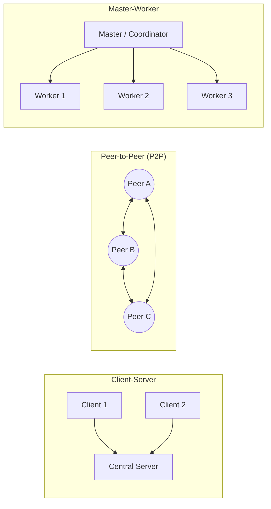

# 4.2. Các Phong Cách Kiến Trúc Phổ Biến (Common Architecture Styles)

> [!IMPORTANT]
> **Nếu bạn chỉ được nhớ một điều duy nhất:** Không có phong cách kiến trúc nào là "viên đạn bạc" tối thượng; kiến trúc là nghệ thuật quản trị sự đánh đổi (Trade-offs) giữa khả năng mở rộng (Scalability), độ trễ (Latency), độ phức tạp vận hành (Operational Complexity) và chi phí tổ chức (Conway's Law).

---

## 1. Kiến trúc Tổng quan & Mô hình Tư duy (Mental Model)

### Ẩn dụ Đời sống: Các Mô Hình Tổ Chức Xã Hội và Nền Kinh Tế
Hãy hình dung các phong cách kiến trúc phần mềm tương tự như các mô hình tổ chức chính trị - kinh tế của xã hội loài người:
- **Monolith (Vương quốc Tập quyền)**: Toàn bộ hoàng gia, quân đội, nông dân và ngân khố tập trung trong một tòa thành kiên cố. Mệnh lệnh truyền đạt tức thì (In-memory latency = nanoseconds), giao dịch tiền tệ nội bộ cực kỳ đơn giản (ACID). Nhưng nếu một bức tường bị sập hoặc dịch bệnh bùng phát, cả vương quốc sụp đổ theo (Single Point of Failure).
- **Modular Monolith (Thành trì Phân Khu Độc Lập)**: Vẫn nằm trong một tòa thành chung, nhưng mỗi khu phố (Thợ rèn, Quân sự, Nông nghiệp) có tường thành riêng, chỉ giao tiếp qua cổng kiểm soát nghiêm ngặt. Rất dễ quản lý và không tốn chi phí xây đường sá liên tỉnh.
- **Microservices (Liên Hợp Quốc Các Quốc Gia Độc Lập)**: Mỗi dịch vụ là một quốc gia có chủ quyền riêng, có luật pháp và ngân khố riêng (Database-per-service). Để giao dịch, các nước phải gửi đại sứ qua đường hàng không hoặc hải cảng (Network hops, HTTP/gRPC). Tự do phát triển và mở rộng dân số, nhưng chi phí ngoại giao, hải quan và rủi ro đứt gãy liên lạc là cực kỳ lớn.
- **Event-Driven Architecture (Hãng Thông Tấn Báo Chí Toàn Cầu)**: Một tòa soạn báo phát hành tin tức (Event). Bất kỳ ai quan tâm đều có thể mua báo đọc mà tòa soạn không cần biết độc giả là ai. Tính tách rời (Decoupling) đạt mức tuyệt đối.
- **Space-Based Architecture (Sàn Giao Dịch Chứng Khoán Trên RAM)**: Không ai đợi thủ thư lục sổ sách dưới hầm (Disk I/O). Mọi giao dịch khớp lệnh diễn ra trực tiếp giữa các nhà môi giới đứng sát nhau trong một căn phòng tràn ngập ánh sáng với tốc độ ánh sáng (In-Memory Data Grid).

```mermaid
graph TD
    Styles["Kiến Trúc Phần Mềm (Architecture Styles)"]
    
    Styles --> Monos["1. Monolithic Families"]
    Monos --> M1["Monolithic Architecture"]
    Monos --> M2["Modular Monolith"]
    Monos --> M3["Layered Architecture"]
    
    Styles --> Dist["2. Distributed Families"]
    Dist --> D1["Microservices Architecture"]
    Dist --> D2["Service-Oriented Architecture (SOA)"]
    Dist --> D3["Event-Driven Architecture (EDA)"]
    Dist --> D4["Space-Based Architecture (IMDG)"]
    Dist --> D5["Shared-Nothing Architecture (SNA)"]
    
    Styles --> Network["3. Network & Compute Topology"]
    Network --> N1["Client-Server"]
    Network --> N2["Peer-to-Peer (P2P)"]
    Network --> N3["Master-Worker"]
    
    Styles --> Patterns["4. Structural & Flow Styles"]
    Patterns --> P1["Pipe and Filter"]
    Patterns --> P2["Broker Architecture"]
    Patterns --> P3["Blackboard Architecture"]
    Patterns --> P4["Serverless (FaaS)"]
    Patterns --> P5["Plug-in / Microkernel"]
    Patterns --> P6["CQRS Architecture"]
```



---

## 2. Chi tiết từng Keyword (Under-the-Hood Deep Dive)

### 2.1. Monolithic Family: Monolith, Modular Monolith & Layered Architecture

#### 1. Monolithic Architecture (Kiến Trúc Khối Đồng Nhất)
- **Đặc trưng**: Toàn bộ chức năng (Authentication, Payments, Catalog, Notifications) được biên dịch và đóng gói thành một đơn vị triển khai duy nhất (Single Deployment Artifact: 1 file `.war`, 1 file nhị phân Go/C++, hoặc 1 Docker Container).
- **Ưu điểm**: Cực kỳ dễ phát triển ban đầu, gỡ lỗi (debugging) đơn giản bằng cách đặt breakpoint trên một tiến trình, kiểm thử E2E trực tiếp, độ trễ giao tiếp giữa các hàm ở mức nano-giây (In-memory calls), giao dịch nhất quán tuyệt đối (ACID DB Transactions).
- **Hạn chế**: Khi đội ngũ vượt quá 50 kỹ sư, việc merge code xung đột liên tục; triển khai rủi ro cao (sửa một dòng code thông báo cũng phải deploy lại toàn bộ app); khó mở rộng cục bộ (scaling bottlenecks).

#### 2. Modular Monolith (Khối Đồng Nhất Module Hóa)
- **Bản chất**: Vẫn triển khai dưới dạng một tiến trình duy nhất (Single Binary), nhưng kiến trúc mã nguồn được phân chia thành các Module có ranh giới nghiệp vụ (Bounded Contexts) hoàn toàn độc lập.
- **Quy tắc vàng**:
  - Module $A$ cấm chọc trực tiếp vào Database của Module $B$.
  - Mọi giao tiếp giữa các Module phải thông qua Public In-Memory Interface (hoặc Domain Events nội bộ).
  - Không có chi phí mạng (Zero Network Latency), không cần Kubernetes phức tạp, nhưng duy trì tính tách rời cao, sẵn sàng tách thành Microservices khi cần.

#### 3. Layered Architecture (Kiến Trúc Phân Tầng)
- Tổ chức theo chiều ngang với các mối quan tâm tách biệt: Presentation $\to$ Application $\to$ Domain $\to$ Infrastructure / Database. Phù hợp với các hệ thống doanh nghiệp tiêu chuẩn có quy trình xử lý dữ liệu theo luồng.

---

### 2.2. Distributed Families: Microservices, SOA & Shared-Nothing Architecture (SNA)

#### 1. Microservices Architecture
- **Định nghĩa**: Hệ thống gồm nhiều dịch vụ nhỏ, độc lập, loosely coupled, được tổ chức xoay quanh các năng lực nghiệp vụ (Business Capabilities - Bounded Contexts).
- **Quy tắc bắt buộc**: **Database-per-service** (Mỗi service sở hữu cơ sở dữ liệu riêng). Dịch vụ này tuyệt đối không được đọc/ghi trực tiếp vào DB của dịch vụ khác. Giao tiếp qua mạng bằng các giao thức nhẹ (gRPC, REST, Kafka).
- **Cái giá phải trả**:
  - Đánh đổi tính nhất quán ACID lấy tính nhất quán sau cùng (Eventual Consistency) qua Saga Pattern.
  - Vấn đề Network Latency, Distributed Tracing, Circuit Breaking, Service Mesh.
  - Chi phí hạ tầng và vận hành (Kubernetes, Observability) tăng vọt.

#### 2. Service-Oriented Architecture (SOA) vs Microservices
- **SOA (Kiến trúc Hướng Dịch Vụ - 2000s)**: Tập trung vào việc tái sử dụng ứng dụng cấp độ doanh nghiệp lớn thông qua một **Enterprise Service Bus (ESB)** trung tâm thông minh (Smart Pipes, Dumb Endpoints). Các dịch vụ giao tiếp qua SOAP/XML nặng nề.
- **Microservices**: Ngược lại hoàn toàn với SOA. Áp dụng triết lý *"Smart Endpoints, Dumb Pipes"*. Bus truyền thông chỉ là message broker thụ động (Kafka/RabbitMQ), toàn bộ logic nghiệp vụ nằm ở biên của các microservices.

#### 3. Shared-Nothing Architecture (SNA)
- Kiến trúc phân tán mà trong đó các nút xử lý (Nodes) hoàn toàn độc lập: Không chia sẻ bộ nhớ RAM (No shared memory), không chia sẻ ổ đĩa cứng (No shared disk), và không có sự phụ thuộc phần cứng tập trung.
- Đây là nền tảng của các hệ thống cơ sở dữ liệu phân tán quy mô hàng ngàn máy chủ (Google Bigtable, Apache Cassandra, Spanner).

---

### 2.3. Event-Driven Architecture (EDA) & Space-Based Architecture (IMDG)

#### 1. Event-Driven Architecture (EDA - Kiến Trúc Hướng Sự Kiện)
- **Cơ chế**: Các thành phần tương tác thông qua việc phát sinh (Produce), phát hiện (Detect), và tiêu thụ (Consume) các **Events** (sự kiện quá khứ đã diễn ra: `OrderPlaced`, `PaymentFailed`).
- **Phân loại**:
  - *Broker Topology*: Không có bộ điều phối trung tâm. Producers bắn event vào Broker; Consumers tự đăng ký lắng nghe và phản ứng độc lập (Choreography).
  - *Mediator Topology*: Sử dụng một thành phần trung gian (Mediator) để điều phối chuỗi các bước nghiệp vụ phức tạp (Orchestration).
- **Ưu điểm**: Khả năng mở rộng vô hạn, Loose Coupling tuyệt đối, thông lượng cực cao, phản hồi thời gian thực.

#### 2. Space-Based Architecture (Kiến Trúc Dựa Trên Không Gian Bộ Nhớ)
- **Bản chất**: Giải quyết triệt để nút thắt cổ chai lớn nhất trong kỹ nghệ phần mềm: **Cơ sở dữ liệu tập trung (Central Database)**.
- **Cách thức hoạt động**:
  - Toàn bộ dữ liệu nghiệp vụ được tải trực tiếp lên một **In-Memory Data Grid (IMDG)** phân tán (Apache Ignite, Hazelcast, Redis Cluster).
  - Các Processing Units (PU) chứa cả logic tính toán lẫn bản sao dữ liệu trong RAM.
  - Việc ghi xuống ổ cứng (Database) được tách riêng thành tiến trình phi đồng bộ ở hậu trường (Write-Behind Caching).
- **Ứng dụng**: Sàn giao dịch chứng khoán Nasdaq/NYSE, hệ thống đặt cược trực tuyến mùa World Cup, hệ thống bán vé hòa nhạc quy mô triệu người.

---

### 2.4. Mạng Lưới Phân Phối: Client-Server, Peer-to-Peer (P2P) & Master-Worker



- **Client-Server Architecture**: Phân định ranh giới giữa nhà cung cấp dịch vụ (Server) và người tiêu dùng (Client). Phù hợp cho 95% các ứng dụng Web/Mobile thông thường.
- **Peer-to-Peer Architecture (P2P)**: Không có máy chủ trung tâm. Mỗi nút tham gia vừa là Client vừa là Server. Có khả năng chịu lỗi tối thượng và chống kiểm duyệt (BitTorrent, Bitcoin, IPFS).
- **Master-Worker Architecture**: Nút Master chịu trách nhiệm chia nhỏ khối lượng công việc khổng lồ thành các phần độc lập và giao cho các Workers thực thi song song, sau đó thu thập kết quả (MapReduce, Apache Spark, Render Farm đồ họa 3D).

---

### 2.5. Structural & Processing Styles: Pipe and Filter, Broker & Blackboard

#### 1. Pipe and Filter Architecture
- Hệ thống chia nhỏ tác vụ xử lý dòng dữ liệu thành một chuỗi các bước độc lập được gọi là **Filters**, kết nối với nhau qua các đường ống dẫn **Pipes**.
- Mỗi Filter nhận dữ liệu từ Pipe đầu vào, biến đổi dữ liệu, và đẩy sang Pipe đầu ra.
- *Ví dụ kinh điển*: Đường ống lệnh UNIX (`cat access.log | grep 404 | awk '{print $1}' | sort | uniq -c`), các luồng xử lý video/âm thanh (FFmpeg), và ETL Data Pipelines.

#### 2. Broker Architecture
- Sử dụng một thực thể trung gian (Broker) để kết nối các Clients và Servers một cách gián tiếp. Broker chịu trách nhiệm định tuyến yêu cầu, cân bằng tải, và chuyển đổi giao thức (ví dụ: Apache Kafka, CORBA, MQTT Broker trong IoT).

#### 3. Blackboard Architecture
- Lấy cảm hứng từ một nhóm chuyên gia ngồi trước một bảng đen để cùng giải quyết một bài toán hóc búa:
  - **Blackboard**: Vùng nhớ chia sẻ trung tâm chứa trạng thái bài toán và các giải pháp bộ phận.
  - **Knowledge Sources (KS)**: Các module phần mềm chuyên gia độc lập, tự kích hoạt khi thấy dữ liệu trên Blackboard phù hợp với năng lực của mình để giải tiếp.
  - **Control Component**: Bộ điều phối luồng thực thi.
  - *Ứng dụng*: Nhận dạng giọng nói (Speech Recognition), hệ thống AI phân tích tín hiệu radar quân sự, xử lý hình ảnh y tế.

---

### 2.6. Modern Application Styles: Serverless (FaaS), Plug-in & CQRS

#### 1. Serverless Architecture (Function-as-a-Service - FaaS)
- Ứng dụng được chia nhỏ thành các hàm không trạng thái (Stateless Functions: AWS Lambda, Cloud Run), chỉ khởi động khi có sự kiện (HTTP Request, File Upload, Cron), tự động co giãn từ 0 lên hàng chục ngàn instances và giảm về 0 khi hết tải.
- *Hạn chế*: Cold Start latency, phụ thuộc sâu vào nhà cung cấp đám mây (Vendor Lock-in), khó gỡ lỗi cục bộ.

#### 2. Plug-in / Microkernel Architecture
- Hệ thống gồm một Nhân cốt lõi (Core Microkernel) tối giản chỉ chứa các logic tối thiểu, và một tập hợp các Module cắm thêm (Plug-ins) độc lập được đăng ký động để mở rộng tính năng.
- *Ví dụ*: Trình biên tập mã Visual Studio Code, trình duyệt Google Chrome, Linux Kernel.

#### 3. CQRS Architecture (Command Query Responsibility Segregation)
- Tách đôi hoàn toàn mô hình xử lý hệ thống:
  - **Command Stack**: Tiếp nhận các thao tác ghi/sửa/xóa, tập trung vào bảo vệ tính đúng đắn của Domain Logic và Invariants.
  - **Query Stack**: Tiếp nhận các truy vấn đọc, sử dụng cơ sở dữ liệu phi chuẩn hóa (Read-Optimized Views, Elasticsearch) để trả lời kết quả ở tốc độ cao nhất mà không cần JOIN phức tạp.

---

## 3. Thực thi Mã nguồn & Mô phỏng Chuyên sâu (Dual-Engine Implementation)

### 3.1. C++20 Implementation: Asynchronous Multi-Threaded Pipe and Filter Architecture
Chương trình C++20 dưới đây mô phỏng một Data Pipeline theo phong cách Pipe and Filter xử lý luồng dữ liệu song song qua nhiều bước với Bounded Thread-Safe Queues.

```cpp
#include <iostream>
#include <vector>
#include <string>
#include <memory>
#include <queue>
#include <mutex>
#include <condition_variable>
#include <thread>
#include <optional>
#include <chrono>
#include <algorithm>

// ============================================================================
// HẠ TẦNG PIPE: HÀNG ĐỢI ĐA LUỒNG AN TOÀN (THREAD-SAFE BOUNDED PIPE)
// ============================================================================
template <typename T>
class Pipe {
private:
    std::queue<T> queue_;
    mutable std::mutex mtx_;
    std::condition_variable cvNotEmpty_;
    std::condition_variable cvNotFull_;
    size_t capacity_;
    bool closed_{false};

public:
    explicit Pipe(size_t capacity) : capacity_(capacity) {}

    void push(T item) {
        std::unique_lock<std::mutex> lock(mtx_);
        cvNotFull_.wait(lock, [this]() { return queue_.size() < capacity_ || closed_; });
        if (closed_) return;
        queue_.push(std::move(item));
        cvNotEmpty_.notify_one();
    }

    std::optional<T> pop() {
        std::unique_lock<std::mutex> lock(mtx_);
        cvNotEmpty_.wait(lock, [this]() { return !queue_.empty() || closed_; });
        if (queue_.empty() && closed_) return std::nullopt;
        T item = std::move(queue_.front());
        queue_.pop();
        cvNotFull_.notify_one();
        return item;
    }

    void close() {
        std::lock_guard<std::mutex> lock(mtx_);
        closed_ = true;
        cvNotEmpty_.notify_all();
        cvNotFull_.notify_all();
    }
};

// ============================================================================
// MÔ HÌNH HÓA DỮ LIỆU ĐI QUA FILTER
// ============================================================================
struct LogRecord {
    uint64_t id;
    std::string level;
    std::string payload;
};

// ============================================================================
// CÁC FILTERS XỬ LÝ (PROCESSING FILTERS)
// ============================================================================

// Filter 1: Lọc bỏ các bản ghi không phải cảnh báo hoặc lỗi
void errorFilter(Pipe<LogRecord>& inPipe, Pipe<LogRecord>& outPipe) {
    while (auto record = inPipe.pop()) {
        if (record->level == "WARN" || record->level == "ERROR") {
            outPipe.push(*record);
        }
    }
    outPipe.close();
}

// Filter 2: Chuẩn hóa chuỗi payload thành chữ in hoa và gắn timestamp
void transformFilter(Pipe<LogRecord>& inPipe, Pipe<LogRecord>& outPipe) {
    while (auto record = inPipe.pop()) {
        for (char& c : record->payload) {
            c = static_cast<char>(std::toupper(c));
        }
        record->payload = "[SANITIZED] " + record->payload;
        outPipe.push(*record);
    }
    outPipe.close();
}

int main() {
    std::cout << "=== C++20 Multithreaded Pipe and Filter Architecture Demo ===\n";

    Pipe<LogRecord> sourcePipe(10);
    Pipe<LogRecord> intermediatePipe(10);
    Pipe<LogRecord> sinkPipe(10);

    // Khởi chạy các Filters trên các luồng OS độc lập
    std::thread tFilter1(errorFilter, std::ref(sourcePipe), std::ref(intermediatePipe));
    std::thread tFilter2(transformFilter, std::ref(intermediatePipe), std::ref(sinkPipe));

    // Bộ phát dữ liệu (Source Producer)
    std::vector<LogRecord> rawLogs = {
        {1, "INFO", "User logged in"},
        {2, "WARN", "Memory usage reached 85%"},
        {3, "DEBUG", "Cache hit for key user_101"},
        {4, "ERROR", "Database connection pool exhausted"},
        {5, "INFO", "Periodic report generated"}
    };

    std::cout << "[Producer] Feeding " << rawLogs.size() << " log records into Source Pipe...\n";
    for (auto& log : rawLogs) {
        sourcePipe.push(log);
    }
    sourcePipe.close();

    // Thu nhận kết quả từ Sink Pipe
    std::cout << "\n[Sink Output - Filtered & Transformed Logs]:\n";
    while (auto processed = sinkPipe.pop()) {
        std::cout << "  -> Log #" << processed->id 
                  << " [" << processed->level << "]: " 
                  << processed->payload << "\n";
    }

    tFilter1.join();
    tFilter2.join();

    std::cout << "[Pipeline Execution] Completed cleanly without deadlock!\n";
    return 0;
}
```

#### Terminal Output Mẫu (C++20):
```text
=== C++20 Multithreaded Pipe and Filter Architecture Demo ===
[Producer] Feeding 5 log records into Source Pipe...

[Sink Output - Filtered & Transformed Logs]:
  -> Log #2 [WARN]: [SANITIZED] MEMORY USAGE REACHED 85%
  -> Log #4 [ERROR]: [SANITIZED] DATABASE CONNECTION POOL EXHAUSTED
[Pipeline Execution] Completed cleanly without deadlock!
```

---

### 3.2. Python 3.11+ Implementation: Modular Monolith vs Event-Driven Bus Architecture
Script Python 3.11+ dưới đây mô phỏng sự kết hợp giữa **Modular Monolith** và **Event-Driven Architecture (EDA)** thông qua một Event Bus nội bộ không đồng bộ, giúp tách rời các phân hệ Orders, Inventory và Notification.

```python
from __future__ import annotations
import asyncio
from dataclasses import dataclass, field
from typing import Callable, Coroutine, Any
from datetime import datetime

# ============================================================================
# EVENT DEFINITIONS (IMMUTABLE DOMAIN EVENTS)
# ============================================================================
@dataclass(frozen=True)
class DomainEvent:
    occurred_at: datetime = field(default_factory=datetime.utcnow)

@dataclass(frozen=True)
class OrderPlacedEvent(DomainEvent):
    order_id: str = ""
    customer_id: str = ""
    item_sku: str = ""
    quantity: int = 0
    total_usd: float = 0.0

# ============================================================================
# EVENT-DRIVEN BUS (IN-PROCESS DECOUPLED MESSAGE BROKER)
# ============================================================================
EventHandler = Callable[[Any], Coroutine[Any, Any, None]]

class AsyncEventBus:
    def __init__(self):
        self._subscribers: dict[type, list[EventHandler]] = {}

    def subscribe(self, event_type: type, handler: EventHandler) -> None:
        if event_type not in self._subscribers:
            self._subscribers[event_type] = []
        self._subscribers[event_type].append(handler)

    async def publish(self, event: Any) -> None:
        event_type = type(event)
        handlers = self._subscribers.get(event_type, [])
        if not handlers:
            return
        # Kích hoạt tất cả subscribers bất đồng bộ song song
        await asyncio.gather(*(handler(event) for handler in handlers))

# ============================================================================
# MODULE 1: INVENTORY MANAGEMENT MODULE (ISOLATED BOUNDED CONTEXT)
# ============================================================================
class InventoryModule:
    def __init__(self, bus: AsyncEventBus):
        self.stock: dict[str, int] = {"LAPTOP-M3": 50, "PHONE-15": 100}
        bus.subscribe(OrderPlacedEvent, self.on_order_placed)

    async def on_order_placed(self, event: OrderPlacedEvent):
        # Trừ kho độc lập khi nhận event
        await asyncio.sleep(0.01)  # Giả lập I/O database
        if event.item_sku in self.stock:
            self.stock[event.item_sku] -= event.quantity
            print(f"  [Inventory Module] Deducted {event.quantity} units of {event.item_sku}. "
                  f"Remaining stock: {self.stock[event.item_sku]}")

# ============================================================================
# MODULE 2: NOTIFICATION MODULE
# ============================================================================
class NotificationModule:
    def __init__(self, bus: AsyncEventBus):
        bus.subscribe(OrderPlacedEvent, self.on_order_placed)

    async def on_order_placed(self, event: OrderPlacedEvent):
        await asyncio.sleep(0.02)  # Giả lập gửi email qua SMTP
        print(f"  [Notification Module] Email sent to Customer {event.customer_id}: "
              f"Order {event.order_id} confirmed (${event.total_usd:.2f})")

# ============================================================================
# MODULE 3: ORDER SERVICE (PRODUCER)
# ============================================================================
class OrderModule:
    def __init__(self, bus: AsyncEventBus):
        self.bus = bus

    async def place_order(self, order_id: str, customer_id: str, sku: str, qty: int, price: float):
        print(f"\n[Order Module] Placing Order {order_id}...")
        # 1. Thực hiện lưu trữ đơn hàng nội bộ
        # 2. Phát tán Domain Event ra Event Bus
        event = OrderPlacedEvent(
            order_id=order_id,
            customer_id=customer_id,
            item_sku=sku,
            quantity=qty,
            total_usd=price * qty
        )
        await self.bus.publish(event)


async def main():
    print("=== Python 3.11+ Modular Monolith with Event Bus Architecture ===")
    event_bus = AsyncEventBus()

    # Khởi tạo các Modules độc lập (Loose Coupling)
    _inventory = InventoryModule(event_bus)
    _notifications = NotificationModule(event_bus)
    orders = OrderModule(event_bus)

    # Đặt hàng liên tiếp
    await orders.place_order("ORD-101", "CUST-A", "LAPTOP-M3", 2, 1999.99)
    await orders.place_order("ORD-102", "CUST-B", "PHONE-15", 5, 999.00)

if __name__ == "__main__":
    asyncio.run(main())
```

#### Terminal Output Mẫu (Python 3.11+):
```text
=== Python 3.11+ Modular Monolith with Event Bus Architecture ===

[Order Module] Placing Order ORD-101...
  [Inventory Module] Deducted 2 units of LAPTOP-M3. Remaining stock: 48
  [Notification Module] Email sent to Customer CUST-A: Order ORD-101 confirmed ($3999.98)

[Order Module] Placing Order ORD-102...
  [Inventory Module] Deducted 5 units of PHONE-15. Remaining stock: 95
  [Notification Module] Email sent to Customer CUST-B: Order ORD-102 confirmed ($4995.00)
```

---

## 4. Systems Engineering & Production Pitfalls

### Các Cạm Bẫy Thực Chiến (Gotchas & Production Antipatterns)

1. **Cơn Ác Mộng Khối Đồng Nhất Phân Tán (Distributed Monolith)**:
   - *Bản chất*: Chia nhỏ hệ thống thành 50 Microservices nhưng các services lại gọi nhau bằng các lệnh HTTP đồng bộ dây chuyền (Chained REST Calls: Service $A \to B \to C \to D$). Nếu Service $D$ bị chậm 2 giây, toàn bộ chuỗi nghẽn mạng; nếu một service deploy phiên bản mới, tất cả 49 services còn lại phải deploy theo vì phụ thuộc chặt chẽ về schema!
   - *Khắc phục*: Tách rời bằng Event-Driven phi đồng bộ (EDA) hoặc quay lại với **Modular Monolith**.

2. **Vấn Đề Ghi Kép Dữ Liệu (The Dual-Write Problem)**:
   - *Bản chất*: Khi một service vừa muốn cập nhật Database của mình vừa muốn gửi một Event lên Kafka. Nếu lưu DB thành công nhưng mạng rớt không gửi được Kafka (hoặc ngược lại), hệ thống phân tán rơi vào trạng thái bất nhất vĩnh viễn.
   - *Khắc phục*: Bắt buộc phải áp dụng **Transactional Outbox Pattern** kết hợp với Change Data Capture (Debezium) để đảm bảo Event được phát đi một cách nguyên tử.

3. **Cái Bẫy Đứt Gãy Nhất Quán Trong Space-Based Architecture**:
   - *Bản chất*: Lưu trữ toàn bộ dữ liệu trên RAM để đạt tốc độ cao. Nếu một sự cố mất điện đột ngột xảy ra trên cụm máy chủ trước khi tiến trình Write-Behind kịp ghi dữ liệu từ RAM xuống Disk, các giao dịch tài chính vừa khớp lệnh sẽ bốc hơi không dấu vết.
   - *Khắc phục*: Sử dụng Non-Volatile Memory (NVDIMM/Optane) hoặc cơ chế đồng bộ RAM Replication qua mạng băng thông rộng RDMA với Quorum tối thiểu trước khi xác nhận giao dịch.

4. **Kỹ Thuật Chẩn Đoán & Giám Sát Kiến Trúc Bằng CLI**:
   ```bash
   # 1. Giám sát độ trễ mạng giữa các Microservices bằng Jaeger CLI / OpenTelemetry
   jaeger-query --config=telemetry.yaml --trace-id=4bf92f3577b34da6a3ce929d0e0e4736

   # 2. Kiểm tra tình trạng kết nối Kafka Broker cho Event-Driven Architecture
   kafka-consumer-groups.sh --bootstrap-server localhost:9092 --describe --group order-processors

   # 3. Phân tích tài nguyên RAM và độ trễ của In-Memory Grid (Redis Cluster)
   redis-cli --cluster info 127.0.0.1:7000
   ```

---

## 5. Bảng So sánh & Decision Matrix

### 5.1. Ma Trận Đánh Giá Toàn Diện Các Phong Cách Kiến Trúc

| Phong Cách Kiến Trúc | Khả Năng Mở Rộng (Scalability) | Độ Trễ (Latency) | Độ Phức Tạp Vận Hành | Tính Nhất Quán (Consistency) | Ngữ Cảnh Tối Ưu Nhất |
| :--- | :---: | :---: | :---: | :---: | :--- |
| **Monolith Cổ Điển** | Thấp | Cực thấp ($\text{ns}$) | Rất thấp | ACID Tuyệt Đối | Sản phẩm mới (MVP), Startup, Tải thấp |
| **Modular Monolith** | Trung bình - Cao | Cực thấp ($\text{ns}$) | Thấp | ACID Tuyệt Đối | **90% ứng dụng doanh nghiệp vừa & lớn** |
| **Microservices** | Cực cao | Trung bình - Cao ($\text{ms}$) | Rất cao | Eventual Consistency | Đội ngũ > 100 kỹ sư, nhiều domain độc lập |
| **Event-Driven (EDA)**| Vô hạn | Biến thiên (Async) | Cao | Eventual Consistency | Hệ thống phản hồi thời gian thực, IoT, Streaming |
| **Space-Based (IMDG)**| Cực hạn | Siêu thấp ($\mu\text{s}$) | Cực cao | Memory-First / Async Disk | Sàn chứng khoán, đấu giá, game thời gian thực |
| **Serverless (FaaS)** | Tự động vô hạn | Cao (Cold Starts) | Trung bình | Tùy thuộc Backend DB | Tác vụ định kỳ, xử lý ảnh/video nền, Webhook |
| **Pipe and Filter** | Cao (Từng stage) | Phụ thuộc ống dẫn | Thấp | Tuần tự theo luồng | Trình biên dịch, mã hóa video, Big Data ETL |
| **Plug-in / Kernel** | Thấp - TB | Rất thấp | Thấp | Nội tại tiến trình | Desktop Apps (VS Code), Hệ điều hành, CMS |
