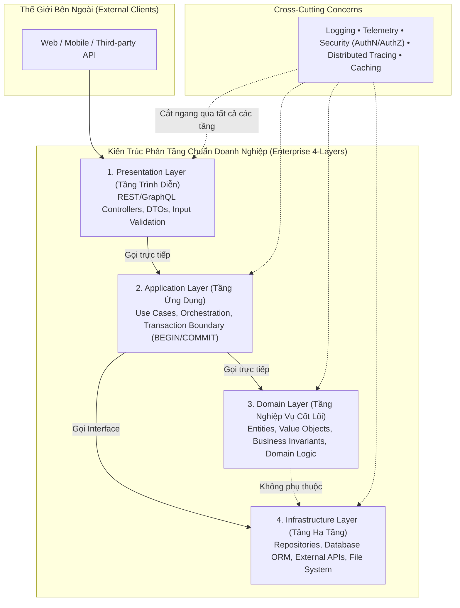
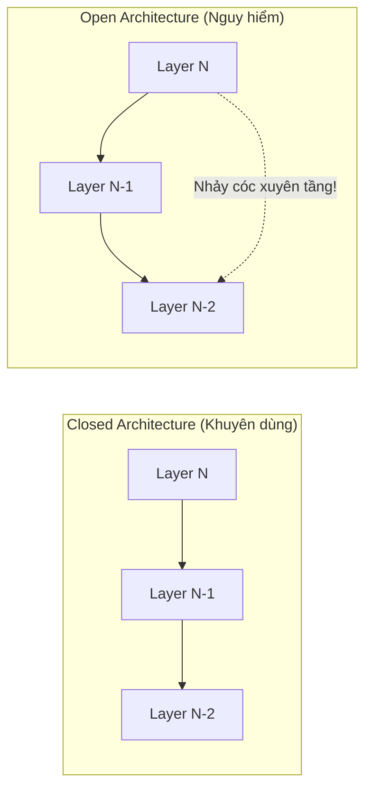

# 4.3. Kiến Trúc Phân Tầng (Layered Architecture & N-Tier)

> [!IMPORTANT]
> **Nếu bạn chỉ được nhớ một điều duy nhất:** Kiến trúc phân tầng tổ chức mã nguồn thành các lát cắt ngang độc lập theo mức độ trừu tượng hóa; sức mạnh của nó nằm ở tính cô lập (Isolation of Layers) và ranh giới giao dịch (Transaction Boundary) tường minh, nhưng phải cảnh giác cao độ trước Sinkhole Anti-Pattern và rò rỉ chi tiết hạ tầng (Layer Leaking) lên các tầng trên.

---

## 1. Kiến trúc Tổng quan & Mô hình Tư duy (Mental Model)

### Ẩn dụ Đời sống: Chuỗi Vận Hành Nhà Hàng 5 Sao Cao Cấp
Hãy hình dung kiến trúc phân tầng hoạt động tương tự như một nhà hàng ẩm thực chuyên nghiệp:
- **Presentation Layer (Nhân viên Bồi bàn & Lễ tân)**: Tiếp đón khách hàng, trao menu, ghi nhận order và kiểm tra xem khách có yêu cầu món hợp lệ không. Bồi bàn không bao giờ tự ý vào bếp nấu nướng, cũng không được tự chạy ra chợ mua thịt bò.
- **Application Layer (Quản lý Nhà hàng / Bếp trưởng Điều phối)**: Nhận phiếu order từ bồi bàn, kiểm tra tiến độ, ra lệnh cho các bếp chuyên biệt chuẩn bị món ăn, điều phối thời gian và chịu trách nhiệm tính toán hóa đơn thanh toán (Transaction Boundary).
- **Domain Layer (Nghệ nhân Nấu bếp / Công thức Ẩm thực Cốt lõi)**: Trái tim của nhà hàng. Nắm giữ công thức ướp thịt độc quyền, nhiệt độ nướng hoàn hảo và quy chuẩn an toàn vệ sinh thực phẩm (Business Invariants). Nghệ nhân tập trung 100% vào việc nấu món ngon, không cần biết khách ăn bằng đĩa sứ hay mang về bằng hộp giấy.
- **Infrastructure Layer (Thủ kho, Nhà cung cấp Nông sản & Thiết bị Bếp)**: Hệ thống tủ đông công nghiệp, nguồn cung thịt bò Wagyu nhập khẩu, và cổng thanh toán POS cà thẻ tín dụng.
- **Cross-Cutting Concerns (Hệ thống Điện, Nước & Camera Giám sát)**: Cung cấp năng lượng và bảo an cho toàn bộ nhà hàng mà không can thiệp vào công thức nấu ăn.



---

## 2. Chi tiết từng Keyword (Under-the-Hood Deep Dive)

### 2.1. Phân Biệt Layered Architecture (Logical) vs N-Tier Architecture (Physical)
Một sự nhầm lẫn kinh điển trong ngành kỹ nghệ phần mềm là đồng nhất giữa **Layers** và **Tiers**:

| Tiêu Chí | Layered Architecture (Tầng Logic) | N-Tier Architecture (Tầng Vật Lý) |
| :--- | :--- | :--- |
| **Bản chất** | Phân chia về mặt tổ chức cấu trúc mã nguồn, packages, namespaces bên trong cùng một tiến trình. | Phân chia về mặt hạ tầng vật lý, máy chủ, máy ảo hoặc các tiến trình OS riêng biệt chạy trên mạng. |
| **Chi phí Giao tiếp** | Gọi hàm trong bộ nhớ (In-memory calls) ở tốc độ nano-giây ($\text{ns}$). Không có chi phí serialize. | Gọi qua mạng (RPC, HTTP, TCP Socket) ở tốc độ mili-giây ($\text{ms}$), tốn chi phí serialize/deserialize dữ liệu. |
| **Khả năng Lỗi** | Không thể xảy ra lỗi đứt gãy cáp mạng nội bộ tiến trình. | Đối mặt với 8 định kiến sai lầm về mạng phân tán (Fallacies of Distributed Computing). |
| **Ví dụ Kinh điển** | Một file `app.jar` chứa các package: `controller`, `service`, `domain`, `repository`. | Hệ thống 3-Tier: Web Server (Nginx) $\to$ App Server (Spring Boot) $\to$ Database Server (PostgreSQL) trên 3 subnet khác nhau. |

---

### 2.2. Giải Phẫu Bốn Tầng Tiêu Chuẩn: Presentation, Application, Domain, Infrastructure

#### 1. Presentation Layer (Tầng Trình Diễn)
- **Trách nhiệm**: Tiếp nhận luồng dữ liệu thô từ thế giới bên ngoài (HTTP Request, gRPC message, Kafka Event payload, CLI arguments).
- **Thao tác hợp lệ**: Xác thực cú pháp (Schema validation, JSON schema), phân giải mã định danh (Authentication token parsing), ánh xạ Request sang DTO (Data Transfer Object) nội bộ, và chuyển đổi kết quả trả về mã HTTP tương ứng (`200 OK`, `201 Created`, `400 Bad Request`).
- **Điều cấm kỵ**: Tuyệt đối không chứa logic nghiệp vụ tính toán (như tính lãi suất hay kiểm tra hạn mức tín dụng).

#### 2. Application Layer (Tầng Ứng Dụng / Workflow Orchestration)
- **Trách nhiệm**: Đóng vai trò nhạc trưởng điều phối các Use Cases.
- **Thao tác hợp lệ**:
  - Tiếp nhận DTO từ Presentation Layer.
  - Khởi tạo **Ranh giới Giao dịch (Transaction Boundary)**: Mở kết nối DB, kích hoạt `BEGIN TRANSACTION`.
  - Triệu hồi các Entities từ Domain Layer để thực thi quy tắc kinh doanh.
  - Gọi Infrastructure để lưu trữ trạng thái mới hoặc gửi thông báo (Emails, Push notifications).
  - Kết thúc giao dịch: `COMMIT TRANSACTION` hoặc `ROLLBACK` khi có lỗi.

#### 3. Domain Layer (Tầng Nghiệp Vụ Cốt Lõi)
- **Trách nhiệm**: Trái tim và tài sản trí tuệ lớn nhất của doanh nghiệp. Chứa các Entities, Value Objects, Domain Exceptions và Domain Services.
- **Thao tác hợp lệ**: Kiểm soát các điều kiện bất biến (Class Invariants), thực hiện các phép tính logic thuần túy (ví dụ: công thức khấu hao tài sản, luật chiết khấu đơn hàng).
- **Điều cấm kỵ**: Hoàn toàn độc lập với công nghệ bên ngoài. Cấm tiệt việc import thư viện SQL, ORM Annotations, HTTP Headers hay JSON Parser vào Domain Layer.

#### 4. Infrastructure Layer / Data Access Layer (DAL)
- **Trách nhiệm**: Hiện thực hóa các giao tiếp vật lý với phần cứng và thế giới bên ngoài: Kết nối cơ sở dữ liệu quan hệ (PostgreSQL, Oracle) hoặc NoSQL (MongoDB), bộ nhớ đệm (Redis), Message Queue (RabbitMQ), bộ lưu trữ đối tượng (AWS S3) và các dịch vụ bên thứ ba (Stripe, Twilio).

---

### 2.3. Cross-Cutting Concerns và Cơ Chế Tách Rời (AOP & Middlewares)
**Cross-Cutting Concerns (Mối quan tâm xuyên suốt)** là các khía cạnh kỹ thuật không thuộc về nghiệp vụ chuyên biệt của bất kỳ tầng nào nhưng lại hiện diện ở khắp mọi nơi:
- Ghi nhật ký (Structured Logging với Correlation ID).
- Giám sát độ trễ và số liệu (Prometheus Metrics & Distributed Tracing).
- Xác thực và phân quyền người dùng (Security / JWT Authorization).
- Quản lý bộ nhớ đệm (Caching).

**Giải pháp Kiến trúc**: Không bao giờ viết code logging hay đo thời gian lặp đi lặp lại ở mọi phương thức. Sử dụng:
- **Aspect-Oriented Programming (AOP)** hoặc Decorators để chèn logic xuyên suốt vào thời điểm biên dịch hoặc runtime.
- **Middlewares / Interceptors Pipeline** ở ranh giới của Presentation Layer.

---

### 2.4. Closed Architecture vs Open Architecture và Vấn Đề Rò Rỉ Tầng (Layer Leaking)



- **Closed Architecture (Kiến trúc đóng - Chuẩn mực bắt buộc)**:
  - Một tầng chỉ được phép giao tiếp trực tiếp với **tầng ngay bên dưới nó**.
  - Muốn Presentation lấy được dữ liệu từ Database, request bắt buộc phải đi tuần tự: Presentation $\to$ Application $\to$ Domain $\to$ Infrastructure.
  - *Lợi ích*: Bảo tồn tính cô lập tối đa; khi thay đổi tầng Infrastructure, chỉ tầng Application bị ảnh hưởng, tầng Presentation hoàn toàn miễn nhiễm.
- **Open Architecture (Kiến trúc mở)**:
  - Cho phép một tầng nhảy cóc bỏ qua tầng trung gian (ví dụ: Controller gọi thẳng vào Data Access Layer để thực hiện truy vấn đọc nhanh).
  - *Hậu quả*: Tạo ra mạng lưới phụ thuộc chéo chằng chịt (Spaghetti Dependencies), làm mất khả năng kiểm soát logic nghiệp vụ và ranh giới giao dịch.
- **Layer Leaking (Rò rỉ tầng)**:
  - Hiện tượng chi tiết cài đặt của tầng dưới bị phơi bày lên tầng trên.
  - *Ví dụ kinh điển*: Trả trực tiếp đối tượng ORM Entity (`@Entity` của Hibernate/JPA) lên tầng Controller rồi tuần tự hóa thành JSON trả cho Client. Nếu database thêm một cột nhạy cảm (`password_hash`), dữ liệu bị lộ thẳng ra ngoài Internet!

---

### 2.5. Sinkhole Anti-Pattern và Kỹ Thuật Tinh Gọn Luồng Dữ Liệu
**Sinkhole Anti-Pattern (Hiện tượng cống xả ngầm)** xảy ra khi một yêu cầu xử lý từ Client đi xuyên qua tất cả các tầng của hệ thống mà không có bất kỳ tầng nào thực hiện một logic nghiệp vụ có giá trị:
- Controller nhận request $\to$ gọi Service `getUser(id)`.
- Service không làm gì ngoài việc gọi Repository `findUser(id)`.
- Repository trả về kết quả $\to$ Service chuyển tiếp $\to$ Controller trả về client.

**Quy tắc Đánh giá 80-20 (Sinkhole Assessment Rule)**:
- Nếu khoảng $20\%$ các luồng trong hệ thống là Sinkhole (chủ yếu là các truy vấn đọc đơn giản - CRUD), điều này hoàn toàn bình thường và chấp nhận được để bảo vệ tính nhất quán kiến trúc.
- Nếu $> 50-80\%$ các luồng là Sinkhole, kiến trúc của bạn đang bị **Over-Engineered (Phân tầng thừa thãi)**.
- *Giải pháp*: Áp dụng phong cách **CQRS** - Tách riêng đường dẫn đọc (Read Path) cho phép Controller truy vấn trực tiếp View Database chuyên dụng, trong khi vẫn giữ nguyên kiến trúc phân tầng khắt khe cho đường dẫn ghi (Write Path).

---

### 2.6. Ranh Giới Giao Dịch (Transaction Boundary) và Quản Trị Trạng Thái
Ranh giới giao dịch là nơi bắt đầu và kết thúc của một đơn vị công việc nguyên tử (Unit of Work).
- **Vị trí chuẩn mực**: **Application Layer**.
- **Lý do**: Domain Layer chỉ quan tâm đến các quy tắc thuần túy của từng thực thể độc lập, không nắm giữ kết nối cơ sở dữ liệu. Presentation Layer quá xa, không thể đảm bảo an toàn nếu mạng bị đứt gãy.
- **Cơ chế vận hành**:
  1. Khi một Use Case được gọi, một Transaction Handle được tạo ra.
  2. Toàn bộ các thao tác ghi dữ liệu từ các Repository khác nhau tham gia vào cùng một Transaction Context.
  3. Nếu tất cả các điều kiện bất biến (Invariants) của Domain đều hợp lệ, Transaction được `COMMIT`.
  4. Nếu có bất kỳ lỗi nào xảy ra (Domain Exception hoặc Database Deadlock), toàn bộ các thay đổi lập tức được `ROLLBACK`.

---

## 3. Thực thi Mã nguồn & Mô phỏng Chuyên sâu (Dual-Engine Implementation)

### 3.1. C++20 Implementation: Strict Closed Layered Architecture with RAII Transaction Management
Đoạn mã C++20 dưới đây minh họa hệ thống ngân hàng phân tầng khắt khe (Closed Layered Architecture) với cơ chế quản lý Transaction Boundary tự động bằng RAII và ngăn ngừa Layer Leaking thông qua DTO Mappers.

```cpp
#include <iostream>
#include <memory>
#include <string>
#include <stdexcept>
#include <vector>
#include <utility>

// ============================================================================
// 1. DOMAIN LAYER (Zero external dependencies - Purity)
// ============================================================================
class InsufficientFundsException : public std::runtime_error {
public:
    explicit InsufficientFundsException(const std::string& msg) : std::runtime_error(msg) {}
};

class BankAccount {
private:
    uint64_t id_;
    int64_t balanceCents_;

public:
    BankAccount(uint64_t id, int64_t initialCents) : id_(id), balanceCents_(initialCents) {
        if (initialCents < 0) throw std::invalid_argument("Initial balance cannot be negative");
    }

    void debit(int64_t cents) {
        if (cents <= 0) throw std::invalid_argument("Debit amount must be positive");
        if (balanceCents_ < cents) {
            throw InsufficientFundsException("Insufficient funds: current " + 
                                             std::to_string(balanceCents_) + ", requested " + std::to_string(cents));
        }
        balanceCents_ -= cents;
    }

    void credit(int64_t cents) {
        if (cents <= 0) throw std::invalid_argument("Credit amount must be positive");
        balanceCents_ += cents;
    }

    [[nodiscard]] uint64_t id() const noexcept { return id_; }
    [[nodiscard]] int64_t balanceCents() const noexcept { return balanceCents_; }
};

// ============================================================================
// 2. INFRASTRUCTURE INTERFACES & IMPLEMENTATION
// ============================================================================
class ITransactionContext {
public:
    virtual ~ITransactionContext() = default;
    virtual void commit() = 0;
    virtual void rollback() = 0;
};

class IAccountRepository {
public:
    virtual ~IAccountRepository() = default;
    virtual std::unique_ptr<BankAccount> findById(uint64_t id) = 0;
    virtual void save(const BankAccount& account) = 0;
    virtual std::unique_ptr<ITransactionContext> beginTransaction() = 0;
};

// Giả lập lưu trữ Database thực tế
class MockSqlAccountRepository : public IAccountRepository {
private:
    class MockTx : public ITransactionContext {
    public:
        void commit() override { std::cout << "  [DB Engine] >>> COMMIT TRANSACTION Executed Successfully.\n"; }
        void rollback() override { std::cout << "  [DB Engine] >>> ROLLBACK TRANSACTION Triggered!\n"; }
    };
public:
    std::unique_ptr<BankAccount> findById(uint64_t id) override {
        std::cout << "  [DB Engine] Query: SELECT * FROM accounts WHERE id = " << id << ";\n";
        return std::make_unique<BankAccount>(id, 100'000); // Mock số dư $1,000.00
    }

    void save(const BankAccount& account) override {
        std::cout << "  [DB Engine] Query: UPDATE accounts SET balance = " 
                  << account.balanceCents() << " WHERE id = " << account.id() << ";\n";
    }

    std::unique_ptr<ITransactionContext> beginTransaction() override {
        std::cout << "  [DB Engine] >>> BEGIN TRANSACTION\n";
        return std::make_unique<MockTx>();
    }
};

// ============================================================================
// 3. APPLICATION LAYER (Transaction Boundary & DTO Definitions)
// ============================================================================
struct TransferRequestDto {
    uint64_t fromAccountId;
    uint64_t toAccountId;
    int64_t amountCents;
};

struct TransferResponseDto {
    bool success;
    std::string message;
    int64_t fromRemainingBalanceCents;
};

class TransferMoneyUseCase {
private:
    std::shared_ptr<IAccountRepository> repo_;

public:
    explicit TransferMoneyUseCase(std::shared_ptr<IAccountRepository> repo) : repo_(std::move(repo)) {}

    TransferResponseDto execute(const TransferRequestDto& request) {
        // Mở ranh giới giao dịch (Transaction Boundary)
        auto tx = repo_->beginTransaction();
        try {
            auto fromAcc = repo_->findById(request.fromAccountId);
            auto toAcc = repo_->findById(request.toAccountId);

            if (!fromAcc || !toAcc) {
                throw std::runtime_error("One or more accounts not found");
            }

            // Thực thi Domain Logic nguyên chất
            fromAcc->debit(request.amountCents);
            toAcc->credit(request.amountCents);

            // Lưu trữ trạng thái mới
            repo_->save(*fromAcc);
            repo_->save(*toAcc);

            // Xác nhận giao dịch
            tx->commit();

            return TransferResponseDto{
                .success = true,
                .message = "Funds transferred successfully",
                .fromRemainingBalanceCents = fromAcc->balanceCents()
            };
        } catch (const std::exception& ex) {
            tx->rollback();
            throw; // Lan truyền tiếp để Presentation Layer chuyển đổi sang HTTP status code
        }
    }
};

// ============================================================================
// 4. PRESENTATION LAYER (REST Controller Simulation)
// ============================================================================
class PaymentHttpController {
private:
    TransferMoneyUseCase useCase_;

public:
    explicit PaymentHttpController(TransferMoneyUseCase useCase) : useCase_(std::move(useCase)) {}

    void handlePostTransfer(uint64_t from, uint64_t to, int64_t cents) {
        std::cout << "\n[HTTP Presentation Layer] Received POST /api/transfers payload...\n";
        // 1. Validation cú pháp đầu vào
        if (cents <= 0) {
            std::cout << "  -> HTTP 400 Bad Request: Amount must be greater than zero.\n";
            return;
        }

        TransferRequestDto dto{from, to, cents};

        // 2. Chuyển giao xuống Application Layer
        try {
            auto response = useCase_.execute(dto);
            std::cout << "  -> HTTP 200 OK: " << response.message 
                      << " | New Balance: " << response.fromRemainingBalanceCents << " cents\n";
        } catch (const InsufficientFundsException& ex) {
            std::cout << "  -> HTTP 422 Unprocessable Entity (Domain Rule Violated): " << ex.what() << "\n";
        } catch (const std::exception& ex) {
            std::cout << "  -> HTTP 500 Internal Server Error: " << ex.what() << "\n";
        }
    }
};

int main() {
    std::cout << "=== C++20 Strict Closed Layered Architecture Demo ===\n";

    auto repo = std::make_shared<MockSqlAccountRepository>();
    TransferMoneyUseCase useCase(repo);
    PaymentHttpController controller(useCase);

    // Kịch bản 1: Giao dịch thành công
    controller.handlePostTransfer(101, 102, 25'000); // Chuyển $250.00

    // Kịch bản 2: Giao dịch vi phạm Domain Rule (Không đủ tiền)
    controller.handlePostTransfer(101, 102, 500'000); // Chuyển $5,000.00 (Số dư chỉ có $1,000.00)

    return 0;
}
```

#### Terminal Output Mẫu (C++20):
```text
=== C++20 Strict Closed Layered Architecture Demo ===

[HTTP Presentation Layer] Received POST /api/transfers payload...
  [DB Engine] >>> BEGIN TRANSACTION
  [DB Engine] Query: SELECT * FROM accounts WHERE id = 101;
  [DB Engine] Query: SELECT * FROM accounts WHERE id = 102;
  [DB Engine] Query: UPDATE accounts SET balance = 75000 WHERE id = 101;
  [DB Engine] Query: UPDATE accounts SET balance = 125000 WHERE id = 102;
  [DB Engine] >>> COMMIT TRANSACTION Executed Successfully.
  -> HTTP 200 OK: Funds transferred successfully | New Balance: 75000 cents

[HTTP Presentation Layer] Received POST /api/transfers payload...
  [DB Engine] >>> BEGIN TRANSACTION
  [DB Engine] Query: SELECT * FROM accounts WHERE id = 101;
  [DB Engine] Query: SELECT * FROM accounts WHERE id = 102;
  [DB Engine] >>> ROLLBACK TRANSACTION Triggered!
  -> HTTP 422 Unprocessable Entity (Domain Rule Violated): Insufficient funds: current 100000, requested 500000
```

---

### 3.2. Python 3.11+ Implementation: Clean Layered Service with DTO Protection
Chương trình Python 3.11+ dưới đây minh họa việc thực thi phân tầng khắt khe, áp dụng Transaction Boundary qua Context Manager và DTO Mapper ngăn chặn triệt để Layer Leaking.

```python
from __future__ import annotations
from dataclasses import dataclass
from typing import Protocol, Optional
import contextlib

# ============================================================================
# 1. DOMAIN LAYER
# ============================================================================
class BusinessRuleError(Exception):
    pass

class ProductNotAvailableError(BusinessRuleError):
    pass

@dataclass
class OrderLine:
    product_id: str
    quantity: int
    unit_price: float

    @property
    def subtotal(self) -> float:
        return self.quantity * self.unit_price

class Order:
    def __init__(self, order_id: str, customer_id: str):
        self.order_id = order_id
        self.customer_id = customer_id
        self.lines: list[OrderLine] = []
        self.status: str = "DRAFT"

    def add_item(self, product_id: str, quantity: int, unit_price: float) -> None:
        if quantity <= 0:
            raise BusinessRuleError("Quantity must be positive")
        self.lines.append(OrderLine(product_id, quantity, unit_price))

    def confirm(self) -> None:
        if not self.lines:
            raise BusinessRuleError("Cannot confirm an empty order")
        self.status = "CONFIRMED"

    @property
    def total_amount(self) -> float:
        return sum(line.subtotal for line in self.lines)

# ============================================================================
# 2. INFRASTRUCTURE INTERFACES & MOCK ADAPTER
# ============================================================================
class IOrderRepository(Protocol):
    def save(self, order: Order) -> None: ...
    def find_by_id(self, order_id: str) -> Optional[Order]: ...
    @contextlib.contextmanager
    def transaction(self): ...

class MockDatabaseRepository:
    def __init__(self):
        self._storage: dict[str, Order] = {}

    def save(self, order: Order) -> None:
        print(f"  [DB Storage] Saving Order {order.order_id} (Status: {order.status}) to Database...")
        self._storage[order.order_id] = order

    def find_by_id(self, order_id: str) -> Optional[Order]:
        return self._storage.get(order_id)

    @contextlib.contextmanager
    def transaction(self):
        print("  [DB Engine] === BEGIN TRANSACTION ===")
        try:
            yield
            print("  [DB Engine] === COMMIT TRANSACTION ===")
        except Exception:
            print("  [DB Engine] === ROLLBACK TRANSACTION DUE TO EXCEPTION ===")
            raise

# ============================================================================
# 3. APPLICATION LAYER (USE CASE & DTOS)
# ============================================================================
@dataclass(frozen=True)
class CreateOrderInputDTO:
    customer_id: str
    product_id: str
    quantity: int
    unit_price: float

@dataclass(frozen=True)
class OrderResponseDTO:
    order_id: str
    total_amount: float
    status: str

class CreateOrderUseCase:
    def __init__(self, repo: IOrderRepository):
        self._repo = repo

    def execute(self, dto: CreateOrderInputDTO) -> OrderResponseDTO:
        # Transaction Boundary nằm trọn vẹn trong Application Layer
        with self._repo.transaction():
            # Tạo Entity Domain
            import uuid
            order = Order(order_id=str(uuid.uuid4())[:8], customer_id=dto.customer_id)
            order.add_item(dto.product_id, dto.quantity, dto.unit_price)
            order.confirm()

            # Lưu xuống hạ tầng
            self._repo.save(order)

            # MAPPER: Chuyển đổi sang Response DTO (Ngăn chặn Layer Leaking của Entity)
            return OrderResponseDTO(
                order_id=order.order_id,
                total_amount=order.total_amount,
                status=order.status
            )

# ============================================================================
# 4. PRESENTATION LAYER (WEB CONTROLLER)
# ============================================================================
class WebOrderController:
    def __init__(self, use_case: CreateOrderUseCase):
        self._use_case = use_case

    def handle_request(self, payload: dict) -> tuple[int, dict]:
        print(f"\n[HTTP Controller] Handling Incoming Payload: {payload}")
        try:
            # 1. Input Validation
            if "customer_id" not in payload or payload.get("quantity", 0) <= 0:
                return 400, {"error": "Invalid request parameters"}

            # 2. Ánh xạ sang Input DTO
            dto = CreateOrderInputDTO(
                customer_id=payload["customer_id"],
                product_id=payload["product_id"],
                quantity=payload["quantity"],
                unit_price=payload["unit_price"]
            )

            # 3. Gọi Application Use Case
            response = self._use_case.execute(dto)
            return 201, {
                "order_id": response.order_id,
                "total": response.total_amount,
                "status": response.status
            }
        except BusinessRuleError as bre:
            return 422, {"business_error": str(bre)}
        except Exception as e:
            return 500, {"fatal_error": str(e)}


if __name__ == "__main__":
    print("=== Python 3.11+ Closed Layered Architecture Demo ===")
    repo = MockDatabaseRepository()
    use_case = CreateOrderUseCase(repo)
    controller = WebOrderController(use_case)

    # Test Case 1: Tạo đơn hàng thành công
    status_code, body = controller.handle_request({
        "customer_id": "CUST-99",
        "product_id": "MACBOOK-PRO-M3",
        "quantity": 2,
        "unit_price": 2499.00
    })
    print(f"  -> Controller HTTP Status: {status_code} | Body: {body}")

    # Test Case 2: Vi phạm kiểm tra đầu vào (HTTP 400)
    status_code, body = controller.handle_request({
        "customer_id": "CUST-99",
        "product_id": "MACBOOK-PRO-M3",
        "quantity": -5,
        "unit_price": 2499.00
    })
    print(f"  -> Controller HTTP Status: {status_code} | Body: {body}")
```

#### Terminal Output Mẫu (Python 3.11+):
```text
=== Python 3.11+ Closed Layered Architecture Demo ===

[HTTP Controller] Handling Incoming Payload: {'customer_id': 'CUST-99', 'product_id': 'MACBOOK-PRO-M3', 'quantity': 2, 'unit_price': 2499.0}
  [DB Engine] === BEGIN TRANSACTION ===
  [DB Storage] Saving Order 4d7a8b1c (Status: CONFIRMED) to Database...
  [DB Engine] === COMMIT TRANSACTION ===
  -> Controller HTTP Status: 201 | Body: {'order_id': '4d7a8b1c', 'total': 4998.0, 'status': 'CONFIRMED'}

[HTTP Controller] Handling Incoming Payload: {'customer_id': 'CUST-99', 'product_id': 'MACBOOK-PRO-M3', 'quantity': -5, 'unit_price': 2499.0}
  -> Controller HTTP Status: 400 | Body: {'error': 'Invalid request parameters'}
```

---

## 4. Systems Engineering & Production Pitfalls

### Các Cạm Bẫy Thực Chiến (Gotchas & Production Antipatterns)

1. **Rò Rỉ Đối Tượng ORM Gây Ra Detached Entity & LazyInitializationException**:
   - *Bản chất*: Lập trình viên bỏ qua việc tạo DTO mà truyền trực tiếp Entity của ORM (Hibernate, JPA, SQLAlchemy) lên Presentation Layer. Khi Controller cố gắng serialize đối tượng sang JSON, nó truy cập vào các trường quan hệ lười (Lazy Loaded Collections) khi Transaction của Application Layer đã bị đóng (`session closed`), dẫn đến lỗi văng sập server `LazyInitializationException` trên Production.
   - *Khắc phục*: Luôn sử dụng DTO Mapper tại ranh giới của Application Layer để sao chép dữ liệu trước khi trả về Presentation Layer.

2. **Ranh Giới Giao Dịch Kéo Dài Quá Lâu (Long-Running Transactions)**:
   - *Bản chất*: Lập trình viên bao bọc toàn bộ phương thức Use Case trong một Transaction, bao gồm cả việc gọi HTTP API sang dịch vụ bên thứ ba (như gửi SMS hoặc gọi Visa Gateway). Nếu mạng bên thứ ba bị lag 10 giây, kết nối Database bị chiếm giữ trong 10 giây, khóa hàng loạt bảng (Row Locks), dẫn đến cạn kiệt Connection Pool của Database.
   - *Khắc phục*: Tách rời: Chỉ mở Transaction Database cho các thao tác SQL thuần túy; các cuộc gọi I/O mạng bên ngoài phải được thực hiện trước hoặc sau khi đóng Transaction.

3. **Hiện Tượng Phân Tầng Thái Quá (Architecture Bloat & Anemic Domain)**:
   - *Bản chất*: Hệ thống có hàng chục tầng trung gian nhưng Domain Layer lại hoàn toàn rỗng không chứa logic (Anemic Domain Model - chỉ có getters và setters), biến toàn bộ hệ thống thành một chuỗi cống xả ngầm Sinkhole tốn CPU mà không đem lại giá trị bảo trì nào.
   - *Khắc phục*: Nếu ứng dụng chỉ thuần túy làm CRUD, hãy loại bỏ các tầng phức tạp và sử dụng mô hình Active Record hoặc Transaction Script đơn giản.

4. **Kỹ Thuật Chẩn Đoán & Giám Sát Phân Tầng Bằng CLI**:
   ```bash
   # 1. Phát hiện các tầng gọi nhảy cóc vi phạm Closed Architecture bằng JDepend CLI
   jdepend -file report.xml src/

   # 2. Đo thời gian thực thi của từng tầng kiến trúc thông qua OpenTelemetry Spans
   otel-cli exec --service-name order-api --name "ApplicationLayer::TransferUseCase" ./run_usecase

   # 3. Giám sát số lượng Connection rò rỉ trong Connection Pool của PostgreSQL
   psql -c "SELECT count(*), state FROM pg_stat_activity GROUP BY state;"
   ```

---

## 5. Bảng So sánh & Decision Matrix

### 5.1. So Sánh Closed Layered vs Open Layered Architecture

| Tiêu Chí | Closed Layered Architecture | Open Layered Architecture |
| :--- | :--- | :--- |
| **Quy tắc Gọi** | Chỉ được gọi tầng kế tiếp ($N \to N-1$) | Được phép nhảy cóc ($N \to N-2$) |
| **Mức độ Tách rời (Decoupling)** | Rất cao; thay đổi tầng hạ tầng không ảnh hưởng tầng trên | Rất thấp; các tầng bị dính chặt vào nhau |
| **Khả năng Bảo trì (Maintainability)**| Rất cao | Thấp; dễ biến thành Big Ball of Mud |
| **Hiệu năng Thực thi** | Tốn một phần chi phí chuyển tiếp DTO | Nhanh hơn một chút ở các truy vấn đọc nhanh |
| **Rủi ro Rò rỉ Hạ tầng** | Rất thấp | Cực kỳ cao |
| **Khuyến nghị** | **Tiêu chuẩn mặc định cho 95% hệ thống** | Chỉ dùng cho các báo cáo dữ liệu đặc thù |

### 5.2. Ma Trận Chuyển Đổi: Layered Architecture vs Clean / Hexagonal Architecture

| Đặc Tính | Traditional Layered Architecture | Clean / Hexagonal Architecture |
| :--- | :--- | :--- |
| **Hướng Phụ thuộc** | Hướng xuống Cơ sở dữ liệu ($A \to B \to \text{DB}$) | Hướng vào trong Nghiệp vụ ($A \to \text{Core} \leftarrow \text{DB}$) |
| **Trọng tâm Hệ thống** | Database-Centric (Dữ liệu là trung tâm) | Domain-Centric (Quy tắc kinh doanh là trung tâm) |
| **Khả năng Đổi Database** | Rất khó; Domain thường bị dính ORM annotations | Cực kỳ dễ; Database chỉ là một Adapter cắm thêm |
| **Khả năng Viết Unit Test** | Thường cần Database ảo (H2, TestContainers) | Viết Unit Test $100\%$ trong RAM với Mock Ports |
| **Độ Phức Tạp Ban Đầu** | Thấp; trực quan, quen thuộc với mọi lập trình viên | Cao; cần hiểu sâu về DIP, Ports & Adapters |
| **Giai đoạn Phù hợp** | Khởi tạo dự án, ứng dụng doanh nghiệp vừa | Core Banking, FinTech, hệ thống có vòng đời > 10 năm |
