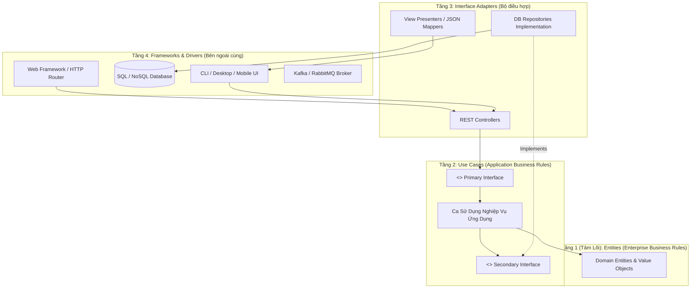
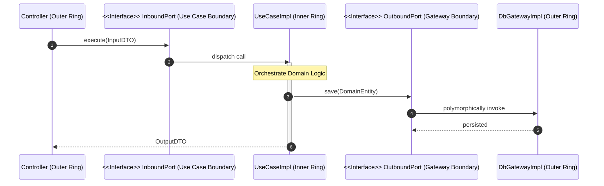
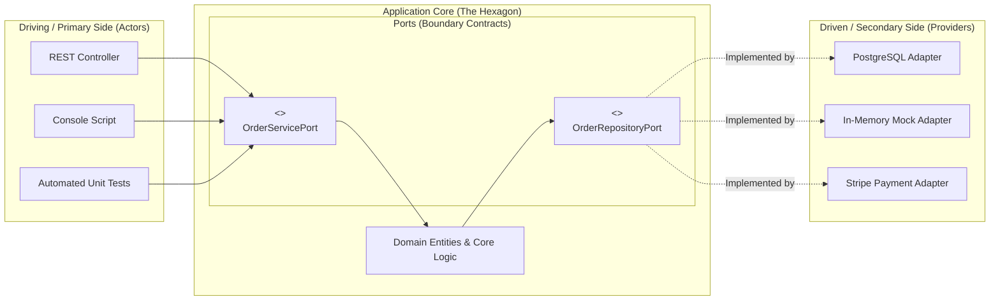

# 4.4. Kiến Trúc Sạch và Kiến Trúc Lục Giác (Clean Architecture & Hexagonal Ports & Adapters)

> [!IMPORTANT]
> **Nếu bạn chỉ được nhớ một điều duy nhất:** Trọng tâm của Clean Architecture và Kiến trúc Lục giác là biến cơ sở dữ liệu, framework web và các dịch vụ bên thứ ba thành những chi tiết kỹ thuật có thể cắm-rút (Plugins) ở ngoại vi; mũi tên phụ thuộc mã nguồn bắt buộc phải luôn luôn hướng vào tâm lõi nghiệp vụ (The Dependency Rule), không bao giờ được phép hướng ra ngoài.

---

## 1. Kiến trúc Tổng quan & Mô hình Tư duy (Mental Model)

### Ẩn dụ Đời sống: Bo Mạch Chủ Máy Tính và Chuẩn Cắm USB / PCIe
Hãy hình dung hệ thống phần mềm của bạn giống như một chiếc máy tính để bàn hiện đại:
- **Core Domain & Use Cases (CPU & Bo Mạch Chủ - Motherboard)**: Nơi diễn ra các phép tính logic cốt lõi. Bo mạch chủ không quan tâm bạn cắm bàn phím cơ quang học hay bàn phím cao su rẻ tiền, cũng không cần biết màn hình hiển thị là OLED 4K hay màn hình đen trắng CRT. Nó chỉ giao tiếp thông qua các khe cắm chuẩn hóa.
- **Ports (Các Khe Cắm Chuẩn - Ports: USB, HDMI, PCIe)**: Các giao diện trừu tượng (Interfaces) quy định hình dạng chân cắm và giao thức truyền tải tín hiệu điện tử.
- **Adapters (Thiết bị Ngoại vi & Jack Chuyển Đổi)**: Chiếc chuột máy tính (Driving Adapter) gửi tín hiệu bấm vào bo mạch chủ thông qua cổng USB; chiếc Card đồ họa Nvidia (Driven Adapter) nhận dữ liệu từ CPU và xuất ra màn hình qua cổng HDMI.
- **Khả năng thay thế tức thì (Hot-Swappable)**: Nếu chiếc bàn phím bị hỏng hoặc bạn muốn nâng cấp lên loại bàn phím công thái học mới, bạn chỉ cần rút giắc cắm cũ và cắm cái mới vào cổng USB mà không cần phải đập vỡ bo mạch chủ hay hàn lại vi mạch. Tương tự, bạn có thể đổi từ PostgreSQL sang DynamoDB trong 1 ngày mà không sửa một dòng code nghiệp vụ nào trong Domain!



---

## 2. Chi tiết từng Keyword (Under-the-Hood Deep Dive)

### 2.1. Bốn Vòng Tròn Đồng Tâm: Entities, Use Cases, Interface Adapters & Frameworks/Drivers
Mô hình Clean Architecture của Robert C. Martin (Uncle Bob) chuẩn hóa hệ thống thành 4 vòng tròn đồng tâm với ranh giới trách nhiệm cực kỳ khắt khe:

1. **Entities (Vòng 1 - Vùng Tâm Lõi - Enterprise Business Rules)**:
   - Đại diện cho các quy tắc kinh doanh tối cao của doanh nghiệp.
   - Chứa các thực thể cốt lõi mang hành vi và các quy tắc kiểm soát tính toàn vẹn (Invariants).
   - Có tuổi thọ dài nhất: Dù công ty có chuyển từ ứng dụng Web sang Mobile, từ cơ sở dữ liệu quan hệ sang Blockchain, các Entities này vẫn giữ nguyên vẹn.
2. **Use Cases (Vòng 2 - Application Business Rules)**:
   - Chứa các quy tắc nghiệp vụ đặc thù của ứng dụng phần mềm cụ thể.
   - Đóng vai trò điều phối luồng dữ liệu tương tác giữa các Entities, triệu hồi các quy tắc của Entities để hoàn thành mục tiêu của người dùng (ví dụ: `RegisterNewCustomerUseCase`, `ProcessCheckoutUseCase`).
   - Tầng này hoàn toàn độc lập với UI và Database.
3. **Interface Adapters (Vòng 3 - Bộ Chuyển Đổi Giao Diện)**:
   - Chuyển đổi dữ liệu từ định dạng thuận tiện nhất cho Use Cases và Entities sang định dạng thuận tiện nhất cho các công cụ bên ngoài.
   - Nơi cư trú của: **Controllers** (chuyển đổi HTTP Request thành DTO), **Presenters** (chuyển đổi DTO thành ViewModel), và **Repository Implementations** (chuyển đổi Entities thành các dòng SQL hoặc tài liệu BSON).
4. **Frameworks & Drivers (Vòng 4 - Vùng Ngoại Vi Dễ Thay Thế)**:
   - Nơi chứa các công cụ cụ thể: Spring Boot, FastAPI, Gin, PostgreSQL, Docker, AWS S3.
   - Đây là tầng chứa ít logic nhất và là tầng "dễ vứt bỏ nhất" khi công nghệ bị lỗi thời.

---

### 2.2. Quy Tắc Phụ Thuộc Tối Cao (The Dependency Rule) & Screaming Architecture

#### 1. The Dependency Rule (Quy Tắc Phụ Thuộc)
> *"Mọi mũi tên phụ thuộc mã nguồn (Source Code Dependencies) bắt buộc phải luôn chỉ VÀO TRONG, tuyệt đối KHÔNG BAO GIỜ được chỉ ra ngoài!"*

- Mã nguồn ở tầng bên trong không bao giờ được phép nhắc tên, biết sự tồn tại, hoặc `import` bất kỳ lớp, hàm, biến hay kiểu dữ liệu nào được định nghĩa ở các tầng bên ngoài.
- Dữ liệu đi qua ranh giới giữa các tầng phải là các cấu trúc dữ liệu đơn giản (Plain Data Structures / DTOs), không bao giờ truyền đối tượng của tầng ngoài (như `HttpRequest` hay `SqlRowSet`) vào tầng bên trong.

#### 2. Screaming Architecture (Kiến Trúc Biết Gào Thét)
Uncle Bob nhấn mạnh rằng kiến trúc phần mềm phải làm nổi bật bản chất nghiệp vụ chứ không phải framework:
- **Kiến trúc Tồi**: Khi mở một dự án, bạn nhìn thấy thư mục: `controllers/`, `models/`, `views/`, `services/`. Kiến trúc này "gào thét" rằng: *"Tôi là một ứng dụng Ruby on Rails hoặc Spring Boot!"* nhưng không ai biết nó kinh doanh ngành gì.
- **Screaming Architecture Chuẩn**: Khi mở dự án, bạn nhìn thấy: `loan_origination/`, `customer_onboarding/`, `payment_settlement/`, `risk_scoring/`. Kiến trúc này "gào thét" rằng: *"Đây là một hệ thống Tài chính - Ngân hàng (FinTech)!"*.

---

### 2.3. Ranh Giới Kiến Trúc và Vùng Lõi Tách Rời (Decoupled Core & Boundaries)
Để đạt được sự độc lập hoàn toàn, Clean Architecture dựng lên các **Boundary Interfaces**:


- **Inbound Boundary**: Use Case định nghĩa một Input Port Interface. Controller gọi hàm thông qua Interface này.
- **Outbound Boundary**: Use Case định nghĩa một Output Port (Gateway) Interface. Database Adapter ở vòng ngoài cài đặt Interface này. Nhờ nguyên lý **Dependency Inversion Principle (DIP)**, luồng điều khiển (Flow of Control) đi ra ngoài Database, nhưng chiều phụ thuộc mã nguồn (Source Code Dependency) lại hướng ngược vào trong lõi!

---

### 2.4. Kiến Trúc Lục Giác: Ports & Adapters (Alistair Cockburn)
Năm 2005, Alistair Cockburn phát minh ra **Hexagonal Architecture** (còn gọi là *Ports and Adapters Pattern*). Hình lục giác không có ý nghĩa toán học 6 cạnh, mà đại diện cho một ranh giới đa chiều nơi có vô số cổng cắm (Ports) kết nối với thế giới bên ngoài:



---

### 2.5. Phân Định Driving vs Driven (Primary vs Secondary Ports & Adapters)

#### 1. Driving Side (Phía Chủ Động / Primary Side)
- **Tác nhân**: Người dùng, ứng dụng web của bên thứ ba, hoặc hệ thống kiểm thử tự động. Đây là bên chủ động khởi tạo và điều khiển tương tác.
- **Primary Ports (Inbound Ports)**: Các Interface định nghĩa những gì ứng dụng có thể làm (Use Cases API).
- **Driving Adapters**: Tiếp nhận yêu cầu bên ngoài, chuyển đổi sang ngôn ngữ của ứng dụng và gọi vào Primary Port (ví dụ: REST Controller, gRPC Handler, Kafka Consumer).

#### 2. Driven Side (Phía Bị Động / Secondary Side)
- **Tác nhân**: Cơ sở dữ liệu, dịch vụ đám mây, máy chủ SMTP. Đây là bên bị động, chỉ hành động khi được ứng dụng yêu cầu.
- **Secondary Ports (Outbound Ports)**: Các Interface do ứng dụng tự định nghĩa để yêu cầu thế giới cung cấp dữ liệu hoặc lưu trữ trạng thái (ví dụ: `IUserRepository`, `IPaymentGateway`).
- **Driven Adapters**: Cài đặt các Secondary Ports cụ thể (ví dụ: `PostgresUserRepository`, `StripePaymentGateway`).

---

### 2.6. Khả Năng Kiểm Thử Tối Thượng (Testability Without Web or Database)
Ưu điểm lớn nhất của Hexagonal & Clean Architecture là **Testability vô song**:
- Trong kiến trúc truyền thống dính chặt vào database, để chạy kiểm thử tích hợp bạn phải bật Docker Compose, dựng cơ sở dữ liệu thật, chạy migrations và seed dữ liệu, làm một bộ test tốn hàng chục phút.
- Trong Kiến trúc Lục giác, bạn chỉ cần viết một **Mock / In-Memory Adapter** cài đặt Secondary Port. Toàn bộ $100\%$ các luồng nghiệp vụ phức tạp của Use Cases và Entities được chạy và kiểm tra trong bộ nhớ RAM ở tốc độ hàng ngàn tests mỗi giây!

---

## 3. Thực thi Mã nguồn & Mô phỏng Chuyên sâu (Dual-Engine Implementation)

### 3.1. C++20 Implementation: Complete Hexagonal Architecture with Swappable Adapters
Chương trình C++20 dưới đây mô phỏng đầy đủ một hệ thống thương mại theo Kiến trúc Lục giác (Hexagonal Architecture) với Domain Entity, Inbound Port, Outbound Port, Driving Controller và hai bộ Driven Adapters có thể hoán đổi nóng (In-Memory Mock vs SQL Adapter).

```cpp
#include <iostream>
#include <memory>
#include <string>
#include <unordered_map>
#include <stdexcept>
#include <utility>

// ============================================================================
// 1. INSIDE THE HEXAGON: DOMAIN ENTITY (Vòng 1 - Core Domain)
// ============================================================================
class Order {
public:
    enum class Status { PENDING, PAID, CANCELLED };

private:
    std::string id_;
    std::string customerId_;
    int64_t totalCents_;
    Status status_{Status::PENDING};

public:
    Order(std::string id, std::string customerId, int64_t totalCents)
        : id_(std::move(id)), customerId_(std::move(customerId)), totalCents_(totalCents) {
        if (totalCents_ <= 0) {
            throw std::invalid_argument("Domain Invariant Violated: Total amount must be positive!");
        }
    }

    void markAsPaid() {
        if (status_ == Status::PAID) {
            throw std::logic_error("Order is already settled!");
        }
        status_ = Status::PAID;
    }

    [[nodiscard]] const std::string& id() const noexcept { return id_; }
    [[nodiscard]] const std::string& customerId() const noexcept { return customerId_; }
    [[nodiscard]] int64_t totalCents() const noexcept { return totalCents_; }
    [[nodiscard]] Status status() const noexcept { return status_; }
};

// ============================================================================
// 2. INSIDE THE HEXAGON: PORTS (Contracts)
// ============================================================================

// Outbound Port / Secondary Port: Do Core định nghĩa để yêu cầu lưu trữ
class IOrderRepositoryPort {
public:
    virtual ~IOrderRepositoryPort() = default;
    virtual std::unique_ptr<Order> findById(const std::string& id) = 0;
    virtual void save(const Order& order) = 0;
};

// Inbound Port / Primary Port: Do Core cung cấp cho thế giới bên ngoài điều khiển
class IProcessPaymentUseCasePort {
public:
    virtual ~IProcessPaymentUseCasePort() = default;
    virtual void execute(const std::string& orderId) = 0;
};

// ============================================================================
// 3. INSIDE THE HEXAGON: USE CASE IMPLEMENTATION (Vòng 2 - Orchestration)
// ============================================================================
class ProcessPaymentUseCase : public IProcessPaymentUseCasePort {
private:
    std::shared_ptr<IOrderRepositoryPort> repositoryPort_;

public:
    explicit ProcessPaymentUseCase(std::shared_ptr<IOrderRepositoryPort> repoPort)
        : repositoryPort_(std::move(repoPort)) {}

    void execute(const std::string& orderId) override {
        std::cout << "[Hexagon Core: UseCase] Processing payment for Order ID: " << orderId << "...\n";
        auto order = repositoryPort_->findById(orderId);
        if (!order) {
            throw std::runtime_error("Order with ID " + orderId + " not found!");
        }

        // Triệu hồi hành vi của Entity
        order->markAsPaid();

        // Ghi lại thông qua Outbound Port
        repositoryPort_->save(*order);
        std::cout << "[Hexagon Core: UseCase] Order " << orderId << " settled successfully.\n";
    }
};

// ============================================================================
// 4. OUTSIDE THE HEXAGON: DRIVEN ADAPTERS (Outbound Implementations)
// ============================================================================

// Driven Adapter A: Mock In-Memory (Dành cho Unit Testing siêu tốc)
class InMemoryOrderAdapter : public IOrderRepositoryPort {
private:
    std::unordered_map<std::string, Order> store_;
public:
    std::unique_ptr<Order> findById(const std::string& id) override {
        auto it = store_.find(id);
        if (it != store_.end()) {
            return std::make_unique<Order>(it->second);
        }
        return nullptr;
    }

    void save(const Order& order) override {
        store_.insert_or_assign(order.id(), order);
        std::cout << "  [Driven Adapter: In-Memory] Persisted Order " << order.id() 
                  << " in RAM cache (Zero Network Latency).\n";
    }
};

// Driven Adapter B: Giả lập PostgreSQL Adapter (Dành cho Production)
class PostgresOrderAdapter : public IOrderRepositoryPort {
public:
    std::unique_ptr<Order> findById(const std::string& id) override {
        std::cout << "  [Driven Adapter: PostgreSQL] SQL: SELECT * FROM orders WHERE id = '" << id << "';\n";
        return std::make_unique<Order>(id, "CUST_VIP_99", 150'000);
    }

    void save(const Order& order) override {
        std::cout << "  [Driven Adapter: PostgreSQL] SQL: UPDATE orders SET status = 'PAID' WHERE id = '" 
                  << order.id() << "';\n";
    }
};

// ============================================================================
// 5. OUTSIDE THE HEXAGON: DRIVING ADAPTER (Inbound Implementation)
// ============================================================================
class OrderRestHttpController {
private:
    std::shared_ptr<IProcessPaymentUseCasePort> useCasePort_;

public:
    explicit OrderRestHttpController(std::shared_ptr<IProcessPaymentUseCasePort> useCasePort)
        : useCasePort_(std::move(useCasePort)) {}

    void postPayOrderEndpoint(const std::string& orderId) {
        std::cout << "\n[Driving Adapter: REST Controller] Received POST /api/orders/" << orderId << "/pay\n";
        try {
            useCasePort_->execute(orderId);
            std::cout << "  -> HTTP 200 OK: Payment settled.\n";
        } catch (const std::exception& ex) {
            std::cout << "  -> HTTP 400 Bad Request: " << ex.what() << "\n";
        }
    }
};

int main() {
    std::cout << "=== C++20 Hexagonal Ports & Adapters Architecture Demo ===\n";

    // KỊCH BẢN 1: MÔI TRƯỜNG KIỂM THỬ SIÊU TỐC (IN-MEMORY ADAPTER)
    std::cout << "\n--- 1. Testing Environment with In-Memory Adapter ---\n";
    auto inMemoryRepo = std::make_shared<InMemoryOrderAdapter>();
    // Seed dữ liệu vào RAM
    inMemoryRepo->save(Order("ORD-001", "CUST-10", 49'900));

    auto testUseCase = std::make_shared<ProcessPaymentUseCase>(inMemoryRepo);
    OrderRestHttpController testController(testUseCase);
    testController.postPayOrderEndpoint("ORD-001");

    // KỊCH BẢN 2: MÔI TRƯỜNG PRODUCTION VỚI POSTGRESQL ADAPTER (KHÔNG ĐỔI 1 DÒNG CORE!)
    std::cout << "\n--- 2. Production Environment with PostgreSQL Adapter ---\n";
    auto postgresRepo = std::make_shared<PostgresOrderAdapter>();
    auto prodUseCase = std::make_shared<ProcessPaymentUseCase>(postgresRepo);
    OrderRestHttpController prodController(prodUseCase);
    prodController.postPayOrderEndpoint("ORD-888");

    return 0;
}
```

#### Terminal Output Mẫu (C++20):
```text
=== C++20 Hexagonal Ports & Adapters Architecture Demo ===

--- 1. Testing Environment with In-Memory Adapter ---
  [Driven Adapter: In-Memory] Persisted Order ORD-001 in RAM cache (Zero Network Latency).

[Driving Adapter: REST Controller] Received POST /api/orders/ORD-001/pay
[Hexagon Core: UseCase] Processing payment for Order ID: ORD-001...
  [Driven Adapter: In-Memory] Persisted Order ORD-001 in RAM cache (Zero Network Latency).
[Hexagon Core: UseCase] Order ORD-001 settled successfully.
  -> HTTP 200 OK: Payment settled.

--- 2. Production Environment with PostgreSQL Adapter ---

[Driving Adapter: REST Controller] Received POST /api/orders/ORD-888/pay
[Hexagon Core: UseCase] Processing payment for Order ID: ORD-888...
  [Driven Adapter: PostgreSQL] SQL: SELECT * FROM orders WHERE id = 'ORD-888';
  [Driven Adapter: PostgreSQL] SQL: UPDATE orders SET status = 'PAID' WHERE id = 'ORD-888';
[Hexagon Core: UseCase] Order ORD-888 settled successfully.
  -> HTTP 200 OK: Payment settled.
```

---

### 3.2. Python 3.11+ Implementation: Clean Banking Architecture with Primary/Secondary Ports
Chương trình Python 3.11+ dưới đây minh họa việc thực hiện Clean Architecture thuần túy với các Primary / Secondary Ports định nghĩa bằng `typing.Protocol` và thực thi Unit Test trong bộ nhớ RAM mà không cần database.

```python
from __future__ import annotations
from dataclasses import dataclass
from typing import Protocol, Optional
import unittest

# ============================================================================
# 1. CORE DOMAIN: ENTITIES (Vòng 1 - Trái tim hệ thống)
# ============================================================================
class InsufficientBalanceException(Exception):
    pass

@dataclass
class Account:
    account_id: str
    owner_name: str
    balance_usd: float

    def withdraw(self, amount: float) -> None:
        if amount <= 0:
            raise ValueError("Withdrawal amount must be positive")
        if self.balance_usd < amount:
            raise InsufficientBalanceException(
                f"Account {self.account_id} has insufficient funds: ${self.balance_usd:.2f} < ${amount:.2f}"
            )
        self.balance_usd -= amount

# ============================================================================
# 2. APPLICATION CORE: PORTS (Vòng 2 - Boundary Interfaces)
# ============================================================================

# Secondary Port (Outbound): Cổng lưu trữ
class AccountRepositoryPort(Protocol):
    def get_by_id(self, account_id: str) -> Optional[Account]: ...
    def save(self, account: Account) -> None: ...

# Primary Port (Inbound): Cổng nghiệp vụ
class WithdrawFundsUseCasePort(Protocol):
    def execute(self, account_id: str, amount: float) -> float: ...

# ============================================================================
# 3. APPLICATION CORE: USE CASE INTERACTION (Vòng 2 - Implementation)
# ============================================================================
class WithdrawFundsUseCase(WithdrawFundsUseCasePort):
    def __init__(self, repo_port: AccountRepositoryPort):
        self._repo = repo_port

    def execute(self, account_id: str, amount: float) -> float:
        account = self._repo.get_by_id(account_id)
        if not account:
            raise LookupError(f"Account '{account_id}' does not exist")
        
        account.withdraw(amount)
        self._repo.save(account)
        return account.balance_usd

# ============================================================================
# 4. ADAPTERS: DRIVEN ADAPTER (Vòng 3/4 - In-Memory Test Implementation)
# ============================================================================
class InMemoryAccountAdapter(AccountRepositoryPort):
    def __init__(self):
        self.accounts: dict[str, Account] = {}

    def get_by_id(self, account_id: str) -> Optional[Account]:
        return self.accounts.get(account_id)

    def save(self, account: Account) -> None:
        self.accounts[account.account_id] = account

# ============================================================================
# 5. ADAPTERS: DRIVING ADAPTER (Vòng 3/4 - FastAPI / Flask Controller Simulator)
# ============================================================================
class BankingApiController:
    def __init__(self, withdraw_service: WithdrawFundsUseCasePort):
        self.service = withdraw_service

    def handle_withdraw_post(self, account_id: str, amount: float) -> tuple[int, dict]:
        try:
            new_balance = self.service.execute(account_id, amount)
            return 200, {"status": "SUCCESS", "remaining_balance": new_balance}
        except InsufficientBalanceException as ibe:
            return 422, {"status": "UNPROCESSABLE_ENTITY", "error": str(ibe)}
        except LookupError as le:
            return 404, {"status": "NOT_FOUND", "error": str(le)}
        except Exception as e:
            return 500, {"status": "SERVER_ERROR", "error": str(e)}


if __name__ == "__main__":
    print("=== Python 3.11+ Clean Architecture Bank Ledger Demo ===")
    
    # Thiết lập Driven Adapter (In-Memory)
    memory_repo = InMemoryAccountAdapter()
    memory_repo.save(Account("ACC-007", "James Bond", 5000.00))

    # Khởi tạo Lõi Nghiệp Vụ
    use_case = WithdrawFundsUseCase(repo_port=memory_repo)

    # Khởi tạo Driving Adapter
    controller = BankingApiController(withdraw_service=use_case)

    # Thử nghiệm 1: Rút tiền thành công
    status, payload = controller.handle_withdraw_post("ACC-007", 1200.00)
    print(f"\n[Test 1] Withdraw $1200.00 -> HTTP {status} | Response: {payload}")

    # Thử nghiệm 2: Rút tiền vượt hạn mức (Vi phạm Domain Rule)
    status, payload = controller.handle_withdraw_post("ACC-007", 10000.00)
    print(f"\n[Test 2] Withdraw $10,000.00 -> HTTP {status} | Response: {payload}")

    # Thử nghiệm 3: Tài khoản không tồn tại
    status, payload = controller.handle_withdraw_post("ACC-999", 50.00)
    print(f"\n[Test 3] Withdraw from non-existent account -> HTTP {status} | Response: {payload}")
```

#### Terminal Output Mẫu (Python 3.11+):
```text
=== Python 3.11+ Clean Architecture Bank Ledger Demo ===

[Test 1] Withdraw $1200.00 -> HTTP 200 | Response: {'status': 'SUCCESS', 'remaining_balance': 3800.0}

[Test 2] Withdraw $10,000.00 -> HTTP 422 | Response: {'status': 'UNPROCESSABLE_ENTITY', 'error': 'Account ACC-007 has insufficient funds: $3800.00 < $10000.00'}

[Test 3] Withdraw from non-existent account -> HTTP 404 | Response: {'status': 'NOT_FOUND', 'error': "Account 'ACC-999' does not exist"}
```

---

## 4. Systems Engineering & Production Pitfalls

### Các Cạm Bẫy Thực Chiến (Gotchas & Production Antipatterns)

1. **Ô Nhiễm Entity Bởi Annotations của Framework (Entity Framework Pollution)**:
   - *Bản chất*: Lập trình viên gắn trực tiếp các annotations như `@Entity`, `@Table(name="orders")`, `@JsonProperty` hoặc `@BsonId` lên các Entities trong Domain Layer. Việc này phá hủy hoàn toàn nguyên tắc cốt lõi: Domain không còn độc lập mà bị trói chặt vào ORM framework đó.
   - *Khắc phục*: Tách rời 2 lớp thực thể riêng biệt: **Domain Entity** (thuần túy không annotations) và **Persistence Entity / Data Model** (chứa annotations của ORM). Sử dụng Data Mapper ở tầng Infrastructure để chuyển đổi qua lại.

2. **Chi Phí Ánh Xạ Dữ Liệu Dày Đặc (Mapping Overhead Tax)**:
   - *Bản chất*: Với mỗi request, dữ liệu phải được ánh xạ qua 4 cấp độ: HTTP JSON $\to$ Request DTO $\to$ Domain Entity $\to$ ORM Persistence Entity $\to$ Database Row (và ngược lại ở chiều trả về). Trong các hệ thống xử lý hàng trăm ngàn requests/giây, việc cấp phát và sao chép liên tục hàng triệu object tạm thời này gây áp lực khổng lồ lên CPU Memory Bus và kích hoạt Garbage Collector liên tục.
   - *Khắc phục*: Với các hệ thống High-Throughput / Low-Latency, áp dụng CQRS để bypass toàn bộ mapping ở đường dẫn đọc (Read Queries).

3. **Hiện Tượng Mô Hình Nghiệp Vụ Thiếu Máu (Anemic Domain Model)**:
   - *Bản chất*: Tạo ra Clean Architecture với đầy đủ các vòng tròn nhưng Entities lại chỉ chứa các trường `private` với getters/setters rỗng tuếch. Toàn bộ logic nghiệp vụ bị dồn hết vào Use Cases, biến Use Cases thành các hàm thủ tục khổng lồ (Procedural Scripts), vi phạm tính đóng gói của OOP.
   - *Khắc phục*: Đưa các quy tắc tính toán, thẩm định và biến đổi trạng thái trở về chính bên trong các Entities; Use Case chỉ làm nhiệm vụ điều phối và giao tiếp với Ports.

4. **Kỹ Thuật Chẩn Đoán & Giám Sát Kiến Trúc Bằng CLI**:
   ```bash
   # 1. Quét vi phạm The Dependency Rule bằng ArchUnit CLI trong Java/Kotlin
   archunit-cli check --rules clean-architecture-rules.xml target/classes

   # 2. Kiểm tra các module Domain bị phụ thuộc ngược ra ngoài bằng Dependabot / Deptrac CLI
   deptrac analyze --config-file=depfile.yaml

   # 3. Benchmark thời gian chạy của Unit Tests Clean Architecture (RAM vs DB)
   pytest tests/unit/ -v --benchmark-only
   ```

---

## 5. Bảng So sánh & Decision Matrix

### 5.1. So Sánh Chi Tiết Các Trường Phái Kiến Trúc Hướng Nghiệp Vụ

| Tiêu Chí | Traditional Layered | Hexagonal (Ports & Adapters) | Onion Architecture | Clean Architecture |
| :--- | :--- | :--- | :--- | :--- |
| **Tác Giả & Năm** | N-Tier Standards (1990s) | Alistair Cockburn (2005) | Jeffrey Palermo (2008) | Robert C. Martin (2012) |
| **Trọng Tâm** | Tầng Cơ sở dữ liệu | Cổng tiếp nhận (Ports) | Domain Model & Services | The Dependency Rule |
| **Hình Thái Trực Quan** | Các thanh xếp ngang | Khối lục giác đối xứng | Các vòng tròn củ hành | Bốn vòng tròn đồng tâm |
| **Thuật Ngữ Biên** | DAL / Presentation | Driving / Driven Adapters | Infrastructure / UI | Interface Adapters |
| **Mức Độ Cô Lập Domain** | Thấp (Domain dính DB) | **Tuyệt đối** | **Tuyệt đối** | **Tuyệt đối** |
| **Khả Năng Đổi DB** | Khó khăn | Dễ như cắm USB | Dễ như cắm USB | Dễ như cắm USB |

### 5.2. Ma Trận Quyết Định Lựa Chọn Kiến Trúc Cho Dự Án Mới

| Quy Mô & Đặc Điểm Bài Toán | Nên Chọn Phong Cách | Lý Do Kỹ Thuật |
| :--- | :--- | :--- |
| **MVP, Startup ngắn hạn (< 6 tháng)** | Traditional 3-Tier Layered | Tốc độ ra mắt là tối thượng; không cần chi phí mapping phức tạp |
| **Ứng dụng CRUD thuần túy, ít business logic** | Active Record / Layered | Tránh bẫy Over-engineering; Clean Architecture sẽ biến thành Sinkhole |
| **FinTech, Core Banking, Bảo Hiểm** | **Clean / Hexagonal Architecture** | Logic nghiệp vụ phức tạp, cần tồn tại 10-20 năm, yêu cầu kiểm thử 100% RAM |
| **Hệ thống Microservices quy mô lớn** | Hexagonal Architecture per Service | Mỗi microservice tự bảo vệ ranh giới Domain của mình độc lập với transport |
