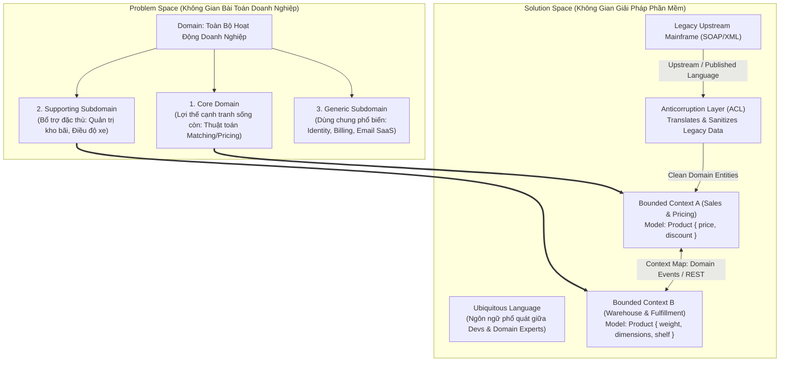
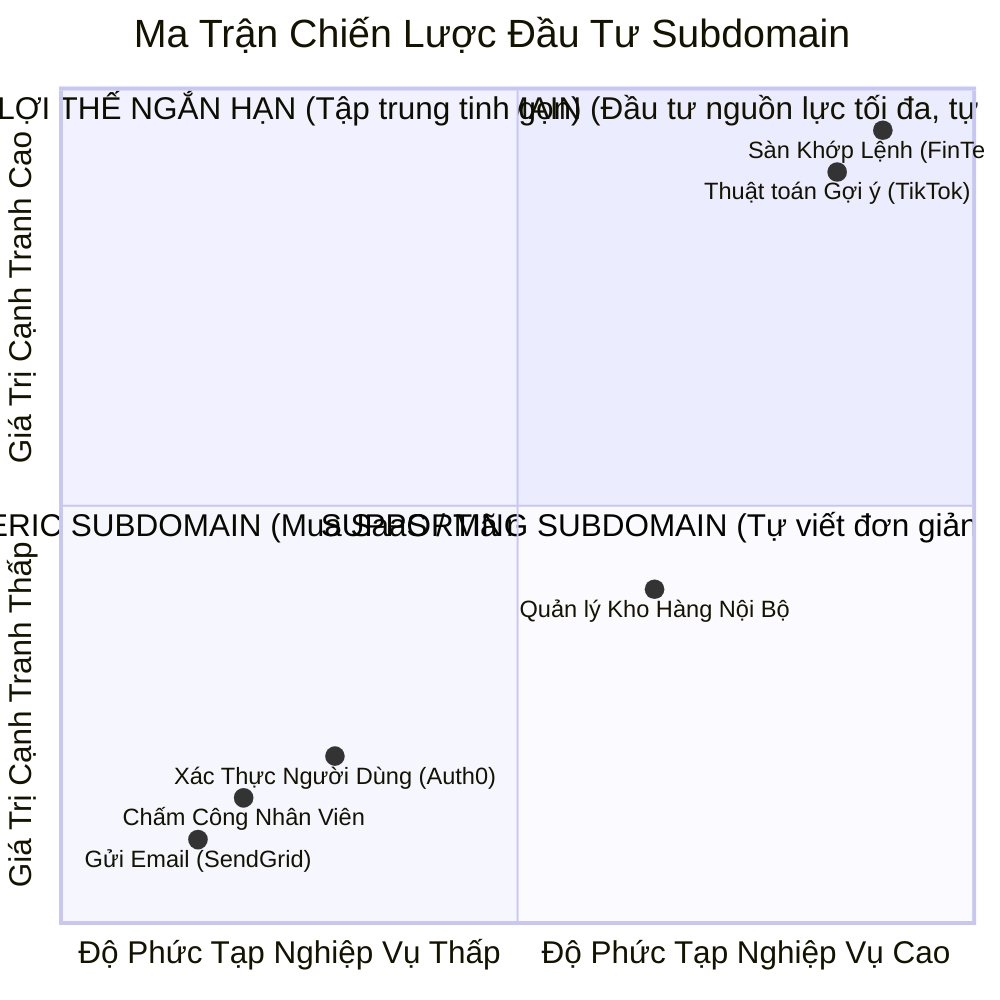
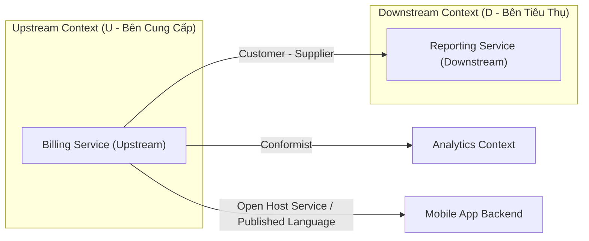

# 4.5. Nền Tảng Thiết Kế Hướng Miền Chiến Lược (Domain-Driven Design Strategic Fundamentals)

> [!IMPORTANT]
> **Nếu bạn chỉ được nhớ một điều duy nhất:** Strategic DDD không bắt đầu bằng code hay database, mà bắt đầu bằng việc phân định ranh giới ngữ nghĩa (Bounded Contexts) và bản đồ quyền lực kỹ thuật (Context Mapping); một kiến trúc phân tán thành công là kiến trúc mà ở đó mỗi Bounded Context sở hữu một mô hình nghiệp vụ độc lập tuyệt đối và được bảo vệ nghiêm ngặt bởi Anticorruption Layer (ACL).

---

## 1. Kiến trúc Tổng quan & Mô hình Tư duy (Mental Model)

### Ẩn dụ Đời sống: Bản Đồ Địa Chính Quốc Gia và Quan Hệ Ngoại Giao
Hãy hình dung hệ thống phần mềm của một tập đoàn giống như quan hệ giữa các quốc gia có chủ quyền trên thế giới:
- **Domain & Subdomains (Lãnh thổ Quốc gia)**:
  - *Core Domain (Kinh đô & Trung tâm Đổi mới Sáng tạo)*: Nơi nắm giữ bí quyết công nghệ độc quyền, mang lại vị thế siêu cường cho quốc gia (ví dụ: Thung lũng Silicon, các viện nghiên cứu bán dẫn). Đây là nơi bạn dồn 80% nhân tài xuất sắc nhất để xây dựng.
  - *Supporting Subdomain (Hệ thống Nông nghiệp & Cơ sở hạ tầng chuyên dụng)*: Cung cấp lương thực và đường sá để hỗ trợ kinh đô hoạt động. Cần tự xây dựng vì mang tính đặc thù nội bộ.
  - *Generic Subdomain (Dịch vụ Chuyển phát Bưu chính, Năng lượng)*: Mua điện lưới quốc tế hoặc thuê dịch vụ viễn thông vệ tinh có sẵn; không cần phát minh lại bánh xe.
- **Ubiquitous Language & Bounded Context (Biên giới Ngôn ngữ & Pháp quyền)**:
  - Cùng một từ "Tiền": Ở Mỹ có nghĩa là USD, ở Châu Âu có nghĩa là Euro, ở Nhật là Yên. Nếu một công dân cố mang luật pháp nước này áp đặt sang nước khác mà không có sự thông dịch, khủng hoảng sẽ xảy ra (Hiện tượng Đa nghĩa - Polysemy).
  - Bounded Context là đường biên giới hải quan: Bên trong lãnh thổ nước bạn, tiếng mẹ đẻ và luật pháp của bạn có giá trị tối cao.
- **Context Mapping & ACL (Đại sứ quán & Cục Xuất Nhập Cảnh)**:
  - Khi giao thương với một quốc gia cổ hủ dùng hệ thống đo lường lỗi thời (Legacy Mainframe), quốc gia hiện đại thiết lập một **Anticorruption Layer (Cơ quan Kiểm dịch & Dịch thuật)** tại cửa khẩu để khử trùng và dịch toàn bộ văn bản về chuẩn mực hiện đại trước khi chuyển vào nội địa.



---

## 2. Chi tiết từng Keyword (Under-the-Hood Deep Dive)

### 2.1. Phân Tách Không Gian Bài Toán (Problem Space) và Không Gian Giải Pháp (Solution Space)
Eric Evans chia thế giới Domain-Driven Design thành hai không gian hoàn toàn tách biệt:

1. **Problem Space (Không gian Bài toán)**:
   - Tập trung vào **Mục tiêu Kinh doanh (What the business needs)** mà doanh nghiệp đang cố gắng chinh phục.
   - Không chứa bất kỳ khái niệm kỹ thuật nào như Docker, SQL, Kubernetes, Microservices hay NoSQL.
   - Hoạt động phân tích ở đây nhằm bóc tách toàn bộ hoạt động của doanh nghiệp thành các **Subdomains (Miền con)**.
2. **Solution Space (Không gian Giải pháp)**:
   - Tập trung vào **Cách thức Kỹ thuật Hiện thực hóa (How the software is built)** để giải quyết bài toán.
   - Nơi cư trú của các **Bounded Contexts**, mã nguồn, kiến trúc phần mềm, cơ sở dữ liệu, APIs và các mẫu tích hợp Context Mapping.
   - *Nguyên tắc cốt lõi*: Một Subdomain lý tưởng nhất nên được ánh xạ tương ứng vào một Bounded Context duy nhất ($1:1$), nhưng trong thực tế các hệ thống legacy thường có quan hệ $1:N$ hoặc $M:N$.

---

### 2.2. Phân Loại Miền Nghiệp Vụ: Core Domain, Supporting Subdomain và Generic Subdomain



1. **Core Domain (Miền Cốt Lõi)**:
   - Là lý do duy nhất khiến khách hàng trả tiền cho bạn thay vì đối thủ cạnh tranh.
   - *Ví dụ*: Thuật toán For You của TikTok, công cụ tìm kiếm của Google, hệ thống gợi ý và định giá động của Uber/Grab.
   - *Chiến lược*: **BẮT BUỘC TỰ LẬP TRÌNH (In-House Development)**. Phân bổ các Senior/Staff Engineers giỏi nhất vào đây, liên tục cấu trúc lại mã nguồn và bảo vệ bản quyền phần mềm.
2. **Supporting Subdomain (Miền Bổ Trợ)**:
   - Nghiệp vụ liên quan mật thiết và cần thiết để Core Domain vận hành, nhưng bản thân nó không tạo ra sự khác biệt độc quyền trên thị trường.
   - *Ví dụ*: Hệ thống quản lý mã vạch kho hàng của sàn thương mại điện tử Tiki, hệ thống theo dõi hành trình xe tải của công ty vận tải.
   - *Chiến lược*: Tự viết một cách tinh giản nhất có thể, tránh over-engineering, hoặc thuê ngoài (Outsource) phát triển theo đặc tả rõ ràng.
3. **Generic Subdomain (Miền Chung)**:
   - Các chức năng phổ quát mà bất kỳ công ty nào trong nền kinh tế cũng cần, không mang bản sắc riêng.
   - *Ví dụ*: Xác thực phân quyền (OAuth2/SAML), Cổng thanh toán hóa đơn, Quản lý tài liệu hợp đồng, Gửi SMS/Email OTP.
   - *Chiến lược*: **TUYỆT ĐỐI KHÔNG TỰ VIẾT TỪ ĐẦU (Buy or Adopt)**. Mua các dịch vụ SaaS chuyên nghiệp (Auth0, Stripe, SendGrid, Twilio) hoặc dùng thư viện mã nguồn mở có sẵn.

---

### 2.3. Ngôn Ngữ Phổ Quát (Ubiquitous Language) và Hiện Tượng Đa Nghĩa (Polysemy)

#### 1. Ubiquitous Language (Ngôn ngữ Phổ quát)
- Là một ngôn ngữ thống nhất, nghiêm ngặt và không dung thứ cho sự mơ hồ, được xây dựng và chia sẻ chung giữa **Kỹ sư Phần mềm (Developers)** và **Chuyên gia Nghiệp vụ (Domain Experts)**.
- **Quy tắc bất di bất dịch**:
  - Không có sự "dịch thuật ngầm": Thuật ngữ xuất hiện trong buổi họp nghiệp vụ phải phản ánh chính xác từng chữ cái trong mã nguồn (Tên Class, Tên Hàm, Tên Event, Tên Trường DB).
  - Nếu Domain Expert nói về khái niệm *"Hoàn tiền cho khách hàng (Refund)"*, lập trình viên không được đặt tên hàm là `cancelOrderAndRevertMoney()`, mà bắt buộc phải là `order.refund()`.
  - Nếu phát hiện từ ngữ gây hiểu lầm, toàn bộ đội ngũ phải cùng họp để định nghĩa lại từ điển Ubiquitous Language.

#### 2. Hiện Tượng Đa Nghĩa (Polysemy)
Trong một doanh nghiệp lớn, cùng một từ ngữ sẽ mang ý nghĩa, cấu trúc dữ liệu và hành vi hoàn toàn khác nhau tùy thuộc vào góc nhìn của từng phòng ban:

| Khái Niệm | Góc Nhìn Bounded Context Bán Hàng (Sales) | Góc Nhìn Bounded Context Giao Vận (Logistics) |
| :--- | :--- | :--- |
| **Product (Sản Phẩm)** | Tên sản phẩm, Mã giảm giá, Giá niêm yết, Hình ảnh quảng cáo, Mô tả SEO. | Trọng lượng (Kg), Chiều dài/Rộng/Cao, Tiêu chuẩn bảo quản lạnh, Mã vị trí kệ hàng. |
| **Customer (Khách Hàng)** | Điểm tích lũy thành viên, Hạn mức tín dụng, Danh sách yêu thích. | Tọa độ GPS giao hàng, Mã số tòa nhà, Khung giờ được phép bấm chuông. |

*Hậu quả nếu gom chung*: Sinh ra **God Class (Lớp Thần Thánh)** với hàng trăm trường dữ liệu, 80% trường bị gán `null`, các phòng ban liên tục xung đột khi thay đổi logic.

---

### 2.4. Ranh Giới Ngữ Cảnh (Bounded Context) - Nền Tảng Tách Rời Microservices
- **Định nghĩa**: Bounded Context là một ranh giới rõ ràng (thường là một Repository, một Module độc lập hoặc một Microservice) mà bên trong đó một Ubiquitous Language và Domain Model được áp dụng với ý nghĩa toàn vẹn và duy nhất.
- Trong Bounded Context Bán Hàng, ta chỉ tạo class `SalesProduct`. Trong Bounded Context Giao Vận, ta tạo class `ShippableProduct`. Cả hai độc lập về chu kỳ phát hành, độc lập về database schema và không chia sẻ code model với nhau!

---

### 2.5. Bản Đồ Ngữ Cảnh (Context Mapping) và Các Mẫu Tích Hợp (Integration Patterns)
Context Map là sơ đồ mô tả mối quan hệ quyền lực tổ chức và cơ chế tích hợp kỹ thuật giữa các Bounded Contexts:



1. **Shared Kernel (Nhân Chia Sẻ)**: Hai Bounded Contexts cùng chia sẻ chung một thư viện mã nguồn và schema cơ sở dữ liệu. Cần sự phê duyệt của cả hai đội khi sửa đổi. Rất nguy hiểm nếu bị lạm dụng.
2. **Customer-Supplier (Khách Hàng - Nhà Cung Cấp)**: Bên Thượng nguồn (**Upstream - $U$**) cung cấp dịch vụ, bên Hạ nguồn (**Downstream - $D$**) tiêu thụ. Nhu cầu của bên Downstream được bên Upstream xem xét ưu tiên đưa vào kế hoạch phát triển.
3. **Conformist (Kẻ Phục Tùng)**: Bên Downstream hoàn toàn phụ thuộc vào mô hình dữ liệu của Upstream; Upstream không có nghĩa vụ phải sửa API theo ý Downstream. Downstream chấp nhận sao chép schema của Upstream vào hệ thống mình.
4. **Open Host Service (OHS) & Published Language (PL)**:
   - Bên Upstream cung cấp một giao thức truy cập mở chuẩn hóa (ví dụ: RESTful JSON API hoặc gRPC Protobuf) công khai cho tất cả các bên.
   - **Published Language**: Định dạng schema trung gian chuẩn hóa (JSON Schema, XML XSD, Protobuf) phục vụ giao tiếp.
5. **Separate Ways (Đường Ai Nấy Đi)**: Khi chi phí tích hợp kỹ thuật giữa hai hệ thống vượt quá giá trị mà nó mang lại, hai đội ngũ quyết định không tích hợp và tự giải quyết bài toán độc lập.

---

### 2.6. Anticorruption Layer (ACL) và Chiến Lược Bảo Vệ Vùng Lõi
Khi một Bounded Context hiện đại (Downstream) bắt buộc phải tích hợp với một hệ thống Upstream tồi tệ (như hệ thống Core Banking Mainframe cổ lỗ sĩ từ năm 1980 sử dụng XML lộn xộn hoặc chuỗi độ dài cố định):
- Nếu để mã nguồn Domain của bạn tương tác trực tiếp với dữ liệu cũ, các cấu trúc xấu xí của hệ thống cũ sẽ làm "nhiễm độc" và biến tướng Domain Model hiện đại của bạn.
- **Giải pháp**: Dựng lên một **Anticorruption Layer (ACL - Lớp Chống Tha Hóa)** ở giữa:
  - ACL nhận dữ liệu thô xấu xí từ Upstream.
  - ACL thẩm định, lọc bỏ các trường rác, và thực hiện ánh xạ hai chiều (Bidirectional Translation) sang các Clean Domain Entities và Value Objects của Downstream.
  - Vùng lõi của bạn hoàn toàn miễn nhiễm với sự biến đổi của hệ thống cũ!

---

## 3. Thực thi Mã nguồn & Mô phỏng Chuyên sâu (Dual-Engine Implementation)

### 3.1. C++20 Implementation: Enterprise Anticorruption Layer (ACL) Pattern
Chương trình C++20 dưới đây mô phỏng một Anticorruption Layer hoàn chỉnh chuyển đổi dữ liệu thô (chuỗi phân cách cổ điển từ Legacy Mainframe) thành Domain Entity giàu tính năng (Rich Domain Entity) với các kiểm soát bất biến (Invariants) nghiêm ngặt.

```cpp
#include <iostream>
#include <string>
#include <vector>
#include <sstream>
#include <stdexcept>
#include <memory>
#include <utility>

// ============================================================================
// 1. UPSTREAM LEGACY DATA STRUCTURE (Xấu xí, không có Type-Safety)
// ============================================================================
// Giả lập dữ liệu thô định dạng CSV từ hệ thống Mainframe 40 năm tuổi:
// Format: "CUST_ID|FULL_NAME|BALANCE_STRING|STATUS_INT"
// Ví dụ:  "90210|NGUYEN VAN A|1500000|1"
struct LegacyRawRecord {
    std::string pipeDelimitedString;
};

// ============================================================================
// 2. DOWNSTREAM CLEAN DOMAIN MODEL (Hiện đại, Type-Safe, Bất biến)
// ============================================================================
class CurrencyAmount {
private:
    int64_t cents_{0};
public:
    explicit CurrencyAmount(int64_t cents) : cents_(cents) {
        if (cents < 0) throw std::invalid_argument("Negative balance prohibited in Domain!");
    }
    [[nodiscard]] int64_t cents() const noexcept { return cents_; }
    [[nodiscard]] double toStandardUnits() const noexcept { return static_cast<double>(cents_) / 100.0; }
};

class VerifiedCustomer {
public:
    enum class MembershipTier { STANDARD, VIP };

private:
    uint64_t customerId_;
    std::string legalName_;
    CurrencyAmount walletBalance_;
    MembershipTier tier_;

public:
    VerifiedCustomer(uint64_t id, std::string name, CurrencyAmount balance, MembershipTier tier)
        : customerId_(id), legalName_(std::move(name)), walletBalance_(balance), tier_(tier) {
        if (legalName_.empty()) throw std::invalid_argument("Customer legal name cannot be empty!");
    }

    [[nodiscard]] uint64_t id() const noexcept { return customerId_; }
    [[nodiscard]] const std::string& name() const noexcept { return legalName_; }
    [[nodiscard]] double balance() const noexcept { return walletBalance_.toStandardUnits(); }
    [[nodiscard]] MembershipTier tier() const noexcept { return tier_; }
};

// ============================================================================
// 3. ANTICORRUPTION LAYER (ACL TRANSLATOR & ADAPTER)
// ============================================================================
class LegacyCustomerTranslatorACL {
public:
    // Dịch thuật và khử độc dữ liệu từ Upstream sang Downstream Domain Entity
    static std::unique_ptr<VerifiedCustomer> translate(const LegacyRawRecord& raw) {
        std::stringstream ss(raw.pipeDelimitedString);
        std::string token;
        std::vector<std::string> tokens;

        while (std::getline(ss, token, '|')) {
            tokens.push_back(token);
        }

        if (tokens.size() < 4) {
            throw std::runtime_error("ACL Corrupted Data: Token count less than 4!");
        }

        try {
            // 1. Parse và Validate ID
            uint64_t id = std::stoull(tokens[0]);

            // 2. Sanitize Name (Chuẩn hóa chữ hoa/thường)
            std::string name = tokens[1];

            // 3. Convert Balance: Mainframe lưu cents thô
            int64_t cents = std::stoll(tokens[2]);
            CurrencyAmount balance(cents);

            // 4. Translate Status Int sang Clean Domain Enum
            int rawStatus = std::stoi(tokens[3]);
            VerifiedCustomer::MembershipTier tier = (rawStatus == 1) 
                ? VerifiedCustomer::MembershipTier::VIP 
                : VerifiedCustomer::MembershipTier::STANDARD;

            std::cout << "  [ACL Engine] Successfully translated & sanitized Legacy ID: " << id << "\n";
            return std::make_unique<VerifiedCustomer>(id, name, balance, tier);

        } catch (const std::exception& ex) {
            throw std::runtime_error(std::string("ACL Quarantine Error: Failed to adapt legacy record: ") + ex.what());
        }
    }
};

int main() {
    std::cout << "=== C++20 Strategic DDD Anticorruption Layer (ACL) Demo ===\n";

    // Dữ liệu từ Upstream Legacy Mainframe
    LegacyRawRecord raw1{"100092|Alice Smith|2500075|1"}; // $25,000.75, VIP
    LegacyRawRecord raw2{"100093|Bob Jones|50000|0"};     // $500.00, STANDARD

    try {
        std::cout << "\n[Ingesting Raw Record 1]: " << raw1.pipeDelimitedString << "\n";
        auto customer1 = LegacyCustomerTranslatorACL::translate(raw1);
        std::cout << "  -> Clean Domain Entity Created: ID=" << customer1->id() 
                  << ", Name='" << customer1->name() 
                  << "', Balance=$" << customer1->balance() 
                  << ", Tier=" << (customer1->tier() == VerifiedCustomer::MembershipTier::VIP ? "VIP" : "STANDARD") << "\n";

        std::cout << "\n[Ingesting Raw Record 2]: " << raw2.pipeDelimitedString << "\n";
        auto customer2 = LegacyCustomerTranslatorACL::translate(raw2);
        std::cout << "  -> Clean Domain Entity Created: ID=" << customer2->id() 
                  << ", Name='" << customer2->name() 
                  << "', Balance=$" << customer2->balance() 
                  << ", Tier=" << (customer2->tier() == VerifiedCustomer::MembershipTier::VIP ? "VIP" : "STANDARD") << "\n";

        // Thử nghiệm dữ liệu độc hại từ Upstream
        std::cout << "\n[Ingesting Corrupted Record]: Attempting negative money injection...\n";
        LegacyRawRecord toxicRaw{"999999|Hacker|-999999|1"};
        auto toxicCustomer = LegacyCustomerTranslatorACL::translate(toxicRaw);

    } catch (const std::exception& ex) {
        std::cout << "  🛡️ ACL Defense Success: Intercepted and quarantined bad data:\n     " << ex.what() << "\n";
    }

    return 0;
}
```

#### Terminal Output Mẫu (C++20):
```text
=== C++20 Strategic DDD Anticorruption Layer (ACL) Demo ===

[Ingesting Raw Record 1]: 100092|Alice Smith|2500075|1
  [ACL Engine] Successfully translated & sanitized Legacy ID: 100092
  -> Clean Domain Entity Created: ID=100092, Name='Alice Smith', Balance=$25000.8, Tier=VIP

[Ingesting Raw Record 2]: 100093|Bob Jones|50000|0
  [ACL Engine] Successfully translated & sanitized Legacy ID: 100093
  -> Clean Domain Entity Created: ID=100093, Name='Bob Jones', Balance=$500, Tier=STANDARD

[Ingesting Corrupted Record]: Attempting negative money injection...
  🛡️ ACL Defense Success: Intercepted and quarantined bad data:
     ACL Quarantine Error: Failed to adapt legacy record: Negative balance prohibited in Domain!
```

---

### 3.2. Python 3.11+ Implementation: Polysemic Bounded Context Routing & ACL
Chương trình Python 3.11+ dưới đây minh họa sự khác biệt của cùng một khái niệm `Product` trong hai Bounded Contexts khác nhau (Sales vs Warehouse), và cách một Anticorruption Layer chuyển dịch thông điệp giữa chúng.

```python
from __future__ import annotations
from dataclasses import dataclass
from typing import Optional

# ============================================================================
# BOUNDED CONTEXT 1: SALES & MARKETING
# Ubiquitous Language: Catalog, Price, Campaign, Listing
# ============================================================================
@dataclass(frozen=True)
class SalesProduct:
    sku: str
    display_title: str
    unit_price_usd: float
    discount_rate: float = 0.0

    @property
    def final_price(self) -> float:
        return self.unit_price_usd * (1.0 - self.discount_rate)

# ============================================================================
# BOUNDED CONTEXT 2: WAREHOUSE & FULFILLMENT
# Ubiquitous Language: Weight, Volume, Shelf, Pallet, Hazmat
# ============================================================================
@dataclass(frozen=True)
class WarehouseProduct:
    sku: str
    weight_kg: float
    volume_liters: float
    is_fragile: bool
    shelf_location: str

    def calculate_shipping_surcharge(self) -> float:
        base_fee = self.weight_kg * 2.5
        if self.is_fragile:
            base_fee += 15.0
        return base_fee

# ============================================================================
# ANTICORRUPTION LAYER & CONTEXT TRANSLATOR
# ============================================================================
class OrderFulfillmentACL:
    """
    ACL chuyển đổi sự kiện bán hàng (Sales Order) sang thông điệp vận hành kho bãi
    mà không làm rò rỉ các thuật ngữ tiếp thị (discount, display_title) vào kho bãi.
    """
    def __init__(self, inventory_db: dict[str, WarehouseProduct]):
        self._inventory = inventory_db

    def translate_order_for_warehouse(self, sales_prod: SalesProduct, quantity: int) -> dict:
        print(f"\n[ACL Translator] Translating Sales Product '{sales_prod.sku}' for Warehouse Context...")
        
        warehouse_spec = self._inventory.get(sales_prod.sku)
        if not warehouse_spec:
            raise LookupError(f"SKU {sales_prod.sku} not registered in Warehouse Logistics Registry!")

        # Tạo Dispatch Work Order chỉ chứa thông tin mà thủ kho quan tâm
        dispatch_order = {
            "action": "PICK_AND_PACK",
            "sku": warehouse_spec.sku,
            "quantity": quantity,
            "shelf": warehouse_spec.shelf_location,
            "total_weight_kg": warehouse_spec.weight_kg * quantity,
            "requires_fragile_packaging": warehouse_spec.is_fragile
        }
        return dispatch_order


if __name__ == "__main__":
    print("=== Python 3.11+ Strategic DDD Polysemy & ACL Simulation ===")

    # Thiết lập cơ sở dữ liệu riêng của Warehouse Context
    warehouse_registry = {
        "MACBOOK-PRO-16": WarehouseProduct(
            sku="MACBOOK-PRO-16",
            weight_kg=2.15,
            volume_liters=3.5,
            is_fragile=True,
            shelf_location="ZONE-A-SHELF-42"
        )
    }

    acl = OrderFulfillmentACL(warehouse_registry)

    # 1. Tại Sales Context: Sản phẩm mang ý nghĩa giá cả và khuyến mãi
    sales_item = SalesProduct(
        sku="MACBOOK-PRO-16",
        display_title="Apple MacBook Pro 16-inch M3 Max (Space Black)",
        unit_price_usd=3499.00,
        discount_rate=0.10 # Giảm 10%
    )
    print(f"[Sales Context] Item: '{sales_item.display_title}' | Final Price: ${sales_item.final_price:.2f}")

    # 2. Chuyển đổi qua ACL sang Warehouse Context
    dispatch_payload = acl.translate_order_for_warehouse(sales_item, quantity=3)
    
    print("[Warehouse Context] Received Clean Fulfillment Dispatch Order:")
    for key, value in dispatch_payload.items():
        print(f"  -> {key:<28}: {value}")
```

#### Terminal Output Mẫu (Python 3.11+):
```text
=== Python 3.11+ Strategic DDD Polysemy & ACL Simulation ===
[Sales Context] Item: 'Apple MacBook Pro 16-inch M3 Max (Space Black)' | Final Price: $3149.10

[ACL Translator] Translating Sales Product 'MACBOOK-PRO-16' for Warehouse Context...
[Warehouse Context] Received Clean Fulfillment Dispatch Order:
  -> action                      : PICK_AND_PACK
  -> sku                         : MACBOOK-PRO-16
  -> quantity                    : 3
  -> shelf                       : ZONE-A-SHELF-42
  -> total_weight_kg             : 6.45
  -> requires_fragile_packaging  : True
```

---

## 4. Systems Engineering & Production Pitfalls

### Các Cạm Bẫy Thực Chiến (Gotchas & Production Antipatterns)

1. **Cái Bẫy Mô Hình Dữ Liệu Dùng Chung Toàn Cầu (The Canonical Data Model Trap)**:
   - *Bản chất*: Ban lãnh đạo Enterprise cố gắng tạo ra một "Bản thiết kế thực thể toàn doanh nghiệp" (Enterprise Canonical Model) duy nhất: Một class `User` hoặc `Product` khổng lồ chia sẻ chung cho tất cả 100 microservices trong công ty. Kết quả: Mọi nỗ lực thay đổi của một team đều làm vỡ hệ thống của 99 teams còn lại.
   - *Khắc phục*: Tôn trọng triệt để nguyên lý Bounded Contexts. Thà chấp nhận sao chép một vài trường dữ liệu (Duplication of concepts) còn hơn tạo ra sự ghép nối phụ thuộc chặt chẽ (Coupling).

2. **Rò Rỉ Ranh Giới Ngữ Cảnh Qua Cơ Sở Dữ Liệu Dùng Chung (Shared Database Coupling)**:
   - *Bản chất*: Hai Bounded Contexts được phân tách sạch sẽ trong code, nhưng lại cùng trỏ vào một Database PostgreSQL chung và thực hiện các câu lệnh SQL JOIN xuyên bảng giữa hai context.
   - *Khắc phục*: Áp dụng nguyên tắc **Database-per-Context**. Mỗi Bounded Context sở hữu một Database riêng biệt; cấm tuyệt đối truy vấn xuyên cơ sở dữ liệu.

3. **Hiện Tượng Shared Kernel Biến Chất Thành Bãi Rác (Shared Kernel Degradation)**:
   - *Bản chất*: Hai đội ngũ quyết định dùng Shared Kernel cho các hàm tiện ích chung. Dần dần, mọi class lười biếng đều được vứt vào Shared Kernel, biến nó thành một God Library nặng hàng trăm Megabytes mà không ai dám xóa.
   - *Khắc phục*: Giữ Shared Kernel ở mức tối giản nhất có thể; nếu hai team không thể đạt được sự đồng thuận trong 1 cuộc họp, hãy hủy bỏ Shared Kernel và chuyển sang mô hình Customer-Supplier.

4. **Kỹ Thuật Chẩn Đoán & Giám Sát Bounded Contexts Bằng CLI**:
   ```bash
   # 1. Trực quan hóa ranh giới Context Map bằng công cụ Context Mapper CLI
   context-mapper-cli generate -i model.cml -f PlantUML

   # 2. Quét các lệnh SQL JOIN vi phạm ranh giới bảng giữa các schema
   pg_query_analyzer --log-file=query.log --check-cross-schema-joins

   # 3. Giám sát tỷ lệ lỗi chuyển đổi dữ liệu trên Anticorruption Layer qua Prometheus
   curl http://localhost:9090/api/v1/query?query=rate(acl_quarantine_errors_total[5m])
   ```

---

## 5. Bảng So sánh & Decision Matrix

### 5.1. So Sánh Toàn Diện Các Mối Quan Hệ Tích Hợp Context Mapping

| Mẫu Tích Hợp (Pattern) | Quyền Lực (Power Dynamics) | Chi Phí Kỹ Thuật | Mức Độ Ràng Buộc (Coupling) | Trường Hợp Khuyên Dùng |
| :--- | :--- | :---: | :---: | :--- |
| **Shared Kernel** | Dân chủ đồng thuận (50 - 50) | Thấp ban đầu | Cực kỳ cao | Hai team làm việc chung phòng, domain rất nhỏ |
| **Customer - Supplier**| Upstream phục vụ Downstream | Trung bình | Vừa phải | Các phân hệ lõi của cùng một công ty |
| **Conformist** | Upstream nắm quyền tuyệt đối | Thấp | Rất cao | Tích hợp các hệ thống của đối tác độc quyền lớn |
| **Open Host / Pub Lang**| Upstream cung cấp chuẩn mở | Trung bình | Thấp | Public API, Microservice phục vụ nhiều clients |
| **Anticorruption Layer**| Downstream tự vệ tuyệt đối | Cao (Cần viết adapter) | **Cực thấp (Tách rời hoàn toàn)**| Tích hợp với hệ thống cũ (Legacy) hoặc đối tác thứ ba |
| **Separate Ways** | Không liên quan gì nhau | Bằng 0 | Bằng 0 | Chi phí tích hợp lớn hơn giá trị mang lại |

### 5.2. Ma Trận Chiến Lược Đầu Tư Subdomain (Strategic Investment Matrix)

| Loại Subdomain | Tính Chất Khác Biệt | Độ Phức Tạp Kỹ Thuật | Phương Thức Triển Khai | Đội Ngũ Nhân Sự Phù Hợp |
| :--- | :--- | :--- | :--- | :--- |
| **Core Domain** | **Lợi thế cạnh tranh sống còn** | Rất cao | **Tự viết 100% (In-house Custom)** | Đội ngũ Senior / Principal giỏi nhất |
| **Supporting Subdomain**| Không tạo khác biệt độc quyền | Trung bình | Tự viết đơn giản hoặc Outsource | Kỹ sư Mid-level hoặc Outsource Agency |
| **Generic Subdomain** | Phổ thông, ngành nào cũng có | Rất cao nếu tự làm | **Mua SaaS / Thư viện mã nguồn mở** | 1 Kỹ sư cài đặt & tích hợp cấu hình |
