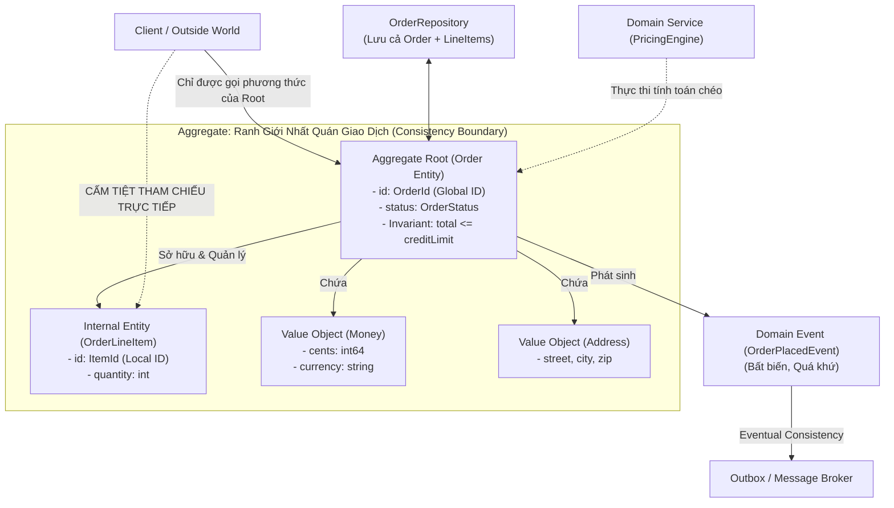
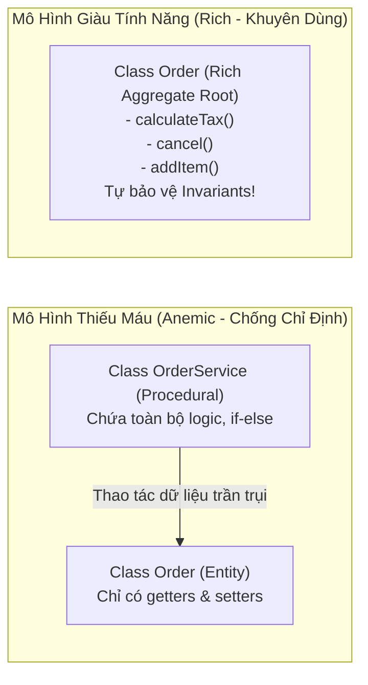

# 4.6. Các Mẫu Chiến Thuật Thiết Kế Hướng Miền (DDD Tactical Patterns)

> [!IMPORTANT]
> **Nếu bạn chỉ được nhớ một điều duy nhất:** Tactical DDD biến hướng đối tượng trở về đúng bản chất nguyên thủy của nó: Đóng gói chặt chẽ dữ liệu và hành vi vào Rich Domain Models; Aggregate Root là người gác cổng duy nhất bảo vệ các bất biến nghiệp vụ (Invariants), và một giao dịch cơ sở dữ liệu chỉ được phép cập nhật duy nhất một Aggregate.

---

## 1. Kiến trúc Tổng quan & Mô hình Tư duy (Mental Model)

### Ẩn dụ Đời sống: Cơ Thể Sinh Học và Ranh Giới Màng Tế Bào
Hãy hình dung hệ thống phần mềm hướng miền giống như cơ thể sống của một sinh vật:
- **Value Object (Phân tử Nước, Glucose, Tế bào Hồng cầu)**: Không có căn cước công dân riêng biệt. Nếu hai phân tử glucose có cấu trúc hóa học giống nhau, chúng hoàn toàn bình đẳng và có thể thay thế cho nhau. Chúng bất biến (Immutable): Bạn không thể "sửa" phân tử nước thành cồn, bạn chỉ có thể tổng hợp ra một phân tử mới.
- **Entity (Một Con Người Cụ Thể)**: Được định danh bằng số Hộ chiếu (Identity / ID). Dù con người đó có già đi, thay đổi màu tóc, cân nặng hay tên gọi, họ vẫn là con người đó.
- **Aggregate Root (Vị Thuyền Trưởng / Bộ Não Chỉ Huy)**: Một gia đình gồm Cha mẹ và các con nhỏ. Thế giới bên ngoài (Trường học, Bệnh viện) chỉ liên hệ và giao dịch thông qua Người Giám hộ (Aggregate Root). Không một người lạ nào ngoài đường được phép vào phòng ngủ điều khiển trực tiếp đứa trẻ (Internal Entity). Thuyền trưởng chịu trách nhiệm bảo vệ an toàn và luật lệ gia đình (Invariants).
- **Domain Event (Tiếng Chuông Báo Động / Hormones Phát Tán)**: Khi một sự kiện quan trọng xảy ra ("Em bé chào đời" - `BabyBorn`), bộ não giải phóng hormones vào dòng máu (Event Bus). Các cơ quan khác (Dạ dày, Phổi) tự điều chỉnh thích nghi một cách phi đồng bộ (Eventual Consistency).



---

## 2. Chi tiết từng Keyword (Under-the-Hood Deep Dive)

### 2.1. Building Blocks Cốt Lõi: Entity, Value Object, Identity & Immutability

#### 1. Entity (Thực Thể)
- Được định danh duy nhất bởi một **Identity (ID)** bất biến trong suốt vòng đời của nó.
- Hai Entity được coi là bình đẳng khi và chỉ khi chúng có cùng ID, bất kể các trường dữ liệu khác có khác nhau hay không.
- Mang trạng thái có thể biến đổi (Mutable State) thông qua các phương thức nghiệp vụ thể hiện ý định (Intent-revealing methods).

#### 2. Value Object (Đối Tượng Giá Trị - VO)
- Không có Identity độc lập. Được xác định duy nhất bởi **Giá trị của các thuộc tính (Structural Equality)** mà nó chứa đựng.
- Nếu hai đối tượng `Money(100, "USD")` được khởi tạo ở hai vùng nhớ heap khác nhau, chúng vẫn hoàn toàn bằng nhau (`money1 == money2`).
- **Tính Bất Biến Tuyệt Đối (Strict Immutability)**: Không có hàm setters. Khi muốn thay đổi, phương thức của VO bắt buộc phải trả về một thực thể mới (ví dụ: `money.add(fee)` trả về một instance `Money` mới).
- **Tự Thẩm Định (Self-Validation)**: Ném exception ngay trong Constructor nếu dữ liệu vi phạm quy tắc (ví dụ: `EmailAddress("invalid")` ném `IllegalArgumentException`).

---

### 2.2. Anemic Domain Model vs Rich Domain Model: Chữa Lành Bệnh "Mô Hình Thiếu Máu"



| Đặc Điểm | Anemic Domain Model (Chống Chỉ Định) | Rich Domain Model (Chuẩn Mực DDD) |
| :--- | :--- | :--- |
| **Bản chất** | Lập trình thủ tục (Procedural) đội lốt các class OOP. | Hướng đối tượng thực thụ (Data + Behavior). |
| **Cấu trúc Entity** | Chỉ chứa các trường dữ liệu và getters/setters công khai. | Chứa logic, ẩn giấu cấu trúc nội bộ, setters bị vô hiệu hóa. |
| **Vị trí của Logic** | Nằm rải rác ở hàng chục các Service, Utility classes. | Nằm tập trung ngay trong Entity và Value Objects. |
| **Bảo vệ Bất biến** | Dễ bị phá vỡ vì bên ngoài có thể gọi `setBalance(-999)`. | Tuyệt đối an toàn; Entity từ chối mọi trạng thái phi lý. |
| **Khả năng Bảo trì** | Cực kỳ kém khi hệ thống lớn dần (Spaghetti code). | Rất cao; code đọc như ngôn ngữ kinh doanh tự nhiên. |

---

### 2.3. Aggregates, Aggregate Root & Transactional Consistency Boundary

#### 1. Khái niệm Aggregate
Một Aggregate là một cụm liên kết chặt chẽ gồm một hoặc nhiều Entities và Value Objects đại diện cho một khái niệm nghiệp vụ hoàn chỉnh.

#### 2. Vai trò của Aggregate Root (AR)
- Là Entity đứng đầu đại diện cho toàn bộ cụm.
- **Quy tắc Vàng của Aggregate (Eric Evans & Vaughn Vernon)**:
  1. **Một cổng vào duy nhất**: Bên ngoài chỉ được giữ con trỏ tham chiếu đến Aggregate Root. Nghiêm cấm tuyệt đối việc Client bên ngoài chọc thẳng vào các Entity con (Internal Entities) bên trong cụm!
  2. **Bảo toàn Invariants**: Mọi thay đổi dữ liệu bên trong cụm phải thông qua các hàm nghiệp vụ của Root. Root có nhiệm vụ kiểm tra và duy trì các điều kiện chân lý nghiệp vụ luôn đúng.
  3. **Tham chiếu giữa các Aggregates**: Một Aggregate không được chứa con trỏ trực tiếp đến một Aggregate khác; nó chỉ được phép lưu trữ **Identity (ID)** của Aggregate kia (ví dụ: `Order` chỉ lưu `customerId`, không lưu đối tượng `Customer`).

#### 3. Ranh Giới Nhất Quán Giao Dịch (Transactional Consistency Boundary)
> **Quy tắc Bất Di Bất Dịch:** Một Database Transaction chỉ được phép nạp và lưu **DUY NHẤT MỘT AGGREGATE ROOT**!

- Nếu bạn cần cập nhật 2 Aggregates cùng lúc (ví dụ: Trừ tiền `Account` và Tạo `Order`), bạn **KHÔNG ĐƯỢC** dùng một Distributed Transaction (2PC) cồng kềnh.
- Thay vào đó: Lưu Aggregate thứ nhất $\to$ Phát tán **Domain Event** $\to$ Aggregate thứ hai tiêu thụ event và cập nhật trạng thái của mình thông qua **Tính Nhất Quán Cuối Cùng (Eventual Consistency)**.

---

### 2.4. Domain Events: Cầu Nối Nhất Quán Cuối Cùng (Eventual Consistency)
- Là một bản ghi bất biến (Immutable Record) mô tả một sự kiện quan trọng trong quá khứ của nghiệp vụ.
- Đặt tên theo thì quá khứ: `OrderPlacedEvent`, `PaymentFailedEvent`, `InventoryReservedEvent`.
- Aggregate Root tích lũy các sự kiện trong một danh sách nội bộ (`_domain_events`). Khi Repository lưu Aggregate xuống Database, các sự kiện này được lấy ra và phát tán vào Message Broker hoặc bảng Transactional Outbox.

---

### 2.5. Domain Services, Repositories và Factories

#### 1. Domain Services (Dịch Vụ Miền)
- Khi một nghiệp vụ quan trọng không thuộc về trách nhiệm tự nhiên của bất kỳ một Entity nào, hoặc liên quan đến sự tương tác giữa nhiều Aggregates khác nhau.
- *Ví dụ*: `FundsTransferDomainService.transfer(fromAccount, toAccount, amount)`. Phương thức này không nên đặt trong `fromAccount` (vì nó không có quyền tự trừ tiền account khác), cũng không nên đặt trong `toAccount`.
- **Phân biệt Domain Service vs Application Service**:
  - *Domain Service*: Chứa logic nghiệp vụ thuần túy, không biết gì về HTTP, DB hay Transactions.
  - *Application Service*: Điều phối Use Case, mở Transaction, gọi Repository và gửi thông báo.

#### 2. Repositories (Kho Lưu Trữ)
- Đóng vai trò như một bộ sưu tập trong bộ nhớ (In-memory Collection) của toàn bộ Aggregate.
- **Chỉ tồn tại Repository cho Aggregate Root**. Tuyệt đối không tạo Repository riêng cho Internal Entity (Không bao giờ có `OrderLineItemRepository`!).

#### 3. Factories (Nhà Máy Tạo Lập)
- Chịu trách nhiệm khởi tạo các Aggregates phức tạp có cấu trúc lồng nhau sâu hoặc đòi hỏi các quy tắc thẩm định khắt khe ngay từ lúc sinh ra.

---

### 2.6. Specification Pattern, Policy Pattern & Side-Effect-Free Functions

#### 1. Specification Pattern (Mẫu Đặc Tả Nghiệp Vụ)
- Đóng gói một quy tắc kiểm tra điều kiện nghiệp vụ (Business Predicate) thành một đối tượng độc lập.
- Cung cấp khả năng kết hợp linh hoạt thông qua các toán tử logic Boolean:
  $$\text{Spec}_{\text{composite}} = \text{Spec}_A \land (\text{Spec}_B \lor \neg \text{Spec}_C)$$
- *Ứng dụng*: Kiểm tra xem khách hàng có đủ điều kiện vay VIP không, lọc dữ liệu tìm kiếm trong Repository.

#### 2. Policy Pattern
- Đóng gói các chính sách kinh doanh thường xuyên thay đổi (ví dụ: Chính sách tính điểm thưởng ngày lễ, chính sách phụ phí vận chuyển).

#### 3. Side-Effect-Free Functions (Hàm Thuần Túy Không Tác Dụng Phụ)
- Các hàm chỉ nhận dữ liệu đầu vào và trả về giá trị mới mà không làm thay đổi trạng thái của bất kỳ đối tượng nào (No mutation), không ghi I/O. Giúp hệ thống cực kỳ dễ kiểm thử và an toàn tuyệt đối trong môi trường đa luồng (Thread-safe).

---

## 3. Thực thi Mã nguồn & Mô phỏng Chuyên sâu (Dual-Engine Implementation)

### 3.1. C++20 Implementation: Complete Order Aggregate Root with Invariant & Event Emission
Chương trình C++20 dưới đây minh họa việc cài đặt một Aggregate Root hoàn chỉnh: Đóng gói Internal Entity, Value Object, tự bảo vệ Invariants và tích lũy Domain Events chuẩn DDD.

```cpp
#include <iostream>
#include <vector>
#include <string>
#include <memory>
#include <stdexcept>
#include <compare>
#include <utility>
#include <chrono>

// ============================================================================
// 1. VALUE OBJECT: Money (Immutable, Self-Validating)
// ============================================================================
class Money {
private:
    int64_t cents_{0};
    std::string currency_{"USD"};

public:
    Money() = default;
    Money(int64_t cents, std::string currency) : cents_(cents), currency_(std::move(currency)) {
        if (cents_ < 0) throw std::invalid_argument("Money cannot be negative!");
    }

    [[nodiscard]] int64_t cents() const noexcept { return cents_; }
    [[nodiscard]] const std::string& currency() const noexcept { return currency_; }

    [[nodiscard]] Money add(const Money& other) const {
        if (currency_ != other.currency_) throw std::invalid_argument("Currency mismatch in Money addition!");
        return Money(cents_ + other.cents_, currency_);
    }

    auto operator<=>(const Money&) const = default;
};

// ============================================================================
// 2. DOMAIN EVENT DEFINITION
// ============================================================================
struct DomainEvent {
    std::string eventName;
    uint64_t aggregateId;
    std::chrono::system_clock::time_point timestamp;
};

// ============================================================================
// 3. INTERNAL ENTITY: OrderLineItem (Local Identity inside Aggregate)
// ============================================================================
class OrderLineItem {
private:
    uint64_t itemId_;
    std::string productSku_;
    int quantity_;
    Money unitPrice_;

public:
    OrderLineItem(uint64_t itemId, std::string sku, int qty, Money price)
        : itemId_(itemId), productSku_(std::move(sku)), quantity_(qty), unitPrice_(price) {
        if (quantity_ <= 0) throw std::invalid_argument("Quantity must be positive!");
    }

    [[nodiscard]] uint64_t id() const noexcept { return itemId_; }
    [[nodiscard]] const std::string& sku() const noexcept { return productSku_; }
    [[nodiscard]] int quantity() const noexcept { return quantity_; }
    [[nodiscard]] Money totalCost() const {
        return Money(unitPrice_.cents() * quantity_, unitPrice_.currency());
    }
};

// ============================================================================
// 4. AGGREGATE ROOT: Order (Transactional Consistency Boundary)
// ============================================================================
class OrderAggregateRoot {
public:
    enum class Status { DRAFT, CONFIRMED, CANCELLED };

private:
    uint64_t orderId_;
    uint64_t customerId_;
    Status status_{Status::DRAFT};
    std::vector<OrderLineItem> items_;
    std::vector<DomainEvent> uncommittedEvents_;

    // CLASS INVARIANT: Tổng giá trị đơn hàng không được vượt quá $50,000 cho tài khoản thường
    static constexpr int64_t kMaxOrderLimitCents = 5'000'000; // $50,000.00

    void verifyInvariants() const {
        Money total = calculateTotal();
        if (total.cents() > kMaxOrderLimitCents) {
            throw std::domain_error("Invariant Violated: Order total exceeds maximum single order limit ($50,000)!");
        }
    }

public:
    OrderAggregateRoot(uint64_t orderId, uint64_t customerId)
        : orderId_(orderId), customerId_(customerId) {
        if (orderId == 0 || customerId == 0) {
            throw std::invalid_argument("Invalid Order or Customer Identity");
        }
    }

    // Rich Domain Behavior: Thêm món hàng và kiểm soát Invariants
    void addLineItem(uint64_t itemId, const std::string& sku, int quantity, Money unitPrice) {
        if (status_ != Status::DRAFT) {
            throw std::logic_error("Cannot mutate an order that is not in DRAFT status!");
        }

        // Tạo internal entity
        items_.emplace_back(itemId, sku, quantity, unitPrice);

        // Kiểm tra Invariant toàn cục của Aggregate
        verifyInvariants();
    }

    // Rich Domain Behavior: Xác nhận đơn hàng và phát sinh Domain Event
    void confirm() {
        if (items_.empty()) {
            throw std::logic_error("Cannot confirm an empty order!");
        }
        if (status_ != Status::DRAFT) {
            throw std::logic_error("Order is already finalized!");
        }

        status_ = Status::CONFIRMED;

        // Phát sinh Domain Event
        uncommittedEvents_.push_back(DomainEvent{
            .eventName = "OrderConfirmedEvent",
            .aggregateId = orderId_,
            .timestamp = std::chrono::system_clock::now()
        });
    }

    [[nodiscard]] Money calculateTotal() const {
        Money total(0, "USD");
        for (const auto& item : items_) {
            total = total.add(item.totalCost());
        }
        return total;
    }

    [[nodiscard]] uint64_t id() const noexcept { return orderId_; }
    [[nodiscard]] Status status() const noexcept { return status_; }
    [[nodiscard]] const std::vector<DomainEvent>& getEvents() const noexcept { return uncommittedEvents_; }
    void clearEvents() noexcept { uncommittedEvents_.clear(); }
};

int main() {
    std::cout << "=== C++20 Tactical DDD Aggregate Root & Domain Event Demo ===\n";

    try {
        OrderAggregateRoot order(1001, 888);
        std::cout << "[Init] Created Order Aggregate Root (ID: 1001) in DRAFT state.\n";

        // Thêm các món hàng thông qua Aggregate Root
        order.addLineItem(1, "MACBOOK-M3-MAX", 1, Money(349900, "USD")); // $3,499.00
        order.addLineItem(2, "STUDIO-DISPLAY", 2, Money(159900, "USD"));  // $3,198.00

        std::cout << "[Item Added] Current Order Total: $" 
                  << (static_cast<double>(order.calculateTotal().cents()) / 100.0) << "\n";

        // Xác nhận đơn hàng
        order.confirm();
        std::cout << "[Order Finalized] Status is now CONFIRMED.\n";

        // Kiểm tra Domain Events được phát sinh
        for (const auto& event : order.getEvents()) {
            std::cout << "  📢 Dispatched Domain Event: " << event.eventName 
                      << " for Aggregate ID: " << event.aggregateId << "\n";
        }

        // Thử nghiệm vi phạm Invariant: Vượt quá hạn mức $50,000
        std::cout << "\n[Invariant Test] Attempting to add items exceeding $50,000 limit...\n";
        OrderAggregateRoot luxuryOrder(1002, 888);
        luxuryOrder.addLineItem(1, "SUPERCOMPUTER-RACK", 20, Money(300000, "USD")); // $60,000.00!

    } catch (const std::exception& ex) {
        std::cout << "  🛡️ Aggregate Invariant Protection Shield: Caught error:\n     " << ex.what() << "\n";
    }

    return 0;
}
```

#### Terminal Output Mẫu (C++20):
```text
=== C++20 Tactical DDD Aggregate Root & Domain Event Demo ===
[Init] Created Order Aggregate Root (ID: 1001) in DRAFT state.
[Item Added] Current Order Total: $6697
[Order Finalized] Status is now CONFIRMED.
  📢 Dispatched Domain Event: OrderConfirmedEvent for Aggregate ID: 1001

[Invariant Test] Attempting to add items exceeding $50,000 limit...
  🛡️ Aggregate Invariant Protection Shield: Caught error:
     Invariant Violated: Order total exceeds maximum single order limit ($50,000)!
```

---

### 3.2. Python 3.11+ Implementation: Specification Pattern for Loan Eligibility Engine
Chương trình Python 3.11+ dưới đây minh họa việc hiện thực hóa **Specification Pattern** với các toán tử logic tổng hợp (`And`, `Or`, `Not`) để thẩm định các chính sách cho vay tài chính phức tạp trong ngân hàng.

```python
from __future__ import annotations
from abc import ABC, abstractmethod
from dataclasses import dataclass

# ============================================================================
# DOMAIN MODEL (CANDIDATE TO EVALUATE)
# ============================================================================
@dataclass(frozen=True)
class LoanApplicant:
    applicant_id: str
    credit_score: int
    monthly_income_usd: float
    has_active_default: bool
    employment_years: float

# ============================================================================
# SPECIFICATION PATTERN BASE & COMPOSITE COMBINATORS
# ============================================================================
class Specification(ABC):
    @abstractmethod
    def is_satisfied_by(self, candidate: LoanApplicant) -> bool:
        """Đánh giá xem candidate có thỏa mãn quy tắc hay không."""
        pass

    def __and__(self, other: Specification) -> Specification:
        return AndSpecification(self, other)

    def __or__(self, other: Specification) -> Specification:
        return OrSpecification(self, other)

    def __invert__(self) -> Specification:
        return NotSpecification(self)


class AndSpecification(Specification):
    def __init__(self, one: Specification, other: Specification):
        self._one = one
        self._other = other

    def is_satisfied_by(self, candidate: LoanApplicant) -> bool:
        return self._one.is_satisfied_by(candidate) and self._other.is_satisfied_by(candidate)


class OrSpecification(Specification):
    def __init__(self, one: Specification, other: Specification):
        self._one = one
        self._other = other

    def is_satisfied_by(self, candidate: LoanApplicant) -> bool:
        return self._one.is_satisfied_by(candidate) or self._other.is_satisfied_by(candidate)


class NotSpecification(Specification):
    def __init__(self, spec: Specification):
        self._spec = spec

    def is_satisfied_by(self, candidate: LoanApplicant) -> bool:
        return not self._spec.is_satisfied_by(candidate)

# ============================================================================
# CONCRETE LEAF SPECIFICATIONS (REUSABLE DOMAIN RULES)
# ============================================================================
class PrimeCreditScoreSpecification(Specification):
    def is_satisfied_by(self, candidate: LoanApplicant) -> bool:
        return candidate.credit_score >= 720

class HighIncomeSpecification(Specification):
    def is_satisfied_by(self, candidate: LoanApplicant) -> bool:
        return candidate.monthly_income_usd >= 8000.0

class NoActiveDefaultSpecification(Specification):
    def is_satisfied_by(self, candidate: LoanApplicant) -> bool:
        return not candidate.has_active_default

class StableEmploymentSpecification(Specification):
    def is_satisfied_by(self, candidate: LoanApplicant) -> bool:
        return candidate.employment_years >= 2.0


if __name__ == "__main__":
    print("=== Python 3.11+ Tactical DDD Specification Pattern Demo ===")

    # Xây dựng chính sách xét duyệt cho vay tín chấp VIP bằng cách kết hợp Boolean:
    # Rule = Không có nợ xấu AND (Điểm tín dụng VIP OR (Thu nhập cao AND Thâm niên ổn định))
    no_default = NoActiveDefaultSpecification()
    prime_score = PrimeCreditScoreSpecification()
    high_income = HighIncomeSpecification()
    stable_job = StableEmploymentSpecification()

    vip_loan_policy = no_default & (prime_score | (high_income & stable_job))

    # Test Case 1: Ứng viên hoàn hảo
    alice = LoanApplicant(
        applicant_id="APPL-01",
        credit_score=750,
        monthly_income_usd=9500.0,
        has_active_default=False,
        employment_years=3.5
    )
    print(f"\n[Evaluating Alice]: Score={alice.credit_score}, Default={alice.has_active_default}")
    print(f"  -> Eligible for VIP Loan: {vip_loan_policy.is_satisfied_by(alice)}")

    # Test Case 2: Điểm tín dụng thấp nhưng thu nhập rất cao và không nợ xấu
    bob = LoanApplicant(
        applicant_id="APPL-02",
        credit_score=680, # Dưới 720
        monthly_income_usd=12000.0, # Thu nhập cao
        has_active_default=False,
        employment_years=4.0
    )
    print(f"\n[Evaluating Bob]: Score={bob.credit_score}, Income=${bob.monthly_income_usd}")
    print(f"  -> Eligible for VIP Loan: {vip_loan_policy.is_satisfied_by(bob)}")

    # Test Case 3: Điểm cao nhưng đang dính nợ xấu (Bị chặn ngay bởi NoActiveDefault)
    charlie = LoanApplicant(
        applicant_id="APPL-03",
        credit_score=800,
        monthly_income_usd=15000.0,
        has_active_default=True, # Vi phạm
        employment_years=5.0
    )
    print(f"\n[Evaluating Charlie]: Score={charlie.credit_score}, Default={charlie.has_active_default}")
    print(f"  -> Eligible for VIP Loan: {vip_loan_policy.is_satisfied_by(charlie)}")
```

#### Terminal Output Mẫu (Python 3.11+):
```text
=== Python 3.11+ Tactical DDD Specification Pattern Demo ===

[Evaluating Alice]: Score=750, Default=False
  -> Eligible for VIP Loan: True

[Evaluating Bob]: Score=680, Income=$12000.0
  -> Eligible for VIP Loan: True

[Evaluating Charlie]: Score=800, Default=True
  -> Eligible for VIP Loan: False
```

---

## 4. Systems Engineering & Production Pitfalls

### Các Cạm Bẫy Thực Chiến (Gotchas & Production Antipatterns)

1. **Cạm Bẫy Cụm Thực Thể Quá Lớn (The Mega-Aggregate Pitfall)**:
   - *Bản chất*: Lập trình viên thiết kế một Aggregate `User` ôm đồm toàn bộ `Profile`, `Orders`, `PaymentMethods`, `AuditLogs`. Mỗi khi một order mới được thêm vào, toàn bộ `User` cùng 10.000 dòng audit log bị nạp lên RAM và khóa bảng database (Optimistic/Pessimistic Locking Concurrency Failures).
   - *Khắc phục*: Thiết kế **Aggregates Nhỏ (Small Aggregates)**: `Order` là một Aggregate độc lập chỉ lưu `userId`. Giữ Aggregate nhỏ nhất có thể, chỉ bao bọc các thuộc tính bắt buộc phải nhất quán tức thì (Atomic Consistency).

2. **Cập Nhật Nhiều Aggregates Trong Một Giao Dịch**:
   - *Bản chất*: Application Service mở một Transaction và gọi liên tiếp `userRepo.save(user)` rồi `accountRepo.save(account)`. Thói quen này phá hủy ranh giới kiến trúc và gây tắc nghẽn chết chóc (Deadlocks) ở tầng database khi có hàng ngàn request đồng thời.
   - *Khắc phục*: Bắt buộc chỉ sửa 1 Aggregate per Transaction; sử dụng Domain Events để đồng bộ các Aggregate còn lại.

3. **Cạm Bẫy N+1 Truy Vấn Khi Nạp Aggregate Bằng ORM**:
   - *Bản chất*: Khi Repository nạp một Aggregate Root có quan hệ 1-N với Internal Entities bằng Lazy Loading, ORM thực hiện 1 truy vấn lấy Root và $N$ truy vấn bổ sung để lấy các dòng con.
   - *Khắc phục*: Sử dụng `Eager Fetching` hoặc kỹ thuật `JOIN FETCH` trong Repository Implementation để nạp toàn bộ cấu trúc Aggregate trong đúng **1 câu lệnh SQL duy nhất**.

4. **Kỹ Thuật Chẩn Đoán & Giám Sát Tactical DDD Bằng CLI**:
   ```bash
   # 1. Đo lường kích thước bộ nhớ của một Aggregate khi serialize sang JSON/Protobuf
   valgrind --tool=massif ./aggregate_benchmark

   # 2. Giám sát tỷ lệ xung đột Optimistic Locking (StaleObjectStateException) trong DB
   grep -i "OptimisticLockingFailure" /var/log/app/backend-service.log | wc -l

   # 3. Quét phát hiện Anemic Domain Models (Classes có getters/setters nhưng thiếu logic)
   pmd check -d src/domain/ -R rulesets/java/design.xml -r pmd-report.xml
   ```

---

## 5. Bảng So sánh & Decision Matrix

### 5.1. So Sánh Entity vs Value Object

| Tiêu Chí Đánh Giá | Entity (Thực Thể) | Value Object (Đối Tượng Giá Trị) |
| :--- | :--- | :--- |
| **Định Danh (Identity)** | Có ID duy nhất toàn cục hoặc cục bộ | **Không có ID** |
| **Bình Đẳng (Equality)** | Bằng nhau theo ID (`this.id == other.id`) | Bằng nhau theo cấu trúc giá trị (`val1 == val2`) |
| **Tính Biến Đổi (Mutability)**| Có thể thay đổi trạng thái (Mutable) | **Bất biến tuyệt đối (Immutable)** |
| **Vòng Đời (Lifecycle)** | Có lịch sử thay đổi kéo dài theo thời gian | Tạm thời; tạo ra dùng rồi vứt bỏ |
| **Hàm Cập Nhật** | Phương thức nghiệp vụ biến đổi nội tại | Phương thức luôn trả về đối tượng mới |
| **Ví Dụ Điển Hình** | `Order`, `Customer`, `BankAccount`, `Invoice` | `Money`, `Email`, `Address`, `DateRange`, `GPSCoordinate` |

### 5.2. Ma Trận Phân Định Trách Nhiệm Giữa Các Tầng Service

| Loại Service | Tầng Kiến Trúc | Trách Nhiệm Cốt Lõi | Ví Dụ Điển Hình |
| :--- | :--- | :--- | :--- |
| **Application Service** | Application Layer | Điều phối Use Case, Transaction, Security, DTO mapping | `CreateOrderService`, `UserLoginService` |
| **Domain Service** | Domain Layer | Thực thi logic nghiệp vụ thuần túy liên quan nhiều Aggregates | `TransferFundsService`, `PricingEngine` |
| **Infrastructure Service** | Infrastructure Layer | Tương tác trực tiếp với phần cứng, mạng và dịch vụ thứ ba | `SmtpEmailSender`, `S3FileStorageService` |
